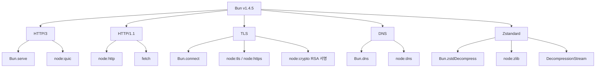
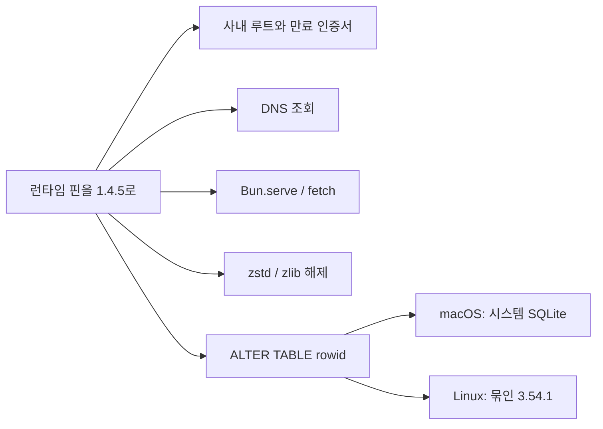

# [종합 보고서] Bun v1.4.5 보안 릴리스 분석 및 실무 예제

> **대상 런타임:** Bun v1.4.5 (`a7733435c`, 전체 `a7733435cf40429e3b35c36072769df2052b80f1`, Darwin arm64)  
> **릴리즈 일자:** 2026년 11월 19일 (공식 블로그, Dylan Conway, 1 min read). GitHub 태그 `bun-v1.4.5`는 같은 날 08:47:28 UTC에 게시됐다.  
> **핵심 키워드:** 보안 릴리스, `lsquic 4.11.2`, `c-ares 1.34.9`, `SQLite 3.54.1`, `llhttp 9.4.4`, `BoringSSL` 2026년 11월, HTTP/3, TLS, DNS, Zstandard, `CERT_HAS_EXPIRED`  
> **검증 환경:** macOS (Apple silicon, arm64), 이 머신의 Bun v1.4.5 공식 바이너리. RSA 서명, 만료 인증서, `bun:sqlite`, Zstandard 왕복, `Bun.dns.lookup`만 이 문서에서 실행했다. HTTP/3 세션, CRL이 붙은 부분 신뢰 체인, 레거시 루트 거부는 재현하지 않았다.


---

## 문서 안내

본 보고서는 **단 하나의 마크다운 파일만으로 Bun v1.4.5의 변경 사항, 동작 원리, 재현 코드**를 파악할 수 있도록 v1.4.4 가이드와 같은 장 구성으로 작성했다.

공식 블로그는 한 페이지다. 그 페이지의 설치 방법, 보안 표면, 의존성 표, SQLite 문장, 버그 수정 다섯 줄을 빠짐없이 옮겼다. 블로그가 번호를 적지 않은 상위 라이브러리 릴리스 노트(c-ares 1.34.9, lsquic 4.11.2, SQLite 3.54.1, llhttp 9.4.4)와 `bun-v1.4.4...bun-v1.4.5` 비교의 패치 커밋은 **상위 출처**로 구분해 적는다. 그 번호를 Bun이 자기 CVE로 발표한 것처럼 합치지 않는다.

---

## 목차 (Table of Contents)

1. [개요 및 릴리즈 핵심 요약](#1-개요-및-릴리즈-핵심-요약)
2. [핵심 업데이트 심층 분석](#2-핵심-업데이트-심층-분석)
   - [2.1 보안 표면](#21-보안-표면)
   - [2.2 의존성 다섯 개](#22-의존성-다섯-개)
   - [2.3 HTTP/3와 lsquic](#23-http3와-lsquic)
   - [2.4 DNS와 c-ares](#24-dns와-c-ares)
   - [2.5 SQLite](#25-sqlite)
   - [2.6 HTTP/1.1과 llhttp](#26-http11과-llhttp)
   - [2.7 TLS, BoringSSL, node:crypto](#27-tls-boringssl-nodecrypto)
   - [2.8 Zstandard와 zlib 패치](#28-zstandard와-zlib-패치)
   - [2.9 같은 태그에 같이 들어간 릴리스 엔지니어링](#29-같은-태그에-같이-들어간-릴리스-엔지니어링)
   - [2.10 블로그에 없고 태그 diff에 있는 동작](#210-블로그에-없고-태그-diff에-있는-동작)
3. [전체 예제 코드 모음](#3-전체-예제-코드-모음)
4. [실무에서 바로 쓰는 조합](#4-실무에서-바로-쓰는-조합)
5. [실제 검증 테스트 실행 결과 로그](#5-실제-검증-테스트-실행-결과-로그)
6. [설치, 업그레이드 및 마이그레이션 권고사항](#6-설치-업그레이드-및-마이그레이션-권고사항)
7. [사실 검토 및 출처](#7-사실-검토-및-출처)

---

## 1. 개요 및 릴리즈 핵심 요약

Bun v1.4.5는 기능 릴리스가 아니다. 블로그 첫 문장은 **“This is a security release.”**다. 사용자에게 새로 열린 API는 없고, 묶여 있던 다섯 라이브러리를 올린다. lsquic, c-ares, SQLite, llhttp, BoringSSL이다. 보안 절이 이름을 거는 프로토콜은 HTTP/3, TLS, DNS이고, 영향 목록에는 HTTP/1.1과 Zstandard도 들어 있다.

GitHub Release는 기여자 세 명을 적는다. @dylan-conway, @Jarred-Sumner, @robobun. 태그를 만든 계정은 robobun이다. `bun-v1.4.4...bun-v1.4.5` 비교는 24커밋, 92파일이다. 그중 사용자 동작과 직접 닿는 커밋은 의존성 갱신, Zstandard 리터럴 꼬리 0 채우기, zlib 윈도 크기 검사다. 나머지는 CI와 릴리스 파이프라인이다.

이 머신의 `process.versions`는 라이브러리 버전을 표와 다르게 보여 준다. `llhttp`만 `"9.4.4"`로 표와 같다. `node`는 `"26.3.0"`이다. 비교에 “Node.js를 26.12.1로 올린다”는 커밋과 “Node.js 26.3.0 보고를 유지한다”는 커밋이 둘 다 있고, 실행 결과는 후자다. `sqlite`는 `"3.51.0"`이다. 블로그가 말한 대로 macOS의 Bun은 시스템 SQLite를 쓴다. `openssl` 필드는 `"1.1.0"`이고, BoringSSL 스냅샷은 `boringssl` 필드의 커밋 `fe703e9faa3bfd22b04eb192066856557b7e015c`로 나온다. `ares`, `zstd`, `zlib`도 버전 번호가 아니라 커밋 해시다.

### v1.4.4 vs v1.4.5 핵심 비교표

| 컴포넌트 | v1.4.4 | v1.4.5 | 분류 |
| :--- | :--- | :--- | :---: |
| **릴리스 성격** | `bun fmt`, install, SQL, `ws`, JSC 1,013커밋 | 보안 패치. 새 사용자 API 없음 | **Security** |
| **HTTP/3** | lsquic 4.9.4 | lsquic 4.11.2. HTTP/3와 `node:quic` 안정성 수정 | **Security** |
| **DNS** | c-ares 1.34.8 | c-ares 1.34.9. 상위 프로젝트는 이 버전을 보안 릴리스로 부름 | **Security** |
| **SQLite** | 3.53.4를 묶음. macOS는 시스템 라이브러리 | 3.54.1을 묶음. `rowid` / `oid` / `_rowid_` ALTER 금지, DEFAULT 식의 authorizer. macOS는 그대로 시스템 라이브러리 | **Behavior** |
| **HTTP/1.1** | llhttp 9.4.2 | llhttp 9.4.4 | **Dep** |
| **TLS** | BoringSSL 2026년 8월 | BoringSSL 2026년 11월. RSA 해시 네 종류, 만료 인증서 코드, CRL이 있는 부분 신뢰 체인, 사용자 루트 검사 | **Security / Compat** |
| **압축** | 의존성 표에 없음 | 블로그 영향 목록에 Zstandard와 `node:zlib`, `DecompressionStream`. 비교에는 zstd·zlib 패치 커밋이 있음 | **Security** |

업그레이드가 닿는 길을 블로그의 영향 목록 그대로 그리면 이렇다.



---

## 2. 핵심 업데이트 심층 분석

### 2.1 보안 표면

블로그 Security 절의 전문은 두 문장이다.

> This release includes security fixes for HTTP/3, TLS and DNS. These protocols, APIs and commands are affected:

그 다음 목록을 토큰 그대로 적으면 다음과 같다.

`HTTP/3`, `HTTP/1.1`, `TLS`, `DNS`, `Zstandard`, `Bun.serve`, `Bun.connect`, `Bun.dns`, `Bun.zstdDecompress`, `node:tls`, `node:https`, `node:http`, `node:quic`, `node:dns`, `node:zlib`, `fetch`, `DecompressionStream`

블로그는 CVE 번호, 심각도, 악용 여부를 적지 않는다. “벤더가 보안 릴리스라고 부른다”가 공식 근거의 전부다. 프로토콜 세 개(HTTP/3, TLS, DNS)와 영향 목록(HTTP/1.1, Zstandard 포함)이 글 안에서 어긋나 보이지 않게, 이 문서도 둘을 한 문장으로 합치지 않는다.

`node:quic`를 이 머신에서 import하면 실험 기능 경고가 먼저 나온다. export는 `QuicEndpoint`, `QuicError`, `QuicSession`, `QuicStream`, `connect`, `listen`, `constants`다. import가 된다는 사실과, HTTP/3 세션 버그가 고쳐졌다는 사실은 별개다. 후자는 이 문서에서 세션을 열어 확인하지 않았다.

### 2.2 의존성 다섯 개

블로그 표:

| 의존성 | Bun v1.4.4 | Bun v1.4.5 |
| :--- | :--- | :--- |
| lsquic | 4.9.4 | 4.11.2 |
| c-ares | 1.34.8 | 1.34.9 |
| SQLite | 3.53.4 | 3.54.1 |
| llhttp | 9.4.2 | 9.4.4 |
| BoringSSL | August 2026 | November 2026 |

이 바이너리의 `process.versions`와 표를 나란히 두면 해석이 갈린다.

| 필드 | 이 머신이 보고한 값 | 읽는 법 |
| :--- | :--- | :--- |
| `llhttp` | `9.4.4` | 표와 같다 |
| `sqlite` | `3.51.0` | macOS 시스템 SQLite. 묶인 3.54.1이 아니다 |
| `node` | `26.3.0` | 호환 버전 표기. 26.12.1로 바뀌어 보고되지 않는다 |
| `openssl` | `1.1.0` | BoringSSL이 내놓는 호환 문자열. 8월/11월 스냅샷 이름이 아니다 |
| `boringssl` | `fe703e9faa3bfd22b04eb192066856557b7e015c` | 이 바이너리에 박힌 BoringSSL 커밋 |
| `ares` | `0b88066f79ac9745d6819899f1794df91b73c873` | 버전 번호 1.34.9가 아니라 소스 커밋 |
| `zstd` | `f8745da6ff1ad1e7bab384bd1f9d742439278e99` | 소스 커밋. 그 위에 Bun 패치가 있다 |
| `zlib` | `12731092979c6d07f42da27da673a9f6c7b13586` | 소스 커밋. 그 위에 Bun 패치가 있다 |

### 2.3 HTTP/3와 lsquic

Bun이 적은 문장은 “HTTP/3와 `node:quic`의 여러 안정성 문제를 고쳤다”이다. 버전은 lsquic 4.9.4에서 4.11.2다.

상위 lsquic v4.11.2 릴리스 노트(2026-11-16, `f52c001`)가 그 태그에 적는 수정은 두 개다.

- HTTP/3 스트림이 QPACK 때문에 헤더가 막혀 있는 동안 계속 읽히지 않게 하고, 잘린 헤더 블록은 거절한다. 상위 권고는 GHSA-5vg5-79mr-8863이다.
- path table이 가득 찼을 때 이미 검증된 경로를 유지한다. 복호화되지 않는 패킷이 대기 중인 트래픽의 경로를 바꾸지 못하게 하는 수정이다. 상위 권고는 GHSA-fg6p-g89q-65wr이다.

4.9.4와 4.11.2 사이의 중간 태그를 이 문서에서 한 줄씩 다시 읽지는 않았다. Bun 블로그는 그 사이를 “various stability issues”로만 부른다. 두 GHSA를 Bun의 CVE 목록인 것처럼 옮기지 않는다. lsquic이 자기 4.11.2 태그에 적은 수정이다.

`Bun.serve`가 HTTP/3를 받으려면 리스너가 QUIC 쪽 설정을 열어야 한다. 1.4.5가 그 API 모양을 바꾸었다는 문장은 블로그에 없다. 아래 코드는 모듈이 로드되는지만 보여 주고, 엔드포인트를 열지는 않는다.

```ts
const quic = await import("node:quic");
// ExperimentalWarning: quic is an experimental feature and might change at any time
// QuicEndpoint, QuicSession, QuicStream, connect, listen, constants
void quic.listen;
```

### 2.4 DNS와 c-ares

Bun 블로그는 “DNS 보안 수정”과 `Bun.dns`, `node:dns`만 적는다. 번호는 c-ares 자신의 1.34.9 릴리스(2026-10-19)에 있다. 그 글은 자신을 보안 릴리스라고 부르고, 아래 열한 건을 적는다.

| 상위 권고 | c-ares 1.34.9가 적은 내용 |
| :--- | :--- |
| GHSA-wpr3-8q3r-4q8c | 연결 실패 뒤 조회를 취소하면 메모리가 깨질 수 있음 |
| GHSA-fqh5-3x7m-wp44 | 질의와 다른 서버에서 온 DNS 응답을 받아들일 수 있었음 |
| GHSA-97vq-4mxv-7vhm | 실패한 연결을 닫은 뒤 lookup use-after-free |
| GHSA-rf6g-ww74-97qh | 콜백에서 조회를 취소하거나 채널을 닫을 때 use-after-free |
| GHSA-mw23-pfg6-2x9r | 소켓 상태 콜백이 반환된 뒤 연결 use-after-free |
| GHSA-v33j-65h4-4ch8 | 서버 상태 콜백에서 조회를 취소할 때 use-after-free |
| GHSA-pj7p-v3cw-hq66 | 콜백 안에서 DNS 서버를 바꿀 때 서버 레코드 use-after-free |
| GHSA-grv7-fq5q-9vfc | 애플리케이션이 아직 읽는 캐시 응답의 use-after-free |
| GHSA-ph6c-3cvx-mq6v | 다른 스레드가 서버를 바꾸는 동안 `ares_dup()` / `ares_save_options()`의 버퍼 오버플로 |
| GHSA-cfcv-8v2j-qj6r | prefix 길이가 붙은 숫자 IPv6 이름에서 초기화되지 않은 메모리 반환 |
| GHSA-wrgc-prmw-27xh | 쿼리 캐시가 다른 EDNS 옵션으로 얻은 답을 돌려줄 수 있었음 |

같은 노트의 동작 변경도 Bun 앱에 간접으로 닿을 수 있다. 캐시에서 꺼낸 답의 TTL은 처음 받은 값이 아니라 남은 TTL이다. UDP 응답은 주소뿐 아니라 서버 포트도 맞아야 한다. `ares_inet_pton()`은 `/bits` 프리픽스를 거절하고, 파싱 실패 시 `-1` 대신 `0`을 반환한다. 64KB를 넘는 DNS 메시지는 `ares_dns_write()`가 거절한다. `resolv.conf`의 인라인 주석은 값에서 벗겨지고, 터무니없는 retry/attempts 값은 무시된다.

JavaScript에서 이 채널을 건드리는 표면은 `Bun.dns`와 `node:dns`다. 이 머신의 `Bun.dns.lookup("example.com")`은 IPv6 두 개와 IPv4 두 개를 돌려줬다. 주소는 5장의 스냅샷이고, DNS 답이므로 나중에 바뀐다.

```ts
const records = await Bun.dns.lookup("example.com");
// [{ address, family: 6, ttl }, { address, family: 4, ttl }, ...]

const v4 = await Bun.dns.lookup("example.com", { family: 4 });
```

`node:dns`의 `lookup`도 같은 c-ares 경로를 탄다. 블로그가 둘을 따로 적은 이유다.

```ts
import { lookup } from "node:dns/promises";

const one = await lookup("example.com");
```

### 2.5 SQLite

블로그가 SQLite에 대해 적은 문장은 두 개다.

1. SQLite 3.54는 `ALTER TABLE`로 `rowid`, `oid`, `_rowid_`라는 열을 추가·이름 변경·삭제하지 못하게 한다.
2. `DEFAULT` 식 안의 함수에 대해 `setAuthorizer()` 콜백을 호출한다.
3. macOS에서 Bun은 시스템 SQLite를 쓴다.

3번은 이 머신에서 그대로 확인된다. `bun:sqlite`의 `sqlite_version()`과 `process.versions.sqlite`가 둘 다 `3.51.0`이다. 그래서 3.54의 ALTER 거부가 **이 Mac에서는 아직 동작하지 않는다.** `ALTER TABLE t ADD COLUMN rowid`는 성공했다. `nickname`을 `rowid`로 바꾸는 문장은 거절됐지만, 이유는 3.54의 새 규칙이 아니라 `duplicate column name: rowid`다. 시스템 SQLite가 암시적 rowid와 부딪힌 결과로 읽는 것이 맞다.

Linux·Windows에서 Bun이 묶인 3.54.1을 쓰면 블로그의 거부가 적용된다. 마이그레이션이 `rowid`라는 실제 열을 만들거나 지우거나 그 이름으로 바꾸면, 그 플랫폼에서만 업그레이드 뒤 실패한다. macOS 개발 머신에서 통과했다고 리눅스 CI가 통과하는 것은 아니다.

```ts
import { Database } from "bun:sqlite";

const db = new Database(":memory:");
db.query("select sqlite_version() as v").get();
// 이 Mac: { v: "3.51.0" }

db.run("create table t (name text)");
db.run("alter table t add column rowid text"); // 3.51.0에서는 성공. 3.54에서는 오류
```

3.54.0(2026-10-09) 노트에서 Bun 문장과 직접 맞는 항목은 3번과 11번이다. 11번은 authorizer 콜백이 `CREATE TABLE`의 `DEFAULT` 절에 있는 SQL 함수에 대해 호출된다는 것이다. 테이블을 만들 때와 DEFAULT가 실제로 쓰일 때 호출되고, 데이터베이스를 열며 스키마를 읽을 때는 호출되지 않는다. `bun:sqlite`가 `sqlite3_set_authorizer`를 JavaScript로 열어 두었다는 문장은 블로그에 없다. authorizer를 네이티브로 붙인 임베딩만 이 호출 횟수 변화를 본다.

3.54.1(2026-10-16) 패치 노트는 32비트 빌드의 힙 버퍼 오버플로를 고친다고 적고, **64비트 빌드는 이 문제의 대상이 아니라고** 명시한다. 이 문서의 arm64 바이너리는 64비트다. CLI 프롬프트, `diskused()`, `%j` printf, Windows XP 지원 종료 같은 3.54.0 항목은 `sqlite3` CLI와 Windows 빌드 이야기라 Bun의 JS API 릴리스 노트에 없다.

`setAuthorizer`를 쓰는 쪽을 SQL로만 보면, DEFAULT 식의 함수가 새로 검사 대상이 된다.

```sql
CREATE TABLE account (
  id INTEGER PRIMARY KEY,
  created TEXT DEFAULT (datetime('now'))
);
```

3.54에서는 `datetime`이 authorizer에 한 번 더 올라간다. 함수 이름을 막는 authorizer라면, 예전에는 통과하던 이 `CREATE TABLE`이 거절될 수 있다.

### 2.6 HTTP/1.1과 llhttp

블로그 표는 llhttp 9.4.2에서 9.4.4다. 이 바이너리의 `process.versions.llhttp`도 `9.4.4`다. 영향 목록의 `node:http`와 `fetch`가 이 파서 위에 있다.

llhttp v9.4.4 릴리스(2026-11-13)가 적는 코드 변경은 두 가지다. `QUERY` 메서드를 RFC 10008 기준으로 표준 메서드로 다시 분류한 것, 그리고 relaxed header 값을 빠른 스캐너로 되돌린 것이다. 후자에는 회귀 테스트가 따라온다. 의존성 범프 커밋은 릴리스 노트용 잡무가 대부분이다.

Bun 블로그는 `QUERY`를 새 API로 소개하지 않는다. 파서가 그 메서드를 표준으로 보게 됐다는 것은 상위 릴리스의 문장이다. HTTP/1.1 요청을 읽는 서버는 `Bun.serve`와 `node:http` 둘 다 이 파서를 지난다.

```ts
const server = Bun.serve({
  port: 0,
  hostname: "127.0.0.1",
  fetch(req) {
    return new Response(req.method);
  },
});

const method = await (await fetch(server.url)).text();
// GET
await server.stop(true);
```

### 2.7 TLS, BoringSSL, node:crypto

BoringSSL은 2026년 8월 스냅샷에서 2026년 11월 스냅샷으로 올라갔다. 비교의 해당 커밋은 `219d51e` (`deps: upgrade BoringSSL to upstream 148a7b1f`)이고, 바로 다음 `e0cf301`이 포크의 master HEAD에 다시 고정한다. 그래서 블로그의 “November 2026”과 이 바이너리의 `process.versions.boringssl` 해시를 한 커밋으로 단정하지 않는다. 해시 `fe703e9f…`는 실행 파일이 보고한 값이다.

블로그 Bugfixes 절은 다섯 줄이다. 첫 줄은 HTTP/3라 2.3에 두었고, 나머지 넷은 TLS와 `node:crypto`다.

#### RSA 서명 해시

`node:crypto`에서 SHA-3, SHA-512/224, SHA-512/256, RIPEMD-160로 RSA 서명을 만들면 `ERR_OSSL_RSA_UNKNOWN_ALGORITHM_TYPE`이 나던 것을 고쳤다. 이 머신에서는 다섯 해시 모두 서명과 검증이 끝났다. 대조로 넣은 SHA-256도 그대로다. 모듈러스 2048의 서명은 256바이트였다.

```ts
import crypto from "node:crypto";

const { privateKey, publicKey } = crypto.generateKeyPairSync("rsa", {
  modulusLength: 2048,
});
const data = Buffer.from("bun-1.4.5");

for (const hash of ["sha3-256", "sha3-512", "sha512-224", "sha512-256", "ripemd160"]) {
  const signature = crypto.sign(hash, data, privateKey);
  const ok = crypto.verify(hash, data, publicKey, signature);
  // 1.4.5: ok === true, signature.length === 256
  void ok;
}
```

1.4.4에서는 이 호출이 throw였다. 이 문서는 1.4.4 바이너리를 다시 깔아 그 throw를 재현하지 않았다. “고쳤다”는 문장은 블로그의 것이고, 1.4.5에서 성공한다는 문장만 이 머신의 로그다.

#### 알 수 없는 발급자의 만료 인증서

만료된 인증서인데 발급자를 모르면, 이제 Node.js와 같이 `CERT_HAS_EXPIRED`를 보고한다. 이 머신은 2020-01-01부터 2020-01-02까지 유효했던 자체 서명 인증서로 `Bun.serve` TLS를 열고, `node:tls`가 `rejectUnauthorized: true`로 붙게 했다. 오류 코드는 `CERT_HAS_EXPIRED`, 메시지는 `certificate has expired`였다.

```bash
openssl req -x509 -newkey rsa:2048 \
  -keyout key.pem -out cert.pem -nodes \
  -subj "/CN=expired.local" \
  -addext "subjectAltName=DNS:localhost,IP:127.0.0.1" \
  -not_before 20200101000000Z -not_after 20200102000000Z
```

```ts
import tls from "node:tls";
import { readFileSync } from "node:fs";

const cert = readFileSync("cert.pem");
const key = readFileSync("key.pem");

const server = Bun.serve({
  port: 0,
  hostname: "127.0.0.1",
  tls: { cert, key },
  fetch() {
    return new Response("ok");
  },
});

await new Promise<void>((resolve, reject) => {
  const socket = tls.connect(
    {
      host: "127.0.0.1",
      port: server.port!,
      servername: "localhost",
      rejectUnauthorized: true,
    },
    () => {
      socket.end();
      reject(new Error("expired certificate was accepted"));
    },
  );
  socket.on("error", (error) => {
    const err = error as NodeJS.ErrnoException;
    console.log(err.code); // CERT_HAS_EXPIRED
    resolve();
  });
});

await server.stop(true);
```

클라이언트가 이 인증서를 `ca`로 신뢰하면 코드가 달라질 수 있다. 블로그가 한정한 경우는 “unknown issuer”다. 예제는 신뢰 저장소에 넣지 않은 자체 서명이다.

#### `allowPartialTrustChain`과 CRL

`allowPartialTrustChain`과 `crl`을 같이 주면, 체인은 이제 Node.js처럼 **스스로 서명한 인증서에서 끝나야** 한다. 중간 인증서에서 끊긴 체인을 부분 신뢰로 넘기던 구성은 1.4.5에서 거절된다.

이 문서는 루트·중간·리프와 CRL 파일을 만들어 그 거절을 실행하지 않았다. 비교 커밋 `219d51e`는 `test/js/node/tls/fixtures/trust-anchor/`에 그 검증용 인증서와 CRL을 넣었고 `node-tls-cert.test.ts`를 고쳤다. 재현은 그 테스트의 몫으로 남긴다. 호출 모양만 적으면 다음과 같다.

```ts
import tls from "node:tls";

tls.connect({
  host: "internal.example",
  port: 443,
  ca: rootOrIntermediatePem,
  crl: crlPem,
  allowPartialTrustChain: true,
});
```

`crl` 없이 `allowPartialTrustChain`만 쓰는 경우는 블로그 문장의 대상이 아니다.

#### 사용자 루트 인증서

사용자 루트는 검사가 더 엄격해져서, 일부 레거시 루트는 거절된다. **Bun이 묶어 둔 루트는 영향받지 않는다.** 사내 CA를 `NODE_EXTRA_CA_CERTS`나 `ca` 옵션으로 넣었다면, 그 루트의 확장(CA 비트, key usage, 알 수 없는 critical 확장)이 1.4.5의 BoringSSL에서 탈락할 수 있다. 공개 웹으로 나가는 `fetch`의 기본 신뢰 저장소는 블로그 문장상 그대로다.

```ts
import tls from "node:tls";

tls.connect({
  host: "intranet.example",
  port: 443,
  ca: corporateRootPem, // 레거시 루트면 1.4.5에서 거절될 수 있다
});
```

이 거절을 일부러 실패시키는 레거시 루트는 이 머신에 없어서 로그가 없다.

### 2.8 Zstandard와 zlib 패치

의존성 표에는 Zstandard와 zlib 행이 없다. 블로그 영향 목록에는 `Zstandard`, `Bun.zstdDecompress`, `node:zlib`, `DecompressionStream`이 있다. 태그 비교에서 그에 해당하는 커밋은 둘이다.

`01b6345` (`zstd: zero the bytes after the decoded literals`, #49287)는 `patches/zstd/literals-buffer-tail.patch`를 더한다. 디코드된 리터럴 뒤의 `WILDCOPY_OVERLENGTH` 바이트를 0으로 채우고, Huffman 디코드가 실패하면 리터럴을 옮기기 **전에** 반환한다. 패치 주석은 상위 zstd가 같은 수정을 품으면 이 패치를 지우라고 적는다.

`6c8c828` (`zlib: check the window size of a header before storing it`)는 `patches/zlib/inflate-window-size.patch`를 더한다. zlib 헤더의 윈도 크기(`CINFO`)가 `MAX_WBITS`보다 크거나, 이미 정해진 `wbits`보다 크면 **그 값을 `state->wbits`에 저장하기 전에** 거절한다. 잘못된 CINFO가 상태에 남는 길을 막는다. 패치는 zlib-ng `1bfa59ae1`을 가리킨다.

둘 다 “손상된 입력을 어떻게 거절하는가”의 수정이다. 정상적인 압축 왕복이 바뀌었다는 문장은 없다. 이 머신에서 짧은 문자열의 Zstandard 압축과 해제는 원문을 그대로 돌려줬다. 압축 결과는 24바이트였다.

```ts
const payload = "hello bun 1.4.5";
const compressed = Bun.zstdCompressSync(payload);
const restored = new TextDecoder().decode(Bun.zstdDecompressSync(compressed));
// restored === payload
```

`node:zlib`에도 `zstdDecompressSync`와 `createZstdDecompress`가 있다. `DecompressionStream`은 같은 디코더 계열로 블로그 목록에 올라 있다.

```ts
import { zstdDecompressSync, zstdCompressSync } from "node:zlib";

const encoded = new TextEncoder().encode("hello bun 1.4.5");
const back = zstdDecompressSync(zstdCompressSync(encoded));
```

깨진 프레임을 넣어 패치 전후의 메모리 차이를 재현하는 코드는 넣지 않는다. 패치가 막는 입력은 보안 버그의 입력이다.

### 2.9 같은 태그에 같이 들어간 릴리스 엔지니어링

24커밋 비교에는 사용자 API와 무관한 릴리스 작업이 많다. 블로그는 이것을 적지 않는다. 태그를 읽을 때 “24커밋이면 기능이 24개”로 세지 않도록 종류만 적는다.

- Homebrew 잡, Docker 다운로드, Windows 서명 옵션, 릴리스 환경, npm trusted publishing, AWS·Azure 이미지 조회, Linux 이미지에서 SSH 제거, 릴리스 브랜치에서 빌드, 기여자 목록을 diff 없이 만들기, xwin 0.10.0.
- `d3ffe9f`가 버전을 1.4.5로 올린다.
- `2d12481`은 Bun 1.4.4로 빌드하고 Node.js 헤더를 26.12.1로 올린다. `a773343`은 보고 버전을 Node.js 26.3.0으로 유지한다. 이 바이너리의 `process.versions.node`는 `26.3.0`이다. `scripts/build/deps/nodejs-headers.ts`의 `NODEJS_VERSION`도 `"26.3.0"`으로 고정되고, `NODEJS_ABI_VERSION`은 `"147"`, `NODEJS_V8_VERSION`은 `"14.6.202.34-node.20"`이다. CI 이미지의 `node` 바이너리가 26.12.1을 찍는 테스트 수정은 Bun이 보고하는 버전이 아니다.

### 2.10 블로그에 없고 태그 diff에 있는 동작

블로그 본문은 여기서 끝이다. `bun-v1.4.4...bun-v1.4.5`의 92파일을 다시 펼쳐 보니, 사용자 동작에 닿는데 블로그가 한 줄도 적지 않은 변경이 있다. 없는 것도 같이 적는다. HTTP/3 헤더 크기 제한을 다루는 PR `#46392`는 이 24커밋 안에 없다.

#### 압축된 DNS RDATA 패치를 걷어 냄

1.4.4는 c-ares 1.34.8 위에 `patches/cares/accept-rdata-compression.patch`를 얹었다. 1.34.8이 RFC 3597을 따라 SRV·NAPTR 같은 RDATA 안의 이름 압축을 거절하면서, 실제로 압축해서 보내는 리졸버에서 `dns.resolveSrv()`가 `EBADRESP`가 됐기 때문이다. 1.34.9는 그 압축을 다시 받는다(c-ares PR `#1326`, RFC 3597 4절). 그래서 1.4.5는 로컬 패치를 삭제하고 업스트림 파서에 맡긴다. 테스트는 SRV에 더해 `dns.resolveNaptr`의 압축된 replacement도 통과해야 한다고 적는다.

```ts
import { Resolver } from "node:dns";

const resolver = new Resolver({ timeout: 1000, tries: 1 });
resolver.setServers(["127.0.0.1:53"]);
resolver.resolveSrv("_test._tcp.example.test", (error, records) => {
  // 압축된 SRV 타깃을 EBADRESP로 거절하지 않아야 한다
  void error;
  void records;
});
resolver.resolveNaptr("naptr.example.test", (error, records) => {
  void error;
  void records;
});
```

이 호출이 성공하려면 위 테스트처럼 압축 포인터를 담은 답을 직접 주는 서버가 필요하다. 공개 리졸버로 이 문서에서 재현하지 않았다.

#### 빈 `Transfer-Encoding`과 llhttp 로컬 패치 제거

llhttp 소스는 이제 Node.js v26.13.1이 벤더한 9.4.4와 바이트 단위로 같다고 README가 적는다. 1.4.4 README에 있던 로컬 패치, 즉 lenient header 값 아래에서 NUL이 `llhttp_execute`를 무한 루프에 넣던 것을 막는 패치는 빠졌다. 업스트림이 고쳤기 때문에 다시 적용하지 않는다는 뜻이다.

1.4.5가 새로 고정하는 파서 동작이 하나 더 있다. 값이 비어 있는 `Transfer-Encoding`은 `HPE_INVALID_TRANSFER_ENCODING`이다. 이 머신에서 `POST` 요청으로 실행하면 예외가 난다. `reason`은 `Empty Transfer-Encoding`이다.

```ts
import { HTTPParser } from "node:_http_common";

const parser = new HTTPParser();
parser.initialize(HTTPParser.REQUEST, {});
parser.execute(Buffer.from("POST / HTTP/1.1\r\nTransfer-Encoding:\r\nContent-Length: 0\r\n\r\n"));
// code: HPE_INVALID_TRANSFER_ENCODING
// reason: Empty Transfer-Encoding
```

1.4.4에서 같은 입력이 통과했는지는 그 바이너리를 다시 깔지 않아 확인하지 않았다. 테스트가 이 태그에 새로 들어왔다는 사실과, 1.4.5가 거절한다는 사실만 적는다.

#### `node:http2` 옵션 검사 순서

`strictSingleValueFields` 검사 위치가 `unknownProtocolTimeout`보다 앞으로 옮겨 갔다. Node.js 26.11.0부터의 순서에 맞춘 것이다. 잘못된 문자열과 범위 밖 숫자를 같이 주면, `createServer`와 `connect` 모두 먼저 불리언 타입 오류를 낸다. 이 머신에서 둘 다 `ERR_INVALID_ARG_TYPE`이었다.

```ts
import http2 from "node:http2";

const options = { strictSingleValueFields: "yes" as unknown as boolean, unknownProtocolTimeout: -1 };

http2.createServer(options);
// ERR_INVALID_ARG_TYPE: options.strictSingleValueFields must be a boolean

http2.connect("http://127.0.0.1", options);
// 같은 코드. 1.4.4의 createServer는 unknownProtocolTimeout의 RangeError가 먼저였다.
```

#### QUIC 혼잡 제어 번호와 CONNECTION_CLOSE 패치

lsquic 4.11.2에서 `es_cc_algo`의 번호가 바뀌었다. 주석 기준으로 0은 기본값(BBRv1), 1은 Cubic, 2는 BBRv1이다. 예전 주석은 0이 Adaptive(내부 3)로 이어지고 3이 BBRv1이라고 적었다. `node:quic`의 문자열 매핑은 그대로다. `"cubic"`과 `"reno"`는 1, `"bbr"`은 2다. Reno는 여전히 없고 Cubic으로 붙는다. 숫자를 직접 넣던 코드만 영향이 있다. 벤치 도구 `h3blast`도 BBRv1 상수를 3에서 2로 바꿨다.

`patches/lsquic/connection-close-pns.patch`는 짧아졌다. 핸드셰이크 진행에 따라 패킷 번호 공간을 고르던 덩어리는 빠지고, 남은 설명은 이렇다. 서버는 핸드셰이크 중에 받은 `CONNECTION_CLOSE`의 코드를 보고하고, 호환되는 버전 전환 전에 보낸 것은 복호화한다. 블로그의 “HTTP/3 안정성”에 해당하는 패치 설명이지, 새 옵션은 아니다.

#### 만료된 중간 인증서가 유효한 인증서를 가리지 않음

`node:quic` 테스트가 하나 늘었다. `ca`에 만료된 중간 인증서가 있어도, 서버가 보내는 유효한 중간 인증서를 가리면 안 된다. `session.opened`의 `validationErrorCode`는 `undefined`여야 한다. 상수 `X509_V_FLAG_IGNORE_EXPIRED_TRUST_ANCHORS`는 `0x2000000`에서 `0x40000000`으로 바뀌었고, shim이 그 값을 BoringSSL 헤더와 맞춘다. 블로그가 말한 “사용자 루트 검사가 더 엄격하다”와 “만료 인증서는 `CERT_HAS_EXPIRED`”의 옆에 있는 동작이다. 이 문서에서 QUIC 세션으로 재실행하지는 않았다.

PR `#49144`는 `allowPartialTrustChain` 쪽을 이렇게 구현한다고 적는다. 체인 구성에서 `X509_V_FLAG_PARTIAL_CHAIN`을 지우고, 검증이 성공한 뒤에도 스스로 서명하지 않은 신뢰 앵커는 `X509_V_FLAG_CRL_CHECK_ALL`이 켜져 있으면 검사된 CRL이 필요하다. 2.7의 블로그 문장과 같은 수정이다.

#### 해시 일회성 함수 제거는 내부 변경

BoringSSL이 `SHA1()`과 `SHA256()` 일회성 함수를 `static inline`으로 바꿔서, Bun의 Rust 해시는 `Init` / `Update` / `Final`만 쓴다. 컴파일 목록에는 `cpace.cc`, `p_keccak.cc`, `p_slhdsa.cc`가 추가된다. 이 바이너리의 `crypto.getHashes()`에는 keccak, SLH-DSA, CPace가 없다. 소스에 들어갔다는 것과 JavaScript로 열렸다는 것은 다르다.

---

## 3. 전체 예제 코드 모음

예제 1–4는 이 머신의 Bun 1.4.5로 실행했다. 예제 5는 블로그와 테스트 트리의 형태만 옮긴 것이고 실행하지 않았다.

### 예제 1. 업그레이드와 버전 확인

블로그의 업그레이드 명령은 하나다.

```bash
bun upgrade
```

확인:

```bash
bun --version    # 1.4.5
bun --revision   # 1.4.5+a7733435c
```

전체 리비전은 런타임이 보고한다.

```ts
console.log(Bun.version); // 1.4.5
console.log(Bun.revision); // a7733435cf40429e3b35c36072769df2052b80f1
console.log(process.versions.llhttp); // 9.4.4
console.log(process.versions.sqlite); // macOS에서는 시스템 버전. 이 머신: 3.51.0
console.log(process.versions.node); // 26.3.0
```

### 예제 2. RSA 서명

예제 전문은 2.7의 첫 코드 블록이다. 1.4.5에서 `sha3-256`, `sha3-512`, `sha512-224`, `sha512-256`, `ripemd160`가 모두 `verify-ok`였다.

### 예제 3. 만료된 자체 서명 인증서

예제 전문은 2.7의 openssl 명령과 `tls.connect` 블록이다. 결과 코드는 `CERT_HAS_EXPIRED`다.

### 예제 4. SQLite 버전과 ALTER, Zstandard 왕복, DNS

```ts
import { Database } from "bun:sqlite";

const db = new Database(":memory:");
console.log(db.query("select sqlite_version() as v").get());

const text = "hello bun 1.4.5";
const compressed = Bun.zstdCompressSync(text);
console.log(new TextDecoder().decode(Bun.zstdDecompressSync(compressed)) === text);

const records = await Bun.dns.lookup("example.com");
console.log(records.map((record) => record.family));
```

macOS에서 첫 줄이 `3.54.1`이 아니면, `rowid` ALTER 거부는 그 머신에 아직 없다.

### 예제 5. 이 문서에서 실행하지 않음

`allowPartialTrustChain`과 `crl`을 같이 주는 `tls.connect`, 레거시 사용자 루트, `node:quic`의 `listen`으로 여는 HTTP/3 세션, 손상된 zstd·zlib 입력은 2.3·2.7·2.8의 설명까지만 있다.

---

## 4. 실무에서 바로 쓰는 조합

1.4.5는 동작을 더하는 릴리스가 아니라 교체하는 릴리스다. 배포 단위로 런타임을 고정한 곳이 대상이다.

```bash
bun upgrade
bun --version
```

Docker 이미지는 태그 `oven/bun`이 최신을 따라간다. 1.4.5를 고정하려면 버전 태그를 쓴다. 블로그가 적은 실행 형태는 아래다.

```bash
docker pull oven/bun
docker run --rm --init --ulimit memlock=-1:-1 oven/bun
```

CI에서 버전을 파일로 고정했다면 그 핀을 1.4.5로 올린다. 업그레이드 뒤 볼 테스트는 새 기능 테스트가 아니라 다음 네 갈래다.

```text
TLS 클라이언트  →  사내 루트, 만료 인증서, CRL
DNS            →  Bun.dns / node:dns 조회
HTTP           →  Bun.serve, fetch, node:http
압축           →  Bun.zstdDecompress, node:zlib, DecompressionStream
SQLite 마이그레이션  →  rowid / oid / _rowid_ 열 이름. macOS와 Linux를 둘 다 볼 것
```



`bun fmt`, `bun check`, `Bun.SQL`의 1.4.4 동작은 이 패치가 되돌렸다는 문장이 없다. 1.4.4 가이드의 그 기능은 1.4.5에서도 그대로 두고, 이 문서에서 다시 벤치하지 않았다.

---

## 5. 실제 검증 테스트 실행 결과 로그

환경: `bun --revision` → `1.4.5+a7733435c`. 전체 해시는 `a7733435cf40429e3b35c36072769df2052b80f1`. 날짜는 2026-11-20, macOS arm64.

### 5.1 라이브러리 버전

```text
{
  "node": "26.3.0",
  "bun": "1.4.5",
  "openssl": "1.1.0",
  "boringssl": "fe703e9faa3bfd22b04eb192066856557b7e015c",
  "llhttp": "9.4.4",
  "sqlite": "3.51.0",
  "zstd": "f8745da6ff1ad1e7bab384bd1f9d742439278e99",
  "zlib": "12731092979c6d07f42da27da673a9f6c7b13586",
  "ares": "0b88066f79ac9745d6819899f1794df91b73c873"
}
```

### 5.2 RSA

```text
rsa sha3-256 verify-ok sigBytes 256
rsa sha3-512 verify-ok sigBytes 256
rsa sha512-224 verify-ok sigBytes 256
rsa sha512-256 verify-ok sigBytes 256
rsa ripemd160 verify-ok sigBytes 256
rsa sha256 verify-ok sigBytes 256
```

### 5.3 SQLite

```text
sqlite 3.51.0
alter-add rowid allowed
alter-add oid allowed
alter-add _rowid_ allowed
alter-add nickname allowed
alter-rename rejected error in table t after rename: duplicate column name: rowid
```

### 5.4 Zstandard와 DNS

```text
zstd true compressed 24
```

`Bun.dns.lookup("example.com")` 스냅샷. TTL과 주소는 조회 시점의 값이다.

```text
[
  {"address":"2606:4700:10::6814:179a","family":6,"ttl":238},
  {"address":"2606:4700:10::ac42:93f3","family":6,"ttl":238},
  {"address":"172.66.147.243","family":4,"ttl":432},
  {"address":"104.20.23.154","family":4,"ttl":432}
]
```

`{ family: 4 }`는 `172.66.147.243`과 `104.20.23.154`만 남겼다.

### 5.5 만료 인증서

인증서 유효기간은 `notBefore=Jan 1 00:00:00 2020 GMT`, `notAfter=Jan 2 00:00:00 2020 GMT`였다.

```text
tls-code CERT_HAS_EXPIRED
tls-message certificate has expired
```

### 5.6 `node:quic` import

```text
ExperimentalWarning: quic is an experimental feature and might change at any time
QuicEndpoint, QuicError, QuicSession, QuicStream, connect, constants, listen
```

세션은 열지 않았다.

---

## 6. 설치, 업그레이드 및 마이그레이션 권고사항

### 1) 블로그가 적은 설치

```bash
curl -fsSL https://bun.sh/install | bash
npm install -g bun
powershell -c "irm bun.sh/install.ps1|iex"
scoop install bun
brew tap oven-sh/bun
brew install bun
docker pull oven/bun
docker run --rm --init --ulimit memlock=-1:-1 oven/bun
```

업그레이드:

```bash
bun upgrade
```

GitHub Release의 설치 스크립트 URL은 `https://bun.com/install`과 `https://bun.com/install.ps1`이다. 블로그는 `bun.sh` 호스트를 쓴다. 둘 다 릴리스 문서에 있고, 이 보고서는 어느 쪽이 리다이렉트인지는 확인하지 않았다.

특정 바이너리만 받으려면 태그 `bun-v1.4.5`의 zip이다. 이 머신에 해당하는 파일은 `bun-darwin-aarch64.zip`(릴리스 페이지 기준 38.0 MB)이다. `SHASUMS256.txt`와 `SHASUMS256.txt.asc`가 같이 있다. 다운로드 횟수는 페이지를 열 때마다 바뀌므로 적지 않는다.

### 2) 업그레이드 전에 손볼 코드

- **사내 루트 인증서.** 레거시 루트는 거절될 수 있다. Bun이 묶어 둔 공개 루트는 블로그 문장상 그대로다. `NODE_EXTRA_CA_CERTS`와 `tls.connect({ ca })`를 쓰는 서비스부터 본다.
- **`allowPartialTrustChain`과 CRL을 같이 쓰는 클라이언트.** 체인이 자체 서명 인증서로 끝나지 않으면 Node.js와 같이 실패한다.
- **만료 인증서의 오류 코드에 의존하는 분기.** 발급자를 모르는 만료 인증서는 `CERT_HAS_EXPIRED`다. 다른 코드 문자열을 기다리던 분기는 1.4.5에서 안 맞을 수 있다.
- **SHA-3, SHA-512/224, SHA-512/256, RIPEMD-160 RSA 서명.** 1.4.5에서는 throw 대신 서명이 나온다. 실패를 정상 경로로 깔고 있던 코드만 의미가 바뀐다.
- **`rowid`, `oid`, `_rowid_` 열을 ALTER하는 마이그레이션.** 묶인 SQLite 3.54.1에서 실패한다. macOS 개발기 의 `bun:sqlite`는 시스템 라이브러리라, 이 머신은 3.51.0이라 추가가 성공했다. Linux CI에서 따로 본다.
- **authorizer로 DEFAULT 함수를 막는 임베딩.** 3.54는 `CREATE TABLE`의 DEFAULT 함수에도 authorizer를 호출한다. JS `bun:sqlite`가 이 콜백을 노출한다는 문장은 없다.
- **HTTP/3와 `node:quic`.** 안정성 수정이 있다. API 이름 변경은 블로그에 없다. import 경고는 그대로다. `cc` 문자열(`"cubic"`, `"reno"`, `"bbr"`)의 매핑은 유지된다. lsquic의 혼잡 제어 번호만 바뀌어서, 숫자 3을 BBRv1로 넣던 코드는 2가 맞다.
- **압축된 SRV·NAPTR.** 1.4.4의 로컬 c-ares 패치는 지워졌다. 1.34.9가 압축된 RDATA를 다시 받는다. 1.4.4에서 `EBADRESP`로 막히던 서버가 1.4.5에서 풀릴 수 있다.
- **빈 `Transfer-Encoding`.** 이 바이너리는 `HPE_INVALID_TRANSFER_ENCODING`으로 거절한다.
- **`node:http2`에서 타입 오류와 범위 오류를 같이 내는 옵션.** `strictSingleValueFields`가 먼저 검사된다. `createServer`가 `unknownProtocolTimeout`의 `RangeError`를 먼저 내던 순서에 의존하면 코드가 바뀐다.

### 3) 올려도 되는 것

- 공개 CA만 믿는 `fetch`와 `Bun.serve`의 기본 TLS. 블로그는 묶인 루트가 영향받지 않는다고 적는다.
- 정상적인 Zstandard 왕복. 이 머신의 짧은 문자열 예제는 원문과 같았다.
- `llhttp` 9.4.4의 `QUERY` 재분류. 기존 `GET`/`POST` 앱의 메서드 문자열이 바뀌었다는 문장은 없다.
- 1.4.4의 `bun fmt`, `bun check`, install, `Bun.SQL`. 1.4.5 블로그는 그것들을 수정 목록에 넣지 않는다.

---

## 7. 사실 검토 및 출처

- **공식과 실측.** 보안 릴리스라는 규정, 영향 목록, 의존성 표, SQLite 두 문장, 버그 수정 다섯 줄, 설치 명령은 [Bun v1.4.5 블로그](https://bun.com/blog/release-notes/bun-v1.4.5) 전문이다. 5장의 RSA 성공, `CERT_HAS_EXPIRED`, SQLite 3.51.0에서 `rowid` 추가가 되는 것, Zstandard 왕복, DNS 스냅샷, `process.versions`, `node:quic` export만 이 머신의 실행이다.
- **CVE를 만들지 않은 이유.** 블로그에 CVE 번호가 없다. c-ares GHSA 열한 개와 lsquic GHSA 두 개는 각 상위 릴리스 노트의 번호다. zlib·zstd는 패치 주석과 커밋 메시지까지다. 악용 절차는 적지 않았다.
- **macOS SQLite.** “On macOS, Bun uses the system's SQLite.”는 블로그 문장이고, `3.51.0`은 이 바이너리의 보고다. 3.54의 ALTER 거부를 이 Mac에서 실패한 테스트로 적으면 안 된다. 반대로, Linux에서 3.51과 같을 것이라고 적지도 않는다.
- **BoringSSL 해시.** 블로그는 “November 2026”이라고만 한다. `148a7b1f`는 커밋 `219d51e`의 메시지이고, 그 다음 커밋이 포크 HEAD로 다시 고정한다. `fe703e9f…`는 `process.versions.boringssl`이다. 세 문자열을 한 커밋으로 합치지 않는다.
- **Node.js 버전.** 비교에는 헤더를 26.12.1로 올리는 커밋과 보고를 26.3.0으로 유지하는 커밋이 있다. 실행 결과는 `26.3.0`이다.
- **기여자.** GitHub Release는 세 명이다. 다른 요약 사이트가 네 번째 이름을 적더라도 이 문서는 릴리스 페이지를 따른다.
- **2차 대조.** 블로그에 없는 동작은 2.10에 모았다. 근거는 태그 비교 92파일의 패치와, 이 머신에서 돌린 `node:http2` 옵션 순서·빈 `Transfer-Encoding`이다. 압축 SRV 서버, QUIC 세션, 1.4.4와의 차이는 실행하지 않았다. PR `#46392`의 HTTP/3 헤더 한도는 이 태그의 24커밋에 없다.
- **재현하지 않은 항목.** HTTP/3 세션, QPACK·path table 수정, c-ares 열한 건의 트리거, 압축 SRV·NAPTR 서버, CRL이 있는 부분 신뢰 체인, 레거시 루트 거절, 만료 중간 인증서가 유효 체인을 가리는 QUIC 케이스, 손상된 zstd/zlib 입력, 32비트 SQLite 힙 오버플로, 1.4.4에서의 RSA throw와 빈 `Transfer-Encoding` 허용 여부.

출처:

- [Bun v1.4.5 공식 블로그](https://bun.com/blog/release-notes/bun-v1.4.5)
- [GitHub Releases — bun-v1.4.5](https://github.com/oven-sh/bun/releases/tag/bun-v1.4.5)
- [oven-sh/bun 비교 bun-v1.4.4...bun-v1.4.5](https://github.com/oven-sh/bun/compare/bun-v1.4.4...bun-v1.4.5)
- [c-ares 1.34.9 릴리스](https://github.com/c-ares/c-ares/releases/tag/v1.34.9)
- [lsquic v4.11.2 릴리스](https://github.com/litespeedtech/lsquic/releases/tag/v4.11.2)
- [llhttp v9.4.4 릴리스](https://github.com/nodejs/llhttp/releases/tag/release/v9.4.4)
- [SQLite 3.54.1 릴리스 로그](https://sqlite.org/releaselog/3_54_1.html)
- 패치: `patches/zstd/literals-buffer-tail.patch`, `patches/zlib/inflate-window-size.patch` (태그 `bun-v1.4.5`)
- 검증 바이너리: 이 머신의 `bun` 1.4.5, 리비전 `a7733435cf40429e3b35c36072769df2052b80f1`
