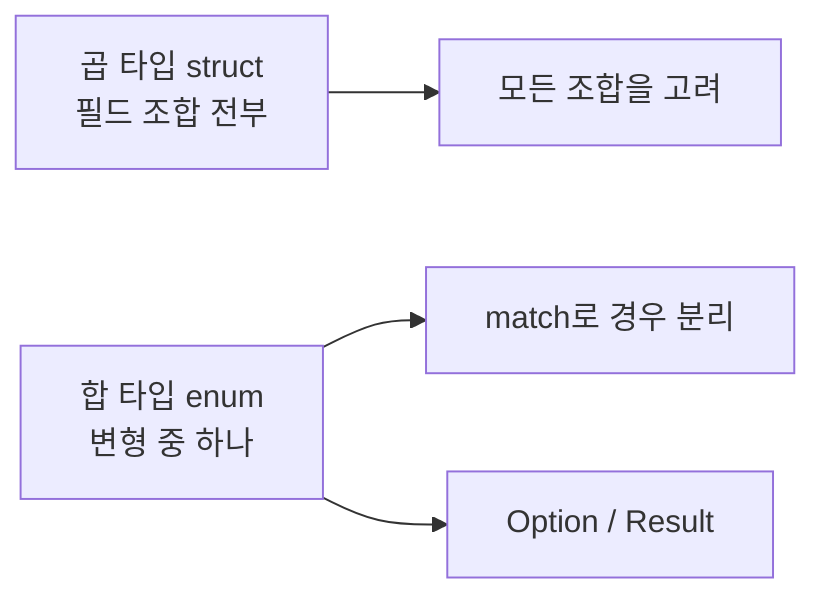
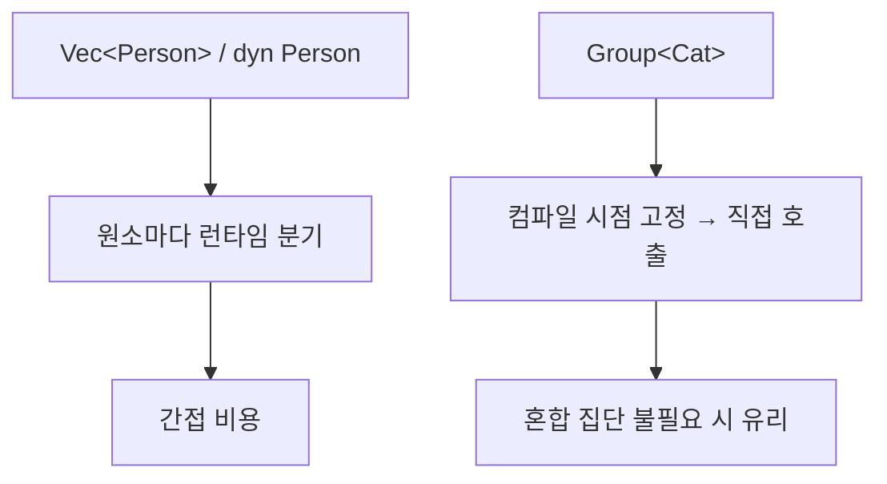
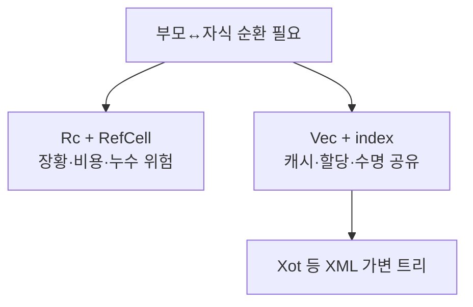

# Rust가 개발자로서의 나를 바꾼 방식… 문법이 아니라 ‘사고 도구’가 늘어난 이야기

### Martijn Faassen이 6년+ 사용·4년+ 실무(Xot, Xee 등) 끝에 적은 경험담. 합 타입·정적 디스패치·타입 주도 개발·serde/clap 매크로·소유권과 아레나·성능이 연 설계 가능성까지. GeekNews([37313](https://news.hada.io/topic?id=37313))와 HN식 토론은 “OCaml/Haskell이 먼저”와 “Rust가 주류로 끌어온 결합”을 같이 읽는다


2026년 11월 16일 [How Rust Changed Me As A Developer](https://blog.startifact.com/posts/how-rust-changed-me/)에서 Faassen은 단순한 언어 자랑을 하지 않는다. **쓰는 언어가 개발자의 사고방식을 바꾼다**는 전제에서 시작한다. Python을 아는 사람이 JavaScript를 배우는 것처럼 **비슷한 언어끼리는 변화가 작다**. Rust는 그에게 충분히 달랐고, 그래서 바뀌었다.

그는 처음부터 “제약이 나를 도전하게 하리라”고 기대했고, 그 기대가 **개발 습관의 변화**로 이어졌다고 본다. 다만 다루는 배움은 **Rust만의 전유물이 아니다**. 다른 맥락에서 이미 만났던 개념도 Rust 덕분에 **더 선명해졌다**.

이 글은 원문 본문·각주와 GeekNews 요약·댓글을 기사 형태로 **전부** 다시 정리한다.

## 0. 디렉터리

Rust 언어가 사고·설계에 미치는 영향 에세이이므로 `docs/02_Rust/01_Language`에 둔다. 문법 로드맵·입문·스타일 가이드와 같은 층이다.

## 1. 익숙하지 않은 언어가 바꾸는 것

| 상황 | 체감 |
|---|---|
| Python → JavaScript | 유사해서 사고 변화가 작을 수 있음 |
| 기존 습관 → Rust | 차이가 커서 변화도 큼 |
| 6년+ / 실무 4년+ | 제약에의 도전이 습관 변화로 |

원문의 반복 문장 패턴은 “Rust made me a better programmer because …”이다. 아래에 그 이유들을 섹션으로 펼친다.

## 2. 합 타입 — “enum은 어디에 있었나”

### 2.1 곱 타입(product)

필드를 독립적으로 조합하는 익숙한 형태. struct를 모르면 **클래스로 생각**해도 된다.

```rust
struct Human {
    first_name: String,
    last_name: String,
}
```

`first_name` × `last_name`의 **모든 조합**을 다뤄야 한다. 그게 product다.

### 2.2 합 타입(sum)

여러 **변형 중 하나**. 커뮤니티가 오래 무시해 온 쪽이라고 Faassen은 말한다(불린·C `enum` 같은 **빈약한 형태**는 곳곳에 있다).

```rust
enum Person {
    Human { first_name: String, last_name: String },
    Cat { name: String, cuteness: Cuteness },
}
```

`Person`은 Human **이거나** Cat — 가능성의 **합**. 각 변형은 자체 데이터를 가질 수 있다. `match`로 다룰 때 컴파일러가 **모든 변형**을 강제한다.

```rust
match some_person {
    Person::Human { first_name, last_name } => {
        // first_name, last_name만 신경 쓰면 됨
    }
    Person::Cat { name, cuteness } => {
        // name, cuteness만
    }
}
```

Human 분기에서는 고양이의 `name`/`cuteness`를 **아예 고려할 필요 없다**. 경우들이 **분리**된다.

선택(`Option`: 값 또는 없음)과 오류(`Result`: 성공 값 또는 오류 값)도 합 타입이다. 함수형 언어는 오래전부터 썼다. 타입 태그 필드로 **흉내**낼 수는 있지만, 언어가 기본으로 지원하는 가치가 크다고 본다. 합 타입 없는 언어는 이제 **빈곤하게** 느껴진다고까지 적는다.



## 3. 인터페이스 대신 enum을 고를 때

OOP에서는 인터페이스 + 동적 디스패치로 변형을 감춘다.

```text
interface Person { do_one_thing(); do_another_thing(); }
class Human implements Person { ... }
class Cat implements Person { ... }
```

느슨한 결합은 좋은 아이디어다. 다만 Rust가 가르친 **대가**는 두 가지다.

1. **성능** (간접 디스패치)
2. **인터페이스를 설계하는 비용**

언제 인터페이스가 값비싼가 / enum이 충분한가:

| 상황 | 기울기 |
|---|---|
| 아직 모르는 구현을 **외부에서 플러그인**해야 함 (개방/폐쇄) | 인터페이스 가치↑ |
| 단일 도메인 안 **사람과 고양이만** | enum으로 충분할 수 있음 |
| 가끔 `Dog`를 추가하고, 기존 분기를 **같이 고쳐도** 됨 | enum + 완전성 검사가 단순 |
| 추상화 자체가 “성공 또는 오류”처럼 **변형** | enum이 잘 맞음 |

enum에도 메서드를 붙일 수 있어, 선택했다고 추가 추상화가 **불가능해지지는 않는다**. 합 타입은 인터페이스를 **대체하는 만능**이 아니라, **의례가 적은 추상화 도구를 하나 더** 준다.

## 4. 디스패치와 성능

Rust가 드러내는 디스패치 종류:

| 종류 | 예 |
|---|---|
| 동적 디스패치 | trait object 등 (요청 시) |
| 조건부 (`if`) | 불리언 분기도 변형을 나누는 **특수 경우**로 볼 수 있음 |
| enum `match` | 강화된 조건부 디스패치 |
| **정적(컴파일 시점)** | 제네릭으로 타입이 조립된 뒤 직접 호출 |

사람만 있는 집단 / 고양이만 있는 집단을 다룰 때, 원소마다 `Person` enum·인터페이스를 쓰면 **실제로는 없는 혼합 집단**까지 허용하게 된다.

대신:

```rust
struct Group<T> {
    // ...
}

let cat_group: Group<Cat> = Group::new();
```

공통 속성(세어 보기 등)은 trait로 두고, **원소가 전부 고양이**라는 불변조건은 컴파일 시점에 고정한다. 고양이에 안 맞는 연산은 컴파일되지 않는다. TypeScript·Python 제네릭과도 익숙한 그림이다.

런타임에 원소마다 사람/고양이인지 확인하지 않는다. **고양이 코드로 직접 디스패치**. 원소마다의 간접 비용이 사라지며, 성능이 중요할 때 의미가 있다.

> Rust made me a better programmer as I now better understand the connection between dispatch and performance.



## 5. 타입 주도 개발 — 반복적 설계 도구

1990년대 말 C++ → Python에서 동적 타입의 간결함에 매료됐고, 이후 약 10년간 **더 쓰기 편한 정적 타입**으로 돌아오는 길을 걸었다. 많은 이가 같은 여정에 있다고 느낀다.

| 실천 | 뻔한 이득 | 미묘한 이득 |
|---|---|---|
| 테스트 | 동작 검증·회귀 방지 | 테스트 가능한 구조를 고민 → API·아키텍처 개선 (TDD) |
| 문서 | 목적·동작 전달 | 설명 못 하면 설계를 다시 봄 (문서 주도) |
| 타입 | 정적 검사·(Rust에선) 성능 | 도메인 일관성, **parse, don’t validate**, API 유도 |

이건 “테스트·문서·타입을 **미리 전부** 쓰고 구현”하는 빅 디자인 업프론트가 **아니다**. 배우며 **계속 수정하는 반복**이 핵심이다. AI와 함께 선행 대규모 설계가 다시 보이지만, Faassen은 여전히 **회의적**이고 점진적 학습·이론 구축을 선호한다.

정적 검사 보장을 원한다면, **합 타입을 갖추고 성능 이점도 주는** 정적 타입 중심 언어를 고를 이유가 생긴다는 각주도 있다.

## 6. 가장 큰 언어적 놀라움 — 컴파일 시점 매크로

Python처럼 풍부한 런타임에서 하던 “마법” 상당수를 Rust는 **컴파일 시점 매크로**로 한다.

| Python | Rust |
|---|---|
| pickle: 런타임 필드 조사 → 저장/복원 | 타입은 런타임 객체가 아님 |
| Pydantic: 런타임 타입 정보 → JSON | 리플렉션은 별도 노력 |
| 데코레이터: **런타임** 실행 | `#[…]` 속성은 비슷해 보여도 **매크로가 코드를 생성** |

**serde** — `#[derive(Serialize, Deserialize)]`면 JSON·TOML 등 직렬화/역직렬화 코드 생성. 생성 코드는 나머지와 같이 컴파일·최적화된다.

```rust
#[derive(Serialize, Deserialize)]
struct Human {
    first_name: String,
    last_name: String,
}
```

**clap** — 타입·enum으로 CLI 인자를 정의하고 일반 문서 주석을 쓰면 **도움말 내장 CLI**. 처리 코드는 **이미 올바르게 파싱된** 같은 타입을 받는다.

```rust
/// My first CLI
#[derive(Parser)]
struct MyFirstCli {
    /// How many cats do you want?
    #[arg(long, short)]
    amount_of_cats: usize,
}
```

코드 생성·매크로는 무섭다. 동적 언어 인트로스펙션보다 어렵다. 그래서 **프레임워크에 캡슐화**하고 앱 코드에 함부로 섞지 않는 편이 낫다. Python에서도 마법은 선언적 프레임워크 안에 신중히 감추는 것이 바람직하다.

> Rust made me a better programmer as I learned about a new class of framework patterns.

## 7. 소유권과 아키텍처

소유권은 GC 없이 메모리를 관리하고, **읽는 곳을 동시에 바꾸지 못하게** 해 병렬 코드의 여러 UB 부류를 막는다. Python/JS/Java에 익숙하면 **가변 참조 남발·순환 구조**가 막히는 느낌이 큰 장벽이다.

원문이 든 “그대로면 안 되는” Python 패턴:

```python
# 컨테이너에 넣은 뒤 기존 참조로 계속 변경
my_container.items.append(my_item)
my_item.value = "I change you!"

# 부모↔자식 순환
node.parent = self
self.children.append(node)
```

적응하면서:

- **변경**을 주로 생성 단계에 모으고, 사용과 분리 → 불변조건↓, 추론 쉬움
- 제약을 수용하면 **결합도↓**, 데이터 흐름이 명확
- 멀리서 동작을 바꾸는 숨은 백채널이 **만들기 어렵고**, 만들어도 **더 눈에 띔** (불가능은 아님)

로컬 Rust는 읽기 어려울 수 있어도, **큰 코드베이스에서 누가 무엇을 소유하는지는 더 깔끔**해지는 경향이 있었다고 한다.

> Rust made me a better programmer as I now think about ownership more carefully, which has a positive impact on architecture.

## 8. 아레나 — 순환을 인덱스로

XML 라이브러리를 조사할 때 **roxmltree**는 뛰어났지만 **불변** 트리였다. 가변이 필요했고, 가변을 지원하는 여러 라이브러리는 **부모 참조가 없어** 조상으로 올라갈 수 없었다. 일부 XML 기능 부재와 함께 **Xot**을 만든 이유다.

참조 카운트 + 내부 가변성으로 순환을 구현할 수는 있지만: 장황, 성능 비용, **RC 순환 누수** 위험.

**아레나**: 노드를 배열에 두고 **인덱스로** 부모·자식·기타 순환을 표현.

| 특성 | 이득 |
|---|---|
| 빠른 순회 | 같은 메모리 영역 → CPU 캐시 |
| 빠른 할당 | 블록을 잡은 뒤 증가 연산 위주 |
| 인터닝 | 한 번 저장, 여러 곳에서 재사용 |
| 공통 소유·수명 | 아레나가 소유, 같은 수명끼리 인덱스 순환 |

```rust
// 개념 스케치: 직접 &Node 대신 인덱스
struct Arena {
    nodes: Vec<Node>,
}
struct Node {
    parent: Option<usize>,
    children: Vec<usize>,
    // ...
}
```

직접 참조보다 쓸 것은 늘지만, Rust 제약은 **컴퓨터가 효율적으로 실행할 구조**로 개발을 민다고 본다. “Rust에는 아레나가 어디에나 있다.”



## 9. 성능은 양만의 문제가 아니다

“성급한 최적화” 문구의 아이러니: Knuth가 **효율을 위해 goto를 남겨야 한다**고 논한 논문에서 나왔다.

Rust에서는 RC·동적 디스패치 비용이 **코드에 보인다**. 피하려는 복잡성도 보인다 — **tower** 미들웨어처럼 단순한 추상화에 제네릭·제약이 쌓일 수 있다. Python에선 안 보이던 **해시맵 병목**이 Rust에선 보인다. 하이퍼옵티마이즈에 빠질 수도 있으니, 때로는 **복제해서 소유**하는 단순한 길이 낫다. 복제·소유가 연속 메모리로 이어지기도 하고, 읽기 쉬운 Rust 패턴 상당수가 CPU에도 친화적이다.

성능의 **질**:

- 수치·시뮬레이션 대기↓, AI를 가능케 하는 핵심이기도 함
- 현대 컴퓨터는 아주 빠른데도 자원을 더 쏟는 데에는 이유가 있지만, 눈을 뜨면 **새 아키텍처**를 탐색할 수 있음
- 실험 **Colchis**: 대량 JSON을 메모리에 두면서 접근·인덱스 접근을 유지. `jsonpath`는 언젠가 추가하고 싶은 기능(아직 아님). Rust 전에는 **레이더에조차 없던** 설계
- “메모리·CPU를 거의 안 쓰는 듯한” 작은 프로그램 — 과장이지만 그렇게 **느껴질** 때가 있다

매크로가 가장 큰 **언어** 놀라움이라면, 사고의 가장 큰 이동은 **성능이 열어 주는 가능성**이다.

> Rust made me a better programmer because I can make the computer do more with less, opening up new areas of opportunity.

## 10. 결론 — 어려운 학습이 넓힌 구현 범위

Rust는 그가 배운 언어 중 **어려운 편**이었고, 그래서 **가장 많이 바꾼** 언어이기도 하다.

- 쉬운 층: enum, 선언적 타입 주도 프레임워크, 훌륭한 도구. 아레나 개념도 본질적으로 어렵지 않음
- 어려움의 상당 부분: **옛 습관을 버리고 새 습관을 익히는 것**
- 그 아래엔 더 복잡한 Rust가 있고, 필요할 때 드러남

가장 큰 보상: **만들 수 있는 것의 범위가 넓어졌다.**

### 각주가 남긴 AI 시대 메모

1. 에이전트가 코드를 많이 쓴다. 그래도 **코드를 직접 보는 것**이 중요하다고 믿으면 언어 이해가 도움이 된다. 시스템이 사고·행동에 미치는 영향을 살피는 일도 더 중요해졌다.
2. AI가 ‘이해’하는가 — 철학 논쟁. 자연어 의미는 맥락에 따라 늘어난다.
3. AI는 절충을 **없애기보다 바꾼다**. Rust를 몰라도 AI가 짤 수 있지만, **Rust 경험 + AI**가 AI만보다 나은 상황이 많을 것으로 기대한다.

## 11. GeekNews·토론이 덧붙인 축

**“2004년 OCaml로도 배울 수 있었다”**  
Rust의 성공 중 하나는 함수형이 20년간 해 온 것을 **주류로 끌어온 것**. 원문도 “Rust만이 아니다”고 이미 밝혔다. 핵심이 흐려지지는 않는다 — Smalltalk·Haskell·Erlang·C를 권하는 이유도 “그 언어만의 독점 개념”이 아니라 **다른 언어에도 유용한 방식을 익히기 좋은 수단**이기 때문. Haskell+C를 아는 사람이 C만 아는 사람보다 나은 C++을 쓰는 식.

**Erlang·Graydon**  
공유 메모리 뮤텍스 대신 Erlang식 동시성만 쓰겠다는 소신을 끝까지 못 지킨 점이 아쉽다는 의견.

**문법 가독성**  
ML/Haskell의 한 글자 기호는 읽기 단서가 적어 노력이 크다. Rust는 자주 안 짜도 **읽기 쉽다**는 경험(futex RW락 구현을 Rust로 읽은 사례). “쓰기보다 읽기”를 최적화한 방향.

**Haskell 먼저 vs Rust에서야 합 타입**  
순수 함수·재귀 리스트·모나드에 가려 타입의 힘을 못 봤다가, Rust에서 합 타입의 진가를 알았다는 반례. Rust는 결합·**cargo** 등 도구로 접근성을 높여 옛 패러다임을 **새로 발견**하게 한다.

**생태계**  
문서 예제를 컴파일·실행해 낡지 않게 하는 것, 같은 파일 단위 테스트, rustfmt·clippy·rust-analyzer. “최초”가 아니어도 **쓸 수 있다는 것**이 좋다. 추천 글: [Kobzol — Rust/Python 시각](https://kobzol.github.io/rust/python/) — Python을 덜 “파이썬답게” 짜더라도 예측·유지보수 가치가 커졌다는 경험. 소유권→깔끔한 아키텍처 부분에 공감.


## 12. 실무로 가져갈 한 줄씩

1. **변형이 도메인이면 enum**부터 — 인터페이스 세금은 필요할 때만.
2. **혼합이 없으면 `Group<T>`**로 정적 디스패치.
3. 타입·테스트·문서는 **반복 설계 도구**지 빅 디자인 업프론트가 아님.
4. 직렬화·CLI 마법은 **serde/clap 같은 프레임워크**에 가둔다.
5. 소유권 마찰을 **결합도·데이터 흐름**으로 승화한다.
6. 순환이 필요하면 **아레나(인덱스)** 를 기본 후보로.
7. 성능은 벤치만이 아니라 **전에 못 그리던 설계**(대용량 in-memory JSON 등)를 연다.
8. AI가 짜도 **읽는 사람**의 언어 감각은 남는다.

## 13. 맺음

Faassen의 글은 “Rust를 쓰라”는 설교보다 **다른 제약이 다른 습관을 만든다**는 관찰에 가깝다. 합 타입으로 경우를 분리하고, 디스패치 비용을 보고, 타입으로 설계를 반복하며, 매크로로 선언적 프레임워크를 쓰고, 소유권과 아레나로 데이터 흐름을 정리하고, 성능으로 레이더 밖의 아키텍처를 연다. GeekNews가 보탠 것은 그 개념의 **역사적 선조**를 인정하면서도, Rust가 그것을 **읽고 배우기 쉬운 주류 패키지**로 묶었다는 점이다.

복사할 문장 하나: **언어는 문법 목록이 아니라, 매일 고르게 되는 추상화의 기본 세트다.** 그 세트가 바뀌면, 같은 컴퓨터로도 만들 수 있는 것의 범위가 바뀐다.

---

**원문 및 참고 자료**

- Martijn Faassen, *How Rust Changed Me As A Developer*, 2026-11-16. https://blog.startifact.com/posts/how-rust-changed-me/
- GeekNews 토픽 요약·댓글: https://news.hada.io/topic?id=37313
- 본문에서 언급: Xot, Xee, roxmltree, Colchis, serde, clap, tower
- 토론 추천: https://kobzol.github.io/rust/python/ (GeekNews 스레드에서 링크)

※ 본 기사는 원문 에세이와 GeekNews 토론을 바탕으로 재구성한 해설이다. 코드 예제는 원문·개념 스케치를 따르며, 프로젝트 API는 각 크레이트를 기준으로 한다. Rust 학습을 강제하는 가이드가 아니라, 언어가 사고를 바꾸는 방식을 정리한 경험 해설이다.
