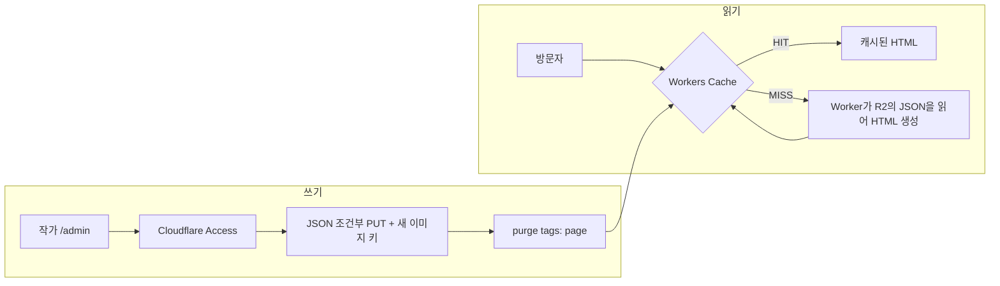
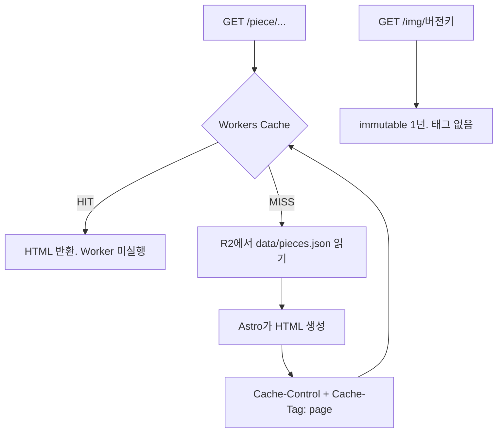
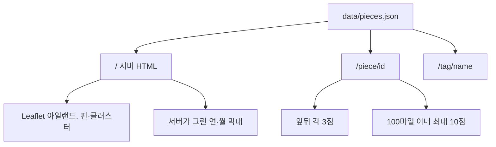

# 그림은 하루에 0.3점… 방문자에겐 캐시된 바이트, 작가에겐 CRUD

### 친구에게 단체 채팅으로 보내던 스케치가 웹사이트가 됐다. 방문자는 30일짜리 엣지 캐시에서 HTML을 받고, 작가 한 명만 웹 폼으로 고친다. 고치는 순간 페이지 캐시가 비고, 다음 방문이 그 페이지를 다시 그린 뒤 또 한 달을 앉혀 둔다. 글의 RSS 시각은 2026년 11월 16일, Hacker News에 오른 날은 11월 20일이다. 코드는 그 설계가 운영 중에 고쳐진 기록이다

Kshitij Lauria의 [I’m quite pleased by the tech architecture of my art website](https://klauria.tech/klauria-art/)는 블로그 RSS에서 2026-11-16로 잡힌다. 글 HTML에는 날짜가 없다. 작품 사이트는 [klauria.art](https://klauria.art), 코드는 [kshitijl/sketchbook-website](https://github.com/kshitijl/sketchbook-website)다. GeekNews([토픽 37607](https://news.hada.io/topic?id=37607))가 이를 요약했고, Hacker News에는 [185포인트, 댓글 38개](https://news.ycombinator.com/item?id=50577991)가 붙었다(2026-11-20 17:03 UTC, 올린 사람 evakhoury). 저자의 LLM 사용 기준은 [llm-use-policy](https://klauria.tech/llm-use-policy)에 따로 있다.

이 글은 그 에세이, 저장소의 [architecture.md](https://github.com/kshitijl/sketchbook-website/blob/main/docs/architecture.md), 캐시 코드, Cloudflare 가격 문서, HN 토론을 기사 형태로 엮는다. 에세이가 “페이지 캐시를 전부 비운다”고 말한 지점과, 운영 중에 “HTML만 태그로 지우고 이미지는 영구 캐시로 남긴다”로 좁혀진 지점을 구분한다.


*페이지 이미지는 아키텍처 도표가 아니라 작품 Mono Lake Tufa at Sunset이다. 저작권은 저자에게 있고 코드만 MIT다.*

에세이에 같이 실린 그림의 파일 URL이다. 집, 바위, Twin Peaks에 나온 폭포, 브루클린 집 앞.

- [House By Red Barn](https://klauria.tech/_astro/2026-08-30-house-by-red-barn.CilC71cF_1hLcV9.webp)
- [Kodachrome Entrada](https://klauria.tech/_astro/2026-08-16-kodachrome-entrada.CKwDdWO1_jjGmM.webp)
- [Twin Peaks](https://klauria.tech/_astro/2026-08-29-twin-peaks.CHf2WPtS_2ms8wj.webp)
- [Hot Morning Outside My House](https://klauria.tech/_astro/2026-07-04-hot-morning-outside-my-house.DMUyTAkt_1xztog.webp)
- 같은 그림의 1800px WebP: [Mono Lake](https://klauria.tech/_astro/2026-07-10-mono-lake-tufa-at-sunset.Cg94MFl2_Z1RD1X4.webp)

## 1. 한눈에 보기

| 항목 | 내용 |
|---|---|
| 읽는 사람 | 캐시된 HTML. 히트면 Worker가 실행되지 않는다 |
| 쓰는 사람 | 작가 한 명. `/admin`은 [Cloudflare Access](https://developers.cloudflare.com/cloudflare-one/access-controls/policies/) + Google, 이메일 하나 |
| 원본 데이터 | R2의 `data/pieces.json` 하나 + 이미지 객체 |
| HTML 캐시 | `Cache-Control: public, max-age=60, s-maxage=2592000` (브라우저 1분, 엣지 30일), `Cache-Tag: page` |
| 무효화 | 관리자 쓰기가 `cache.purge({ tags: ['page'] })`. 이미지 응답은 태그가 없다 |
| 이미지 | 업로드 때 브라우저가 thumb 240 / card 1000 / big 1800 WebP를 만들고, 키는 버전을 붙여 재사용하지 않는다 |
| 렌더 | Astro 7 SSR, `@astrojs/cloudflare`. 프레임워크는 교체 가능하다고 에세이는 말한다 |
| 비용 | 컴퓨팅·대역폭은 무료 구간. R2 저장 10GB-month까지 무료, 넘으면 GB당 월 $0.015. 송신 요금은 없다 |
| 규모 가정 | 작품 500–1,000점. 스캔 한 장은 최대 약 20MB PNG. 올해 그림 100점, 하루 최대 4점, 평균 0.3점 미만 |
| 라이선스 | 코드 MIT. 그림·스케치·사진은 © Kshitij Lauria, all rights reserved. 작품 파일은 저장소에 없다 |



입구는 둘이다. 방문자는 이미 그려진 바이트를 받고, 작가만 JSON과 이미지 키를 바꾼 뒤 페이지 캐시를 비운다. 에세이가 말한 이상적인 서버는 이벤트 루프 안의 [`open`](https://man7.org/linux/man-pages/man2/open.2.html) 다음 [`sendfile`](https://man7.org/linux/man-pages/man2/sendfile.2.html)이다. 저자는 “농담이되 반만”이라고 적었다. 그 문장의 유명한 원전은 확인되지 않았다. 가까운 글은 Dan Kegel의 [C10K](https://kegel.com/c10k.html)가 `sendfile`을 제로카피로 소개한 것, Jeff Tranter의 [Linux Gazette 91](https://linuxgazette.net/issue91/tranter.html) 예제가 `open` 다음 `sendfile`인 것이다. 캐시 히트는 그 농담에 가장 가까운 동작이다. Worker는 실행되지 않는다.

## 2. 정적 사이트와 CRUD가 동시에 필요했던 이유

출발은 기술 선택이 아니다. 소셜 미디어를 거의 쓰지 않는 저자가 그림과 스케치 스캔을 단체 채팅으로 보내다가, “어디서 그렸어?”, “실물은 어때?”라는 질문이 나왔고, 동생이 작품마다 마커가 있는 지도를 제안했다.

그 다음에 저자가 이름 붙인 두 기준이 갈린다.

- **가까운 도구.** React로 그리고, 이미지는 S3에 두고, CDN을 붙이면 인도에 있는 부모에게도 충분하다. 트래픽은 거의 없다.
- **거의 안 변하는 콘텐츠.** 자바스크립트가 브라우저에서 페이지를 그리거나, 요청마다 서버 코드가 돌 이유가 없다. 바이트가 미리 앉아 있어야 한다.

정적이 이겼다. 그리고 곧바로 막혔다. 새 그림마다 파일을 넣고 빌드하고 배포해야 한다. 올해 그림이 100점이다. 태그, 위치, 순서를 고치는 UI는 웹 폼이 맞다. 웹 폼이 내용을 바꾸면 그 사이트는 더 이상 정적 사이트가 아니다.

원하는 것은 이 한 줄이다. **다른 사람에게는 정적이고, 나에게만 동적이다.** 빌드는 GitHub Actions나 터미널이 아니라 관리 화면의 저장 버튼이 시작해야 한다.

HN에서 저자는 이 구분을 이렇게 닫았다. 페이지는 누군가 처음 열 때 서버가 그리고, 그다음 변경 전까지 캐시에 앉는다. 비용과 지연은 정적 사이트 쪽에 가깝다. “그냥 디스크에서 바이트를 보내면 되지 않느냐”는 질문에는, 태그 페이지와 작품 페이지가 JSON 전체를 읽어 여러 작품을 모은 **빌드 산출물**이라고 답했다. 유타 태그 페이지, 한 작품 아래의 가까운 장소·가까운 시기가 그 예다. 원본은 JSON과 이미지 파일이고, 노트북에서 매 페이지를 다시 빌드할 수도 있다. CRUD 화면을 포기하지 않으려고 캐시라는 한 단계를 넣었다.

## 3. 읽기: 히트면 Worker는 실행되지 않는다

요청 한 번의 경로는 저장소 문서가 이렇게 적는다.

1. Cloudflare anycast가 가까운 PoP로 보낸다.
2. 캐시 히트면 Workers Cache가 HTML을 준다. Worker는 돌지 않는다. 문서의 목표 수치는 한 자릿수 밀리초에서 10ms 미만이다.
3. 미스면(퍼지 직후, 또는 그 URL을 아직 아무도 안 연 경우) Worker가 R2의 현재 JSON으로 Astro 페이지를 그린다. 응답에 `Cache-Control`이 실리고 캐시에 들어간다.
4. Workers Cache는 계층이다. 데이터센터마다 로컬 캐시가 있고, 로컬 미스 때는 상위 계층을 본다. 지구 어딘가에서의 첫 요청이 이후 요청의 히트를 만들 수 있다.

에세이의 인도 예시가 이 계층을 말로 푼 것이다. `#summer` 같은 페이지를 Worker가 한 번 그리면, 나중에 인도에서 같은 URL을 열 때 그 산출물이 인도 엣지로 간다. 저자는 Worker를 다시 돌릴 수도 있다고 적었고, 페이지에 생성 시각을 찍어 확인한 결과 다시 돌지는 않았다고 했다. 저장소의 디버그 푸터(렌더 시각, 엣지 colo, 배포 커밋)가 그 확인 장치다. 새로고침해도 시각이 같으면 캐시 히트다.

공개 코드의 헤더는 이렇다. `s-maxage=2592000`은 30일(2,592,000초)이다.

```ts
// src/lib/cache.ts — MIT, kshitijl/sketchbook-website
export const PAGE_CACHE_CONTROL = 'public, max-age=60, s-maxage=2592000';
export const PAGE_CACHE_TAG = 'page';

export function setPageCacheHeaders(headers: Headers): void {
  headers.set('Cache-Control', PAGE_CACHE_CONTROL);
  headers.set('Cache-Tag', PAGE_CACHE_TAG);
}
```

두 숫자가 하는 일이 다르다.

| 지시 | 누가 읽나 | 값 | 역할 |
|---|---|---|---|
| `s-maxage` | Workers Cache | 30일 | Astro가 다시 그려지는 상한. 평소의 신선함은 만료가 아니라 퍼지가 만든다 |
| `max-age` | 방문자 브라우저 | 1분 | 엣지 퍼지는 이미 받아 둔 브라우저 사본을 지우지 못한다. 작가가 자기 브라우저 캐시를 비우지 않고 확인하려고 짧게 뒀다. 재요청은 브라우저↔엣지이고, 렌더 횟수와는 분리된다 |
| `Cache-Tag: page` | 퍼지 매칭 | 페이지 응답만 | `/admin`은 `no-store`, `/img`는 별도 헤더라 이 태그를 안 단다 |

여기까지가 에세이보다 한 겹 아래다. 처음에 가정한 메커니즘은 존(zone) Cache Rule이었는데, 프로덕션 스모크 테스트에서 `CF-Cache-Status`가 아예 없고 매 요청이 다시 그려졌다. Cache Rule은 Worker가 **바깥 origin을 `fetch`할 때** 적용된다. 이 사이트는 R2를 읽어 Worker가 응답을 직접 만든다. 그때 앞에 서는 캐시는 Wrangler 4.69 이상의 `"cache": { "enabled": true }`로 켜는 **Workers Cache**다. 존 퍼지 API, 대시보드 퍼지, Terraform 퍼지도 이 캐시에는 닿지 않는다. 지우는 호출은 Worker 안의 `cache.purge()`뿐이다.

캐시를 우회하는 조건도 문서에 적혀 있다. `GET`/`HEAD`만 캐시된다. `Set-Cookie`가 있으면 `BYPASS`다. `Authorization`이 있으면 응답이 `public`이거나 `s-maxage` 등이 있어야 캐시된다. `/admin`의 `private`/`no-store`는 항상 우회다.



## 4. 쓰기: JSON 하나, 이미지 키는 버리고, HTML만 지운다

작품 메타데이터는 R2 객체 `data/pieces.json` 하나다. 설계 규모의 상한(필드가 넉넉한 1,000점)에서 압축 전 1–2MB, gzip하면 수백 KB로 문서가 추정한다. 지도와 타임라인 아일랜드에 통째로 실어 보내도 부담이 작다는 판단이다.

한 점의 모양은 이렇다. `stage` 같은 안 쓰는 필드는 빼었고, 매체·여행·습작 여부는 전부 열린 `tags` 배열이다. 초안 상태는 없다. 올리면 바로 공개다.

```json
{
  "id": "2023-india-jaipur-001",
  "title": "Hawa Mahal, morning light",
  "date": "2023-11-14",
  "location": { "lat": 26.9239, "lng": 75.8267, "placeName": "Jaipur, India" },
  "tags": ["india-2023", "watercolor", "ink", "architecture"],
  "notes": "Free text",
  "favoriteRank": 3,
  "assets": [
    {
      "id": "a1",
      "kind": "final",
      "r2Key": "assets/2023-india-jaipur-001/a1-v1.png",
      "sizes": {
        "thumb": "assets/2023-india-jaipur-001/a1-thumb-v1.webp",
        "card": "assets/2023-india-jaipur-001/a1-card-v1.webp",
        "big": "assets/2023-india-jaipur-001/a1-big-v1.webp"
      },
      "width": 0,
      "height": 0
    }
  ]
}
```

쓰기 순서는 여섯 단계다.

1. Access가 엣지에서 이메일을 확인한 뒤에야 Worker가 돈다.
2. Worker가 `data/pieces.json`을 읽고 ETag를 보관한다.
3. 메모리에서 고친다.
4. 새 이미지 바이트는 `assets/<id>/<asset>-v2.png`처럼 **한 번도 안 쓴 키**에 넣는다. 예전 키는 참조만 끊긴다. 그래서 이미지 캐시를 지울 필요가 없다.
5. JSON을 `onlyIf: { etagMatches }`로 조건부 PUT 한다. 사이에 다른 쓰기가 있으면 다시 읽고 재시도한다. 편집자는 한 명이라 충돌은 드물지만, 이중 제출을 막는다.
6. `purgePages()`가 `page` 태그만 지운다. 실패는 삼킨다. 다음 쓰기가 페이지를 다시 전부 지우므로, 한 번 놓친 퍼지는 다음 편집이 덮는다.

```ts
// src/lib/purge.ts — 정상 경로는 태그 퍼지. purgeEverything은 ?full=1 탈출구
import { cache } from 'cloudflare:workers';

export async function purgePages(): Promise<void> {
  try {
    await cache.purge({ tags: ['page'] });
  } catch {
    // 로컬에는 Workers Cache가 없다. 실패가 저장 자체를 막지 않는다.
  }
}
```

에세이는 “영향받는 페이지만 지우자”를 검토하고 버렸다. 페이지 생성 코드는 의존성을 선언하지 않는다. JSON의 어떤 필드가 바뀌어도 출력이 달라질 수 있다. 의존성 목록을 손으로 유지하면 사이트가 **반만 갱신**된다. 새 작품이 `#evening`에 들어가는 것은 그 태그가 있을 때뿐이지만, 그 조건을 퍼지 코드에 다시 적는 복잡도를 저자는 거절했다. 일반 정적 생성기라면 산출물 해시가 같은 파일은 엣지가 굳이 갈아끼우지 않을 수 있다고도 적었다. 그 최적화는 이 저장소에 없다.

운영 기록은 에세이보다 한 걸음 더 좁혔다. 초기의 `purgeEverything: true`는 같은 Worker가 서빙하는 `/img`까지 지웠다. 제목만 고쳐도 이미지 변환 캐시가 날아갔다. 경로 prefix로 나누는 안은 “빼먹기 쉬운 목록”이라 버렸다. 태그는 `setPageCacheHeaders()`를 모든 페이지가 쓰는 한 목록이 어긋나지 않는다. 클라이언트에 `Cache-Tag`가 안 보이는 것은 정상이다. Cloudflare가 퍼지용으로 먹고, HIT 응답에 다시 실어 주지 않을 수 있다. 확인은 헤더가 아니라 홈의 렌더 id가 바뀌는지로 했다.

짧은 TTL(몇 분)로 퍼지 자체를 없애는 안도 버려졌다. 그러면 변경은 알아서 전파되지만, “HTML이 엣지에 앉아 있는 정적 사이트”라는 목표가 사라진다. 긴 `s-maxage`와 쓰기 직후 퍼지가, 즉시 반영과 긴 캐시를 같이 가져가는 조합으로 남았다.

공식 문서는 이 선택과 반대쪽을 권한다. [Purge everything](https://developers.cloudflare.com/cache/how-to/purge-cache/purge-everything/)은 다음 요청이 전부 오리진으로 가 트래픽이 몰릴 수 있다며 단일 파일 퍼지를 권한다. Fastly는 주 1회보다 자주 전체를 지우면 [surrogate key](https://www.fastly.com/documentation/guides/full-site-delivery/purging/purging-with-surrogate-keys)를 쓰라고 한다. “의존성 추적이 어려워서 매 저장마다 전체를 지운다”는 1차 설계 글은 이번에 찾지 못했다. 이 사이트의 정상 경로는 존 전체 삭제가 아니라 **페이지 태그 하나**다. 편집이 하루 0.2회라, 퍼지 직후 오리진으로 가는 요청은 그 글을 다시 여는 방문이다. 트래픽이 큰 사이트에 같은 버릇을 옮기면 문서가 경고하는 오리진 폭주가 된다.

Workers Cache의 키는 [경로와 쿼리스트링](https://developers.cloudflare.com/workers/cache/cache-keys/)이다. 호스트는 키에 없고, `Cookie`·`Accept`만 다른 요청은 같은 응답을 받는다. 내용을 나누려면 응답에 `Vary`를 둔다. 저장소 문서가 “키는 요청 URL”이라고 적은 것과, 호스트가 키 밖이라는 공식 설명은 같이 읽어야 한다. `?a=1&b=2`와 `?b=2&a=1`은 다른 항목이다.

### 4.1 배포는 데이터를 안 건드려도 캐시를 비워야 한다

`purgePages()`는 원래 관리자 쓰기 안에만 있었다. 코드만 배포하면 캐시가 남는다. 캐시 키에 배포된 Worker 버전은 들어가지 않는다. 라우트를 지운 뒤에도 옛 HTML이 30일 상한까지 살아 있는 사고가 실제로 났다.

그래서 `npm run deploy`는 타입체크, 테스트, 빌드, `wrangler deploy` 다음에 `scripts/deploy-purge.mjs`를 돌린다. CLI 세션에는 Access 로그인이 없으므로 `/deploy-purge`는 `DEPLOY_PURGE_TOKEN`으로 막고, 틀리거나 시크릿이 없으면 404다. 토큰은 저장하지 않는다. 배포 스크립트가 난수를 만들어 `wrangler secret put`으로 넣고, 그 토큰으로 퍼지한 뒤 버린다.

대기 45초는 일부러다. `wrangler deploy`가 돌아와도 모든 엣지가 새 버전은 아니다. 그 창에 들어온 요청은 **옛 코드가 만든 404**를 캐시하고, 즉시 퍼지하면 아직 없는 항목을 지운 셈이 된다. 그 404는 `s-maxage` 30일을 산다. 2026-08-06에 `/month/` 라우트를 넣은 배포가 이 방식으로 “있는 페이지의 캐시된 404”를 만들었다. 퍼지가 엣지에 퍼지는 데도 15–30초가 더 걸린다. 첫 확인을 믿지 말고 25–30초 뒤에 `CF-Cache-Status`를 다시 본다.

`/deploy-purge` 자신은 모든 응답(404 포함)에 `Cache-Control: no-store`를 단다. 안 그러면 첫 404가 캐시되어, 같은 URL로 재시도하는 여덟 번이 전부 그 404를 받는다. 부작용이 목적인 라우트는 캐시 밖에 둬야 호출이 실제로 실행된다.

## 5. 이미지는 업로드하는 브라우저가 줄인다

썸네일과 카드에 보관용 원본을 넣으면 느리다. 필요한 크기는 세 가지로 고정이다. thumb 240px(관리 화면, 지도 호버), card 1000px(그리드, OG), big 1800px(작품 페이지, 지도 상세). WebP 품질 0.82. 문서에 적힌 22MB PNG 스캔의 결과는 card 약 105KB, big 약 330KB, thumb 약 9KB다. 원본이 압도적으로 크므로 파생본의 저장 증분은 작다.

요청 시 변환은 버렸다. Cloudflare Images 바인딩을 쓰던 시기에 세 가지가 겹쳤다.

- 입력 한도 20MB를 넘으면 **조용히 실패**하고, 폴백이 `?size=card`에도 20–32MB PNG 원본을 줬다.
- 기본 WebP 품질을 코드에서 못 낮춰, 1800px `big`이 2.6MB로 나왔다. 만든 원본보다 컸다.
- 큰 이미지는 손실 압축이 두 번 갔다.

Worker에서 20–30MB 스캔을 줄이지도 않는다. 메모리를 그 일에 쓰고 싶지 않았다. 업로더가 작가 한 명이므로 변환은 그 브라우저가 한다. 제출 때 `makeVariants()`가 디코드하고, 세 WebP를 `FormData`에 붙여 보낸다. 서버는 세 파일이 다 있어야 에셋을 만든다. 디코더는 `createImageBitmap(file, { imageOrientation: 'from-image' })`이고, HEIC는 Safari 밖에서 `createImageBitmap`이 못 읽으므로 [heic-to](https://github.com/hoppergee/heic-to)(libheif WASM)가 연다. 축소는 [Pica](https://github.com/nodeca/pica)의 Lanczos다. 그냥 캔버스 draw보다 선명하고, 타일로 나눠 Safari의 캔버스 면적 한도를 피한다. wasm-vips는 `SharedArrayBuffer`와 교차 출처 격리가 필요해 관리 화면의 지도·지오코딩과 부딪혀 제외했다.

폰트 사진의 EXIF 방향(예: 6 = 90도)을 적용하지 않으면 변종만 옆으로 눕는다. 백필 스크립트가 한 번 이걸 빼먹었고, JPEG 마스터 중 orientation이 1이 아닌 것만 다시 만들었다. sharp는 `metadata()`를 파일 이름으로 캐시하므로, 임시 경로를 재사용하면 첫 파일의 방향이 전부에 복사된다. 메타데이터는 `Buffer`에서 읽어야 한다.

HEIC 마스터만 예외다. 작품 스캔 PNG/JPEG는 바이트 그대로 보관한다. 폰트 HEIC는 어차피 Safari 밖에서 못 보여서 한 번은 다시 인코딩해야 하고, 원본은 iCloud에 있다는 판단으로 품질 0.9 풀해상도 WebP를 마스터로 둔다. 디코드는 한 번, 인코드는 마스터와 변종 세 장까지 네 번이다. 변종에서 마스터를 다시 뽑으면 손실이 두 세대가 된다.

긴 변이 1500px 미만이면 제출 전에 `confirm()`으로 멈춘다. macOS 사진 앱의 “Mac 저장 공간 최적화”가 iCloud에만 있는 원본 대신 약 1024px 미리보기를 건네는 경우를 막기 위해서다. 그 함정으로 저해상도 마스터 59장이 이미 보관됐다.

이미지가 서빙될 때의 헤더는 페이지와 반대다. `Cache-Control: public, max-age=31536000, immutable`. 키를 재사용하지 않으므로 1년은 사실상 영구다. `/img/...`는 변환 없는 R2 패스스루다.

아래는 문서에 적힌 파이프라인을 축약한 예시다. 저장소는 Pica와 heic-to를 쓰고, 이 조각은 방향 적용과 세 너비, 품질만 보여 준다.

```js
const WIDTHS = { thumb: 240, card: 1000, big: 1800 };
const QUALITY = 0.82;

async function makeVariants(file) {
  const bitmap = await createImageBitmap(file, { imageOrientation: 'from-image' });
  const longSide = Math.max(bitmap.width, bitmap.height);
  if (longSide < 1500 && !confirm('긴 변이 1500px 미만입니다. 미리보기 파일일 수 있습니다.')) {
    throw new Error('too small');
  }
  const variants = {};
  for (const [name, width] of Object.entries(WIDTHS)) {
    const scale = Math.min(1, width / bitmap.width);
    const canvas = new OffscreenCanvas(Math.round(bitmap.width * scale), Math.round(bitmap.height * scale));
    canvas.getContext('2d').drawImage(bitmap, 0, 0, canvas.width, canvas.height);
    variants[name] = await canvas.convertToBlob({ type: 'image/webp', quality: QUALITY });
  }
  return variants;
}
```

`imageOrientation: "from-image"`은 MDN이 EXIF 방향을 반영한다고 적은 값이고, Chrome 112·Firefox 111·Safari 16부터 호환 데이터가 있다. 조사 시점의 WHATWG 문장은 `"from-image"`에 “추가 단계 없음”이라고만 되어 있고, 이를 고치려는 [HTML PR 11234](https://github.com/whatwg/html/pull/11234)는 조사 시점에 열려 있었다. 저장소가 겪은 방향 버그는 브라우저 옵션이 아니라 sharp 백필이 `.rotate()`를 빼먹은 경로다. 캔버스에 그린 결과는 원본 JPEG 컨테이너를 복사하지 않는다. `toBlob`의 해상도 메타데이터는 96dpi다.

## 6. 지도, 타임라인, 가까운 작품

인터랙션은 두 개의 아일랜드다. 나머지는 Astro 기본값대로 JS를 안 보낸다. HN에서 noscript로 스크롤해도 본문이 깨지지 않았다는 반응이 나온 이유다. 지도만은 JS가 필요하다.

홈의 지도는 Leaflet이다. `data/pieces.json`을 별도 요청으로 받지 않고 페이지 안의 JSON으로 넣는다. 처음 화면은 작품 경계에 맞추지 않고 세계(`setView([20, 0], 2)`)다. 호버는 작은 썸네일, 클릭은 지도 아래 패널에 상세를 그린다. 클러스터는 세 번 실패하고 `leaflet.markercluster`로 갔다. 좌표를 11m로 반올림하면 같은 장소도 핀이 안 합쳐졌고, `placeName` 문자열은 줌에 따라 합쳤다 갈라지는 동작을 만들지 못한다. 픽셀 거리 클러스터는 줌마다 다시 계산해야 한다.

타임라인 막대는 서버가 CSS로 그린다. 클라이언트가 JSON을 직접 읽어 막대를 만들지 않는다. 연도를 누르면 월로 들어가고, 빈 달은 압축하지 않고 비활성 막대로 간격을 남긴다. 막대 색은 매체 태그 우선순위(과슈 > 스케치북 > 수채)다. 클릭과 페이징만 `src/scripts/timelineChart.ts`가 맡는다. 월별 목록은 메타데이터에서 뽑아 넣는다. 과거 작품을 다 올리지 않아 최근으로 치우쳐 있다는 문장은 에세이에 그대로 있다.

작품 페이지 하단은 두 갈래다.

- **이 무렵.** `getTimelineNeighbors()`가 시간순으로 앞뒤 최대 3점.
- **근처.** `getNearbyPieces()`가 100마일 안의 다른 작품을 최대 10개. 개수와 반경을 같이 걸어, 외딴 작품 옆에 수백 마일 밖 핀을 채우지 않는다.

100마일과 10개 상한을 거리 함수로 옮기면 이런 형태다. 작품 수가 1,000 이하라 한 점마다 전수 거리가 충분하다. 아래는 문서의 규칙을 옮긴 예시이고, 저장소 함수의 전문은 아니다.

```js
const EARTH_MILES = 3958.8;
const MAX_MILES = 100;
const MAX_NEARBY = 10;

function miles(a, b) {
  const φ1 = a.lat * Math.PI / 180, φ2 = b.lat * Math.PI / 180;
  const dφ = (b.lat - a.lat) * Math.PI / 180;
  const dλ = (b.lng - a.lng) * Math.PI / 180;
  const h = Math.sin(dφ / 2) ** 2 + Math.cos(φ1) * Math.cos(φ2) * Math.sin(dλ / 2) ** 2;
  return 2 * EARTH_MILES * Math.asin(Math.min(1, Math.sqrt(h)));
}

function nearby(pieces, origin) {
  return pieces
    .filter((p) => p.id !== origin.id)
    .map((p) => ({ p, d: miles(origin.location, p.location) }))
    .filter((x) => x.d <= MAX_MILES)
    .sort((a, b) => a.d - b.d)
    .slice(0, MAX_NEARBY);
}
```

블로그에 지도를 끼우려고 2026-11-02에 `/embed/map`, `/embed/timeline`이 생겼다. iframe 안에서는 휠 줌을 끄고, 핀 클릭은 새 탭으로 `/piece/`를 연다. 인라인 상세의 큰 이미지가 iframe 스크롤과 부모 페이지 `scrollIntoView`를 건드렸기 때문이다. `X-Frame-Options`나 `frame-ancestors`를 나중에 넣으면 이 임베드가 깨진다.



공개 라우트는 `/`, `/piece/<id>`, `/tag/<tag>`, `/paintings/<year>`, `/paintings/<year>/<month>`, `/kind/<kind>`, `/embed/map`, `/embed/timeline`이다. `/paintings/2026/06`처럼 경로 자체가 문장이다. 쿼리스트링을 저자가 싫어해서다. 기간 페이지의 정렬만 오래된 순이다. 그 시기의 변화가 앞에서 뒤로 보이게 하려는 이유이고, 제목 아래에 “oldest first”를 적어 버그처럼 보이지 않게 했다. `/month/`는 6일 쓰고 리다이렉트 없이 빠졌다. 링크가 홈의 표 하나뿐이었다.

## 7. 인증, 백업, 공개 전에 열린 구멍

바인딩은 R2 두 개뿐이다. `ART_BUCKET`(`31-art-website-data`)과 `BACKUP_BUCKET`(`31-art-website-backups`). KV, Images, D1, 큐는 없다. `@astrojs/cloudflare`가 기본으로 자원을 만들어 두 번 걷어 냈다. Images는 `imageService: 'passthrough'`(2026-07-30), 세션 KV는 `session.driver`를 null 드라이버로(2026-08-06). null 드라이버는 783바이트 스텁이고, 먼저 시도한 `lruCache()`는 쓰지 않는 세션에 25KB를 실었다. 어댑터 업그레이드 뒤에 `dist/server/wrangler.json`의 `kv_namespaces`가 비고 `images` 키가 없는지 다시 본다.

`/admin*`은 Access 애플리케이션이 막는다. 팀 도메인은 문서에 `untitledtrading.cloudflareaccess.com`으로 적혀 있다. 정책은 Google 이메일 하나다. 로그인 안 된 `/admin`은 Worker에 닿기 전에 Access가 302로 보낸다. 앱 안의 이메일 재검사는 빼었다. 로컬에서는 시크릿이 비어 아무 일도 안 했고, 프로덕션에서는 Access가 이미 끝낸 일이었다. 두 번째 편집자가 생기면 Access 정책을 추가하는 쪽이다.

Access는 **호스트 이름**에 붙는다. `workers_dev: true`이던 2026-07-30, 문서가 적은 `31-art-website.klauria.workers.dev/admin`은 인증 없이 열려 있었다. `wrangler.jsonc`에서 `workers_dev`를 끄자 그 호스트는 사라졌고 `klauria.art`는 커스텀 도메인이라 남았다. 이 플래그를 다시 켜면 관리 화면이 다시 열린다. 앱 코드에는 인증이 없기 때문이다.

같은 감사에서 `/img/` 프록시가 `data/pieces.json`을 그대로 내려주는 경로도 막혔다. 2026-09-23에 공개 저장소 커밋 88개를 `git log -p`로 다시 봤고, 토큰·계정 ID·`.env`는 없었다고 문서가 적는다. 인증 없는 `/admin/`, 대소문자·인코딩 변형은 Access 302였다. `/deploy-purge`에 토큰이 없거나 틀리면 404다. 공개돼도 되는 것으로 문서가 인정한 값은 커밋 작성자 이메일, R2 버킷 이름, Access 팀 도메인이다.

백업이 막는 사고는 디스크 고장이 아니다. R2의 내구성 주장(연간 11개의 9)은 인프라 장애에 대한 것이고, 앱 버그나 대시보드에서의 삭제와는 별개다. 이 앱은 이미지 객체에 `.delete()`를 호출하지 않는다. “이 그림 빼기”는 JSON 포인터만 고친다. 그래서 위험은 `pieces.json`이 잘못 덮이는 쪽에 몰린다. 바이트는 남아 있어도, 제목·태그·좌표·어떤 키가 어떤 작품인지를 잇는 목록이 없으면 아카이브가 풀린다.

백업 버킷은 append-only다. 기본 버킷을 지워도 백업까지 전파되지 않게, 백업 쪽에서는 지우지 않는다.

- 쓰기와 같은 요청에서, 올라온 이미지 바이트를 같은 키로 백업 버킷에 넣고, `backups/pieces/<시각>.json` 스냅샷을 남긴다. 문서 크기가 수백 KB라 매년 쌓아도 용량이 티가 안 나서 prune이 없다. 백업 실패는 본 쓰기를 실패시키지 않는다.
- 별도 Worker `backup-worker/`가 하루 한 번, 참조된 이미지 중 백업이 없는 것을 복사하고 스냅샷을 한 장 더 남긴다. Astro 앱에 cron을 붙이지 않은 이유는 “지루하고 깨지기 어려운 쪽”을 고르려고다. 공개 라우트는 없다.
- `/admin`에 최근 백업 로그 10건이 바로 보인다. 상태를 덮어쓰는 `status.json` 하나는 “마지막으로 간 사람이 잊는다”는 이유로 버렸다.

복구는 스냅샷을 골라 작품 수를 세고, `data/pieces.json`에 다시 PUT한 뒤 페이지를 퍼지하는 순서로 문서에 적혀 있다. 변종 WebP가 사라지면 마스터에서 다시 만들 수 있다. 마스터만 백업한다. 계정 자체가 잠기는 경우는 범위 밖이다. 두 버킷, Access, 도메인이 한 Cloudflare 계정에 있어서, 계정 탈취에는 백업도 같이 사라진다. 로컬 디스크로 백업 버킷을 가져오는 `rclone`은 아직 할 일로 남아 있다.

## 8. 돈

에세이의 각주는 “컴퓨팅과 대역폭은 무료, 저장은 지금 무료, 그림을 더 그리면 10GB를 넘어 한 달에 몇 센트”다. [R2 가격](https://developers.cloudflare.com/r2/pricing/)의 Standard 무료 구간은 저장 10GB-month, Class A(쓰기·목록) 월 100만, Class B(읽기) 월 1,000만, 인터넷으로의 송신은 무료다. 그 다음 저장은 GB-month당 $0.015다. 11GB면 초과 1GB가 월 $0.015, 12GB면 $0.03이다. “몇 센트”와 맞다. 무료 구간은 Standard에만 있고 Infrequent Access에는 없다.

캐시 히트는 Worker를 실행하지 않는다. CPU 시간은 그때 0이다. 요청 건수는 그렇지 않다. [Workers 요금](https://developers.cloudflare.com/workers/platform/pricing/)의 무료 구간은 하루 10만 요청, 호출당 CPU 10ms다. [Workers Cache](https://developers.cloudflare.com/workers/cache/)는 히트도 표준 요청 요율로 센다고 적고, CPU는 Worker가 돌 때만 청구한다. 무료 한도에서 히트가 빠지는 문장은 없다. 에세이의 “컴퓨팅은 무료”는 이 사이트의 방문이 하루 10만 안에 있고 히트의 CPU가 0이라는 뜻에 가깝다. 요청이 무제한이라는 뜻은 아니다.

송신 요금 없음은 조항이 셋이다. R2에서 인터넷으로 나가는 egress, Workers의 대역 추가 요금 없음, 존 CDN의 대역 포함. 하나를 다른 제품의 근거로 쓰면 안 된다. 비용이 새는 구멍은 저장(큰 PNG 마스터)과, 캐시를 잘못 비워 변환·렌더를 반복하는 쪽이다. 태그 퍼지로 `/img`를 살린 이유가 여기 연결된다. 이미지 바이트를 R2에서 다시 읽으면 Class B다. 페이지 HTML을 다시 그리면 Worker CPU와 `pieces.json`의 GetObject가 다시 발생한다.

| 시나리오 | 저장 | 월 저장 요금 (무료 10GB 이후) |
|---|---|---|
| 10GB 이하 | 무료 구간 | $0 |
| 12GB | 초과 2GB | $0.03 |
| 20GB | 초과 10GB | $0.15 |
| 100GB | 초과 90GB | $1.35 |

Class A $4.50/백만, Class B $0.36/백만은 무료 횟수를 넘긴 다음의 단가다. 하루 편집 0.2회, 읽기의 대부분이 캐시 히트인 사용량에서는 연산 횟수가 그 한도에 닿기 어렵다. 이 표의 저장 요금만 공식 단가로 계산한 것이고, 실제 청구는 일별 피크의 월평균(GB-month)이다.

## 9. 커뮤니티에서 나온 다른 설계

- **불변 스냅샷.** [showcaseearth](https://news.ycombinator.com/item?id=50577991)는 같은 “남에겐 정적, 나에겐 동적”을 Grist로 풀었다. 카탈로그의 버전 스냅샷을 만들고 `current.json`이 그중 하나를 가리킨다. 옛 버전은 안 바뀌므로 캐시를 지울 일이 없다. 스테이징과 프로덕션은 포인터 두 개이고, 롤백은 포인터를 되돌리는 일이다. klauria.art는 JSON 하나를 덮어쓰고 페이지 캐시를 비운다. 롤백은 백업 스냅샷을 다시 PUT하는 런북이다.
- **1999년의 같은 모양.** mikeryan은 Vignette StoryServer가 콘텐츠 ID로 정적 파일을 찾고, 없으면 조립해 캐시했다고 적었다. [StoryServer](https://en.wikipedia.org/wiki/StoryServer) 항목이 그 제품의 기록이다.
- **SSR이라는 이름.** “여러 프레임워크가 이미 SSR을 지원한다”는 댓글에 저자는, 첫 방문만 서버가 그리고 그다음부터는 정적 사이트의 비용이라고 받았다. 이름이 아니라 캐시 히트에서 코드가 돌지 않는지가 이 글의 기준이다.
- **LLM과 그림.** zzzeek는 물감으로 작업하는 사람이 사이트 코드를 LLM으로 만든 점이 드물다고 했다. 저자는 직업 화가가 아니라 소프트웨어를 만들고 그림은 취미이며, [klauria.tech](https://klauria.tech)의 다른 글은 GPU와 퍼즐 솔버라고 정정했다. 에세이 말미의 공개 문구는 “시스템 설계는 내 작업, 작품 사이트 코드는 LLM, 글과 사이트의 문장은 내가 썼다”이다. 설계 문서의 분량(결정, 버린 안, 프로덕션에서 난 사고)은 그 문장과 같이 읽어야 한다. 코드 생성과 캐시 계층을 고른 일은 분리돼 있다.
- **모노 레이크.** 지워진 댓글 “프롬프트가 뭐예요?”에 저자가 맞장구로, 자기 하드웨어로 학습한 이미지-투-이미지 모델이라며 [그 그림 페이지](https://klauria.art/piece/2026-07-10-mono-lake-tufa-at-sunset)를 걸었다. 스케치와 진행 사진이 있는 작품 페이지다.
- **다른 호스팅.** ricardobeat는 비슷한 규모를 bunny.net에 두며 월 $0.22라고 적었다. 이 저장소는 Cloudflare 바인딩에 묶여 있고, README는 아이디어는 옮길 수 있어도 코드는 많이 바뀐다고 한다.
- **GeekNews 댓글 1개**는 독립 의견이 아니다. GN⁺가 위 HN 토론을 한국어로 요약한 글이다. 블로그 원문에는 댓글란이 없다.

| 방식 | 공개가 바뀌는 순간 | 캐시를 지리나 |
|---|---|---|
| 이 사이트 | 관리 폼이 R2의 JSON을 덮어쓴 뒤 페이지 태그를 퍼지 | 페이지는 지운다. 이미지 키는 불변이라 안 지운다 |
| [Decap CMS](https://decapcms.org/docs/intro/), [TinaCMS](https://tina.io/docs) | 웹 UI가 깃에 커밋하고, 호스트가 그 커밋으로 다시 빌드 | 소개 문서는 30일 TTL과 전체 퍼지를 말하지 않는다 |
| [Cloudflare Workers Sites](https://blog.cloudflare.com/extending-the-workers-platform/) | 배포가 파일을 KV에 올리고, 파일명과 콘텐츠 해시가 캐시 키가 된다 | 옛 바이트는 키가 달라져 안 맞는다. 전체 퍼지를 쓰지 않는다 |
| HN의 Grist + `current.json` | 새 스냅샷을 가리키는 포인터만 바꾼다 | 옛 버전은 불변이라 지울 일이 없다 |

“사람이 결정을 하고 LLM이 코드를 쓴다”에 해당하는 다른 공개 글은 Malcolm Xavier의 [Building this site](https://malxavi.com/case-studies/building-this-site)다. 정보 구조와 제약은 사람이, React 구현은 Claude Code가 맡았다고 적혀 있다. Astro·R2·퍼지는 그 글의 주제가 아니다.

## 10. 이 패턴을 가져올 때의 체크리스트

편집자가 한 명이고, 읽기가 쓰기보다 훨씬 많고, 페이지가 한 덩어리 JSON의 함수일 때 성립한다. 여러 사람이 동시에 쓰고 부분 갱신이 돈이면 다른 설계다.

- [ ] HTML을 만드는 Worker 앞에 **Workers Cache**가 있는지 확인한다. 존 Cache Rule만 켜고 `CF-Cache-Status`가 없으면 매 요청이 렌더 중이다. 히트도 무료 플랜의 하루 10만 요청에 포함되는지로 요금 문서를 본다. CPU는 실행될 때만 청구된다
- [ ] 페이지는 `s-maxage`를 길게, 브라우저는 짧게, 퍼지는 Worker 안의 `cache.purge()`로 한다. 존 퍼지 API는 이 캐시에 안 닿는다
- [ ] 무효화 단위는 “영향받는 URL 목록”보다 “모든 페이지 태그”다. 이미지처럼 키가 불변인 응답은 태그에서 뺀다
- [ ] 조건부 PUT(ETag)으로 JSON 덮어쓰기를 한 장으로 유지한다
- [ ] 코드 배포도 퍼지한다. 캐시 키에 Worker 버전이 없다. 배포 직후 45초와 퍼지 전파 15–30초를 기다린 뒤 `CF-Cache-Status`를 본다
- [ ] 부작용 라우트(`/deploy-purge` 같은 것)는 `no-store`다
- [ ] 관리 URL은 앱 코드가 아니라 엣지 인증으로 막고, `workers.dev`처럼 Access가 안 덮는 호스트를 끈다
- [ ] 이미지 파생본은 업로드 때 만들고, 키는 버전을 붙여 재사용하지 않는다. EXIF 방향을 디코드 경로마다 적용한다
- [ ] 메타데이터 스냅샷은 지우지 않는 버킷에 남긴다. 내구성 숫자와 삭제 복구는 다른 문제다
- [ ] 작품 파일과 코드를 라이선스에서 나눈다

## 참고

- Kshitij Lauria, [I’m quite pleased by the tech architecture of my art website](https://klauria.tech/klauria-art/) (RSS 2026-11-16, HN 2026-11-20), [LLM use policy](https://klauria.tech/llm-use-policy)
- 사이트 [klauria.art](https://klauria.art), 임베드 [지도](https://klauria.art/embed/map), [타임라인](https://klauria.art/embed/timeline)
- 저장소 [kshitijl/sketchbook-website](https://github.com/kshitijl/sketchbook-website), [docs/architecture.md](https://github.com/kshitijl/sketchbook-website/blob/main/docs/architecture.md), [src/lib/cache.ts](https://github.com/kshitijl/sketchbook-website/blob/main/src/lib/cache.ts), [src/lib/purge.ts](https://github.com/kshitijl/sketchbook-website/blob/main/src/lib/purge.ts), [wrangler.jsonc](https://github.com/kshitijl/sketchbook-website/blob/main/wrangler.jsonc)
- GeekNews, [내 미술 작품 웹사이트의 기술 아키텍처가 꽤 마음에 든다](https://news.hada.io/topic?id=37607)
- Hacker News, [토론 50577991](https://news.ycombinator.com/item?id=50577991) (185포인트, 댓글 38, 2026-11-20)
- Cloudflare, [R2 pricing](https://developers.cloudflare.com/r2/pricing/), [Workers pricing](https://developers.cloudflare.com/workers/platform/pricing/), [Workers Cache](https://developers.cloudflare.com/workers/cache/), [캐시 키](https://developers.cloudflare.com/workers/cache/cache-keys/), [Purge](https://developers.cloudflare.com/workers/cache/purge/), [Purge everything](https://developers.cloudflare.com/cache/how-to/purge-cache/purge-everything/)
- Cloudflare, [Astro 팀 합류 발표](https://www.cloudflare.com/press/press-releases/2026/cloudflare-acquires-astro-to-accelerate-the-future-of-high-performance-web-development/) (2026-01-16, Astro는 오픈 소스로 유지)
- 비교 사례: [StoryServer](https://en.wikipedia.org/wiki/StoryServer), HN의 Grist + `current.json`, [Decap CMS](https://decapcms.org/docs/intro/), [TinaCMS](https://tina.io/docs), [Workers Sites](https://blog.cloudflare.com/extending-the-workers-platform/), [C10K](https://kegel.com/c10k.html), [sendfile 예제](https://linuxgazette.net/issue91/tranter.html)
- 이미지 도구: [Pica](https://github.com/nodeca/pica), [heic-to](https://github.com/hoppergee/heic-to), [Leaflet](https://leafletjs.com/), [leaflet.markercluster](https://github.com/Leaflet/Leaflet.markercluster)
