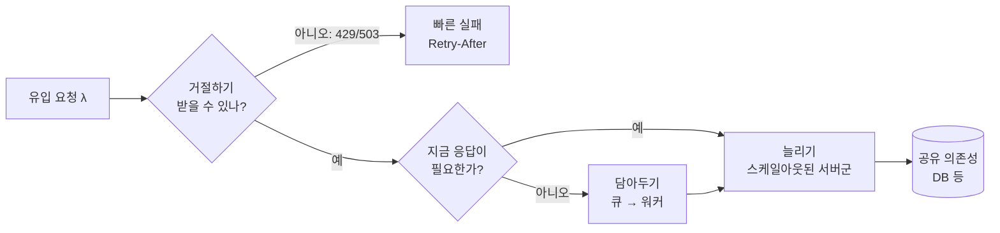
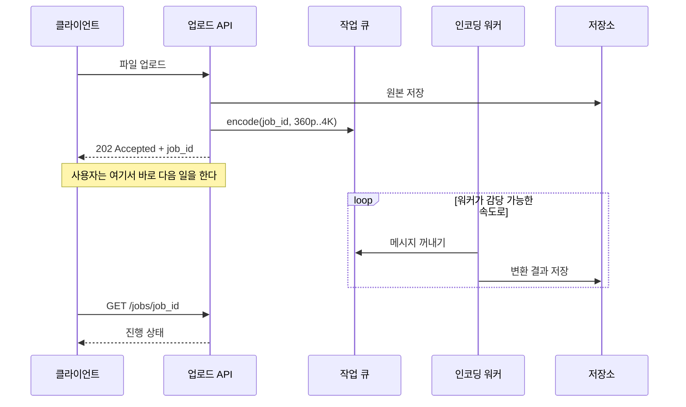
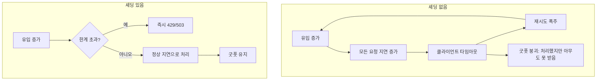
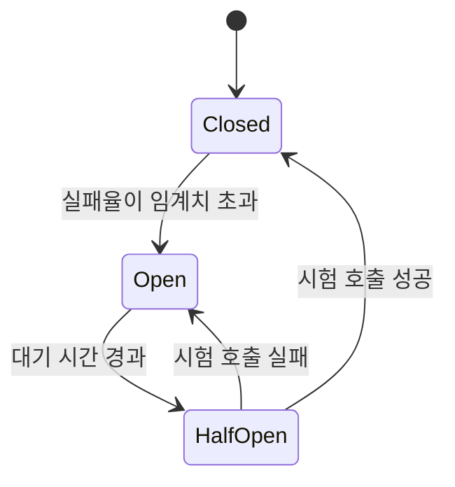
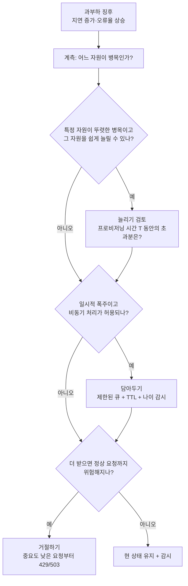
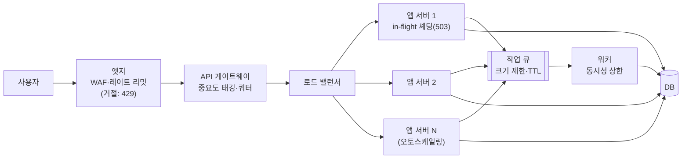

# 서버만 늘리면 해결될까: 과부하에 대응하는 세 가지 전략, 늘리기·담아두기·거절하기

### 트래픽이 처리 능력을 넘을 때 쓸 수 있는 구조적 수단은 셋이다. 처리 능력을 키우거나(Scale), 지금 처리하지 않고 쌓아 두거나(Queue), 일부를 의도적으로 받지 않는다(Shed). 증설은 병목이 다른 곳에 있거나 프로비저닝이 늦으면 듣지 않고, 큐는 처리 능력을 늘려 주지 않으며, 부하 차단은 거절당한 사용자라는 비용을 남긴다. Google SRE의 요청 중요도 4단계와 AWS·Azure 설계 문서를 근거로, 세 전략의 원리와 한계, 이를 받치는 백프레셔·레이트 리밋·데드라인·서킷 브레이커·벌크헤드·브라운아웃, 그리고 겹쳐 쓰는 법을 정리한다

과부하 대응은 흔히 "서버를 더 띄우자"나 "캐시를 넣자"로 시작한다. 둘 다 유효하지만 질문의 범위가 다르다. 캐시는 **부하 자체를 줄이는 최적화**이고, 이 글이 다루는 것은 최적화를 다 하고도 **처리 능력을 넘는 요청이 들어올 때 시스템이 어떻게 행동하게 설계할 것인가**다. 뼈대는 Google [SRE Book, 21장 Handling Overload](https://sre.google/sre-book/handling-overload/)와 [22장 Addressing Cascading Failures](https://sre.google/sre-book/addressing-cascading-failures/), Amazon Builders' Library의 [Using load shedding to avoid overload](https://builder.aws.com/content/3Eun1EEyX6p2e3VYNyRLSJzLuMV/using-load-shedding-to-avoid-overload)(David Yanacek, 2019)와 [Avoiding insurmountable queue backlogs](https://aws.amazon.com/builders-library/avoiding-insurmountable-queue-backlogs/), AWS Well-Architected의 [REL05-BP04 Fail fast and limit queues](https://docs.aws.amazon.com/wellarchitected/latest/reliability-pillar/rel_mitigate_interaction_failure_fail_fast.html)·[REL05-BP07 Emergency levers](https://docs.aws.amazon.com/wellarchitected/latest/reliability-pillar/rel_mitigate_interaction_failure_emergency_levers.html), Microsoft의 [Queue-Based Load Leveling 패턴](https://learn.microsoft.com/en-us/azure/architecture/patterns/queue-based-load-leveling)이다. 같은 저장소의 [스레드 풀 크기 산정과 과부하 대응](../04_Operations_and_SRE/260830_2359_Thread_Pool_Sizing_Formulas_and_API_Server_Overload_Response.md)이 서버 한 대 안쪽을 다뤘다면, 이 글은 시스템 전체 관점의 전략 지도를 그린다.

**본문의 코드는 개념 설명용 재구성 예제이며 운영 환경에서 실행 검증하지 않았다. 수치 예시(도착률·처리율·프로비저닝 시간 등)는 계산 원리를 보여 주기 위한 가정값이고, 특정 서비스의 실측이 아니다.**

## 0. 먼저 용어: 과부하란 무엇인가

쉽게 말하면 과부하는 **식당에 손님이 주방이 감당할 수 있는 속도보다 빨리 들어오는 상태**다. 주방(서버)의 조리 속도를 처리율, 손님이 들어오는 속도를 도착률이라고 부르면, 과부하는 도착률이 처리율을 넘는 순간이다.

| 용어 | 정의 | 식당 비유 |
|---|---|---|
| 도착률 $\lambda$ (arrival rate) | 초당 들어오는 요청 수 | 분당 들어오는 손님 수 |
| 처리율 $\mu$ (service rate) | 시스템이 초당 끝낼 수 있는 요청 수 | 분당 내보낼 수 있는 요리 수 |
| 이용률 $\rho = \lambda / \mu$ (utilization) | 처리 능력 중 실제로 쓰이는 비율 | 주방이 바쁜 정도 |
| 처리량 (throughput) | 서버에 보내진 전체 요청 속도 | 주문서가 들어오는 속도 |
| 굿풋 (goodput) | 오류 없이, **클라이언트가 쓸 수 있을 만큼 빨리** 끝난 요청의 속도 | 손님이 식기 전에 받은 요리 수 |
| 병목 (bottleneck) | 전체 속도를 결정하는 가장 느린 자원 | 화구는 많은데 설거지가 한 명 |

굿풋은 Builders' Library 글의 핵심 개념이다. 서버가 요청을 다 받아서 처리하긴 했는데 클라이언트 타임아웃이 이미 지났다면, 그 처리는 CPU만 쓰고 아무 가치도 만들지 못한 것이다. 같은 글은 중앙값 지연이 클라이언트 타임아웃과 같아지면 요청의 약 절반이 실패한다고 지적한다. **지연 문제가 가용성 문제로 바뀌는 지점**이다.

$\rho \ge 1$이 지속되면 어떤 설계도 모든 요청을 제때 처리할 수 없다. 그때 남는 선택지는 수학적으로 셋뿐이다.

1. $\mu$를 키운다 → **늘리기**
2. 지금의 $\lambda$를 시간축으로 펴서 나중에 처리한다 → **담아두기**
3. 받아들이는 $\lambda$ 자체를 줄인다 → **거절하기**

캐싱은 요청당 비용을 줄여 실질적인 $\mu$를 키우거나, 백엔드에 도달하는 $\lambda$를 줄이는 최적화라서 1·3번과 결과는 비슷하다. 하지만 "처리 능력을 이미 넘었을 때의 행동"을 정하지는 않으므로 이 글에서는 따로 다루지 않는다.

## 1. 한눈에 보기

| 전략 | 무엇을 바꾸나 | 대표 기법 | 잘 맞는 상황 | 한계·대가 |
|---|---|---|---|---|
| **늘리기** (Scale) | 처리율 $\mu$ | 스케일업, 스케일아웃, 오토스케일링 | 특정 자원이 뚜렷한 병목이고, 그 자원을 쉽게 늘릴 수 있을 때 | 병목 이동, 프로비저닝 지연, 비용 |
| **담아두기** (Queue) | 처리 **시점** | 메시지 큐, 비동기 작업, 대기열(가상 대기실) | 일시적 폭주이고 비동기 처리가 허용될 때 | 처리 능력은 그대로, 지속 초과 시 대기열 무한 증가 |
| **거절하기** (Shed) | 받아들이는 $\lambda$ | 로드 셰딩, 레이트 리밋, 429/503 빠른 실패 | 더 받으면 정상 요청까지 무너질 때 | 거절된 사용자의 손실, 정책 설계 필요 |



세 전략은 **배타적인 선택지가 아니라 층위**다. 앞단에서 거절하고, 시간이 걸리는 작업은 큐로 빼고, 남은 동기 요청은 늘린 서버들이 처리한다. 이 조합이 7장의 결론이다.

## 2. 늘리기: 처리 능력 자체를 키운다

### 2.1 스케일업과 스케일아웃

| 구분 | 수직 확장 (Scale-up) | 수평 확장 (Scale-out) |
|---|---|---|
| 방법 | 서버 한 대의 CPU·메모리를 키운다 | 같은 역할의 서버를 여러 대 둔다 |
| 장점 | 코드 변경이 거의 없다. 상태 공유 문제가 없다 | 상한이 사실상 없다. 한 대가 죽어도 버틴다 |
| 단점 | 하드웨어 상한, 교체 시 중단, 단일 장애점 | 서버가 무상태여야 하고 로드 밸런서가 필요하다 |
| 비유 | 요리사 한 명을 더 빠른 사람으로 교체 | 요리사를 여러 명 고용 |

둘 다 실무에서 기본기다. 문제는 "늘리면 늘린 만큼 빨라진다"는 직관이 자주 틀린다는 점이다. 한계는 세 가지다.

### 2.2 한계 1: 병목은 다른 곳에 있을 수 있다

애플리케이션 서버를 10대에서 50대로 늘려도, 뒤에 있는 데이터베이스가 이미 처리 한계라면 전체 처리량은 거의 늘지 않는다. 시스템 전체 처리율은 경로상 가장 느린 자원으로 정해진다.

$$
\mu_{\text{system}} = \min(\mu_{\text{LB}},\ \mu_{\text{app}} \cdot N,\ \mu_{\text{DB}},\ \dots)
$$

오히려 악화되기도 한다. 앱 서버가 늘면 DB 커넥션 수가 늘고, DB의 락 경합과 컨텍스트 스위칭이 커져 DB의 $\mu$가 떨어질 수 있다. Microsoft 문서도 같은 경고를 큐 맥락에서 한다. 소비자 쪽을 오토스케일링하면서 하위 의존성으로 가는 총 속도를 제한하지 않으면 **과부하를 하위 의존성으로 옮길 뿐**이라는 것이다.

이 현상을 정량화한 모델이 Neil Gunther의 **범용 확장성 법칙**(USL, Universal Scalability Law)이다. $N$대(또는 $N$개 스레드)일 때의 처리량을

$$
X(N) = \frac{\lambda_1 N}{1 + \alpha (N-1) + \beta N (N-1)}
$$

로 본다. $\alpha$는 경합(직렬화되는 구간, 암달의 법칙의 그 부분), $\beta$는 일관성 비용(노드끼리 서로 맞추는 비용)이다. $\beta > 0$이면 어떤 $N$을 넘는 순간 **늘릴수록 처리량이 줄어든다**. 쉽게 말하면 회의 참석자가 많아질수록 결정이 느려지는 것과 같다.

### 2.3 한계 2: 확장에는 시간이 걸린다

오토스케일링은 지표를 보고 서버를 띄우는데, 지표 집계·인스턴스 부팅·애플리케이션 워밍업·헬스 체크 통과까지 수십 초에서 수 분이 걸린다. 그동안 들어온 초과 요청은 어딘가에 쌓이거나 실패한다.

**가정값으로 계산해 보자.** 평상시 처리율 $\mu = 1{,}000$ req/s인 서비스에 $\lambda = 1{,}200$ req/s가 들어오고, 새 서버가 투입되기까지 $T = 180$초가 걸린다고 하자.

$$
\text{누적 백로그} = (\lambda - \mu) \cdot T = 200 \times 180 = 36{,}000 \text{ 요청}
$$

180초 뒤 처리율이 $1{,}500$ req/s로 늘어도, 새로 들어오는 1,200을 처리하고 남는 300 req/s로 백로그를 갚아야 하므로

$$
t_{\text{drain}} = \frac{36{,}000}{1{,}500 - 1{,}200} = 120 \text{초}
$$

가 더 걸린다. 그 사이 대부분의 요청은 클라이언트 타임아웃을 넘겼을 가능성이 크다. 굿풋 관점에서는 이미 처리할 가치가 없는 요청이다. Google SRE 22장이 "새로 붙거나 재시작한 클러스터는 캐시가 차가워서 한동안 느리다"(cold cache)며 **부하를 천천히 올리라**고 권하는 것도 같은 맥락이다. 새 서버의 실효 $\mu$는 투입 직후 가장 낮다.

$T$를 줄이거나 미리 치르는 수단은 두 갈래다. 하나는 **무엇을 보고 늘릴지**(스케일링 신호), 다른 하나는 **얼마나 빨리 쓸 수 있는 상태가 되는지**(콜드 스타트)다.

| 스케일링 신호 | 장점 | 함정 |
|---|---|---|
| CPU 사용률 | 기본 제공, 설정이 쉽다 | I/O 대기·락 경합이 병목이면 CPU가 낮은 채로 지연만 는다. 셰딩과 간섭한다(2.4) |
| 대상당 요청 수(RPS) | 부하와 직접 비례 | 요청마다 비용이 다르면 부정확하다(4.4의 QPS 지적과 같은 문제) |
| 동시 처리 수(in-flight) | 리틀의 법칙으로 지연까지 반영한다 | 애플리케이션이 지표를 내보내야 한다 |
| 큐 깊이·가장 오래된 메시지 나이 | 비동기 워커에 가장 정직한 신호 | 깊이만 보면 처리율 차이를 놓친다. 나이를 함께 본다(3.5) |
| 예약·예측 스케일링 | 반응 지연 $T$를 미리 치른다 | 예측이 빗나가면 비용만 쓴다 |

| 콜드 스타트 완화 | 무엇을 줄이나 |
|---|---|
| 넉넉한 `minReplicas`, 웜 풀(미리 부팅해 둔 인스턴스) | 인스턴스 부팅 시간 |
| 가벼운 이미지, 지연 초기화 대신 시작 시 예열 | 애플리케이션 기동·JIT·커넥션 풀 준비 시간 |
| 준비 상태(readiness) 검사를 실제 예열 완료에 맞춤 | 덜 준비된 서버로 트래픽이 가는 것 |
| 로드 밸런서의 슬로 스타트(새 대상에 트래픽을 서서히 늘림) | 차가운 캐시 상태에서의 급격한 부하 |

### 2.4 한계 3: 비용, 그리고 셰딩과의 간섭

무작정 사양과 대수를 늘리면 비용이 선형 이상으로 는다. 그리고 덜 알려진 함정이 하나 있다. Builders' Library 글은 **로드 셰딩과 CPU 기반 스케일링 정책이 비슷한 CPU 수준을 목표로 하면 스케일링이 영원히 트리거되지 않을 수 있다**고 경고한다. 셰딩이 CPU를 목표치 바로 아래로 눌러 두기 때문이다. 셰딩하는 플릿은 CPU 지표가 보여 주는 것보다 훨씬 한계에 가깝게 돌고 있을 수 있어서, 가용 영역 하나를 잃었을 때 버틸 여유가 없을 수도 있다.

### 2.5 예시: 지표와 상한을 함께 둔 오토스케일링

아래는 Kubernetes HPA(Horizontal Pod Autoscaler) 설정의 **재구성 예시**다. 핵심은 (1) 실제 병목을 대표하는 지표를 고르고, (2) 확장은 빠르게·축소는 천천히, (3) `maxReplicas`로 비용 상한과 DB 보호 상한을 동시에 건다는 점이다.

```yaml
apiVersion: autoscaling/v2
kind: HorizontalPodAutoscaler
metadata:
  name: api
spec:
  scaleTargetRef:
    apiVersion: apps/v1
    kind: Deployment
    name: api
  minReplicas: 6          # 평시 + 한 영역 장애를 버틸 최소치
  maxReplicas: 40         # 비용 상한이자, DB 커넥션 총량을 지키는 상한
  metrics:
    - type: Resource
      resource:
        name: cpu
        target:
          type: Utilization
          averageUtilization: 60   # 셰딩 임계치(예: 85%)보다 충분히 낮게
  behavior:
    scaleUp:
      stabilizationWindowSeconds: 0
      policies:
        - type: Percent
          value: 100              # 한 번에 최대 2배까지
          periodSeconds: 30
    scaleDown:
      stabilizationWindowSeconds: 300
```

`maxReplicas`는 "더 늘려도 DB가 받아 주지 못하는 지점"에서 정해야 한다. 그 숫자는 DB의 커넥션 상한과 부하 테스트로 구한다. 오토스케일링 임계치를 셰딩 임계치보다 확실히 낮게 두는 것도 2.4의 함정을 피하는 방법이다.

### 2.6 정리: 늘리기의 판단 기준

- 실제 병목 지점을 먼저 계측으로 확인한다. 늘리는 대상이 병목이 아니면 효과가 없다.
- 프로비저닝 시간 $T$ 동안의 초과분 $(\lambda-\mu)T$를 누가 감당할지 정한다. 답은 보통 큐(3장)나 셰딩(4장)이다.
- 예측 가능한 피크(출근 시간, 티켓 오픈)에는 예약 확장으로 $T$를 미리 지불한다.

## 3. 담아두기: 지금 처리하지 않고 시간축으로 편다

### 3.1 큐 기반 부하 평준화

시스템 앞에 대기열을 두고, 뒤쪽은 **자기가 감당할 수 있는 일정한 속도로** 꺼내 처리한다. Microsoft는 이를 Queue-Based Load Leveling 패턴으로 정리했다. 큐가 버퍼 역할을 해 간헐적인 폭주가 서비스로 그대로 전달되지 않게 하고, 평균 부하에 맞춘 인스턴스만 두면 되므로 비용도 줄어든다.


쉽게 말하면 **댐**이다. 장마철 폭우(스파이크)를 저수지(큐)에 받아 두고, 하류(백엔드)에는 일정한 양만 흘려보낸다. 단, 댐은 강의 유량을 늘려 주지 않는다.

### 3.2 두 가지 모양: 작업을 기다리게 하기, 사람을 기다리게 하기

| 구분 | 작업 대기 | 사용자 대기 |
|---|---|---|
| 예 | 동영상 업로드 후 화질별 인코딩 | 인기 콘서트·명절 기차표 예매 |
| 무엇이 큐에 들어가나 | 처리해야 할 **작업 메시지** | 입장을 기다리는 **사용자 세션** |
| 사용자 경험 | 업로드 접수 즉시 응답, 결과는 나중에 | 대기 순번 화면, 일정 인원씩 순차 입장 |
| 응답 형태 | `202 Accepted` + 작업 ID, 이후 폴링/웹훅 | 대기열 토큰 + 예상 대기 시간 |
| 공통 원리 | 순간적인 부하를 시간축으로 분산 | 동일 |

동영상 플랫폼에 파일을 올리면 모든 화질 변환이 끝날 때까지 기다리지 않는다. 업로드와 작업 접수만 끝나면 먼저 응답하고, 무거운 인코딩은 큐에 담아 뒤쪽 워커가 감당 가능한 속도로 처리한다. 예매 시스템의 가상 대기실은 같은 원리를 사람에게 적용한 것이다. 대기열의 구체 설계는 같은 저장소의 [대규모 티켓팅 대기열 분석](../01_Ticketing_System/260902_0253_Large-Scale_Ticketing_Waiting_Queue_Analysis_and_Bun_Built-in_Implementation.md)에서 다뤘다.



### 3.3 한계: 큐는 처리 능력을 늘려 주지 않는다

큐의 효과는 **평균 도착률이 평균 처리율보다 낮을 때**만 성립한다. 평균적으로 $\lambda > \mu$라면 큐 길이는 시간에 비례해 끝없이 늘고, 대기 시간도 따라 는다. Microsoft 문서도 생산 속도가 소비 속도를 넘으면 큐가 계속 자라고 지연이 커진다며, 큐 깊이를 감시하고 소비자를 안전 범위 안에서 늘리거나 **생산자 쪽에서 작업을 버리라**고 권한다. 담아두기의 한계가 거절하기로 이어지는 지점이다.

$\lambda < \mu$여도 공짜는 아니다. 가장 단순한 대기행렬 모델인 M/M/1(도착과 처리 시간이 모두 무작위인 단일 서버)에서 요청이 시스템에 머무는 평균 시간은

$$
W = \frac{1}{\mu - \lambda} = \frac{1/\mu}{1 - \rho}
$$

이다. 서비스 시간 $1/\mu$ 대비 몇 배를 기다리는지가 $\frac{1}{1-\rho}$로 정해진다.

| 이용률 $\rho$ | 0.5 | 0.8 | 0.9 | 0.95 | 0.99 |
|---|---|---|---|---|---|
| 평균 체류 시간 / 서비스 시간 | 2배 | 5배 | 10배 | 20배 | 100배 |

이용률이 90%를 넘으면 지연은 선형이 아니라 **폭발적으로** 는다. 실제 시스템은 M/M/1보다 복잡하지만, "이용률이 1에 가까워질수록 대기 시간이 급증한다"는 모양은 대부분 유지된다. 큐를 두면 이 대기 시간을 사용자가 보지 않는 곳(비동기 작업)으로 옮길 수는 있어도, 없앨 수는 없다.

또 하나 기억할 공식은 **리틀의 법칙**(Little's Law)이다. 안정 상태에서 시스템 안에 있는 평균 요청 수 $L$은

$$
L = \lambda W
$$

이다. 큐에 쌓인 메시지 수와 도착률을 알면 평균 대기 시간을 거꾸로 추정할 수 있다. 예를 들어 큐에 60,000건이 있고 초당 500건이 들어온다면 평균 대기는 약 120초다(가정값).

### 3.4 큐를 안전하게 쓰는 규칙

AWS Well-Architected REL05-BP04와 Builders' Library, Google SRE 22장이 공통으로 짚는 규칙을 묶으면 다음과 같다.

| 규칙 | 이유 | 출처 |
|---|---|---|
| **큐 크기를 제한한다** | 무제한 큐는 메모리와 지연을 무한히 키운다. SRE 22장은 큐 길이를 스레드 풀 크기의 50% 이하처럼 작게 두라는 예를 든다 | SRE 22장, REL05-BP04 |
| **메시지 나이를 잰다** | 큐 길이보다 "가장 오래된 메시지가 몇 초 기다렸나"가 소비자 지연을 더 정확히 보여 준다 | REL05-BP04 |
| **TTL을 넘긴 작업은 버린다** | 클라이언트가 이미 포기한 요청을 처리하면 굿풋 없이 자원만 쓴다 | Builders' Library, REL05-BP04 |
| **엄격한 순서가 필요 없으면 LIFO·스필오버를 고려한다** | 오래된 백로그가 모든 새 요청을 늦추는 것을 막는다. 오래된 일은 스필오버 큐로 빼고 여유 있을 때 처리 | REL05-BP04, SRE 22장 |
| **처리 불가 메시지는 DLQ로** | 독이 든 메시지(poison message)가 큐를 막지 않게 한다 | REL05-BP04, Azure 패턴 |
| **소비자는 멱등하게** | 대부분의 큐는 최소 1회 전달이라 같은 메시지가 두 번 올 수 있다 | Azure 패턴 |
| **작업 유형별로 큐를 나눈다** | 무거운 작업과 가벼운 작업이 한 큐를 쓰면 백로그가 서로 번진다 | REL05-BP04 |

### 3.5 예시: 크기 제한·TTL·202 응답을 갖춘 비동기 작업 큐

아래는 Python `asyncio`로 쓴 **재구성 예시**다. 외부 브로커 대신 프로세스 내 큐를 쓰지만, 규칙(크기 제한, 가득 차면 거절, 오래된 작업 폐기, 처리 속도 제한)은 SQS·Kafka·RabbitMQ에서도 그대로 적용된다.

```python
import asyncio
import time
import uuid
from dataclasses import dataclass, field

MAX_QUEUE = 1_000          # 큐 크기 상한: 넘으면 받지 않는다
JOB_TTL_SEC = 300          # 5분 넘게 기다린 작업은 가치가 없다고 본다
WORKERS = 4                # 하위 의존성이 감당할 수 있는 동시 처리 수

@dataclass
class Job:
    id: str
    payload: dict
    enqueued_at: float = field(default_factory=time.monotonic)

queue: asyncio.Queue[Job] = asyncio.Queue(maxsize=MAX_QUEUE)
status: dict[str, str] = {}

def submit(payload: dict) -> tuple[int, dict]:
    """HTTP 핸들러가 호출한다고 가정. (상태 코드, 본문)을 돌려준다."""
    job = Job(id=str(uuid.uuid4()), payload=payload)
    try:
        queue.put_nowait(job)                 # 기다리지 않는다
    except asyncio.QueueFull:
        # 담아두기의 한계 → 거절하기로 넘어간다
        return 503, {"error": "busy", "retry_after": 30}
    status[job.id] = "queued"
    return 202, {"job_id": job.id, "status_url": f"/jobs/{job.id}"}

async def encode(payload: dict) -> None:
    await asyncio.sleep(2)                    # 무거운 작업을 흉내 낸다

async def worker(n: int) -> None:
    while True:
        job = await queue.get()
        age = time.monotonic() - job.enqueued_at
        try:
            if age > JOB_TTL_SEC:
                status[job.id] = "expired"    # 이미 늦은 일은 버린다
                continue
            status[job.id] = "running"
            await encode(job.payload)
            status[job.id] = "done"
        except Exception:
            status[job.id] = "failed"         # 실제로는 재시도 횟수 후 DLQ로
        finally:
            queue.task_done()

async def main() -> None:
    workers = [asyncio.create_task(worker(i)) for i in range(WORKERS)]
    for i in range(10):
        print(submit({"video": f"v{i}.mp4"}))
    await queue.join()
    print(status)
    for w in workers:
        w.cancel()

if __name__ == "__main__":
    asyncio.run(main())
```

운영에서는 큐 깊이와 함께 **가장 오래된 메시지의 나이**(SQS라면 `ApproximateAgeOfOldestMessage`)를 경보 지표로 삼는 것이 좋다. 큐 길이 10,000이 많은지 적은지는 처리율에 따라 다르지만, "가장 오래된 작업이 20분째 대기 중"은 누가 봐도 문제다.

## 4. 거절하기: 일부를 포기해 나머지를 지킨다

### 4.1 전력망에서 온 개념

로드 셰딩(load shedding, 부하 차단)은 원래 전력 계통의 용어다. 전력 수요가 공급 능력을 넘어 계통 전체의 주파수가 무너질 위험이 생기면, 운영자는 일부 지역의 전력 공급을 **의도적으로** 끊는다(순환 정전). 일부의 불편으로 대규모 정전(블랙아웃)을 막는 선택이다.

소프트웨어도 같다. 서버가 감당하지 못하는 요청까지 전부 받으면 모든 요청의 응답이 함께 늘어지고, 결국 중요한 요청까지 타임아웃으로 실패한다. 그래서 처리 한계를 넘는 일부 요청을 **빨리** 거절한다.



Builders' Library 글이 그리는 이상적인 결과는 이렇다. 부하 테스트에서 유입을 계속 늘려도 굿풋이 처리 한계 근처에서 **평평하게 유지**되는 것. 셰딩이 없으면 굿풋은 한계를 넘는 순간 꺾여 떨어지고, 재시도가 얹히면서 과부하가 일시적 사건이 아니라 **안정 상태**가 되어 버린다. Google SRE 22장은 과부하를 연쇄 장애(cascading failure)의 가장 흔한 원인으로 꼽는다.

### 4.2 429와 503: 거절에도 문법이 있다

| 상태 코드 | 의미 | 정의 | 언제 |
|---|---|---|---|
| `429 Too Many Requests` | **이 클라이언트가** 정해진 시간 안에 너무 많이 보냈다 | [RFC 6585](https://www.rfc-editor.org/rfc/rfc6585) | 클라이언트별 쿼터·레이트 리밋 초과 |
| `503 Service Unavailable` | **서버가** 일시적 과부하나 유지보수로 지금 처리할 수 없다 | [RFC 9110 §15.6.4](https://www.rfc-editor.org/rfc/rfc9110#name-503-service-unavailable) | 전체 용량 초과로 인한 셰딩 |

둘 다 `Retry-After` 헤더로 "언제 다시 오라"를 알려 줄 수 있다. 클라이언트는 이를 존중하고, 지수 백오프에 무작위 지터를 섞어 재시도해야 한다. 지터가 없으면 거절당한 클라이언트들이 같은 시각에 일제히 다시 몰려와(동기화된 재시도) 두 번째 파도를 만든다.

### 4.3 거절은 싸야 한다

셰딩 자체가 비싸면 의미가 없다. 거절 경로에서 무거운 로깅을 하거나, 요청 본문을 다 읽은 뒤 거절하거나, 인증·DB 조회를 먼저 하면 거절 비용이 처리 비용에 가까워진다. Builders' Library 글은 이 점을 강조하며, 가능한 한 호출 체인의 **앞쪽**에서 거절하라고 권한다.

| 거절 위치 | 장점 | 단점 |
|---|---|---|
| CDN·WAF·API 게이트웨이 | 가장 싸다. 서버에 도달하지 않는다 | 서버 내부 상태(실제 부하)를 모른다 |
| 로드 밸런서·프록시 (연결 수 제한) | 설정이 간단하다 | 우선순위를 두기 어렵고 과부하를 잘못 보고할 수 있다. 최후의 수단 |
| OS (iptables 등) | 애플리케이션보다 훨씬 싸다 | 요청 의미를 모른다 |
| 서비스 프레임워크·서버 | 실제 부하와 요청 중요도를 알아 정확하다 | 요청이 서버까지 와야 한다 |

### 4.4 예시: 동시 처리 수 기반 셰딩 미들웨어

아래는 Go로 쓴 **재구성 예시**다. 동시에 처리 중인 요청 수(in-flight)를 세고, 한계를 넘으면 요청 본문을 읽기 전에 503을 돌려준다. 헬스 체크는 셰딩 대상에서 뺀다. Builders' Library 글이 지적하듯 로드 밸런서의 핑에 실패하면 로드 밸런서가 그 서버로 트래픽을 끊어 버려 상황이 더 나빠지기 때문이다.

```go
package main

import (
	"net/http"
	"sync/atomic"
	"time"
)

type Shedder struct {
	inFlight atomic.Int64
	limit    int64
	rejected atomic.Int64
}

func (s *Shedder) Wrap(next http.Handler) http.Handler {
	return http.HandlerFunc(func(w http.ResponseWriter, r *http.Request) {
		if r.URL.Path == "/healthz" { // 헬스 체크는 절대 셰딩하지 않는다
			next.ServeHTTP(w, r)
			return
		}
		if s.inFlight.Add(1) > s.limit {
			s.inFlight.Add(-1)
			s.rejected.Add(1)             // 거절도 지표로 남긴다 (로그는 샘플링)
			w.Header().Set("Retry-After", "1")
			w.WriteHeader(http.StatusServiceUnavailable)
			return                        // 본문을 읽기 전에 끝낸다: 거절은 싸야 한다
		}
		defer s.inFlight.Add(-1)
		next.ServeHTTP(w, r)
	})
}

func main() {
	s := &Shedder{limit: 64} // 부하 테스트로 정한 서버당 동시 처리 한계
	mux := http.NewServeMux()
	mux.HandleFunc("/healthz", func(w http.ResponseWriter, _ *http.Request) { w.WriteHeader(200) })
	mux.HandleFunc("/work", func(w http.ResponseWriter, _ *http.Request) {
		time.Sleep(50 * time.Millisecond)
		w.Write([]byte("ok"))
	})
	http.ListenAndServe(":8080", s.Wrap(mux))
}
```

동시 처리 수 대신 CPU 사용률, 큐 길이, 요청 대기 시간을 신호로 쓸 수도 있다. Google SRE 21장은 주로 **예약 CPU 대비 사용률**과, 실행 중이거나 실행 대기 중인 스레드 수를 지수 감쇠로 평활한 **실행기 부하 평균**(executor load average)을 신호로 쓰고, 이 값이 태스크에 할당된 프로세서 수를 넘으면 거절을 시작한다고 설명한다. 같은 장은 "초당 쿼리 수(QPS)"가 용량을 모델링하는 지표로는 부실하다고 지적한다. 요청마다 비용이 다르고 요청 구성 비율도 시간에 따라 바뀌기 때문이다.

### 4.5 클라이언트 쪽 셰딩: 적응형 스로틀링과 재시도 예산

거절도 비용이 든다. 백엔드가 거절하느라 바쁠 정도로 요청이 몰리면 클라이언트 스스로 덜 보내야 한다. Google SRE 21장의 **적응형 스로틀링**(adaptive throttling)에서 각 클라이언트는 최근 2분 동안 시도한 요청 수 $\text{requests}$와 백엔드가 받아 준 수 $\text{accepts}$를 세고, 아래 확률로 요청을 **로컬에서** 거절한다(책의 "Client request rejection probability" 식).

$$
p_{\text{reject}} = \max\left(0,\ \frac{\text{requests} - K \cdot \text{accepts}}{\text{requests} + 1}\right)
$$

평소에는 $\text{requests} \approx \text{accepts}$라 $p = 0$이다. 백엔드가 거절을 시작해 $\text{requests}$가 $K \cdot \text{accepts}$를 넘으면 그때부터 클라이언트가 스스로 걸러 낸다. 책은 $K = 2$를 선호한다고 밝힌다. $K$가 작을수록 공격적으로 거른다.

재시도도 예산으로 묶는다. 같은 장의 규칙은 두 가지다.

- **요청당** 최대 3번 시도. 세 번 실패하면 호출자에게 실패를 올린다.
- **클라이언트당** 재시도 비율을 전체 요청의 10% 미만으로 유지.

책은 요청당 제한만 있으면 최악의 경우 부하가 3배 가까이 불어나지만, 클라이언트당 예산을 더하면 일반적인 경우 약 1.1배로 줄어든다고 설명한다. 그리고 재시도는 **거절한 계층 바로 위에서만** 하라고 권한다. 여러 계층이 각자 재시도하면 조합 폭발이 일어나기 때문이다. SRE 22장은 3계층이 각각 4번씩 시도하면 사용자 동작 하나가 DB에 $4^3 = 64$번의 시도를 만든다는 예를 들고, Builders' Library의 [Timeouts, retries, and backoff with jitter](https://builder.aws.com/content/3EumjoZascWd1oZiEgL8ORlv3qE/timeouts-retries-and-backoff-with-jitter)(Marc Brooker, 2019)는 5계층이 각각 3번씩 재시도하면 DB 부하가 243배($3^5$)까지 늘 수 있다고 쓴다.

```python
# 재구성 예시: 적응형 스로틀링 + 재시도 예산을 갖춘 클라이언트
import random, time
from collections import deque

class AdaptiveThrottle:
    def __init__(self, k: float = 2.0, window: float = 120.0):
        self.k, self.window = k, window
        self.events: deque[tuple[float, bool]] = deque()   # (시각, 수락 여부)

    def _trim(self) -> None:
        cutoff = time.monotonic() - self.window
        while self.events and self.events[0][0] < cutoff:
            self.events.popleft()

    def allow(self) -> bool:
        self._trim()
        requests = len(self.events)
        accepts = sum(1 for _, ok in self.events if ok)
        p = max(0.0, (requests - self.k * accepts) / (requests + 1))
        return random.random() >= p

    def record(self, accepted: bool) -> None:
        self.events.append((time.monotonic(), accepted))

class RetryBudget:
    """클라이언트당 재시도 비율을 전체 요청의 ratio 미만으로 묶는다."""
    def __init__(self, ratio: float = 0.1):
        self.ratio, self.requests, self.retries = ratio, 0, 0

    def can_retry(self) -> bool:
        return self.retries < self.ratio * self.requests

def call_with_budget(send, throttle: AdaptiveThrottle, budget: RetryBudget,
                     max_attempts: int = 3, base: float = 0.1, cap: float = 2.0):
    budget.requests += 1
    for attempt in range(max_attempts):              # 요청당 최대 3번 시도
        if attempt > 0:
            if not budget.can_retry():
                raise RuntimeError("client retry budget exhausted")
            budget.retries += 1
        if not throttle.allow():
            throttle.record(False)                    # 로컬 거절도 requests에 센다
            raise RuntimeError("locally throttled")   # 백엔드에 보내지도 않는다
        status = send()
        throttle.record(status not in (429, 503))
        if status < 500 and status != 429:
            return status
        if attempt < max_attempts - 1:
            # 지수 백오프 + 풀 지터: [0, min(cap, base * 2^attempt)] 중 무작위
            time.sleep(random.uniform(0, min(cap, base * (2 ** attempt))))
    raise RuntimeError("per-request attempts exhausted")
```

`RetryBudget`은 시간 창 없이 누적 카운터로 단순화했고, 운영에서는 이런 로직을 직접 짜기보다 gRPC의 재시도 정책이나 AWS SDK의 재시도 모드처럼 검증된 구현을 쓰는 편이 안전하다.

## 5. 무엇부터 거절할 것인가: 요청 중요도

### 5.1 Google의 4단계 중요도

무작위로 거절하면 결제 요청과 추천 위젯 요청이 같은 확률로 떨어진다. 그래서 **언제, 어떤 요청을 거절할지 정책을 미리 정해 두는 것**이 셰딩의 핵심이다. Google SRE 21장은 모든 요청에 중요도(criticality)를 붙이는 설계를 소개한다.

| 중요도 | 정의 (SRE Book 21장 요지) | 계열 |
|---|---|---|
| `CRITICAL_PLUS` | 가장 중요한 요청. 실패하면 사용자가 체감하는 심각한 영향 | 크리티컬 |
| `CRITICAL` | 프로덕션 작업의 기본값. 사용자 영향은 있지만 `CRITICAL_PLUS`보다 덜함 | 크리티컬 |
| `SHEDDABLE_PLUS` | 부분적 비가용이 예상되는 트래픽. 배치 작업의 기본값 | 셰더블 |
| `SHEDDABLE` | 잦은 부분 비가용과 가끔의 완전 비가용이 예상되는 트래픽 | 셰더블 |

과부하가 오면 낮은 중요도부터 거절한다. 백엔드는 `SHEDDABLE`을 먼저 다 거절한 뒤에야 `SHEDDABLE_PLUS`를, 그다음 `CRITICAL`을 거절하는 식이다. 책은 중요도가 RPC 호출을 따라 하위 서비스로 **전파**된다는 점도 설명한다. 사용자 요청이 `CRITICAL`이면 그 요청을 처리하려고 내부에서 부르는 호출도 같은 중요도를 갖게 되어, 하위 서비스도 같은 기준으로 판단할 수 있다.

### 5.2 빨라야 하는 것과 중요한 것은 다르다

검색창의 자동 완성을 생각해 보자. 한 글자 칠 때마다 수십 밀리초 안에 추천어가 떠야 하니 **지연 요구사항은 매우 엄격**하다. 하지만 과부하 상황에서 추천어가 잠시 안 나온다고 검색 서비스 전체를 쓸 수 없는 것은 아니다. 사용자는 그냥 검색어를 끝까지 치고 엔터를 누르면 된다. 즉 자동 완성은 **빨라야 하지만 셰더블**이다.

반대로 야간 정산 배치는 몇 시간이 걸려도 되지만, 완료되지 않으면 다음 날 업무가 멈출 수 있다. **느려도 되지만 중요할 수** 있다.

| | 중요도 높음 | 중요도 낮음 |
|---|---|---|
| **지연 요구 엄격** | 결제 승인, 로그인 | 자동 완성, 실시간 추천 |
| **지연 요구 느슨** | 정산 배치, 주문 확정 후처리 | 크롤러 트래픽, 통계 집계 |

두 축을 하나로 섞으면 "빠른 것 = 중요한 것"이라는 착각으로 정작 결제를 먼저 버리는 정책이 나온다. 중요도와 응답 시간 요구사항은 **별개로 판단**해야 한다.

### 5.3 무엇을 먼저 지킬지에 대한 실무 감각

Builders' Library 글의 우선순위 원칙도 함께 볼 만하다.

- 로드 밸런서 헬스 체크는 가장 중요하다. 실패하면 서버가 통째로 빠진다.
- 사람이 보낸 요청이 백그라운드 크롤러보다 중요하다.
- **이미 시작한 일을 끝내는 요청**이 새 일을 시작하는 요청보다 중요하다. 예: 결제 흐름의 마지막 단계가 첫 단계보다, 페이지네이션의 뒷 페이지가 첫 페이지보다 우선.
- 쿼터 안의 요청이 쿼터를 넘은 버스트 요청보다 중요하다.

### 5.4 예시: 중요도별 임계치를 둔 셰딩

4.4의 미들웨어를 확장해, 이용률이 높아질수록 낮은 중요도부터 차례로 거절하는 **재구성 예시**다. 중요도는 게이트웨이가 인증·경로 규칙으로 붙인 헤더(`X-Criticality`)에서 읽는다고 가정한다. 외부 클라이언트가 이 헤더를 마음대로 올리지 못하게, 게이트웨이에서 덮어써야 한다.

```go
type Criticality int

const (
	Sheddable Criticality = iota
	SheddablePlus
	Critical
	CriticalPlus
)

// 이용률(in-flight / limit)이 이 값을 넘으면 해당 중요도부터 거절한다. (가정값)
var shedAt = map[Criticality]float64{
	Sheddable:     0.70,
	SheddablePlus: 0.85,
	Critical:      1.00,
	CriticalPlus:  1.20, // 여유 슬롯을 따로 남겨 둔다
}

func parseCriticality(h string) Criticality {
	switch h {
	case "CRITICAL_PLUS":
		return CriticalPlus
	case "CRITICAL":
		return Critical
	case "SHEDDABLE_PLUS":
		return SheddablePlus
	case "SHEDDABLE":
		return Sheddable
	}
	return Critical // SRE Book처럼 기본값은 CRITICAL
}

func (s *Shedder) admit(r *http.Request) bool {
	c := parseCriticality(r.Header.Get("X-Criticality"))
	util := float64(s.inFlight.Load()) / float64(s.limit)
	return util < shedAt[c]
}
```

이 `admit`은 4.4 `Wrap`의 `s.inFlight.Add(1) > s.limit` 검사를 **대체**해야 한다. 고정 한도 검사를 그대로 두면 `limit`에서 모두 잘려 `CriticalPlus`에 남겨 둔 여유 슬롯(1.20)이 쓰이지 않는다. 또 `Load`와 비교가 원자적이지 않아 한도를 몇 개 넘길 수 있는데, 셰딩 판단은 근사로 충분하므로 예시에서는 허용했다.

## 6. 세 전략을 받치는 주변 장치

늘리기·담아두기·거절하기는 "무엇을 할지"를 정하는 전략이고, 실제 시스템에서는 이를 받치는 장치들이 함께 돈다. 이름은 많지만 하는 일은 결국 셋 중 하나로 돌아간다. 유입을 조절하거나(거절의 변형), 기다림의 길이를 제한하거나(담아두기의 안전장치), 장애가 번지는 범위를 줄인다.

| 장치 | 한 줄 정의 | 비유 | 세 전략과의 관계 |
|---|---|---|---|
| 백프레셔 | 하류가 느리면 상류에 "천천히 보내라"는 신호를 되돌린다 | 컨베이어 끝이 막히면 앞 공정이 멈춘다 | 담아두기의 상한 + 거절의 전파 |
| 레이트 리밋 | 클라이언트별로 정해진 속도까지만 받는다 | 놀이기구 1인당 탑승권 수 | 거절(공정성 기준) |
| 타임아웃·데드라인 전파 | 기다림에 상한을 두고, 남은 시간을 하위 호출에 넘긴다 | 택배 "오늘 6시까지만 받음" | 담아두기의 한계 관리 |
| 백오프 + 지터 | 실패 후 재시도 간격을 지수적으로, 무작위로 벌린다 | 막힌 출입문 앞에서 다 같이 밀지 않기 | 거절 이후의 클라이언트 예절 |
| 서킷 브레이커 | 계속 실패하는 의존성 호출을 잠시 끊는다 | 누전 차단기(두꺼비집) | 호출자 쪽에서 하는 거절 |
| 벌크헤드 | 자원을 칸막이로 나눠 한 곳의 고장이 전체로 번지지 않게 한다 | 선박의 격벽 | 거절 범위를 국소화 |
| 우아한 저하·브라운아웃 | 핵심 기능만 남기고 부가 기능을 줄여 요청당 비용을 낮춘다 | 정전 대신 조명만 어둡게 | 실효 $\mu$를 늘리는 거절 |
| 승인 제어·적응형 동시성 | 지금 받아도 제때 끝낼 수 있는 요청만 들인다 | 식당 입구의 "지금 앉으면 30분 대기" 판단 | 거절의 결정 로직 |

### 6.1 백프레셔: 막힘을 위로 전달한다

쉽게 말하면 **수도꼭지를 잠그라고 하류가 상류에 알려 주는 것**이다. 크기가 정해진 큐가 가득 차면 생산자의 `put`이 막히거나(블로킹) 즉시 실패하고(3.5의 `QueueFull` → 503), 그 신호가 호출 체인을 거슬러 올라가 결국 맨 앞에서 거절이나 대기로 바뀐다. TCP 흐름 제어의 수신 윈도, Reactive Streams의 `request(n)`, gRPC/HTTP/2의 흐름 제어 윈도가 모두 같은 원리다.

백프레셔가 없는 시스템은 무제한 큐가 신호를 삼켜 버려, 상류는 아무 문제가 없다고 믿고 계속 보내다가 메모리 부족이나 타임아웃 폭주로 한꺼번에 무너진다. 자바 서버 안에서 이를 구현하는 방법은 같은 저장소의 [스레드 풀 크기 산정과 과부하 대응](../04_Operations_and_SRE/260830_2359_Thread_Pool_Sizing_Formulas_and_API_Server_Overload_Response.md) 8.5절에서 다뤘다.

### 6.2 레이트 리밋: 토큰 버킷과 리키 버킷

레이트 리밋과 로드 셰딩은 둘 다 거절이지만 기준이 다르다. **레이트 리밋은 클라이언트별 계약**(이 키는 초당 100건까지)을 지키는 것이고 서버가 한가해도 동작한다. 응답은 429다. **로드 셰딩은 서버 상태**(지금 감당할 수 있나)를 보고 판단하며 응답은 503이다. 레이트 리밋만으로는 정상 고객 다수가 동시에 몰리는 과부하를 막지 못하고, 셰딩만으로는 한 클라이언트의 폭주가 다른 고객의 몫을 빼앗는 것을 막지 못한다. 둘 다 필요하다.

| 알고리즘 | 동작 | 버스트 | 쓰임 |
|---|---|---|---|
| **토큰 버킷** | 버킷에 초당 $r$개 토큰이 최대 $b$개까지 찬다. 요청 하나가 토큰 하나를 쓰고, 없으면 거절 | 최대 $b$개까지 허용 | API 게이트웨이, 클라이언트 쿼터. AWS REL05-BP02가 권하는 방식 |
| **리키 버킷** | 요청을 버킷(큐)에 넣고 일정 속도 $r$로 흘려보낸다. 넘치면 버린다 | 출력에는 버스트가 없다 | 트래픽 셰이핑, 하위 의존성 보호 |
| 고정 창 카운터 | 1분 단위로 개수를 센다 | 창 경계에서 최대 2배 | 구현이 가장 쉽다 |
| 슬라이딩 창 | 최근 $w$초 동안의 개수를 센다 | 경계 문제를 줄인다 | 정밀한 쿼터 |

토큰 버킷의 상태 갱신은 한 줄이다. 마지막 갱신 후 $\Delta t$초가 지났다면

$$
\text{tokens} \leftarrow \min\left(b,\ \text{tokens} + r \cdot \Delta t\right)
$$

로 채운 뒤, $\text{tokens} \ge 1$이면 1을 빼고 통과시킨다. 장기 평균은 $r$로 묶이고, 짧은 폭주는 $b$까지 흡수한다. 담아두기와 거절하기를 숫자 두 개로 섞어 놓은 셈이다. Go라면 `golang.org/x/time/rate`의 `rate.NewLimiter(r, b)`가 이 알고리즘의 구현이다. [AWS REL05-BP02 Throttle requests](https://docs.aws.amazon.com/wellarchitected/latest/reliability-pillar/rel_mitigate_interaction_failure_throttle_requests.html)는 API Gateway가 계정·스테이지·사용량 계획 단위로 토큰 버킷을 적용하고 한도를 넘으면 429를 돌려준다고 설명한다.

### 6.3 타임아웃과 데드라인 전파

타임아웃이 없으면 큐에 쌓인 요청은 영원히 기다리고, 그동안 스레드·커넥션·메모리를 붙잡는다. Builders' Library의 Brooker 글은 하위 서비스 지연의 높은 백분위수(예: 거짓 타임아웃을 0.1%로 허용한다면 p99.9)를 기준으로 타임아웃을 정하라고 권한다.

여러 계층을 지나면 **데드라인 전파**가 필요하다. SRE 22장은 백엔드를 호출할 때마다 새 타임아웃을 지어내지 말고, 사용자 요청에서 시작된 마감 시각을 하위 호출로 넘기라고 쓴다. 각 계층은 작업을 시작하기 전에 남은 시간을 확인해, 이미 지났거나 남은 시간으로는 끝낼 수 없으면 **시작하지 않는다**. 3.4의 "TTL을 넘긴 작업은 버린다"를 동기 호출에 적용한 것이고, 굿풋 없는 작업을 체인 전체에서 걷어 낸다. gRPC의 deadline이 대표적인 구현이며, Rust로 구현한 예는 같은 저장소의 [MSA 회복탄력성](../../02_Rust/03_Axum_MSA/260912_1430_msa_resilience.md) 5장에 있다.

```go
// 재구성 예시: 남은 시간이 부족하면 하위 호출을 시작하지 않는다
func handle(w http.ResponseWriter, r *http.Request) {
	ctx := r.Context() // 상위에서 받은 데드라인이 담겨 있다고 가정
	if dl, ok := ctx.Deadline(); ok && time.Until(dl) < 20*time.Millisecond {
		http.Error(w, "deadline too close", http.StatusServiceUnavailable)
		return
	}
	ctx, cancel := context.WithTimeout(ctx, 200*time.Millisecond) // 상위 데드라인보다 길어지지 않는다
	defer cancel()
	_ = callBackend(ctx) // 하위 호출에 같은 ctx를 넘겨 데드라인을 전파한다
}
```

`context.WithTimeout`은 부모 컨텍스트의 데드라인이 더 이르면 그쪽을 따르므로, 하위 호출의 마감은 자연스럽게 짧아진다.

### 6.4 재시도: 지수 백오프와 지터

재시도는 일시적 실패에는 약이지만 과부하에는 독이다. Brooker는 재시도를 "이기적"이라고 표현한다. 내 요청의 성공 확률을 높이려고 서버 용량을 더 쓰기 때문이다. 안전하게 쓰는 규칙은 네 가지로 정리된다.

1. **지수 백오프**: 기다리는 시간을 $\text{base} \cdot 2^n$으로 늘리고 상한 $\text{cap}$을 둔다.
2. **지터**: 같은 시각에 실패한 클라이언트들이 같은 시각에 돌아오지 않게 무작위성을 섞는다. AWS Architecture 블로그의 [Exponential Backoff And Jitter](https://aws.amazon.com/blogs/architecture/exponential-backoff-and-jitter/)가 비교한 방식 중 "풀 지터"는 $\text{sleep} = \text{random}\left(0,\ \min(\text{cap},\ \text{base} \cdot 2^n)\right)$이다(4.5 코드가 이 방식이다).
3. **예산**: 요청당 시도 횟수와 클라이언트당 재시도 비율을 함께 제한한다(4.5). Brooker 글은 AWS SDK가 토큰 버킷으로 재시도를 제한한다고 소개한다. 토큰이 있는 동안만 재시도하고, 다 쓰면 정해진 속도로만 재시도한다.
4. **한 계층에서만**: 재시도는 스택의 한 지점에서만 한다(4.5의 64배·243배 예).

멱등하지 않은 연산(결제, 주문 생성)은 재시도 전에 멱등성 키로 중복 실행을 막아야 한다.

### 6.5 서킷 브레이커: 호출하는 쪽에서 끊는다

하위 의존성이 계속 실패하는데도 호출을 계속하면 호출자는 타임아웃만큼 자원을 붙잡히고, 이미 쓰러진 의존성은 회복할 틈을 얻지 못한다. 서킷 브레이커는 실패율이 임계치를 넘으면 회로를 **열어** 일정 시간 호출 자체를 하지 않고 즉시 실패(또는 대체 응답)한다. 시간이 지나면 **반열림** 상태에서 소수의 시험 호출만 보내 회복 여부를 본다. Michael Nygard의 『Release It!』이 널리 알린 패턴이며, [Martin Fowler](https://martinfowler.com/bliki/CircuitBreaker.html)와 [Azure 아키텍처 센터](https://learn.microsoft.com/en-us/azure/architecture/patterns/circuit-breaker)에 정리돼 있다.



서킷 브레이커는 **호출자 쪽에서 하는 로드 셰딩**이고, 4.5의 적응형 스로틀링과 목적이 같다. 차이는 서킷 브레이커가 열림·닫힘의 이산 상태를 갖는 반면 적응형 스로틀링은 확률을 연속적으로 바꾼다는 점이다. Brooker 글은 서킷 브레이커가 시험하기 어려운 모드 전환 동작을 들여오고 복구 시간을 늘릴 수 있다며, 재시도 제한에는 로컬 토큰 버킷을 선호한다고 밝힌다. 의존성 단위로 완전히 끊는 판단이 필요할 때는 서킷 브레이커를, 부하를 매끄럽게 줄이고 싶을 때는 적응형 스로틀링을 쓰는 식으로 나눠 생각할 수 있다.

### 6.6 벌크헤드: 고장의 반경을 줄인다

배의 격벽처럼 자원을 칸으로 나눈다. 의존성마다 별도의 커넥션 풀·스레드 풀·동시성 한도를 두면, 느려진 추천 서비스가 결제 호출에 쓸 스레드까지 다 잡아먹는 일을 막을 수 있다. 셰딩과 결합하면 "추천용 칸이 가득 찼으니 추천 요청만 거절"처럼 거절 범위를 국소화할 수 있다. 3.4의 "작업 유형별로 큐를 나눈다"도 큐에 적용한 벌크헤드다. 테넌트별 칸을 두면 한 고객의 폭주가 다른 고객을 해치지 않는다. 구현 예는 [스레드 풀 크기 산정과 과부하 대응](../04_Operations_and_SRE/260830_2359_Thread_Pool_Sizing_Formulas_and_API_Server_Overload_Response.md) 8.6절과 [Azure Bulkhead 패턴](https://learn.microsoft.com/en-us/azure/architecture/patterns/bulkhead)을 참고한다.

### 6.7 우아한 저하와 브라운아웃

거절이 "요청 전체를 버린다"면, **우아한 저하**(graceful degradation)는 "요청은 받되 덜 비싸게 처리한다"다. SRE 22장은 이를 로드 셰딩을 한 단계 더 밀고 나간 것으로 설명한다. 검색이라면 전체 인덱스 대신 일부만 뒤지거나, 정확도가 낮은 로컬 캐시 결과를 돌려주는 식이다. 요청당 비용이 줄어드니 같은 서버로 실효 $\mu$가 커진다.

**브라운아웃**은 이를 자동 다이얼로 만든 개념이다. Klein 등이 ICSE 2014 논문 "Brownout: Building More Robust Cloud Applications"에서 제안했다. 응답을 필수 부분과 선택 부분(추천 상품, 개인화 위젯)으로 나누고, 부하에 따라 선택 부분을 제공하는 비율을 0~100% 사이에서 조절한다. 블랙아웃 대신 조명만 어둡게 한다는 이름 그대로다. AWS [REL05-BP07](https://docs.aws.amazon.com/wellarchitected/latest/reliability-pillar/rel_mitigate_interaction_failure_emergency_levers.html)의 비상 레버(비핵심 기능 끄기, 기능 플래그)는 같은 생각을 사람이 당기는 스위치로 구현한 것이다.

주의할 점은 SRE 22장의 경고대로 저하 모드가 **평소에 거의 쓰이지 않는 코드 경로**라는 것이다. 정기적으로 실제로 켜 보지 않으면 정작 필요할 때 동작하지 않는다. 또 저하 판단 자체가 무거우면 의미가 없으므로 단순해야 한다.

### 6.8 승인 제어, 적응형 동시성, LIFO·CoDel

로드 셰딩은 넓게 보면 **승인 제어**(admission control)의 한 형태다. 요청을 받기 전에 "지금 들이면 제때 끝낼 수 있는가"를 판단한다. 4.4의 고정 한도 64는 부하 테스트로 정한 상수인데, 하위 의존성이 느려지면 적정 동시성도 줄어든다. 그래서 측정한 지연을 보고 한도를 스스로 조정하는 **적응형 동시성 한도**가 나왔다. TCP 혼잡 제어(AIMD, Vegas)에서 아이디어를 빌린 Netflix의 [concurrency-limits](https://github.com/Netflix/concurrency-limits) 라이브러리가 대표적이다. 지연이 최소 지연 대비 늘어나면 한도를 줄이고, 여유가 있으면 조금씩 늘린다.

큐의 **꺼내는 순서**도 승인 제어다. SRE 22장은 기본 FIFO 대신 LIFO나 CoDel(Controlled Delay) 알고리즘을 쓰면 이미 포기했을 요청을 처리하는 낭비를 줄일 수 있다고 쓴다. Facebook의 Ben Maurer가 ACM Queue에 쓴 "Fail at Scale"(2015)은 둘을 결합한다. 평소에는 FIFO로 처리하다가 큐가 쌓이기 시작하면 LIFO로 바꾸고(adaptive LIFO), 큐가 일정 시간 이상 비지 않으면 대기 타임아웃을 아주 짧게 줄여(CoDel 변형) 오래 기다린 요청을 빨리 버린다. 새로 온 요청은 데드라인 안에 끝날 확률이 가장 높으므로 먼저 처리하는 편이 굿풋이 높다는 논리다.

## 7. 어떤 전략을 언제 고르나

### 7.1 판단 흐름



| 상황 | 1순위 | 보조 |
|---|---|---|
| 앱 서버 CPU만 포화, DB는 여유 | 늘리기 | 셰딩으로 확장 지연 구간 보호 |
| DB가 포화, 앱 서버는 여유 | 앱 서버 증설은 무의미. 쓰기를 큐로, 읽기를 캐시로 | 셰딩 |
| 인코딩·메일 발송 같은 무거운 비동기 작업 폭주 | 담아두기 | 소비자 확장(하위 의존성 한도 안에서) |
| 티켓 오픈처럼 예측 가능한 초단기 폭주 | 예약 확장 + 사용자 대기열 | 대기열 앞단의 셰딩 |
| 원인 불명의 급증, 연쇄 장애 조짐 | 거절하기 | 원인 파악 후 늘리기 |

### 7.2 겹쳐 쓰기: 층위적 방어

세 전략은 함께 쓸 때 가장 강하다. 서버는 여러 대로 늘리고, 시간이 걸리는 작업은 큐에 담고, 그래도 감당할 수 없는 요청은 앞단에서 거절한다. AWS 문서들이 권하는 방향도 같다. Builders' Library 글은 엣지(CloudFront·WAF·API Gateway), OS, 서버 프레임워크 각 층에서 셰딩하되 서버가 가장 정확한 판단을 하도록 **층을 겹치라**("Protecting in layers")고 하고, 오토스케일링과 셰딩을 보완 관계로 다루되 잘못 설정하면 셰딩이 반응형 스케일링을 막는다고 경고한다(2.4). 즉 "확장과 부하 차단을 함께 쓰는 다층 방어"는 문서의 문구 그대로가 아니라 이 두 대목을 합친 요지다. Well-Architected REL05는 스로틀링(BP02), 재시도 제한(BP03), 빠른 실패와 큐 제한(BP04), 비상 레버(BP07)를 한 묶음의 상호작용 장애 완화책으로 다룬다.



시간축으로 보면 역할 분담이 더 분명하다.

| 시간 규모 | 무엇이 버티나 |
|---|---|
| 밀리초~초 | 셰딩, 동시성 제한, 빠른 실패 |
| 초~분 | 큐가 폭주를 흡수, 오토스케일링이 시작 |
| 분~시간 | 늘어난 서버가 정상 처리, 큐 백로그 소진 |
| 일~주 | 용량 계획, 예약 확장, 아키텍처 개선 |

Google SRE 22장도 오토스케일링이 과부하를 막는 데 도움이 될 수 있지만 **적절한 용량 계획은 여전히 필요**하다고 쓴다. 각 층은 다른 층이 반응하기 전의 시간을 벌어 주는 역할이다.

## 8. 트레이드오프 정리

| 전략 | 얻는 것 | 내주는 것 | 숨은 위험 |
|---|---|---|---|
| 늘리기 | 처리 능력, 가용성 | 비용, 운영 복잡도 | 병목 이동, 확장 지연, 셰딩과의 지표 간섭 |
| 담아두기 | 폭주 흡수, 평균 용량 기준 비용 | 즉시성, 순서 보장, 멱등성 설계 부담 | 무제한 큐, 처리 불가능한 백로그, 늦게 처리된 무가치한 작업 |
| 거절하기 | 나머지 요청의 안정성, 굿풋 | 거절된 사용자의 경험 | 재시도 폭주, 헬스 체크 셰딩, 거짓 양성 거절 |

비용 관점으로 다시 보면 세 전략은 **언제, 누가 값을 치르는가**가 다르다.

| 전략 | 비용이 드는 시점 | 비용의 모양 | 줄이는 방법 |
|---|---|---|---|
| 늘리기 | 평소(여유 용량)와 피크(추가 인스턴스) 모두 | 인프라 비용. 가용 영역 하나를 잃어도 버티려면 평시에도 $N+1$ 이상의 여유가 필요하다 | 예약·예측 스케일링, 적정 `minReplicas`, 축소는 천천히 |
| 담아두기 | 폭주 때 | 브로커 운영비는 작지만, 대기 시간이라는 사용자 비용과 멱등성·DLQ 설계라는 개발 비용 | 평균 용량에 맞춘 소비자 + 큐 나이 기반 확장 |
| 거절하기 | 폭주 때 | 잃어버린 요청(매출·신뢰). 인프라 비용은 거의 없다 | 중요도 기반 셰딩, 저하 모드로 "완전 거절"을 "부분 응답"으로 바꾸기 |

평소에 늘리기로 여유를 많이 사 둘수록 거절이 드물어지고, 여유를 적게 둘수록 담아두기와 거절하기가 자주 일한다. 이 균형점은 기술이 아니라 **비즈니스가 감수할 손실**로 정해진다.

어떤 선택이든 비용이 따른다. 과부하 설계는 "어떻게 다 처리할까"가 아니라 **무엇을 지금 처리하고, 무엇을 기다리게 하고, 무엇을 거절할지**를 정하는 문제다.

## 9. 실무 체크리스트

- [ ] 서비스별 처리 한계(서버당 동시 처리 수, 굿풋이 꺾이는 지점)를 **한계를 넘는 부하 테스트**로 측정했다
- [ ] 늘리기 전에 병목 자원을 계측으로 확인했다. `maxReplicas`가 DB 커넥션 한도와 맞물려 있다
- [ ] 오토스케일링 임계치가 셰딩 임계치보다 충분히 낮다
- [ ] 모든 큐에 크기 상한, 메시지 TTL, DLQ, **가장 오래된 메시지 나이** 경보가 있다
- [ ] 큐 소비자가 멱등하다. 하위 의존성으로 가는 총 속도에 상한이 있다
- [ ] 셰딩은 본문을 읽기 전, 인증·DB 조회 전에 일어나며 헬스 체크는 셰딩하지 않는다
- [ ] 클라이언트별 쿼터 초과는 429, 서버 용량 초과는 503으로 구분하고 `Retry-After`를 준다
- [ ] 모든 요청 경로에 중요도가 정의되어 있고, 지연 요구사항과 분리해 판단했다
- [ ] 재시도는 요청당·클라이언트당 예산이 있고, 지수 백오프와 지터를 쓰며, 거절한 계층 바로 위에서만 일어난다
- [ ] 모든 하위 호출에 타임아웃이 있고, 데드라인이 호출 체인을 따라 전파되며, 남은 시간이 부족하면 작업을 시작하지 않는다
- [ ] 클라이언트별 레이트 리밋(토큰 버킷 등)과 서버 상태 기반 셰딩을 둘 다 둔다
- [ ] 의존성·테넌트별로 풀과 동시성 한도를 나눴다(벌크헤드). 반복 실패하는 의존성은 서킷 브레이커나 적응형 스로틀링으로 끊는다
- [ ] 오토스케일링 신호가 실제 병목을 대표하고, 콜드 스타트 시간(부팅·예열)을 재 봤다
- [ ] 거절 수, 거절된 클라이언트·연산을 지표로 남기며, 빠른 실패는 지연 지표에서 분리한다
- [ ] 셰딩·저하 모드 같은 비상 레버를 정기적으로 실제로 당겨 본다

## 10. 정리

서버 증설은 가장 먼저 떠오르지만 가장 많은 전제를 깔고 있는 카드다. 병목이 바로 그 서버여야 하고, 늘리는 동안 버틸 수단이 있어야 하며, 비용을 감당할 수 있어야 한다. 큐는 폭주를 시간축으로 펴 주지만 처리 능력을 만들어 내지는 않는다. 평균적으로 넘치면 큐는 지연을 숨기는 장치가 될 뿐이다. 로드 셰딩은 낯설게 느껴지지만, 전력망이 순환 정전으로 블랙아웃을 막듯 일부를 포기해 전체를 지키는 가장 확실한 안전장치다. 무엇을 포기할지는 Google의 4단계처럼 **미리** 정해야 한다.

세 전략은 경쟁 관계가 아니라 서로 다른 시간 규모를 맡는 층이다. 앞단에서 거절하고, 뒤로 미룰 수 있는 일은 큐에 담고, 남은 일은 늘린 서버가 처리한다. 그리고 각 층의 결정에는 언제나 대가가 따른다. 그 대가를 알고 고르는 것이 설계다.

## 참고 링크

- Google SRE Book, [Chapter 21 – Handling Overload](https://sre.google/sre-book/handling-overload/) (요청 중요도 4단계, 적응형 스로틀링, 재시도 예산, 활용도 신호)
- Google SRE Book, [Chapter 22 – Addressing Cascading Failures](https://sre.google/sre-book/addressing-cascading-failures/) (큐 관리, 로드 셰딩, 데드라인 전파, 콜드 캐시)
- David Yanacek, [Using load shedding to avoid overload](https://builder.aws.com/content/3Eun1EEyX6p2e3VYNyRLSJzLuMV/using-load-shedding-to-avoid-overload), Amazon Builders' Library (2019)
- Amazon Builders' Library, [Avoiding insurmountable queue backlogs](https://aws.amazon.com/builders-library/avoiding-insurmountable-queue-backlogs/)
- Marc Brooker, [Timeouts, retries, and backoff with jitter](https://builder.aws.com/content/3EumjoZascWd1oZiEgL8ORlv3qE/timeouts-retries-and-backoff-with-jitter), Amazon Builders' Library (2019), [Exponential Backoff And Jitter](https://aws.amazon.com/blogs/architecture/exponential-backoff-and-jitter/), AWS Architecture Blog
- AWS Well-Architected, [REL05-BP02 Throttle requests](https://docs.aws.amazon.com/wellarchitected/latest/reliability-pillar/rel_mitigate_interaction_failure_throttle_requests.html), [REL05-BP03 Control and limit retry calls](https://docs.aws.amazon.com/wellarchitected/latest/reliability-pillar/rel_mitigate_interaction_failure_limit_retries.html), [REL05-BP04 Fail fast and limit queues](https://docs.aws.amazon.com/wellarchitected/latest/reliability-pillar/rel_mitigate_interaction_failure_fail_fast.html), [REL05-BP07 Implement emergency levers](https://docs.aws.amazon.com/wellarchitected/latest/reliability-pillar/rel_mitigate_interaction_failure_emergency_levers.html)
- Microsoft Azure Architecture Center, [Queue-Based Load Leveling](https://learn.microsoft.com/en-us/azure/architecture/patterns/queue-based-load-leveling), [Circuit Breaker](https://learn.microsoft.com/en-us/azure/architecture/patterns/circuit-breaker), [Bulkhead](https://learn.microsoft.com/en-us/azure/architecture/patterns/bulkhead), [Rate Limiting](https://learn.microsoft.com/en-us/azure/architecture/patterns/rate-limiting-pattern) 패턴
- Martin Fowler, [CircuitBreaker](https://martinfowler.com/bliki/CircuitBreaker.html)
- Ben Maurer, "Fail at Scale: Reliability in the face of rapid change", [ACM Queue](https://queue.acm.org/detail.cfm?id=2839461) (2015)
- Cristian Klein 외, "Brownout: Building More Robust Cloud Applications", ICSE 2014
- Netflix, [concurrency-limits](https://github.com/Netflix/concurrency-limits) (적응형 동시성 한도)
- Kubernetes, [Horizontal Pod Autoscaling](https://kubernetes.io/docs/tasks/run-application/horizontal-pod-autoscale/)
- IETF, [RFC 6585 – Additional HTTP Status Codes (429)](https://www.rfc-editor.org/rfc/rfc6585), [RFC 9110 – HTTP Semantics (503, Retry-After)](https://www.rfc-editor.org/rfc/rfc9110#name-503-service-unavailable)
- 같은 저장소: [자바 API 서버의 스레드 풀 크기 산정과 과부하 대응](../04_Operations_and_SRE/260830_2359_Thread_Pool_Sizing_Formulas_and_API_Server_Overload_Response.md), [SRE Four Golden Signals](../04_Operations_and_SRE/260812_1308_SRE_four_golden_signals.md), [대규모 티켓팅 대기열 분석](../01_Ticketing_System/260902_0253_Large-Scale_Ticketing_Waiting_Queue_Analysis_and_Bun_Built-in_Implementation.md), [MSA 회복탄력성: graceful shutdown·과부하 방어·런타임 튜닝](../../02_Rust/03_Axum_MSA/260912_1430_msa_resilience.md)
- 원 출처: [서버만 늘리면 해결될까? | 과부하에 대응하는 3가지 아키텍처 전략](https://www.youtube.com/watch?v=p4s_-9yC1Cs) (YouTube, 코딩하는기술사)
