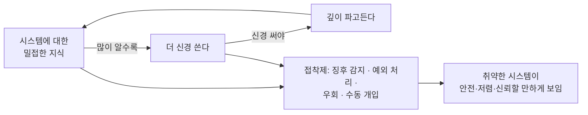
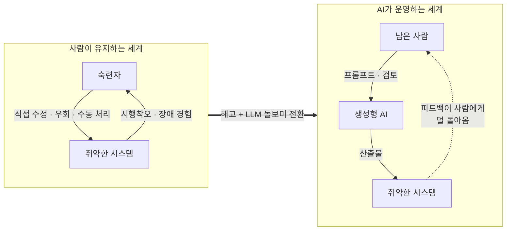
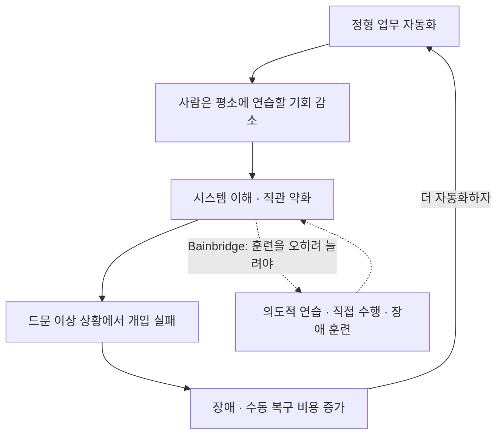

# "세상은 진심으로 신경 쓰는 똑똑한 사람들이 붙잡고 있다"… 장애가 이어진 한 주에 나온 경고

### Stripe에서 일했던 Justin Michael은 ACH 같은 낡고 취약한 시스템이 굴러가는 이유를 기술이 아니라 사람에서 찾는다. 시스템을 깊이 알고 끝까지 책임지는 사람들이 매일 결함을 메운다는 것이다. 그는 이런 사람들이 해고되거나 'LLM 돌보미'로 바뀌면서 줄어들고 있다고 본다. 같은 주에 Microsoft 365, FAA 항공 관제, United Airlines, NSA, 주요 은행, Apple에서 장애가 이어졌다. 그는 이 장애들의 공통분모가 바로 그것일 수 있다고 추정한다

2026년 11월 17일 Justin Michael은 개인 블로그 VioletPixel에 [We Need Smart People Who Give a Shit](https://violetpixel.com/blog/2026-11-17-we-need-smart-people-who-give-a-shit/)라는 짧은 글을 올렸다. GeekNews([토픽 37446](https://news.hada.io/topic?id=37446))에서 37점을 받았고, [Hacker News](https://news.ycombinator.com/item?id=50554045)와 [Lobste.rs](https://lobste.rs/s/rzuasm/we_need_smart_people_who_give_shit)에서도 긴 토론이 이어졌다.

원문은 코드도 그림도 없는 에세이다. 이 글은 원문 주장을 순서대로 정리하고 두 커뮤니티의 토론을 모두 옮긴다. 여기에 이 주장이 신뢰성 공학에서 이미 40년 넘게 다뤄 온 문제(Bainbridge의 "자동화의 아이러니")와 어떻게 겹치는지 덧붙인다. 같은 폴더의 [AI는 SRE를 대체하는가, 아니면 전문성을 약화시키는가](261031_2222_AI_SRE_Deskilling_and_Never_Skilling.md)와 함께 읽으면 좋다.

## 1. 한눈에 보기

| 원문의 주장 | 근거로 든 것 | 원문 스스로 단 단서 |
|---|---|---|
| 복잡하고 취약한 시스템은 **진심으로 신경 쓰는 똑똑한 사람들**이 붙잡고 있다 | Stripe에서 본 ACH 등 은행·자금 이동 시스템 | 개인 경험 |
| 그런 사람의 부족이 최근 연쇄 장애의 **공통분모일 수 있다** | 한 주 사이 Microsoft 365, FAA, United, NSA, 은행, Apple 장애 | **내부 정보 없음**, 추정. 각 장애는 서로 무관하고 공격도 AI 탓도 아니라고 발표됨 |
| 경영진은 사람의 일과 생성형 AI를 **'산출물'로만 비교**한다 | AI가 더 싸고, 쉬지 않고, 반박하지 않는다 | |
| AI는 똑똑하지도, 신경 쓰지도 않는다 | 지능은 착시, 관심은 듣고 싶은 말을 하도록 설계된 결과 | |
| 해고와 **'LLM 돌보미'** 전환이 이해와 주인의식을 갉아먹는다 | 직접 만들며 배우는 과정이 사라진다 | 예외가 있어 아직은 돌아간다 |



## 2. ACH: 간신히 돌아가는데 믿을 만해 보이는 시스템

저자는 Stripe에서 은행·자금 이동 시스템을 배우며 그 취약함에 놀랐다고 한다. 대표 사례가 미국의 은행 간 일괄 이체망 [ACH(Automated Clearing House)](https://en.wikipedia.org/wiki/Automated_clearing_house)다. 급여 입금, 공과금 자동이체, 계좌 간 송금이 매일 이 망을 지난다. ACH는 오래됐고 결함이 많으며 레거시의 짐을 잔뜩 지고 있다. 그런데도 대체로 **안전하고 저렴하며 믿을 만하다**고 여겨진다.

저자는 기술적 현실과 운영상의 평판 사이의 이 간극을 메우는 것이 사람이라고 말한다. 결함은 누군가가 고치고, 패치하고, 우회하고, 재정의하고, **손으로 처리한다.** 그 일을 하는 사람에게는 두 가지가 있다.

1. 시스템에 대한 **밀접한 지식**
2. 시스템을 어떻게든 돌아가게 만들려는 **의지와 끈기**

두 가지는 서로를 키운다. 복잡한 시스템을 깊이 파고들려면 먼저 신경을 써야 하고, 많이 알수록 더 신경 쓰게 된다. 인프라가 중요할수록 더 그렇다. 저자는 ACH 자리에 거대 인프라부터 "있으면 좋은" 앱까지 무엇을 넣어도 같은 이야기가 된다고 말한다.

### 2.1 예제: "예외는 사람이 처리한다"를 코드로

ACH 운영에서 '예외'가 무엇인지 감을 잡기 위해, 반송(return) 코드를 분류하는 작은 코드를 붙인다. 원문에는 없는 예제다. NACHA 운영 규칙의 대표 항목만 단순화했다(Bun으로 실행해 확인했다).

```ts
// ach-returns.ts — ACH 반송(return) 코드를 "자동 처리"와 "사람 검토"로 나누는 분류기
//   bun run ach-returns.ts
// 규칙은 NACHA 운영 규칙의 대표 항목만 단순화했다. 실제 운영은 은행·프로세서 규정을 따른다.

type Action =
  | { kind: "retry"; reason: string }            // 자동 재제출 (R01·R09: 최대 2회, 정산일 후 180일 이내)
  | { kind: "update-account"; reason: string }   // 고객에게 새 계좌 요청, 같은 계좌로 재시도 금지
  | { kind: "human-review"; reason: string };    // 사람이 맥락을 보고 판단해야 하는 것

const UNAUTHORIZED = new Set(["R05", "R07", "R10", "R11", "R29", "R51"]);

export function triage(code: string, retriesSoFar: number, daysSinceSettlement: number): Action {
  if (code === "R01" || code === "R09") {
    if (retriesSoFar < 2 && daysSinceSettlement <= 180)
      return { kind: "retry", reason: `${code} 잔액·미수금 부족: 재제출 ${retriesSoFar + 1}/2` };
    return { kind: "human-review", reason: `${code} 재제출 한도 초과: 고객 연락·대체 결제 수단 필요` };
  }
  if (["R02", "R03", "R04", "R20"].includes(code))
    return { kind: "update-account", reason: `${code} 계좌 해지·없음·번호 오류·거래 불가 계좌` };
  if (UNAUTHORIZED.has(code))
    return { kind: "human-review", reason: `${code} 무권한 반송: 분쟁·사기 가능성, 반송률 한도 관리 대상` };
  // 목록에 없는 코드는 "모른다"가 정답이다. 추측해서 자동 처리하지 않는다.
  return { kind: "human-review", reason: `${code} 미분류 코드: 규칙을 아는 사람이 확인` };
}

/** 무권한 반송률: NACHA는 0.5%를 넘으면 원천(Originator)을 조사 대상으로 본다. */
export function unauthorizedRate(returnCodes: string[], totalDebits: number): number {
  return returnCodes.filter((c) => UNAUTHORIZED.has(c)).length / totalDebits;
}
```

```text
R01  → retry          R01 잔액·미수금 부족: 재제출 1/2
R01  → human-review   R01 재제출 한도 초과: 고객 연락·대체 결제 수단 필요
R03  → update-account R03 계좌 해지·없음·번호 오류·거래 불가 계좌
R10  → human-review   R10 무권한 반송: 분쟁·사기 가능성, 반송률 한도 관리 대상
R99  → human-review   R99 미분류 코드: 규칙을 아는 사람이 확인
무권한 반송률 0.33% 정상 범위
```

자동화할 수 있는 부분(재시도 규칙)은 몇 줄이면 끝난다. 그러나 `human-review` 갈래가 실제 운영의 대부분을 차지한다. 고객에게 전화하고, 분쟁 이력을 보고, 처음 보는 코드가 뜨면 규정집을 뒤지는 일이다. 마지막 분기의 "모르면 추측하지 말고 사람에게"라는 규칙이 원문이 말하는 **판단**이다. 산출물만 보는 눈에는 이 분기가 비용으로만 보인다.

## 3. 한 주 사이의 장애들

저자는 글을 쓰기 직전 일주일여 사이에 이어진 장애를 나열한다.

| 장애 | 보도 |
|---|---|
| Microsoft 365 (Outlook 등) | [AP](https://apnews.com/article/microsoft-outage-outlook-email-365-status-down-d92547a821930290db2964388016979a) |
| FAA 전국 항공 지상정지 (11월 13일) | [Reuters](https://www.reuters.com/world/us/faa-issues-national-ground-stop-due-extraordinary-circumstance-reasons-safety-2026-11-13/) |
| United Airlines 출발편 시스템 (11월 16일) | [Reuters](https://www.reuters.com/world/us/united-airlines-says-technology-issue-affecting-departing-flights-2026-11-16/) |
| NSA 네트워크 일시 성능 저하 (11월 17일) | [Reuters](https://www.reuters.com/world/us/national-security-agency-says-network-hit-by-temporary-degradation-during-2026-11-17/) |
| Chase, Wells Fargo, Truist 등 주요 은행 | [AP](https://apnews.com/article/bank-outage-chase-wells-fargo-truist-50fee2693c22f597fa6ca51a97ef2cda) |
| Apple 서비스 (11월 17일, 내부 업데이트가 원인) | [Reuters](https://www.reuters.com/business/retail-consumer/apple-works-restore-services-after-outage-caused-by-internal-update-2026-11-17/) |

각 장애는 서로 관련이 없고 사이버 공격도, 생성형 AI 탓도 아니라고 발표됐다. 저자는 "그건 보기 나름"이라고 받는다. 그리고 내부 정보는 없지만 복잡한 시스템을 다뤄 본 경험으로 볼 때 공통분모가 있다고 말한다. **똑똑하고 신경 쓰는 사람의 부족**이다. 그러면서 묻는다. 그 사람들은 다 어디로 갔나?

이 대목은 원문에서도 가장 약한 고리다. GeekNews 요약도 "각 장애의 원인으로 확인된 것은 아님"을 분명히 했다. HN에서도 대형 인프라 장애는 수십 년 전부터 있었으니 한 주에 몰렸다고 AI가 직접 원인이라 할 수는 없다는 반론이 가장 먼저 나왔다. 저자의 주장은 인과 증명이 아니라 **구조적 위험에 대한 경고**로 읽는 것이 맞다.

## 4. 산출물만 보는 눈

저자의 진단은 이렇다. 자본주의는 이런 사람들에게 친절하지 않았다. 다만 자본의 목표에 맞는 시스템을 짓고 유지하려면 그들이 필요했고, 드물었기 때문에 받아들였을 뿐이다.

생성형 AI가 등장하자 경영진의 계산이 바뀌었다. 기계는 같거나 더 나은 가치와 더 많은 산출물을 주는 것처럼 보인다. 더 싸고, 더 오래 일하고, 병가·휴가·복리후생을 요구하지 않고, 나쁜 아이디어에 반박하지도 않는다.

문제는 **실제 일을 하지 않는 사람에게는 둘이 구별되지 않는다**는 것이다. 결함은 있어도 사람이 유지해 온 시스템과 AI가 만든 저품질 '슬롭(slop)'이 똑같아 보인다. 읽을 수 있는 글, 실행되는 코드, 보기 좋은 픽셀은 모두 그냥 '산출물'이다. AI로 사람을 대체하고 싶은 압력이 클수록 과장된 약속을 믿고 싶어진다.

저자는 AI에 대해 단호하다.

- **지능은 착시다.** 공유지(commons)에서 긁어모은 거대한 데이터로 맞춘 가중치가 출력을 "원하는 모양"으로 끌어당길 뿐이다.
- **관심처럼 보이는 것은 설계의 결과다.** 사용자가 듣고 싶은 말을 하도록 만들어졌다. LLM의 수학과 논리는 물리 법칙처럼 차갑고 무심하다.

반면 신경 쓰는 사람은 **알아채고, 점을 잇고, 이상함을 감지하고, 궤도를 되돌리고, 예외를 처리하고, 언제 옳은 일을 해야 하는지와 언제 한 걸음 더 가야 하는지를 안다.** 저자는 생성형 AI가 이 영역에서 크게 못 미치며, 프롬프트와 산출물을 늘린다고 메워지지도 않는다고 본다. 이것이 복잡한 시스템을 붙잡고 있는 **접착제**다.

## 5. 해고, 그리고 'LLM 돌보미'

경영진은 AI가 기대대로 작동하기를 바라는 압력을 받는다. 그 결과 신경 쓰는 사람들이 해고되고, 남은 사람들은 안에서부터 비어 간다. 저자가 특히 경계하는 것은 해고보다 조용한 변화다. **직접 하던 일을 LLM을 돌보는 일로 바꾸는 것**이다.

- 프롬프트를 한 번 던질 때마다 사람은 시스템에서 한 걸음 멀어진다.
- 생성된 산출물이 시스템에 쌓일수록 시스템에 대한 이해는 줄어든다.
- 직접 만들며 시행착오로 배우는 과정, 그리고 그 과정에서 생기는 **주인의식과 밀접한 연결**을 잃는다.



저자의 결론은 이렇다. 우리는 "신경 쓰는 똑똑한 사람들이 붙잡고 있는 복잡하고 취약한 시스템의 세계"에서 "**덜 똑똑하고 덜 신경 쓰는 쪽이 운영하는** 복잡하고 취약한 시스템의 세계"로 옮겨 가고 있다. 아직 예외인 사람들이 남아 있어 많은 시스템이 그럭저럭 돌아간다. 하지만 그 수가 줄어드는 만큼 더 많은 시스템이 실패할 것이다.

글은 뜨거운 난로 비유로 끝난다. "난로가 뜨겁다"고 말해 주면 경고만 듣고 배우는 아이가 있고, 직접 데어야 배우는 아이가 있다. 자본주의는 경고를 받았지만 지금 난로에 손을 얹고 있다. 그리고 마지막 문장은 이렇다. "불행히도, **우리 모두가 데고 있다.**"

## 6. 40년 전의 같은 경고: 자동화의 아이러니

원문은 인용하지 않았지만, 이 주장은 인간공학에서 오래된 논쟁과 정확히 겹친다. Lisanne Bainbridge는 1983년 학술지 *Automatica*에 실은 [「Ironies of Automation」](https://en.wikipedia.org/wiki/Ironies_of_Automation)([원문 PDF](https://gwern.net/doc/sociology/technology/1983-bainbridge.pdf), [해설](https://blog.acolyer.org/2020/01/08/ironies-of-automation/))에서 공정 제어 자동화를 두고 다음과 같이 지적했다.

| Bainbridge (1983) | 2026년 판 |
|---|---|
| 일을 대부분 자동화하면 사람에게는 **자동화할 수 없는 가장 어려운 일**만 남는다 | 정형 업무는 AI가, 예외와 장애는 사람이 맡는다 |
| 운영자는 평소 업무로 기술을 **연습하지 못한다** | 직접 하던 일이 LLM 검토로 바뀐다 |
| 지금 자동화를 감독하는 사람은 **수동 시절의 기술로 버틴다.** 다음 세대에게는 그 기술을 기대할 수 없다 | 시니어는 과거 경험으로 AI 출력을 걸러 내지만, 주니어는 그 경험을 쌓을 기회가 없다 |
| 드물지만 결정적인 개입에 대비하려면 **훈련이 오히려 더 필요하다** | AI가 실패하는 순간에 쓸 깊은 지식을 따로 길러야 한다 |
| 감시(monitoring)는 그 자체로 **지치는 일**이다 | 'LLM 돌보미'의 피로 |

HN 토론에서 링크된 Lars Faye의 글(「AI coding will prevent expertise」 계열, 앞선 글 [「Agentic Coding is a Trap」](https://dev.to/larsfaye/agentic-coding-is-a-trap-as-featured-on-hackernews-fireship-4mbm)의 후속)도 같은 이야기를 소프트웨어에 적용한다. 그는 이것을 **감독의 역설**이라 부른다. AI 에이전트를 감독하는 데 필요한 기술이 바로 AI에 지나치게 기대면서 사라지는 기술이라는 것이다. 만드는 비용은 AI가 빠르게 낮추지만 이해하는 비용은 그만큼 내려가지 않는다. 그 차이가 **이해 부채(comprehension debt)**로 쌓인다. 같은 폴더의 [SigNoz 글 정리](261031_2222_AI_SRE_Deskilling_and_Never_Skilling.md)가 말한 deskilling과 never-skilling도 같은 문제를 SRE 관점에서 본 것이다.



## 7. 커뮤니티 반응

### 7.1 Hacker News

- **유지보수는 사회의 체력 시험.** 항만 노동자 출신 철학자 Eric Hoffer의 말이 인용됐다. 짓는 것은 한 번에 할 수 있지만 날마다 돌보는 의지와 기술은 드물다는 것이다. 고대 로마에서 정원을 방치했다는 이유로 공직 후보 자격을 잃은 사람의 일화도 따라 나왔다. 이어진 의견들은 다음과 같다.
  - 서구 경제는 미끼를 던진 뒤 조건을 바꾸는 '금융화'를 장려한다.
  - Ramit Sethi의 말을 빌리면 "사람은 준비한 수준까지 올라가지 않고, 갖춰 둔 시스템 수준까지 떨어진다."
  - 인간은 유지보수에 서툴러 세금이라는 강제 수단으로 인프라 인력을 고용해야 한다.
  - 유지보수가 어려운 이유는 단기 피드백이 없기 때문이다.
- **장애는 예전에도 있었다, 하지만.** 한 주에 몰렸다고 AI가 원인은 아니라는 반론이 먼저 나왔다. 핵심은 AI가 만드는 비용을 이해하는 비용보다 훨씬 빨리 낮춘다는 점이라는 지적이 이어졌다(Lars Faye 글 링크). 일주일 걸리는 일도 그 과정에서 문서화되지 않은 가정과 의존성을 발견하고 직관을 쌓는 시간이며, AI에게 설명을 요구하는 식으로 이 부채를 줄일 수도 있다는 것이다. 반박도 나왔다.
  - 예전에는 지금처럼 **중앙집중 인프라에 의존하지 않았다.** 서버실 이중 바닥 아래 낡은 노트북에서 dancer IRCd를 돌리던 회사도 36시간 통신 두절은 없었다. 단순해서 직접 고칠 수 있었기 때문이다.
  - 규모의 경제를 내세워 책임을 외주화하게 만들고, 이제 "확장은 어렵다"며 면죄부를 구하는 것은 연봉 100만 달러 직원 수천 명을 둔 회사가 할 말이 아니다.
  - Slack, IBM, Microsoft, AWS를 모두가 쓰니 책임질 필요가 없다는 논리는 **2008년 금융위기와 같은 구조**다.
- **책임은 AI가 아니라 경영진에게.** 이중화와 견고함에는 돈과 노력이 들지만 당장 매출을 올리지 않는다. 예방 비용이 사고 감내 비용보다 크면 기업은 뻔한 선택을 한다. 항공 관제는 1980년대부터 예산에 쪼들렸다. 캐나다처럼 민영화된 체계도 있으니 돈보다 정치적 의지의 문제라는 의견이었다.
- **직접 바꾸는 것과 시키는 것의 차이.** 시스템을 직접 바꾸면 시스템과 변경 도구를 배운다. 남에게 맡기면 상호작용과 결과 평가를 배운다. 어느 쪽이 중요한지는 관점에 따라 다르다는 의견이다. AI로 오래된 코드의 기술 부채를 빠르게 갚았다는 긍정적 경험담도 있었다.
- **Bell System의 신뢰성.** 전기기계식 교환기 시절 전화국은 자연재해를 빼면 30분 이상 멈춘 적이 거의 없었다. 말기의 예외가 [1975년 뉴욕 전화국 화재](https://en.wikipedia.org/wiki/1975_New_York_Telephone_exchange_fire)다. 단일 장애점이 없는 설계라서 고장이 나도 회선 하나나 작은 묶음에 그쳤다. 장거리 경로 설정이 실패하면 읽기 전용 장치에 저장된 정적 경로로 넘어갔다. 오늘날의 BGP에 해당하는 기능에도 대체 경로가 있었던 셈이다. #5 crossbar 교환기를 찾아보라는 권유도 있었다. 이 신뢰성 기록은 컴퓨터 시대로 이어지지 못했다.
- **인재는 길러지는 것.** 그런 사람들은 저절로 나타났다 사라지지 않고 교육으로 평범한 사람에게서 길러진다는 의견이 나왔다. 반도체 비유도 붙었다. 공정이 나쁘면 성능별 선별(binning)을 아무리 강화해도 설계 성능이 오르지 않으니, 설계와 제조 과정을 고쳐야 한다는 것이다.
- **내 관심과 회사 관심의 교집합.** 강요는 통하지 않으니 겹치는 영역에서 가치를 증명하고 그 성과를 지렛대로 쓰라는 조언이 나왔다. 팀 문화에 따라 다르며, DDD·문서화·정적 분석·표준화를 팀의 관심사로 만든 경험담도 달렸다.
- **회사는 순종을 원한다? 반론도.** 대부분 회사에서 유능하고 진심인 사람은 부담이고, 원하는 것은 시키는 대로 하는 사람이라는 냉소가 나왔다. 반대 경험도 있었다. 중요한 과제의 정예 인력은 대개 그런 사람이고 좋은 대우를 받는다는 것이다. 독단적이거나 문제를 보고도 침묵하는 사람은 어디서나 환영받지 못한다는 말도 덧붙었다. 순종보다 **대체 가능성**(쉽게 뽑고 쉽게 내보낼 수 있는 인력)이 진짜 동기라는 분석도 나왔다. 이 구조가 두려움과 가면 증후군을 키운다는 것이다. 지금은 "악의적 지시 이행"의 시대라는 한 줄 평도 있었다.
- **왜곡된 보상.** CEO는 인재를 붙잡고 싶어도 이사와 중간관리자에게는 비싼 사람을 내보내는 편이 성과급에 유리할 수 있다. 떠나서 자랑스러운 것을 만들고 그 체계는 무너지게 두라는 말, 그런 보상 구조를 만든 CEO는 무능하다는 말이 이어졌다. 맨해튼 프로젝트 비유도 나왔다. "Kaul 장군은 너무 많고 Groves 장군은 너무 적다. 물론 전자는 모두 후자인 척한다."
- **AI가 드러낸 것.** 400명 조직에서 진심으로 일하는 사람이 3명뿐이라는 사실을 AI가 드러냈다는 관찰이 있었다. 반대로 AI가 일에 대한 애정 자체를 바꿨다는 증언도 나왔다. 코드를 모르는 상사가 에이전트로 기능을 쏟아내고, 연구·문제 해결·설계 역량은 불필요하다고 취급되며, 복지는 절반으로 줄고, 배우자는 AI 때문에 일자리를 못 구했다는 것이다. 학계에서도 AI로 무의미한 논문이 더 빨리 쏟아진다는 지적이 나왔다.
- **말(馬)의 처지.** 자동차가 풀을 먹고 마차를 끌 수 있느냐고 묻는 것처럼, 세상이 바뀌었는데 회사가 예전처럼 행동하기를 기대하는 것은 헛되다는 의견이었다. 회사는 원래 소프트웨어 품질에 관심이 없었고, 언젠가 AI 인터페이스가 필요한 소프트웨어를 즉석에서 만들지도 모른다는 것이다. 해고가 진행 중이라 "좋은 일을 하면 살아남는다"는 통제감조차 없다는 두려움도 담겼다.
- **불을 끄는 사람과 불이 안 나게 만든 사람.** 유능한 사람의 해법은 가장 싸거나 빠르지 않고 이점이 나중에야 드러난다. 그래서 "불을 끈 사람은 칭찬받지만, 불이 안 나게 만든 사람은 그렇지 못하다." 큰 회사에서는 눈에 띄는 성과가 전부라는 말, 더 나은 해법이 고객에게만 이롭고 회사에는 아닐 때 그걸 지적하는 사람이 밀려난다는 말이 이어졌다. 한 댓글은 이렇게 회고했다. 입사 초 불을 끌 때는 높이 평가받았는데, 처음부터 잘 만든 새 프로젝트는 문제없이 돌아가 아무도 칭찬하지 않았다. 계속 고장 났다면 일자리는 지켰을 것이고, 불이 날 때마다 "소프트웨어가 원래 그렇지"라는 말을 들었을 것이다. 무능한 조직에서는 진심이 해고의 지름길이며, 많은 대기업이 숫자를 조금씩 조작하다 어느 날 무너지는 옛 소련 공장처럼 굴러간다는 신랄한 평가도 있었다.

### 7.2 Lobste.rs

- **떠난 사람의 고백.** 코드를 짜는 게 좋아서 관리자가 아닌 사람에게, 일의 가장 즐거운 부분을 로봇에게 넘기는 삶은 오래가지 못한다는 고백이 나왔다. 16년 동안 최선을 다했지만 무시와 경멸만 돌아와 대학 IT 지원으로 옮겼고, 지금은 작은 도움에도 기뻐하는 사람들과 일한다는 사연도 이어졌다.
- **자본주의 탓인가.** 자본주의는 비용을 남에게 떠넘기게 만든다. 그러니 난로 비유는 틀렸다는 의견이 나왔다. 아이들은 동생에게 대신 만지게 한다는 것이다. 반론도 있었다. 이런 현상은 어느 체제에서나 나타나며, 진짜 원인은 책임과 법적 부담의 비대칭, 그리고 탐욕이라는 것이다. 탐욕이 해결되기 전까지는 적당한 규제가 있는 자유시장이 그나마 피해가 적다는 주장도 나왔다.
- **Y2K의 역설.** 모든 것이 돌아가는 것은 일이 더 힘들어졌는데도 누군가 애쓰고 있어서다. 하지만 큰 실패 없이는 생각을 바꾸기 어렵다. 막아 놓으면 막지 않았을 때의 결과를 잊는 Y2K와 백신처럼 말이다. 2년 전 대인관계·조직화 같은 비기술 주제를 꺼냈다가 입 다물라는 말을 들었는데, 뒤늦게 사과한 사람들은 대부분 최근 해고된 상태라는 경험담도 있었다. IT는 잘 돌아가도 "왜 당신이 필요하죠?", 장애가 나도 같은 질문을 받는다.
- **보상하는 사회.** 사회가 진심으로 애쓰는 사람에게 보상해야 하는데, 좋은 일을 하면 오히려 짓밟힌다는 의견에 대해, 그런 사회가 과거에는 있었지만 지금의 신자유주의 서구는 아니라는 답이 달렸다.
- **더 큰 붕괴.** 생존과 출산이 양립하기 어려워 출산을 포기하는 지경인데, 기후와 생물권 파괴는 방치한 채 노동 효율만 논한다는 비판이 나왔다. 이미 집단적으로 '사회적 재생산 거부'가 일어나고 있다는 진단, 한 번은 [Earth Strike](https://en.wikipedia.org/wiki/Earth_Strike) 같은 시도도 있었다는 답이 이어졌다.
- **고치는 사람과 전달하는 사람.** 핵심에 동의하지만 집단 사이를 잇는 사람도 필요하다는 의견이 나왔다. Neal Stephenson의 『Anathem』처럼 유능한 사람들이 사제 집단처럼 격리되면 발언권을 잃는다는 것이다. 잘못된 점을 모두 나열한 회의에서 PM이 "잘 진행되고 있고 목표대로 가고 있다"로 바꿔 전달해 준 경험담이 붙었다. 진짜 실력은 망가진 것을 보고 고치는 능력과 예상 결과를 전달하는 능력을 겸하는 것이라는 정리도 나왔다. 전자만 있으면 재앙만 외친다고 무시당하고, 후자만 있으면 못 고친 문제가 터질 때 낙관이 깨진다.
- **IT보다 넓은 문제.** 공공 서비스도 이런 사람들("SPWGS", Smart People Who Give a Shit)이 떠받치는데 관리자는 그들을 함부로 대한다는 의견이 나왔다. 연방정부에서의 이탈은 오래 후유증을 남길 것이라고 했다. 전직 CIA 관계자에게서 CIA와 국무부 인재가 해고되지 않았는데도 지도부 스트레스로 떠났다는 이야기를 들었다는 증언도 있었다.
- **존중하는 업계는 어디에?** 소프트웨어만의 문제인지 묻는 질문에, 업계가 아니라 개별 조직의 문제이며 꼭대기에 그런 사람이 있느냐에 달렸다는 답이 달렸다. 지금의 경제 체제는 잘 작동하는 제품을 명시적 목표로 삼지 않고, 이윤을 최적화하다 우연히 그런 결과가 나오기를 기대한다는 지적도 나왔다. 협동조합이나 공공기관처럼 조직된 노동이 이윤보다 실질 성과에 충실하다는 의견도 있었다. 이 글이 Marx의 '일반지성(General Intellect)' 개념을 이공계 독자에게 가장 잘 풀어낸 글이라는 평도 나왔다.
- **흑백이 아니다.** 유능하고 회사에 여지가 있다면, 회사의 LLM 도입 방식에 관여해 역량을 더 나은 방향으로 쓰라는 조언이 나왔다. "LLM은 나쁘다"고 외치기보다 공감하며 듣는 능력이 직업에 인간다움을 남기는 길이라는 것이다.

## 8. 정리: 운영 조직이 가져갈 것

원문은 인과를 증명하지 않는다. 하지만 운영 조직이 점검할 질문은 분명하게 던진다.

| 질문 | 신호 | 대응 예 |
|---|---|---|
| 우리 시스템의 '예외'를 누가 처리하는가? | 수동 처리 큐, 런북 밖의 일이 한두 사람에게 몰림 | 예외 처리 로그를 남기고 지식을 문서·코드로 옮김 |
| 그 사람이 떠나면? | 버스 팩터 1, 휴가 중 장애 대응 불가 | 페어 온콜, 순환 배치 |
| AI가 만든 변경을 누가 이해하는가? | 리뷰어가 "테스트 통과했으니"로 승인 | 변경 설명 요구, 주요 경로는 사람이 직접 작성·수정 |
| 직접 할 기회가 남아 있는가? | 주니어가 장애를 한 번도 직접 다뤄 본 적 없음 | 게임 데이, 장애 훈련, AI 없이 하는 정기 실습 (Bainbridge의 "훈련은 오히려 늘려야") |
| 불이 안 나게 한 일을 측정하는가? | 화재 진압만 성과로 인정 | 예방 작업·사고 방지를 성과 지표에 포함 |
| 산출물이 아니라 결과를 보는가? | PR 수·생성 줄 수로 생산성 평가 | 장애율, 복구 시간, 변경 실패율(DORA 지표) |

난로의 경고는 이미 나와 있다. 원문의 마지막 문장처럼 모두가 데기 전에, 시스템을 붙잡고 있는 사람과 그 사람이 계속 배울 수 있는 구조를 지키는 것이 가장 값싼 신뢰성 투자다.

## 참고

- Justin Michael, [We Need Smart People Who Give a Shit](https://violetpixel.com/blog/2026-11-17-we-need-smart-people-who-give-a-shit/), VioletPixel (2026-11-17)
- GeekNews, [우리에겐 진심으로 신경 쓰는 똑똑한 사람들이 필요하다](https://news.hada.io/topic?id=37446), [Hacker News 토론](https://news.ycombinator.com/item?id=50554045), [Lobste.rs 토론](https://lobste.rs/s/rzuasm/we_need_smart_people_who_give_shit)
- 원문이 인용한 장애 보도: [Microsoft 365 (AP)](https://apnews.com/article/microsoft-outage-outlook-email-365-status-down-d92547a821930290db2964388016979a), [FAA 지상정지 (Reuters)](https://www.reuters.com/world/us/faa-issues-national-ground-stop-due-extraordinary-circumstance-reasons-safety-2026-11-13/), [United Airlines (Reuters)](https://www.reuters.com/world/us/united-airlines-says-technology-issue-affecting-departing-flights-2026-11-16/), [NSA (Reuters)](https://www.reuters.com/world/us/national-security-agency-says-network-hit-by-temporary-degradation-during-2026-11-17/), [주요 은행 (AP)](https://apnews.com/article/bank-outage-chase-wells-fargo-truist-50fee2693c22f597fa6ca51a97ef2cda), [Apple (Reuters)](https://www.reuters.com/business/retail-consumer/apple-works-restore-services-after-outage-caused-by-internal-update-2026-11-17/)
- [Automated clearing house (Wikipedia)](https://en.wikipedia.org/wiki/Automated_clearing_house)
- Lisanne Bainbridge, [Ironies of Automation](https://en.wikipedia.org/wiki/Ironies_of_Automation), *Automatica* (1983), [원문 PDF](https://gwern.net/doc/sociology/technology/1983-bainbridge.pdf), [the morning paper 해설](https://blog.acolyer.org/2020/01/08/ironies-of-automation/)
- Lars Faye, [Agentic Coding is a Trap](https://dev.to/larsfaye/agentic-coding-is-a-trap-as-featured-on-hackernews-fireship-4mbm)
- [1975 New York Telephone exchange fire](https://en.wikipedia.org/wiki/1975_New_York_Telephone_exchange_fire), [Earth Strike](https://en.wikipedia.org/wiki/Earth_Strike)
- GeekNews 관련 글: [기술 부채, 인지 부채, 의도 부채](https://news.hada.io/topic?id=28824), [소프트웨어가 구조적으로 무너지고 있다](https://news.hada.io/topic?id=37303), [생각을 멈춰도 되는 때는 오지 않는다](https://news.hada.io/topic?id=33909), [이해의 기쁨과 힘](https://news.hada.io/topic?id=30818), [AI는 도구이며, 잘 쓰려면 숙련이 필요하다](https://news.hada.io/topic?id=35268)
- 같은 카테고리: [AI는 SRE를 대체하는가, 아니면 전문성을 약화시키는가](261031_2222_AI_SRE_Deskilling_and_Never_Skilling.md), [SRE 4대 골든 시그널](260812_1308_SRE_four_golden_signals.md)
