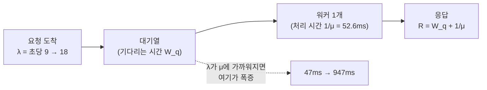
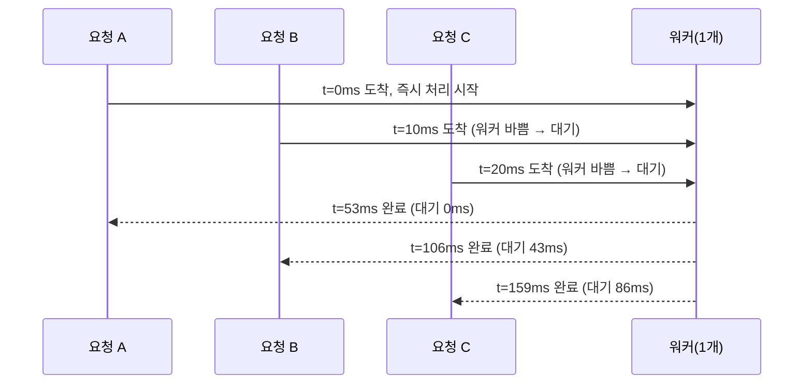
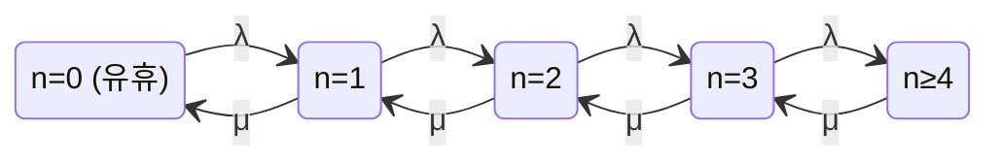
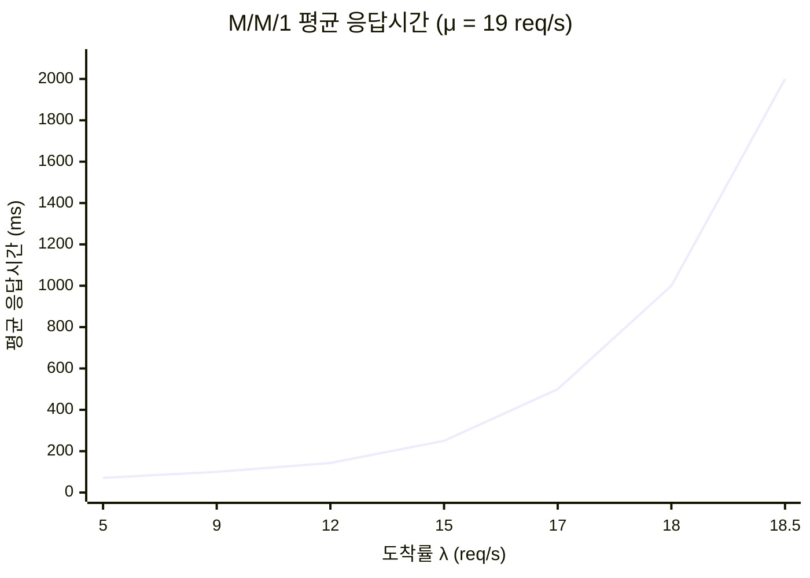
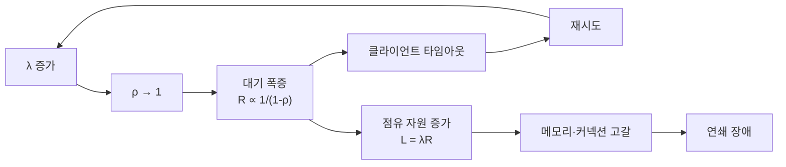
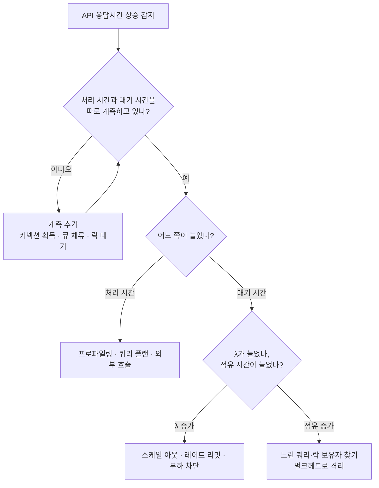
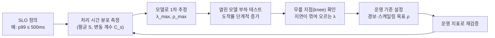

# 트래픽은 2배인데 응답시간은 10배: M/M/1 대기행렬로 보는 "갑자기 느려지는 시스템"

### 처리 시간은 그대로인데 응답시간만 폭증하는 이유는 대부분 '기다림'에 있다. M/M/1 모델의 평균 응답시간 $R = 1/(\mu-\lambda)$에 숫자를 넣으면, 처리율 19 req/s인 워커에 요청이 9 → 18 req/s로 2배 늘 때 응답시간은 100ms → 1,000ms로 10배, 대기 시간은 47ms → 947ms로 약 20배가 된다. 이 비선형성은 DB 커넥션 풀, 스레드 풀, 락에서 그대로 나타난다. 그래서 성능 목표는 최대 TPS가 아니라 "목표 응답시간을 지키는 최대 부하"로 잡아야 한다


성능 장애 회고에서 자주 나오는 말이 있다. "트래픽이 평소의 두 배였을 뿐인데 API가 열 배 느려졌다." 직관은 응답시간이 부하에 **비례**해서 늘 것이라고 말한다. 하지만 하나의 처리 자원 앞에 요청이 줄을 서는 시스템에서는 그렇지 않다. 이 글은 대기행렬 이론(Queueing Theory)의 가장 기본 모델인 **M/M/1**로 이 현상을 설명한다. 공식과 수치는 [Wikipedia: M/M/1 queue](https://en.wikipedia.org/wiki/M/M/1_queue), [Kendall 표기법](https://en.wikipedia.org/wiki/Kendall%27s_notation), [리틀의 법칙](https://en.wikipedia.org/wiki/Little%27s_law), [Kingman 공식](https://en.wikipedia.org/wiki/Kingman%27s_formula)으로 대조했다. 실무 맥락은 AWS 엔지니어 Marc Brooker의 [Latency Sneaks Up On You](https://brooker.co.za/blog/2021/08/05/utilization.html), Google SRE 책의 [Handling Overload](https://sre.google/sre-book/handling-overload/), HikariCP의 [About Pool Sizing](https://github.com/brettwooldridge/HikariCP/wiki/About-Pool-Sizing)에서 가져왔다.

**본문의 모든 수치는 M/M/1 가정(포아송 도착, 지수 분포 처리 시간, 서버 1개, 무한 대기열)에서 계산한 이론적 평균값이다. 실제 서버가 트래픽 2배에 반드시 10배 느려진다는 뜻이 아니며, 실제 성능은 계측과 부하 테스트로 확인해야 한다. 표의 수치는 필자가 공식과 간단한 시뮬레이션(10장 코드)으로 직접 계산·검증했다.**

## 1. 한눈에 보기

| 항목 | 평소 | 트래픽 증가 후 | 변화 |
|---|---|---|---|
| 도착률 $\lambda$ (초당 요청) | 9 | 18 | **2배** |
| 처리율 $\mu$ (초당 처리 가능) | 19 | 19 | 그대로 |
| 평균 처리 시간 $1/\mu$ | 52.6 ms | 52.6 ms | 그대로 |
| 이용률 $\rho = \lambda/\mu$ | 47.4% | 94.7% | 2배 |
| 평균 응답시간 $R = 1/(\mu-\lambda)$ | **100 ms** | **1,000 ms** | **10배** |
| 평균 대기 시간 $W_q = R - 1/\mu$ | 47.4 ms | 947.4 ms | **약 20배** |
| 시스템 안 평균 요청 수 $L = \lambda R$ | 0.9개 | 18개 | 20배 |
| p99 응답시간 $\ln(100)/(\mu-\lambda)$ | 약 461 ms | 약 4.6 s | 10배 |



핵심 메시지는 세 가지다.

1. 응답시간은 **처리 시간 + 대기 시간**이다. 처리 시간이 그대로여도 대기 시간이 폭증할 수 있다.
2. 대기 시간은 이용률 $\rho$가 1에 가까워질수록 $\frac{1}{1-\rho}$ 꼴로 **비선형적으로** 커진다.
3. 따라서 "최대 몇 TPS까지 버티는가"보다 "**목표 응답시간을 지키며** 몇 TPS까지 받을 수 있는가"가 진짜 용량이다.

## 2. 응답시간 안에는 '기다리는 시간'이 들어 있다

### 2.1 용어부터

| 용어 | 뜻 | 쉽게 말하면 |
|---|---|---|
| **워커(server)** | 요청을 실제로 처리하는 실행 주체. 스레드, 프로세스, DB 커넥션, CPU 코어 등 | 은행 창구 직원 |
| **대기열(queue)** | 워커가 바쁠 때 요청이 차례를 기다리는 곳 | 번호표를 뽑고 앉아 있는 대기석 |
| **처리 시간(service time)** | 워커가 요청 하나를 실제로 처리하는 시간 | 창구에서 업무를 보는 시간 |
| **대기 시간(waiting time)** | 대기열에서 차례를 기다린 시간 | 번호가 불리기까지 앉아 있던 시간 |
| **응답시간(response / sojourn time)** | 대기 시간 + 처리 시간 | 은행에 들어와서 나갈 때까지 걸린 시간 |
| **이용률(utilization) $\rho$** | 워커가 바쁜 시간의 비율 | 창구 직원이 쉬지 않고 일하는 비율 |

$$
R = W_q + S
$$

여기서 $R$은 응답시간, $W_q$는 대기 시간, $S$는 처리 시간이다. 대부분의 APM 대시보드가 보여 주는 "API 응답시간"은 $R$이다. 프로파일러가 보여 주는 "메서드 실행 시간"은 대체로 $S$에 가깝다. 둘의 차이가 바로 이 글의 주제다.

### 2.2 여유가 있어도 줄은 생긴다

워커가 초당 19건을 처리할 수 있고 요청이 초당 9건이면 절반 이상 놀고 있다. 그런데도 대기는 생긴다. 요청이 **일정한 간격으로 오지 않기 때문**이다.

평균 초당 9건이라도 어떤 1초에는 6건, 어떤 1초에는 12건이 온다. 수십 밀리초 사이에 서너 건이 몰리기도 한다. 그 순간 워커가 이미 일하고 있으면 뒤에 온 요청은 기다려야 한다.

> 쉽게 말하면, 하루 평균 손님이 적은 카페도 점심시간 5분 동안 손님이 몰리면 줄이 생긴다. "평균적으로 한가하다"와 "줄이 없다"는 다른 말이다.



위 시퀀스는 처리 시간을 53ms로 고정한 **재구성 예시**다. 세 요청의 처리 시간은 같지만, 응답시간은 53ms, 96ms, 139ms로 늘어난다. 늘어난 부분은 모두 기다림이다.

### 2.3 확률 용어 세 개: 포아송 도착, 지수 분포, 정상 상태

뒤에서 계속 나오는 세 단어를 먼저 정리한다. 수식 없이 감만 잡아도 충분하다.

| 용어 | 정의 | 쉽게 말하면 | 실무에서 성립하나 |
|---|---|---|---|
| **포아송 과정**(Poisson process) | 평균 도착률 $\lambda$는 일정하지만, 각 요청은 서로 독립적으로 무작위 시점에 도착한다. 1초 동안 도착하는 수는 평균이 $\lambda$인 포아송 분포를 따른다 | 서로 모르는 수많은 손님이 각자 알아서 카페에 들어온다. 평균 9명이어도 어떤 1초엔 6명, 어떤 1초엔 12명이다 | 독립적인 사용자가 많은 공개 API는 근사적으로 맞다. 배치 작업, 크론, 재시도 폭주처럼 **몰려서** 오는 트래픽은 이보다 나쁘다 |
| **지수 분포**(exponential distribution) | 평균이 $1/\mu$이고, 짧은 값이 흔하고 긴 값이 드물게 꼬리를 그리는 분포. 표준편차가 평균과 같다($C_s = 1$). 포아송 도착의 **도착 간격**도 지수 분포다 | 창구 업무 대부분은 금방 끝나지만 가끔 한참 걸리는 손님이 있다 | 처리 시간 분포는 서비스마다 다르다. 분포가 바뀔 때의 효과는 8.1에서 본다 |
| **정상 상태**(steady state) | 시작 직후의 과도 구간이 지나, 큐 길이의 **확률 분포**가 더 이상 변하지 않는 상태. 큐 길이는 계속 오르내리지만 "평균적으로 몇 개쯤"은 고정된다 | 개점 직후의 혼란이 지나고, 손님이 오고 가며 줄 길이가 평소 수준에서 출렁이는 상태 | $\lambda < \mu$이고 $\lambda$가 한동안 일정해야 한다. 트래픽이 분 단위로 바뀌는 순간은 공식이 정확히 설명하지 못한다 |

이 글의 공식은 모두 **정상 상태의 평균**이다. "트래픽이 18 req/s로 **계속** 유지되면 평균적으로 이렇게 된다"는 뜻이지, 트래픽이 늘어난 첫 1초에 바로 응답시간이 1초가 된다는 뜻이 아니다.

## 3. 대기행렬 이론은 어디서 왔나: 전화 교환기

이 문제는 컴퓨터보다 훨씬 오래됐다. 20세기 초 전화 교환국은 동시에 연결할 수 있는 **회선 수**가 한정돼 있었다. 사람들이 전화를 거는 시각은 제멋대로다. 모든 회선이 사용 중이면 새 통화는 기다리거나 끊긴다. 그렇다면 회선을 몇 개 깔아야 하는가?

| 연도 | 사건 | 의미 |
|---|---|---|
| 1909 | 코펜하겐 전화회사의 **A. K. Erlang**이 "The Theory of Probabilities and Telephone Conversations" 발표 | 무작위 전화 트래픽이 **포아송 분포**를 따른다는 것을 보임. 대기행렬 이론의 출발점 |
| 1917 | Erlang, 자동 교환기의 통화 손실·대기 시간 공식 발표 | 오늘날 Erlang B(손실), Erlang C(대기) 공식의 원형 |
| 1953 | **D. G. Kendall**이 `A/S/c` 표기법 제안 | "M/M/1" 같은 모델 이름 체계의 시작 |
| 1961 | **J. D. C. Little**이 $L = \lambda W$ 증명 발표 | 분포 가정 없이 성립하는 리틀의 법칙 |
| 1961 | **J. F. C. Kingman**, 고부하 단일 서버 대기 근사식 발표 | 일반 분포(G/G/1)에서도 $\frac{\rho}{1-\rho}$ 구조가 남는다는 것을 보임 |

트래픽 강도의 단위 **얼랑(Erlang)** 은 그의 이름에서 왔다. 1 얼랑은 "회선 하나가 한 시간 내내 쓰이는 양"이다. 이 글의 $\rho$가 단일 서버에서 같은 개념이다. 출처는 [Agner Krarup Erlang](https://en.wikipedia.org/wiki/Agner_Krarup_Erlang), [Erlang (unit)](https://en.wikipedia.org/wiki/Erlang_(unit)), [Kendall's notation](https://en.wikipedia.org/wiki/Kendall%27s_notation), [Little's law](https://en.wikipedia.org/wiki/Little%27s_law), [Kingman's formula](https://en.wikipedia.org/wiki/Kingman%27s_formula)다.

전화 회선이 오늘날의 DB 커넥션, 스레드, CPU 코어로 바뀌었을 뿐 구조는 같다. **유한한 자원**을 **무작위로 도착하는 요청**이 나눠 쓴다.

## 4. M/M/1 모델 해부

### 4.1 이름 읽는 법: Kendall 표기법 `A/S/c`

| 자리 | 의미 | M/M/1에서 | 쉽게 말하면 |
|---|---|---|---|
| A | 도착 간격 분포 | **M**: 포아송 도착(도착 간격이 지수 분포) | 손님이 서로 짜지 않고 제각각 온다 |
| S | 처리 시간 분포 | **M**: 지수 분포 | 대부분 금방 끝나지만 가끔 오래 걸리는 업무가 있다 |
| c | 서버(워커) 수 | **1** | 창구가 하나 |

M은 **Markovian**(마르코프적)의 머리글자다. 지수 분포의 **무기억성**(memoryless)에서 왔다. "이미 30ms 처리했으니 곧 끝나겠지"가 통하지 않는다는 성질이다. 지금까지 얼마나 걸렸든 남은 시간의 분포가 처음과 같다. 이 성질 덕분에 시스템의 상태를 "지금 몇 개가 들어 있나" 하나로만 표현할 수 있고, 수학이 아주 단순해진다.

표기를 확장하면 `A/S/c/K/N/D`까지 쓴다. K는 대기열 용량, N은 요청 모집단 크기, D는 처리 순서 규칙(FIFO 등)이다. 생략하면 $K=\infty$, $N=\infty$, FIFO로 본다.

| 기호 | 이 글에서의 의미 | 단위 |
|---|---|---|
| $\lambda$ (람다) | 평균 **도착률**: 초당 들어오는 요청 수 | req/s |
| $\mu$ (뮤) | 평균 **처리율**: 워커가 초당 처리할 수 있는 요청 수 | req/s |
| $S = 1/\mu$ | 평균 처리 시간 | s |
| $\rho = \lambda/\mu$ | 이용률(utilization) | 0~1 |
| $R$ | 평균 응답시간(대기 + 처리) | s |
| $W_q$ | 평균 대기 시간 | s |
| $L$, $L_q$ | 시스템 안 / 대기열 안 평균 요청 수 | 개 |

### 4.2 핵심 공식

안정 조건 $\lambda < \mu$ (즉 $\rho < 1$)에서 M/M/1의 정상 상태(steady state) 결과는 다음과 같다.

$$
P(N = n) = (1-\rho)\rho^{n}, \qquad n = 0, 1, 2, \dots
$$

$$
L = \frac{\rho}{1-\rho}, \qquad L_q = \frac{\rho^{2}}{1-\rho}
$$

$$
\boxed{R = \frac{1}{\mu - \lambda}} = \frac{1}{\mu}\cdot\frac{1}{1-\rho}, \qquad W_q = R - \frac{1}{\mu} = \frac{\rho}{\mu - \lambda}
$$

가운데 식 $R = \frac{1}{\mu}\cdot\frac{1}{1-\rho}$이 가장 직관적이다. **응답시간 = 처리 시간 × 증폭 계수 $\frac{1}{1-\rho}$** 이다.

| 이용률 $\rho$ | 증폭 계수 $\frac{1}{1-\rho}$ | 의미 |
|---|---|---|
| 0.5 | 2배 | 응답시간이 처리 시간의 2배 |
| 0.8 | 5배 | |
| 0.9 | 10배 | |
| 0.95 | 20배 | |
| 0.99 | 100배 | 처리 시간 50ms면 응답시간 5초 |

### 4.3 공식은 어디서 나오나 (유도 스케치)

전문가가 아닌 독자는 건너뛰어도 된다. 상태를 "시스템 안의 요청 수 $n$"으로 두면 M/M/1은 **출생-사망 과정**(birth-death process)이다. 요청이 오면 $n \to n+1$ (비율 $\lambda$), 처리가 끝나면 $n \to n-1$ (비율 $\mu$)이다. 정상 상태에서는 인접한 두 상태 사이를 오가는 흐름이 균형을 이룬다.

$$
\lambda P_{n} = \mu P_{n+1} \;\Rightarrow\; P_{n+1} = \rho P_n \;\Rightarrow\; P_n = \rho^n P_0
$$

확률의 합이 1이므로 $P_0 = 1-\rho$이고, 기하분포의 평균에서 $L = \rho/(1-\rho)$가 나온다. 마지막으로 **리틀의 법칙** $L = \lambda R$에 넣으면 다음과 같다.

$$
R = \frac{L}{\lambda} = \frac{\rho}{\lambda(1-\rho)} = \frac{1}{\mu-\lambda}
$$



### 4.4 안정 조건 $\lambda < \mu$

$\lambda \ge \mu$이면 들어오는 양이 나가는 양 이상이다. 대기열은 시간이 갈수록 끝없이 길어지고 "평균 응답시간"이라는 값 자체가 수렴하지 않는다. 공식의 분모가 0이나 음수가 되는 것이 그 신호다. 실제 시스템에서는 대기열이 무한하지 않으므로 타임아웃, 메모리 부족, 연결 거부로 끝난다.

## 5. 숫자를 넣으면 정말 10배가 된다

### 5.1 계산

워커 하나가 평균 초당 19건을 처리한다고 하자. 평균 처리 시간은 $1/19 \approx 0.0526$초, 즉 **52.6ms**다.

$$
\text{평소: } R = \frac{1}{19-9} = \frac{1}{10} = 0.1\,\text{s} = 100\,\text{ms}
$$

$$
\text{증가 후: } R = \frac{1}{19-18} = \frac{1}{1} = 1\,\text{s} = 1{,}000\,\text{ms}
$$

| 구분 | $\lambda=9$ | $\lambda=18$ | 배수 |
|---|---|---|---|
| 평균 처리 시간 | 52.6 ms | 52.6 ms | 1배 |
| 평균 대기 시간 $W_q$ | 100 − 52.6 = **47.4 ms** | 1000 − 52.6 = **947.4 ms** | **약 20배** |
| 평균 응답시간 $R$ | 100 ms | 1,000 ms | 10배 |
| 응답시간 중 대기 비중 | 47% | 95% | |

처리 로직은 한 줄도 바뀌지 않았다. 응답시간이 10배가 된 원인은 **전부 대기**다. 이 상황에서 처리 로직을 최적화하겠다고 프로파일러를 켜면 "메서드는 여전히 52ms"라는 결과만 보게 된다.

### 5.2 리틀의 법칙으로 보는 같은 현상

리틀의 법칙 $L = \lambda R$은 분포 가정이 필요 없다. 안정 상태이기만 하면 어떤 시스템에도 성립한다.

| 구분 | $\lambda$ | $R$ | $L = \lambda R$ (시스템 안 평균 요청 수) |
|---|---|---|---|
| 평소 | 9 /s | 0.1 s | **0.9개** |
| 증가 후 | 18 /s | 1.0 s | **18개** |

같은 순간 서버 안에 머무는 요청이 0.9개에서 18개로 20배 늘었다. 요청 하나가 스레드, 메모리, 소켓을 하나씩 붙잡고 있는 구조라면 자원 사용량도 그만큼 는다. 그래서 대기가 늘면 메모리·커넥션 고갈 같은 **2차 장애**로 번지기 쉽다.

### 5.3 시뮬레이션으로 확인

공식이 맞는지 40만 건 시뮬레이션으로 확인했다(10.1의 코드). 평균 응답시간은 $\lambda=9$에서 **100.7ms**로 이론값 100ms와 거의 같았다. $\lambda=18$에서는 **1,085ms**로 이론값 1,000ms보다 8% 높게 나왔다. 같은 조건을 400만 건으로 늘려 시드 세 개로 돌리면 970~1,012ms로 이론값 근처에 모인다. $\rho$가 1에 가까우면 긴 대기열이 한번 생겼을 때 오래 유지돼 표본 평균의 수렴이 느리다. 이 자체가 고부하 시스템의 응답시간이 **들쭉날쭉하다**는 증거이기도 하다.

## 6. 처리 한계에 가까워질수록 급격히 느려진다: 하키 스틱 곡선

$\mu = 19$로 고정하고 $\lambda$만 바꿔 계산한 표다.

| $\lambda$ (req/s) | $\rho$ | 평균 응답시간 $R$ | 평균 대기 $W_q$ | 시스템 안 요청 수 $L$ |
|---|---|---|---|---|
| 5 | 26.3% | 71.4 ms | 18.8 ms | 0.36 |
| 9 | 47.4% | 100.0 ms | 47.4 ms | 0.90 |
| 12 | 63.2% | 142.9 ms | 90.2 ms | 1.71 |
| 15 | 78.9% | 250.0 ms | 197.4 ms | 3.75 |
| 17 | 89.5% | 500.0 ms | 447.4 ms | 8.50 |
| 18 | 94.7% | 1,000.0 ms | 947.4 ms | 18.00 |
| 18.5 | 97.4% | 2,000.0 ms | 1,947.4 ms | 37.00 |
| 18.9 | 99.5% | 10,000.0 ms | 9,947.4 ms | 189.00 |



(그래프는 위 표의 $\lambda$ 18.5까지를 그린 것이다. `xychart-beta`를 지원하지 않는 뷰어에서는 위 표를 보면 된다. 18.9 req/s의 10초는 축 범위를 넘어 생략했다.)

### 6.1 민감도: 같은 1 req/s가 다른 무게를 갖는다

$R$을 $\lambda$로 미분하면 부하 1단위가 늘 때 응답시간이 얼마나 느는지 알 수 있다.

$$
\frac{dR}{d\lambda} = \frac{1}{(\mu-\lambda)^2}
$$

| 구간 | 요청 +1 req/s일 때 응답시간 증가 |
|---|---|
| $\lambda$ 9 → 10 | 100 → 111 ms (+11 ms) |
| $\lambda$ 15 → 16 | 250 → 333 ms (+83 ms) |
| $\lambda$ 17 → 18 | 500 → 1,000 ms (+500 ms) |

이용률이 낮을 때의 1 req/s와 높을 때의 1 req/s는 전혀 다르다. 그래서 고부하 구간에서는 **작은 변화가 큰 효과**를 낸다. 나쁜 쪽(트래픽 소폭 증가 → 장애)과 좋은 쪽(처리율 소폭 개선 → 극적 회복) 모두 그렇다.

### 6.2 반대로 읽기: 효율 개선이 "사라지는" 이유

Marc Brooker는 [Latency Sneaks Up On You](https://brooker.co.za/blog/2021/08/05/utilization.html)에서 이 곡선의 반대편을 지적한다. 최적화로 $\mu$를 올리면 $\rho$가 내려가 지연이 크게 준다. 그러나 이후 트래픽이 늘거나(λ 증가), 절감한 만큼 서버를 줄이면(μ 감소) $\rho$가 다시 올라 지연이 원래대로 돌아간다. 그는 고백분위 지연이 효율의 지표로는 나쁘지만 **임박한 과부하의 선행 지표로는 좋다**고 정리한다. 또 각주에서 대기열은 명시적인 큐만이 아니라 **락을 기다리는 스레드, I/O 완료를 기다리는 비동기 태스크** 같은 암묵적 대기열일 수 있다고 덧붙인다. 이 지적이 9장의 실무 사례로 이어진다.

### 6.3 "무릎"은 어디인가: 이용률 70~80% 목표의 근거

곡선을 보면 어딘가에서 "꺾이는" 지점(knee)이 있어 보인다. 그러나 $\frac{1}{1-\rho}$는 매끄러운 함수라 수학적으로 정해진 꺾임점은 없다. 무릎은 **응답시간이 처리 시간의 몇 배까지 허용되는가**로 정해진다. 처리 시간 $S$ 대비 평균 응답시간 $R/S$를 서버 수별로 계산하면 다음과 같다.

| 이용률 | M/M/1 ($c=1$) | M/M/4 | M/M/16 | M/M/32 |
|---|---|---|---|---|
| 70% | 3.33배 | 1.36배 | 1.03배 | 1.00배 |
| 80% | 5.00배 | 1.75배 | 1.10배 | 1.03배 |
| 90% | 10.0배 | 2.97배 | 1.37배 | 1.14배 |

(워커당 $\mu = 19$, 풀 전체 이용률 기준, Erlang C로 계산. 코드는 10.1의 `erlang_c_response`)

두 가지를 읽을 수 있다.

1. **단일 자원**(락 하나, 단일 스레드 이벤트 루프, 파티션 하나를 맡은 컨슈머)은 이용률 70%에서 이미 처리 시간의 3배를 넘는다. 이런 자원은 이용률 목표를 낮게 잡아야 한다.
2. **워커가 많은 풀**은 같은 이용률에서 훨씬 덜 느려진다. 워커 32개는 90%에서도 1.14배다. "CPU 70~80%를 목표로" 같은 관행은 코어가 여럿이라는 전제에, 버스트와 측정·스케일링 지연에 대비한 여유분을 더한 경험칙이다. 적정 목표는 **서버 수와 처리 시간 변동성**에 따라 달라진다.

다만 워커가 많아도 $\rho \to 1$에서 폭증하는 성질은 같다. 무릎이 오른쪽으로 밀리고 더 가팔라질 뿐이다. 그래서 큰 풀은 "멀쩡하다가 갑자기" 무너지는 것처럼 보인다.

## 7. 평균만 보면 안 된다: 꼬리 지연(p99)

M/M/1(FIFO)의 응답시간은 평균만 $1/(\mu-\lambda)$인 것이 아니다. 분포 전체가 **비율 $\mu-\lambda$인 지수 분포**다. 따라서 백분위수를 바로 구할 수 있다.

$$
P(R > t) = e^{-(\mu-\lambda)t} \quad\Rightarrow\quad R_{p} = \frac{-\ln(1-p)}{\mu-\lambda}, \qquad R_{p99} = \frac{\ln 100}{\mu-\lambda} \approx \frac{4.605}{\mu-\lambda}
$$

| $\lambda$ | 평균 $R$ | p99 $R$ |
|---|---|---|
| 5 | 71 ms | 329 ms |
| 9 | 100 ms | 461 ms |
| 15 | 250 ms | 1,151 ms |
| 18 | 1,000 ms | 4,605 ms |

여기서 흥미로운 결론이 하나 나온다. **처리 시간 자체가 지수 분포**(평균 52.6ms)이면 부하가 0이어도 p99는 $4.605 \times 52.6 \approx 242$ms다. 즉 "p99 200ms" 목표는 이 워커로는 **어떤 부하에서도 달성할 수 없다**. 대기를 줄이는 것으로 해결되지 않는 문제이고, 처리 시간의 분산 자체를 줄이거나(캐시, 무거운 요청 분리) 처리율을 높여야 한다. 반면 목표가 p99 500ms라면 $\lambda \le 19 - 4.605/0.5 \approx 9.8$ req/s까지만 받을 수 있다. 평균 기준으로는 넉넉해 보이는 이용률 52%에서 이미 한계다.

> 쉽게 말하면, 평균은 "대부분의 손님"을 말하고 p99는 "100명 중 가장 운 나쁜 1명"을 말한다. 대기열이 길어지면 운 나쁜 손님의 대기가 평균보다 훨씬 빨리 나빠진다.

### 7.1 팬아웃이 꼬리를 키운다

API 하나가 내부적으로 백엔드 $N$개를 병렬로 호출하고 **모두 기다려야** 응답할 수 있다면, 사용자 요청은 가장 느린 백엔드만큼 느리다. 각 백엔드가 독립적으로 1% 확률로 자기 p99를 넘는다면 다음과 같다.

$$
P(\text{사용자 요청이 느림}) = 1 - 0.99^{N}
$$

| 팬아웃 $N$ | 적어도 한 백엔드가 p99를 넘는 사용자 요청 비율 |
|---|---|
| 1 | 1% |
| 10 | 9.6% |
| 100 | **63.4%** |

Jeffrey Dean과 Luiz André Barroso의 [The Tail at Scale](https://doi.org/10.1145/2408776.2408794)(CACM, 2013)이 든 예가 이것이다. 팬아웃이 큰 서비스에서는 백엔드의 p99가 **사용자 입장의 중앙값**이 된다. 그래서 백엔드 하나의 이용률이 조금 올라 꼬리가 길어지면 상위 서비스 전체가 느려진다. 같은 논문은 헤지 요청(hedged request: 일정 시간 안에 응답이 없으면 다른 복제본에 한 번 더 보냄)과 요청 우선순위 같은 꼬리 완화 기법을 소개한다. 헤지 요청은 그 자체로 부하를 더하므로, 보통 p95쯤을 넘긴 요청에만 보내 추가 부하를 몇 % 이내로 묶는다.

## 8. 모델의 한계와 변형: 언제 M/M/1이 틀리는가

M/M/1은 **직관을 만드는 도구**다. 실제 서버를 정확히 예측하는 도구는 아니다. 가정이 깨지는 방향에 따라 결론이 어떻게 바뀌는지 알아 두면 오히려 더 쓸모가 있다.

### 8.1 처리 시간의 편차: M/D/1, M/G/1

처리 시간 분포를 일반화한 M/G/1의 평균 대기 시간은 **Pollaczek–Khinchine 공식**으로 주어진다([Wikipedia](https://en.wikipedia.org/wiki/Pollaczek%E2%80%93Khinchine_formula)).

$$
W_q = \frac{\rho}{1-\rho}\cdot\frac{1 + C_s^2}{2}\cdot\frac{1}{\mu}
$$

$C_s$는 처리 시간의 변동 계수(표준편차 ÷ 평균)다. 지수 분포는 $C_s = 1$이므로 M/M/1이 된다. 처리 시간이 항상 같은 M/D/1은 $C_s = 0$이라 대기가 **정확히 절반**이다.

| $\lambda$ (μ=19) | M/M/1 평균 응답시간 | M/D/1 평균 응답시간 |
|---|---|---|
| 9 | 100.0 ms | 76.3 ms |
| 15 | 250.0 ms | 151.3 ms |
| 18 | 1,000.0 ms | 526.3 ms |

M/D/1에서도 $\lambda$ 9 → 18에 응답시간은 약 6.9배가 된다. 정확한 배수는 분포에 따라 다르지만 **$\frac{1}{1-\rho}$ 폭증은 사라지지 않는다**. 반대로 어떤 요청은 5ms, 어떤 요청은 2초가 걸리는 API($C_s \gg 1$)는 M/M/1보다 훨씬 나쁘다.

### 8.2 도착도 불규칙하다: Kingman 공식(G/G/1)

도착과 처리 모두 일반 분포일 때 Kingman의 근사식은 이렇다.

$$
\mathbb{E}[W_q] \approx \underbrace{\left(\frac{\rho}{1-\rho}\right)}_{\text{U: 이용률}} \underbrace{\left(\frac{c_a^2 + c_s^2}{2}\right)}_{\text{V: 변동성}} \underbrace{\tau}_{\text{T: 처리 시간}}
$$

"VUT 공식"이라고도 부른다. 대기는 **이용률 × 변동성 × 처리 시간**의 곱이다. 세 손잡이 중 어느 하나만 줄여도 대기가 준다. 버스트를 평탄화하는 레이트 리미터나 큐는 $c_a$를, 무거운 요청을 별도 풀로 떼어 내는 것은 $c_s$를, 코드 최적화는 $\tau$를 줄인다.

### 8.3 서버가 여러 개라면: M/M/c와 풀링 효과

실제 서버는 스레드도 코어도 여러 개다. $\lambda = 18$에서 구성을 바꿔 Erlang C 공식으로 계산했다.

| 구성 | 총 처리 능력 | 평균 응답시간 | 대기할 확률 |
|---|---|---|---|
| M/M/1, $\mu=19$ (기준) | 19 /s | 1,000 ms | 94.7% |
| M/M/2, 각 $\mu=19$ (같은 서버 1대 추가) | 38 /s | **67.9 ms** | 30.5% |
| M/M/1, $\mu=38$ (2배 빠른 서버 1대) | 38 /s | **50.0 ms** | 47.4% |
| M/M/2, 각 $\mu=9.5$ (절반 속도 2대) | 19 /s | 1,027 ms | 92.2% |

두 가지를 읽을 수 있다. 첫째, 포화 근처에서는 자원을 **조금만** 더해도 극적으로 좋아진다(1,000ms → 68ms). 둘째, 총 처리 능력이 같으면 느린 서버 여럿보다 **공유 대기열 하나에 붙은 빠른 서버**가 평균 응답시간에서 유리하다. 서버마다 대기열을 따로 두면(로드 밸런서가 요청을 랜덤 배정하는 구조) 이 풀링 효과를 잃는다. 다만 고장 격리나 비용은 별개의 축이다.

### 8.4 열린 시스템과 닫힌 시스템, 그리고 재시도

M/M/1은 **열린 시스템**(open system)이다. 요청은 응답 속도와 상관없이 계속 들어온다. 인터넷 트래픽이 대체로 이렇다. 반면 사용자 수가 고정되고 각자 응답을 받아야 다음 요청을 보내는 **닫힌 시스템**에서는 느려질수록 도착률이 스스로 줄어 폭증이 완화된다. 부하 테스트 도구가 "동시 사용자 N명" 모델이면 닫힌 시스템이 돼 실제보다 낙관적인 결과가 나올 수 있다.

| 구분 | 열린 시스템 (open loop) | 닫힌 시스템 (closed loop) |
|---|---|---|
| 도착률을 정하는 것 | 외부 (사용자가 사실상 무한) | 고정된 사용자 수 $N$과 생각 시간(think time) $Z$ |
| 서버가 느려지면 | 도착률 그대로 → 대기열 폭증 | 사용자가 응답을 기다리느라 도착률이 스스로 줄어듦 |
| 대표 예 | 공개 웹·API 트래픽 | 커넥션 풀 뒤의 DB(동시 요청 수가 풀 크기로 묶임), 고정 개수 배치 워커, 동시 사용자 고정형 부하 테스트 |
| 처리량 (리틀의 법칙) | $X = \lambda$ ($\lambda < \mu$일 때) | $X = N / (R + Z)$ |

**부하 테스트의 함정, coordinated omission.** 닫힌 루프 부하 생성기는 응답을 받아야 다음 요청을 보낸다. 서버가 2초 멈추면 생성기도 2초 동안 요청을 보내지 않는다. 원래 그 2초 사이에 보냈어야 할 요청 수십 개의 긴 지연이 **측정에서 통째로 빠진다**. 그래서 p99, p99.9가 실제보다 훨씬 좋게 나온다. Gil Tene이 이름 붙인 이 현상은 [wrk2 README](https://github.com/giltene/wrk2)에 자세히 설명돼 있다. 대응은 세 가지다.

1. **도착률을 고정하는** 열린 모델로 부하를 건다(wrk2의 `-R`, k6 [`constant-arrival-rate`](https://grafana.com/docs/k6/latest/using-k6/scenarios/executors/constant-arrival-rate/), Gatling [open injection](https://docs.gatling.io/concepts/injection/)).
2. 지연을 실제 전송 시각이 아니라 **보냈어야 할 시각**(intended start time)부터 잰다.
3. 고정 간격으로 측정하는 경우 [HdrHistogram](https://github.com/HdrHistogram/HdrHistogram)의 `recordValueWithExpectedInterval`처럼 빠진 샘플을 보정해 기록한다.

반대 방향의 위험도 있다. 응답이 느려 클라이언트가 **타임아웃 후 재시도**하면 실질 도착률 $\lambda$가 오히려 커진다. 이용률이 더 오르고, 더 느려지고, 재시도가 더 는다. Google SRE 책의 [Handling Overload](https://sre.google/sre-book/handling-overload/)와 [Addressing Cascading Failures](https://sre.google/sre-book/addressing-cascading-failures/)가 재시도 예산, 지수 백오프, 부하 차단(load shedding)을 강조하는 이유다.



### 8.5 줄 세우는 순서: FIFO, LIFO, 우선순위

Kendall 표기의 마지막 자리 D(queue discipline)는 생략하면 FIFO다. 순서를 바꾸면 무엇이 달라질까?

| 규칙 | 평균 응답시간 | 꼬리와 과부하 시 동작 |
|---|---|---|
| **FIFO** | 기준 | 꼬리가 가장 예측 가능하다. 과부하 때는 모든 요청이 똑같이 오래 기다리고, 클라이언트가 이미 타임아웃으로 포기한 요청을 처리하느라 자원을 쓴다 |
| **LIFO** | 처리 시간을 모르고 고르는 한 FIFO와 **같다** | 최신 요청은 빨리, 오래된 요청은 아주 늦게 처리된다. 꼬리는 길어지지만, 과부하 때 **아직 기다리고 있는 클라이언트의 요청**부터 처리하는 효과가 있다 |
| **우선순위** | 등급별로 다르다. 짧은 작업 우선(SJF, SRPT)이면 전체 평균이 줄어든다 | 고부하에서 낮은 등급이 기아(starvation)에 빠질 수 있다 |

M/G/1에서 처리 시간을 보지 않고 다음 요청을 고르는 비선점(non-preemptive) 규칙이면, FIFO든 LIFO든 무작위든 **평균** 대기 시간은 같다. 바뀌는 것은 분포, 즉 **누가** 기다리느냐다. 그래서 순서 규칙은 평균이 아니라 꼬리와 과부하 동작을 설계하는 손잡이다.

실무 예로 Ben Maurer의 [Fail at Scale](https://doi.org/10.1145/2838344.2839461)(ACM Queue, 2015)은 Facebook이 쓰는 두 기법을 소개한다. 큐가 일정 시간 동안 한 번도 비지 않으면 대기 타임아웃을 짧게 줄이는 **Controlled Delay**(네트워크 큐 관리 기법 CoDel에서 따옴)와, 큐가 밀리기 시작하면 FIFO를 LIFO로 바꾸는 **Adaptive LIFO**다. 둘 다 "어차피 늦은 요청에 자원을 쓰지 말고, 살릴 수 있는 요청부터 살린다"는 생각이다.

## 9. 개발 현장의 숨은 대기열

M/M/1의 '워커 하나'를 다음 자원으로 바꿔 읽으면 실무와 바로 연결된다. 세 사례 모두 **처리 자원은 제한돼 있고, 요청이 그 자원을 두고 경쟁한다**는 공통점이 있다. 구조가 M/M/1과 똑같다는 뜻은 아니지만 비선형 원리는 그대로다.

| 숨은 대기열 | 워커(서버) | 대기 시간이 쌓이는 곳 | 관찰 지표 예시 |
|---|---|---|---|
| **DB 커넥션 풀** | 풀의 커넥션 (예: 최대 10개) | `getConnection()` 호출이 반환을 기다리는 시간 | 커넥션 획득 시간, 대기 스레드 수 |
| **스레드 풀** | 워커 스레드 | 작업 큐에 들어간 뒤 실행되기까지 | 큐 길이, 활성 스레드 수 |
| **DB 락** | 락 하나(사실상 $c=1$) | 다른 트랜잭션이 락을 풀기를 기다리는 시간 | 락 대기 시간, 락 대기 세션 수 |
| CPU 런큐 | 코어 | 실행 가능한데 코어를 못 받은 시간 | load average, run queue 길이 |
| 커널 TCP 백로그 | `accept()` 처리 | 연결 수립 후 애플리케이션이 받기 전 | SYN/accept 큐 오버플로 |

### 9.1 도착률만이 아니다: 점유 시간이 늘어도 같다

$\rho = \lambda/\mu = \lambda \cdot S$다. 이용률은 **도착률 × 점유 시간**이다. 요청량이 그대로여도 느린 SQL 하나 때문에 커넥션을 붙잡는 시간 $S$가 길어지면 $\rho$가 올라간다. 그러면 그 커넥션을 기다리는 **다른 모든 요청**의 대기가 비선형으로 는다.

> 쉽게 말하면, 손님 수는 같아도 창구에서 한 손님이 오래 붙잡고 있으면 뒷사람 전체가 늦어진다.

이 때문에 "특정 쿼리 하나가 느려졌을 뿐인데 무관한 API까지 전부 느려지는" 현상이 생긴다. 느린 쿼리를 고치면 그 쿼리의 처리 시간뿐 아니라 **풀 전체의 대기**도 함께 준다.

### 9.2 그렇다면 풀을 크게 하면 되나?

꼭 그렇지 않다. 커넥션 풀을 늘리면 "풀 앞의 대기열"은 줄지만 그 뒤의 **DB 서버**가 새로운 병목이 된다. DB의 CPU 코어와 디스크라는 진짜 워커는 그대로이기 때문이다. HikariCP 위키는 출발점으로 다음 공식을 제시한다.

$$
\text{connections} = (\text{core\_count} \times 2) + \text{effective\_spindle\_count}
$$

같은 문서는 동시 사용자 1만 명 규모에서도 "풀이 얼마나 커야 하나가 아니라 얼마나 **작아야** 하나"가 질문이라고 말한다. 대기열을 없애는 것이 아니라 **대기열이 어디에 생기게 할지** 고르는 문제다. 애플리케이션 쪽 풀 앞에서 기다리게 하는 편이 DB 내부에서 수백 개 세션이 컨텍스트 스위칭하며 경쟁하는 것보다 낫다는 논리다. 스레드 풀 크기 산정과 과부하 시 거부 전략은 같은 섹션의 [스레드 풀 크기 산정과 과부하 대응](260830_2359_Thread_Pool_Sizing_Formulas_and_API_Server_Overload_Response.md)에서 자세히 다뤘다.

## 10. 처리 시간인가, 대기 시간인가: 분리해서 재기

느려졌을 때 첫 질문은 **"처리가 길어졌나, 기다림이 길어졌나"** 다. 둘은 처방이 정반대다.

| 진단 결과 | 의미 | 처방 방향 |
|---|---|---|
| 처리 시간 ↑, 대기 ≈ 그대로 | 코드·쿼리·외부 호출 자체가 느려짐 | 프로파일링, 쿼리 튜닝, 캐시 |
| 처리 시간 ≈ 그대로, 대기 ↑ | 이용률 상승(λ 증가 또는 다른 요청의 점유 증가) | 용량 증설, 부하 차단, 점유 시간 단축, 격리 |
| 둘 다 ↑ | 흔한 경우. 처리 지연이 다시 $\rho$를 올려 대기까지 키움 | 처리 시간 원인을 먼저 제거하면 대기가 함께 빠짐 |



### 10.1 계산기와 시뮬레이터 (Python)

본문의 M/M/1, M/M/c 수치는 아래 함수로 재현할 수 있다(M/D/1 값은 8.1의 P-K 공식에 $C_s = 0$을 넣어 계산). 외부 라이브러리가 필요 없다.

```python
import math, random

def mm1(lam: float, mu: float) -> dict:
    """M/M/1 정상 상태 지표. 단위: lam, mu는 req/s, 시간은 초."""
    if lam >= mu:
        raise ValueError("불안정: λ ≥ μ 이면 대기열이 무한히 커진다")
    rho = lam / mu
    R = 1 / (mu - lam)
    return {
        "rho": rho,
        "R": R,                          # 평균 응답시간
        "Wq": rho / (mu - lam),          # 평균 대기 시간
        "L": rho / (1 - rho),            # 시스템 안 평균 요청 수
        "p99": math.log(100) / (mu - lam),
    }

def erlang_c_response(c: int, lam: float, mu: float) -> float:
    """M/M/c 평균 응답시간(Erlang C)."""
    a = lam / mu
    head = sum(a**k / math.factorial(k) for k in range(c))
    tail = a**c / math.factorial(c) * c / (c - a)
    p_wait = tail / (head + tail)
    return p_wait / (c * mu - lam) + 1 / mu

def simulate(lam: float, mu: float, n: int = 400_000, seed: int = 1) -> float:
    """FIFO 단일 서버 이산 사건 시뮬레이션. 평균 응답시간(초) 반환."""
    rng = random.Random(seed)
    t = free_at = total = 0.0
    for _ in range(n):
        t += rng.expovariate(lam)            # 다음 요청 도착 시각
        start = max(t, free_at)              # 워커가 비는 시각까지 대기
        free_at = start + rng.expovariate(mu)
        total += free_at - t                 # 대기 + 처리
    return total / n

for lam in (9, 18):
    m = mm1(lam, 19)
    print(f"λ={lam}: ρ={m['rho']:.1%} R={m['R']*1e3:.0f}ms "
          f"Wq={m['Wq']*1e3:.1f}ms p99={m['p99']*1e3:.0f}ms "
          f"sim={simulate(lam, 19)*1e3:.0f}ms")
print(f"M/M/2 (μ=19 each, λ=18): {erlang_c_response(2, 18, 19)*1e3:.1f}ms")
```

```text
λ=9: ρ=47.4% R=100ms Wq=47.4ms p99=461ms sim=101ms
λ=18: ρ=94.7% R=1000ms Wq=947.4ms p99=4605ms sim=1085ms
M/M/2 (μ=19 each, λ=18): 67.9ms
```

### 10.2 운영 지표로 대기를 보이게 만들기

Spring Boot + HikariCP + Micrometer 환경이라면 커넥션 풀의 대기를 직접 볼 수 있다. 메트릭은 HikariCP에 들어 있는 [`MicrometerMetricsTracker`](https://github.com/brettwooldridge/HikariCP/blob/dev/src/main/java/com/zaxxer/hikari/metrics/micrometer/MicrometerMetricsTracker.java)가 만든다. 소스 기준 이름은 `hikaricp.connections.acquire`(타이머), `hikaricp.connections.usage`(타이머), `hikaricp.connections.pending`·`active`·`max`(게이지)이고 태그는 `pool`이다. Prometheus로 내보내면 점이 밑줄로 바뀌고 타이머에는 `_seconds_sum`, `_seconds_count`가 붙는다. Spring Boot는 Actuator와 Micrometer가 있으면 이 트래커를 자동으로 연결한다. 레지스트리 설정(네이밍 컨벤션, 공통 태그)에 따라 달라질 수 있으니 `/actuator/prometheus` 출력에서 한 번 확인하자.

```promql
# 커넥션 획득까지 기다린 평균 시간 (= 풀 앞 대기 W_q)
rate(hikaricp_connections_acquire_seconds_sum[5m])
  / rate(hikaricp_connections_acquire_seconds_count[5m])

# 커넥션을 빌려 쓴 평균 시간 (= 점유 시간 S)
rate(hikaricp_connections_usage_seconds_sum[5m])
  / rate(hikaricp_connections_usage_seconds_count[5m])

# 커넥션을 기다리는 스레드 수 (= 대기열 길이 L_q)
max by (pool) (hikaricp_connections_pending)

# 풀 이용률 근사 (= ρ)
max by (pool) (hikaricp_connections_active / hikaricp_connections_max)
```

네 지표가 M/M/1의 $W_q$, $S$, $L_q$, $\rho$에 각각 대응한다. API 응답시간이 늘었는데 `usage`는 그대로고 `acquire`와 `pending`만 치솟았다면 원인은 **SQL이 아니라 기다림**이다. 반대로 `usage`가 먼저 늘었다면 느린 쿼리가 점유 시간을 늘려 대기를 유발한 것이다. 스레드 풀(Micrometer `ExecutorServiceMetrics`의 큐 길이 게이지 `executor_queued_tasks`, 큐 체류 시간 타이머 `executor_idle_seconds`, 실행 시간 타이머 `executor_seconds`)과 DB 락 대기(PostgreSQL `pg_stat_activity`의 `wait_event_type = 'Lock'`, MySQL `performance_schema`의 락 대기 테이블)도 같은 방식으로 "대기"를 따로 꺼내 볼 수 있다. 계측 전반은 [SRE 4대 황금 신호](260812_1308_SRE_four_golden_signals.md)의 Saturation 항목과 연결된다.

### 10.3 운영 환경에서 $\lambda$와 $\mu$ 재기

공식을 쓰려면 두 숫자가 필요하다. 둘 다 운영 지표로 구할 수 있지만, 흔한 실수가 있다.

| 값 | 재는 법 | 흔한 실수 |
|---|---|---|
| $\lambda$ (도착률) | 요청 카운터의 증가율. 예: `sum(rate(http_server_requests_seconds_count[1m]))`, 큐라면 enqueue 카운터 | 5분·1시간 평균만 본다. 대기를 만드는 것은 **초 단위 버스트**이므로 짧은 창(1m 이하)과 피크 시간대를 따로 본다 |
| $S = 1/\mu$ (처리 시간) | 워커가 일을 **시작한 뒤부터** 끝날 때까지. 커넥션 풀은 `usage` 타이머, 스레드 풀은 실행 타이머, 직접 계측은 dequeue 시점부터 잰다 | API 응답시간을 처리 시간으로 쓴다. 응답시간에는 이미 대기가 들어 있어, 고부하일수록 $S$를 과대 추정한다 |
| $\rho$ (이용률) | **이용률 법칙** $U = X \cdot S$ (처리량 × 처리 시간, 분포 가정 불필요). 또는 바쁜 워커 수의 평균 ÷ 워커 수 (`active / max`) | 순간 게이지를 긴 간격으로 샘플링한다. 15초마다 찍은 `active`는 짧은 포화를 놓친다 |
| 검증 | **리틀의 법칙** $L = \lambda R$: in-flight 요청 수 게이지 평균이 `λ × 평균 응답시간`과 맞는지 본다 | 맞지 않으면 계측 경계(어디서부터 어디까지 재는가)가 서로 다른 것이다 |

부하 테스트로 얻은 "최대 처리량"은 $c \cdot \mu$의 근사치일 뿐이다. 포화 상태에서는 컨텍스트 스위칭과 락 경합 때문에 실제 $S$가 늘어나므로, $\mu$는 **중간 부하에서 잰 처리 시간**으로 계산하고 포화 처리량과 비교하는 편이 안전하다. 두 값의 차이가 크면 그 자원은 부하가 오를수록 스스로 느려지는(처리 시간이 부하에 의존하는) 자원이고, M/M/1보다 더 일찍 무릎이 온다.

## 11. 용량 계획: 최대 TPS가 아니라 목표 응답시간 기준으로

예제의 워커는 이론상 19 req/s까지 처리한다. 그런데 18 req/s에서 이미 평균 1초다. 목표 응답시간이 200ms였다면 **처리 한계에 닿기 한참 전에 성능 목표가 깨진** 것이다.

M/M/1에서 목표 평균 응답시간 $R_{\mathrm{target}}$를 지키는 최대 도착률은 공식을 뒤집으면 바로 나온다.

$$
\lambda_{\max} = \mu - \frac{1}{R_{\mathrm{target}}}, \qquad \rho_{\max} = 1 - \frac{1}{\mu R_{\mathrm{target}}}
$$

| 목표 | 계산 ($\mu = 19$) | 받을 수 있는 최대 부하 | 그때 이용률 |
|---|---|---|---|
| 평균 1,000 ms | 19 − 1 | 18 req/s | 94.7% |
| 평균 200 ms | 19 − 5 | **14 req/s** | 73.7% |
| 평균 100 ms | 19 − 10 | 9 req/s | 47.4% |
| p99 500 ms | 19 − 4.605/0.5 | 약 9.8 req/s | 약 51.5% |
| p99 200 ms | 19 − 4.605/0.2 < 0 | **불가능** | 처리 시간 분산부터 줄여야 함 |

"서버가 19 TPS를 낸다"는 말은 성능 목표 관점에서 거의 정보가 없다. 의미 있는 문장은 "**p99 500ms를 지키며 약 10 TPS까지 받을 수 있다**"이다. 이용률 경보 기준(예: 70%)이나 오토 스케일링 목표값을 정할 때도 이 계산이 근거가 된다. 일반 웹 서비스에서 CPU 60~70%를 스케일링 목표로 잡는 관행도 같은 곡선 위에서 이해할 수 있다.



모델은 1차 추정까지만 맡는다. 실제 시스템은 GC, 캐시 효과, 커넥션 재수립, 다단계 대기열이 겹쳐 공식대로 움직이지 않는다. 최종 숫자는 **도착률을 직접 제어하는 열린 모델 부하 테스트**(Gatling `injectOpen`, k6 `constant-arrival-rate` 등, 8.4의 coordinated omission 주의)로 확정하고 운영 지표로 계속 재검증해야 한다. 대규모 이벤트처럼 순간 도착률이 처리율을 크게 넘는 경우는 대기열을 명시적으로 앞단에 세우는 설계가 필요하다(→ [대규모 티켓팅 대기열 분석](../01_Ticketing_System/260902_0253_Large-Scale_Ticketing_Waiting_Queue_Analysis_and_Bun_Built-in_Implementation.md)).

## 12. 정리: 느려진 것은 처리일까, 기다림일까

| 오해 | 대기행렬 이론이 말하는 것 |
|---|---|
| 트래픽 2배면 응답시간도 2배쯤 | 이용률이 높으면 10배, 20배도 된다. $R \propto \frac{1}{1-\rho}$ |
| API가 느리면 API 로직부터 최적화 | 먼저 처리 시간과 대기 시간을 분리한다. 대기가 원인이면 로직 최적화는 효과가 작다 |
| 평균 이용률 50%면 여유 있다 | 평균에 여유가 있어도 버스트 때문에 대기는 생긴다. p99는 평균보다 훨씬 빨리 나빠지고, 팬아웃이 크면 백엔드의 p99가 사용자의 중앙값이 된다 |
| 이용률 목표는 어디서나 70~80% | 단일 자원(락, 단일 스레드)은 더 낮게, 워커가 많은 풀은 더 높게 잡을 수 있다 |
| 부하 테스트 p99가 좋으면 안심 | 닫힌 루프 도구는 coordinated omission으로 꼬리를 과소 측정한다. 도착률을 고정해 테스트한다 |
| 최대 TPS가 성능이다 | 목표 응답시간을 지키는 최대 부하가 성능이다 |
| 풀·스레드를 늘리면 해결 | 대기열이 다른 곳(DB, CPU)으로 옮겨 갈 뿐일 수 있다 |
| 처리율 개선은 선형 효과 | 포화 근처에서는 작은 개선이 극적인 회복을 만든다 (반대도 마찬가지) |

1909년 전화 교환국의 회선 문제와 오늘날 DB 커넥션 풀의 문제는 같은 수학 위에 있다. 공식 하나가 실제 시스템을 정확히 맞히지는 못한다. 그래도 "응답시간이 늘었다"는 관측 앞에서 **"처리가 길어졌나, 차례를 기다리는 시간이 길어졌나"** 를 먼저 묻게 만든다는 점에서, M/M/1은 성능 문제를 바라보는 가장 값싼 렌즈다.

## 참고 링크

- 대기행렬 이론 기초: [Wikipedia — M/M/1 queue](https://en.wikipedia.org/wiki/M/M/1_queue), [Queueing theory](https://en.wikipedia.org/wiki/Queueing_theory), [Kendall's notation](https://en.wikipedia.org/wiki/Kendall%27s_notation), [Little's law](https://en.wikipedia.org/wiki/Little%27s_law), [Pollaczek–Khinchine formula](https://en.wikipedia.org/wiki/Pollaczek%E2%80%93Khinchine_formula), [Kingman's formula](https://en.wikipedia.org/wiki/Kingman%27s_formula)
- 역사: [Agner Krarup Erlang](https://en.wikipedia.org/wiki/Agner_Krarup_Erlang) (1909 "The Theory of Probabilities and Telephone Conversations", 1917 자동 교환기 논문), [Erlang (unit)](https://en.wikipedia.org/wiki/Erlang_(unit)), D. G. Kendall, "Stochastic Processes Occurring in the Theory of Queues..." (Annals of Mathematical Statistics, 1953) [doi:10.1214/aoms/1177728975](https://doi.org/10.1214/aoms/1177728975), J. D. C. Little, "A Proof for the Queuing Formula: L = λW" (Operations Research 9(3), 1961) [doi:10.1287/opre.9.3.383](https://doi.org/10.1287/opre.9.3.383)
- 실무: Marc Brooker, [Latency Sneaks Up On You](https://brooker.co.za/blog/2021/08/05/utilization.html) (2021), Google SRE Book [Handling Overload](https://sre.google/sre-book/handling-overload/) · [Addressing Cascading Failures](https://sre.google/sre-book/addressing-cascading-failures/), HikariCP [About Pool Sizing](https://github.com/brettwooldridge/HikariCP/wiki/About-Pool-Sizing)
- 꼬리 지연과 과부하: Jeffrey Dean, Luiz André Barroso, "The Tail at Scale" (CACM 56(2), 2013) [doi:10.1145/2408776.2408794](https://doi.org/10.1145/2408776.2408794), Ben Maurer, "Fail at Scale" (ACM Queue, 2015) [doi:10.1145/2838344.2839461](https://doi.org/10.1145/2838344.2839461)
- 부하 테스트: [wrk2 (coordinated omission 설명)](https://github.com/giltene/wrk2), [HdrHistogram](https://github.com/HdrHistogram/HdrHistogram), k6 [constant-arrival-rate](https://grafana.com/docs/k6/latest/using-k6/scenarios/executors/constant-arrival-rate/), Gatling [Injection](https://docs.gatling.io/concepts/injection/)
- 계측 소스: HikariCP [MicrometerMetricsTracker.java](https://github.com/brettwooldridge/HikariCP/blob/dev/src/main/java/com/zaxxer/hikari/metrics/micrometer/MicrometerMetricsTracker.java), Micrometer [ExecutorServiceMetrics.java](https://github.com/micrometer-metrics/micrometer/blob/main/micrometer-core/src/main/java/io/micrometer/core/instrument/binder/jvm/ExecutorServiceMetrics.java)
- 교재: Mor Harchol-Balter, [Performance Modeling and Design of Computer Systems: Queueing Theory in Action](https://www.cs.cmu.edu/~harchol/PerformanceModeling/book.html) (Cambridge University Press)
- 이미지: [Wikimedia Commons — Erlang.jpg](https://commons.wikimedia.org/wiki/File:Erlang.jpg)
- 같은 섹션: [스레드 풀 크기 산정과 과부하 대응](260830_2359_Thread_Pool_Sizing_Formulas_and_API_Server_Overload_Response.md), [SRE 4대 황금 신호](260812_1308_SRE_four_golden_signals.md)
- 원본 영상: 코딩하는기술사, [우리 시스템이 갑자기 느려지는 이유 | M/M/1 대기행렬 이론](https://www.youtube.com/watch?v=ly3Dptp6Qo8) (2026-11-24)
