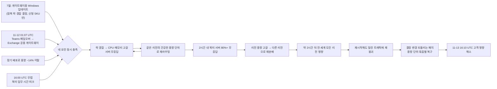
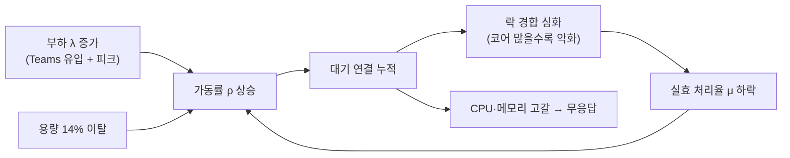
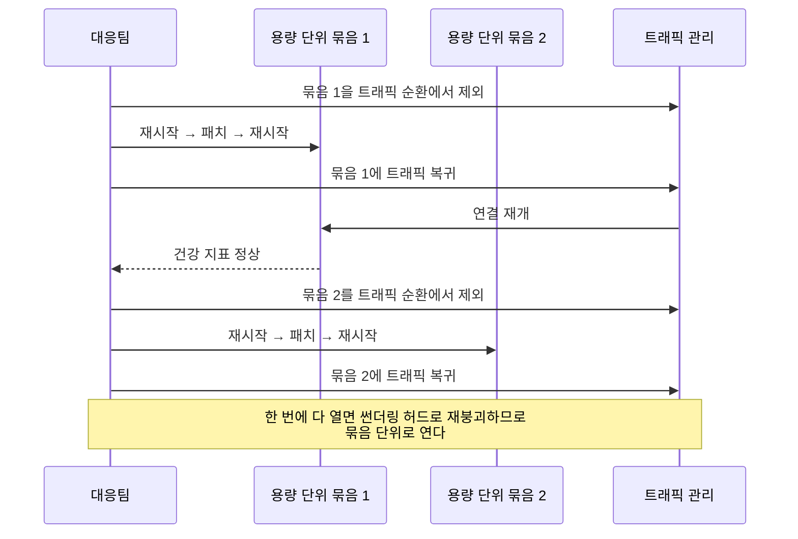
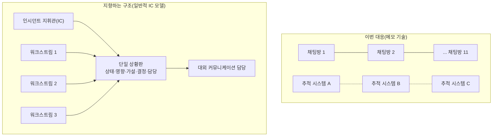
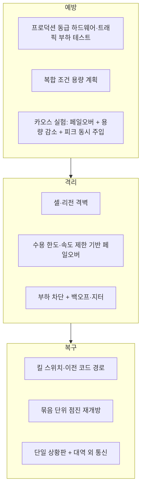

# Microsoft, Exchange Online 역대 최악의 장애 이후 'Code Red' 선언… 내부 메모가 드러낸 "전장의 안개"

### 2026년 11월 12~13일, 약 24시간 동안 Exchange Online·Outlook·Teams·Copilot이 전 세계에서 멈췄다. 원인은 7월에 배포돼 넉 달 가까이 잠복한 게이트웨이 서버의 락 경합 결함이었다. 정기 배포로 용량 14%가 빠져 있던 날, Teams 트래픽이 Exchange 게이트웨이로 넘어오고 미국 출근 시간 피크가 겹치자 결함이 터졌다. 북미 서버 80% 이상이 응답을 멈췄고, 다시 2시간 만에 전 세계 모든 리전으로 번졌다. Microsoft는 내부적으로 Code Red를 선언하고 "전 세계 1시간 내 복구"를 목표로 내걸었다. 이 글은 장애의 기술적 메커니즘과 연쇄 장애가 커지는 과정, 그리고 내부 메모에 드러난 대응 조직의 문제를 정리한다


Reuters는 2026년 11월 24일 **「Microsoft declares 'Code Red' after historic outage, internal memos show」**([원문](https://www.reuters.com/business/microsoft-declares-code-red-after-historic-outage-internal-memos-show-2026-11-24/))에서 Microsoft 내부 메모 여러 건을 인용했다. 기사에 따르면 Microsoft는 11월 12~13일 대규모 장애 이후 Code Red를 선언했다. GeekNews([토픽 37797](https://news.hada.io/topic?id=37797))는 이 기사를 요약하고 [Hacker News 토론](https://news.ycombinator.com/item?id=50631157)(257점, 댓글 245개)의 주요 의견을 함께 정리했다.

Reuters 기사는 장애가 *어떻게 터졌는지*보다 *조직이 어떻게 대응했는지*를 주로 다룬다. 기술적 원인은 Microsoft가 고객에게 낸 사후 보고서(PIR, Post Incident Report) 두 건으로 보충했다. 11월 15일자 **예비 PIR**([PDF 사본](https://next.ink/wp-content/uploads/2026/11/PostIncidentReport.pdf), 7쪽)과 11월 20일자 **최종 PIR**([PDF 사본](https://www.365fanatic.com/wp-content/uploads/2026/11/postincidentreport-mo1550821.pdf), 15쪽)이다. 원본은 Microsoft 365 관리 센터의 인시던트 EX1550543 아래에 있다. 여기에 [The Register](https://www.theregister.com/2026/11/16/microsoft-blames-monster-email-outage-on-software-defect-introduced-in-july-fix/5310026), [BleepingComputer](https://bleepingcomputer.com/news/microsoft/microsoft-says-months-old-bug-caused-global-microsoft-365-outage), [ITPro](https://www.itpro.com/software/microsoft/microsoft-365-outage-company-exec-lifts-lid-on-the-cascading-failure-that-caused-lengthy-disruption), [eSecurity Planet](https://www.esecurityplanet.com/news/news-microsoft-365-outage-windows-bug-recovery/), Tony Redmond의 [Office 365 for IT Pros](https://office365itpros.com/2026/11/16/exchange-online-outage-nov26/) 보도를 더했다.

**주의: Reuters 사이트는 자동 수집이 차단돼 직접 열지 못했다. 대신 같은 기사를 전재한 [The Star](https://www.thestar.com.my/tech/tech-news/2026/11/25/exclusive-microsoft-declares-039code-red039-after-historic-outage-internal-memos-show)(Reuters 배급, 기자 Jaspreet Singh)와 이를 인용한 [The Next Web](https://thenextweb.com/news/microsoft-code-red-exchange-online-outage-memos-reuters), [Yahoo Tech](https://tech.yahoo.com/ai/copilot/articles/microsoft-declares-code-red-memos-190240104.html)로 메모 내용을 확인했다. 메모 원문은 어느 매체도 공개하지 않았으므로 인용은 모두 Reuters 보도를 거친 것이다. 두 PIR PDF는 Microsoft 공식 배포처가 아닌 언론·블로그가 올린 사본이다. 글에 나오는 큐잉 계산과 코드는 개념을 설명하려고 새로 만든 재구성 예시이며, Microsoft의 실제 수치나 구현이 아니다.**

## 0. 어디에 두는가

이 사건은 세 층위로 읽힌다.

| 층위 | 질문 | 이 글의 장 |
|---|---|---|
| **소프트웨어 결함** | 왜 테스트를 통과한 코드가 넉 달 뒤에 터졌나 | 2, 3 |
| **분산 시스템 동역학** | 왜 일부 서버의 문제가 4시간 만에 전 세계로 번졌나 | 4, 5 |
| **조직과 운영** | 왜 복구에 하루가 걸렸고, 왜 Code Red까지 갔나 | 6, 7, 8, 9 |

쉽게 말하면 이렇다. 고속도로 요금소 하나의 결함이 원인이었지만, 그 결함이 최신형 요금소 전부에 똑같이 깔려 있었다. 막힌 차들을 옆 요금소로 돌리자 그 요금소들도 같은 결함으로 차례로 멈췄다. 한 지역의 요금소가 모자라자 다른 지역으로 차를 보냈고, 불은 전국으로 옮겨 붙었다. 우회로가 없는 화물차(Exchange Online)는 그 길로만 다녀야 해서 가장 오래 갇혔다.

### 0.1 먼저 알아 둘 용어

| 용어 | 뜻 | 비유 |
|---|---|---|
| **SLI** (Service Level Indicator) | 서비스 품질을 재는 실제 측정값. 예: 성공한 메일함 연결 비율 | 체온계 눈금 |
| **SLO** (Service Level Objective) | 내부적으로 세운 SLI 목표. 예: 월 99.95% | "열이 37.5도를 넘지 않게 한다"는 건강 목표 |
| **SLA** (Service Level Agreement) | 고객과 맺은 계약. 어기면 돈(서비스 크레딧)을 돌려준다 | 택배사의 "늦으면 배송비 환불" 약속 |
| **오류 예산** (error budget) | SLO가 허락하는 장애의 총량. 99.9%면 0.1%만큼은 고장 나도 된다 | 한 달 용돈. 다 쓰면 더는 무리한 지출(위험한 배포)을 못 한다 |
| **연쇄 장애** (cascading failure) | 한 부품의 장애가 그 부하를 떠안은 다른 부품의 장애로 번지는 현상 | 줄다리기에서 한 명이 손을 놓으면 남은 사람이 버티다 차례로 넘어진다 |
| **재시도 폭풍** (retry storm) | 실패한 요청을 모두가 즉시 다시 보내 부하가 몇 배로 불어나는 현상 | 전화가 안 되자 모두가 동시에 다시 거는 명절 고객센터 |
| **썬더링 허드** (thundering herd) | 기다리던 요청이 자원이 풀리는 순간 한꺼번에 몰리는 현상 | 세일 첫날 문이 열리자마자 뛰어드는 인파 |
| **폭발 반경** (blast radius) | 장애 하나가 영향을 미치는 범위 | 방화문으로 나뉜 건물에서 불이 번질 수 있는 넓이 |
| **셀 아키텍처** (cell-based architecture) | 서비스를 독립된 작은 복제본(셀)으로 쪼개 고객을 나눠 담는 구조. 이번 PIR의 "용량 단위(capacity unit)"가 비슷한 개념이다 | 배의 격벽. 한 칸에 물이 차도 배는 뜬다 |
| **PIR / 포스트모템** | 장애 후 원인·경과·재발 방지책을 적는 보고서. 비난 없는(blameless) 작성이 원칙이다 | 항공 사고 조사 보고서 |
| **인시던트 지휘관** (IC, Incident Commander) | 장애 대응 중 우선순위와 역할 분담을 결정하는 단 한 사람. 직접 고치지 않고 지휘만 한다 | 화재 현장의 현장 지휘관 |

SLO·오류 예산은 같은 폴더의 [SRE 4대 골든 시그널](260812_1308_SRE_four_golden_signals.md)과 Google SRE 책의 [오류 예산 정책](https://sre.google/workbook/error-budget-policy/)을, 연쇄 장애는 SRE 책의 [Addressing Cascading Failures](https://sre.google/sre-book/addressing-cascading-failures/)를 함께 보면 좋다.

## 1. 한눈에 보기

| 항목 | 내용 | 출처 |
|---|---|---|
| 기간 | 2026-11-12 16:20 UTC ~ 11-13 16:10 UTC, **23시간 50분**(고객 영향 해소 기준). 11-14 04:15 UTC 종료 선언 | 최종 PIR |
| 인시던트 ID | EX1550543(Exchange Online), MO1550821(타 M365 서비스 파급) | 최종 PIR |
| 영향 서비스 | Exchange Online(주 영향), Copilot, Teams, SharePoint, OneDrive, Defender, Purview, Fabric, Intune, Planner, Power Apps, To Do, Power BI, Universal Print | 최종 PIR |
| 사회적 영향 | 호주·일본·미국 정부, 금융 거래 업체 지연, 항공사 통신 차질 | Reuters |
| 근본 원인 | 7월부터 배포된 M365 네트워킹 게이트웨이 서버용 Windows 업데이트의 잠복 결함(내부 프로세스 락 경합). **코어가 많은 신형 SKU에서만** 발현 | 최종 PIR |
| 트리거 | ① 정기 배포로 게이트웨이 용량 약 14% 이탈 ② Teams 트래픽이 Exchange 공용 게이트웨이로 페일오버 ③ 북미 업무 시간 피크 | 최종 PIR |
| 최악 시점 | 2시간이 안 돼 **북미 서버 80% 이상 무응답**. 이후 약 2시간 만에 모든 리전으로 확산 | 최종 PIR |
| 복구 방식 | 결함 변경을 되돌리는 업데이트. 서버마다 "격리 → 재시작 → 패치 → 재시작 → 복귀" 5단계를 용량 단위 묶음으로 적용 | 최종 PIR |
| 데이터 | 기업 메일 유실 없음. 재전송 기간을 24시간에서 48시간으로 늘림. 30일 넘게 비활성인 소비자 메일함행 일부 메일은 만료돼 반송 | 최종 PIR |
| 대응 현장 | Teams 채팅방 11개, 메시지 1만 1,000건 이상. 진단 데이터는 여러 추적 시스템에 흩어짐 | Amanda Silver 메모(11-23) |
| 경영 조치 | Code Red 선언(Jason Henderson 메모, 11-20). 5개 작업 흐름 중 공개된 것은 부하 차단, 지역별 트래픽 분할, 빠른 복구 3개 | Reuters |
| 목표 | 향후 장애를 **전 세계 1시간 이내** 해결. 가장 긴급한 보안 문제도 탐지부터 안전한 전 세계 배포까지 1시간. Henderson은 "아직 거기에 이르지 못했다"고 인정 | Reuters |
| 현재 격차 | 별도 사고에서 긴급 프로덕션 수정이 전 세계에 퍼지는 데 **5~6일** 걸림 | Henderson의 이달 초 메모(Reuters) |
| 원인 배제 | 사이버 공격 아님, 악의적 활동 증거 없음, AI 도구가 만든 변경 아님 | 최종 PIR |



## 2. 타임라인: 넉 달 잠복, 15시간 숙성, 4시간 확산

최종 PIR의 타임라인(모두 UTC)에 한국 시간(KST, UTC+9)을 붙였다. 주요 항목만 옮겼다.

| UTC | KST | 사건 |
|---|---|---|
| 2026년 7월 | — | M365 네트워킹 게이트웨이 서버용 업데이트 배포 시작. 안전 배포(safe deployment)를 거쳐 몇 주에 걸쳐 전 세계에 퍼졌고, 3개월 넘게 문제 없음 |
| 11-12 무렵 | — | 새 서비스 버전을 배포하는 정기 작업으로 게이트웨이 용량 약 14%가 서비스에서 빠져 있음 |
| 11-12 00:25 | 11-12 09:25 | US East 리전에서 Teams 사용자가 대체 게이트웨이 연결 시 시간 초과를 겪기 시작(라우팅 문제) |
| 11-12 01:07 | 11-12 10:07 | 자동 페일오버가 Teams 트래픽을 **Exchange Online과 공유하는 게이트웨이**로 옮김. 한 리전의 문제였지만 전 세계 Teams 트래픽이 옮겨 감 |
| 01:07~16:00 | — | 게이트웨이 부하가 서서히 증가. 일부 리전에서 산발적 서버 장애, 자동 완화 조치 적용 |
| 11-12 16:00 무렵 | 11-13 01:00 | 미국 동부 업무 시간 피크에 북미에서 광범위한 장애 시작 |
| 11-12 16:03 | 11-13 01:03 | 연결성 이상 탐지 모니터가 연결 문제 증가 감지 |
| 11-12 16:17 | 11-13 01:17 | 자동화가 트래픽을 다른 건강한 엔드포인트로 돌리기 시작 |
| 11-12 16:20 | 11-13 01:20 | 고우선순위 경보, 서비스 상태 대시보드에 EX1550543 게시(공식 시작 시각) |
| 11-12 16:33 | 11-13 01:33 | 첫 고객 지원 케이스 접수. DownDetector 등에 사용자 신고 누적 |
| 11-12 18:27 | 11-13 03:27 | MO1550821 게시(Teams, Copilot, Defender 등으로 파급) |
| 11-12 19:00 | 11-13 04:00 | 대응 확대. 예방 차원에서 **모든 배포·구성 변경 중단** |
| 11-12 19:20 | 11-13 04:20 | 부하 상승의 원인이 트래픽 증가가 아니라 **서버가 대량으로 빠지며 남은 서버에 부하가 쏠린 것**임을 파악 |
| 11-12 20:00~21:00 | — | 헬스 체크 실패 구성 요소 우회, 대체 헬스 체크 방식 적용, 무응답 서버 자동 재시작 프로세스 준비 |
| 11-12 22:00 | 11-13 07:00 | 지금까지의 조치가 효과 없음을 확인. 리전별 트래픽 격리 검토 시작 |
| 11-12 23:55 | 11-13 08:55 | 복귀시킨 서버가 트래픽을 받자마자 다시 무응답이 되는 현상 확인 |
| 11-13 00:30 | 11-13 09:30 | **연결 협상(connection negotiation)** 단계에서 경쟁하는 프로세스들이 연결 처리를 막고 있음을 파악 |
| 11-13 01:53 | 11-13 10:53 | 이상 탐지 모니터가 수행하던 **자동 트래픽 재라우팅 일부를 끔** |
| 11-13 04:00~05:00 | — | 프로토콜별 조정, 트래픽 재분배, 전략적 트래픽 차단. 일부 회복했지만 지속되지 않음. 나쁜 상태에 갇힌 서버가 변경을 받지 못함 |
| 11-13 07:20 | 11-13 16:20 | 결함 변경을 되돌리는 업데이트를 완화책으로 확정, 일부 용량에 적용 |
| 11-13 08:00 | 11-13 17:00 | 안정성 확인 후 업무 시간에 들어서는 리전부터 체계적으로 확대 |
| 11-13 11:00 / 11:35 | 20:00 / 20:35 | 아시아태평양 일부 복구 완료 / 유럽 가용성 정상화 |
| 11-13 14:17 | 11-13 23:17 | 전 세계 Outlook 웹 가용성 정상화 |
| 11-13 16:10 | 11-14 01:10 | 고객 영향 해소 확인, 장기 모니터링과 메일 적체 처리로 전환 |
| 11-14 04:15 | 11-14 13:15 | 장기 모니터링 후 종료 선언, 최종 고객 업데이트 |

이 표에서 눈여겨볼 숫자는 네 개다.

- **넉 달.** 결함 코드는 7월에 들어가 11월까지 아무 일도 일으키지 않았다. 그래서 "최근 배포를 롤백한다"는 기본 대응이 통하지 않았다.
- **15시간.** Teams 페일오버(01:07)부터 광범위한 장애(16:00 무렵)까지의 간격이다. 최종 PIR은 이 기간에 "모든 서비스가 약 16시간 동안 건강했다"고 쓰면서도, 같은 타임라인에 일부 리전의 산발적 서버 장애와 자동 완화를 적었다. 게이트웨이는 아직 그 리전의 하루 피크를 맞지 않았을 뿐이었다. 시스템은 이미 위험했지만, 자동 완화가 작은 경고를 삼키고 있었다.
- **8시간.** 탐지(16:03)부터 원인 지점 파악(00:30)까지 걸린 시간이다. 내부 메모가 말한 "전장의 안개"가 바로 이 구간이다.
- **20분.** 최종 PIR은 첫 고객 공지가 광범위한 영향 발생 후 약 20분 뒤에 나갔다고 스스로 적었다. 이 역시 개선 항목에 올랐다.

> 출처마다 시작 시각이 조금 다르다. 서비스 상태 대시보드에는 16:17 UTC가 찍혔다는 보도도 있고(이는 PIR상 자동 재라우팅이 시작된 시각이다), BleepingComputer는 11:20 AM ET(16:20 UTC)를 썼다. 이 글은 두 PIR이 모두 명시한 16:20 UTC를 따랐다.

## 3. 근본 원인: "약한 하드웨어로만 한 부하 테스트"와 락 경합

### 3.1 락 경합이란

**락(lock)**은 여러 스레드가 같은 자료구조를 동시에 고치지 못하게 막는 자물쇠다. 한 스레드가 락을 잡으면 나머지는 기다린다. **락 경합(lock contention)**은 락을 기다리는 스레드가 너무 많아져서 실제 일보다 기다리는 데 쓰는 시간이 더 커진 상태를 말한다. 락의 종류와 동작은 [비관적 락과 낙관적 락](../03_DB_and_Concurrency/260731_1227_pessimistic_vs_optimistic_lock.md)에서 다뤘다.

쉽게 말하면 화장실이 한 칸인 사무실과 같다. 직원이 10명이면 버틸 만하지만, 100명이 되면 줄 서는 시간이 근무 시간을 잡아먹는다. 더 나쁜 경우도 있다. 기다리는 사람들이 문을 계속 두드리며 확인하면(스핀 락, 바쁜 대기) 줄 서는 동안에도 CPU를 태운다.

PIR은 결함을 이렇게 설명했다.

- 결함은 Windows **내부 프로세스의 락 경합**을 일으켜 서버의 CPU와 메모리를 고갈시켰다.
- 이 결함은 M365 네트워킹 게이트웨이 서버에서 활성화된 업데이트에서 나왔다. 최종 PIR은 이 구성이 Exchange Online용이며 일반 Windows 배포에는 해당하지 않는다고 밝혔다.
- **신형 SKU 하드웨어에서만 나타났고, 구형 SKU에서는 나타나지 않았다.** 신형은 코어가 많아 동시 요청이 많고, 그만큼 경합이 심했다.
- 부하 테스트가 잡지 못한 이유는 두 가지였다. 테스트 트래픽 조건이 장애 당시와 달랐고, 실험실은 코어가 적은 **구형 SKU**를 썼다.

### 3.2 왜 코어가 많을수록 나빠지나

직관과는 반대다. 코어가 많으면 더 빨라야 할 것 같다. 하지만 공유 락 하나를 두고 경쟁하는 코드에서는 코어가 늘수록 경쟁자도 는다. 대략적인 모델은 **암달의 법칙(Amdahl's law)**을 확장한 **보편 확장성 법칙(USL, Universal Scalability Law)**이다.

$$
C(N) = \frac{N}{1 + \alpha (N-1) + \beta N (N-1)}
$$

- $N$: 동시 처리 단위(코어나 스레드) 수
- $\alpha$: 직렬화 비율. 락 안에서만 할 수 있는 일의 비중이다
- $\beta$: 일관성 유지 비용. 캐시 라인 핑퐁처럼 코어끼리 상태를 맞추는 비용이다

$\beta > 0$이면 $C(N)$은 어느 지점에서 정점을 찍고 **오히려 떨어진다**. 코어를 늘릴수록 처리량이 줄어드는 구간이 생긴다는 뜻이다. 저코어 테스트 장비에서는 정점 전이라 멀쩡하던 코드가 고코어 프로덕션 장비에서는 정점을 넘어 무너질 수 있다. 같은 폴더의 [스레드 풀 크기 산정과 과부하 대응](260830_2359_Thread_Pool_Sizing_Formulas_and_API_Server_Overload_Response.md)에서도 "스레드를 늘리면 오히려 느려지는" 같은 현상을 다룬다.

> **재구성 예시(가상 수치).** $\alpha=0.02$, $\beta=0.0005$이면 $C(16)\approx 11.3$, $C(64)\approx 15.0$, $C(128)\approx 11.0$이다. 정점은 $N^*=\sqrt{(1-\alpha)/\beta}\approx 44$ 부근이고, 128코어 장비는 16코어 장비보다 오히려 *덜* 처리한다. Microsoft는 계수도 코어 수도 공개하지 않았다. 이 숫자는 경향을 보여주려는 예시일 뿐이다.

```c
// 재구성 예시: "연결 협상" 경로에 전역 락이 하나 끼어든 상황 (Microsoft 코드 아님)
static spinlock_t g_session_table_lock;

int negotiate_connection(conn_t *c) {
    tls_handshake(c);                       // 코어 수에 비례해 병렬로 잘 돈다

    spin_lock(&g_session_table_lock);       // 모든 코어가 여기서 한 줄로 선다
    session_t *s = session_table_insert(c); // 테이블이 커질수록 임계 구역도 길어진다
    spin_unlock(&g_session_table_lock);

    return attach_mailbox_route(c, s);
}
// 부하가 낮을 때: 임계 구역이 짧아 거의 기다리지 않는다
// 부하가 높고 코어가 많을 때: 스핀 대기가 CPU를 태우고 → 처리 지연 → 대기 연결 누적
//                              → 메모리 증가 → 더 긴 임계 구역 → 악순환
```

PIR이 원인을 "**연결 협상** 단계에서 경쟁하는 프로세스들이 연결 처리를 막았다", "연결을 맺는 프로세스가 압도됐다"고 표현한 점이 이 그림과 맞는다. 다만 실제 자료구조와 락 종류는 최종 PIR에도 나오지 않는다.

### 3.3 "Windows 결함"인가, "게이트웨이 결함"인가

Reuters는 원인을 "7월에 도입된, 탐지되지 않은 **Windows 확장성 결함**"이라고 썼다. 반면 Charles Lamanna(Copilot·에이전트·플랫폼 담당 EVP)는 X에서 이 결함이 **M365 게이트웨이 전용 수정**에만 해당하며 일반 Windows 배포와는 관계없다고 밝혔다(ITPro 보도). 두 PIR도 같은 입장이다. 정리하면 Windows 코드 경로를 건드린 변경이 맞지만, 그 변경은 M365 게이트웨이 서버에서만 켜졌다. Microsoft 설명대로라면 일반 Windows Server 사용자가 같은 결함을 맞을 가능성은 낮다.

## 4. 트리거: 각각은 정상이었던 세 사건

예비 PIR은 원인을 "세 요인"(결함, Teams 페일오버, 용량 감소)으로 설명했다. 최종 PIR은 여기에 **피크 부하**를 더해 "네 요인"으로 다시 정리했다. 이 장애가 무서운 이유는 결함을 뺀 나머지 셋이 모두 **정상 운영 상태**였다는 데 있다.

| 트리거 | 정상인가 | 무엇을 바꿨나 |
|---|---|---|
| 용량 약 14% 이탈 | 예. 새 서비스 버전을 배포하는 정기 작업이었다. Microsoft는 이것만으로는 영향이 없을 만큼 여유 용량이 있었다고 봤다 | 남은 서버당 부하 |
| Teams 페일오버 | 예. 두 개의 독립된 이기종 게이트웨이 사이를 오가는 것은 표준 BCDR(업무 연속성·재해 복구) 절차다. Lamanna는 "정상적인 복원력 동작"이라고 했다 | 공용 게이트웨이의 **부하 총량**과 **트래픽 패턴** |
| 북미 업무 시간 피크 | 예. 매일 오는 피크다 | 하루 중 최대 부하 |

> **예비 PIR과 최종 PIR의 차이.** 예비 PIR은 14% 이탈을 "전날 생긴 무관한 문제"라고 적었다. 최종 PIR은 이를 "최신 버전을 배포할 때의 정기 작업"으로 고쳐 적었고, 개선 항목에서는 "정기 유지보수의 일부"라고 불렀다. Teams 페일오버도 최종 PIR에서야 원인(US East 리전의 라우팅 문제)과 범위(한 리전의 문제로 전 세계 Teams 트래픽이 이동)가 드러났다.

여유 용량(headroom)은 단순 산수로 보면 충분해 보인다. 예를 들어 평소 가동률이 60%라면 14%가 빠져도 남은 서버의 가동률은 $0.60/0.86 \approx 0.70$이다. 70%는 안전해 보인다.

하지만 두 가지가 이 계산을 무너뜨린다.

1. **대기열은 선형이 아니다.** 가장 단순한 M/M/1 큐에서 평균 응답 시간은 $W = \dfrac{1}{\mu - \lambda} = \dfrac{1/\mu}{1-\rho}$다($\mu$: 처리율, $\lambda$: 도착률, $\rho = \lambda/\mu$: 가동률). $\rho$가 0.7에서 0.9로 가면 응답 시간은 서비스 시간의 3.3배에서 10배로 뛴다. 0.95를 넘으면 사실상 무한대다.
2. **잠복 결함이 $\mu$ 자체를 깎는다.** 락 경합은 부하가 높을수록 처리율을 떨어뜨린다. 부하가 오르면 $\mu$가 내려가고 $\rho$가 더 오른다. 양의 피드백이다.



여기서 중요한 교훈이 하나 나온다. **여유 용량은 "정상 코드의 처리율"을 기준으로 계산된다.** 잠복 결함이 있으면 그 기준 자체가 틀린다. Microsoft도 "충분한 여유 용량이 있었다"고 믿었지만, 그 믿음은 결함이 없는 세계를 기준으로 한 것이었다. 흔히 쓰는 N+1, N+2 용량 계획(서버 한두 대가 빠져도 버티게 하는 계획)도 "빠지는 서버"만 셈하지, "남은 서버가 느려지는 경우"는 셈하지 않는다.

## 5. 연쇄 장애: 복구 장치가 불을 옮겼다

### 5.1 1단계: 리전 안의 도미노

**연쇄 장애(cascading failure)**는 한 구성 요소의 장애가 그 부하를 넘겨받은 다른 구성 요소의 장애로 이어지는 현상이다. 최종 PIR에 따르면 게이트웨이는 수천 개의 **용량 단위(capacity unit)**로 이뤄진다. 용량 단위는 컴퓨트 서버와 네트워크 장비를 묶은 용량 조각(샤드)이다. 서버가 응답하지 않으면 트래픽 관리 시스템은 **같은 리전의 다른 건강한 용량 단위**로 트래픽을 돌린다. Lamanna와 PIR의 설명은 이렇다.

> "...caused a cascading failure from server to server as the same amount of load was spread across fewer servers."

서버 $N$대가 총부하 $L$을 나눠 맡고, 서버 한 대가 버틸 수 있는 한계가 $T$라고 하자. $k$대가 쓰러지면 남은 서버의 부하는 다음과 같다.

$$
\ell(k) = \frac{L}{N-k}
$$

$\ell(k) > T$가 되는 순간 다음 서버가 쓰러지고 $k$가 늘어난다. $\ell(k)$는 $k$에 대해 볼록하게 증가하므로 한번 임계를 넘으면 멈추지 않는다. 결과는 PIR이 밝힌 대로다. **2시간이 안 돼 북미 서버 함대의 상당 부분에서 결함이 터졌고, 최악 시점에는 80% 이상의 서버가 응답하지 않았다.** 최종 PIR은 서비스 내부의 재시도도 문제를 다른 용량 단위로 퍼뜨렸을 수 있다고 적었다. 재시도 폭풍이 도미노를 밀었다는 뜻이다.

### 5.2 2단계: 리전 경계를 넘다

예비 PIR은 "별도 문제 때문에 파티션 사이의 격벽이 연쇄 장애를 막지 못했다"고만 썼다. 최종 PIR은 그 메커니즘을 밝혔다. 리전의 건강한 용량이 바닥나기 시작하면 트래픽 관리 시스템이 이를 감지해 **트래픽을 다른 리전으로 돌린다.** 그런데 다른 리전에도 같은 결함이 깔려 있었다. 북미에서 광범위한 장애가 시작되고 약 2시간 뒤에는 모든 리전의 서버가 영향을 받았다.

선박은 선체를 여러 **격벽(bulkhead)**으로 나눈다. 한 칸에 물이 차도 배 전체가 가라앉지 않게 하려는 것이다. 이번 경우는 격벽에 "물이 차면 옆 칸으로 퍼내는 펌프"가 달려 있었던 셈이다. 펌프는 물이 깨끗할 때만 도움이 된다.

트래픽 관리 시스템은 원래 "아픈 서버를 피해 건강한 서버로 보내는" 보호 장치다. 그런데 모든 서버에 같은 결함이 있는 상황에서는 이 보호 장치가 **결함을 전파하는 통로**가 됐다. 대응팀이 11-13 01:53 UTC에 자동 재라우팅 일부를 끈 것도, 최종 PIR이 "자동 트래픽 분배를 막는 임시 가드레일"을 완료 항목에 올린 것도 이 때문이다. eSecurity Planet이 이 장애를 "복구 시스템이 장애를 퍼뜨렸다"고 요약한 이유다.

| 설계 의도 | 실제로 일어난 일 |
|---|---|
| 서버 장애 시 같은 리전의 건강한 용량 단위로 우회 | 건강한 서버도 같은 결함으로 붕괴 |
| 리전 용량 고갈 시 다른 리전으로 재분배 | 결함을 전 세계로 옮김 |
| 두 개의 독립된 게이트웨이로 격리 | 한 리전 문제로 Teams 트래픽 전체가 Exchange 쪽 게이트웨이로 몰림 |
| 대체 게이트웨이로 페일오버 | Teams·OneDrive·SharePoint·Office 앱은 가능. **Exchange는 규모 때문에 불가** |
| 자동 복구 | 광범위한 무응답과 계속되는 재접속 수요를 상정하지 않아 작동하지 않음 |

### 5.3 Exchange만 오래 갇힌 이유

복구의 첫 단계는 Teams, OneDrive, SharePoint, Office 앱 트래픽을 다른 게이트웨이로 옮기는 것이었다. 이 서비스들은 먼저 회복했고, Teams 채팅과 회의는 장애 대부분 동안 대체로 작동했다. 다만 Exchange 데이터에 기대는 기능(검색, 사람 정보, 일정, 상태 표시 등)은 계속 영향을 받았다. Exchange Online은 PIR 표현으로 **"규모 때문에(for scale reasons)"** 그렇게 할 수 없었다.

규모가 어느 정도인지는 Redmond가 인용한 2022년 MEC 발표 수치에서 짐작할 수 있다. 물리 메일박스 서버 약 30만 대, 하루 메시지 92억 건이다. 이 규모의 연결을 받아낼 대체 진입로를 따로 상시 유지하기는 어렵다. Redmond는 그래서 메일박스 복제(DAG, Database Availability Group)는 튼튼했지만 **연결을 받고 라우팅하는 층이 아킬레스건**이었다고 본다.

## 6. 왜 하루가 걸렸나: 재시작, 롤백, 썬더링 허드

최종 PIR은 복구를 늦춘 요인을 셋으로 꼽았다. 수개월 전 결함을 찾아내는 일, 패치 전후로 서버를 두 번 재시작해야 하는 일, 그리고 많은 서버에 패치를 퍼뜨리는 시간이다. 이를 풀어 쓰면 다음과 같다.

**① 재시작해도 다시 쓰러진다.** 서버를 재부팅하면 그동안 밀려 있던 연결과 재시도가 한꺼번에 몰려든다. 이것이 **썬더링 허드(thundering herd)**다. 식당 문을 다시 여는 순간 밖에서 기다리던 손님 전원이 동시에 들어오는 상황이다. 막 일어난 서버는 그 부하에 다시 쓰러졌다(11-12 23:55 UTC 기록).

**② 롤백할 대상이 없다.** 보통의 첫 대응은 "최근 변경을 되돌리기"다. 구성 배포 중단, 배포 롤백, 새로 켠 기능 끄기 같은 장치다. 그러나 결함은 3개월도 더 전에 들어갔다. 최종 PIR은 변경 감사(change auditing)와 진단 절차가 넉 달 전 Windows 변경을 범인으로 지목하는 데 오래 걸렸다고 인정했다. 범인을 안 뒤에도 이미 전 세계 함대에 깔린 변경이라 플라이팅(flighting, 단계적 실험 배포)이나 기능 플래그로 빠르게 끌 수 없었다.

**③ 원인 파악까지 8시간.** 연결 협상 지점이 범인이라는 사실을 알아낸 것이 00:30 UTC였다. 그 전까지는 헬스 체크 우회, 재시작, 용량 추가, 재라우팅처럼 증상을 누르는 조치만 반복했다. 일부는 효과가 없다고 22:00 UTC에 스스로 확인했다.

결국 Microsoft는 **연결 처리 코드 경로를 이전의 정상 상태로 되돌리는 업데이트**를 새로 만들었다. 서버 한 대에 적용하는 데 다섯 단계가 필요했다.

1. 서버를 서비스에서 뺀다. 재시작 직후 부하를 받지 않게 하려는 것이다.
2. 무응답 상태의 서버를 재시작한다.
3. 패치를 적용한다.
4. 패치를 활성화하려고 한 번 더 재시작한다.
5. 서비스에 복귀시킨다.

이를 서버 한 대씩 하면 끝이 없다. 그래서 큰 용량 단위 묶음(예비 PIR 표현으로 "한 리전의 50% 이상")을 통째로 트래픽에서 빼고, 그 안의 서버를 동시에 복구한 뒤 묶음째 복귀시켰다. 그리고 업무 시간에 들어서는 리전부터 순서대로 넓혔다.



최종 PIR은 이 과정이 너무 오래 걸렸다고 보고, "서버가 복귀할 때 점진적 트래픽 증가(ramp-up)와 수용 제어(admission control)"를 개선 항목에 올렸다. 위 그림의 "조금씩 다시 받기"가 이번에는 체계적인 장치로 존재하지 않았다는 뜻으로 읽힌다.

### SLA로 환산하면

Redmond의 계산을 따르면 23시간 50분은 1,430분이다. 11월 한 달은 43,200분이다. 모든 사용자가 전 시간 동안 접속하지 못했다고 가정하면 월간 가동률은 다음과 같다.

$$
1 - \frac{1430}{43200} \approx 0.9669 = 96.69\%
$$

Microsoft 365 SLA의 99.9% 약정에 한참 못 미치고, 95~99% 구간의 서비스 크레딧(50%)에 해당한다. 다만 실제 크레딧은 테넌트별 영향과 서비스별 약관에 따라 다르다. 자동으로 지급되지도 않아서 2026년 12월 말까지 직접 청구해야 한다고 Redmond는 짚었다. 같은 글에 따르면 Microsoft 365의 2026년 1분기 가동률은 99.526%였고, 이것이 그가 2013년부터 추적한 이래 최저치였다. 이번 분기는 그 기록을 크게 밑돌 가능성이 높다.

## 7. Code Red: 내부 메모가 드러낸 대응 조직의 문제

### 7.1 누가 무엇을 말했나

| 인물 | 직책 | 메모·발언 요지 |
|---|---|---|
| **Jason Henderson** | M365 Core 사장 | 11월 20일(금) 직원 메모. Exchange Online 역사상 고객 영향이 가장 컸던 사고라고 했다. "Code Red는 이것이 우리 팀의 최우선 과제라는 뜻"이라고 썼다. 수년간 해 온 작업이 "목요일에 우리를 지키기에는 충분하지 않았다"고 인정했다. M365 기반 서비스 엔지니어링을 맡는 **Substrate 리더십 팀**과 매일 회의하고 주간 검토를 하겠다고 했다. 이달 초 다른 메모에서는 M365 Core의 긴급 패치가 전 세계에 퍼지는 데 너무 오래 걸린다고 지적했다 |
| **Amanda Silver** | CVP, M365 Core 및 Work IQ(AI 에이전트용 업무 인텔리전스 플랫폼) 담당 | 11월 23일(월) 별도 메모. 엔지니어들이 "**전장의 안개(fog of war)**" 속에서 일했다고 했다. Teams 채팅방 11개에서 메시지 1만 1,000건 이상이 오갔고, 진단 데이터가 파편화된 내부 추적 시스템에 흩어져 일관된 그림을 유지하기 어려웠다. 5개 작업 흐름을 제시했다 |
| **Charles Lamanna** | EVP, Copilot·Agents·Platform | Silver 메모에 따르면 Code Red 검토 회의에서 해당 구성 요소의 이번 장애를 "**약 10년 치의 허용 가능한 장애**"에 비유했다. 별도로 X에 공개 사과와 기술 설명을 올렸다 |
| **Satya Nadella** | CEO | 공개 사과 |
| 회사 대변인 | — | "서비스가 복구됐다고 일이 끝나는 것은 아니다." 장애가 났을 때 해결하는 것만이 아니라 재발을 막는 데 전념하겠다고 했다 |

메모 날짜는 Reuters가 "금요일", "월요일"로 쓴 것을 Yahoo Tech 등이 11월 20일, 23일로 옮긴 것이다. 공교롭게도 Henderson의 Code Red 메모가 나온 11월 20일은 최종 PIR이 나온 날이기도 하다.

**Code Red**는 원래 병원 화재 경보 같은 최고 등급의 비상 코드를 뜻한다. HN의 한 댓글(alephnerd)은 Microsoft에서 Code Red가 **경영진부터 실무자까지 참여해 업무 절차를 바꾸는 전사적 조치**를 뜻한다고 설명했다. 그래서 제목이 그 맥락을 모르는 독자에게는 과장되게 읽힌다는 것이다. Henderson 메모의 표현대로라면 적어도 M365 Core 조직 안에서는 "다른 무엇보다 먼저 하는 일"이라는 뜻이다.

### 7.2 "10년 치의 허용 가능한 장애"를 숫자로 읽기

Lamanna의 비유는 **오류 예산(error budget)**으로 읽으면 선명해진다. 99.9%라는 목표를 세우면 0.1%만큼은 고장 나도 된다는 뜻이고, 그 0.1%가 예산이다. 많은 조직은 예산을 다 쓰면 기능 배포를 멈추고 안정성 작업만 하도록 정해 둔다. Code Red는 그 규칙을 조직 단위로 발동한 것에 가깝다.

> **재구성 계산(Microsoft가 공개한 SLO 아님).** 약 24시간이 "10년 치 허용량"이라면 연간 허용량은 약 2.4시간이다. 1년은 8,760시간이므로 해당 구성 요소의 암묵적 연간 목표는 대략 $1 - 2.4/8760 \approx 99.97\%$다. 하루짜리 장애 한 번으로 10년 치 예산을 다 쓴 셈이다.

| 연간 가용성 목표 | 연간 허용 장애 | 24시간 장애는 몇 년 치인가 |
|---|---|---|
| 99.9% | 약 8.8시간 | 약 2.7년 |
| 99.95% | 약 4.4시간 | 약 5.5년 |
| 99.97% | 약 2.6시간 | 약 9.1년 |
| 99.99% | 약 53분 | 약 27년 |

### 7.3 "전장의 안개"는 무엇이 문제였나

메시지 1만 1,000건이라는 숫자 자체에는 HN에서도 이견이 있었다. marysol5는 24시간 장애치고는 많지 않다고 했다. 실제 조율은 음성·영상 통화로 했을 테고, 채팅은 요약과 데이터 전달용이었으리라는 추정도 나왔다.

진짜 문제는 숫자가 아니라 **분산**이다. 채팅방이 11개라는 것은 진실의 원천(single source of truth)이 11개였다는 뜻이다. 거기에 진단 데이터는 여러 추적 시스템에 따로 흩어져 있었다. 그러면 이런 일이 생긴다.

- 같은 가설을 여러 팀이 따로 검증한다.
- 한 방에서 기각된 가설이 다른 방에서 계속 살아 있다.
- 결정이 누구에게 언제 전달됐는지 추적되지 않는다.
- 새로 합류한 사람이 현재 상황을 파악하는 데 한참 걸린다.

PIR 타임라인에도 그 흔적이 보인다. 22:00 UTC에 "지금까지의 조치가 효과가 없었다"고 확인했고, 03:00 UTC에는 변경이 기대대로 적용되지 않는다는 것을 알고 "새 작업 흐름"을 만들었다. 가설과 조치가 여러 갈래로 동시에 돌고 있었다는 뜻이다.

HN의 unethical_ban은 과거 직장에서 쓰던 방식을 소개했다. 일반 채팅·기술 정보 메모 하나와, 주요 장애 관리자(MIM, Major Incident Manager)가 관리하는 큐레이션 보드 하나를 따로 두는 방식이다. 큐레이션 보드에는 현재 상태, 영향, 가설, 작업 중인 팀만 올린다. 업계 표준인 **인시던트 지휘 체계(ICS, Incident Command System)**의 핵심도 같다. 지휘관(IC) 한 명, 기록 담당 한 명, 대외 커뮤니케이션 담당 한 명, 그리고 하나의 상황판이다. Google SRE 책의 [Managing Incidents](https://sre.google/sre-book/managing-incidents/) 장이 이 구조를 자세히 설명한다.



HN에서 많이 공감받은 지적이 하나 더 있다. **Teams가 망가졌는데 Teams로 대응을 조율했다는 점**이다. PIR을 보면 Teams 채팅과 회의는 장애 대부분 동안 대체로 작동했고, 더 안정적인 내부용 Teams 인스턴스였을 가능성도 있다. 그래도 원칙은 분명하다. 복구 수단이 복구 대상에 의존해서는 안 된다. 그래서 대응팀에는 장애 대상과 분리된 **대역 외(out-of-band)** 통신 수단이 필요하다. 2025년 10월 Azure Front Door 장애 때 Microsoft가 관리자들이 복구를 할 수 있도록 Azure Portal을 Front Door에서 떼어 낸 것도 같은 원칙이다(9장).

## 8. Code Red의 처방: 5개 작업 흐름, 최종 PIR의 개선 항목, 그리고 "1시간"

Reuters에 따르면 Silver는 5개 작업 흐름을 제시했다. 보도된 것은 세 가지뿐이고, 나머지 둘의 이름은 어느 매체도 전하지 않았다.

| 초점 | 의미 | 이번 장애와의 연결 |
|---|---|---|
| **부하 차단(load shedding)** | 과부하 시 일부 요청을 의도적으로 거절해 나머지를 살린다 | 모든 연결을 받으려다 모두 쓰러졌다 |
| **지역별 트래픽 분할** (geographic traffic partitioning) | 리전·셀 단위로 트래픽을 나눠 폭발 반경을 제한한다 | 리전 간 재분배로 전 세계로 번졌다 |
| **더 빠른 복구 메커니즘** | 대규모 동시 장애에서도 작동하는 복구 절차 | 자동 복구가 이 규모를 상정하지 않았다 |

여기에 더해 **AI 에이전트**로 엔지니어가 시스템 상태 데이터를 더 빨리 진단하게 한다는 계획도 있다. Microsoft 대변인은 서비스 복구 뒤에도 팀들이 교훈을 반영하는 작업을 계속하고 있다고 밝혔다.

### 8.1 최종 PIR의 개선 항목

메모의 작업 흐름은 방향이고, 구체적인 일정은 최종 PIR에 있다. 최종 PIR은 이미 끝낸 조치와 앞으로 할 조치를 나눠 적었다.

**완료한 조치**: 결함 변경을 되돌리는 업데이트, 수정 사항을 Windows 이미지에 영구 반영(신규·기존 서버 모두), 메일 전달 기간 연장, 선제적 용량 추가, 트래픽 재라우팅 패턴과 연결 처리 상태에 대한 모니터링 추가, 자동 트래픽 분배를 막아 연쇄 영향을 피하는 **임시** 가드레일, 유지보수 중이던 서버 복귀.

**앞으로의 조치**(표의 분류 꼬리표는 PIR 원문의 것):

| 분류 | 발견 | 조치 | 시한 |
|---|---|---|---|
| 폭발 반경 | 트래픽 분배 설계가 장애를 다른 리전으로 옮길 수 있다 | 다른 리전으로의 연쇄 장애를 없애도록 트래픽 분배 수정 | 2026년 4분기 |
| 폭발 반경 | 리전 단위 장애 구역이 너무 크다 | 더 작은 장애 구역(fault zone)으로 트래픽 분배 설계 | 미정 |
| 폭발 반경 | Teams 페일오버가 결함을 드러내는 데 한몫했다 | 게이트웨이 용량을 워크로드별 풀(pool)로 분할 | 2027년 1분기 |
| 페일오버 설계 | 한 리전의 라우팅 문제로 전 세계 Teams 트래픽이 이동했다 | Teams는 문제 리전만 페일오버 | 2026년 4분기 |
| 페일오버 훈련 | 페일오버 테스트가 결함을 잡지 못했다 | 피크 조건과 배포 중인 다른 변경까지 포함한 범위 지정 페일오버 테스트를 안전 배포에 편입 | 미정 |
| 진단 | 넉 달 전 Windows 변경을 원인으로 지목하는 데 오래 걸렸다 | Windows 변경의 진단 수집·변경 감사 개선 | 2027년 1분기 |
| 복구 | 수정 사항을 전 세계에 배포·검증하는 데 너무 오래 걸렸다 | 함대 전체 장애용 복구 절차 개선 | 2027년 1분기 |
| 복구 | 복귀한 서버가 다시 압도됐다 | 점진적 트래픽 증가와 수용 제어, 프로토콜·워크로드·리전별 트래픽 감축 제어, 서비스 내부 재시도·백오프 개선 | 미정 |
| 폭발 반경 | 서비스 재시도가 문제를 다른 용량 단위로 퍼뜨릴 수 있다 | 다른 서비스와의 재시도·백오프 동작 개선 | 미정 |
| 테스트 | 테스트가 하드웨어와 트래픽 조합을 재현하지 못했다 | 최신 고코어 하드웨어와 프로덕션 대표 트래픽으로 부하 테스트 확대, 피크 한계 정기 테스트 | 2027년 1분기 |
| 용량 설계 | 결함과 다른 요인이 겹친 피크를 버티지 못했다 | 여유 용량 추가 | 2027년 1분기 |
| 용량 설계 | 정기 유지보수로 줄어든 용량이 다른 요인과 겹치면 위험하다 | 여유 용량을 위협하는 장기 용량 손실 탐지 | 2026년 4분기 |
| 고객 커뮤니케이션 | 첫 고객 공지가 광범위한 영향 후 약 20분 뒤에 나갔다 | 탐지와 자동 공지 개선 | 2026년 4분기 |

> PDF의 표는 셀 정렬이 깨져 있어 일부 행의 시한은 읽기가 애매하다. 위 시한은 PDF 텍스트와 이를 옮긴 [365Fanatic](https://www.365fanatic.com/m365-outage-12-november-2026/) 정리를 대조해 맞췄다.

이 표를 Silver의 작업 흐름과 맞대 보면 "지역별 트래픽 분할"은 폭발 반경 항목, "더 빠른 복구"는 복구 항목, "부하 차단"은 수용 제어·트래픽 감축 항목에 대응한다. 눈여겨볼 점은 핵심인 폭발 반경 축소(더 작은 장애 구역)와 복귀 시 수용 제어가 **"미정"**이라는 것이다. 그동안 자동 트래픽 분배는 임시 가드레일로 막혀 있다. 보호 장치 하나를 끈 채로 운영하는 기간이 생긴다는 뜻이기도 하다.

### 8.2 부하 차단: 일부를 버려 전체를 살린다

부하 차단은 응급실의 **트리아지(triage)**와 같다. 모든 환자를 동시에 받으면 의료진이 무너진다. 그래서 중증도에 따라 받을 사람과 기다릴 사람을 나눈다. 서버도 처리할 수 있는 양을 넘는 요청은 빨리 거절해야 한다. 거절당한 클라이언트는 나중에 다시 오면 된다. 반면 받아놓고 처리하지 못하면 메모리만 차지하다가 결국 시간 초과로 끝난다. Google SRE 책의 [Handling Overload](https://sre.google/sre-book/handling-overload/) 장이 이 원리를 다룬다.

```go
// 재구성 예시: 동시 처리 한도와 우선순위 기반 부하 차단 (Microsoft 구현 아님)
// Request 타입과 Priority 상수(Background, NewConnection 등)는 생략했다.
import "sync/atomic"

type Shedder struct {
    inflight atomic.Int64
    limit    int64 // 측정된 안전 동시성. 정적 값보다 적응형(AIMD 등)이 낫다
}

func (s *Shedder) Admit(r *Request) bool {
    n := s.inflight.Add(1)
    // 우선순위별로 다른 문턱: 이미 인증된 세션의 메일 동기화 > 신규 연결 > 백그라운드 작업
    threshold := s.limit
    switch r.Priority {
    case Background:
        threshold = s.limit * 6 / 10
    case NewConnection:
        threshold = s.limit * 8 / 10
    }
    if n > threshold {
        s.inflight.Add(-1)
        return false // 즉시 503 + Retry-After. 큐에 쌓지 않는다
    }
    return true
}

func (s *Shedder) Done() { s.inflight.Add(-1) }
```

이 코드가 막으려는 것은 이번 장애의 "대기 연결 누적 → 메모리 고갈" 고리다. 다만 부하 차단만으로는 락 경합 결함 자체를 고치지 못한다. 서버가 무너지는 시점을 늦추고, 무너지더라도 응답 가능한 상태로 남게 해서 진단과 패치 적용을 쉽게 해 줄 뿐이다. 이번 복구에서 "나쁜 상태에 갇힌 서버가 변경을 받지 못했다"(05:00 UTC)는 기록을 떠올리면 그 차이는 작지 않다.

### 8.3 클라이언트 쪽 절반: 지수 백오프와 지터

부하 차단은 서버 쪽 절반에 불과하다. 거절당한 클라이언트가 즉시 재시도하면 **재시도 폭풍(retry storm)**이 생긴다. 그래서 클라이언트는 대기 시간을 지수적으로 늘리고, 무작위성(지터, jitter)을 섞어 동시에 몰리지 않게 해야 한다. AWS Builders' Library의 [Timeouts, retries, and backoff with jitter](https://aws.amazon.com/builders-library/timeouts-retries-and-backoff-with-jitter/)가 대표적인 참고 자료다.

$$
\text{sleep}_n = \text{random}\left(0,\ \min(\text{cap},\ \text{base}\cdot 2^{n})\right)
$$

```python
# 재구성 예시: "Full Jitter" 지수 백오프
import random
import time


class Overloaded(Exception):
    """서버가 503 또는 Retry-After로 거절한 경우"""
    def __init__(self, retry_after=None):
        super().__init__("overloaded")
        self.retry_after = retry_after   # 초 단위, 없으면 None


class GiveUp(Exception):
    pass


def call_with_backoff(fn, base=0.2, cap=30.0, max_attempts=8):
    for n in range(max_attempts):
        try:
            return fn()
        except Overloaded as e:
            if e.retry_after:
                time.sleep(e.retry_after)    # 서버가 정해 준 시각을 존중한다
            else:
                time.sleep(random.uniform(0, min(cap, base * 2 ** n)))
    raise GiveUp()
```

최종 PIR이 "서비스 재시도가 문제를 다른 용량 단위로 퍼뜨릴 수 있다"를 발견 항목에 올린 것은 이 절반이 Microsoft 내부 서비스 사이에서도 부족했다는 뜻이다.

### 8.4 셀 기반 격리: 폭발 반경을 숫자로 제한한다

**셀 기반 아키텍처(cell-based architecture)**는 서비스를 서로 독립된 작은 복제본(셀) 여러 개로 쪼개는 방식이다. 고객은 그중 하나의 셀에만 배정된다. 셀이 $K$개면 한 셀의 장애가 미치는 영향은 대략 전체의 $1/K$로 제한된다. 핵심 규칙은 **셀 사이에 장애 시 트래픽을 넘기지 않거나, 넘기더라도 받는 쪽의 수용 한도 안에서만 넘기는 것**이다. 이번 장애처럼 "건강한 곳으로 넘기기"가 불을 옮기는 상황을 구조적으로 막기 위해서다. AWS의 [셀 기반 아키텍처 백서](https://docs.aws.amazon.com/wellarchitected/latest/reducing-scope-of-impact-with-cell-based-architecture/reducing-scope-of-impact-with-cell-based-architecture.html)가 이 설계를 정리했다.

Exchange 게이트웨이에도 수천 개의 용량 단위라는 "셀 비슷한 것"이 있었다. 문제는 그 단위들이 장애 시 서로 트래픽을 주고받도록, 그리고 리전이 바닥나면 다른 리전으로 넘기도록 설계돼 있었다는 점이다. 셀이 있어도 셀 사이의 페일오버 규칙이 셀을 하나로 묶어 버리면 폭발 반경은 줄지 않는다. 최종 PIR의 "더 작은 장애 구역", "워크로드별 풀 분할" 항목이 이 문제를 겨냥한다.

AWS가 2025년 10월 us-east-1 장애 뒤 "가용 영역(AZ) 페일오버로 한 번에 빼는 용량의 속도를 제한하는 장치(velocity control)"를 추가한 것도 같은 교훈이다(9장). 페일오버는 공짜 보험이 아니라 받는 쪽에 부하를 떠넘기는 행위이므로, 한도와 속도 제한이 붙어야 한다.

### 8.5 안전 배포는 왜 이 결함을 놓쳤나

전문가라면 먼저 묻는 질문이다. Microsoft는 링(ring) 배포라 부르는 단계적 배포, 플라이팅, 기능 플래그, 건강 지표 기반 자동 중단을 갖춘 **안전 배포 관행(SDP, Safe Deployment Practices)**을 오래 써 왔다. 원칙은 [Azure Well-Architected의 안전 배포 가이드](https://learn.microsoft.com/en-us/azure/well-architected/operational-excellence/safe-deployments)에 정리돼 있다. PIR도 7월 업데이트가 "안전 배포를 거쳐 몇 주에 걸쳐 전 세계에 퍼졌다"고 적었다.

그런데도 놓친 이유는 안전 배포의 전제에 있다. 단계적 배포는 **"결함이 있으면 배포 직후 관찰 기간(bake time) 안에 증상이 나타난다"**는 가정 위에 선다. 이번 결함은 그 가정을 벗어났다.

| 안전 배포 장치 | 전제 | 이번 결함 |
|---|---|---|
| 링·단계적 배포 | 초기 링에서 증상이 드러난다 | 증상의 조건(고코어 SKU + 공용 게이트웨이 + 용량 감소 + 피크)이 몇 달간 한 번도 겹치지 않았다 |
| 건강 지표 기반 자동 롤백 | 배포와 증상 사이가 가깝다 | 넉 달 간격. 자동 롤백이 볼 수 있는 창을 한참 지났다 |
| 기능 플래그 | 새 동작이 플래그 뒤에 있다 | 이미 몇 달 전에 "정상 동작"으로 굳어 플래그로 끌 수 없었다 |
| 부하 테스트 | 실험실이 프로덕션을 대표한다 | 실험실은 구형 저코어 SKU, 트래픽 조합도 달랐다 |

그래서 처방도 배포 방식보다 **검증 조건**에 있다. 최종 PIR이 "최신 고코어 하드웨어와 프로덕션 대표 트래픽으로 부하 테스트", "피크 조건을 포함한 범위 지정 페일오버 테스트를 안전 배포에 편입"을 약속한 이유다. 일반화하면 이렇다. 배포 단계의 첫 링에는 **가장 위험한 하드웨어 세대**가 들어가야 하고, 부하 테스트는 평균이 아니라 **최악 조합**(피크 + 페일오버 유입 + 용량 감소)을 재현해야 한다. 그리고 몇 달 전 변경이라도 끌 수 있도록, 위험한 변경의 이전 코드 경로를 일정 기간 남겨 두는 장치가 필요하다.

### 8.6 "1시간"은 얼마나 공격적인 목표인가

| 지표 | 이번 장애 | Code Red 목표 |
|---|---|---|
| 전 세계 장애 해결 | 23시간 50분 | **1시간 이내** |
| 긴급 프로덕션 수정 전 세계 배포 | 5~6일(별도 사고, Henderson 메모) | — |
| 가장 긴급한 보안 문제(탐지→안전한 전 세계 배포) | Henderson: "아직 거기에 이르지 못했다" | **1시간** |

이번 장애에서는 원인 지점을 찾는 데만 8시간이 걸렸다. 그러니 1시간 목표는 "더 빨리 찾자"만으로는 달성할 수 없다. **찾기 전에 피해를 줄이는 구조**가 필요하다. 셀 격리로 폭발 반경을 줄이고, 부하 차단으로 붕괴를 막고, 원인을 몰라도 쓸 수 있는 완화 레버(트래픽 차단, 기능 끄기, 이전 코드 경로 전환)를 미리 준비해 두는 식이다. 1시간 목표는 진단 속도의 목표라기보다 아키텍처의 목표에 가깝다.

긴급 패치 배포에 5~6일이 걸린다는 내부 메모 내용도 같은 맥락이다. 배포 속도와 배포 안전성은 서로 부딪친다. 단계적 배포는 원래 느리게 하려는 장치이기 때문이다. 이 둘을 함께 얻으려면 각 단계의 건강 판정을 자동화해 "기다리는 시간"을 "관찰이 끝나는 시간"으로 바꿔야 한다.

보안 패치 목표가 함께 들어간 데는 배경이 있다. Microsoft는 2023년 11월 [Secure Future Initiative(SFI)](https://www.microsoft.com/en-us/security/blog/2023/11/02/announcing-microsoft-secure-future-initiative-to-advance-security-engineering/)를 발표했고, 2024년 5월에는 Nadella가 [보안을 "무엇보다 우선"](https://blogs.microsoft.com/blog/2024/05/03/prioritizing-security-above-all-else/)한다고 선언했다. SFI는 안전 배포, 빠른 패치, 엔지니어링 시스템 개선을 축으로 한다. 이번 Code Red는 그 "빠르고 안전한 전 세계 배포"라는 과제가 보안만이 아니라 가용성에서도 아직 풀리지 않았음을 보여 준다. 다만 Reuters 보도는 Code Red를 SFI와 직접 연결하지 않았다. 이 연결은 이 글의 해석이다.

## 9. 다른 대형 장애와 비교

이번 장애는 최근 몇 년 사이의 대형 클라우드 장애와 닮은 점이 많다. 세 사건을 골라 나란히 놓았다. 각 사건의 사실관계는 해당 회사의 공식 사후 분석과 보도를 따랐다.

| 항목 | CrowdStrike (2024-07-19) | AWS us-east-1 (2025-10-19~20) | Azure Front Door (2025-10-29) | Exchange Online (2026-11-12~13) |
|---|---|---|---|---|
| 직접 원인 | 보안 센서용 콘텐츠 업데이트(Channel File 291)의 결함으로 Windows 커널 드라이버가 충돌 | DynamoDB DNS 관리 자동화의 잠복 경쟁 조건(race condition)으로 리전 엔드포인트 DNS 레코드가 비어 버림 | 의도치 않은 테넌트 구성 변경. 소프트웨어 결함으로 안전 검증을 우회해 전파 | 넉 달 전 게이트웨이 업데이트의 잠복 락 경합 결함 |
| 잠복 기간 | 거의 없음(배포 즉시) | 오래된 결함, 특정 타이밍에서만 발현 | 거의 없음(구성 반영 즉시) | 약 4개월 |
| 확산 방식 | 단계 배포 없이 전 세계에 동시 배포 | DynamoDB 의존 서비스로 연쇄. EC2 관리 시스템의 혼잡 붕괴(congestive collapse), NLB 헬스 체크 흔들림 | 중앙 집중 글로벌 엣지라 전 노드에 반영. Entra ID 등 의존 서비스로 파급 | 페일오버와 재라우팅이 리전 안에서, 다시 리전 사이로 결함을 옮김 |
| 복구를 늦춘 것 | 부팅이 안 되는 PC를 사람이 직접 고쳐야 했음 | DNS를 고친 뒤에도 밀린 작업 때문에 EC2가 혼잡 붕괴. 복구에 반나절 이상 | 수동 노드 복구와 점진적 트래픽 재분배 | 재시작 직후 썬더링 허드, 서버당 두 번의 재시작 |
| 공통 교훈 | 콘텐츠·구성도 코드처럼 단계 배포 | 복구 후의 적체가 두 번째 장애를 만든다. 페일오버에 속도 제한 | 검증 장치 자체의 결함이 가장 위험하다. 관리 도구는 대역 외로 | 페일오버가 결함을 옮긴다. 테스트는 최악 조합을 재현해야 한다 |

네 사건을 겹쳐 보면 패턴이 두 개 보인다.

1. **"한 번에 전부"가 가능한 경로가 있었다.** CrowdStrike는 전 세계 동시 배포였고, Front Door는 검증을 우회한 구성 변경이 전 노드에 반영됐다. Exchange는 배포 자체는 단계적이었지만, 장애 시 트래픽 재분배가 "한 번에 전부"의 경로가 됐다. 폭발 반경은 배포 경로만이 아니라 **페일오버 경로**로도 정의된다.
2. **복구가 두 번째 장애를 만든다.** AWS는 DynamoDB를 고친 뒤 EC2 관리 시스템이 밀린 작업에 짓눌렸고, Exchange는 재시작한 서버가 밀린 연결에 짓눌렸다. 원인을 고친 순간이 아니라 **적체를 소화한 순간**이 복구다. 그래서 복구 절차 자체에 수용 제어와 점진적 재개방이 들어가야 한다.

## 10. 커뮤니티 반응: 감원, 카오스 엔지니어링, 기본기

### 10.1 감원이 원인인가

HN 최상위 댓글(runako)은 Microsoft가 2022년 당시 인력의 약 45%를 해고했거나 희망퇴직 대상으로 삼고 있으며, 현재 인력의 25% 이상이 희망퇴직 제안을 고민 중이라고 썼다. 또 다른 경제적 요인도 짚었다. 다른 직장을 쉽게 구할 수 있는 사람일수록 희망퇴직을 받아들인다. 결국 시장 가치가 높은 인력이 먼저 나간다는 것이다.

반론도 바로 나왔다. 다른 댓글은 직원 수가 2022년 22만 1,000명에서 2026년 22만 3,000명으로 사실상 줄지 않았다고 지적했다. 또 Business Insider를 인용해 CFO Amy Hood가 대상자의 5% 이하만 희망퇴직을 받아들일 것으로 예상했다는 점도 들었다. 영업·마케팅 조직이 희망퇴직 대상에서 대체로 빠졌다는 관찰도 있었다.

공개 보도로 확인할 수 있는 사실은 이렇다.

- **희망퇴직 규모.** AP 보도([ABC7 전재](https://abc7news.com/19981967/))에 따르면 Microsoft는 2026년 10월 26일 전 세계 인력의 약 27%인 **약 6만 명**에게 자발적 퇴직 제안(Voluntary Exit Offer)을 했다. 대상은 미국·영국·캐나다·인도의 적격 직원이다. HN의 "25% 이상"은 *고민 중인* 비율이 아니라 *제안을 받은* 비율에 가깝다.
- **인원 수.** 같은 보도에 따르면 2026년 6월 말 정규직은 약 22만 3,000명이다. 2022년 6월 말 22만 1,000명은 Microsoft 연차 보고서의 수치다. 두 숫자는 HN 반론과 맞는다.
- **수락률.** [Fortune](https://fortune.com/2026/10/26/microsoft-offers-buyouts-to-nearly-30-of-workforce-in-ongoing-ai-shift/) 보도에서 회사 대변인은 비슷한 프로그램을 운영한 다른 대형 기술 기업의 수락률이 3~5%였다고 언급했다고 한다(검색 요약으로만 확인, 본문은 차단). Amy Hood의 "5% 이하" 발언은 확인하지 못했다.
- **"2022년 대비 45%"**와 영업·마케팅 제외 여부는 확인하지 못했다.

Redmond도 최근 감원 프로그램이 느린 복구의 원인이라는 증거는 찾지 못했다고 썼다. 다만 이 규모의 장애에서는 경험 많은 엔지니어가 진단을 앞당겼을 수 있다고 덧붙였다. 퇴직 제안의 마감은 12월 초, 퇴직일은 12월 31일로 보도됐으므로 11월 장애 시점에는 아직 아무도 그 프로그램으로 떠나지 않았다. **감원과 이번 장애 사이의 인과관계는 공개된 자료로 판단할 수 없다.** 이 주제는 같은 폴더의 [We Need Smart People Who Give a Shit](261121_2241_We_Need_Smart_People_Who_Give_a_Shit.md)와 [AI는 SRE를 대체하는가](261031_2222_AI_SRE_Deskilling_and_Never_Skilling.md)에서 더 다뤘다.

### 10.2 카오스 엔지니어링과 디지털 트윈

- Netflix식 **Chaos Monkey**(운영 중인 시스템의 일부를 일부러 죽여 복원력을 검증하는 도구)가 필요하다는 의견이 있었다. Microsoft에도 [Azure Chaos Studio](https://learn.microsoft.com/en-us/azure/chaos-studio/chaos-studio-overview)라는 같은 계열의 서비스가 있다는 답이 달렸다.
- 한 댓글은 정상 종료(graceful shutdown)만 신경 쓰고 비정상 종료 후 복구는 방치하는 경향을 비판했다. 비정상 종료를 기본으로 보고, 정상 종료는 일부 최적화가 가능한 특수한 경우로 다뤄야 한다는 것이다. PIR의 "자동 복구가 광범위한 무응답 상태를 상정하지 않았다"는 문장이 정확히 이 지적과 맞닿는다.
- teyc는 구성 요소 간 상호작용을 **디지털 트윈**으로 대규모 모델링해야 한다고 했다. 그리고 이렇게 덧붙였다. 그걸 못 하는 건 멍청해서가 아니라, 말 그대로 **아무에게도 맡겨지지 않은 일**이기 때문이다.

마지막 지적이 이번 장애의 본질에 가깝다. 게이트웨이 팀, Teams 페일오버 팀, 용량 관리 팀은 각자의 영역에서 정상적으로 움직였다. 세 결정이 한 시점에 겹칠 때 어떤 일이 생기는지는 누구의 일도 아니었다. 최종 PIR이 "페일오버 테스트가 결함을 잡지 못했다"를 발견 항목으로 올린 것도 같은 고백이다.

### 10.3 기본기에 대한 의문

- kozikow는 점진적 배포나 기능 플래그 같은 기본 장치를 제대로 쓰지 않는 것처럼 보인다고 물었다. PIR을 보면 7월 배포 자체는 안전 배포를 거쳐 몇 주에 걸쳐 진행됐고, 3개월 넘게 문제가 없었다. 문제는 배포 방식보다는 **배포 후 몇 달 뒤에야 성립하는 조건**을 테스트가 재현하지 못했다는 점에 있다(8.5절).
- UltraSane은 이렇게 많은 서버에 배포하기 전에 동시성 버그를 잡지 못한 것은 엔지니어링 관행이 매우 부실하다는 뜻이라고 했다.
- 한 사용자는 장애 전부터 읽고 있던 [「How Microsoft Vaporized a Trillion Dollars」](https://isolveproblems.substack.com/p/how-microsoft-vaporized-a-trillion) 연재를 추천했다. 전 Azure Core 엔지니어가 쓴 글로, 2026년 4월 [HN 토론](https://news.ycombinator.com/item?id=47616242)에 댓글이 648개 달렸다. 글쓴이가 주니어 개발자였으니 감안해서 읽어야 한다는 단서도 붙었다. 근본 해결에는 절차 개선이 아니라 속도를 늦추고 아키텍처를 다시 설계하는 수준의 문화 변화가 필요하다는 의견도 있었다.
- 제목을 보고 2001년 IIS 서버를 공격한 [Code Red 웜](https://en.wikipedia.org/wiki/Code_Red_(computer_worm))을 떠올렸다는 댓글도 여럿이었다. 그 무렵 Hotmail을 FreeBSD에서 Windows로 옮기고 있었다는 회상도 있었다.
- GeekNews 댓글(realg)은 장애가 해결되지 않은 상황에서 "marginal success" 같은 소송 회피성 표현을 쓴다고 Microsoft의 커뮤니케이션을 비판했다. 이 표현이 정확히 어떤 공지에서 나왔는지는 확인하지 못했다. 최종 PIR도 첫 고객 공지가 늦었다는 점은 인정했다.

## 11. 우리 시스템에 대입해 보기

Microsoft 규모가 아니어도 같은 구조의 장애는 생긴다. 다음은 이번 사건에서 바로 뽑아낼 수 있는 점검 항목이다.

| 영역 | 질문 | 이번 장애의 해당 지점 |
|---|---|---|
| 부하 테스트 | 테스트 장비의 코어 수·하드웨어 세대·트래픽 조합이 프로덕션과 같은가 | 구형 저코어 SKU, 다른 트래픽 조건으로만 테스트 |
| 배포 순서 | 가장 위험한 하드웨어 세대가 첫 링에 들어가나 | 신형 SKU에서만 터지는 결함 |
| 용량 계획 | 여유 용량을 "정기 유지보수 + 페일오버 유입 + 피크" 조건에서 계산했나 | 14% 이탈 + Teams 유입 + 북미 피크 동시 발생 |
| 페일오버 | 페일오버가 받는 쪽의 한도를 확인하고, 문제 범위만 넘기나 | 한 리전 문제로 전 세계 Teams 트래픽 이동 |
| 격벽 | 셀·리전 사이에 장애 시 트래픽이 무제한으로 넘어가지 않게 막았나 | 리전 간 재분배로 전 세계 확산 |
| 부하 차단 | 과부하 시 큐에 쌓지 않고 빠르게 거절하나 | 연결이 쌓여 CPU·메모리 고갈 |
| 재시도 | 내부 서비스끼리도 백오프와 지터, 재시도 예산을 쓰나 | 재시도가 다른 용량 단위로 문제를 전파 |
| 복구 | 복구 중인 서버에 트래픽을 점진적으로 여나 | 재시작 즉시 밀린 트래픽에 재붕괴 |
| 되돌리기 | 오래된 변경도 끌 수 있는 킬 스위치·이전 코드 경로가 있나 | 3개월 전 변경이라 롤백 불가 |
| 변경 추적 | "몇 달 전 변경"까지 증상과 연결해 볼 수 있는 변경 감사 기록이 있나 | 원인 지목에 오래 걸림 |
| 단일 진입로 | 대체 경로가 없는 서비스가 있나 | Exchange는 게이트웨이를 피할 수 없었음 |
| 대응 체계 | 장애 선언 시 단일 채널·단일 상황판·IC가 자동으로 정해지나 | 채팅방 11개, 추적 시스템 파편화 |
| 대역 외 통신 | 대응 도구가 장애 대상과 같은 인프라에 의존하지 않나 | Teams 장애 중 Teams로 조율 |
| 고객 공지 | 자동 탐지와 공지 사이가 몇 분인가 | 광범위한 영향 후 약 20분 |
| 사용자 측 | 메일이 하루 멈춰도 업무를 이어갈 계획이 있나 | 정부·금융·항공 업무 차질 |



특히 "페일오버와 용량 감소, 피크를 **동시에** 주입하는 카오스 실험"을 강조하고 싶다. 이번 장애는 하나씩 보면 모두 견딜 만한 사건들이 겹쳐서 일어났다. 단일 장애만 주입하는 실험으로는 이런 종류의 장애를 찾을 수 없다. 최종 PIR의 "피크 조건과 배포 중인 다른 변경까지 포함한 범위 지정 페일오버 테스트"가 바로 이 방향이다.

## 12. 맺으며

이번 장애는 하나의 큰 실수에서 나오지 않았다. 안전 배포를 통과한 업데이트, 정기 배포로 빠진 용량, 정상적인 페일오버, 매일 오는 피크가 한 시점에 겹쳤다. 그리고 이를 막아야 할 장치들이 오히려 불을 옮겼다. 건강한 서버로의 재라우팅, 다른 리전으로의 재분배, 재시작, 자동 복구가 그랬다.

Code Red 메모가 드러낸 것은 기술 문제만이 아니다. 하루짜리 장애 동안 11개 채팅방에서 1만 1,000건의 메시지가 오갔지만, 누구도 전체 그림을 한눈에 볼 수 없었다. "1시간 내 전 세계 복구"라는 목표는 이 두 문제를 함께 겨냥한다. 기술적으로는 원인을 몰라도 피해를 가둘 수 있는 구조가 필요하고, 조직적으로는 하나의 상황판 위에서 판단하는 체계가 필요하다. 최종 PIR의 일정표를 보면 그 구조 중 상당수가 2027년 1분기 이후이거나 아직 "미정"이다.

Redmond는 수백만 개의 AI 에이전트가 Exchange Online에 의존하는 미래를 Nadella가 그리고 있다는 점을 짚었다. 그런 미래라면 부하는 더 커진다. "things must improve"라는 그의 결론이 과장이 아닌 이유다. 공교롭게도 Microsoft가 내놓은 처방에는 진단을 돕는 AI 에이전트가 들어 있다. AI를 위한 인프라를 지키는 데 AI를 쓰겠다는 셈이다. 그 효과는 다음 장애가 1시간 안에 끝나는지로 판가름 날 것이다.

---

**원문 및 참고 자료**

- Reuters(Jaspreet Singh), *Microsoft declares 'Code Red' after historic outage, internal memos show*, 2026. 11. 24. https://www.reuters.com/business/microsoft-declares-code-red-after-historic-outage-internal-memos-show-2026-11-24/ (직접 열람 불가. 아래 전재본으로 확인)
  - The Star 전재본(2026. 11. 25.). https://www.thestar.com.my/tech/tech-news/2026/11/25/exclusive-microsoft-declares-039code-red039-after-historic-outage-internal-memos-show
  - The Globe and Mail 전재본. https://www.theglobeandmail.com/business/article-microsoft-code-red-outage/
- The Next Web, *Microsoft declares 'Code Red' after its worst email outage, Reuters reports*. https://thenextweb.com/news/microsoft-code-red-exchange-online-outage-memos-reuters
- Yahoo Tech, *Microsoft Declares 'Code Red' as Memos Reveal a 'Fog of War' During the Outlook Outage*, 2026. 11. 24. https://tech.yahoo.com/ai/copilot/articles/microsoft-declares-code-red-memos-190240104.html
- GeekNews 토픽 37797. https://news.hada.io/topic?id=37797
- Hacker News 토론. https://news.ycombinator.com/item?id=50631157
- Microsoft, *Preliminary Post Incident Report for Microsoft 365* (EX1550543/MO1550821), 2026. 11. 15. PDF 사본(next.ink). https://next.ink/wp-content/uploads/2026/11/PostIncidentReport.pdf
- Microsoft, *Post Incident Report for Microsoft 365* (최종, EX1550543/MO1550821), 2026. 11. 20. PDF 사본(365Fanatic). https://www.365fanatic.com/wp-content/uploads/2026/11/postincidentreport-mo1550821.pdf
- 365Fanatic, *Microsoft 365 outage 12 November 2026: final report*. https://www.365fanatic.com/m365-outage-12-november-2026/
- The Register, *Microsoft blames monster email outage on software defect introduced in July fix*, 2026. 11. 16. https://www.theregister.com/2026/11/16/microsoft-blames-monster-email-outage-on-software-defect-introduced-in-july-fix/5310026
- BleepingComputer, *Microsoft says months-old bug caused global Microsoft 365 outage*. https://bleepingcomputer.com/news/microsoft/microsoft-says-months-old-bug-caused-global-microsoft-365-outage
- ITPro, *Microsoft 365 outage: Company exec lifts lid on the 'cascading failure' that caused lengthy disruption*, 2026. 11. 16. https://www.itpro.com/software/microsoft/microsoft-365-outage-company-exec-lifts-lid-on-the-cascading-failure-that-caused-lengthy-disruption
- eSecurity Planet, *Microsoft 365 Outage: How Recovery Systems Spread the Failure*. https://www.esecurityplanet.com/news/news-microsoft-365-outage-windows-bug-recovery/
- Tony Redmond, *The Great Exchange Online Meltdown of November 2026*, Office 365 for IT Pros, 2026. 11. 16. https://office365itpros.com/2026/11/16/exchange-online-outage-nov26/
- AP(ABC7 전재), *Microsoft offers a quarter of its global workforce voluntary buyouts as AI spending accelerates*, 2026. 10. 26. https://abc7news.com/19981967/
- Fortune, *Microsoft offers buyouts to nearly 30% of workforce in ongoing AI shift*, 2026. 10. 26. https://fortune.com/2026/10/26/microsoft-offers-buyouts-to-nearly-30-of-workforce-in-ongoing-ai-shift/
- AWS, *Summary of the Amazon DynamoDB Service Disruption in the Northern Virginia (US-EAST-1) Region*. https://aws.amazon.com/message/101925/
- CrowdStrike, *Channel File 291 Incident Root Cause Analysis*, 2024. 8. 6. https://www.crowdstrike.com/wp-content/uploads/2024/08/Channel-File-291-Incident-Root-Cause-Analysis-08.06.2024.pdf
- InfoQ, *Azure Front Door Outage: How a Single Control-Plane Defect Exposed Architectural Fragility*, 2025. 11. 5. https://www.infoq.com/news/2025/11/azure-afd-control-plane-failure
- Azure 상태 기록(PIR 목록). https://azure.status.microsoft/en-us/status/history/
- Microsoft, *Announcing Microsoft Secure Future Initiative*, 2023. 11. 2. https://www.microsoft.com/en-us/security/blog/2023/11/02/announcing-microsoft-secure-future-initiative-to-advance-security-engineering/
- Satya Nadella, *Prioritizing security above all else*, 2024. 5. 3. https://blogs.microsoft.com/blog/2024/05/03/prioritizing-security-above-all-else/
- Microsoft Learn, *Safe deployment practices* (Azure Well-Architected). https://learn.microsoft.com/en-us/azure/well-architected/operational-excellence/safe-deployments
- Microsoft Learn, *What is Azure Chaos Studio?* https://learn.microsoft.com/en-us/azure/chaos-studio/chaos-studio-overview
- Google SRE Book, *Addressing Cascading Failures*, *Handling Overload*, *Managing Incidents*, *Postmortem Culture*. https://sre.google/sre-book/addressing-cascading-failures/ · https://sre.google/sre-book/handling-overload/ · https://sre.google/sre-book/managing-incidents/ · https://sre.google/sre-book/postmortem-culture/
- Google SRE Workbook, *Error Budget Policy*. https://sre.google/workbook/error-budget-policy/
- AWS Builders' Library, *Timeouts, retries, and backoff with jitter*. https://aws.amazon.com/builders-library/timeouts-retries-and-backoff-with-jitter/
- AWS, *Reducing the Scope of Impact with Cell-Based Architecture*. https://docs.aws.amazon.com/wellarchitected/latest/reducing-scope-of-impact-with-cell-based-architecture/reducing-scope-of-impact-with-cell-based-architecture.html
- *How Microsoft Vaporized a Trillion Dollars*. https://isolveproblems.substack.com/p/how-microsoft-vaporized-a-trillion
- Wikipedia, *Code Red (computer worm)*. https://en.wikipedia.org/wiki/Code_Red_(computer_worm)
- 같은 카테고리: [SRE 4대 골든 시그널](260812_1308_SRE_four_golden_signals.md), [스레드 풀 크기 산정과 과부하 대응](260830_2359_Thread_Pool_Sizing_Formulas_and_API_Server_Overload_Response.md), [AI는 SRE를 대체하는가](261031_2222_AI_SRE_Deskilling_and_Never_Skilling.md), [We Need Smart People Who Give a Shit](261121_2241_We_Need_Smart_People_Who_Give_a_Shit.md)
- 관련 글: [비관적 락과 낙관적 락](../03_DB_and_Concurrency/260731_1227_pessimistic_vs_optimistic_lock.md)

※ 본 기사는 Reuters 보도(전재본 경유), Microsoft의 예비·최종 PIR(언론·블로그가 올린 PDF 사본), 기술 매체 보도, 개발자 커뮤니티 의견을 바탕으로 재구성한 해설 기사다. 내부 메모 원문은 공개되지 않았으며 인용은 모두 Reuters 보도를 거쳤다. USL 계수, 큐잉·오류 예산 계산, 코드 예시는 개념 설명을 위한 가상 예시이며 Microsoft의 실제 수치나 구현이 아니다. HN 댓글에 나온 "2022년 대비 45%", Amy Hood의 "5% 이하" 발언은 검증하지 못했다.
