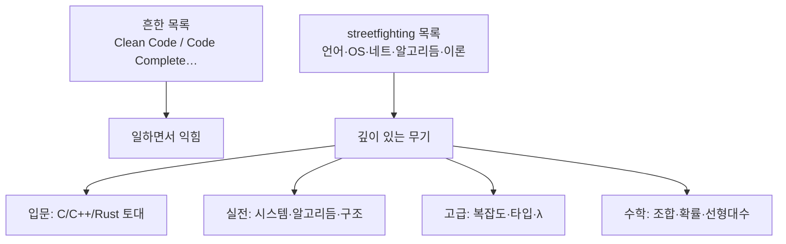
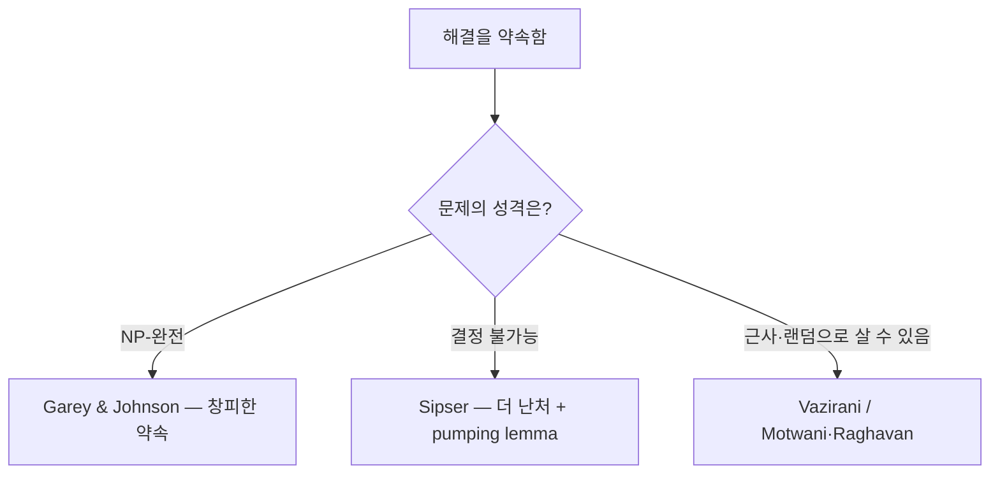
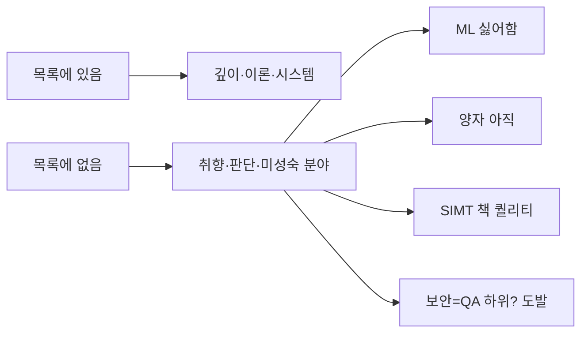
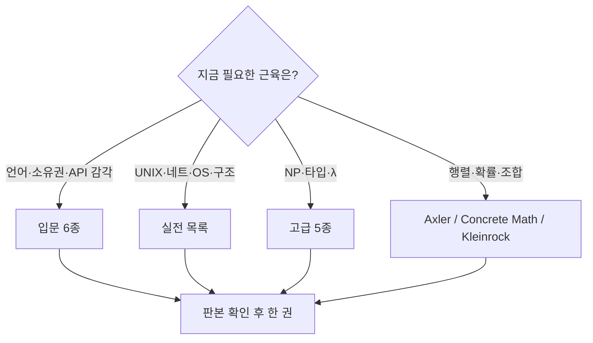

# 실전파 컴퓨터 과학자를 위한 도서 목록… Clean Code 대신 ‘칼로 싸우는’ 기초

### Nick Black dankwiki 2025년판. Code Complete류 관행서 대신 C/C++/Rust·UNIX·네트워크·알고리듬·계산 이론·복잡도·타입·λ까지. GeekNews([37232](https://news.hada.io/topic?id=37232))가 옮긴 판본 주의와 제외 분야(ML·양자·SIMT·보안), 댓글의 ‘번역본·두꺼움’까지 한자리에 모은다


원문 제목은 [Book list for streetfighting computer scientists](https://nick-black.com/dankwiki/index.php?title=Book_list_for_streetfighting_computer_scientists)다. 머리말에 **“Edsger Dijkstra is watching you”** 가 붙는다. 2025년판이며, 흔한 “프로그래머 필독서” — Code Complete, Clean Code, 설계 슬로건 모음 — 과 **의도적으로 다르다**. 그런 관행은 일하면서 익히라는 쪽이고, 이 목록은 언어·OS·네트워크·알고리듬·계산 이론을 **깊게** 파서 “거리에서도 싸울 수 있게” 만들려는 책들이다.

모든 책을 다 읽어야 하나? 원문 답: **그 안의 내용을 알고 싶을 때만.** 링크는 게을러서 안 달았다고 본인이 적는다. 아래는 GeekNews 요약과 원문 목록·각주·제외 사유를 **빠짐없이** 기사 형태로 다시 적은 것이다.

## 0. 디렉터리

CS 기초·시스템·이론 독서 지도이므로 `docs/04_CS_Fundamentals/01_Concepts`에 둔다. 지연시간 숫자·부동소수 같은 “자주 되짚는 기초”와 같은 층이다.

## 1. 이 목록이 겨냥하는 것



원문의 거친 비유를 정제하면: **관행 수칙이 아니라, 시스템을 이해하는 데 필요한 칼**을 모은 목록이다. 개인 취향이 세고, 빠진 분야마다 이유가 붙어 있다(후술).

## 2. 입문 — Introductory streetfighting

| 저자 | 제목 | 원문 포인트 |
|---|---|---|
| Stepanov | *From Mathematics to Generic Programming*, *The Elements of Programming* | 제네릭·수학적 프로그래밍 토대 |
| Gustedt | *Modern C* | 현대 C |
| Hanson | *C Interfaces and Implementations* | C 인터페이스·구현 |
| Stroustrup | *The C++ Programming Language* | C++ 본진 |
| Josuttis | *C++ Move Semantics* | 이동 의미론에 **200쪽**이 필요하단 점에서, Rust 책보다 **역설적으로 Rust의 필요성**을 납득시킴 |
| Klabnik, Nichols, Krycho | *The Rust Programming Language* | Rust 입문 |

**C/C++를 꼭 현업에서 짜야 하나?** 원문: **대체로 아니다.** 그래도 배울 가치는 있다.

- 대부분의 하드웨어에 구현되어 있고  
- 중요한 OS의 **네이티브 API를 표현하는 공통어(lingua franca)** 이기 때문.

Rust는 쓰고 읽기에 꽤 좋은 언어다. 다만 **끊임없이 이야기만 하지 말고 실제로 쓰고 읽으라**고 덧붙인다.

```c
/* lingua franca 감각: OS·하드웨어에 가까운 API는 여전히 C ABI로 말해지는 경우가 많다 */
#include <unistd.h>
ssize_t n = write(1, "hello\n", 6);
```

```rust
// 같은 “시스템과 대화”를 Rust에서 읽기/쓰기로 익히라는 쪽
fn main() {
    println!("hello");
}
```

Josuttis 한 줄의 뼈아픔을 스케치하면:

```cpp
// C++ move가 “문법 한 줄”이 아니라 수명·값 범주·예외 안전까지 끌고 가서
// 책 한 권이 되는 순간, 소유권을 언어 중심에 둔 Rust가 왜 있는지 역으로 보인다
std::string a = std::move(b);
```

## 3. 본격 실전 — Brawling combat

판본·권수가 중요하다고 찍힌 항목을 **원문 그대로** 옮긴다.

### 3.1 프로그래밍·비트·UNIX

| 저자 | 제목 | 주의 |
|---|---|---|
| Dijkstra | *A Discipline of Programming* | CS에서 **페이지마다 가장 아름다운 책** |
| Knuth | *The Art of Computer Programming* | 특히 **1권·4B**, **제3판** |
| Warren | *Hacker's Delight* | **반드시 제2판** |
| Stevens & Rago | *Advanced Programming in the UNIX Environment* | 최소 2판, **가능하면 3판** |
| Stevens | *UNIX Network Programming* | **제2판** |
| Abelson & Sussman | *Structure and Interpretation of Computer Programs* | **제2판**, CS 교재 중 **표지가 최고** |

```c
/* Hacker's Delight 감각: 분기 없이 비트로 생각하기 (개념 예시) */
unsigned abs_diff(unsigned x, unsigned y) {
    return (x > y) ? (x - y) : (y - x);
}
/* 실전에서는 분기 예측·비트 트릭 트레이드오프를 책에서 익힌다 */
```

### 3.2 네트워크·OS·대기행렬·구조

| 저자 | 제목 | 포인트 |
|---|---|---|
| Varghese | *Networking Algorithmics* | 네트워킹을 알고리듬으로 |
| Garcia & Widjaja | *Communications Networks* | **ARQ**를 짚으라는 농담 포함 (“do you even ARQ”) |
| McKusick | *The Design and Implementation of the FreeBSD Operating System* | FreeBSD 설계·구현 |
| Kerrisk | *The Linux Programming Interface* | Linux API 대형 레퍼런스 |
| Kleinrock | *Queueing Systems* | 특히 **1권** — 왜 확률/통계를 배웠는지 보여주는 책 |
| Hennessy & Patterson | *Computer Architecture: A Quantitative Approach* | 구판은 자료를 온라인에 가두지 않음(장점) / 오래됨(단점) |

```text
# ARQ를 “아냐?”로 넘기지 말라는 목록의 취지 (개념)
송신 → (타임아웃/ACK) → 재전송 또는 창 전진
손실·지연·중복을 가정하지 않으면 프로토콜 설계가 무너진다
```

### 3.3 컴파일러·알고리듬·병렬·난해성

| 저자 | 제목 | 포인트 |
|---|---|---|
| Kennedy | *Optimizing Compilers for Modern Architectures* | 최적화 컴파일러 |
| Muchnik | *Advanced Compiler Design and Implementation* | **실제로 구현**하려면 Kennedy와 **함께** |
| CLRS | *Introduction to Algorithms* | 고전 교과서 |
| Samet | *Metric and Multidimensional Data Structures* | 거리·다차원 구조 |
| Crochemore et al. | *Algorithms on Strings* | 문자열 알고리듬 (“프랑스력” 농담) |
| Vazirani | *Approximation Algorithms* | 근사 |
| Motwani & Raghavan | *Randomized Algorithms* | 랜덤화 (원문 철자 Raghaven) |
| McKenney | *Is Parallel Programming Hard…?* | 제목은 혹평할 만하지만 **다른 데서 못 찾는 내용**이 훌륭. 작명 디스도 원문에 있음 |
| Culler et al. | *Parallel Computer Architecture* | 병렬 컴퓨터 구조 |
| Ward & Halstead | *Computation Structures* | 계산 구조 |
| Shriver & Smith | *The Anatomy of a High-Performance Microprocessor* | 고성능 마이크로프로세서 해부 |
| Garey & Johnson | *Computers and Intractability* | 해결을 약속한 뒤 **NP-완전**임을 깨달을 때의 난처함 |
| Sipser | *Introduction to the Theory of Computation* | **결정 불가능**을 약속한 뒤 깨닫는 것은 더 난처. **펌핑 보조정리** |
| Golub & Van Loan | *Matrix Computations* | 순수 수학에 가깝지만, 실전에서 **행렬 떼거리**를 자주 만남 (원문 철자 Galub → 통용 Golub) |



## 4. 고급 — For the advanced streetfighter

| 저자 | 제목 | 포인트 |
|---|---|---|
| Arora & Barak | *Computational Complexity* | 계산 복잡도 (원문 Ahora → 통용 Arora) |
| Pierce | *Types and Programming Languages* | TAPL |
| Okasaki | *Purely Functional Data Structures* | 순수 함수형 자료구조 |
| Van Roy & Haridi | *Concepts, Techniques, and Models of Computer Programming* | 다중 패러다임 모델 (원문 Hardidi) |
| Barendregt | *The Lambda Calculus* | λ-cube는 칼싸움에 당장 쓸모는 드물다. 하루를 마치면 **F 시스템**으로 돌아간다. 노란 표지로 눈을 가릴 수 있다는 농담 |

```haskell
-- Okasaki / λ 감각: “상태를 바꾸지 않고 구조를 쌓는다”는 고급 목록의 방향
data Stack a = Empty | Cons a (Stack a)
push x s = Cons x s
```

## 5. 수학 — 목록 옆의 필수 근육

원문이 명시적으로 찍는 보완서·영역:

| 항목 | 내용 |
|---|---|
| Axler | *Linear Algebra Done Right* |
| Knuth | *Concrete Mathematics* |
| 확실히 | **조합론, 확률/통계, 선형대수** |
| 미적분 | 미분방정식까지는 **알아야** 하지만, 본인은 하드코어인데도 **적분을 실제로 할 일은 드물었다** |

Kleinrock 1권이 “왜 확률/통계를 시켰는지”의 실전 증명으로 다시 연결된다.

## 6. 의도적으로 뺀 것 · 아직 평가 안 한 것 · 마지막 한 권

| 제외/보류 | 사유 (원문) |
|---|---|
| 머신러닝 | **개인적으로 싫어해서** |
| 양자 컴퓨팅 | 아직 실전에 유용하지 않음 (바뀌길 기대) |
| SIMT / 가속기 | **전부 형편없다**고 판단 |
| 정보보안 | **QA의 하위 분야**라는 도발적 입장 (“fight me”) |
| Tim Roughgarden 알고리듬 | 평 좋고 책장에 두었으나 **아직 직접 평가 전** |
| Beej 네트워킹 | 소장·미평가, **다소 가벼워 보임** |
| Beej·Stevens 공통 한계 | **XDP, io_uring** 등 현대 고속 네트워킹은 다루지 않음 |

그리고:

> *Hacking the Planet with Notcurses* 를 읽고, **팀과 가족에게도 사 주라.**

(저자 Nick Black의 Notcurses 관련 저작을 목록 끝에 자기 추천으로 붙인 형태다.)



## 7. GeekNews 댓글

- **xguru**: 국내 번역본들이 있다(스레드에 링크·목록 언급).
- **windrod**: 다 좋은 책인데… **너무 두껍다.**

원문의 “칼싸움” 톤과 댓글의 “두께”는 같은 목록의 양면이다. 깊이는 페이지로 오고, 선택 독서가 전제다.

## 8. 어떻게 쓰면 되는가

원문이 허용하는 읽기 방식만 정리한다.

1. **전부 필독이 아니다.** 알고 싶은 내용이 있는 책만.
2. **판본을 지킨다.** Hacker’s Delight 2판, APUE 2→3판, UNP 2판, TAOCP 3판·1·4B, SICP 2판 등.
3. **C/C++는 현업 강제어가 아니라 OS·하드웨어 공통어**로 읽는다. Rust는 말보다 **손**.
4. **Clean Code류는 일터에서**, 이 목록은 **이론·시스템 근육**으로 역할을 나눈다.
5. ML·양자·가속기·보안이 필요하면 **이 목록 밖**에서 따로 짠다 — 저자의 공백이지 세계의 공백이 아니다.
6. 현대 NIC 경로(XDP/io_uring)는 Stevens·Beej 다음에 **별도 자료**가 필요하다.



## 9. 결론

Black의 2025년 목록은 “좋은 개발자 습관” 서가와 나란히 두지 말라고 스스로 선을 긋는다. Dijkstra가 지켜보는 거리에서는 **제네릭 수학, C 인터페이스, move 200쪽의 역설, Dijkstra·Knuth·Warren, Stevens·Kerrisk, CLRS와 Garey–Johnson, Pierce와 Barendregt**가 한 줄로 이어진다. 빠진 ML·양자·SIMT·보안, 미평가 Roughgarden·Beej, Notcurses 자추, “너무 두껍다”는 댓글까지 포함해 읽으면, 이 목록은 커리큘럼 강제가 아니라 **취향이 적힌 무기 선반**이다.

한 줄: **관행은 일터에서 배우고, 칼은 기초에서 간다.** 무엇을 집을지는 — 그 안의 내용을 알고 싶은지에 달렸다.

---

**원문 및 참고 자료**

- Nick Black, *Book list for streetfighting computer scientists* (2025 edition), dankwiki. https://nick-black.com/dankwiki/index.php?title=Book_list_for_streetfighting_computer_scientists
- GeekNews 토픽 요약·댓글: https://news.hada.io/topic?id=37232

※ 본 기사는 dankwiki 원문과 GeekNews 요약을 바탕으로 재구성한 해설이다. 원문의 거친 표현은 기사체에서 완화했고, 도서·판본·제외 사유는 원문 의미를 유지한다. 저자명 통용 표기(Golub, Arora, Haridi, Crochemore 등)를 병기했다. 모든 책을 읽으라는 지시가 아니라, 선택 독서를 전제로 한 목록 해설이다. 국내 번역본 존재 여부는 댓글 안내대로 별도 확인이 필요하다.
