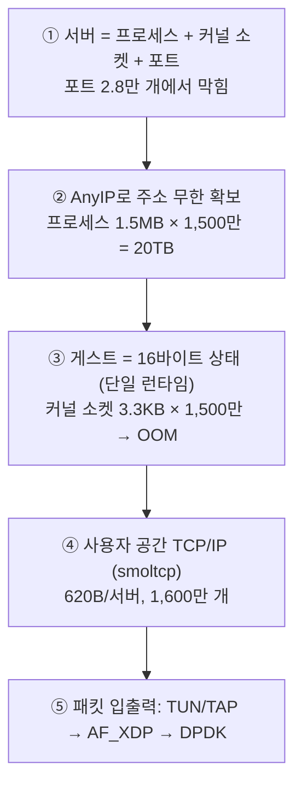
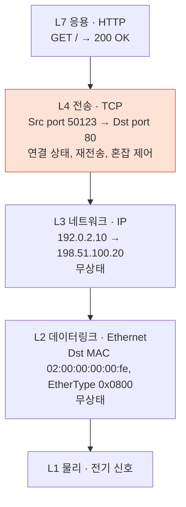
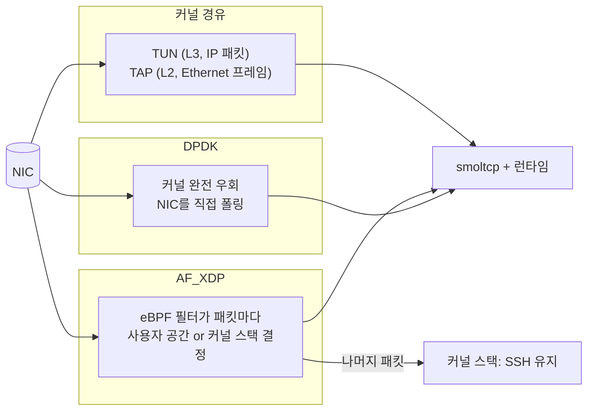
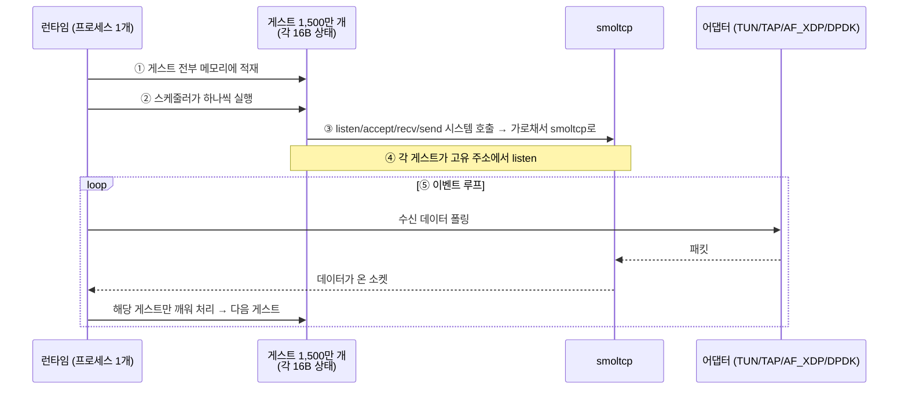

# VM 한 대에 웹 서버 1,500만 개… 병목은 CPU가 아니라 커널 소켓 3,384바이트였다

### RAM 10GB, CPU 1코어 VM에서 "OK"만 답하는 웹 서버 1,500만 개를 돌리는 실험이다. 포트는 AnyIP로, 프로세스 비용은 단일 런타임으로 넘었지만 마지막 벽은 리눅스 커널 소켓이었다. 소켓 하나에 약 3.3KB가 들어 커널 스택은 255만 개에서 메모리가 바닥났다. TCP/IP를 사용자 공간의 smoltcp로 옮기자 유휴 서버당 620바이트로 1,600만 개까지 올라갔다

2026년 11월 18일 kapteko는 [15 million web servers on one VM - smoltcp, DPDK, AF_XDP](https://kapteko.com/15-million-webservers/)를 공개했다. GeekNews([토픽 37470](https://news.hada.io/topic?id=37470))가 이를 요약했고, Hacker News 토론도 함께 정리했다.

글은 농담으로 시작한다. 지구 인구 80억 명에게 웹 서버를 하나씩 나눠 주자는 것이다. 하지만 내용은 진지하다. 리눅스에서 "서버 하나"가 실제로 무엇을 소비하는지 계층별로 벗겨 보는 실험이다. 이 글은 원문 흐름을 따라 각 벽이 왜 생기는지 정리하고, 직접 돌려 본 예제 코드(C 서버, 소켓 비용 측정, smoltcp 다중 서버)를 붙였다.

## 1. 한눈에 보기

| 단계 | 시도 | 부딪힌 벽 | 숫자 |
|---|---|---|---|
| 1 | C 최소 서버를 포트 0으로 여러 개 실행 | 자동 할당 포트 고갈 | 28,232개에서 `listen` 실패 |
| 2 | AnyIP로 IPv6 /64 전체를 수신 주소로 | 프로세스 메모리 | 서버당 약 1.5MB → 약 **20TB** 필요 |
| 3 | 단일 런타임(LFI)에 게스트를 몰아넣기 | 커널 소켓 메모리 | 소켓당 약 **3,384B**, 커널 스택은 **255만 개**에서 OOM |
| 4 | TCP/IP를 사용자 공간 smoltcp로 | 남은 것은 I/O 방식 선택 | 유휴 **620B**, 활성 약 **1KB**, **1,600만 개** 실행 |

목표 예산은 처음부터 빡빡하다.

$$
\frac{10\ \text{GB}}{15{,}000{,}000\ \text{servers}} \approx 667\ \text{B / server}
$$

서버 하나가 **700바이트 남짓**으로 살아야 한다. 아래는 이 숫자를 지키기 위해 한 계층씩 내려가는 이야기다.



## 2. 1단계: 최소 웹 서버와 포트의 벽

HTTP 라이브러리를 아무리 쌓아도 바닥에는 시스템 호출 다섯 개가 있다. `listen`, `accept`, `recv`, `send`, `close`다. 원문은 이것만 쓰는 C 서버를 만든다. 모든 요청에 `HTTP 200`과 본문 `OK`를 돌려주고, 처리량은 약 **초당 6만 5,000건**이다.

같은 구조로 직접 쓴 예제다(macOS와 Linux에서 컴파일하고 `curl`로 `OK` 응답을 확인했다).

```c
// ok_server.c — answers every request with "OK". listen/accept/recv/send/close, nothing else.
//   cc -O2 -o ok_server ok_server.c
//   ./ok_server            # port 0: the kernel picks a free ephemeral port
//   ./ok_server 7 8080     # AnyIP: the 7th address after BASE, port 8080
#include <arpa/inet.h>
#include <netinet/in.h>
#include <stdio.h>
#include <stdlib.h>
#include <sys/socket.h>
#include <unistd.h>

#define BASE "10.64.0.1"

int main(int argc, char **argv) {
    struct sockaddr_in addr = {.sin_family = AF_INET};
    if (argc > 1) {  // n-th address after BASE (needs `ip route add local 10.64.0.0/10 dev lo`)
        inet_pton(AF_INET, BASE, &addr.sin_addr);
        addr.sin_addr.s_addr = htonl(ntohl(addr.sin_addr.s_addr) + (uint32_t)atol(argv[1]));
    }
    addr.sin_port = htons(argc > 2 ? atoi(argv[2]) : 0);

    int srv = socket(AF_INET, SOCK_STREAM, 0);
    int one = 1;
    setsockopt(srv, SOL_SOCKET, SO_REUSEADDR, &one, sizeof one);
    if (bind(srv, (struct sockaddr *)&addr, sizeof addr) < 0 || listen(srv, 128) < 0) {
        perror("listen");
        return 1;
    }

    static const char reply[] = "HTTP/1.0 200 OK\r\nContent-Length: 2\r\n\r\nOK";
    char buf[1024];
    for (;;) {
        int c = accept(srv, NULL, NULL);
        if (c < 0) continue;
        recv(c, buf, sizeof buf, 0);
        send(c, reply, sizeof reply - 1, 0);
        close(c);
    }
}
```

이 서버를 셸 루프로 계속 띄우면 **28,232개째에서 `listen`이 실패**한다. 포트 0을 주면 커널이 자동 할당 범위에서 빈 포트를 고르는데, 그 범위가 정해져 있기 때문이다.

```bash
$ sysctl net.ipv4.ip_local_port_range
net.ipv4.ip_local_port_range = 32768	60999
```

60999 − 32768 + 1 = **28,232**. 숫자가 정확히 맞는다. 범위 밖의 포트에도 각자 사정이 있다.

| 범위 | 자동 할당에서 빠지는 이유 |
|---|---|
| 0 | 특수 값 ("아무 포트나"). [존재하지 않는 포트](https://acid.vegas/blog/the-port-that-does-not-exist/) 참고 |
| 1–1024 | 특권 포트, root 필요 |
| 1024–32768 | 기존 애플리케이션이 쓰는 포트와 충돌하지 않도록 |
| 60999–65535 | IP Masquerading(NAT)이 쓰던 역사적 이유 |

범위를 1–65535로 넓히고 TCP와 UDP를 따로 세도 약 12만 8천 개다. 1,500만에는 한참 모자란다. 커널의 포트 자료형을 바꾸는 것도 소용없다. TCP 표준에서 포트는 **16비트(u16)** 라서, 그렇게 고치면 일반 클라이언트가 접속하지 못한다. 원문은 NIC 450장을 꽂자는 농담도 던졌다. 한 독자는 NIC가 지난 1년간 가격이 오르지 않은 유일한 하드웨어라고 맞받았다. 결국 소프트웨어로 풀기로 했다.

## 3. 2단계: AnyIP로 주소 1,800경 개, 그러나 20TB

서버는 `(프로토콜, IP, 포트)` 튜플로 식별된다. 포트가 부족하면 **IP를 늘리면 된다.** 리눅스의 AnyIP는 서브넷 전체를 로컬 주소로 받아들이게 하는 기능이다. 라우팅 테이블에 `local` 경로 하나만 추가하면 된다.

```bash
# IPv6 /64 하나 = 2^64 ≈ 1,800경(18 quintillion) 개 주소가 모두 '내 주소'
sudo ip -6 route add local 2001:db8:1234:5678::/64 dev lo

# IPv4로 실험할 때 (10.64.0.0/10 ≈ 419만 개)
sudo ip route add local 10.64.0.0/10 dev lo
```

`2001:db8::/32`는 문서용 예시 대역이다. 원문은 IPv4로 공인 주소 1,500만 개를 사려면 약 **2억 5천만 달러**가 든다고 계산했다. 서버 코드는 명령행 인덱스로 기준 주소에서 n번째 주소를 골라 `bind`하면 된다(위 예제의 `./ok_server 7 8080`). 예를 들어 10.64.0.1 다음은 10.64.0.2다.

이렇게 실행하면 이번에는 **Out of memory**가 난다. 프로세스 하나가 약 1.5MB를 쓴다.

$$
1.5\ \text{MB} \times 15{,}000{,}000 \approx 22\ \text{TB}
$$

주소 문제는 풀렸지만, "서버 = 프로세스"라는 모델이 남은 벽이 됐다.

## 4. 3단계: 게스트를 16바이트로 줄였는데 왜 OOM인가

### 4.1 단일 프로세스 런타임

원문 저자는 이전 글 두 편([Codex CLI 1,000만 개 실행](https://kapteko.com/running-10-million-codex-clis-on-one-server-lfi-processes), [Rust 사용자 공간 리눅스 스케줄러](https://kapteko.com/userland-linux-scheduler-in-rust))에서 쓴 기법을 가져온다. 프로세스 1,500만 개를 띄우지 않는다. 대신 **맞춤 런타임 프로세스 하나에 게스트 1,500만 개를 올리고, 사용자 공간 스케줄러로 번갈아 실행**한다.

샌드박스는 [LFI(Lightweight Fault Isolation)](https://www.scs.stanford.edu/~zyedidia/docs/papers/lfi.pdf)를 쓴다. 게스트끼리 메모리를 격리하고, 게스트의 모든 시스템 호출을 호스트 핸들러 호출로 바꾼다. 그래서 I/O를 런타임이 직접 구현할 수 있다. 웹 서버 게스트가 기억해야 할 상태는 세 가지뿐이다.

| 필드 | 크기 | 의미 |
|---|---|---|
| `pc` | 8B (u64) | 다시 실행할 복귀 주소 |
| 서버 fd | 4B (i32) | listen 소켓 |
| 클라이언트 fd | 4B (i32) | accept한 연결 |
| **합계** | **16B** | 1,500만 개면 약 220MB. 비트 패킹으로 8B까지 가능 |

### 4.2 검증 없이 믿은 숫자

여기서 저자는 LLM에게 소켓 비용을 물었다. 받은 답은 "유휴 연결은 0바이트, 활성 연결은 약 5KB"였다. 이를 바탕으로 유휴 1,400만, 활성 100만이면 약 5.22GB로 충분하다고 계산했다.

그런데 아무 요청도 받지 않는 유휴 소켓만 만들어도 메모리가 바닥났다. 원문의 테스트 코드에는 "SHOULD CONSUMER ZERO MEMORY"라는 주석이 달려 있었다. 저자는 **LLM 답을 검증 없이 받아들인 것이 실수의 출발점**이었다고 인정한다. Wolfram Alpha 계산 화면과 함께 이 대목을 유머로 풀었는데, HN 댓글에서 가장 즐거웠던 부분으로 꼽혔다.

## 5. 커널 소켓 하나의 값: 3,384바이트

빠뜨린 비용은 `socket()` 시스템 호출 그 자체였다. 커널은 소켓을 만들 때 연결이 있든 없든 여러 구조체를 할당한다.

| 커널 구조체 | 크기 | 담는 것 |
|---|---|---|
| `tcp_sock` | 2,240B | TCP 상태, 큐, 타이머, 시퀀스 번호, 혼잡 제어, 재전송 정보 |
| `socket_alloc` | 768B | `struct socket` 128B(대기 큐 포함) + sockfs inode 608B + 패딩 |
| `file` | 184B | 열린 파일 연산, 플래그, 자격 증명, 참조 카운트, 소켓 역참조 |
| `dentry` | 192B | sockfs 가상 이름, inode 포인터, VFS 조회와 수명 관리 |
| **합계** | **3,384B** | 유휴 listen 소켓도 같은 비용 |

$$
3{,}384\ \text{B} \times 15{,}000{,}000 \approx 50.8\ \text{GB} \gg 10\ \text{GB}
$$

리눅스에서 소켓은 "모든 것은 파일"이라는 철학 때문에 **파일(`file`, `dentry`, `inode`)이기도 하다.** TCP 상태(`tcp_sock`)도 연결 여부와 무관하게 통째로 할당된다. 원문 측정에서 커널 스택은 **약 255만 개**에서 OOM이 났다.

### 5.1 예제: 내 서버에서 소켓 비용 재 보기

소켓 메모리는 프로세스 RSS가 아니라 **커널 slab 캐시**에 잡힌다. 그래서 `/proc/meminfo`의 `MemAvailable`이 소켓을 만들기 전후로 얼마나 줄었는지를 비교해야 한다(Linux 전용. macOS에서는 컴파일만 확인했다).

```c
// socket_cost.c — how much kernel memory does an idle TCP socket cost? (Linux)
//   cc -O2 -o socket_cost socket_cost.c && ulimit -n 1100000 && ./socket_cost 1000000
// Socket memory lives in the kernel (slab caches), not in the process RSS,
// so compare MemAvailable from /proc/meminfo before and after.
#include <stdio.h>
#include <stdlib.h>
#include <string.h>
#include <sys/socket.h>
#include <netinet/in.h>

static long mem_available_kb(void) {
    FILE *f = fopen("/proc/meminfo", "r");
    char line[256];
    long kb = -1;
    while (f && fgets(line, sizeof line, f))
        if (sscanf(line, "MemAvailable: %ld kB", &kb) == 1) break;
    if (f) fclose(f);
    return kb;
}

int main(int argc, char **argv) {
    long n = argc > 1 ? atol(argv[1]) : 100000, made = 0;
    long before = mem_available_kb();
    for (; made < n; made++)
        if (socket(AF_INET, SOCK_STREAM, 0) < 0) { perror("socket"); break; }  // never closed
    long after = mem_available_kb();
    printf("%ld sockets: %.0f bytes each (MemAvailable %ld -> %ld kB)\n",
           made, (before - after) * 1024.0 / (made ? made : 1), before, after);
}
```

100만 개를 열려면 파일 디스크립터 한도를 올려야 한다(`ulimit -n`, 필요하면 `fs.nr_open`). 어느 slab에 얼마가 쌓였는지는 구조체 이름으로 직접 볼 수 있다.

```bash
# TCP(=tcp_sock), sock_inode_cache(=socket_alloc), filp(=file), dentry
sudo grep -E '^(TCP|TCPv6|sock_inode_cache|filp|dentry) ' /proc/slabinfo \
  | awk '{printf "%-18s objs=%-9s objsize=%sB\n", $1, $3, $4}'
```

## 6. 4단계: 네트워크 스택을 사용자 공간으로

### 6.1 계층을 내려가면 상태가 사라진다

TCP/IP를 커널이 맡는 한 소켓 비용을 피할 수 없다. 그렇다면 **TCP보다 아래에서 직접 패킷을 다루면 된다.** 원문은 OSI 계층을 위에서부터 내려간다.



TCP(L4)는 연결마다 상태를 들고 있지만, IP(L3)와 Ethernet(L2)은 **무상태**다. 프로그램이 IP 패킷이나 Ethernet 프레임을 직접 만들어 보낼 수 있다. 그러면 TCP 상태를 어디에, 얼마나 작게 둘지 **애플리케이션이 직접 정할 수 있다.**

### 6.2 사용자 공간 TCP/IP 스택들

| 구현 | 특징 |
|---|---|
| [Miniweb](https://dunkels.com/adam/miniweb/) (Adam Dunkels) | 자체 TCP/IP와 HTTP 서버가 **28바이트** 상태로 동작 |
| [gVisor](https://github.com/google/gvisor) | 네트워크 스택을 포함해 리눅스 커널을 사용자 공간에 재구현 |
| [Seastar](https://github.com/scylladb/seastar) | ScyllaDB 팀의 런타임, 자체 네트워크 스택 |
| [lwIP](https://github.com/lwip-tcpip/lwip) | 임베디드용 C TCP/IP 스택 |
| [F-Stack](https://github.com/F-Stack/f-stack) | FreeBSD TCP/IP 스택을 DPDK 위에서 사용 |
| **[smoltcp](https://github.com/smoltcp-rs/smoltcp)** | Rust, 이벤트 기반, **힙 할당 없이** 동작. 이번 실험의 선택 |

smoltcp는 베어메탈과 실시간 시스템을 위한 독립형 스택이다. 소켓 버퍼를 **호출자가 직접 넘겨준다.** 그래서 서버 하나에 얼마를 쓸지 바이트 단위로 정할 수 있다. 반면 스스로 패킷을 주고받는 기능은 없어서, 장치 어댑터(`phy::Device`)를 붙여야 한다.

### 6.3 예제: smoltcp로 서버 N개를 각자 다른 IP에

smoltcp 0.14로 직접 만들어 돌린 예제다. 인터페이스 하나에 **AnyIP**(`set_any_ip(true)`)를 켜고, 서버 N개가 각자 10.64.0.2, 10.64.0.3, …에서 listen한다. 장치는 어디서나 실행되도록 `Loopback`을 썼다. `Device` 트레이트를 구현한 TUN/TAP, DPDK, AF_XDP 어댑터로 바꾸면 실제 네트워크와 통신한다.

```toml
# Cargo.toml
[dependencies]
smoltcp = { version = "0.14", default-features = false, features = ["std", "medium-ip", "proto-ipv4", "socket-tcp"] }
```

```rust
//! N "OK" web servers on one smoltcp interface, each on its own IPv4 address.
//!   cargo run --release -- 100000 1000   # servers, requests
use smoltcp::iface::{Config, Interface, SocketHandle, SocketSet};
use smoltcp::phy::{Loopback, Medium};
use smoltcp::socket::tcp;
use smoltcp::time::Instant;
use smoltcp::wire::{HardwareAddress, IpAddress, IpCidr, Ipv4Address};

const RESPONSE: &[u8] = b"HTTP/1.0 200 OK\r\nContent-Length: 2\r\n\r\nOK";
const BUF: usize = 128; // per direction, per server: enough for a tiny GET and the reply

/// The i-th server address: 10.64.0.2, 10.64.0.3, … (10.64.0.0/10 holds about 4.19M hosts).
fn server_addr(i: u32) -> Ipv4Address {
    Ipv4Address::from_bits(u32::from_be_bytes([10, 64, 0, 0]) + 2 + i)
}

fn tcp_socket<'a>(size: usize) -> tcp::Socket<'a> {
    tcp::Socket::new(tcp::SocketBuffer::new(vec![0; size]), tcp::SocketBuffer::new(vec![0; size]))
}

fn main() {
    let mut args = std::env::args().skip(1).map(|a| a.parse::<u32>().unwrap());
    let servers = args.next().unwrap_or(100_000);
    let requests = args.next().unwrap_or(1_000);

    let mut device = Loopback::new(Medium::Ip);
    let mut iface = Interface::new(Config::new(HardwareAddress::Ip), &mut device, Instant::now());
    iface.update_ip_addrs(|a| a.push(IpCidr::new(IpAddress::v4(10, 64, 0, 1), 10)).unwrap());
    // AnyIP: accept packets for every address, like `ip route add local … dev lo` on Linux.
    iface.set_any_ip(true);

    let mut sockets = SocketSet::new(Vec::with_capacity(servers as usize + 1));
    let handles: Vec<SocketHandle> = (0..servers)
        .map(|i| {
            let mut s = tcp_socket(BUF);
            s.listen((IpAddress::Ipv4(server_addr(i)), 80)).unwrap();
            sockets.add(s)
        })
        .collect();

    println!(
        "{servers} servers listening; per server = tcp::Socket {} B + buffers {} B",
        std::mem::size_of::<tcp::Socket>(),
        2 * BUF
    );

    // One client socket, reused: connect to a server, send GET, read "OK", repeat.
    let client = sockets.add(tcp_socket(1024));
    let started = std::time::Instant::now();
    let mut ok = 0u32;
    let mut target: Option<u32> = None;
    let mut response = Vec::new();
    let mut local_port = 49152u16;

    while ok < requests {
        iface.poll(Instant::now(), &mut device, &mut sockets);

        // Servers: answer every request with "OK", then listen again.
        // (A real runtime would only wake the servers that have pending data.)
        if let Some(i) = target {
            let h = handles[i as usize];
            let s = sockets.get_mut::<tcp::Socket>(h);
            if s.can_recv() {
                let mut req = [0u8; BUF];
                let _ = s.recv_slice(&mut req);
                s.send_slice(RESPONSE).unwrap();
                s.close();
            }
            if s.state() == tcp::State::Closed {
                s.listen((IpAddress::Ipv4(server_addr(i)), 80)).unwrap();
            }
        }

        // Client.
        let cx = iface.context();
        let c = sockets.get_mut::<tcp::Socket>(client);
        match target {
            None if !c.is_open() => {
                let i = ok.wrapping_mul(2_654_435_761) % servers; // spread requests over servers
                local_port = if local_port == u16::MAX { 49152 } else { local_port + 1 };
                c.connect(cx, (IpAddress::Ipv4(server_addr(i)), 80), local_port).unwrap();
                target = Some(i);
                response.clear();
            }
            Some(_) => {
                if c.may_send() && c.send_queue() == 0 && response.is_empty() {
                    c.send_slice(b"GET / HTTP/1.0\r\n\r\n").unwrap();
                    response.push(0); // marker: request sent
                }
                if c.can_recv() {
                    c.recv(|d| {
                        response.extend_from_slice(d);
                        (d.len(), ())
                    })
                    .unwrap();
                }
                if !c.may_recv() && response.len() > 1 {
                    assert!(response[1..].ends_with(b"OK"), "unexpected reply");
                    c.close();
                    c.abort(); // free the client socket at once (skip TIME-WAIT)
                    ok += 1;
                    target = None;
                }
            }
            None => {}
        }
    }

    println!("{ok} requests answered \"OK\" in {:.2?}", started.elapsed());
}
```

Apple M1 맥(macOS, release 빌드)에서 직접 잰 결과다.

| 서버 수 | 최대 RSS | 서버당 메모리 | 요청 20건 처리 시간 |
|---|---|---|---|
| 10,000 | 8.7MB | 약 865B (고정 오버헤드 포함) | 13ms |
| 100,000 | 71.4MB | **약 714B** | 614ms |

`tcp::Socket` 구조체 자체는 408B이고, 여기에 버퍼 256B(128B × 2)를 더한 것이 서버 하나의 비용이다. 원문이 측정한 유휴 620B와 같은 수준이다. 커널 소켓 3,384B와 비교하면 약 5분의 1이다.

처리 시간이 서버 수에 비례해 늘어난다는 점도 보인다. 이 예제는 `poll`이 매번 **모든 소켓을 훑기** 때문이다(100만 개로 늘리자 요청 몇 건에도 수 분이 걸려 중단했다). 원문 런타임이 1,600만 개를 처리할 수 있었던 것은 스케줄러가 **패킷이 도착한 게스트만 깨우기** 때문이다. 대규모 서버 수에서는 메모리만큼이나 "누구를 깨울지"를 찾는 자료구조가 중요하다.

## 7. 5단계: 패킷을 어떻게 주고받나 — TUN/TAP, DPDK, AF_XDP

사용자 공간 스택에는 패킷이 들어오고 나갈 통로가 필요하다. 원문은 네 가지 어댑터를 비교했다.



| 방식 | 동작 | 장점 | 단점 |
|---|---|---|---|
| **TUN / TAP** | 커널 가상 인터페이스. TUN은 IP 패킷(L3), TAP은 Ethernet 프레임(L2) | smoltcp가 기본 지원, 설정이 쉬움 | 패킷마다 시스템 호출 + 복사 |
| **AF_XDP** | 커널이 NIC를 계속 소유. eBPF(XDP) 프로그램이 골라낸 패킷만 **제로카피** 버퍼로 사용자 공간에 넘김 | SSH 등 다른 트래픽은 일반 커널 스택이 처리해 서버 관리가 쉬움. `SO_PREFER_BUSY_POLL`이면 인터럽트 없이 DPDK에 근접 | DPDK보다 약간 느림 |
| **DPDK** | NIC를 OS에서 떼어 내 메모리 매핑 버퍼로 직접 송수신 | 시스템 호출 없음, 인터럽트 없어 라이브락 없음, 가장 빠름 | 바쁜 대기 루프가 **CPU 코어 하나를 상시 점유**. 장치가 OS에서 사라져 그 NIC로 SSH 중이면 끊김 |

왜 시스템 호출 하나가 문제가 되는지는 숫자로 보면 분명하다.

| 항목 | 시간 |
|---|---|
| 시스템 호출 1회 | 약 500ns |
| 커널 → 사용자 공간 복사 | 약 1,000ns 추가 (버퍼 크기에 따라) |
| 400Gbps NIC의 패킷 간격 | 초당 최대 6억 패킷 → **패킷당 약 1.7ns** |

패킷당 1.7ns 예산 안에서 1,500ns짜리 왕복을 할 수는 없다. DPDK의 핵심 루프는 개념적으로 다음과 같다.

```c
for (;;) {                                   // 인터럽트 없이 계속 도는 바쁜 대기
    send_from_app_memory_to_network();       // 앱 메모리의 송신 링 → NIC
    receive_from_network_to_app_memory();    // NIC → 앱 메모리의 수신 링
}
```

smoltcp와 연결하려면 [`phy::Device` 트레이트](https://docs.rs/smoltcp/latest/smoltcp/phy/trait.Device.html)의 메서드 세 개(`receive`, `transmit`, `capabilities`)만 구현하면 된다. 기존 크레이트로 DPDK용 [rust-dpdk-net](https://github.com/youyuanwu/rust-dpdk-net), AF_XDP용 [xsk-rs](https://github.com/DouglasGray/xsk-rs)가 있다.

## 8. 결과: 1,600만 개

최종 런타임은 다섯 단계로 움직인다.




차트 읽는 법(차트에 담긴 설명 기준)은 이렇다.

- **가로축**: 동시에 listen하는 서버 수. 1만까지는 로그 스케일, 그 위는 제곱근 스케일이다.
- **실선**: 평균 초당 HTTP 응답 수(왼쪽 축). **점선**: 서버 최대 RAM, GiB 단위(오른쪽 축).
- **Kernel network**: 블로킹 리눅스 소켓은 listen 소켓 **2,550,000개에서 OOM**이 나고, 서버가 늘수록 RPS도 떨어진다.
- **smoltcp 백엔드 4종**: 모두 1,000만 개 이상에 도달한다. 처리량은 **DPDK가 가장 높고 AF_XDP가 바로 뒤**, 그 아래가 TUN과 TAP이다.
- TUN과 TAP의 400만, 1,000만 지점 RPS는 측정값과 이웃 측정값의 선형 보간을 평균한 값이다.

| 스택 | 서버당 메모리 | 최대 실행 수 |
|---|---|---|
| 리눅스 커널 소켓 | 약 3,384B | 약 255만 (OOM) |
| smoltcp | 유휴 **620B**, 활성 약 **1KB** | **1,600만** |

해석에는 주의가 필요하다. 1,600만은 **각자 고유 주소에서 listen하는 서버 수**다. 1,600만 연결이 동시에 요청을 처리했다는 뜻이 아니다. 또 이것은 개념 증명이다. 실제 리눅스 바이너리를 그대로 돌리는 호환 런타임과 100% POSIX 구현은 큰 별도 과제로 남아 있다. 저자는 다음 글에서 다루겠다고 했다. 결론에 쓴 "Simply"라는 단어가 과장이라는 것도 저자 스스로 인정했다.

## 9. 커뮤니티 반응

GeekNews 댓글은 "우와 재밌겠다"는 짧은 반응 하나와, GN⁺가 정리한 [Hacker News 토론](https://news.ycombinator.com/item?id=50556533) 요약 하나다.

- **글쓰기에 대한 호평.** GB 농담, Wolfram 스크린샷, "전기랑 뭐 그런 것들"이라는 L1 설명, LLM이 맞장구치는 장면이 즐거웠다는 반응이 많았다. SEO 중심 글쓰기가 퍼지기 전인 2005년 무렵 블로그처럼 유머가 살아 있는 기술 글이 그립다는 감상, AI가 쓰지 않은 글이라 반갑다는 말도 나왔다.
- **리눅스 네트워킹 내부를 다룬 손꼽히는 글.** 다음 읽을거리로 epoll/kqueue 원리부터 io_uring 기반 비동기 서버까지 다루는 [Lord of the io_uring](https://unixism.net/loti/async_intro.html#async-intro)이 추천됐다.
- **추상화를 걷어내는 것이 고성능의 본질.** "웹 서버 1,500만 개"는 정의하기 나름이다. 클라이언트 입장에서는 HTTP에 응답하는 IP·포트 조합 1,500만 개일 뿐이므로, iptables 투명 프록시 같은 와일드카드 방식으로 한꺼번에 처리할 수도 있다는 지적이 나왔다.
- **제목이 내용을 깎아 먹는다.** RAM 10GB는 기본형 M4 Mac mini 수준이고, 그 Mac mini가 실험 VM보다 강력하다. 제목에서 '웹'을 빼고 "VM 하나에서 서버 1,500만 개"라고 했으면 HTTP 파싱 글로 오해받지 않았을 거라는 의견도 있었다.

## 10. 정리: 우리 서버에 가져갈 교훈

- **"유휴는 공짜"가 아니다.** 리눅스 TCP 소켓은 연결이 없어도 약 3.3KB를 쓴다. 수백만 단위 연결을 설계할 때는 연결당 커널 메모리부터 계산한다.
- **포트가 모자라면 주소를 늘린다.** AnyIP(`ip route add local … dev lo`)와 IPv6 /64면 주소 공간 제약은 사실상 사라진다.
- **측정한 숫자만 믿는다.** 이번 실험의 첫 설계 오류는 검증하지 않은 LLM 답("유휴 0바이트")에서 나왔다. `/proc/meminfo`와 `/proc/slabinfo`로 직접 잰다.
- **사용자 공간 스택은 메모리를 바이트 단위로 통제하게 해 준다.** 대신 패킷 I/O, 스케줄링, 호환성을 직접 책임져야 한다.
- **I/O 경로는 운영성과 성능을 맞바꾼다.** DPDK는 가장 빠르지만 코어와 NIC를 통째로 가져간다. AF_XDP는 조금 느린 대신 SSH와 커널 도구를 살려 둔다.

## 참고

- kapteko, [15 million web servers on one VM - smoltcp, DPDK, AF_XDP](https://kapteko.com/15-million-webservers/) (2026-11-18)
- GeekNews, [VM 한 대에서 웹 서버 1,500만 개 실행하기: smoltcp, DPDK, AF_XDP](https://news.hada.io/topic?id=37470), [Hacker News 토론](https://news.ycombinator.com/item?id=50556533)
- 실험 소스: [artemyarulin/AI10M — poc/ten-million-webservers](https://github.com/artemyarulin/AI10M/tree/main/poc/ten-million-webservers)
- 저자 이전 글: [Running 10 million Codex CLIs on one server (LFI processes)](https://kapteko.com/running-10-million-codex-clis-on-one-server-lfi-processes), [Userland Linux scheduler in Rust](https://kapteko.com/userland-linux-scheduler-in-rust)
- [LFI 논문 (PDF)](https://www.scs.stanford.edu/~zyedidia/docs/papers/lfi.pdf), [The port that does not exist](https://acid.vegas/blog/the-port-that-does-not-exist/)
- [smoltcp](https://github.com/smoltcp-rs/smoltcp), [smoltcp `phy::Device`](https://docs.rs/smoltcp/latest/smoltcp/phy/trait.Device.html), [rust-dpdk-net](https://github.com/youyuanwu/rust-dpdk-net), [xsk-rs](https://github.com/DouglasGray/xsk-rs)
- [Miniweb](https://dunkels.com/adam/miniweb/), [gVisor](https://github.com/google/gvisor), [Seastar](https://github.com/scylladb/seastar), [lwIP](https://github.com/lwip-tcpip/lwip), [F-Stack](https://github.com/F-Stack/f-stack)
- [DPDK 문서](https://doc.dpdk.org/guides/index.html), [Linux AF_XDP 문서](https://docs.kernel.org/networking/af_xdp.html), [How we handle 15M WebSocket connections on a single server](https://medium.com/beyond-localhost/how-we-handle-15M-websocket-connections-on-a-single-server-8917c3952f59)
- [Lord of the io_uring](https://unixism.net/loti/async_intro.html#async-intro)
- GeekNews 관련 글: [Server Challenge 시리즈 — 1코어 31만, 4코어 143만 동시 사용자](https://news.hada.io/topic?id=36697), [Replit, microVM으로 샌드박스 엔진 재구축](https://news.hada.io/topic?id=36828), [Devvm.dev](https://news.hada.io/topic?id=36746), [DGX Station 2대에서 vLLM으로 GLM-5.3 서빙](https://news.hada.io/topic?id=37221), [Voxel — Oxide 서버 랙 에뮬레이터](https://news.hada.io/topic?id=35421)
- 같은 카테고리: [특권 포트와 EACCES](260914_2044_Privileged_Ports_EACCES_and_Why_SIP_Ports_5060-5061_Are_Problematic.md), [NAT 루프백](260912_2028_NAT_Loopback_Hairpin_NAT_Concepts_and_Remediation_for_Public-IP_LAN_Access.md)
