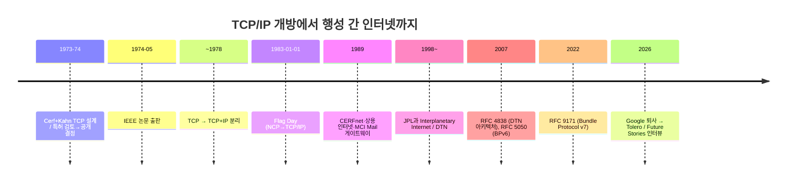
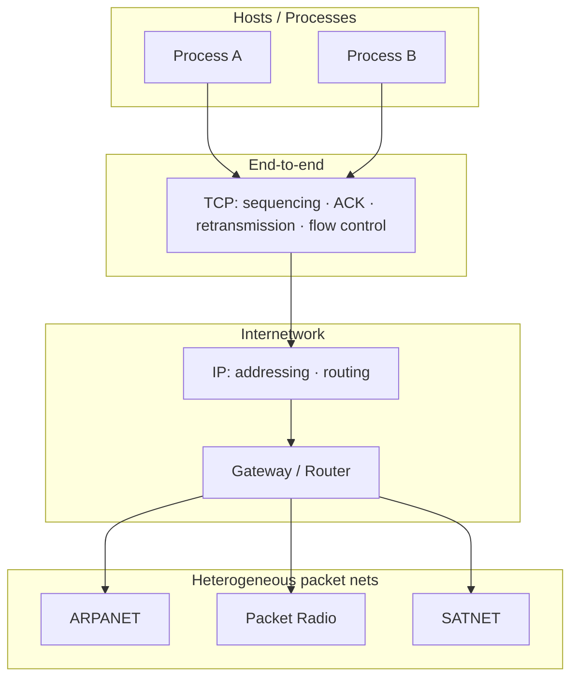
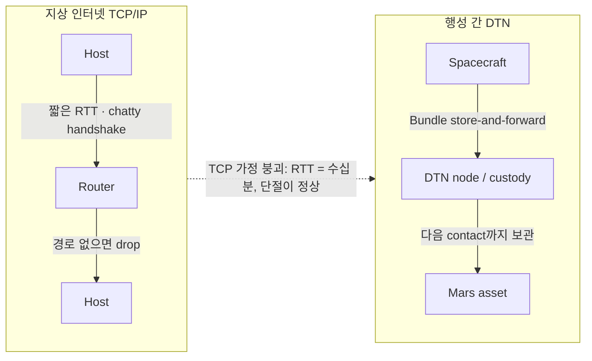

# 25년 뒤 동맹이 누구일지 몰랐다… Vint Cerf가 TCP/IP를 특허내지 않은 이유

### TCP/IP 공동 설계자 Vint Cerf는 1970년대에 특허·라이선스 대신 프로토콜을 공개했다. 이유는 이상주의가 아니라, 미군 지휘통제망이 미래 동맹과도 상호운용되어야 하는데 25년 뒤 동맹 목록을 알 수 없었기 때문이다. 83세에 Google을 떠난 Cerf는 이제 행성 간 인터넷 소프트웨어 회사 Tolero를 이끌고, "빛의 속도는 너무 느리다"며 TCP가 깨지는 장지연 환경에 DTN을 심는다

João Tomé의 팟캐스트 [Future Stories](https://ourfuturestories.eu/vint-cerf)는 2026년 10월 14일 Zoom으로 Cerf와 56분 대화를 녹음하고, 11월 19일 [Substack 기사](https://seremot.com/p/vint-cerf-on-why-tcpip-was-never)와 함께 공개했다. GeekNews([토픽 37578](https://news.hada.io/topic?id=37578))가 이를 요약했다. 이 글은 인터뷰·대화록·Tolero·NASA/IRTF DTN 자료를 기사 형태로 엮는다.


*출처: [João Tomé / seremot](https://seremot.com/p/vint-cerf-on-why-tcpip-was-never) 에피소드 이미지*

## 1. 한눈에 보기

| 항목 | 내용 |
|---|---|
| 인터뷰 | Future Stories 1회, 2026-10-14 Zoom / 공개 2026-11-19 |
| 핵심 발언 | 미래 동맹 접근 보장을 위해 TCP/IP를 **특허·라이선스 없이 공개** |
| 1974 논문 | Cerf & Kahn, [*A Protocol for Packet Network Intercommunication*](https://doi.org/10.1109/tcom.1974.1092259) (IEEE Trans. Commun.) |
| Flag Day | **1983-01-01** ARPANET NCP → TCP/IP (DoD 네트워크 중심) |
| 현재 | Google 퇴사(2026) → [Tolero Networks](https://www.tolero.com/) Co-Founder, President & CEO |
| 다음 과제 | 지구–화성 편도 ~3–22분 지연에서 TCP 대신 **DTN / Bundle Protocol** |
| 테마 | 상호운용성(interoperability) — 네트워크에서 이메일, 이제 AI 에이전트까지 |



인터뷰의 축은 셋이다. **(1)** 왜 특허를 내지 않았는가, **(2)** 상호운용을 끝까지 밀어붙인 일화들, **(3)** 지구 인터넷의 가정이 깨지는 우주에서 무엇을 바꾸는가.

## 2. 특허를 내지 않은 이유: 25년 뒤의 동맹

### 2.1 군사 C2와 열린 프로토콜

TCP/IP는 처음부터 "누구나 쓰라고"만 설계된 것이 아니다. Cerf와 Bob Kahn이 1970년대 초에 붙잡은 문제는, **서로 다른 패킷 네트워크**(ARPANET, 패킷 라디오, 위성망)를 하나의 **네트워크들의 네트워크**로 묶는 것이었다. 의도된 용도 중 하나는 미국 **지휘통제(command and control)** 를 컴퓨터로 받치는 기판이었고, 그 기판은 **동맹국과도 이어져야** 했다.

그래서 특허·라이선스 여부를 진지하게 따졌다. 정부가 돈을 댄 기술은 라이선스로 풀 수도 있다. 하지만 라이선스 장벽이 생기면, 나중에 아군이 된 나라조차 프로토콜에 닿지 못할 수 있다. Cerf의 분석은 단순했다.

> "Who will our allies be 25 years from now? And we didn't know. So we thought the only way we can be assured that the allies will have access to this is to simply open it up."
>
> — Vint Cerf, Future Stories (2026-10-14), [seremot 요약](https://seremot.com/p/vint-cerf-on-why-tcpip-was-never) / [대화록](https://ourfuturestories.eu/vint-cerf)

1974년의 동맹 목록, 25년 전의 목록, 25년 후의 목록은 서로 달랐고 달랐을 것이다. **예측할 수 없으니 열어 둔다.** Cold War 한가운데 설계도를 공개한 결정은, 훗날 IETF의 "rough consensus and running code"와 민간 인터넷 폭발로 이어졌지만, Cerf가 말하는 **1차 논리는 군사 상호운용 + 채택 마찰 제거**다.


*1977년 ARPANET + 패킷 라디오 + SATNET 연결 시연. 출처: [Wikimedia Commons](https://commons.wikimedia.org/wiki/File:First_Internet_Demonstration,_1977.jpg) (Public domain, US)*

### 2.2 1974 논문에서 Flag Day까지

| 시점 | 사건 |
|---|---|
| 1974-05 | Cerf & Kahn, IEEE *Transactions on Communications*에 TCP(당시 Transmission Control Program) 공개 |
| 1975 | Stanford / BBN / UCL(Peter Kirstein)에서 구현 시작 — 유럽 유입 경로 |
| ~1978 | Jon Postel 등의 작업으로 **TCP와 IP 분리** |
| 1982-03 | DoD가 TCP/IP를 공식 표준으로 채택 |
| **1983-01-01** | **Flag Day**: ARPANET이 NCP를 끄고 TCP/IP로 전환 ([RFC 801](https://www.rfc-editor.org/info/rfc801/)) |

논문은 "한 네트워크 안의 프로토콜"이 아니라 **게이트웨이로 이종 패킷망을 잇는 방법**을 적었다. 패킷 크기 차이, 재전송, 순서, 흐름 제어, end-to-end 오류 검사가 그 안에 들어 있다. 이후 IP가 네트워크들의 공통 주소·라우팅 기판이 되고, TCP가 그 위에서 신뢰 전송을 맡는 형태가 되었다.



Flag Day를 "하루 만에 전 세계가 바뀌었다"로 쓰면 과장이다. DoD·ARPANET이 중심이었고, 일부 면제와 병행 기간이 있었다. 그래도 그날이 현대 인터넷의 프로토콜 기반이 굳어진 이정표인 것은 맞다.

## 3. 상호운용의 일화들

Cerf의 경력 전체를 관통하는 단어는 **interoperability**다. TCP/IP 개방, 이메일 게이트웨이, 상용망 연결, 그리고 지금은 서로 다른 기업의 AI 에이전트가 정확히 말을 주고받는 문제로까지 이어진다. 인터뷰에 나온 에피소드만 골라도 같은 패턴이 반복된다.

### 3.1 Steve Crocker와 30초

재현되지 않는 버그에 2주를 쓰다, 절친 Steve Crocker에게 코드를 함께 따라가 보자고 했다. Crocker는 "그게 문제야"라고 했고, 맞았다. **30초.** Cerf가 인터뷰에서 꺼내 든 교훈은 단순하다. 혼자 같은 각도만 보면 안 보이고, 다른 시선이 붙으면 바로 보이는 경우가 있다.

### 3.2 CERFnet과 글리터 병

1989년 말 미국에 상용 인터넷 서비스가 셋 생겼다. 샌디에이고의 하나는 원래 **SURFnet**을 쓰고 싶었지만, 네덜란드 연구망과 이름이 겹쳤다. 풀네임 California Education and Research Federation Network의 두문자 **CERFnet**으로 바꾸고 Cerf에게 허락을 구했다. Cerf는 "망치면 내가 창피한가?"를 잠깐 걱정하다, 아이 이름을 따도 원래 주인에게 책임을 묻지 않는다고 생각해 승낙했다. 출범식에서는 Cisco 라우터 위에 **반짝이 가루가 든 플라스틱 병**을 깨뜨렸다.

### 3.3 MCI Mail과 Minitel의 거절

1980년대 Cerf가 만든 **MCI Mail**은 전신·팩스·우편까지 붙이려 했다. 이메일에 우편 주소를 넣으면 인쇄해 봉투에 넣어 보냈다. 프랑스 온라인 서비스 **Minitel**에도 연동을 제안했지만 거절당했다. Cerf는 메일링 리스트와 인터뷰에서 반복해서, **아직도 그 이유를 모르겠다**고 한다(본인 회고 기준 1983–84경).

상호운용을 거절한 쪽이 남긴 것은, Cerf 입장에서는 이해되지 않는 구멍 하나다. 열어 둔 쪽은 결국 인터넷 메일 섬들을 서로 이었다.

### 3.4 "IP on Everything"

2020년 인터넷 역사 메일링 리스트에서 "Cerf가 쓰리피스 정장이 아닌 모습을 본 사람이 있나"는 질문이 나왔다. 티셔츠를 봤다는 답에 Cerf는 1992년 엔지니어 모임의 **"IP on Everything"** 사진으로 응답했다. 개방 프로토콜이 사유 대안에 이긴 뒤의 자기선언에 가까운 장면이다.

## 4. 빛의 속도는 너무 느리다: DTN과 Tolero

### 4.1 TCP가 우주에서 깨지는 이유

지구 인터넷의 TCP는 **짧은 RTT**와 **대체로 이어진 경로**를 전제한다. 지구와 화성이 멀 때 편도 전파 지연은 약 **20분**(궤도에 따라 대략 3–22분), 왕복은 **40분**대에 이른다. 행성이 자전하면 지상국이 가려지고, 태양 conjunction이면 링크가 길게 끊긴다.

그 환경에서 3-way handshake는 연결만 여는 데 왕복을 여러 번 쓰고, ACK 기반 혼잡 제어는 창을 키우는 데 며칠이 걸릴 수 있다. timeout을 늘려도 "항상 붙어 있는 파이프"라는 가정 자체는 남는다. Cerf의 한 줄 요약이 이것이다.

> "The speed of light is too slow."



| 항목 | TCP/IP | DTN / Bundle Protocol |
|---|---|---|
| 가정 | 짧은 RTT, 대체로 연결 가능 | 장지연·단절이 **정상** |
| 전송 단위 | 바이트 스트림 + ACK | 메시지 **bundle** |
| 중간 노드 | 짧게 버퍼 후 경로 없으면 폐기 | **지속 저장** 후 contact까지 대기 |
| 신뢰성 | 주로 end-to-end 재전송 | **custody transfer**로 홉 책임 이전 |
| 표준 | RFC 791 / 793 | 아키텍처 [RFC 4838](https://www.rfc-editor.org/rfc/rfc4838), BPv7 [RFC 9171](https://www.rfc-editor.org/rfc/rfc9171) |


*지연·단절 환경의 다중 경로 store-and-forward. 출처: [NASA DTN](https://www.nasa.gov/communicating-with-missions/delay-disruption-tolerant-networking/)*

### 4.2 Tolero: 태양계 인터넷용 OEM 소프트웨어

Cerf는 1998년부터 JPL과 Interplanetary Internet을 그려 왔고, Google에서 Chief Internet Evangelist로 20년 넘게 일했다. 2026년 Google을 떠난 뒤 [Tolero Networks](https://www.tolero.com/)의 **Co-Founder, President & CEO**가 되었다. CTO는 Bundle Protocol v7(RFC 9171) 공저자이자 우주 네트워크 엔지니어 **Edward Birrane**이다.

| 항목 | 내용 |
|---|---|
| 사이트 | https://www.tolero.com/ |
| 모델 | 장치 제조사·우주기관·상용 사업자가 쓰는 **OEM 소프트웨어** |
| 스택 | Embedded C/C++ 커널, Hardware-Agnostic Baseline(HAB), custody·store-and-forward |
| 목표 | Solar System Internet + 지상 전술 DTN |
| 현장 | NASA는 이미 ISS·PACE 등에서 DTN을 운용. Tolero는 상용 라우터 소프트웨어 층 |

인터뷰에서 Cerf는 달(왕복 ~2.5초)을 시험장으로, 화성을 다음 단계로 본다. 통신 없이 탐사선을 보내는 이유를 묻는다. 1970년대에 "동맹이 프로토콜에 닿게" 열어 둔 사람이, 2020년대에는 "행성이 서로 메시지를 맡길 수 있게" 다른 가정을 깐 프로토콜을 심는 중이다.

### 4.3 예제: 왜 handshake가 실패하는지 (교육용)

프로덕션 스택이 아니다. 편도 20분·타임아웃 2분이라는 **과장된 대비**로 TCP 가정이 깨지는 지점만 보여 준다.

```python
# educational_only.py — TCP handshake vs DTN custody (not a real stack)
#   python educational_only.py

MARS_OWLT_MIN = 20          # one-way light time when far apart (illustrative)
RTT_MIN = 2 * MARS_OWLT_MIN # ~40 minutes
TCP_SYN_TIMEOUT_MIN = 2     # terrestrial-ish patience (illustrative)


def tcp_connect_to_mars() -> str:
    # SYN leaves Earth. Mars cannot see it until OWLT later.
    time_until_syn_arrives = MARS_OWLT_MIN
    time_until_synack_back = RTT_MIN
    if TCP_SYN_TIMEOUT_MIN < time_until_synack_back:
        return (
            f"FAIL: SYN+ACK needs ~{time_until_synack_back} min RTT, "
            f"but timeout is {TCP_SYN_TIMEOUT_MIN} min"
        )
    # Even with huge timeouts, every lost segment waits another full RTT from Earth.
    return f"OK but painful: open alone costs ~{1.5 * RTT_MIN:.0f} min of chatter"


def dtn_forward(contact_open: bool) -> str:
    # No end-to-end path required. Hold the bundle until the next radio window.
    if contact_open:
        return "send bundle to next hop; optionally transfer custody"
    return "persist to disk; schedule on contact plan; retransmit from nearest custodian"


if __name__ == "__main__":
    print("TCP :", tcp_connect_to_mars())
    print("DTN :", dtn_forward(contact_open=False))
    print("DTN :", dtn_forward(contact_open=True))
```

```text
$ python educational_only.py
TCP : FAIL: SYN+ACK needs ~40 min RTT, but timeout is 2 min
DTN : persist to disk; schedule on contact plan; retransmit from nearest custodian
DTN : send bundle to next hop; optionally transfer custody
```

한 줄로 줄이면 이렇다. **TCP는 "아직 거기 있니?"를 RTT마다 묻고, DTN은 "다음 교신창까지 맡아 둬"라고 한다.**

## 5. 디지털 기록이 증발할 때

인터뷰 말미에 Cerf는 ARPANET Interface Message Processor(IMP) 명판을 카메라에 보여 준다. 1982년 ARPA를 떠날 때 받은 것이고, 하드웨어 자체는 1969년으로 거슬러 올라간다. 이어지는 걱정은 네트워크가 아니라 **기록 보존**이다.

> "I'm worried that the 22nd century won't know what happened in the 21st because all of our records will have evaporated or will be uninterpretable."

비트만 남고 실행 환경이 사라지면, 22세기는 21세기를 읽지 못할 수 있다. Cerf가 오래 말해 온 "digital dark age" / "digital vellum" 주제다. 데이터뿐 아니라 **읽는 소프트웨어와 돌리는 환경**까지 남겨야 한다는 주장이다. 행성 간 인터넷과 맞닿는 지점도 같다. 멀리서 도착한 비트가, 도착한 뒤에야 해석 불가가 되어서는 안 된다.

## 6. 정리: 체크리스트

- [ ] TCP/IP 개방의 1차 논리를 "오픈소스 미학"이 아니라 **미래 동맹 상호운용**으로 이해했다
- [ ] 1974 IEEE 논문 → TCP/IP 분리 → 1983 Flag Day 타임라인을 구분했다
- [ ] CERFnet / MCI Mail / Minitel / Crocker 일화를 상호운용 테마로 읽었다
- [ ] 지구–화성 장지연에서 TCP handshake·ACK 가정이 깨지는 이유를 설명했다
- [ ] DTN = store-and-forward + custody, RFC 4838(아키텍처) ≠ RFC 9171(BPv7)을 구분했다
- [ ] Tolero가 Cerf+Birrane의 Solar System Internet OEM 소프트웨어라는 점을 확인했다
- [ ] 디지털 보존: 비트 + 소프트웨어 + 실행 환경이 한 세트임을 기억했다

## 참고

- João Tomé, [Vint Cerf on why TCP/IP was never patented](https://seremot.com/p/vint-cerf-on-why-tcpip-was-never) (Future Stories, 2026-11-19)
- 대화록·오디오: [ourfuturestories.eu/vint-cerf](https://ourfuturestories.eu/vint-cerf)
- GeekNews, [Vint Cerf가 말하는 TCP/IP를 특허로 등록하지 않은 이유](https://news.hada.io/topic?id=37578)
- Cerf & Kahn, [A Protocol for Packet Network Intercommunication](https://doi.org/10.1109/tcom.1974.1092259) (IEEE, 1974-05); [교육용 PDF](https://www.cs.rice.edu/~eugeneng/teaching/f07/comp529/papers/ck74.pdf)
- [RFC 801](https://www.rfc-editor.org/info/rfc801/) NCP/TCP Transition Plan; Internet Society, [Flag Day 설명](https://www.internetsociety.org/blog/2016/09/final-report-on-tcpip-migration-in-1983/)
- Tolero: [tolero.com](https://www.tolero.com/), [About Us](https://www.tolero.com/about-us.html)
- DTN: [RFC 4838](https://www.rfc-editor.org/rfc/rfc4838), [RFC 9171](https://www.rfc-editor.org/rfc/rfc9171), [NASA DTN](https://www.nasa.gov/communicating-with-missions/delay-disruption-tolerant-networking/), [ION](https://ion-dtn.readthedocs.io/en/latest/)
- 이미지: [1977 Internet Demonstration](https://commons.wikimedia.org/wiki/File:First_Internet_Demonstration,_1977.jpg), [NASA DTN diagram](https://www.nasa.gov/wp-content/uploads/2023/09/dtn-2.png), [Vint Cerf (Wikimedia)](https://commons.wikimedia.org/wiki/File:Dr_Vint_Cerf_ForMemRS.jpg)
- 관련: [Cloudflare This Week in NET — TCP paper 50년](https://blog.cloudflare.com/), DCD [Cerf's interplanetary ambitions](https://www.datacenterdynamics.com/en/analysis/vint-cerfs-interplanetary-ambitions/)
- 같은 카테고리: [15 Million Web Servers / smoltcp](261121_2217_15_Million_Web_Servers_on_One_VM_smoltcp_DPDK_AF_XDP.md), [CGNAT](260913_2214_CGNAT_Network_Diagnostics_and_SSE-Based_Client_Communication.md), [Privileged Ports](260914_2044_Privileged_Ports_EACCES_and_Why_SIP_Ports_5060-5061_Are_Problematic.md), [NoisyTCP](../02_Security/261121_2158_NoisyTCP_CVE_2026_99288_Linux_Kernel_TCP_Pre-auth_Remote_DoS.md)
