# 공유기 포트를 열지 않고 집·사무실·클라우드를 한 망으로 묶는 방법 — Tailscale, Headscale, Tailcat

### NAS·맥 미니 로컬 AI·홈서버를 밖에 두고도 쓰려면 예전에는 포트 포워딩이 답이었다. 그 구멍은 취약점이 생길 때마다 공격면이 된다. WireGuard 위에 NAT 홀펀칭과 DERP 중계를 얹은 Tailscale은 그 구멍을 기본값에서 없애고, 2025년 Series C에서 약 15억 달러(약 2조 원대) 기업가치를 인정받았다. 중개 서버를 직접 돌리려면 Headscale이 있고, 계정·루트·라우팅 테이블 없이 두 기기만 터널로 잇는 미니멀 도구가 Tailcat이다

작성일: 2026-11-25. 검토 메모([`allblue/_certs/1.md`](../../../../_certs/1.md))에 적힌 영상·저장소 — [YouTube `SucveHciVU0`](https://www.youtube.com/watch?v=SucveHciVU0), [juanfont/headscale](https://github.com/juanfont/headscale), [tailscale/tailcat](https://github.com/tailscale/tailcat) — 를 공식 문서와 맞춰 기사로 정리한다. 탄소포집·홈페이지 운영처럼 **관리 화면·장비·내부 API를 인터넷에 직접 노출하지 않고** 접근해야 하는 경우의 검토용 메모이기도 하다.


*출처: [How Tailscale Works](https://tailscale.com/blog/how-tailscale-works/) (Tailscale 블로그 히어로 이미지)*

## 1. 한눈에 보기

| 항목 | 내용 |
|---|---|
| 문제 | 집·사무실 LAN의 사설 IP만으로는 외부에서 도달 불가. 포트 포워딩은 공유기/호스트 포트를 인터넷에 연다 |
| 대안 | UDP 홀펀칭으로 직접 터널을 뚫고, 실패하면 암호화 중계(DERP)로 이어 준다 |
| 상용 오버레이 | [Tailscale](https://tailscale.com/) — WireGuard + 제어 평면 + magicsock |
| 기업가치(공개) | 2025-04 Series C, 약 **USD 1.5B** post-money ([Bloomberg](https://www.bloomberg.com/news/articles/2025-04-08/toronto-s-tailscale-hits-1-5-billion-valuation-with-new-funding) / [공식 Series C](https://tailscale.com/blog/series-c)). 원화 환산으로 “약 2조 원” 표현이 국내 보도에 쓰였다 |
| 자기호스팅 제어 평면 | [Headscale](https://github.com/juanfont/headscale) — Tailscale **제어 서버**의 오픈소스 구현, 단일 tailnet |
| 제어 평면 없는 데이터 평면 | [Tailcat](https://github.com/tailscale/tailcat) — netcat처럼, Tailscale 계정·TUN·루트 없이 WireGuard+DERP만 사용 |
| 영상 | 315초, 한국어 수동 자막 보존본은 동 시각 스탬프의 `Unedited Manual Caption…` 파일 |

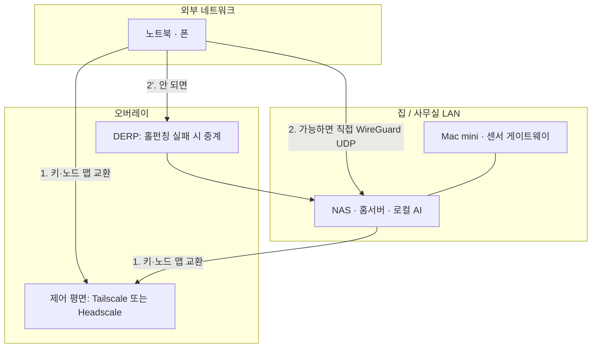

핵심 한 줄: **애플리케이션 포트를 인터넷에 열어 두지 않은 채**, 이미 로그인한 기기들끼리만 가상 LAN처럼 말한다.

## 2. 왜 포트 포워딩이 기본값으로 위험한가

가정부터 잡자. Google Drive 대용으로 NAS를 사서 공유기 뒤에 둔다. 공유기는 각 기기에 **사설(프라이빗) IP**를 준다. 같은 LAN 안에서는 그 주소로 파일을 주고받을 수 있다. 사설 주소는 기본적으로 인터넷 쪽에서 라우팅되지 않는다.

밖에 나가서 — 예를 들어 카페 Wi-Fi에서 — 집 NAS의 영상을 꺼내려면 사설 IP만으로는 안 된다. 전통적 해결이 **포트 포워딩**이다. 공유기 공인 IP의 특정 TCP/UDP 포트로 들어온 패킷을 NAS의 내부 포트로 넘긴다. 구멍과 구멍을 파이프로 잇는 셈이다.

문제는 그 구멍이 **나 말고도** 인터넷 전체에서 찔러 볼 수 있다는 점이다. 비밀번호로 막아 두어도, 서비스 자체의 취약점·기본 계정·오래된 펌웨어가 있으면 구멍이 입구가 된다. AI 보조 개발·자동 스캐닝이 늘면서 “매일 새로운 취약점”이 나오는 환경에서는, 열어 둔 포트마다 **패치 주기와 공격면**이 늘어난다.

같은 문서 트리의 특권 포트·NAT 루프백 기록과도 맞닿아 있다. 포트를 연다는 것은 OS·공유기·애플리케이션이 동시에 그 번호를 책임진다는 뜻이다. 열지 않아도 되는 트래픽은 열지 않는 편이 짧다.


## 3. UDP 홀펀칭이 “구멍을 평소에 안 열어 두고” 통신하는 이유

많은 가정용 NAT는 **내가 먼저 밖으로 보낸 UDP 흐름**에 대해, 일정 시간 동안 그 상대에서 오는 응답을 안으로 들여보낸다. 상태형 NAT 매핑이다.

홀펀칭의 직관은 이렇다. 통신할 두 기기가 **거의 동시에** 서로를 향해 UDP를 보낸다. 중간의 조율자(나중에 말할 제어 평면·디스커버리)가 서로의 공인 주소:포트를 알려 주면, 양쪽 NAT에 “내가 보낸 흐름”이 생기고, 그 매핑을 타고 패킷이 교차한다. 성공하면 **공유기 WAN에 고정 포워딩 규칙을 미리 안 만들어도** 터널이 열린다.

UDP는 연결 설정·재전송을 애플리케이션에 맡기는 전송이다. “확인 없이 빠르게 보낸다”는 요약은 거칠지만, 홀펀칭·실시간 미디어·VPN 데이터플레인에서 UDP가 선호되는 이유와는 맞닿아 있다. 실제 Tailscale 데이터 경로는 그 UDP 위에 **WireGuard 암호화**를 올린다. 평문 파일이 NAT를 가로지르는 것이 아니다.

홀펀칭이 항상 되는 것은 아니다. 대칭형 NAT, 캐리어급 NAT(CGNAT), 엄격한 기업 방화벽에서는 직접 경로가 실패한다. 그때 쓰는 대안이 **DERP**(Designated Encrypted Relay for Packets)다. 중계는 평문을 보지 않도록 설계된 암호화 릴레이이고, 처리량은 직접 UDP보다 떨어질 수 있다. Tailscale 호스팅 DERP는 비용 때문에 속도 제한이 있다. 자체 DERP를 돌리면 그 한도를 스스로 정한다.


*출처: [How Tailscale Works](https://tailscale.com/blog/how-tailscale-works/) 도식 자산*

## 4. Tailscale이 하는 일 — 앱 설치·로그인 이후의 가상 LAN

사용 흐름은 짧다.

1. 통신할 기기마다 Tailscale 클라이언트를 설치한다. 설치 패키지 자체는 가볍다(영상 기준 “1MB 남짓”으로 소개; 플랫폼·버전에 따라 실제 용량은 달라진다).
2. 계정으로 로그인하면 기기에 **tailnet 안의 가상 IP**(보통 `100.x` CGNAT 대역의 Tailscale IP)가 할당된다.
3. 그 IP(또는 MagicDNS 이름)로 브라우저·SSH·SMB·자체 웹 UI에 접속한다.
4. 홀펀칭·DERP·키 교환은 클라이언트가 처리한다.

직접 경로가 열리면 페이로드는 Tailscale 사의 서버를 **경유하지 않는다**. 기기 A ↔ 기기 B의 WireGuard UDP다. 제어 평면은 공개키·노드 맵·ACL·경로 광고를 교환하는 쪽이고, 데이터 평면과 역할이 다르다.

영상에서 든 일상 예시:

- Windows 폴더 공유로 파일을 열어 볼 수 있지만, 공유 설정은 다른 도구·에이전트와 꼬일 수 있다.
- 요즘은 작은 웹서버로 파일·관리 UI를 두고, Tailscale IP:포트로만 붙이는 편이 단순하다.
- 로컬 AI·에이전트 게이트웨이처럼 **관리자 페이지가 로컬 포트에 뜨는 소프트웨어**도, 그 포트를 공유기에서 포워딩하지 않은 채 Tailscale IP만으로 연다.

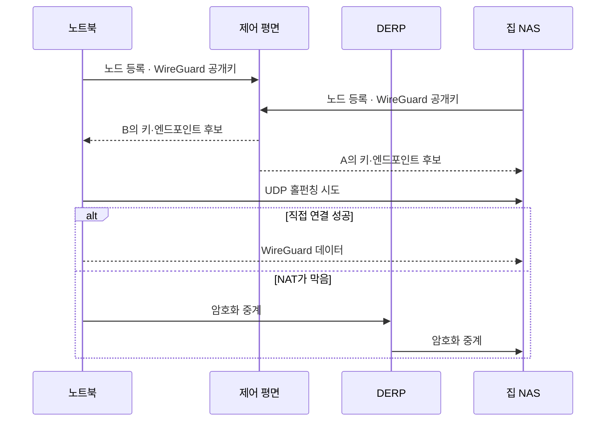

### 4.1 Exit node로 만드는 “간단한 VPN”

전통 VPN의 한 패턴은 **출구(exit)를 다른 기계로 바꾸는 것**이다. 내가 사이트에 직접 가지 않고, 다른 컴퓨터(또는 VPS)를 거쳐 나가면 그 구간의 출구 IP가 바뀐다. Tailscale의 **exit node**가 그 스위치를 UI/설정으로 제공한다. 해외 IP가 필요하면 AWS·소형 VPS에 클라이언트를 올리고 exit로 지정하는 식이 영상에서 소개된다.

이것은 “검열 우회·게임 지역 제한” 용도로도 이야기되지만, 이 글의 초점은 **내부 서비스 노출 최소화**다. Exit는 전 트래픽을 다른 신뢰 경계로 넘기는 설정이므로, 누가 exit를 돌리는지·그 노드의 권한이 무엇인지가 보안 경계가 된다.

### 4.2 기업가치 “2조 원” 표현의 근거

영상 제목·도입의 “기업가치 2조 원”은 대략 다음 공개 수치와 맞는다.

- 2025-04-08 Tailscale Series C: **USD 160M** 조달, Accel 주도 ([공식 블로그](https://tailscale.com/blog/series-c)).
- 보도에 따른 post-money는 약 **USD 1.45–1.5B** ([BetaKit](https://betakit.com/corporate-vpn-startup-tailscale-secures-230-million-cad-series-c-on-back-of-surprising-growth/), [Bloomberg](https://www.bloomberg.com/news/articles/2025-04-08/toronto-s-tailscale-hits-1-5-billion-valuation-with-new-funding)).
- 국내 환산 보도에서 “약 2조 원”으로 적힌 바 있다 ([토큰포스트 등](https://www.tokenpost.kr/news/tech/236099)).

2026년 11월 Globe and Mail 보도는 유료 고객·ARR 성장, 정부·대기업용 **sovereign**(데이터·제어 위치 주권) 제품 논의를 전한다. 숫자는 시점에 따라 변하므로, 이 글은 “WireGuard 오버레이가 제품·투자 서사에서 얼마나 크게 다뤄지는지”의 맥락으로만 적는다.

## 5. Headscale — Tailscale 제어 서버를 직접 돌리는 오픈소스


*출처: [juanfont/headscale](https://github.com/juanfont/headscale) 저장소 로고*

[Headscale](https://github.com/juanfont/headscale)은 **Tailscale 제어 서버의 자기호스팅 구현**이다. Tailscale 클라이언트(특히 open source 쪽 daemon)가 쓰는 제어 프로토콜을 받아, WireGuard 공개키 교환·노드 IP 할당·사용자 경계·머신 공유·광고된 라우트를 자기 서버에서 처리한다.

공식 README가 분명히 하는 점:

- Tailscale의 거의 모든 것은 오픈소스다. 예외로 자주 꼽히는 것은 **독점 OS GUI 클라이언트**와 **Tailscale Inc.가 운영하는 제어 서버**다.
- Headscale의 설계 목표는 개인·취미·소규모 오픈소스 조직용 **단일 tailnet**이다. 엔터프라이즈 다중 tailnet·완전 관리형 거버넌스를 Tailscale 제품 대신한다는 선언이 아니다.
- Tailscale Inc.와는 별개 프로젝트다. 다만 유지자 중 한 명이 Tailscale 직원이어서 근무 시간에 기여할 수 있고, 그 기여도 다른 유지자 리뷰를 받는다는 점이 [Tailscale 오픈소스 페이지](https://tailscale.com/opensource)와 README disclaimer에 적혀 있다.
- 문서·예시는 **리버스 프록시·컨테이너로 Headscale을 돌리는 구성을 지원·권장하지 않는다**.

### 5.1 요구 사항과 포트

[requirements](https://github.com/juanfont/headscale/blob/main/docs/setup/requirements.md) 요약:

| 포트 | 공개 | 용도 |
|---|---|---|
| tcp/80 | 조건부 | Let’s Encrypt HTTP-01 |
| tcp/443 | 예 | 클라이언트 HTTPS. Tailscale 클라이언트가 443을 가정하는 경우가 있어 **HTTPS:443 권장** |
| udp/3478 | 임베디드 DERP 사용 시 | STUN |
| tcp/9090 | 아니오 | 메트릭·디버그 |

서버는 공인 IPv4(+가능하면 IPv6), 비교적 최신 Linux/BSD, 전용 로컬 사용자, 약간의 CLI 운영을 전제로 한다. 기본 예시는 `/etc/headscale/config.yaml`, SQLite, `/var/lib/headscale` 데이터 디렉터리다.

### 5.2 설치 스케치 (Debian/Ubuntu 패키지)

공식 DEB가 사용자·systemd·예시 설정을 넣는다. 버전·아키텍처는 [Releases](https://github.com/juanfont/headscale/releases)에서 고른다.

```bash
# 예시 — 버전·아키는 릴리스 페이지 값으로 치환
HEADSCALE_VERSION="0.26.0"   # 예시 자리표시. 반드시 최신 스테이블 확인
HEADSCALE_ARCH="amd64"       # 또는 arm64 등

wget --output-document=headscale.deb \
  "https://github.com/juanfont/headscale/releases/download/v${HEADSCALE_VERSION}/headscale_${HEADSCALE_VERSION}_linux_${HEADSCALE_ARCH}.deb"

sudo apt install ./headscale.deb
sudo nano /etc/headscale/config.yaml
sudo systemctl enable --now headscale
```

클라이언트는 일반 Tailscale 바이너리로 Headscale URL을 가리키게 login한다(배포판·버전에 따라 `login-server` 플래그/설정). **클라이언트 버전과 Headscale 버전 호환**은 문서의 clients 표를 본다.

### 5.3 임베디드 DERP

Headscale는 임베디드 DERP를 켤 수 있다. 기본 DERP 맵(Tailscale Inc. 무료 릴레이 목록)을 끄고 자기 DERP만 쓰게 할 수도 있다. `config.yaml` 개념 예:

```yaml
derp:
  server:
    enabled: true
    ipv4: 198.51.100.1   # 문서용 예시 주소 — 실제 공인 IP로 교체
    ipv6: 2001:db8::1
```

중계를 자기 인프라에 두면 “수상한 기업에 메타데이터·중계를 맡기기 싫다”는 요구에 가깝게 갈 수 있다. 대신 **443·STUN·인증서·업타임·백업**을 직접 진다. Tailscale 공식 입장도 Headscale을 생태계의 건강한 자기호스팅 실험으로 보되, 관리형 제품과 운영 범위를 구분한다.

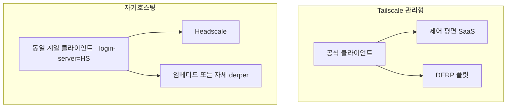

## 6. Tailcat — 제어 평면 없이 Tailscale 데이터 평면만 쓰는 netcat

[Tailcat](https://github.com/tailscale/tailcat)은 Tailscale이 공개한 조각(WireGuard userspace, magicsock, DERP, gVisor netstack)을 **remix**해, netcat처럼 두 프로세스만 잇는다. 한 줄 정의는 README 그대로다.

> like netcat, but over Tailscale's data plane, without Tailscale's control plane

즉:

- Tailscale **계정 불필요**
- 머신 라우팅 테이블·DNS·TUN 장치를 건드리지 않음 → **루트 없이** userspace
- 연결 메타데이터(주소 문자열)는 **대역 외**로 전달 — 채팅, USB, QR, 메모 등
- 부트스트랩은 DERP, 가능하면 직접 WireGuard UDP로 승격

블로그: [Tailcat: An open-source CLI for Tailscale’s WireGuard, NAT traversal, and DERP](https://tailscale.com/blog/tailcat). 브라우저 WASM 데모: [tailscale.github.io/tailcat](https://tailscale.github.io/tailcat/) (직접 연결 전 WebRTC는 이슈 [#4](https://github.com/tailscale/tailcat/issues/4) 기준으로 제한적).

### 6.1 Tailcat 주소 (`tc…`)

서버가 인쇄하는 주소는 `tc` 접두 + base64(CBOR)이며 대략 다음을 담는다.

- 서버 WireGuard 공개키
- 경로 탐색용 별도 공개키(디스코 프레임에 WireGuard 키를 드러내지 않기 위함)
- 기본으로 WireGuard **pre-shared key**(DERP 운영자가 양쪽 공개키를 보더라도 터널에 끼어들기 어렵게, 주소가 비밀인 동안 기록 트래픽에 대한 추가 보호)
- DERP 정보: 기본 Tailscale-run 릴레이의 작은 정수이거나, 풀 DERP 메타데이터

기본 주소는 **소지자 능력(bearer capability)** 이다. 주소를 아는 쪽이 연결할 수 있다. DNS TXT에 올리면 인터넷 전체가 그 능력을 갖는 셈이므로, 공개하려면 `serve --allow`로 클라이언트 노드 키를 제한하거나 SSH에 `--ssh-authorized-keys`를 강제한다.

### 6.2 연결 순서

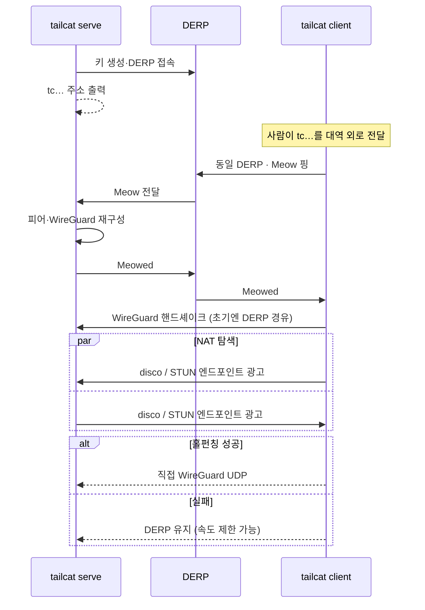

### 6.3 CLI 예시

stdin/stdout 파이프:

```bash
# 서버
tailcat
# 🐈 Server listening with new address: tc...

# 클라이언트
echo hello | tailcat tc...
```

로컬 포트 노출·포워드:

```bash
# 서버: 8080·8443을 터널로 제공
tailcat serve 8080,8443

# 클라이언트: 로컬 18080 → 터널 8080
tailcat forward tcXXXXXXXXX 18080:8080
```

LAN의 adb만 골라 프록시(exit-node 전체 노출 없이):

```bash
tailcat serve 5555:10.2.200.213:5555
# 클라이언트
tailcat forward tcXXXXXXXXX 5555
adb connect 127.0.0.1:5555
```

SSH (authorized_keys 필수인 안전한 기본):

```bash
tailcat serve --ssh-authorized-keys=~/.ssh/authorized_keys ssh
tailcat ssh tcXXXXXXXXX
```

`no-auth-ssh`는 터널 신원만으로 셸을 준다. README 경고대로 **주소가 곧 자격 증명**이다.

파일 수신함:

```bash
tailcat recv ~/inbox          # 서버
tailcat cp report.pdf tc...:  # 송신
```

설치는 Homebrew·deb/rpm·Scoop·Snap·Nix·정적 바이너리 등이 [INSTALL.md](https://github.com/tailscale/tailcat/blob/main/INSTALL.md)에 정리돼 있다.

```bash
# macOS 예
brew install tailscale/tap/tailcat   # 탭 경로는 INSTALL 문서를 따를 것
```

### 6.4 Tailscale / Headscale / Tailcat 역할 비교

| | Tailscale | Headscale | Tailcat |
|---|---|---|---|
| 제어 평면 | 회사 SaaS | 자기 서버 | 없음(주소 대역 외 교환) |
| 데이터 평면 | WireGuard + magicsock | 동일 계열 클라이언트 | 동일 계열 라이브러리 |
| 기기 수·정책 | ACL·유저·공유·DNS | 단일 tailnet 범위 | 보통 1:1 또는 소수·서비스 단위 |
| OS 네트워크 | TUN·라우트·DNS 가능 | 클라이언트에 따름 | 변경 없음(userspace) |
| 루트 | 플랫폼에 따라 필요할 수 있음 | 서버 운영 필요 | CLI/라이브러리는 루트 불필요 |
| 적합한 장면 | 팀·상시 VPN·에이전트 플릿 | 주권·자기호스팅 제어 | 임시 터널·데모·임베디드·최소 설치 |

## 7. 영상 스크립트가 덮는 이야기 전체 (기술 재구성)

315초 한국어 수동 자막의 논지 순서다. 비속어 비유는 **포트 노출**로 바꿔 적는다. 원문 타임스탬프는 형제 파일에 있다.

1. **도입** — 집에 NAS·맥 미니 로컬 AI·폰 리눅스 홈서버가 늘었다. 기기 간 통신을 위해 포트를 열어 두는 습관이 많다. 열어 둔 면은 취약점이 생기면 입구가 된다. 실리콘밸리에서 유행하는, 포트를 평소에 안 열고 통신하는 방법이 있고, 그 축으로 기업가치 약 2조 원대 서사를 가진 스타트업이 있다.
2. **사설 IP** — NAS를 공유기 뒤에 두면 사설 IP로 LAN 안 통신은 된다. 바깥(카페)에서는 사설 IP로 집 NAS에 닿지 못한다.
3. **포트 포워딩의 대가** — WAN 포트 → 내부 포트 파이프. 외부 스캔·자격 증명 우회·서비스 취약점에 노출. 지속 패치 부담.
4. **UDP 홀펀칭** — 양측이 동시에 UDP를 보내고, NAT가 “내가 연 흐름”으로 응답을 들여보내게 만든다. 중간의 조율이 있으면 고정 포워딩 없이 터널이 생긴다.
5. **Tailscale 사용** — 기기마다 앱·로그인 → 가상 IP → 그 IP로 접속. 홀펀칭 실패 시 DERP. 파일은 폴더 공유보다 작은 웹 UI가 충돌이 적다. 로컬 AI 관리 페이지도 IP:포트로.
6. **직접 경로와 WireGuard** — 홀펀칭 성공 시 데이터는 Tailscale 서버를 거치지 않고 기기 직행, WireGuard로 암호화.
7. **Exit node** — 출구를 다른 컴퓨터/VPS로 바꾸면 간단한 VPN 패턴.
8. **Headscale** — 중개·제어를 회사에 맡기기 싫으면 오픈소스 제어 서버.
9. **Tailcat** — Tailscale이 만든 미니멀 오픈소스. 두 기기 터미널·서비스 연결에 초점.
10. **결론** — 포트를 길바닥에 열어 두고 통신하기 싫으면 이 계열을 검토하라.

## 8. 탄소포집·홈페이지 운영에 옮길 때의 검토 포인트

메모의 “탄소포집이나 홈페이지때 한번 검토”는 다음 질문에 가깝다.

| 장면 | 포트 포워딩 | Tailscale/Headscale | Tailcat |
|---|---|---|---|
| 홈페이지 **관리자 콘솔** | `/admin`을 443에 노출하거나 별도 포트 | 관리자만 tailnet 가입, 공인에는 정적 사이트·공개 API만 | 임시로 `serve`/`forward`해 로컬 미리보기 |
| 탄소포집 **현장 센서·PLC·엣지** | 셀 모뎀에 포트 개방 | 현장 게이트웨이만 tailnet, 중앙은 exit/서브넷 라우터 | 출장 중 단일 터널로 로그만 수집 |
| CI·에이전트가 사설 GPU/NAS 접근 | 임시로 0.0.0.0 바인딩 | 러너에 Tailscale 사이드카 | 잡 단위 `tc…` 전달 후 폐기 |
| 규제·주권 | 클라우드 VPN 계정 | Headscale+자체 DERP로 제어·중계 위치 고정 | 메타데이터 최소, 단 정책 UI 없음 |

홈페이지([`/Users/async/glory/homepage`](../../../../../homepage))처럼 공개 Next와 사설 Spring이 나뉜 구조에서는, **관리자·DB·메트릭은 tailnet 전용**, 공개 원본만 CDN/로드밸런서에 두는 쪼개기가 포트 스캔면을 줄인다. 탄소포집 파일럿처럼 현장이 여러 NAT 뒤에 흩어지면, 사이트마다 포워딩 규칙을 외우는 대신 **노드 ACL로 “누가 어느 태그 기기와 말할 수 있나”**를 중앙에서 적는 편이 감사에 유리하다.

주의:

- Tailscale/Headscale 노드가 뚫리면 그 노드가 보는 내부 서비스가 보인다. **오버레이는 마법이 아니라 이동한 경계**다.
- Exit node·서브넷 라우터는 권한 범위가 넓다. 최소 권한 태그·ACL을 기본으로 둔다.
- Tailcat 주소를 슬랙·이슈에 붙여 넣으면 만료 전까지 공유 비밀이 된다.
- Headscale을 컨테이너/리버스 프록시로 우회 구성하면 업스트림이 지원하지 않는다고 명시한 길을 가는 것이다.

## 9. 로컬 서비스 예시 — 공개 바인딩 없이 관리 HTTP

아래는 **개념 검증용**이다. 실제로는 Tailscale IP에만 바인딩하거나, `127.0.0.1`에 두고 `tailcat forward`/`tailscale serve`로만 연다. Bun 내장 `Bun.serve`만 사용한다.

```ts
// admin-only.ts — 루프백 전용 관리 핑. 공유기 포트 포워딩 없음.
const server = Bun.serve({
  hostname: "127.0.0.1",
  port: 8787,
  fetch(req) {
    const url = new URL(req.url);
    if (url.pathname === "/healthz") {
      return Response.json({ ok: true, bind: "127.0.0.1:8787" });
    }
    return new Response("admin overlay only\n", {
      headers: { "content-type": "text/plain; charset=utf-8" },
    });
  },
});

console.log(`loopback only: http://127.0.0.1:${server.port}`);
// 같은 머신에서:
//   tailcat serve 8787
// 다른 머신에서 받은 tc… 주소로:
//   tailcat forward tc… 18787:8787
//   curl http://127.0.0.1:18787/healthz
```

Tailscale 노드라면 MagicDNS 이름이나 `100.x` 주소로 같은 포트를 열되, WAN 포워딩 테이블에는 넣지 않는다.

## 10. 보안 모델이 바꾸는 것 / 바꾸지 않는 것

바꾸는 것:

- **기본 노출면**: “인터넷의 아무나 → 내 서비스 포트”가 “tailnet 멤버(또는 tc 주소 소지자) → 내 서비스”로 좁아진다.
- **연결 정체성**: IP 허용 목록보다 노드 키·유저 신원·ACL 태그에 가깝다.
- **NAT 뒤 기기**: 현장·집·클라우드가 같은 오버레이 주소 공간에 올라간다.

바꾸지 않는 것:

- 애플리케이션 RCE, 약한 세션 쿠키, SSRF로 오버레이 안을 가로지르는 공격.
- 엔드포인트 OS 패치, 공급망, 피싱으로 훔친 refresh token.
- DERP 운영자·Headscale 서버 관리자의 가용성·정직성 가정(종단 암호화와 메타데이터·정책 권한은 층이 다르다).

xkcd가 오래전에 그려 둔 “비밀번호 복잡도 vs 실제 위협” 풍자는, 포트만 닫고 끝나는 착각을 경계할 때도 유효하다.


*출처: [xkcd 792 — Password Strength 인접 테마의 Security](https://xkcd.com/792/) / 이미지 `security.png`. 오버레이는 만능 자물쇠가 아니다.*

## 11. 실무 체크리스트

1. 지금 공인으로 열려 있는 관리·SSH·DB·메트릭 포트를 목록화한다.
2. 그 중 **사람만 쓰면 되는 것**을 Tailscale/Headscale 노드 ACL 뒤로 옮긴다.
3. 기기 태그: `tag:admin`, `tag:edge`, `tag:ci`처럼 최소 집합만 서로 말하게 한다.
4. 직접 경로 비율·DERP 폴백을 클라이언트로 확인한다. 항상 DERP면 대역폭·비용을 계산한다.
5. 제어 평면을 자기호스팅할 거면 Headscale 요구 사항(443, 백업, 업그레이드)을 운영 문서에 적는다. 컨테이너 우회는 업스트림 비권장임을 명시한다.
6. 일회성 지원·데모는 Tailcat으로 포트를 안 연 채 `tc…`만 전달하고, 종료 후 주소·프로세스를 폐기한다.
7. Exit·서브넷 라우터는 별도 승인 없이 켜지 않는다.
8. 탄소포집 현장처럼 규제 문서가 있으면 “데이터가 거치는 국가/사업자” 표를 제어 평면·DERP 위치에 맞춰 갱신한다.

## 12. 전통 VPN과 무엇이 다른가

전통 기업 VPN은 대개 **중앙 게이트웨이**로 트래픽을 모은다. 샌프란시스코의 노트북이 같은 건물의 프린터에 가려면, 정책에 따라 뉴욕 데이터센터 게이트웨이를 왕복할 수 있다. Tailscale 계열 서사가 강조하는 지점은 그 우회를 기본값에서 없애는 것이다. 가능하면 **피어 투 피어**, 안 되면 가까운 DERP.

| | 전통 허브-앤-스포크 VPN | Tailscale형 오버레이 |
|---|---|---|
| 기본 경로 | 클라이언트 → VPN GW → 대상 | 클라이언트 → 대상 (직접) |
| 식별 | 종종 IP·인증서·AD 그룹 | 노드 키 + 유저 신원 + ACL |
| NAT 뒤 서버 | 사이드에 별도 인bound 규칙 | 클라이언트가 아웃바운드로 뚫고 만남 |
| 장애 도메인 | GW 용량·위치가 병목 | 제어 평면 장애와 데이터 평면 장애를 분리해 이야기할 수 있음 |

WireGuard 자체만 쓰면 키 배포·엔드포인트 갱신·NAT 탐색을 사람이 스크립트로 진다. Tailscale/Headscale이 더하는 것은 그 **운영 평면**이다. Tailcat은 그 평면을 빼고, 주소 문자열 하나로 데이터 평면만 남긴다.


*출처: [How Tailscale Works](https://tailscale.com/blog/how-tailscale-works/)*

## 13. WireGuard·magicsock·DERP를 층으로 읽기

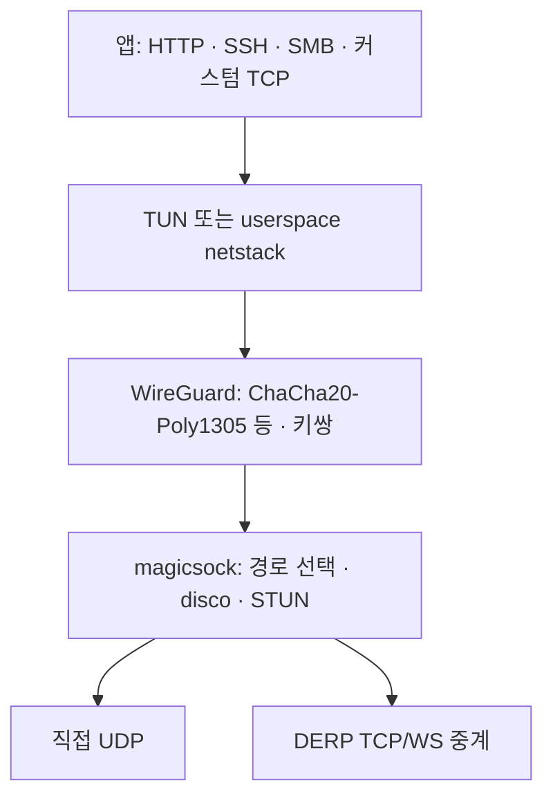

- **WireGuard**: 현대적 VPN 프로토콜. 코드베이스가 작고, 키 기반 피어 모델이 단순하다. Tailscale/Tailcat은 커널 모듈 대신 **userspace** 구현을 쓸 수 있다.
- **magicsock**: Tailscale이 붙인 전송 계층. 여러 후보 경로를 알고, 지연·성공률에 따라 직접 UDP와 DERP를 고른다.
- **DERP**: 패킷을 암호화된 채로 중계. 홀펀칭용 사이드 채널이기도 하다. Tailcat README는 공개 호스팅 DERP에 속도 제한이 있다고 명시한다. 자체 [`derper`](https://github.com/tailscale/tailscale/tree/main/cmd/derper)로 바꾸면 한도를 통제한다.
- **disco**: 피어가 “나의 현재 공인/로컬 엔드포인트”를 서로에게 알리는 프로토콜. Tailcat은 WireGuard 키와 분리된 path-discovery 키를 써서, 클리어텍스트 디스코 프레임에 WireGuard 신원이 덜 드러나게 한다.

CGNAT 환경에서는 공인 IPv4가 공유된다. 이 트리의 [CGNAT 진단 문서](./260913_2214_CGNAT_Network_Diagnostics_and_SSE-Based_Client_Communication.md)와 맞물리면, “포트 포워딩이 원천적으로 불가·불안정한 회선”에서 오버레이가 더 설득력을 갖는다.

## 14. ACL·태그·최소 권한 — 홈페이지·탄소포집 공통

오버레이를 켠 뒤 모든 노드가 모든 포트에 닿으면, 구멍만 옮긴 것이다. Tailscale ACL(및 Headscale이 지원하는 정책 파일)의 직관은 방화벽 규칙을 **유저·태그 단위**로 적는 것이다.

개념 예시(문법이 제품·버전에 따라 다를 수 있으므로, 적용 전 공식 ACL 문서를 본다):

```json
{
  "tagOwners": {
    "tag:homepage-admin": ["group:web-ops"],
    "tag:edge-sensor": ["group:field"],
    "tag:ci": ["group:platform"]
  },
  "acls": [
    {
      "action": "accept",
      "src": ["tag:homepage-admin"],
      "dst": ["tag:homepage-admin:443", "tag:homepage-admin:8080"]
    },
    {
      "action": "accept",
      "src": ["tag:ci"],
      "dst": ["tag:homepage-admin:22"]
    },
    {
      "action": "accept",
      "src": ["tag:edge-sensor"],
      "dst": ["tag:ingest:443"]
    }
  ]
}
```

탄소포집 현장에서 센서 게이트웨이는 `tag:edge-sensor`만 달고, 중앙 수집 API(`tag:ingest`)의 443만 연다. SSH는 필드 엔지니어 그룹에만 연다. 홈페이지 관리자 콘솔은 `tag:homepage-admin` 기기에서만 보이게 한다. 공개 원본 Next는 계속 공인 443에 두고, Spring 관리 API는 tailnet 전용 리스너로 옮긴다.

## 15. Headscale 운영에서 자주 걸리는 지점

1. **443이 아닌 HTTPS** — 동작하는 경우도 있으나 클라이언트가 443을 가정하는 경로가 있어 프로덕션은 443을 권장한다 ([issue 2164](https://github.com/juanfont/headscale/issues/2164) 맥락이 문서에 인용됨).
2. **리버스 프록시** — 업스트림이 지원·권장하지 않는다고 못 박았다. TLS를 Headscale에 직접 맡기거나, 문서가 허용하는 패턴만 따른다.
3. **버전 핀** — `main` 브랜치 설정 예시는 미릴리스 변경을 담을 수 있다. 설치한 태그로 문서를 고른다.
4. **단일 tailnet** — 조직이 여러 완전 분리 네트워크를 원하면 Headscale 하나로는 부족할 수 있다. 그게 설계 범위다.
5. **백업** — SQLite·키 자료(`/var/lib/headscale`)를 잃으면 노드 재가입 비용이 크다. DB와 설정을 같은 주기로 백업한다.
6. **DERP만 Tailscale 공개망** — 제어는 자기 서버, 중계는 회사 플릿인 하이브리드가 된다. 주권 요구가 있으면 임베디드 DERP + 기본 맵 비활성화를 검토한다.

FOSDEM 발표도 참고 가치가 있다.

- [2026: Headscale & Tailscale: The complementary open source clone](https://fosdem.org/2026/schedule/event/KYQ3LL-headscale-the-complementary-open-source-clone/) (Kristoffer Dalby)
- [2023: Headscale integration testing](https://fosdem.org/2023/schedule/event/goheadscale/) (Juan Font Alonso, Kristoffer Dalby)

## 16. Tailcat을 “미니멀 Tailscale”로 오해하지 않기

영상은 Tailcat을 “미니멀한 오픈소스 버전” “기기 두 개 터미널 연결”으로 소개한다. 공식 README에 더 정확히 쓰면:

- Tailscale **제품 대체재가 아니라** 데이터 평면 컴포넌트 재사용 도구다.
- 상시 메시·ACL UI·키 로테이션 정책·감사 로그 제품이 없다.
- `serve`/`ssh`/`files`/`perf`/`exec`까지 가면 기능은 넓지만, **신뢰 모델은 주소·`--allow`·SSH 키**에 집중한다.
- `no-auth-ssh`는 데모·폐쇄 채널에서만.

그래서 팀 상시망은 Tailscale/Headscale, **일회성 포트 포워딩 대체·에이전트 임시 접속·임베디드 바이너리**는 Tailcat으로 나누는 편이 맞다.

### 16.1 추가 유스케이스 코드

성능 측정:

```bash
# 서버
tailcat serve perf

# 클라이언트 — 10초 기본
tailcat perf tcXXXXXXXXX
tailcat perf --reverse tcXXXXXXXXX
tailcat perf --udp --bitrate=10M tcXXXXXXXXX
```

연결마다 명령 실행(inetd 유사):

```bash
tailcat serve exec -- /usr/bin/fortune
tailcat tcXXXXXXXXX 80 < /dev/null
```

QR로 주소 옮기기(콘솔 복사가 어려울 때):

```bash
tailcat serve --qr 8080
```

## 17. 위협 시나리오 몇 가지

| 시나리오 | 포트 포워딩 세상 | 오버레이 세상 |
|---|---|---|
| 인터넷 전수 스캔 | 열린 포트가 히트 | WAN에 관리 포트가 없으면 히트 없음 |
| NAS 웹 UI 0-day | 공인 IP로 즉시 시도 가능 | 공격자가 먼저 노드/계정을 얻어야 함 |
| 노트북 분실 | VPN 비밀번호·쿠키 | 노드 키·로그인 세션 폐기·ACL에서 제거 |
| DERP 운영자 | (해당 없음 또는 상용 VPN 로그) | 페이로드는 종단 암호화, 메타데이터·타이밍은 남을 수 있음 |
| 내부자 노트북 감염 | 포워딩된 서비스만 | tailnet에서 보이는 **모든** 허용 dst가 대상 — ACL이 중요 |
| tc 주소 슬랙 유출 | — | Tailcat 서비스가 열려 있는 동안 공유 비밀 유출 |

## 18. 탄소포집 파일럿 아키텍처 초안

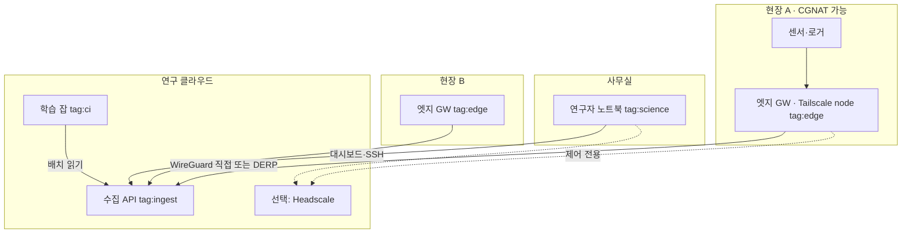

현장 셀 모뎀에 포트 포워딩을 넣지 않는다. 펌웨어 업데이트는 연구자가 tailnet으로 들어가 수행하거나, 서명된 아티팩트를 엣지가 폴링한다. 공개 홈페이지는 여전히 별도 공개망에 두고, 내부 실험 대시보드만 오버레이에 둔다.

## 19. 홈페이지(Spring + Next)에 적용하는 최소 변경 사고실험

현재 구조 요약(기존 README 기준): 공개 프론트 `8888`, API 프록시, 백엔드 `8080`.

검토 방향:

1. 프로덕션에서 `8080`·관리자 경로를 공인 로드밸런서에 올리지 않는다.
2. 운영자 노트북·배스천만 Tailscale에 넣고, `BACKEND_ORIGIN`은 tailnet IP를 가리킨다.
3. 공개 Next는 정적·캐시 가능한 페이지만 서빙한다.
4. 비상 시 Tailcat으로 `8080`만 `forward`해 핫픽스한 뒤 프로세스를 끈다.
5. 감사 로그에 “누가 어느 노드에서 admin API를 쳤는지”를 Tailscale identity와 함께 남길지 결정한다.

이 사고실험은 구현 지시가 아니라 **포트 노출 최소화 체크리스트**다.

## 20. 의사결정 트리

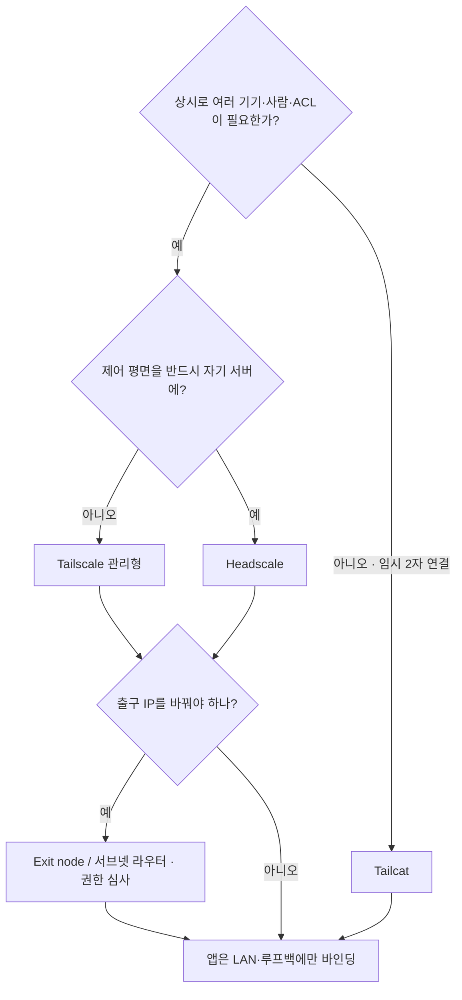

## 21. 참고

### 21.1 일차 자료

- 영상: [누구나 쓸 수 있는 2조원짜리 보안기술](https://www.youtube.com/watch?v=SucveHciVU0) (315s). 미편집 자막: [`261125_2136_Unedited Manual Caption of Tailscale Overlay Networking Brief.md`](./261125_2136_Unedited%20Manual%20Caption%20of%20Tailscale%20Overlay%20Networking%20Brief.md)
- [Tailscale — How Tailscale Works](https://tailscale.com/blog/how-tailscale-works/)
- [Tailscale — How NAT traversal works](https://tailscale.com/blog/how-nat-traversal-works/)
- [Tailscale Series C](https://tailscale.com/blog/series-c) / [Open source at Tailscale](https://tailscale.com/opensource)
- [juanfont/headscale](https://github.com/juanfont/headscale) · 문서 [headscale.net](https://headscale.net/stable/)
- [tailscale/tailcat](https://github.com/tailscale/tailcat) · [Tailcat 블로그](https://tailscale.com/blog/tailcat)
- WireGuard: [wireguard.com](https://www.wireguard.com/)

### 21.2 이 트리 안의 인접 문서

- [Privileged Ports EACCES…](./260914_2044_Privileged_Ports_EACCES_and_Why_SIP_Ports_5060-5061_Are_Problematic.md)
- [NAT Loopback / Hairpin NAT](./260912_2028_NAT_Loopback_Hairpin_NAT_Concepts_and_Remediation_for_Public-IP_LAN_Access.md)
- [CGNAT Network Diagnostics](./260913_2214_CGNAT_Network_Diagnostics_and_SSE-Based_Client_Communication.md)
- [Access Control List](./260814_1339_AccessControlList.md)

### 21.3 이 글이 단정하지 않는 것

- Tailscale의 현재 기업가치·ARR의 실시간 수치(보도일 기준만 인용).
- Headscale이 모든 기업 규정에서 Tailscale SaaS를 대체한다는 주장.
- 홀펀칭 성공률 100%.
- 오버레이만으로 애플리케이션 취약점이 사라진다는 주장.
- 영상 채널·유머를 기술 표준으로 인용한다는 주장 — 기술 검증은 위 공식 문서를 따른다.


---

# 부록 A. 놓치기 쉬운 네트워크 개념 (포트 포워딩을 버리기 전에)

앞 본문이 “사설 IP → 포트 포워딩 → 홀펀칭 → Tailscale”로 빠르게 지나간 층을 여기서 풀어 쓴다. 탄소포집 현장의 CGNAT 회선, 홈페이지 관리망, 사무실 방화벽이 왜 같은 레시피로 안 풀리는지 이해하려면 이 층이 필요하다.

## A1. 사설 주소와 공인 주소 (RFC 1918)

IPv4에서 “집에서만 쓰는 주소”는 관례가 아니라 [RFC 1918](https://www.rfc-editor.org/rfc/rfc1918)에 적힌 **사설 주소 공간**이다.

| 블록 | 범위 | 흔한 사용 |
|---|---|---|
| 10.0.0.0/8 | 10.0.0.0 – 10.255.255.255 | 큰 LAN·클라우드 VPC |
| 172.16.0.0/12 | 172.16.0.0 – 172.31.255.255 | 중규모 LAN |
| 192.168.0.0/16 | 192.168.0.0 – 192.168.255.255 | 가정 공유기 기본값 |

이 주소는 인터넷 백본에서 라우팅되지 않는다(또는 필터된다). 그래서 카페 Wi-Fi의 노트북이 `192.168.0.10`으로 집 NAS를 부를 수 없다. 공유기 WAN 쪽에 붙는 **공인(퍼블릭) IP**만이 바깥에서 도달 가능한 끝점이다. Tailscale이 기기마다 주는 `100.x` 대역은 또 다른 **CGNAT용 예약 공간**을 오버레이 주소로 재사용하는 제품 관례이며, 집 LAN의 `192.168`과 겹치지 않게 고른 설계다.

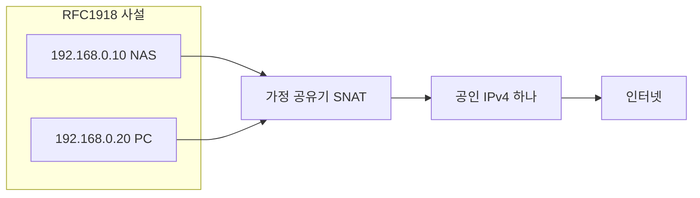

## A2. NAT가 패킷에 하는 일 — SNAT가 홀펀칭을 어렵게 만든다

[How NAT traversal works](https://tailscale.com/blog/how-nat-traversal-works) (David Anderson, Tailscale)가 강조하는 구분:

- **상태형 방화벽**: “밖으로 나간 UDP 흐름이 있으면, 그에 대응하는 들어오는 UDP를 잠시 허용한다.”
- **SNAT (Source NAT)**: 그 위에 **출발지 IP·포트까지 바꿔** 여러 기기가 공인 IP 하나를 공유하게 한다.

홀펀칭이 “양쪽이 거의 동시에 쏘면 된다”로 끝나는 경우는, 방화벽만 마주 보거나 NAT가 예측 가능한 매핑을 줄 때다. NAT가 상대마다·시도마다 **다른 외부 포트**를 쓰면(대칭형에 가까운 동작), 상대가 미리 알고 있는 `ip:port`가 틀려져 직접 경로가 실패한다. 그때 DERP 같은 **사이드 채널 + 중계**가 필수에 가까워진다.

Anderson 글의 핵심 트릭을 한국어로 압축하면 이렇다.

1. UDP여야 단순하다. TCP 홀펀칭은 훨씬 어렵다.
2. NAT 탐색용 여분 패킷을 보낼 수 있게 **소켓을 직접** 다뤄야 한다.
3. 양쪽이 “누가 먼저” 문제로 교착하므로, **동시에** 보내고, 일부 유실을 감수한다.
4. 상대의 현재 `ip:port`를 알려 줄 **저대역 사이드 채널**(조정 서버·DERP·예전엔 XMPP 등)이 필요하다.
5. NAT/방화벽 매핑은 유휴 시 만료되므로 **keepalive**가 필요하다.

WebRTC·VoIP·일부 게임이 같은 가방의 기술을 쓴다. Tailscale은 그 가방을 WireGuard 터널 수립에 연결한다.


*출처: [How NAT traversal works](https://tailscale.com/blog/how-nat-traversal-works/) OG 이미지*

## A3. NAT “타입”을 현장에서 왜 이야기하나

문헌·실무에서 자주 쓰는 거친 분류다. 장비마다 이름이 흔들리고, 실제 동작은 펌웨어에 따라 다르니 **분류는 직관용**이다.

| 관용 이름 | 직관 | 홀펀칭 |
|---|---|---|
| Full cone | 한 번 밖으로 연 포트로 아무 외부 호스트나 들어옴 | 쉬움 |
| Address/Port restricted | 내가 말한 적 있는 주소(·포트)만 응답 허용 | 동시 송출로 가능한 경우 많음 |
| Symmetric | 목적지마다 외부 포트가 달라짐 | 직접 경로 실패율 높음 → 중계 의존 |

휴대폰 테더링·일부 기업망·CGNAT는 대칭형에 가깝게 동작하는 경우가 있다. “우리 집에서는 Tailscale이 직접 붙었는데 현장 모뎀에서는 DERP만 쓴다”는 보고가 나오면, 앱 버그보다 **경로상의 NAT**를 의심하는 편이 맞다.

## A4. CGNAT — 공인 IPv4를 ISP가 한 번 더 나눈다

캐리어급 NAT(CGNAT)는 ISP가 가입자 모뎀에 **사설 또는 공유 공인**을 주고, ISP 내부에서 또 SNAT한다. 가입자 집에 포트 포워딩을 열어도 **ISP NAT까지는 열리지 않는다**. 이 트리의 [CGNAT 진단 문서](./260913_2214_CGNAT_Network_Diagnostics_and_SSE-Based_Client_Communication.md)가 다루는 고통이 그것이다.

오버레이가 여기서 설득력을 얻는 이유:

- 기기가 **아웃바운드**로 제어 평면·DERP·피어에 붙기만 하면 된다.
- WAN에 “서버 포트”를 안 연다.
- 현장 셀 모뎀처럼 포트 포워딩이 원천 봉인된 회선에서도 같은 레시피가 통한다.

## A5. 포트 포워딩 · DMZ · UPnP

| 수단 | 하는 일 | 위험 요약 |
|---|---|---|
| 수동 포트 포워딩 | WAN 포트 → LAN 호스트:포트 | 그 포트가 인터넷 공격면 |
| DMZ 호스트 | 거의 모든 미매핑 포트를 한 기기로 | 그 기기 전체가 노출에 가까움 |
| UPnP / NAT-PMP / PCP | 앱이 라우터에 매핑을 요청 | 악성·취약 앱이 구멍을 열 수 있음 |

Tailscale류는 이상적으로 **이 세 가지를 기본 경로에서 제거**한다. 일부 NAT 환경에서는 클라이언트가 PCP/UPnP로 매핑을 **도우미**로 시도할 수 있으나, 제품 서사의 목표는 “사람이 공유기 UI에서 8080을 열어 두기”가 아니다. Anderson 글도 카페·공항 라우터를 사용자가 재설정할 수 없음을 전제로 한다.

## A6. Hairpin NAT (NAT 루프백)

같은 LAN의 기기가 **공인 IP:포워딩 포트**로 자기 집 서버에 접속할 때, 공유기가 그 패킷을 다시 안으로 꺾어 주는지가 hairpin/NAT loopback이다. 안 되면 “밖에서는 되는데 집에서는 공인 주소로 안 된다”가 생긴다. 오버레이 IP(`100.x` 또는 MagicDNS)로 붙이면 이 문제를 **우회**하는 경우가 많다. 상세는 [NAT Loopback 문서](./260912_2028_NAT_Loopback_Hairpin_NAT_Concepts_and_Remediation_for_Public-IP_LAN_Access.md).

## A7. IPv6가 있으면 오버레이가 필요 없어지나

이상적 엔드투엔드 IPv6에서는 각 기기에 전역 주소가 있고, 방화벽만 열면 직접 통신이 가능하다. 현실은 다르다.

- 많은 회선이 IPv6를 안 주거나, 주더라도 **방화벽 기본이 인바운드 차단**이다.
- 한쪽만 IPv6면 결국 IPv4 NAT 문제로 돌아온다.
- 주소가 보여도 **신원·ACL·로밍** 문제는 남는다. IP가 바뀌는 노트북에 방화벽 예외를 수동으로 유지하는 비용이 크다.

Headscale 기능 표는 **듀얼 스택(IPv4+IPv6)** 을 명시한다. 오버레이는 “IPv6 대체재”라기보다 **신원 기반 연결 + NAT 관통 + 정책**을 한 묶음으로 파는 쪽에 가깝다.

## A8. Split tunnel vs full tunnel · Exit node

- **Split tunnel**: 오버레이 대역(또는 광고된 서브넷)만 터널로 가고, 일반 웹은 ISP로 나간다. Tailscale 기본 감각에 가깝다.
- **Full tunnel / Exit node**: 기본 경로까지 다른 노드로 보낸다. 영상에서 말한 “간단한 VPN”이 이쪽이다.

Exit는 편리하지만, exit 노드 운영자·그 국가·그 클라우드 계정이 **새 신뢰 경계**가 된다. 탄소포집 데이터가 exit를 지나가면 데이터 거점 표가 바뀐다.

## A9. Zero Trust 마케팅과 오버레이가 실제로 하는 일

“Zero Trust”는 종종 제품 수식어로 남용된다. 이 글에서 안전하게 말할 수 있는 범위는 좁다.

- 오버레이는 **암묵적 기업 LAN 신뢰**를 “인터넷에 포트를 열어 둔 서비스”에서 **인증된 노드·유저만 닿는 서비스**로 옮긴다.
- 그렇다고 앱 RCE·도난 세션·공급망이 사라지지는 않는다.
- Tailscale Funnel처럼 **의도적으로 인터넷에 서비스를 노출**하는 기능은 오버레이와 반대 방향이다. Headscale 기능 목록에도 Funnel/Serve가 이슈 번호와 함께 적혀 있으며, “완전 동일 호환”으로 읽으면 안 된다.

## A10. 생태계 맥락 (대체재 스케치, 추천 아님)

| 계열 | 한 줄 | 이 글과의 관계 |
|---|---|---|
| 순수 WireGuard | 빠르고 단순, 키·엔드포인트 운영은 사람 몫 | Tailscale 데이터면의 암호 층 |
| OpenVPN 등 전통 VPN | 허브 경유가 흔함 | 대비표의 “허브-앤-스포크” |
| Nebula / ZeroTier / Netbird 등 | 각자 오버레이·조정 서버 모델 | 같은 문제 공간의 다른 구현 |
| Headscale | Tailscale **클라이언트 호환** 자기호스팅 제어 평면 | 본문 주연 |
| Tailcat | 제어 평면 없는 Tailscale 데이터면 remix | 본문 주연 |

---

# 부록 B. Tailscale 오픈소스 지형 — 무엇이 열리고 무엇이 닫혀 있는가

출처: [Open source at Tailscale](https://tailscale.com/opensource).

## B1. 공식 분해

1. **클라이언트**: 플랫폼을 가리지 않는 핵심 daemon(`tailscaled`)·CLI는 오픈소스. OS가 오픈소스인 Linux/Android는 GUI까지 오픈인 경우가 많다. Windows·macOS는 daemon은 오픈, **GUI는 클로즈**인 구조를 공식문이 설명한다. 즉 Windows/macOS는 GUI 없이 클라이언트를 빌드할 수 있다.
2. **DERP 릴레이 서버**: 오픈소스. 지연·컴플라이언스 때문에 자기 DERP를 돌릴 수 있다.
3. **조정(coordination) 서버**: **클로즈드 소스** — Tailscale 관리형 서비스의 핵.

왜 일부를 여나: 신뢰·투명성, 배운 것의 공유, 특정 공급자 잠금 완화, 공개 이슈로 피드백. WireGuard(특히 wireguard-go)에 연간 후원·업스트림 기여를 한다고 명시한다. Let’s Encrypt 등도 지원 대상으로 언급한다.

## B2. Headscale을 공식문이 어떻게 위치시키나

Tailscale은 Headscale을 **독립·커뮤니티 유지** 프로젝트로 적는다. Kristoffer Dalby가 Tailscale에 고용되어 Headscale에 근무 시간 기여할 수 있게 하지만, **제품 방향·커뮤니티를 Tailscale이 지휘하지 않는다**. 관리형 Tailscale = 단순·거버넌스·지원, Headscale = 자기 제어 평면을 운영할 의지가 있는 사용자 — 이 구분선을 공식문이 반복한다.

오픈소스 프로젝트용으로 Tailscale Community on GitHub 플랜(OSI 라이선스 프로젝트, GitHub 인증)도 안내한다.

## B3. 제품 기능 중 본문에 덜 적은 것들

| 기능 | 요지 | 포트 노출과의 관계 |
|---|---|---|
| MagicDNS | 노드 이름을 DNS처럼 해석 | IP 암기 제거 |
| Subnet router | LAN 대역을 tailnet에 광고 | 현장 전체 대역 접근 — 권한 큼 |
| Exit node | 기본 출구 | full tunnel VPN 패턴 |
| Taildrop | 기기 간 파일 전송 | 별도 SMB 공유 최소화에 도움 |
| Serve | tailnet 안에서 HTTPS 등 서비스 노출 | 공인 노출 아님 |
| Funnel | **인터넷**으로 서비스 노출 | 포트 포워딩과 같은 방향 — 신중 |
| tsnet | Go 프로세스에 Tailscale 스택 임베드 | 에이전트·사이드카에 유용 |
| ACL / Grants | 누가 어디로 | 구멍 이동 방지 |

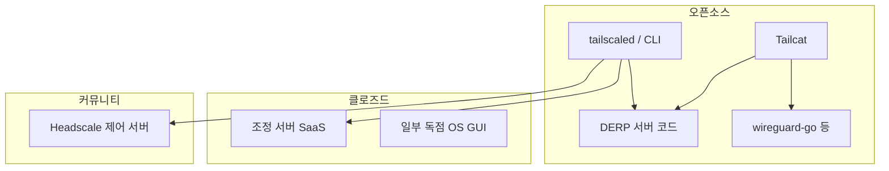

---

# 부록 C. Headscale 프로젝트 상세

공식: [github.com/juanfont/headscale](https://github.com/juanfont/headscale) · 문서 [headscale.net/stable](https://headscale.net/stable/) · 라이선스 **BSD 3-Clause**.

## C1. 존재 이유

Headscale은 Tailscale **제어 서버**의 자기호스팅 구현이다. 클라이언트가 쓰는 제어 프로토콜 표면을 받아:

- WireGuard 공개키를 노드 사이에 배포하고
- IP를 할당하며
- 사용자/노드 경계를 만들고
- 머신 공유·광고 라우트를 노출한다

설계 목표는 **단일 tailnet**, 개인·취미·소규모 오픈소스 조직이다. “Tailscale 엔터프라이즈 전체의 드롭인 대체”가 아니다.

## C2. 기능 매트릭스 (upstream features 페이지)

[Features](https://headscale.net/stable/about/features/)가 Tailscale 제어 서버와의 호환을 표로 정리한다. 요약:

**베이스·등록**

- Tailscale 기능의 full “base” 지원을 목표
- 노드 등록: 웹 인증, pre-auth key

**DNS**

- MagicDNS
- 전역·제한 네임서버(split DNS)
- search domains
- Extra DNS records (**Headscale only**로 표기)

**파일**

- Taildrive
- Taildrop

**라우팅**

- Tags
- Subnet routers
- Exit nodes
- Via를 통한 route filtering
- Dual stack IPv4/IPv6
- Ephemeral nodes

**중계**

- Embedded DERP server
- Peer relays

**정책**

- ACLs, Grants, 일부 Autogroups
- 서브넷/exit auto approvers
- Tailscale SSH
- Node attributes
- Tests / sshTests

**OIDC**

- 기본 등록, IdP 프로필 갱신
- **OIDC 그룹을 ACL에 쓸 수 없음** (문서가 명시)

**미완·이슈로 남은 것 (페이지에 이슈 번호와 함께)**

- Funnel (#1040)
- Serve (#1234)
- Network flow logs (#1687)

즉 “영상에서 말한 중개 기능 오픈소스화”는 맞지만, **Funnel급 공인 노출·일부 엔터프라이즈 관측**까지 완성했다고 읽으면 문서와 어긋난다.

## C3. 클라이언트 OS

[Clients](https://headscale.net/stable/about/clients/): 최근 Tailscale 클라이언트 10개 릴리스를 목표로 Linux, OpenBSD, FreeBSD, Windows, Android, macOS, iOS, tvOS를 지원한다고 적는다. Windows/macOS/iOS/Android/tvOS는 추가 설정·`/windows`·`/apple` 안내가 있을 수 있다.

## C4. 운영 철학 — 컨테이너·리버스 프록시를 권장하지 않음

README 강조: **리버스 프록시와 컨테이너로 Headscale을 돌리는 구성을 지원·권장하지 않는다.** Debian/Ubuntu DEB가 로컬 사용자·기본 config·systemd를 넣는 길을 공식 설치로 권한다. NixOS 모듈이 `nix/`에 있다.

요구 포트 재요약: 80(LE), **443 HTTPS**, 3478/udp(STUN, 임베디드 DERP), 9090(메트릭, 비공개).

## C5. CLI·설정 스케치

```bash
# 서비스 상태
sudo systemctl status headscale

# 사용자 생성 (서브커맨드는 버전에 따라 다를 수 있음 — --help 확인)
headscale users create alice

# pre-auth key 발급 후 클라이언트:
# tailscale up --login-server=https://headscale.example.com --authkey=...
```

```yaml
# config.yaml 개념 — 실제 키 이름은 설치한 버전의 config-example.yaml을 따를 것
server_url: https://headscale.example.com
listen_addr: 0.0.0.0:8080
metrics_listen_addr: 127.0.0.1:9090
database:
  type: sqlite
derp:
  server:
    enabled: true
    ipv4: 203.0.113.10
```

## C6. 발표·거버넌스

- FOSDEM 2026: complementary open source clone
- FOSDEM 2023: integration testing으로 Tailscale 재구현
- AI_POLICY.md, CONTRIBUTING.md, golangci-lint/buf/prettier 등 품질 게이트
- Tailscale 직원 유지자 기여는 다른 유지자 리뷰

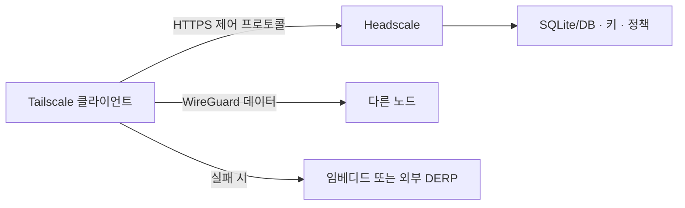

---

# 부록 D. Tailcat 프로젝트 상세

공식: [github.com/tailscale/tailcat](https://github.com/tailscale/tailcat) · [블로그 소개](https://tailscale.com/blog/tailcat) · WASM 데모 [tailscale.github.io/tailcat](https://tailscale.github.io/tailcat/).

## D1. 한 문장 정의의 무게

> remix of Tailscale open source pieces to act like netcat, but over Tailscale's data plane, without Tailscale's control plane

풀어 쓰면:

- **쓰는 것**: WireGuard userspace, magicsock, DERP, gVisor netstack
- **안 쓰는 것**: Tailscale 계정, 조정 서버, TUN, OS 라우팅/DNS 변경
- **대신 하는 것**: `tc…` 주소를 사람이 대역 외로 전달

루트가 필요 없다는 말은 “보안이 자동으로 강하다”가 아니라 **머신 전역 네트워크 네임스페이스를 안 건드린다**는 뜻에 가깝다.

## D2. 주소가 곧 능력이 되는 보안 모델

주소 CBOR 안:

- 서버 WireGuard 공개키
- path-discovery 공개키
- 기본 PSK (DERP 운영자가 공개키를 봐도 터널에 끼어들기 어렵게; 주소 비밀 유지 시 기록 트래픽에 대한 추가 보호; hybrid PQ 모드에서는 변형)
- DERP region 정수 또는 풀 메타데이터

공개 DNS에 올리면 인터넷이 그 PSK를 갖는다. 그때는:

- `serve --allow`로 클라이언트 노드 키 화이트리스트
- SSH는 `--ssh-authorized-keys` (또는 명시적 `no-auth-ssh`의 위험을 문서화)

`no-auth-ssh` README 경고: 주소를 아는 자는 서버 프로세스 유저로 셸을 얻는다.

## D3. 기능 표면 지도

| 영역 | 명령·모드 | 용도 |
|---|---|---|
| 파이프 | `tailcat` / `echo \| tailcat tc…` | netcat 대체 |
| 포트 | `serve 8080,8443` | 로컬 TCP를 터널로 |
| 매핑 | `serve 5555:10.x.x.x:5555` | LAN 일부만 프록시 |
| Unix 소켓 | `serve /run/app.sock` | 소켓 프록시 |
| 클라이언트 포워드 | `forward tc… 18080:8080` | 브라우저·DB 클라이언트가 로컬 포트 사용 |
| 브라우저 | `browse tc…` | forward+open |
| SSH | `serve … ssh` / `tailcat ssh` | 내장 SSH |
| 파일 | `recv`, `cp`, `serve files`, `ls` | SFTP 기반 |
| 벤치 | `perf` | iperf 유사 |
| inetd | `exec -- cmd` | 연결마다 명령 |
| 출구 | `serve exit-node` | 원격 네트워크로 포워드 |
| UX | `--qr`, `--full-address` | 콘솔·임베디드 DERP 정보 |
| 실험 | `--hybrid` PQ | 하이브리드 핸드셰이크 |
| 웹 | WASM 데모 | DERP만 (직접 연결은 WebRTC 이슈 #4) |

## D4. 라이브러리로 쓰기

`github.com/tailscale/tailcat`을 Go에서 import해 서버/클라이언트를 임베드할 수 있다. CLI는 `cmd/tailcat`이다. 에이전트·사이드카가 “임시로만 포트 하나를 열고 주소를 시크릿 스토어에 넣었다가 폐기”하는 패턴에 맞다.

## D5. DERP 맵

기본 맵 예: `https://tailcat.dev/derpmap.json` (README). 자체 derper로 바꾸면 속도 제한·위치를 통제한다.

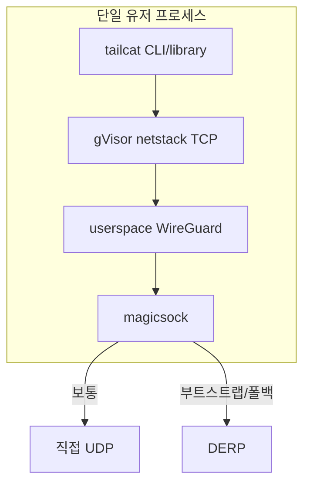

---

# 부록 E. 세 프로젝트를 한 표로 다시 쓰기

| 질문 | Tailscale 관리형 | Headscale | Tailcat |
|---|---|---|---|
| 누가 키 교환을 조율하나 | 회사 제어 평면 | 당신 서버 | 사람+`tc` 문자열 |
| 오픈소스 범위 | 클라이언트·DERP | 제어 서버 전체(해당 구현) | 데이터면 remix 전체 |
| ACL UI/정책 파일 | 풍부 | 지원(기능 표) | `--allow`·SSH 키 수준 |
| TUN/루트 | 흔히 사용 | 클라이언트 따름 | 불필요 |
| 다중 유저 조직 | 강점 | 단일 tailnet 범위 | 비목표 |
| Funnel급 공인 노출 | 제품 기능 | 이슈로 미완 표기 | 해당 없음(주소 공개가 유사 위험) |
| 탄소포집 상시 현장망 | 적합 후보 | 주권 요구 시 후보 | 출장 임시 터널 |
| 홈페이지 관리자만 | 적합 | 적합 | 비상 `forward` |

---

# 부록 F. 영상 논지를 기술 체크리스트로 변환

| 영상 주장 | 기술적으로 남는 문장 | 검증 시 볼 것 |
|---|---|---|
| 포트 열면 위험 | 공격면·패치 부담 증가 | 실제 열린 포트 인벤토리 |
| 홀펀칭으로 안 열어도 통신 | 상태형 NAT/방화벽 + 동시 UDP + 사이드 채널 | `tailscale status`의 direct/DERP |
| 설치·로그인하면 끝 | 제어 평면이 키·IP 배포 | 계정/헤드스케일 URL |
| 직접 가면 서버 안 거침 | 데이터면 P2P WireGuard | 패킷 캡처·status |
| DERP가 대안 | 암호화 중계, 속도 제한 가능 | DERP region·latency |
| Exit로 VPN | 출구 노드로 full tunnel | 라우팅 테이블·정책 |
| Headscale이 오픈소스 중개 | 제어 서버 자기호스팅 | features 매트릭스 |
| Tailcat이 미니멀 | 제어 평면 없는 데이터면 | README 보안 모델 |

---

# 부록 G. 참고 URL 확장

- [RFC 1918](https://www.rfc-editor.org/rfc/rfc1918)
- [How NAT traversal works](https://tailscale.com/blog/how-nat-traversal-works)
- [How Tailscale Works](https://tailscale.com/blog/how-tailscale-works/)
- [Open source at Tailscale](https://tailscale.com/opensource)
- [Headscale features](https://headscale.net/stable/about/features/)
- [Headscale clients](https://headscale.net/stable/about/clients/)
- [Headscale DERP](https://headscale.net/stable/ref/derp/)
- [Tailcat README](https://github.com/tailscale/tailcat/blob/main/README.md)
- [derper](https://github.com/tailscale/tailscale/tree/main/cmd/derper)
- WireGuard: [wireguard.com](https://www.wireguard.com/)


---

# 부록 H. 에이전트 교차검증으로 보강한 세부 (2026-11-25)

아래는 병렬 조사([Headscale](bb4b682c-8be9-42cf-9a36-ce99a6d33ca2), [Tailcat](93d3c7d6-ea4a-4f3d-ada9-a1a5b4f2719f), [Tailscale OSS](84da1ee7-1eda-426a-8f8a-c4632ed7f25b), [누락 개념](8d295e93-fb79-46d4-871f-6c57c3659c35))에서 나온 **공식 문서 근거**를, 앞 부록과 겹치지 않게 압축·교차검증한 결과다. 스타 수·내부 모듈 구조처럼 도구가 확인하지 못한 항목은 적지 않는다.

## H1. 본문에서 정밀화할 세 문장

1. **“양쪽이 거의 동시에 UDP를 보낸다”** — 핵심은 시계 동기화가 아니라, 상대 NAT/방화벽 필터가 열리도록 **양쪽이 서로의 주소로 먼저 패킷을 내보내는 것**이다. 더 중요한 전제는 매핑이 목적지에 따라 바뀌지 않는지(EIM)다 ([How NAT traversal works](https://tailscale.com/blog/how-nat-traversal-works)).
2. **“공유기 공인 IP”** — WAN에 보이는 주소가 공인이 아닐 수 있다(CGNAT). WAN IP와 `curl` 등으로 본 외부 IP가 다르면 포트 포워딩은 상위 NAT에서 끊긴다.
3. **“WireGuard: ChaCha20-Poly1305 등”** — WireGuard는 암호 스위트를 협상하지 않는 **고정 구성**이다. “등”보다 “Noise 기반 핸드셰이크 + ChaCha20-Poly1305 고정 스위트”가 정확하다 ([wireguard.com/protocol](https://www.wireguard.com/protocol/)).

## H2. NAT 매핑·필터링과 홀펀칭 성패 (이론 표)

고전 이름(Full/Restricted/Port-restricted/Symmetric)은 설명용이다. 표준 쪽은 RFC 4787 등의 **매핑 독립성(EIM 등)** 과 **필터링** 축이다.

| A \\ B | Full | Restricted | Port-restricted | Symmetric |
|---|---|---|---|---|
| Full | 원리상 가능 | 가능 | 가능 | 가능 |
| Restricted | 가능 | 가능 | 가능 | 원리상 가능 |
| Port-restricted | 가능 | 가능 | 가능 | **단순 방식 실패** |
| Symmetric | 가능 | 원리상 가능 | **단순 방식 실패** | **실패 → 릴레이** |

“가능”은 보장이 아니라 원리상 가능성이다. Hard↔Hard는 생일 역설식 포트 프로빙도 사실상 비현실적이라 DERP 폴백이 정답에 가깝다. Hard↔Easy는 한쪽에 포트 분산을 쓰면 확률이 오른다는 설명이 Tailscale 블로그에 있다 — **그 기법을 클라이언트가 항상 쓴다고 단정하지 말 것**.

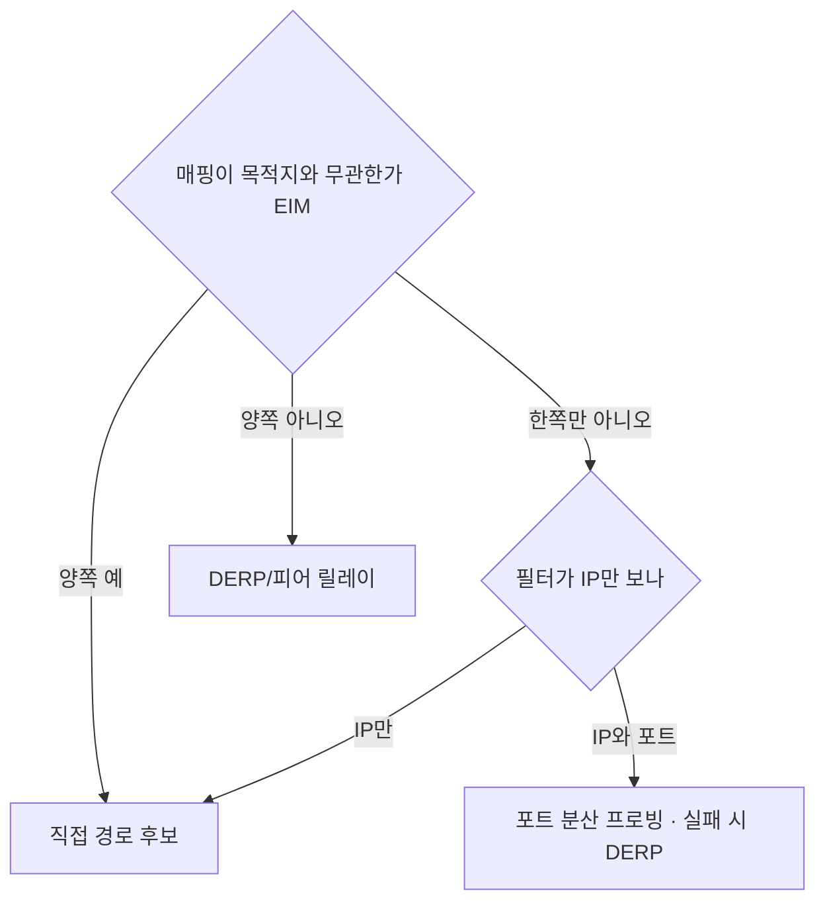

## H3. Serve vs Funnel — 구멍이 다시 생기는 제품 기능

| | Serve | Funnel |
|---|---|---|
| 범위 | **tailnet 안** | **공용 인터넷** |
| 기본 | 내부 HTTPS 등 | **기본 꺼짐**, 정책 `funnel` nodeAttr·승인 필요 |
| 상태(문서) | 일반 기능 | **베타** 표기 확인 필요(시점) |
| 포트 | 문서 기준 다양 | Funnel은 **443 / 8443 / 10000** 등으로 제한된다는 안내 |
| Headscale | Serve #1234 미완 | Funnel #1040 미완 |

오버레이 기사의 결론(“포트를 기본값에서 닫는다”)과 Funnel은 **반대 방향**이다. MagicDNS·HTTPS 인증서가 Funnel 전제인 경우가 많다 ([Funnel KB](https://tailscale.com/kb/1223/funnel), [Serve KB](https://tailscale.com/kb/1242/tailscale-serve)).

## H4. Headscale — 문서 버전·기능·운영 함정 보강

조사 시점 문서/릴리스 표기는 **0.29.x**(예: 0.29.7 보안 릴리스)를 가리켰다. `main`의 설정 예시는 미릴리스를 담을 수 있어 **설치한 태그**의 `config-example.yaml`을 쓴다.

### H4.1 기능 표에 적힌 “없는 것”

- Funnel, Serve, Network flow logs — 이슈로 미구현
- OIDC **그룹을 ACL에 사용 불가**
- `postures` / IP sets 등 일부 정책 블록 미지원(정책 문서)
- 설계상 **단일 tailnet**, 엔터프라이즈 멀티테넌시 비목표
- 성능보다 **정확성·SaaS 기능 패리티** 우선 (FAQ)
- 내장 웹 UI 없음 — 커뮤니티 UI는 비공인

### H4.2 라우트·등록

- 서브넷/exit는 **이중 옵트인**: 노드 광고 + 서버 승인 (`headscale nodes list-routes` / `approve-routes`)
- 웹 인증 또는 pre-auth key (`hskey-auth-…` 형식은 버전 노트에 등장)
- 태그 노드와 사용자 소유는 0.28+에서 상호 배타적 모델(“Tags as identity”)

### H4.3 운영 함정 (문서·FAQ)

- Cloudflare Proxy/Tunnel은 Tailscale 제어 프로토콜의 WebSocket POST와 충돌한다고 안내 (이슈 1468 맥락)
- Headscale 서버 자신을 같은 tailnet 노드로 쓰는 구성은 비지원에 가깝다
- DERP 기본 맵을 끄면 **단일 장애점**
- `dns.base_domain`은 `server_url` 도메인과 **달라야** 한다
- 마이너 버전 건너뛰기 금지(0.29+에서 강제에 가깝게)
- logtail(클라이언트→Tailscale Inc. 로그)은 Headscale이 기본으로 끄도록 안내
- 메트릭 `:9090`은 내부에만
- v0.29.7 등은 **보안 릴리스**: DoS급 findings·Tailscale 의존성 업데이트. **SSH 관련 수정은 노드의 `tailscaled` 업그레이드가 필요할 수 있음** — Headscale만 올려서는 안 닫히는 구멍이 있다

### H4.4 CLI 스케치 (버전마다 `--help` 확인)

```bash
headscale users create alice
headscale preauthkeys create --user <USER_ID>   # 플래그는 버전 확인
headscale auth register --user alice --auth-id <AUTH_ID>
headscale nodes list-routes
headscale nodes approve-routes --identifier 1 --routes 10.0.0.0/8
headscale policy check --file policy.json
headscale configtest
```

클라이언트 쪽:

```bash
tailscale up --login-server https://headscale.example.com --authkey hskey-auth-...
# Windows/macOS/iOS/tvOS/Android는 /windows · /apple · 대체 서버 UI 안내
```

SQLite 권장, Postgres는 레거시/유지보수 모드로 문서가 서술한다.

## H5. Tailcat — 제품이 아니라 “데이터면 remix”인 이유 보강

### H5.1 블로그가 나눈 Tailscale 네 조각

1. 데이터 평면 (WireGuard + NAT + DERP)
2. 제어 평면
3. 회사(운영·지원)
4. 오픈소스 코드

Tailcat은 **1+4**만 가져가고 2·3을 뺀다. 슬로건: “Tailscale without Tailscale, by Tailscale” ([블로그](https://tailscale.com/blog/tailcat), 2026-08 공개 계열).

### H5.2 SECURITY.md 위협 모델 (기사에 필수)

- Tailscale 코어(WireGuard/magicsock/DERP/netstack)는 프로덕션 컴포넌트다.
- **tailcat 래퍼는 초기 실험적 도구**로 서술된다.
- 원래 가정은 **양 끝을 같은 운영자가 통제**하는 경우다. 상호 불신 당사자 간 사용은 역사적 위협 모델 밖이었다.
- 따라서 신뢰하지 않는 상대에게 `no-auth-ssh`·쓰기 가능 파일·exit-node를 주거나, 그런 상대가 준 `tc…`를 검증 없이 받으면 안 된다.
- Hall of Thanks에 기록된 수정(쓰기 전용 recv의 덮어쓰기, 잘못된 주소를 ssh에 넘김, disco DoS, 노드키를 disco에 재사용 등)은 **요약만** 남기고 재현 절차는 적지 않는다.
- CLI/와이어 포맷 **안정성 약속 없음** (README Stability).
- 공용 Tailcat DERP는 SLA·처리량 목표가 없고 접근을 철회할 수 있다.

### H5.3 주소·키·인증 계층

```text
tc + base64(CBOR(
  WireGuard pubkey,
  path-discovery(disco) pubkey,   # 평문 disco에 WG 신원 숨김
  PSK 256-bit (기본),             # 주소=베어러; --psk=false는 구버전 호환·보호 약화
  DERP region id | full DERP blob
))
```

1. 주소 지식 (PSK)
2. `serve --allow=nodekey:…` — 목록 밖 Meow는 조용히 무시
3. `--ssh-authorized-keys` (파일 / 리터럴 / `user@github`)

```bash
# 임시 키(기본) — 프로세스 종료 시 주소 사망
tailcat

# 저장 키 + 고정 DERP 리전 (DNS 게시용)
tailcat genkey --key=default --fixed-region
tailcat serve --allow=nodekey:abcd... 22

# 클라이언트 키
tailcat genkey --client --key=client-default
tailcat ssh my-server.example.com   # TXT tailcat=tc...

# 실험적 PQ
tailcat serve --hybrid ...
```

DNS TXT에 올리면 주소가 전 세계에 공개된다. `tailcat ssh`는 DNS 목적지에 대해 **인증 없는 로그인이 되는지 사전 검사**하고, 되면 거절한다(`--skip-dns-safety-check`로 끌 수 있음).

### H5.4 Meow / Meowed 흐름 (README 표기)

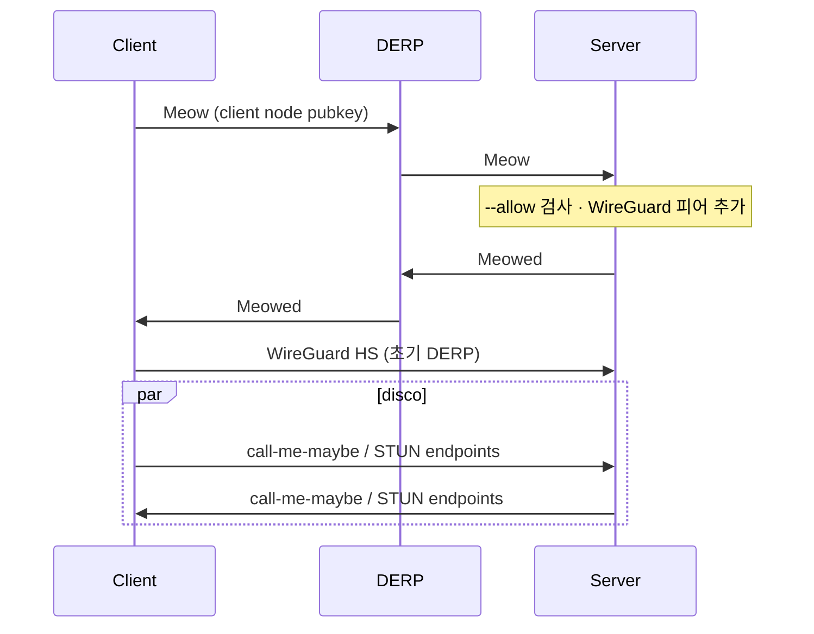

`perf`는 공유 DERP로 대역폭을 재지 않도록 **직접 경로를 기다렸다가**, Tailscale 공유 릴레이로의 처닝 테스트는 거부하는 설계가 README에 있다. 자체 DERP만 `--via-derp` 허용.

### H5.5 언제 쓰고 / 언제 쓰지 않는가

**적합:** 양쪽에 이미 셸이 있고 파일·포트·SSH만 빨리; 일회성·신뢰 경계가 애매한 샌드박스; AI 에이전트가 특수 하드웨어에 임시 접속; root/TUN 불가.

**비적합:** 상호 불신 양 당사자; 상시 ACL·SSO·감사; TUN 투명 라우팅; 공용 DERP로 대용량; “범용 보안 VPN” 마케팅.

기본 DERP 맵 예: `https://tailcat.dev/derpmap.json` (nyc/sfo/fra/tok 등 — 시점에 따라 변경).

## H6. Tailscale 오픈소스 지형 — 기능 vs 코드 공개

| 구분 | 내용 |
|---|---|
| 공개 | `tailscaled`/`tailscale` CLI, DERP(`cmd/derper`), Linux/Android GUI 쪽, 클라이언트 측 제어 프로토콜 구현 |
| 비공개 | **호스팅 조정 서버**, 일부 독점 OS GUI 래퍼 |
| 커뮤니티 | Headscale (제어 서버 재구현) |
| 데이터면 실험 | Tailcat |
| 관련 OSS | `tsnet`, `golink`, `tsidp`, `wireguard-go`(업스트림 후원), gVisor netstack 배선(`wgengine/netstack`) |

**제품 기능**(MagicDNS, Taildrop **알파**, Serve, Funnel **베타**, subnet/exit, Peer Relay ≥1.86 문서 기준)을 “전부 오픈소스 모듈”로 쓰지 말 것. 구현 공개 범위는 기능마다 **[미확인]**일 수 있다.

Peer Relay: 같은 tailnet 기기가 고속 릴레이. DERP를 **대체하지 않고** 협상·폴백은 DERP ([KB 1591](https://tailscale.com/kb/1591/peer-relays)).

서브넷 라우터 구간은 **레거시 LAN으로 복호화되어 나간다** — 종단 암호화의 예외. 점진 도입용이지 최종 목표 형태는 “가능하면 모든 노드에 에이전트”다.

## H7. Zero Trust 한 박스

NIST SP 800-207 의미의 Zero Trust는 제품명이 아니다. 오버레이는 **신원·노드 키·ACL로 노출면을 좁히는 구성요소**를 주지만, 기기 상태 연속 평가·앱 계층 인가·SIEM까지가 한 패키지로 끝나지 않는다. “오버레이 = Zero Trust 완성”과 “오버레이 = 그냥 VPN” 둘 다 과장이다.

## H8. 생태계 비교표 (추천 아님 · 시점 명시)

| | OpenVPN | WireGuard 단독 | Nebula | Netbird | ZeroTier | Tailscale |
|---|---|---|---|---|---|---|
| 기본 토폴로지 | 허브-스포크 | 수동 피어 | 메시+라이트하우스 | 메시 | 메시(L2 성격) | 메시 |
| 데이터면 | 자체/TLS | WG | Noise계 | WG | 자체 | WG |
| NAT 탐색 | 서버 공개에 의존 흔함 | **없음** | 라이트하우스 | ICE+시그널 | 루트 보조 | disco+DERP |
| 신뢰 앵커 | PKI/계정 | 운영자 수동 | **CA** | 관리서버+IdP | 컨트롤러 | 제어서버+IdP |
| 인바운드 | 서버 필요 | 최소 한쪽 | LH 필요 | 서비스측 | 홀펀칭 | 홀펀칭 |

라이선스·가격은 자주 바뀌므로 도입 전 공식 문서를 본다.

## H9. CGNAT·UPnP·IPv6 체크리스트 (현장용)

```bash
# 1) 공유기 WAN IP vs 외부 관측 IP
# 다르거나 WAN이 100.64.0.0/10·RFC1918이면 CGNAT/이중 NAT 의심

# 2) Tailscale 경로
tailscale status
tailscale ping <peer>
tailscale netcheck   # MappingVariesByDestIP 등 — 항목은 버전차

# 3) UPnP/NAT-PMP: LAN 앱이 연 구멍 인벤토리
# 오버레이 전환 후에도 불필요한 매핑이 남았는지 확인
```

IPv6 FAQ 한 줄: **NAT가 없어도 CPE 방화벽은 인바운드를 막는다**(RFC 6092/7084 계열). 핀홀 = IPv6판 포트 포워딩. 오버레이는 IPv6 직접 경로를 **후보로 쓰면서** 신원·ACL·안정 주소를 얹는다.

## H10. 탄소포집·홈페이지 적용 시 추가 질문

1. Funnel/공인 Serve를 켜 둘 업무가 있는가? 있다면 오버레이의 “포트 최소화” 서약과 충돌한다.
2. Headscale을 쓸 경우 Cloudflare 뒤 배치·서버 자신 join·DERP 단일화 함정을 운영 문서에 적었는가?
3. Tailcat으로 임시 지원할 때 SECURITY.md 가정(양끝 동일 운영자)을 지키는가?
4. 서브넷 라우터로 PLC망 전체를 광고하면 암호화 경계가 어디인가?
5. exit node로 연구 트래픽을 보내면 데이터 거점 국가가 바뀌는가?

---

# 부록 I. 조사 한계와 단정 금지

- GitHub 스타 수·내부 `hscontrol` 모듈 맵은 이번 교차검증에서 신뢰할 수치/도면으로 쓰지 않았다.
- Funnel/Serve/Taildrop의 **문서상 알파·베타** 표기와 최소 클라이언트 버전은 시점 의존 — 도입 직전 KB의 Last validated를 본다.
- Tailcat v0.x 와이어 포맷은 깨질 수 있다.
- NAT 성패 표는 이론 모델이다.
- 국내 ISP의 CGNAT·포트 차단은 사업자·상품별로 다르므로 **진단 절차**만 권한다.
