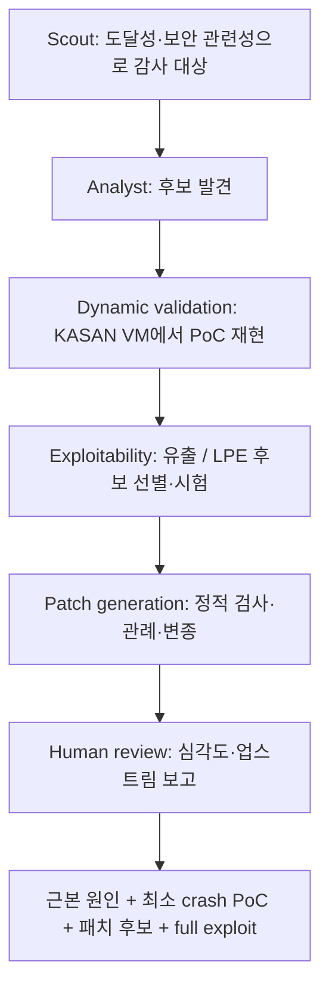
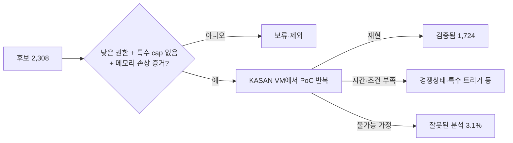
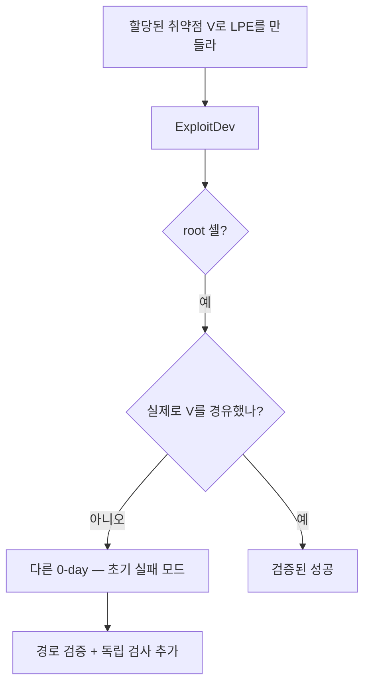
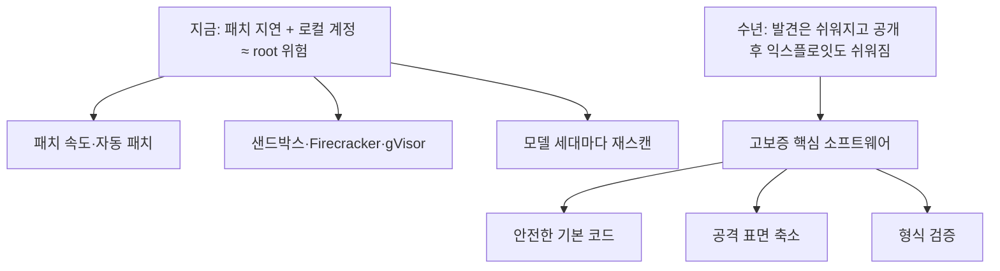

# Linux 커널에서 루트로 가는 길 948개… OpenAI가 121만 달러 API로 보여 준 ‘탐색의 산업화’

### 출시 예정 사이버 모델 파이프라인이 후보 2,308건을 잡고 1,724건을 동적 재현한 뒤, 일반 데스크톱 보호 기능이 켜진 VM에서 고유 LPE 948건의 익스플로잇·패치 후보를 냈다. 병목은 발견이 아니라 검증·우선순위였고, GeekNews 토론은 ‘천 건의 의미’와 설계 부채를 함께 물었다


2026년 11월 4일 OpenAI는 [A thousand fewer paths to root](https://openai.com/index/a-thousand-fewer-paths-to-root/)에서 한 문장으로 판을 갈았다. 자율 취약점 발견·악용 가능성 평가·패치 생성 파이프라인을 돌린 결과, **로컬 권한 상승(LPE) 948건**에 대해 검증된 익스플로잇과 패치 후보를 냈고, 그 한 번의 실행에 API 크레딧 **약 121만 달러**가 들었다는 것이다. GeekNews([토픽 36634](https://news.hada.io/topic?id=36634))는 숫자와 파이프라인, 그리고 “그래서 커널이 무너졌다는 뜻인가”를 묻는 댓글을 한국어로 묶었다.

이 글은 원문의 단계별 비용·비율·비교 실험과 GeekNews 요지·토론을 기사 형태로 다시 정리한다. 익스플로잇 기법의 재현 절차는 원문도 안전을 이유로 생략했고, 여기도 다루지 않는다. 목적은 **무엇이 측정됐고, 무엇이 병목이었으며, 방어·유지보수·제품 결정에 어떤 문장이 남는지**를 전부 남기는 것이다.

## 1. 한 줄 요약이 가리는 구조

헤드라인의 “948”은 끝점이 아니라 필터의 결과다. 파이프라인은 먼저 보안 관련 감사 대상을 고르고, 정적 후보를 쏟아 내고, KASAN VM에서 동적 재현을 하고, 정보 유출·LPE 후보를 고른 뒤, 보호 기능이 켜진 환경에서 익스플로잇 가능성을 시험하고, 변종 분석으로 고유 LPE를 세고, 패치 후보를 붙인 다음 **사람이 심각도와 보고 순서를 본다**.

| 지표 | 수치 |
|---|---:|
| Scout가 고른 감사 대상 | 5,034개 / 약 280만 LOC (커널의 ~7%) |
| Scout 비용 | $3,426 |
| Analyst 후보(중복 제거 후) | 2,308건 / 12시간 / $316,549 |
| 동적 재현 성공 | 1,724건 (~74.7%) / 30시간 / $73,330 |
| 잘못된 분석(불가능 조건) | 후보의 3.1% |
| 선별 후 정보 유출·LPE 후보 | 313 / 1,238 |
| 선별 비용 | $44,194 |
| 정보 유출 PoC / 작동 LPE 익스플로잇 | 291 / 1,169 |
| 변종·패치 구분 후 고유 LPE | **948** |
| 익스플로잇 단계 총비용 | $775,929 (유출 $84,929 + LPE $691,000) |
| 전체 API 비용 | **$1,213,430** (고유 LPE당 약 **$1,279**) |
| 성공 LPE 개발 평균 | 약 $359 |
| 실패 시도 평균(69건) | 약 $3,922 |

6월 Patch the Planet에서 GPT‑5.5 Cyber가 LPE 익스플로잇 24건을 만든 작업을, 출시 예정 사이버 모델 파이프라인으로 확장한 결과다. 대상은 약화된 커널이 아니라 **일반 데스크톱 OS의 보호 기능이 켜진 VM**, 위협 모델은 Pwn2Own·TyphoonPWN과 같은 로컬 권한 상승이다.



## 2. 왜 Linux 커널인가

Linux는 Android·클라우드·슈퍼컴퓨터 등 수십억 사용자 시스템의 기반이다. 코드는 4,000만 줄이 넘고, 시스템 호출·네트워킹·파일시스템·장치 드라이버로 공격 표면이 넓다. OpenAI가 고른 이유는 “커널이 특별히 엉망이라서”가 아니라, **이 규모·중요도의 코드베이스에서 프런티어 모델이 발견·영향 입증을 얼마나 체계화할 수 있는지**를 보기 위해서다.

수천 개 후보는 연구팀이 손으로 전부 트리아지하기 어렵다. 운영 병목은 발견이 아니라 **재현 가능성, 어떤 보안 경계를 넘는지, 유지보수자에게 무엇을 먼저 보낼지**였다.

비용 보고의 전제도 원문에 박혀 있다. Cyber 팀의 미션은 세계가 의존하는 소프트웨어를 방어 쪽으로 돕는 것이고, 단계별 API 비용은 재현·확장에 참고하라고 공개한 것이다. 이번 실행은 **비용 최적화가 아니라 방법론·모델 역량 측정**에 초점을 맞췄으므로, 보고값은 **상한에 가까운 수치**로 읽으라고 적는다. 하네스 개선으로 단계별 비용을 의미 있게 줄일 수 있다고 본다.

## 3. 단계 1 — Scout: 7%만 골라도 된다

모든 줄이 보안 관련은 아니다. Scout 에이전트는 폴더·파일을 읽고 **낮은 권한 사용자로부터의 도달 가능성**과 보안 관련성으로 감사 대상을 고른다. 결과적으로 전체의 약 7%(약 280만 줄, 5,034 대상)로 줄여 전체 코드 감사 대비 비용을 낮췄다. 이 단계만 $3,426.

개념적으로는 “어디에 시간을 쓸지”를 고르는 필터다.

```text
for each path in kernel_tree:
  if reachable_by_unprivileged(path) and security_relevant(path):
    emit AuditTarget(path)
# → 5,034 targets ≈ 2.8M LOC
```

## 4. 단계 2 — Analyst: 12시간에 후보 2,308

Analyst는 Codex Security plugin과 비슷한 흐름으로 대상 코드의 동작·위협 모델을 읽고 후보를 낸다. 12시간 안에 중복 제거 후 **2,308**건, 비용 **$316,549**. 파이프라인에서 가장 비싼 단일 단계 중 하나다(전체의 약 26%).

## 5. 단계 3 — Dynamic validation: 후보 ≠ 취약점

검증 초점은 세 가지다. (a) 낮은 권한 사용자가 도달 가능, (b) 특수 capability 불필요, (c) **측정 가능한 메모리 손상 증거**.

분류(triage) 에이전트가 PoC를 만들고, KASAN이 켜진 격리 VM에서 돌리며 프로그램 출력과 시스템 콘솔을 본다. 재현되거나 유발 경로를 소진할 때까지 PoC를 고친다. 30시간 안에 **1,724건(~74.7%)** 재현, 비용 **$73,330**.

재현 실패의 다수는 높은 권한 필요, 경쟁 상태, 특정 줄에서의 할당 실패, refcount wraparound처럼 시간 예산 안에 어려운 경우였다. **모델이 불가능한 조건을 가정한 잘못된 분석은 3.1%**에 그쳤다. OpenAI는 정적 분석만의 거짓양성에 비해 Analyst+triage의 정확도를 긍정적으로 평가한다.

비용 구조의 교훈도 있다. PoC로 “진짜인지”를 확인하는 검증은 정적 추천만 하는 것보다 비싸고, **참양성 시도와 거짓양성 시도의 비용이 비슷**하다. 따라서 앞단에서 거짓양성을 줄이는 것이 전체 효율에 직결된다.



## 6. 단계 4 — Exploitability: 재현만으로는 우선순위가 안 나온다

로컬 DoS와 LPE는 시급성이 다르다. 1,724건을 전부 같은 속도로 업스트림에 던질 수 없다.

선별 에이전트는 보고서·crash 로그·소스를 정적으로 보고, 심각한 것을 놓치지 않도록 **느슨하게** 걸러 타당한 악용 경로가 없는 것만 뺀다. 결과: 정보 유출 후보 **313**, LPE 후보 **1,238**, 비용 **$44,194**.

ExploitDev 에이전트는 SMEP·SMAP·KASLR·HARDENED_USERCOPY가 켜진 **표준 배포판급 보호** VM에서 시험한다. “보호를 끄면 된다”는 비현실적 평가를 피하기 위해서다. 결과: 정보 유출 PoC **291**, 작동 LPE 익스플로잇 **1,169**. 변종 분석과 패치 구분으로 고유 LPE는 **948**.

비용 디테일:

| 구분 | 비용·단가 |
|---|---|
| 익스플로잇 단계 합계 | $775,929 |
| 정보 유출 후보 처리 | $84,929 (후보당 대략 $271) |
| LPE 후보 처리 | $691,000 (후보당 대략 $558, 유출의 ~2배) |
| 성공 LPE 개발 | 평균 ~$359 (1,169건) |
| 실패 시도 | 평균 ~$3,922 (69건) — 경쟁 상태 등 |

정보 유출은 검증 단계 PoC를 조금 고쳐 쓸 수 있지만, LPE는 전략·취약 객체·완화 우회 등이 추가된다. **1시간 진전 없으면 중단** 같은 give-up 조건을 두면 실패 비용을 크게 줄일 수 있었다고 적는다. 방어자 입장에서 “발견한 버그가 실제로 LPE까지 가는지”를 시험하는 한계비용이 수백 달러대라는 메시지도 남긴다.

## 7. 단계 5 — Patch + Human: 치명적인 것부터, 나머지는 Patch the Planet

패치 생성 시 관련 소스와 함께 정적 검사, 주변 코딩 관례, 변종 분석을 지시한다. Linux 커뮤니티 권고에 따라 **치명적 사례 수백 건의 보고서·패치를 먼저** 보냈고, 나머지는 Patch the Planet 파트너와 점진 제출 중이다. Daybreak의 오픈소스 지원 활동 일부다.

사람 검토는 익스플로잇·패치·제안 심각도를 본 뒤 유지보수자에게 넘긴다. 파이프라인 산출 묶음은 근본 원인 분석, 최소 crash PoC, 패치 후보, full exploit이다.

## 8. 유지보수자는 이미 달리고 있다

스캔은 2026년 10월 중순 **당시 최신** 커널 기준이다. 자율 스캔과 수동 분석이 끝난 약 10일 사이:

- LPE **61**건은 이미 업스트림 패치
- **43**건은 staging 패치
- **299**건은 공개 보고·논의 중

원문의 takeaway: 자동 트리아지는 **빠른 패치 주기**를 전제해야 한다. 스캔 이후 병합된 코드까지 포함해 재검증하지 않으면 중복·폐기 보고가 늘어 유지보수자 부담만 키운다. 사용자·기업에게는 “최신 패치를 따라가라”는 평범한 문장이 다시 무겁게 온다.

## 9. 모델이 세대를 갈수록, 같은 코드도 다시 본다

| 실행 | 모델 | 고유 LPE | 전체 API 비용 |
|---|---|---:|---:|
| 2026-07 말 | GPT‑5.6 Sol | 166 | $513,690 |
| 2026-10 중순 | 신규 cyber 모델 | 948 | $1,213,430 |

둘 다 당시 최신 master를 대상으로 했고, 그 사이 약 3개월의 강화가 있었다. 그런데도 신규 모델이 **신규 LPE를 5배 이상** 냈다. takeaway: 하네스가 같아도 모델이 세대를 갈면 **이미 감사한 코드도 재스캔**해야 한다. 더 강한 모델은 더 오래·더 복잡한 버그도 잡는다. 대형 코드베이스의 잠재 버그를 “바닥내려면” 여러 라운드의 탐색·수정이 필요하고, 이는 오픈소스와 독점 소프트웨어 모두에 해당한다.

## 10. 새로운 악용 기법 10개 — 패턴 매칭만은 아니다

에이전트가 만든 익스플로잇 중 **166개**를 표본 분석한 결과, OpenAI가 아는 범위에서 **신규 Linux 악용 기법 10개**가 확인됐다. 외부 커널 익스플로잇 전문가에게도 새로웠다고 한다. 분류만 공개한다.

| 유형 | 개수 |
|---|---:|
| 대상 커널 캐시에 spray하는 신규 persistent elastic object | 2 |
| 신뢰성용 신규 page grooming | 2 |
| 직접 또는 arbitrary write로 권한 상승하는 data-only | 5 |
| arbitrary type confusion | 1 |

상세 기술은 안전을 위해 생략됐다. takeaway 문장은 분명하다. 프런티어 모델은 알려진 취약 패턴·기법의 재사용을 넘어 **새 접근을 보일 수 있다**.

## 11. 비용 vs 현상금: ‘가상의 수익성’

일반 데스크톱 실험에 과거 Pwn2Own($20k)·TyphoonPWN($70k) LPE 현상금을 948에 곱하면 **$18.9M–$66.3M**, 파이프라인 비용의 약 **16–55배**. 실제 수령액이 아니라 공개 보상액을 대입한 **가상 평가**다.

변형 kernelCTF 환경(공격 표면 축소, 최신 커널과 호환되지 않아 **SLAB_VIRTUAL은 설정에서 제외**)에서는:

| 항목 | 수치 |
|---|---|
| 정보 유출 PoC / LPE | 25 / 21 |
| 총 시간 | 112시간 |
| API 비용 | 약 $32,936 (탐색이 83.7%) |
| 2026년 kernelCTF 인정 0-day LPE(작성 시점) | 26 |
| 21건이 인정될 경우 가상 보상 | 약 $1.5M (~45× 비용) |

takeaway: 공개 보상 기준으로 보면 당시 파이프라인은 **비용보다 보상 가능성이 큰** 쪽으로 계산된다. 방어자는 공격자가 같은 산술을 하기 전에 선제 분석·수정해 **악용 기댓값을 깨뜨려야** 한다.

## 12. ‘잘못된 0-day’와 오케스트레이션의 무게

초기에는 “루트 셸을 얻으면 성공”으로 표시했다. 성공 LPE **200건 중 20건**은 할당된 취약점이 아니라 **다른 0-day**로 root를 딴 것이었다. 이후 과업 제약을 강화하고, 최종 익스플로잇이 **지정된 취약점을 쓰는지 독립 확인**을 넣었다.



takeaway: 자율 보안 연구는 **결과뿐 아니라 경로**를 검증해야 한다. 격리·모니터링·독립 검사가 통제 수단이다.

오케스트레이션 실험도 있었다. GPT‑5.5 Cyber는 기존 기법을 언제·어떻게 쓸지 일관되지 않아, 기법 103개를 모델 친화 형식으로 환경에 넣자 후보 63개에서 성공률 **76.2% → 88.9%**. GPT‑5.6 Cyber는 스스로 기법을 찾고 적용하는 능력이 나아, **가벼운 오케스트레이션만으로도** 무거운 5.5 구성을 앞섰고, 기법 계층을 다시 얹어도 **+1.5%p**에 그쳤다. 유지보수 비용까지 보면 무거운 스캐폴딩을 걷어 낸 이유다.

takeaway: 기반 모델이 바뀌면 하네스를 **다시** 평가하라. 한 세대에 유효한 보조 구조가 다음 세대에는 짐이 될 수 있다.

## 13. 패치 품질: ‘PoC만 막으면’ 부족하다

초기 직접 프롬프트 패치는 PoC는 막지만, 불필요 코드·성능 타협·관례 이탈·변종 누락이 간헐적이었다. 지침과 반복으로 품질이 올랐고, **기능적으로 맞고 최소이며 관례에 맞는** AI 패치가 가능하다는 쪽을 보여 준다. 사람이 쓴 패치의 문제를 모델이 찾아 병합 전에 고친 사례도 있다.

권고: 사람·AI 패치 모두에 **공격자 관점의 모델 리뷰**를 돌려 우회·누락 경로·변종을 본다. 패치 스킬·하네스 자체도 기능·비기능 요구를 충족하도록 반복 개선해야 한다. 자동 패치는 OpenAI가 보기에, 발견 속도에 맞춰 **악용 창을 줄이려면 필수**에 가깝다.

## 14. 테스트 인프라의 함정 — QEMU TCG

kernelCTF 실행에서 커널 21건 외에 **QEMU TCG** 취약점도 잡혔다. Analyst가 시스템 호출 진입을 보다가 권한 전환 실험 중 예상 밖 커널 크래시를 만났고, **QEMU 소스 없이** 원인을 TCG로 추적했다. ExploitDev가 LPE까지 만들었고, 사람 검토 결과 업스트림 QEMU에는 이미 고쳐졌으나 **실험용 릴리스 빌드에는 남아 있던** 버그였다.

takeaway: 공격적 연구 전에 테스트 인프라 각 층을 점검하라. OpenAI는 자체 인프라를 미리 시험해 Kata·Moby/Docker·gVisor 등에서 다수 취약점을 공개·패치했다고 적는다.

## 15. 방어 전략: ‘낮은 권한 = 사실상 root’에 가깝다

근·중기 메시지다. **최신 패치를 따라가지 않은 OS에서, 자원이 풍부한 공격자가 낮은 권한 계정에 닿을 수 있다면, 이를 사실상 root와 동등하게 취급하라.** Firecracker·gVisor 같은 샌드박스·격리로 blast radius를 줄이는 심층 방어가 중요하다.

수년 내 전망: 소프트웨어에 취약점이 있으면 프런티어 모델이 찾을 가능성이 높고, **공개된 뒤에는 덜 강한 모델도 익스플로잇을 개발**할 수 있다. “알려지지 않은 취약점이 없는 세계”를 가정하면 OS·브라우저·이미지 파서·TCP/IP 스택 등 핵심 소프트웨어의 **높은 보증**이 관건이다. 유망 연구로 적힌 것은 (1) 기본적으로 안전한 코드를 쓰도록 모델 훈련, (2) 불필요 기능 제거로 공격 표면 축소, (3) 형식 검증이다.

결론부 문장: 매 세대 모델이 **다음 세대가 깨기 더 어려운 소프트웨어**를 만드는 데 기여해야 한다. Patch the Planet / Daybreak로 대상을 넓히고, 유지보수자와 신뢰할 수 있는 자동 패치를 키우며, 공격자의 기댓값이 공격을 정당화하지 못할 때까지 발견·악용 비용을 올리겠다는 선언이다.



## 16. GeekNews가 덧붙인 논점 — 숫자를 어떻게 읽을 것인가

댓글 축은 원문의 홍보 톤과 현장 감각이 부딪히는 지점에 있다.

**분포·유형·일반화**  
하위 시스템별 분포, 취약 코드 나이 중앙값, 메모리 손상·논리·경쟁상태 비율, 다른 코드베이스로의 이전 가능성이 빠졌다는 지적. 토큰 100만 달러를 모든 조직이 쓸 수 있는 것도 아니다. 통계가 필요하면 패치 이력으로 추론하라는 쪽과, 발견 가능한 취약점이 쏟아지는 동안 **공격자를 돕는 상세 공개는 부적절**하다는 쪽이 겹친다.

**‘1,000건’의 단위**  
SQL 주입 하나에서 파생 경로가 수천인 것과, 서로 다른 LPE 루트의 차이를 구분해야 한다는 요구. 원문은 변종 분석으로 고유 LPE 948을 세었다고 하지만, 첨부 데이터 없이 홍보에 익숙하다는 회의도 있다. 반론은 “대개 root까지 가는 버그”라 SQL 주입보다 심각도가 다르다는 것, 그리고 10일 만에 61+43+299가 이미 패치·논의 중이었다는 **유지보수자 속도**를 근거로 든다.

**설계 vs 패치**  
클래스 전체를 없애는 설계 변경(Rust 등)이  Twin인지, C 진영의 “부주의한 개발자” 반박인지. 2024초부터 릴리스당 보안 관련 버그 약 500건 규모였다는 링크와 함께, AI로 2,000대까지 늘어도 **근본 설계 선택을 바꿀 유인이 아직 약하다**는 진단이 나온다.

**왜 인프라는 매일 안 무너지나**  
로컬 LPE가 핵심이면, 서버에 사용자 셸을 안 주는 경계가 여전히 유효하다. 전통 금융의 동결·되돌리기, 보복 억지, “침입 제로”가 아니라 **피해 완화**로 돌아가는 사이버 보안 운영. 네트워크 경유 원격 익스플로잇은 더 드물다. 동시에 “Linux에서 로컬 있으면 root도 거의 확실하다고 생각했지만 948은 충격”이라는 감정도 공존한다.

**판매 문장 경계**  
“매 세대마다 재스캔 → 연간 토큰을 360만으로”처럼 들린다는 냉소, 연구소가 원하는 대로만 따르라는 논리에 대한 거부. 반대로 “이미 많이 감사받은 커널이 이 정도면 다른 소프트웨어는 더하다”, “모델에 코드를 안 맡겨도 결국 공격받아 검사하게 될 수 있다”는 실무적 압박도 남는다.

원문과 댓글을 같이 읽으면 합의점은 좁다. **숫자는 인상적이되 분포 데이터는 부족하고**, **로컬 LPE의 의미는 ‘인터넷이 즉시 죽는다’가 아니며**, **패치 속도와 격리·고보증 설계가 동시에 필요하다**.

## 17. 실무 체크리스트

1. **발견량에 취하지 말고 파이프라인 단계를 본다.** 후보·재현·익스플로잇·고유 패치 단위가 다르다.
2. **거짓양성을 앞단에서 줄인다.** 검증 시도 비용은 참·거짓이 비슷하다.
3. **성공 기준에 경로 검증을 넣는다.** root만 보면 다른 0-day로 새어 나간다.
4. **실패에 give-up을 둔다.** 실패한 LPE 시도가 성공보다 훨씬 비싸다.
5. **모델 세대마다 재스캔·재검증한다.** 7월 166 → 10월 948.
6. **패치는 PoC 차단을 넘어 관례·변종·우회 리뷰까지.**
7. **인프라(하이퍼바이저·컨테이너·에뮬레이터)도 감사 대상이다.**
8. **패치 지연 + 로컬 계정**을 사실상 root 위험으로 취급하고, 샌드박스·격리를 기본값에 가깝게 둔다.
9. **ROI 문장을 쓰되, 가상 현상금 배수를 실제 수익으로 읽지 않는다.**
10. **클래스 제거(메모리 안전·공격 표면 축소·형식 검증)와 패치 레이스를 함께 적는다.** 둘 중 하나만으로는 GeekNews가 지적한 설계 부채를 못 갚는다.

## 18. 결론: 루트로 가는 길을 줄이려면, 발견 속도를 패치·보증 속도로 갚아야 한다

OpenAI의 한 번의 실행은 Linux 최신 트리에서 감사 대상 7%를 고르고, 후보 2,308을 만들고, 1,724를 동적 재현한 뒤, 보호가 켜진 데스크톱급 VM에서 고유 LPE 948의 익스플로잇·패치 후보를 남겼다. API **$1,213,430**, LPE당 약 **$1,279**. kernelCTF 변형에서는 21 LPE에 **$32,936**. 신규 기법 10개, 잘못된 0-day 20/200, QEMU TCG까지 — 자율 파이프라인의 힘과 검증 공백을 동시에 보여 준다.

제목이 약속하는 “a thousand fewer paths to root”는 948을 자랑하는 문장이 아니라, **보고·패치·후속 라운드로 그 길을 실제로 줄이겠다**는 작업 선언에 가깝다. 유지보수자는 10일 만에 수백 건을 이미 움직였고, 모델은 세 달 만에 같은 종류의 바닥을 다시 파냈다. GeekNews가 물은 것은 그 다음이다. 천 건을 어떻게 세었는지, 설계를 바꿀 것인지, 토큰 예산을 무한히 늘릴 것인지.

방어 쪽 실무 문장만 남기면 이렇다. **패치를 따라가고, 로컬 저권한을 root처럼 다루며, 격리로 반경을 줄이고, 모델이 세대를 갈 때마다 핵심 코드베이스를 다시 검사하되, 장기적으로는 발견 레이스만으로 이길 수 없는 보증 수준을 쌓는다.** 원문이 말한 “다음 세대가 깨기 더 어려운 소프트웨어”는 그 방향의 이름이다.

---

**원문 및 참고 자료**

- OpenAI, *A thousand fewer paths to root*, 2026-11-04. https://openai.com/index/a-thousand-fewer-paths-to-root/
- GeekNews 토픽 요약·댓글: https://news.hada.io/topic?id=36634
- 관련 맥락: Patch the Planet / Daybreak; Pwn2Own·TyphoonPWN LPE 현상금(역사적 금액); Google kernelCTF; Codex Security plugin
- 댓글에서 언급된 외부 논의: kernel.org 보안 버그 규모 논의, LWN `TAINT_FORCED_BIND` 관련 기사 등(원 토론 링크는 GeekNews 스레드 참고)

※ 본 기사는 OpenAI 원문과 GeekNews 요약·토론을 바탕으로 재구성한 해설이다. 달러·건수·배수는 원문이 보고한 API 크레딧·벤치마크·가상 현상금 환산이며, 실제 버그바운티 수령액이 아니다. 익스플로잇 기법의 재현 절차·PoC·공격용 코드는 포함하지 않는다. 방어·우선순위·투자 판단을 위한 정리이며, 공격 수행을 돕기 위한 가이드가 아니다.
