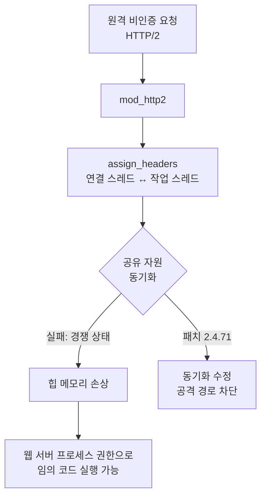
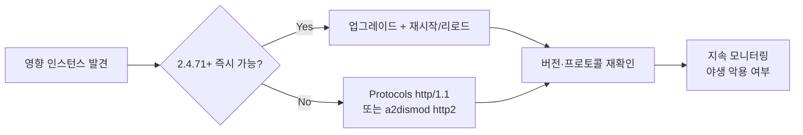

# Apache HTTP Server HTTP/2 모듈의 치명적 RCE… CVE-2026-119618이 가리킨 ‘인증 없는 경쟁 상태’

### Anthropic·Google Cloud가 독립 제보한 `mod_http2`의 `assign_headers()` 레이스. Wiz는 클라우드 환경의 64%에서 영향 버전 리소스를, 51%에서 공개 인스턴스를 집계했다. 패치는 2.4.71, 당장 못 올리면 HTTP/1.1로 프로토콜을 조이면 된다


2026년 11월 11일 Wiz는 [Critical RCE Vulnerability in Apache HTTP Server](https://www.wiz.io/blog/cve-2026-119618-rce-apache-http-server-vulnerability)에서 Apache HTTP Server의 HTTP/2 모듈(`mod_http2`)에 인증 없는 원격 코드 실행으로 이어질 수 있는 결함 **CVE-2026-119618**을 정리했다. GeekNews([토픽 37046](https://news.hada.io/topic?id=37046))는 원인·영향 버전·완화책과 댓글 토론을 한국어로 묶었다.

이 글은 Wiz 원문과 GeekNews 요지·토론을 기사 형태로 다시 정리한다. **힙 손상 재현 입력, 익스플로잇 절차, 페이로드 구성은 적지 않는다.** 목적은 무엇이 깨졌는지, 누가 영향받는지, 패치·임시 완화·인벤토리 점검에 어떤 문장이 남는지를 남기는 것이다.

## 1. 한 줄 요약이 가리는 구조

헤드라인의 “치명적 RCE”는 결과다. 출발점은 HTTP/2를 켠 Apache가 요청 헤더를 연결·작업 스레드 사이에서 나눌 때의 **동기화 실패**다. `assign_headers()`가 공유 자원을 동시에 다루면서 힙이 깨질 수 있고, 그 손상이 웹 서버 프로세스 권한의 임의 코드 실행으로 이어질 수 있다는 보고다.

공개 시점 기준으로 Wiz는 **야생 악용 보고는 없다**고 적었다. GeekNews는 실험 환경에서 힙 손상을 확인하는 PoC가 공개됐다고 전하지만, 그 재현물을 여기로 옮기지 않는다.

| 항목 | 내용 |
|---|---|
| CVE | CVE-2026-119618 |
| 제품 | Apache HTTP Server (`mod_http2`) |
| 원인 위치 | `assign_headers()` 경쟁 상태 |
| 발견 | Anthropic OSS Scanner, Google Cloud Vulnerability Research (독립 제보) |
| 영향 버전 | httpd **2.4.55 ~ 2.4.70** (HTTP/2 사용 시) |
| 수정 버전 | httpd **2.4.71+** |
| 단독 `mod_h2` | **2.0.8 ~ 2.0.42** 영향, 패치된 빌드로 교체 |
| 인증 | 불필요 (원격·비인증) |
| 성공 시 권한 | 웹 서버 프로세스 권한 |
| Wiz 클라우드 집계 | 영향 버전 리소스 **64%**, 공개 인스턴스 **51%** (설정·HTTP/2 여부 미반영) |



## 2. 왜 Apache HTTP/2인가

Apache httpd는 여전히 웹의 큰 축이다. GeekNews 토론은 “요즘은 nginx만 쓴다”는 통념과 달리, 공개 통계상 상당수 사이트가 Apache를 쓰고 Nginx 뒤에서 Apache를 돌리는 구성도 흔하다고 지적한다. `.htaccess`, 무료 OIDC 모듈, PHP 레거시 이전 같은 이유로 **httpd는 아직 현역**이다.

HTTP/2는 다중 스트림·헤더 압축으로 지연을 줄이지만, 구현 복잡도를 올린다. 이번 결함은 “HTTP/2가 나쁘다”는 선언이 아니라, **동시성 경계가 틀리면 웹 서버 전체가 RCE 표면이 된다**는 사례다. 댓글 중 일부는 HTTP/2 자체를 후회했고, 다른 쪽은 고지연 링크·다수 소파일 사이트에서 체감 이득이 컸다고 반박했다. 운영 결론은 철학 논쟁이 아니라 **버전과 Protocols 설정**이다.

클라우드에서는 침해된 Apache가 컨테이너·VM 안에서 옆 마이크로서비스나 **메타데이터 엔드포인트**로 이어질 수 있다. Wiz가 64%/51%를 강조한 이유다. 다만 그 숫자는 HTTP/2 활성 여부를 반영하지 않았다고 명시했다. 영향 버전이 있어도 `Protocols http/1.1`만 쓰면 이번 벡터는 닫힌다.

## 3. 영향 범위와 버전 함정

| Vendor | Product | Affected | Patched |
|---|---|---|---|
| Apache Software Foundation | Apache HTTP Server | 2.4.55 ~ 2.4.70 | **2.4.71+** |
| GitHub (Open Source) | `mod_h2` | 2.0.8 ~ 2.0.42 | 패치된 모듈 (2.0.42 **이후** 빌드) |

함정이 하나 있다. 패치가 들어간 httpd 2.4.71의 **내장** `mod_http2` 버전 표기가 여전히 2.0.42처럼 보일 수 있다. GeekNews가 지적했듯, 단독 GitHub `mod_h2`와 내장 모듈을 혼동하면 “2.0.42라서 위험”으로 오판할 수 있다. **httpd 패키지/배포판 패치 적용 여부**를 기준으로 보라.

배포판 쪽은 Debian 등에서 `apache2 2.4.71-…` 업데이트가 올라오기 시작했다. 수정본이 퍼지기 전에 공개가 앞선다는 불만도 댓글에 있었다. 당장 올릴 패키지가 없다면 아래 완화가 실질 대응이다.

## 4. 해야 할 일: 패치, 그다음 완화

### 4.1 업그레이드

1. Apache HTTP Server를 **2.4.71 이상**으로 올린다. `assign_headers()` 경쟁 상태가 여기서 수정됐다.
2. GitHub에서 따로 빌드한 `mod_h2`를 쓰면 **패치된 모듈**로 교체한다.
3. 올렸으면 **실행 중인 워커/프로세스가 새 바이너리를 쓰는지** 확인한다. 패키지만 받고 재시작을 안 한 상태는 패치가 아니다.

### 4.2 즉시 패치가 어려울 때

설정에서 `h2` / `h2c`를 빼고 HTTP/1.1만 남긴다.

```apache
# Restrict protocols to HTTP/1.1
Protocols http/1.1
```

Debian/Ubuntu 계열에서는 모듈 단위로 끄는 방법도 거론됐다.

```bash
sudo a2dismod http2
sudo systemctl reload apache2
```

GeekNews 토론의 운영 팁도 남길 만하다. `systemctl disable --now apache2`만으로 끝이 아닐 수 있다. certbot cron·systemd timer가 httpd를 다시 살릴 수 있고, 강제 억제가 필요하면 `systemctl mask` 후 패치 뒤 `unmask`하는 식의 이야기가 나왔다. 방화벽에서 80/443을 막는 선택도 거론됐지만, **서비스 유지가 목표면 Protocols 제한이 기본 완화**다.



## 5. 인벤토리: Bun으로 버전·설정·응답 헤더 훑기

아래는 **공격이 아니라 점검**이다. 경량 런타임 Bun의 내장 `fetch`, `Bun.file`, `$` 셸 헬퍼로 (1) 원격 `Server` 헤더 수집, (2) 로컬 `httpd.conf`에서 `Protocols`/`h2` 흔적 검색, (3) 로컬 `httpd -v` 파싱을 한 스크립트에 묶는 예다.

```ts
// check-apache-cve-2026-119618.ts
// bun run check-apache-cve-2026-119618.ts
// 목적: 영향 가능성 신호 수집. 익스플로잇·재현 입력 없음.

type Finding = {
  source: string;
  detail: string;
  risk: "info" | "review" | "likely";
};

function parseApacheVersion(text: string): string | null {
  const m = text.match(/Apache\/(\d+\.\d+\.\d+)/i);
  return m?.[1] ?? null;
}

/** 2.4.55 ~ 2.4.70 이면 버전 관점에서 검토 대상 */
function versionInRange(v: string): boolean {
  const [maj, min, patch] = v.split(".").map(Number);
  if (maj !== 2 || min !== 4) return false;
  return patch >= 55 && patch <= 70;
}

async function probeRemote(url: string): Promise<Finding[]> {
  const out: Finding[] = [];
  try {
    const res = await fetch(url, {
      method: "HEAD",
      redirect: "manual",
      signal: AbortSignal.timeout(5_000),
    });
    const server = res.headers.get("server") ?? "(none)";
    const ver = parseApacheVersion(server);
    out.push({
      source: url,
      detail: `Server: ${server}`,
      risk: ver && versionInRange(ver) ? "review" : "info",
    });
    if (ver && versionInRange(ver)) {
      out.push({
        source: url,
        detail: `버전 ${ver}는 영향 구간에 해당. HTTP/2 활성 여부는 설정·ALPN으로 추가 확인`,
        risk: "likely",
      });
    }
  } catch (e) {
    out.push({
      source: url,
      detail: `probe 실패: ${e instanceof Error ? e.message : String(e)}`,
      risk: "info",
    });
  }
  return out;
}

async function scanLocalConfig(path: string): Promise<Finding[]> {
  const file = Bun.file(path);
  if (!(await file.exists())) {
    return [{ source: path, detail: "파일 없음", risk: "info" }];
  }
  const text = await file.text();
  const findings: Finding[] = [];
  const lines = text.split(/\r?\n/);
  for (let i = 0; i < lines.length; i++) {
    const line = lines[i];
    if (/^\s*#/.test(line)) continue;
    if (/\bh2c?\b/i.test(line) || /Protocols\s+.*h2/i.test(line)) {
      findings.push({
        source: `${path}:${i + 1}`,
        detail: line.trim(),
        risk: "review",
      });
    }
  }
  if (findings.length === 0) {
    findings.push({
      source: path,
      detail: "활성 h2/h2c Protocols 흔적 없음(주석 제외)",
      risk: "info",
    });
  }
  return findings;
}

async function localHttpdVersion(): Promise<Finding[]> {
  try {
    const proc = Bun.spawn(["httpd", "-v"], {
      stdout: "pipe",
      stderr: "pipe",
    });
    const text = await new Response(proc.stdout).text();
    await proc.exited;
    const ver = parseApacheVersion(text);
    if (!ver) {
      return [{ source: "httpd -v", detail: text.trim() || "(empty)", risk: "info" }];
    }
    return [
      {
        source: "httpd -v",
        detail: `Apache/${ver}`,
        risk: versionInRange(ver) ? "likely" : "info",
      },
    ];
  } catch {
    return [
      {
        source: "httpd -v",
        detail: "httpd 바이너리 실행 실패(경로/패키지명 확인: apache2 -v 등)",
        risk: "info",
      },
    ];
  }
}

const targets = Bun.argv.slice(2);
const confPath = process.env.HTTPD_CONF ?? "/etc/httpd/conf/httpd.conf";

const all: Finding[] = [];
all.push(...(await localHttpdVersion()));
all.push(...(await scanLocalConfig(confPath)));
for (const t of targets) {
  all.push(...(await probeRemote(t)));
}

console.log(JSON.stringify({ cve: "CVE-2026-119618", findings: all }, null, 2));
```

실행 예:

```bash
bun run check-apache-cve-2026-119618.ts https://example.com/
HTTPD_CONF=/etc/apache2/apache2.conf bun run check-apache-cve-2026-119618.ts
```

해석 규칙만 분명히 하자. `Server` 헤더가 숨겨져 있으면 원격 probe는 약해진다. 버전만으로 “이미 뚫렸다”고 단정하지 말고, **패치 여부 + HTTP/2 사용 여부**를 같이 본다.

## 6. GeekNews 토론이 남긴 운영 문장

- **변수 이름 부채**: 같은 함수에서 요청을 `r`과 `req`로 나눠 부르면 리뷰가 놓치기 쉽다는 지적. “이름이 명확했다면 잡혔을지도”는 사후 합리화에 가깝지만, 동시성 코드의 가독성 비용은 실재다.
- **끄기의 완전성**: Apache를 멈춘다고 끝이 아니다. Let’s Encrypt/certbot·타이머가 다시 살릴 수 있다.
- **완화의 과잉**: 방화벽으로 80/443을 막는 것과 `a2dismod http2`만으로 충분하다는 의견이 충돌했다. 가용성 요구에 맞게 고르면 된다.
- **HTTP/2 논쟁**: 복잡성 대비 이득이 작다는 주장과, 고지연·다수 연결 환경에서 체감이 크다는 주장이 공존한다. CVE 대응은 그 논쟁과 분리해 **패치·프로토콜 축소**로 끝낸다.
- **등급 감각**: 댓글은 2021년 이후 httpd 2.4 계열에서 critical이 드물다고 봤다. 그래서 제목이 더 크게 들린다.

Wiz의 “클라우드 환경 51%”는 AWS Org / GCP Org / Azure Tenant 같은 **고객 조직 단위**로 읽는 편이 맞다는 해설이 댓글에 있었다. “전 세계 서버의 절반”이 아니다.

## 7. 결론

CVE-2026-119618은 Apache HTTP Server가 HTTP/2를 켤 때 `assign_headers()`의 경쟁 상태로 힙이 깨질 수 있고, 그 끝이 **비인증 RCE**일 수 있다는 권고다. 수정본은 **2.4.71**. 못 올리면 **`Protocols http/1.1`**. Wiz 숫자(64%/51%)는 설정 미반영 상한이니, 인벤토리에서 버전과 HTTP/2 사용을 가르는 일이 남는다.

야생 악용 보고가 없다고 해서 우선순위가 낮아지는 것은 아니다. 공개 PoC와 critical 등급이 같이 나온 타이밍에서는 **노출면이 큰 httpd부터 올리는 쪽**이 맞다.

## 참고

- [Wiz: Critical RCE Vulnerability in Apache HTTP Server (CVE-2026-119618)](https://www.wiz.io/blog/cve-2026-119618-rce-apache-http-server-vulnerability)
- [GeekNews 토픽 37046](https://news.hada.io/topic?id=37046)
- [Apache HTTP Server 보안 취약점 목록 (2.4)](https://httpd.apache.org/security/vulnerabilities_24.html)
- [Apache HTTP Server release notes](https://httpd.apache.org/)
