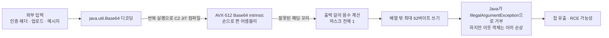
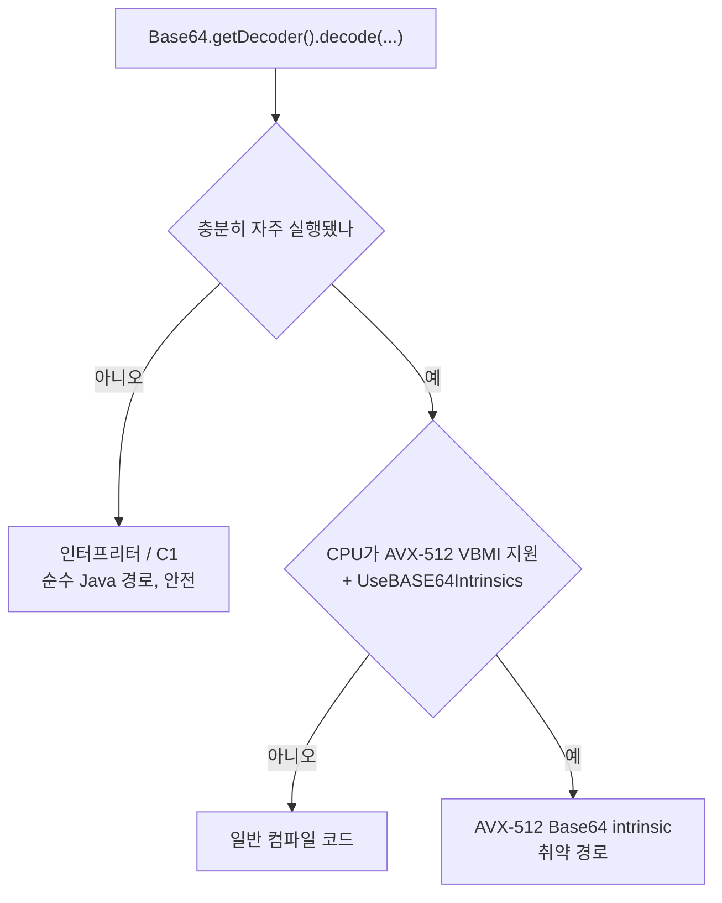
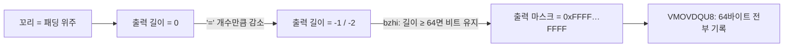
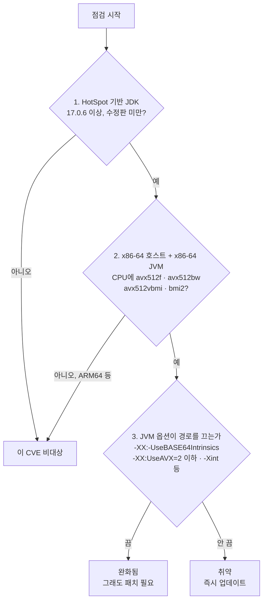
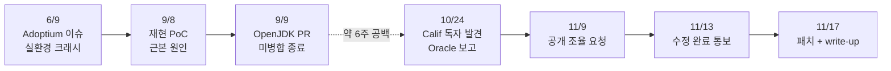

# Java4Shell, 메모리 안전 언어의 런타임에서 터진 Base64 힙 손상… CVE-2026-114938

### Calif가 OpenJDK HotSpot의 AVX-512 Base64 intrinsic에서 배열 밖 쓰기를 찾았다. Java 코드가 잘못된 입력을 거부하기 전에 네이티브 코드가 이미 이웃 메모리를 덮는다. 영향 조건은 OpenJDK 17.0.6 이상과 AVX-512 VBMI를 지원하는 x86-64 CPU다. 2026년 11월 17일 패치가 나왔고, 당장 못 올리면 `-XX:-UseBASE64Intrinsics`로 경로를 끈다

2026년 11월 17일(미 태평양시) 보안 연구업체 Calif는 [Java4Shell: Write once, RCE everywhere](https://calif.io/java4shell/)를 공개했다. 같은 시각 [OpenJDK 보안 권고](https://openjdk.org/groups/vulnerability/advisories/2026-11-17)와 [Oracle 패치](https://www.oracle.com/security-alerts/cspunov2026.html)도 나왔다. GeekNews([토픽 37370](https://news.hada.io/topic?id=37370))는 이를 한국어로 요약하고 국내 엠바고 소동, Lobste.rs와 Hacker News 토론을 함께 정리했다.

이 글은 원문과 GeekNews 요약, 댓글을 기사 형태로 다시 엮는다. **원문 write-up의 익스플로잇 전략, 힙 배치 조작, 원격 타이밍 제어, 단계별 공격 체인은 옮기지 않는다.** 무엇이 깨졌는지, 내 시스템이 해당하는지, 무엇을 올리고 어떤 옵션으로 막는지에 집중한다.

## 1. 한눈에 보기

| 항목 | 내용 |
|---|---|
| CVE | CVE-2026-114938 (별칭 Java4Shell) |
| 심각도 | CVSS 4.0 **9.2** (Critical) |
| 위치 | OpenJDK HotSpot, x86-64 Base64 디코딩 intrinsic (AVX-512) |
| 결함 | 패딩 꼬리 처리 시 저장 마스크 계산 오류, 할당 배열 밖 최대 **62바이트** 쓰기 |
| 영향 버전 | OpenJDK **17.0.6 이상**과 그 기반 배포판 (수정판 이전) |
| 하드웨어 조건 | x86-64 + **AVX-512 VBMI**. ARM64는 영향 없음 |
| 영향 | 인증 없는 원격 공격자의 힙 손상, 힙 정보 유출, 원격 코드 실행 |
| 패치 | 2026-11-17 13:00 PT, OpenJDK 권고와 Oracle CPU |
| 임시 완화 | `-XX:-UseBASE64Intrinsics` 또는 (x86-64만) `-XX:UseAVX=2` |
| 발견 | Quang Luong (Calif), Codex 활용. 원 버그 보고는 sundarms, albertnetymk |



## 2. 왜 이 버그가 크게 다뤄지는가

Calif는 PHP2Shell을 공개한 뒤 PHP를 잘 모르는 사람이 많다는 것을 알았다고 한다. 그래서 이번에는 더 친숙한 Java를 골랐다. Java는 [TIOBE 지수](https://www.tiobe.com/tiobe-index/)에서 세계 3위 언어이고, [IBM에 따르면](https://www.ibm.com/new/announcements/java-at-30-and-beyond-how-ibm-is-securing-the-future-of-java) Fortune 500의 90%가 쓴다. 금융, 항공, 통신, 국가 안보 같은 핵심 산업에도 깊이 들어가 있다. OpenJDK는 그중 가장 널리 쓰이는 Java 런타임이다.

Base64는 인증, 파일 업로드, 네트워크 메시지에서 쓰는 표준 인코딩이다. 공격자가 Base64 문자열을 서버에 넘기는 일은 아주 흔하다. 원문 제목 "Write once, RCE everywhere"는 Java의 오래된 표어 "Write once, run anywhere"를 비튼 것이다.

### 기본 설정에서 RCE를 실증한 제품

원문은 아래 제품의 **기본 설정**에서 RCE를 시연했다고 밝혔다. 목록은 전부가 아니며, Apache Struts와 Spring Boot 샘플 앱에서도 시연했다. 인증이나 파일 업로드 같은 평범한 기능이 디코더를 외부에 노출할 수 있다.

| 구분 | 제품 |
|---|---|
| 인증 전 RCE | Keycloak, Atlassian Jira, Atlassian Confluence, JFrog Artifactory, Jenkins, PingFederate |
| 인증 후 RCE | Apache Kafka Broker, Apache Solr, Elasticsearch, Gerrit, Spinnaker |

서버만 위험한 것도 아니다. samczsun은 **클라이언트 측 공격**도 공유했다. 악성 TLS 서버에 접속하는 Java 프로그램은 서비스를 열지 않았어도 침해될 수 있다.

## 3. 메모리 안전한 Java에서 왜 메모리 손상인가

메모리 손상은 인터넷에서 가장 흔한 취약점 유형이다. Java의 큰 장점은 메모리 안전성이지만, JVM 자체의 상당 부분은 C, C++, 어셈블리로 작성돼 있다. 이번 버그는 Java 애플리케이션 코드가 아니라 **JVM 내부 최적화 코드**에서 생겼다.

### 3.1 C2 JIT와 intrinsic

HotSpot의 C2 JIT 컴파일러는 자주 실행되는 메서드를 네이티브 코드로 컴파일한다. 일부 연산은 아예 CPU 전용 명령을 쓰는 손으로 짠 루틴으로 바꿔 치운다. 이것이 intrinsic이다. Base64 디코딩도 x86-64에서는 AVX-512 명령을 쓰는 intrinsic으로 처리된다.



이 그림에서 두 가지가 나온다. 첫째, 서버가 막 떴을 때는 취약 경로가 아직 쓰이지 않을 수 있다. 정상 트래픽으로 디코더가 충분히 뜨거워진 뒤에야 intrinsic이 쓰인다. 둘째, 완화 옵션이 왜 듣는지 보인다. intrinsic을 끄거나(`-XX:-UseBASE64Intrinsics`) AVX-512를 끄면(`-XX:UseAVX=2`) 오른쪽 아래 경로로 가지 않는다.

### 3.2 꼬리 처리의 마스크 계산

intrinsic은 입력을 256바이트 블록으로 처리하고, 남은 부분은 64바이트 블록으로 처리한다. 64바이트보다 짧은 마지막 꼬리는 `VMOVDQU8` 명령(HotSpot 내부 이름 `evmovdqub`)으로 읽고 쓴다. 이 명령은 64비트 마스크를 받아, 비트가 1인 바이트만 읽거나 쓴다.

출력 마스크는 출력 길이로 만든다. 출력 길이는 `(입력 길이 / 4) * 3`에서 끝의 `=` 개수만큼 뺀 값이다. 원문이 짚은 문제는 이 뺄셈이다.

1. 꼬리가 패딩만으로 끝나는 특정 형태면 패딩을 빼기 전 출력 길이가 0이다.
2. 여기서 패딩 개수를 빼면 출력 길이가 **-1이나 -2**가 된다.
3. 마스크를 만드는 `bzhi` 명령은 길이가 64 이상이면 비트를 지우지 않는다. 음수는 부호 없는 값으로 보면 아주 크므로 **마스크가 전부 1**이 된다.
4. 결국 64바이트 전체가 쓰인다.



한편 Java가 결과용으로 할당하는 배열 길이는 `(ceil(입력 길이 / 4) * 3) - 패딩`으로 계산된다. 원문 예시는 65바이트 입력이다. 이 입력에는 50바이트 배열이 할당되는데, intrinsic은 오프셋 48부터 64바이트를 쓴다. **배열 끝을 62바이트 넘어** 쓰는 셈이다.

intrinsic 스텁은 디코딩한 바이트 수를 돌려주고, 잘못된 입력에서는 일찍 반환한다. 나머지 처리는 Java 코드가 이어받아 `IllegalArgumentException`을 던진다. 애플리케이션 입장에서는 "잘못된 Base64라서 거부됐다"로 끝나 보인다. **그런데 그 시점에는 이웃 객체가 이미 덮여 있을 수 있다.**

OpenJDK 17은 이 코드 경로에 들어가는 길이 임계값이 더 높다. 그래서 트리거에 필요한 입력 길이가 다른 버전보다 길다.

### 3.3 손상에서 원격 코드 실행까지 (개요만)

처음 손상은 강력하지 않다. 덮어쓰는 64바이트 가운데 공격자가 고를 수 있는 값은 거의 없다. 원문은 이 제약된 쓰기를 JavaScript 엔진 공격에서 쓰던 기법으로 키워, 힙 정보 유출과 원격 코드 실행까지 이었다고 설명한다. 힙 유출 단계를 원문은 **JavaBleed**라 부른다. Heartbleed처럼 개인정보, 개인키, 토큰 같은 비밀이 응답에 섞여 나갈 수 있다는 뜻이다.

원문은 다음 사항도 밝혔다.

- **범용 페이로드는 없다.** 대상 애플리케이션마다 디코더에 닿는 경로, 메모리 배치, 응답 동작이 달라서 제품별로 맞춘 공격 체인이 필요하다.
- 공격은 네트워크 왕복 시간과 지터에 민감하다. 잘못 맞으면 JVM이 크래시할 수 있지만 많은 경우 다시 시도할 수 있다.
- 제품별 공격 체인은 사용자가 업그레이드할 시간을 확보할 때까지 공개하지 않는다.

이 글에서는 원문 write-up의 해당 단계(힙 배치, 원격 타이밍, 단계별 체인)를 더 옮기지 않는다.

## 4. 영향 범위: 내 시스템이 해당하는가

세 조건이 **모두** 맞아야 취약 경로가 열린다.



### 4.1 JDK 배포판

OpenJDK 17.0.6 이상과 그 기반 배포판이 모두 해당한다.

- Amazon Corretto
- Eclipse Temurin
- Microsoft Build of OpenJDK
- Azul Zulu
- BellSoft Liberica
- SAP SapMachine
- Red Hat OpenJDK
- Oracle OpenJDK, Oracle Java SE, Oracle GraalVM for JDK

Oracle이 공개 전에 Calif에 알려 준 취약한 Oracle Java SE 버전은 `8u511b33-perf`, `17.0.21.0.3`, `21.0.13.0.3`, `25.0.5.0.3`, `27.0.1.0.3`이다. 정확한 수정 버전은 [Oracle CPU 페이지](https://www.oracle.com/security-alerts/cspunov2026.html)와 [OpenJDK 권고](https://openjdk.org/groups/vulnerability/advisories/2026-11-17), 각 배포판 공지에서 확인한다.

### 4.2 하드웨어

x86-64이면서 AVX-512 VBMI를 지원해야 한다. ARM64(Graviton, Apple Silicon, Ampere 등)는 해당하지 않는다.

| 제조사 | 해당 제품군 |
|---|---|
| Intel Xeon | Ice Lake, Sapphire Rapids, Emerald Rapids, Granite Rapids |
| AMD EPYC / Ryzen | Zen 4 이상 |

Linux에서는 다음 명령으로 확인한다. 네 플래그가 **모두** 나와야 해당한다.

```bash
grep -m1 '^flags' /proc/cpuinfo | tr ' ' '\n' | grep -E '^(avx512f|avx512bw|avx512vbmi|bmi2)$'
```

클라우드 VM은 인스턴스 타입마다 CPU 세대가 다르다. 같은 서비스라도 노드 풀이 섞여 있으면 노드마다 결과가 다를 수 있다. 오토스케일링으로 새 노드가 다른 세대 CPU에 뜰 수도 있다.

### 4.3 JVM이 실제로 무엇을 켰는지 확인

CPU 플래그가 있어도 JVM이 AVX-512를 실제로 쓰는지는 따로 봐야 한다. 실행 중인 JVM의 최종 플래그는 이렇게 본다.

```bash
# 설치된 java 기준
java -XX:+PrintFlagsFinal -version 2>/dev/null \
  | grep -E '\b(UseAVX|UseBASE64Intrinsics)\b'

# 실행 중인 프로세스 기준 (PID 필요)
jcmd <PID> VM.flags -all | grep -E '\b(UseAVX|UseBASE64Intrinsics)\b'
jcmd <PID> VM.version
```

`UseAVX`가 3이고 `UseBASE64Intrinsics`가 `true`면 취약 경로가 열린 상태다.

### 4.4 예제: Bun으로 호스트 점검 묶기

위 조건을 한 번에 보는 [Bun](https://bun.sh) 스크립트다. **트리거 입력을 보내지 않고** CPU 플래그, `java -version`, JVM 최종 플래그만 읽는다. 배포판별 수정 버전은 자동으로 판정할 수 없으므로 "review"로 남긴다. 조건 구성은 아래 9장의 Semgrep 탐지 스크립트를 참고했다.

```ts
// check-java4shell.ts
// 사용: bun run check-java4shell.ts [java 실행 파일 경로]
import { $ } from "bun";

const java = Bun.argv[2] ?? "java";

// 1) CPU 플래그 (Linux)
let cpuFlags = new Set<string>();
try {
  const info = await Bun.file("/proc/cpuinfo").text();
  const line = info.split("\n").find((l) => l.startsWith("flags")) ?? "";
  cpuFlags = new Set(line.split(":")[1]?.trim().split(/\s+/) ?? []);
} catch {
  /* Linux가 아니면 건너뜀 */
}
const needed = ["avx512f", "avx512bw", "avx512vbmi", "bmi2"];
const cpuOk = needed.every((f) => cpuFlags.has(f));

// 2) 아키텍처
const arch = (await $`uname -m`.nothrow().text()).trim();
const x86 = arch === "x86_64" || arch === "amd64";

// 3) JDK 버전과 VM 종류
const ver = await $`${java} -version 2>&1`.nothrow().text();
const isHotSpot = /HotSpot|OpenJDK 64-Bit Server VM|GraalVM/i.test(ver) && !/OpenJ9/i.test(ver);
const m = ver.match(/version "(\d+)(?:\.(\d+))?(?:\.(\d+))?/);
const [maj, min, pat] = m ? [Number(m[1]), Number(m[2] ?? 0), Number(m[3] ?? 0)] : [0, 0, 0];
const atLeast1706 = maj > 17 || (maj === 17 && (min > 0 || pat >= 6));

// 4) JVM 최종 플래그
const flags = await $`${java} -XX:+PrintFlagsFinal -version 2>/dev/null`.nothrow().text();
const flag = (name: string) =>
  flags.split("\n").find((l) => new RegExp(`\\b${name}\\b`).test(l))?.trim().split(/\s+/)[3];
const useAVX = Number(flag("UseAVX") ?? 0);
const b64Intrinsic = flag("UseBASE64Intrinsics") === "true";

const pathOpen = x86 && cpuOk && isHotSpot && atLeast1706 && useAVX >= 3 && b64Intrinsic;

console.log({
  arch,
  cpuAvx512Vbmi: cpuOk,
  vm: isHotSpot ? "HotSpot 계열" : "기타 (OpenJ9 등)",
  javaVersion: `${maj}.${min}.${pat}`,
  useAVX,
  b64Intrinsic,
  verdict: pathOpen ? "review: 취약 경로 열림. 수정 버전인지 배포판 공지로 확인" : "경로 닫힘 또는 비대상",
});
console.log("※ 이 결과는 설치된 java 기준. 실행 중인 서비스는 jcmd <PID> VM.flags -all 로 따로 확인할 것.");
```

## 5. 대응

### 5.1 업데이트

2026년 11월 17일 13:00 PT에 OpenJDK 보안 권고와 Oracle 패치가 나왔다. Calif는 **모든 Java 사용자에게 즉시 업데이트**를 권했다. 사용하는 배포판(Temurin, Corretto, Zulu 등)의 수정판으로 올리고, 서비스를 **재시작**해야 새 JVM이 쓰인다. 컨테이너라면 베이스 이미지를 바꾸고 다시 빌드해 배포한다. 애플리케이션에 번들된 JRE(설치형 제품, jlink 이미지)도 잊지 않는다.

### 5.2 패치 전 임시 완화

JVM 시작 옵션으로 취약 경로를 끈다. 실행 중인 JVM에는 적용되지 않으므로 재시작이 필요하다.

| 옵션 | 효과 | 주의 |
|---|---|---|
| `-XX:-UseBASE64Intrinsics` | 하드웨어 가속 Base64 인코딩/디코딩 끄기 | Base64를 대량으로 처리하는 서비스는 성능이 다소 떨어질 수 있다 |
| `-XX:UseAVX=2` | AVX-512 사용 끄기 | **x86-64에만** 적용. ARM의 OpenJDK는 이 옵션을 몰라서 기동에 실패한다. 다른 AVX-512 최적화도 함께 꺼진다 |

```bash
# 일반 실행
java -XX:-UseBASE64Intrinsics -jar app.jar

# 코드 변경 없이 환경 변수로 일괄 적용
export JAVA_TOOL_OPTIONS="-XX:-UseBASE64Intrinsics"
```

```dockerfile
# 컨테이너 이미지
ENV JAVA_TOOL_OPTIONS="-XX:-UseBASE64Intrinsics"
```

멀티 아키텍처 이미지(amd64와 arm64를 함께 빌드)라면 `-XX:UseAVX=2`보다 `-XX:-UseBASE64Intrinsics`가 안전하다. 앞의 옵션은 arm64 노드에서 JVM이 뜨지 않게 만든다.

적용 뒤에는 4.3의 명령으로 플래그가 실제로 바뀌었는지 확인한다.

```bash
jcmd <PID> VM.flags -all | grep -E '\b(UseAVX|UseBASE64Intrinsics)\b'
```

Hacker News 댓글에서는 `-XX:-UseBASE64Intrinsics`가 동작하려면 `-XX:+UnlockDiagnosticVMOptions`도 필요하다는 주장이 나왔다. 원문에는 없는 내용이다. 위 확인 명령으로 `UseBASE64Intrinsics = false`가 찍히는지 보면 판단할 수 있다.

### 5.3 프록시 요청 버퍼링은 완화책이 아니다

원문은 공격 일부가 요청 본문이 조금씩 애플리케이션에 도달해야 한다고 밝혔다. nginx는 기본적으로 [요청 본문을 버퍼링](https://nginx.org/en/docs/http/ngx_http_proxy_module.html#proxy_request_buffering)하므로 그런 공격을 방해할 수 있다. 하지만 원문은 이것이 **일반적인 완화책이 아니라고** 분명히 했다.

- Elasticsearch 체인은 완성된 요청 하나로 동작하므로 버퍼링으로 막히지 않는다.
- [WebSocket 업그레이드](https://nginx.org/en/docs/http/websocket.html) 이후의 프레임은 터널을 그대로 통과해 버퍼링이 적용되지 않는다.
- Lobste.rs 토론에서는 버퍼링을 기본으로 켜는 nginx가 오히려 예외이고, Traefik, Envoy, HAProxy는 기본으로 꺼져 있다는 반론이 나왔다. Traefik과 Envoy만 합쳐도 많은 Kubernetes 구성이 해당할 것으로 봤다.

결론은 같다. **업데이트하거나 JVM 옵션으로 경로를 끈다.**

## 6. 발견 과정: "켄타우로스 해커"

원문은 PHP2Shell에 이어 이번에도 AI와 연구자가 함께 찾고 무기화했다고 밝힌다. "AI는 체력을, 연구자는 문맥을 댄다"는 표현과 함께, 최고의 해커는 사람과 AI가 결합한 **켄타우로스 해커**라고 부른다.

발견자는 Calif의 Quang Luong이다. 계기는 휴대폰 대상 제로클릭 공격을 개발하던 경험이었다. 제약이 많아 보이던 버그도 Android Runtime의 예측 가능한 할당 패턴 덕에 악용할 수 있었다. 그 경험을 바탕으로 OpenJDK HotSpot을 감사했다.

- Codex에게 JIT 컴파일러, intrinsic, 널리 노출된 API, 암호 영역을 점검하게 했다.
- 초기 결과는 대부분 도달 불가능하거나 비현실적인 잡음이었다. 약 20분 동안 잡음을 걸러 내며 더 강하게 프롬프트를 던진 끝에 Base64 디코더의 메모리 손상이 나왔다.
- 취약점 발견에 약 **1시간**, 첫 동작 익스플로잇에 추가로 약 **2시간**이 걸렸다. AI 토큰 비용은 **200달러 미만**이었다.
- 연구자가 공격 파이프라인과 전략을 먼저 짜고 AI 에이전트가 그것을 쓰게 했다. 이후 체인 대부분은 AI가 거의 자율적으로 구성했다. AI가 막힌 지점에서는 연구자가 힙 추적·시각화 도구를 만들어 줘 시간과 토큰을 아꼈다.

## 7. 공개 일정: 사실은 6월에 이미 보고됐던 버그

원문 타임라인(11월 19일 추가 갱신)을 보면 이 버그는 Calif보다 먼저 **실제 환경에서 크래시로 발견돼 공개 이슈로 올라와 있었다.**

| 날짜 (2026, PT) | 사건 |
|---|---|
| 6월 9일 | sundarms가 실제 환경에서 버그를 만나 [Adoptium 지원 이슈](https://github.com/adoptium/adoptium-support/issues/1480) 등록 |
| 9월 8일 | sundarms가 크래시 재현 PoC를 [이슈 댓글](https://github.com/adoptium/adoptium-support/issues/1480#issuecomment-5581203977)로 게시. 같은 날 albertnetymk이 근본 원인 파악 |
| 9월 9일 | albertnetymk이 [OpenJDK PR](https://github.com/openjdk/jdk/pull/32781)로 수정안 제안. 이후 활동 없이 병합되지 않고 닫힘 |
| 10월 24일 | Calif의 Quang Luong이 Codex로 독자 발견, Elasticsearch 인증 후 RCE PoC와 함께 Oracle에 보고 |
| 10월 26일 | Dion Blazakis가 "정상 운영에서 왜 크래시가 드문가"를 질문. 같은 날 Quang이 sundarms의 원 보고를 발견 |
| 10월 29일 | Oracle이 응답하며 추가 정보 요청 |
| 10월 31일 | Quang이 Jenkins, Keycloak 인증 전 RCE PoC를 Oracle에 공유 |
| 11월 9일 | Bruce Dang이 Oracle에 공개 조율 시작을 요청. 공개 보고가 이미 있다는 점을 지적 |
| 11월 13일 | Oracle이 수정 완료를 알리고 11월 17일 13:00 PT 패치 공개를 예고 |
| 11월 14~17일 | Calif가 정부 기관과 산업 파트너에 통지 |
| 11월 16일 | Calif와 Oracle이 심각도와 수정에 대해 첫 회의 |
| 11월 17일 | Oracle 패치 공개(albertnetymk, Quang Luong 크레딧). Calif write-up 공개 |
| 11월 19일 | Calif가 타임라인 추가 |



교훈은 분명하다. 크래시 보고와 수정 PR이 9월에 이미 공개돼 있었지만, 보안 문제로 다뤄지지 않아 두 달 넘게 방치됐다. GeekNews 관련 글 ["누군가 2026년 9월에 java4shell 버그를 보고함"](https://news.hada.io/topic?id=37480)도 이 지점을 다룬다. HN 댓글에는 "이미 두 달 전에 악용됐을 것"이라는 추측도 있었다.

크레딧은 이렇다. 연구, write-up, 익스플로잇은 Quang Luong(Calif)이 맡았다. 원 버그 보고는 sundarms와 albertnetymk, 익스플로잇 개선은 Jenish Rakholiya(Calif), 아트워크는 Michal Zalewski(Calif)다.

## 8. 공유지의 비극과 "vibe-uncoding"

원문 후반부는 기술 분석보다 주장에 가깝다.

**공유지의 비극.** 공용 소프트웨어 스택은 기능이 쌓일수록 복잡해진다. 기능을 쓰는 사람은 이익을 얻지만, 쓰지 않는 사람도 그 코드와 위험을 함께 떠안는다. Base64 최적화가 그런 예다. 대량 디코딩에는 도움이 되지만 대부분의 애플리케이션에는 이득이 작다. 일부만 필요한 최적화가 모두에게 심각한 위험이 됐다. 원문은 기능은 유용하고 버그는 고칠 수 있지만, **애초에 필요 없던 코드를 왜 갖고 있었는가**를 묻는다.

**Squidbleed.** Calif가 같은 해 찾은 [Squidbleed](https://calif.io/research/squidbleed)도 같은 맥락이다. Squid 프록시의 FTP 모듈에 1997년부터 있던 Heartbleed 유사 취약점이다. FTP는 사실상 사장된 프로토콜이니 그 코드를 지웠어야 했다는 주장이다.

**vibe-uncoding.** 필요 없는 코드는 실행할 이유가 없다. 몇백 바이트를 디코딩하는 데 손으로 짠 어셈블리가 필요한가? 코드를 지우는 일은 숨은 의존성을 찾고, 바꾸고, 남은 기능을 테스트해야 해서 어렵다. 원문은 여기서 AI가 큰 코드베이스의 죽은 코드, 비대한 기능, 불필요한 최적화를 찾는 데 도울 수 있다고 본다. 시스템에 필요한 부분만 남기고 나머지를 지워 공격 표면을 줄이자는 것이 vibe-uncoding이다.

> AI 시대에 사람들은 "무엇을 만들 수 있나"를 묻는다. 보안에서는 "무엇을 지울 수 있나"를 물어야 한다.

## 9. 커뮤니티 반응

### 9.1 국내 엠바고 소동 (GeekNews 작성자 댓글)

- 국내에서는 11월 17일 기준 외부 유출을 금지한 비공개 공문이 돌았다. 그런데 한 보안 언론이 엠바고를 무시해 약 30분 동안 외부에 공개된 상태였다고 한다.
- 공문에는 Base64 문제라는 내용이 빠진 채 "다음 날 새벽 Oracle 패치를 준비하라"는 안내만 있어서 더 시끄러웠다.
- 작성자는 이렇게 평가했다. 공격자가 재현할 수 없게 존재만 알린 공문이라 배포 자체는 적절했다. 엠바고를 깬 쪽도 취약점 설명까지는 올리지 않아, PHP2Shell 엠바고 파괴 때만큼의 파급력은 없었다.
- 다른 댓글은 "ㄷㄷㄷㄷ 머선일이져"라는 놀란 반응이었다.

### 9.2 Lobste.rs

- 요청 버퍼링을 기본으로 켜는 nginx가 오히려 예외이고, Traefik, Envoy, HAProxy는 기본 비활성이라는 반론(5.3 참고).
- AMD Zen 4는 2022년 출시다. Hetzner CPX는 최소 Zen 4 Genoa를 쓰는 것으로 보이고, Netcup은 Zen 5도 제공한다는 지적. 저가 호스팅도 상당수 해당한다는 뜻이다.
- 위험을 과장하면 진짜 Log4Shell급 사안이 왔을 때 경각심이 떨어진다는 의견. 그렇다고 가볍게 볼 수도 없다는 의견이 이어졌다.
- Java, Base64, AVX-512, 요청 버퍼링 비활성은 모두 흔한 독립 조건이라 특이한 조합이 아니라는 의견.
- "어디서나 RCE"는 과장이지만, AVX-512를 지원하는 Intel과 AMD Zen 4 이후 CPU가 워낙 많아 대상이 상당하다는 의견.

### 9.3 Hacker News

- **Semgrep 탐지 스크립트.** Semgrep이 [detection-scripts/CVE-2026-114938](https://github.com/semgrep/detection-scripts/tree/main/CVE-2026-114938)을 공개했다. 다섯 조건을 검사한다.
  1. HotSpot VM인가. OpenJDK, Oracle JDK, GraalVM JDK가 대상이다. OpenJ9, GCJ는 안전하고 Azul Prime 등은 불확실로 표시한다.
  2. x86-64 호스트와 x86-64 JVM인가.
  3. 17.0.6 이상이고 수정 버전 미만인가.
  4. CPU가 `avx512_vbmi`와 `avx512bw`를 보고하고 `UseAVX >= 3`인가.
  5. Base64 intrinsic이 켜져 있고 C2/JVMCI로 컴파일될 수 있는가.

  다음 설정은 5번 조건을 해제한다: `-XX:-UseBASE64Intrinsics`, `-XX:DisableIntrinsic=_base64_decodeBlock`, `-Xint`, 4 미만의 `-XX:TieredStopAtLevel`.
- 지원 범위를 줄여야 한다는 의견(Linux 커널 사례).
- "흥미로운 시대"라는 감상과 함께, 6개월 안에 핵심 인프라 침해가 나올 것이라는 예상. 긍정적으로는 보안 역량 강화와 레거시 현대화가 강제된다는 점을 들었다.
- `-XX:-UseBASE64Intrinsics`에 `-XX:+UnlockDiagnosticVMOptions`가 필요하다는 주장(원문에는 없음, 5.2 참고).
- 손으로 짠 어셈블리 최적화는 훌륭한 공격 표면이라는 냉소, 안전성이 증명되지 않은 네이티브 코드를 그만 쓰라는 의견.
- 운영 중인 Java 애플리케이션 대부분이 영향받을 수 있고, URL 디코딩이나 이메일 전송 같은 일상 동작으로도 Base64 디코딩이 일어나 범위를 가늠하기 어렵다는 의견.
- AVX-512가 필요하므로 모든 환경은 아니지만, 대부분의 Intel 서버와 다수의 AMD 서버, 클라우드 VM 대부분이 지원할 것이라는 의견.
- 원출처이므로 주 토론은 [HN 50532118](https://news.ycombinator.com/item?id=50532118)이라는 안내.

## 10. 정리: 운영자 체크리스트

- [ ] 운영 중인 모든 JVM(서비스, 배치, 빌드 에이전트, 번들 JRE)의 배포판과 버전을 목록화했다
- [ ] x86-64 노드에서 `avx512f`, `avx512bw`, `avx512vbmi`, `bmi2` 플래그를 확인했다. 노드 풀별 CPU 세대를 파악했다
- [ ] 각 배포판의 11월 17일 수정판으로 올리고 **재시작**했다. 컨테이너 베이스 이미지를 다시 빌드했다
- [ ] 패치 전이라면 `-XX:-UseBASE64Intrinsics`를 적용하고 `jcmd`로 `false`를 확인했다. 멀티 아키텍처라면 `-XX:UseAVX=2`는 피했다
- [ ] 프록시 요청 버퍼링을 완화책으로 믿지 않는다
- [ ] Java **클라이언트**(외부 TLS 서버에 붙는 프로그램)도 같은 기준으로 업데이트했다
- [ ] 이유 없는 JVM 크래시(`hs_err_pid*.log`)가 Base64 처리 경로 근처에서 반복되는지 본다

## 참고

- Calif, [Java4Shell: Write once, RCE everywhere](https://calif.io/java4shell/) (2026-11-17, 타임라인 2026-11-19 갱신)
- GeekNews, [Java4Shell: OpenJDK Base64 디코더에서 인증 없는 원격 코드 실행 취약점 발견 (CVE-2026-114938)](https://news.hada.io/topic?id=37370)
- [OpenJDK Vulnerability Advisory 2026-11-17](https://openjdk.org/groups/vulnerability/advisories/2026-11-17)
- [Oracle Critical Patch Update, November 2026](https://www.oracle.com/security-alerts/cspunov2026.html)
- [adoptium-support#1480](https://github.com/adoptium/adoptium-support/issues/1480), [openjdk/jdk#32781](https://github.com/openjdk/jdk/pull/32781)
- [Semgrep detection-scripts: CVE-2026-114938](https://github.com/semgrep/detection-scripts/tree/main/CVE-2026-114938)
- [New York Times 보도](https://www.nytimes.com/2026/11/17/us/politics/ai-security-bug-java.html) (2026-11-17, 원문이 함께 소개)
- Calif, [Squidbleed](https://calif.io/research/squidbleed), [PHP2Shell](https://calif.io/php2shell)
- 토론: [Lobste.rs](https://lobste.rs/s/g0bf9i/java4shell_write_once_rce_everywhere), [HN 50532118](https://news.ycombinator.com/item?id=50532118), [HN 50538240](https://news.ycombinator.com/item?id=50538240)
- GeekNews 관련 글: [Java4Shell: Java 17의 인증 전 RCE](https://news.hada.io/topic?id=37442), [NGINX HTTP/2 인증 없는 RCE](https://news.hada.io/topic?id=37417), [OpenSSH CVE-2024-6387](https://news.hada.io/topic?id=15663), [누군가 2026년 9월에 java4shell 버그를 보고함](https://news.hada.io/topic?id=37480), [OpenCode 인증 없는 RCE](https://news.hada.io/topic?id=25788)
- 같은 카테고리: [PHP2Shell](261023_1756_PHP2Shell_Critical_Remote_Code_Execution_in_the_PHP_Engine.md), [nginx2root](261119_2133_nginx2root_Five_nginx_RCEs_and_a_Linux_SCTP_Privilege_Escalation.md)
