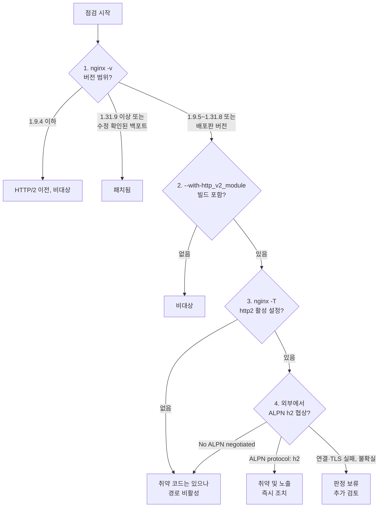
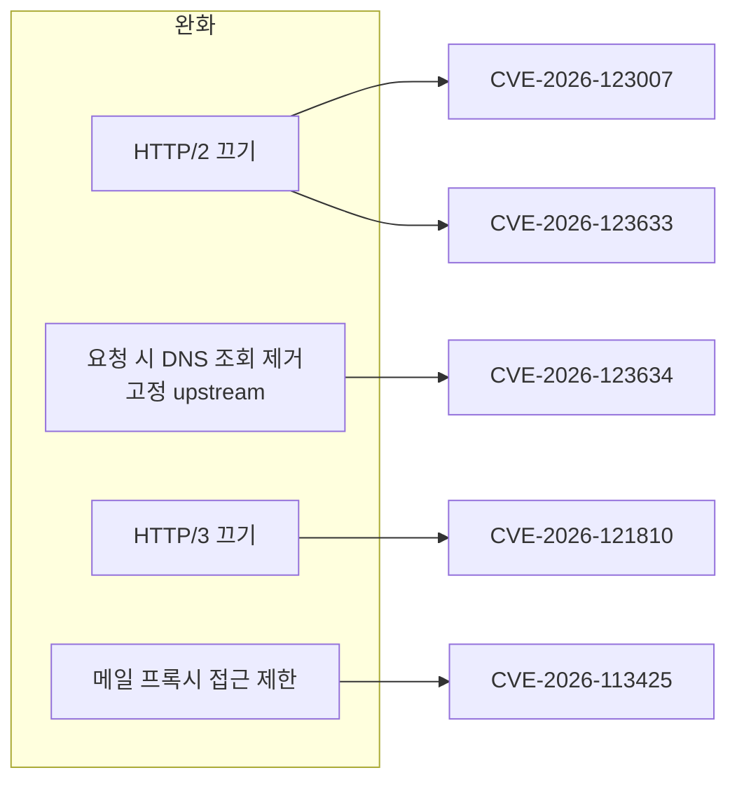
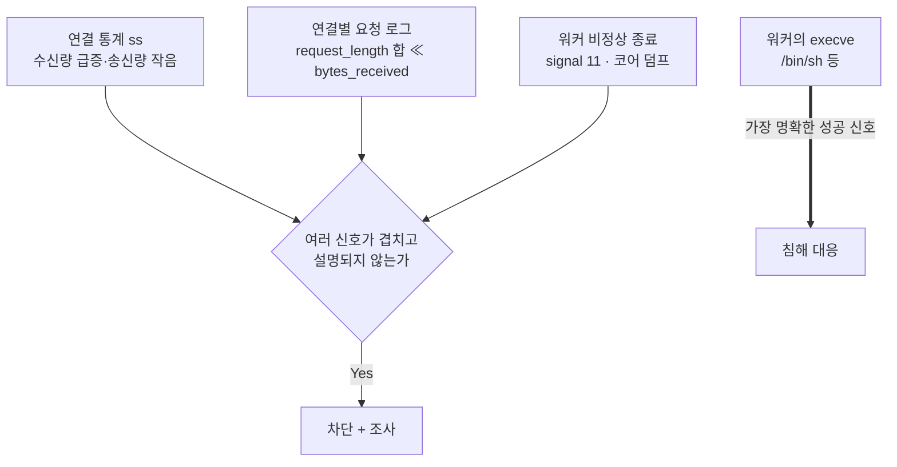
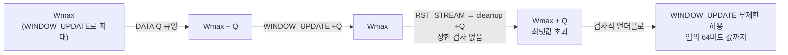
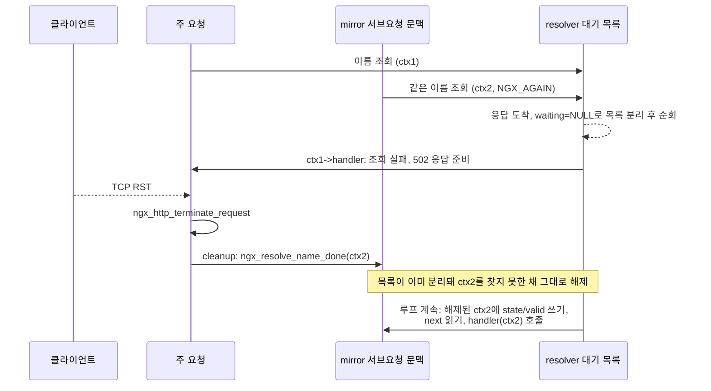
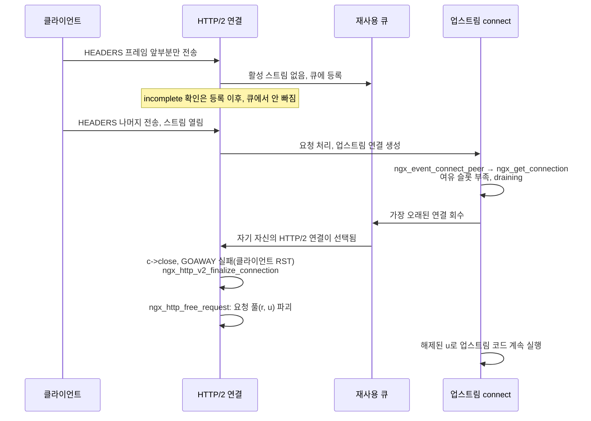
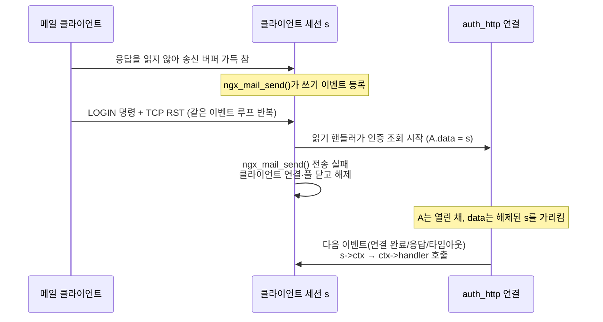
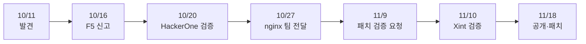

# nginx2root, nginx 비인증 RCE 5개에 Linux SCTP 권한 상승을 엮어 컨테이너 밖 root까지

### Xint가 서로 다른 설정을 노리는 nginx 원격 코드 실행 취약점 5개와 2018년부터 커널에 남아 있던 SCTP 해제 후 사용 버그를 함께 공개했다. 가장 넓게 퍼진 CVE-2026-123007은 HTTP/2를 켠 nginx 1.9.5~1.31.8 전부에 해당한다. 수정판은 stable 1.30.7과 mainline 1.31.9다. HTTP/2만 꺼서는 5개 중 2개만 막힌다

2026년 11월 18일 Xint는 [NGINX2Root: New Remote Code Execution Vulnerabilities in nginx Require Urgent Patching](https://xint.io/blog/nginx2root-remote-code-execution)을 게시했다. GeekNews([토픽 37438](https://news.hada.io/topic?id=37438))는 이 글을 한국어로 요약하고 Lobste.rs 토론을 함께 정리했다.

nginx2root는 취약점 6개를 묶어 부르는 이름이다. nginx 비인증 RCE가 5개, Linux 커널 SCTP 권한 상승이 1개다. nginx 취약점은 각각 따로 워커 프로세스 권한의 명령 실행으로 이어진다. 커널 버그까지 연결하면 호스트 root를 얻는다. Xint는 Docker 컨테이너 안에서 돌던 nginx를 출발점으로 호스트 root까지 올라가는 데 성공했다.

이 글은 원문과 GeekNews 요약, 댓글을 기사 형태로 다시 엮는다. 원인 설명은 원문이 공개한 수준까지만 다룬다. **원문이 생략한 익스플로잇 최종 단계는 여기서도 다루지 않는다.** 남기려는 것은 세 가지다. 무엇이 깨졌는지, 내 서버가 해당하는지, 패치 전에 무엇을 막고 무엇을 봐야 하는지다.

## 1. 한눈에 보기

| 항목 | 내용 |
|---|---|
| 이름 | nginx2root (nginx RCE 5개 + Linux SCTP LPE 1개) |
| 심각도 | Critical |
| 영향 | 비인증 원격 공격자가 nginx 워커 권한으로 임의 명령 실행. 커널 버그와 연결하면 호스트 root |
| 가장 넓은 영향 | CVE-2026-123007, HTTP/2를 켠 nginx 1.9.5~1.31.8 |
| 수정 버전 | stable **1.30.7**, mainline **1.31.9** 이상 |
| 보고자 | Xint Researchers (@imssm99, @cdor1, @tjbecker, @yves) |
| 발견 경위 | ZeroDay Cloud 2026 준비 중 연구원이 1개 발견, 며칠 뒤 자동 스캔이 나머지 4개 발견 |
| 검증 환경 | AWS, GCP, Azure, 베어메탈. 시연 영상은 [nginx2root.com](https://nginx2root.com)에 있다 |


원문 데모의 흐름이 이 그림과 같다. CVE-2026-123007로 컨테이너 안의 nginx 워커에서 명령을 실행하고, 커널 취약점으로 호스트 root까지 올라간다. 데모 대상은 AWS 공개 IP였다.

## 2. 다섯 개의 경로와 각각의 설정 조건

다섯 경로는 서로 독립적이다. 하나를 막아도 나머지는 열려 있다. 그래서 **"우리 서버는 HTTP/2를 끄면 된다"는 판단이 위험하다.**

| CVE | 영향받는 설정 | 이 경로의 최초 영향 릴리스 | HTTP/2를 끄면 막히나 | 원인 |
|---|---|---|---|---|
| CVE-2026-123007 | HTTP/2 활성화 | 1.9.5 | 예 | HTTP/2 흐름 제어 정수 연산 오류, 힙 범위 밖 읽기/쓰기 |
| CVE-2026-123634 | `resolver`, 요청에서 정하는 `proxy_pass` 목적지, `mirror` + `mirror_request_body off` | 1.13.4 | 아니오 | DNS 리졸버 대기 목록의 해제 후 사용 |
| CVE-2026-123633 | HTTP/2 요청을 업스트림으로 전달 | 1.19.7 | 예 | 활성 HTTP/2 연결을 유휴로 회수하면서 요청 메모리 해제 |
| CVE-2026-121810 | HTTP/3 요청을 업스트림으로 전달 | 1.25.0 | 아니오 | HTTP/3 스트림 생성 중 부모 QUIC 연결이 다시 회수 대상이 됨 |
| CVE-2026-113425 | `proxy on`과 `auth_http`를 쓰는 메일 프록시 | 0.5.15 | 아니오 | 메일 인증 연결이 해제된 클라이언트 세션을 계속 참조 |

CVE-2026-123634는 `mirror` 경로로만 검증했다. 그런데 SSI처럼 하위 요청을 만드는 다른 기능도 같은 버그에 닿을 수 있다. 따라서 **`mirror`만 끄는 것으로는 안전을 보장할 수 없다.**

CVE-2026-123007은 2015년 HTTP/2가 들어온 1.9.5부터 1.31.8까지 모든 공식 릴리스에 있다. 2026년 11월 10일 기준 master 브랜치에도 남아 있었다.

## 3. 내 서버가 해당하는지 확인하기

### 3.1 버전 문자열을 믿을 수 없는 이유

배포판은 새 릴리스로 올리는 대신 기존 버전에 보안 수정을 **백포트**한다. 그래서 수정이 들어가도 `nginx -v` 출력은 그대로다.

| 배포판 | 기본 nginx 버전 |
|---|---|
| Ubuntu 24.04 | 1.24.0 |
| Ubuntu 22.04 | 1.18.0 |
| Debian 12 | 1.22.1 |

Ubuntu 22.04가 좋은 예다. 패키지는 원래 `1.18.0-6ubuntu14`였고, 2026년 10월 26일까지 보안 업데이트를 거쳐 `1.18.0-6ubuntu14.22`가 됐다. 그동안 nginx 버전 문자열은 계속 `1.18.0`이었다. 수정 포함 여부는 **전체 패키지 버전을 배포판 보안 공지와 대조**해서 판단해야 한다.

### 3.2 인터넷 노출 규모

11월 10일 Shodan에서 `product:nginx`로 검색하면 5,670만 호스트가 나왔다. 그중 1,194만(21.1%)은 버전을 식별할 수 있었고, 식별된 호스트의 **98.9%**가 1.9.5~1.31.8 범위였다.

이 숫자는 버전 문자열로 센 것이다. 실제로 취약한지 확인한 수가 아니고, 백포트된 수정도 반영하지 못한다. HTTP/2를 켰는지도 따지지 않았다.

### 3.3 네 단계 점검

CVE-2026-123007은 세 조건이 모두 맞을 때 취약하다. 미패치 버전이고, HTTP/2 모듈이 포함됐고, HTTP/2가 켜져 있어야 한다. 네 번째로 그 리스너가 외부에서 닿는지 확인한다.



**① 버전 확인**

```bash
nginx -v 2>&1
# 출력 예: nginx version: nginx/1.31.8
```

1.9.5~1.31.8이면 다음 단계로 간다. 1.9.4 이하는 HTTP/2 도입 전이라 대상이 아니다. 1.31.9 이상이면 릴리스 노트에 수정이 반영됐는지 확인한다. 배포판 패키지면 백포트 여부를 확인한다.

**② HTTP/2 모듈 포함 여부**

```bash
if nginx -V 2>&1 | grep -q -- '--with-http_v2_module'; then
  echo "HTTP2_MODULE=present"
else
  echo "HTTP2_MODULE=absent"
fi
```

**③ 설정에서 HTTP/2 활성화 확인**

```bash
sudo nginx -T 2>&1 | sed 's/#.*//' \
  | grep -nE 'listen[[:space:]].*http2|^[[:space:]]*http2[[:space:]]+on[[:space:]]*;'
```

`nginx -T`는 **디스크에 있는 설정**을 읽는다. 수정 후 리로드하지 않았다면 실행 중인 상태와 다를 수 있다.

**④ 외부 노출 확인** (외부 머신에서 실행)

```bash
openssl s_client -connect {HOST}:443 -servername {HOST} -alpn h2 </dev/null 2>&1 \
  | grep -E 'ALPN protocol:|No ALPN negotiated|Connection refused|connect:errno|handshake failure'
```

`ALPN protocol: h2`가 나오면 HTTP/2를 받는다. `No ALPN negotiated`면 받지 않는다. 그 밖의 결과는 연결 실패다. CDN이나 리버스 프록시 뒤에 있다면 **원본 서버에도 직접** 실행해야 한다. 앞단이 HTTP/2를 끝내 주더라도 원본이 직접 노출됐을 수 있다.

| 상태 | 판정 |
|---|---|
| 미패치 + 모듈 있음 + 외부에서 h2 응답 | 취약 및 노출, 즉시 조치 |
| 미패치 + 모듈 있음 + HTTP/2 비활성 | 취약 코드는 있으나 경로 비활성 |
| 1.9.4 이하 또는 모듈 없음 | 비대상 |
| 1.31.9 이상 또는 수정이 확인된 백포트 | 패치됨 |
| 연결 실패, TLS 실패, 불확실 | 판정 보류, 추가 검토 |

### 3.4 예제: Bun으로 네 단계를 한 번에

위 네 단계를 [Bun](https://bun.sh)의 `$` 셸 헬퍼로 묶은 점검 스크립트다. **공격 코드가 아니며** 버전, 모듈, 설정, ALPN 신호만 모은다. 배포판 백포트는 자동으로 판정할 수 없으므로 "review"로 남긴다.

```ts
// check-nginx2root.ts
// 사용: sudo bun run check-nginx2root.ts [외부에서 확인할 HOST]
import { $ } from "bun";

type Verdict = "vulnerable-exposed" | "code-present-path-off" | "not-affected" | "patched" | "review";

function parseVersion(text: string): [number, number, number] | null {
  const m = text.match(/nginx\/(\d+)\.(\d+)\.(\d+)/);
  return m ? [Number(m[1]), Number(m[2]), Number(m[3])] : null;
}

const cmp = (a: number[], b: number[]) =>
  a[0] - b[0] || a[1] - b[1] || a[2] - b[2];

// 1) 버전
const vOut = await $`nginx -v 2>&1`.nothrow().text();
const ver = parseVersion(vOut);

// 2) HTTP/2 모듈
const VOut = await $`nginx -V 2>&1`.nothrow().text();
const hasH2Module = VOut.includes("--with-http_v2_module");

// 3) 설정의 http2 활성화 (주석 제거 후 검색)
const conf = (await $`nginx -T 2>&1`.nothrow().text())
  .split("\n")
  .map((l) => l.replace(/#.*/, ""));
const h2Lines = conf.filter(
  (l) => /listen\s.*http2/.test(l) || /^\s*http2\s+on\s*;/.test(l),
);

// 4) 외부 ALPN (인자로 HOST를 받으면 실행)
const host = Bun.argv[2];
let alpn: "h2" | "none" | "error" | "skipped" = "skipped";
if (host) {
  const out = await $`openssl s_client -connect ${host}:443 -servername ${host} -alpn h2 < /dev/null 2>&1`
    .nothrow()
    .text();
  alpn = /ALPN protocol: h2/.test(out) ? "h2"
    : /No ALPN negotiated/.test(out) ? "none"
    : "error";
}

// 판정
let verdict: Verdict;
if (!ver) verdict = "review";
else if (cmp(ver, [1, 9, 4]) <= 0) verdict = "not-affected";
else if (cmp(ver, [1, 31, 9]) >= 0) verdict = "patched"; // 릴리스 노트로 재확인
else if (!hasH2Module) verdict = "not-affected";
else if (h2Lines.length === 0 || alpn === "none") verdict = "code-present-path-off";
else if (alpn === "h2") verdict = "vulnerable-exposed";
else verdict = "review"; // 외부 확인 안 함 / 연결 실패

console.log({ version: ver?.join("."), hasH2Module, h2Lines, alpn, verdict });
console.log(
  "※ 배포판 패키지는 버전 문자열이 그대로일 수 있음. dpkg -l nginx / rpm -q nginx 결과를 배포판 보안 공지와 대조할 것.",
);
console.log(
  "※ 이 결과는 CVE-2026-123007 기준. HTTP/3, resolver+mirror, mail auth_http 설정은 2장 표로 따로 확인할 것.",
);
```

## 4. 대응: 패치가 먼저, 완화는 그다음

### 4.1 즉시 조치

stable 1.30.7 또는 mainline 1.31.9 이상을 설치하고 다섯 개 수정이 모두 들어갔는지 확인한다. 설치 후에는 **nginx를 재시작하거나 지원되는 라이브 바이너리 업그레이드를 끝내야 한다.** `nginx -s reload`는 설정만 다시 읽고 실행 파일은 바꾸지 않는다. 패키지만 받고 재시작하지 않은 서버는 아직 패치되지 않은 상태다.

### 4.2 패치 전 임시 완화

완화는 알려진 공격 경로만 막는다. 패치를 대신하지 못한다.



#### ① HTTP/2 끄기: CVE-2026-123007, CVE-2026-123633

1.25.1 이상에서는 해당 `server` 블록에 `http2 off;`를 두고, `listen`에 남은 옛 `http2` 매개변수를 지운다.

```nginx
server {
    listen 443 ssl;      # 기존: listen 443 ssl http2;
    http2 off;
    # ...
}
```

1.9.5~1.25.0에는 `http2` 지시어가 없으므로 `listen`에서 `http2`를 빼는 방법밖에 없다. **같은 주소와 포트를 공유하는 모든 `server` 블록**을 확인해야 한다. 한 곳에만 남아 있어도 그 리스너는 HTTP/2를 받는다.

HTTP/1.1 클라이언트는 계속 쓸 수 있다. 네이티브 gRPC처럼 HTTP/2가 꼭 필요한 기능은 영향을 받는다.

```bash
sudo nginx -t && sudo nginx -s reload
# 외부에서 3.3 ④ 의 openssl 명령을 다시 실행해 h2가 사라졌는지 확인
```

출력이 아무것도 없을 때는 HTTP/2가 꺼진 게 아니라 연결 자체가 실패했을 수도 있다. HTTPS가 정상 동작하는지도 함께 확인한다.

#### ② 요청 시 DNS 조회 제거: CVE-2026-123634

대상은 `proxy_pass`에 변수(`proxy_pass http://$host;` 같은)를 쓰고, `resolver`로 요청 도중 DNS를 조회하며, `mirror`를 쓰는 서버다. 고정된 업스트림 그룹으로 바꾸면 요청 중 DNS 조회가 사라진다.

mirror가 필요 없을 때:

```nginx
upstream backend_hotfix {
    server {BACKEND_IP}:8080;
}

server {
    # ...
    location / {
        mirror off;
        proxy_pass http://backend_hotfix;
    }
}
```

mirror가 꼭 필요하면 주 요청과 미러 요청을 모두 고정 업스트림으로 보내고, 미러는 `internal` location으로 둔다.

```nginx
upstream backend_main_hotfix   { server {MAIN_BACKEND_IP}:8080; }
upstream backend_mirror_hotfix { server {MIRROR_BACKEND_IP}:8080; }

server {
    location / {
        mirror /mirror;
        proxy_pass http://backend_main_hotfix;
    }

    location = /mirror {
        internal;
        proxy_pass http://backend_mirror_hotfix$request_uri;
    }
}
```

`mirror_request_body on`으로 바꾸자 테스트 공격은 막혔다. 그래도 리졸버 결함 자체를 고치지는 않으므로 **단독 대책으로 쓰면 안 된다.** 2장에서 말했듯 SSI 같은 다른 하위 요청 기능도 같은 버그에 닿을 수 있다.

#### ③ HTTP/3 끄기: CVE-2026-121810

QUIC 리스너를 지우고 `http3 off;`를 둔다. 브라우저가 HTTP/3로 다시 오지 않도록 Alt-Svc 광고도 지운다. TCP TLS 리스너는 그대로 둔다.

```nginx
server {
    listen 443 ssl;
    # listen 443 quic reuseport;
    http3 off;
    add_header Alt-Svc 'clear' always;
    # ...
}
```

```bash
sudo ss -lunp 'sport = :443'
# nginx가 보이면 QUIC 리스너가 아직 남아 있다
```

방화벽에서 해당 UDP 포트를 막는 것도 권장한다.

#### ④ 메일 프록시 접근 제한: CVE-2026-113425

`proxy on`과 `auth_http`를 쓰는 `mail` 블록만 해당한다. 이 공격에는 **유효한 자격 증명이 필요 없다.** 인증 서비스가 모든 로그인을 거부해도 공격은 성공했다.

외부 접근이 필요 없으면 리스너를 루프백에 묶는다. 원격 메일 앱은 접속할 수 없게 된다.

```nginx
mail {
    server {
        listen 127.0.0.1:143;
        # ...
    }
}
```

외부 접근이 필요하면 방화벽에서 신뢰하는 IP만 허용한다.

```bash
sudo ss -ltnp | grep -E ':(25|110|143|465|587|993|995)([[:space:]]|$)'
```

#### ⑤ 기존 연결까지 끊기

리로드한 설정은 새 연결에만 적용된다. 기존 연결을 붙잡고 있는 옛 워커는 `ps`에 `nginx: worker process is shutting down`으로 보인다. 이런 워커가 남아 있으면 서비스 관리자로 재시작한다. 진행 중인 다운로드, 업로드, 메일 세션은 끊긴다.

```bash
ps -eo pid,args | grep '[n]ginx: worker process is shutting down'
sudo systemctl restart nginx
```

## 5. 공격 흔적 조사

CVE-2026-123007 공격은 접근 로그에 거의 남지 않는다. 공격에 쓰는 `WINDOW_UPDATE`와 `RST_STREAM`은 제어 프레임이라 요청으로 기록되지 않는다. 전송 중에는 TLS로 암호화돼 있어 네트워크 장비에서도 내용을 보기 어렵다. 그래서 여러 약한 신호를 겹쳐 봐야 한다.



### 5.1 연결 통계

짧은 간격으로 두 번 실행해 `bytes_received`와 `bytes_sent`의 변화를 비교한다.

```bash
sudo ss -tinp state established '( sport = :443 )'
```

다음 패턴이 함께 보이면 조사하고 차단한다. 대용량 업로드처럼 설명되는 정상 사유가 없어야 한다.

- 같은 외부 IP의 연결이 몇 분씩 유지된다
- `bytes_received`가 빠르게 늘어난다
- `bytes_sent`는 그보다 훨씬 작다
- 같은 IP가 짧은 TLS 연결을 많이 연다

### 5.2 연결별 요청 로그

디버그 빌드 없이 `http` 블록에 로그 형식 하나를 추가하면 된다.

```nginx
http {
    log_format h2_hunt '$time_iso8601 src=$remote_addr conn=$connection '
                       'requests=$connection_requests proto=$server_protocol '
                       'status=$status request_length=$request_length '
                       'bytes_sent=$bytes_sent request_time=$request_time';

    access_log /var/log/nginx/h2-hunt.log h2_hunt;
}
```

```bash
sudo nginx -t && sudo nginx -s reload
sudo grep 'proto=HTTP/2.0' /var/log/nginx/h2-hunt.log | tail -n 200
```

의심 IP의 `request_length` 합계를 `ss`로 본 `bytes_received`와 비교한다. 받은 양은 큰데 요청 길이 합이 작다면, 요청으로 기록되지 않는 HTTP/2 제어 프레임을 대량으로 보냈다는 뜻일 수 있다. `request_time`이 비정상적으로 긴지도 함께 본다.

이 집계를 손으로 하기 번거로우면 아래처럼 IP별로 합칠 수 있다.

```ts
// h2-hunt-summary.ts
// 사용: sudo bun run h2-hunt-summary.ts /var/log/nginx/h2-hunt.log
const path = Bun.argv[2] ?? "/var/log/nginx/h2-hunt.log";
const text = await Bun.file(path).text();

type Agg = { conns: Set<string>; reqs: number; reqLen: number; sent: number; maxTime: number };
const byIp = new Map<string, Agg>();

for (const line of text.split("\n")) {
  if (!line.includes("proto=HTTP/2.0")) continue;
  const f = Object.fromEntries(
    [...line.matchAll(/(\w+)=(\S+)/g)].map((m) => [m[1], m[2]]),
  );
  const a = byIp.get(f.src) ?? { conns: new Set(), reqs: 0, reqLen: 0, sent: 0, maxTime: 0 };
  a.conns.add(f.conn);
  a.reqs += 1;
  a.reqLen += Number(f.request_length);
  a.sent += Number(f.bytes_sent);
  a.maxTime = Math.max(a.maxTime, Number(f.request_time));
  byIp.set(f.src, a);
}

const rows = [...byIp]
  .map(([ip, a]) => ({
    ip,
    connections: a.conns.size,
    requests: a.reqs,
    request_length_sum: a.reqLen,
    bytes_sent_sum: a.sent,
    max_request_time: a.maxTime,
  }))
  .sort((x, y) => y.connections - x.connections);

console.table(rows.slice(0, 30));
console.log("→ request_length_sum을 같은 IP의 ss bytes_received와 비교할 것");
```

### 5.3 워커의 외부 프로그램 실행

워커의 UID를 확인한 뒤 auditd로 `execve`를 감시한다.

```bash
ps -eo uid,user,pid,ppid,args | grep '[n]ginx: worker process'

sudo auditctl -a always,exit -F arch=b64 -S execve,execveat \
  -F euid=NGINX_UID -k nginx_worker_exec

sudo ausearch -k nginx_worker_exec -ts recent -i
```

`/bin/sh`, `/bin/bash` 같은 셸 실행을 찾는다. 두 가지를 주의한다.

- 규칙을 넣은 **이후**만 기록된다. 결과가 비어 있어도 과거 침해를 배제할 수는 없다.
- 같은 UID로 도는 다른 프로세스도 잡힌다. PPID를 따라가 nginx에서 시작된 것인지 확인해야 한다.

### 5.4 워커 비정상 종료

```bash
sudo grep -Ei 'worker process.*exited|signal 11|segfault' /var/log/nginx/error.log
sudo coredumpctl list nginx
```

메모리 손상을 노리는 공격은 실패할 때 워커를 죽이곤 한다. 다만 공격 말고 다른 원인으로도 종료될 수 있다.

### 5.5 증거 평가

워커가 외부 프로그램을 실행했다면 **가장 명확한 성공 신호**다. 나머지는 약한 신호다. 다음 중 여러 개가 겹치고 설명되지 않으면 차단하고 조사한다.

- 지속적으로 높은 수신량
- 같은 출처의 다수 연결
- 실제 수신량과 로그에 남은 요청 길이의 큰 차이
- 반복된 워커 비정상 종료

## 6. 기술 분석: 다섯 개의 nginx 버그

원문은 nginx GitHub 커밋 `140aa942711868a8daeb95810bc9a81f272ada72`를 기준으로 소스 위치를 짚는다. 다섯 버그 모두 C 메모리 관리에서 생겼다. 정수 경계가 틀렸거나, 아직 쓰는 객체를 해제했다.

### 6.1 CVE-2026-123007: HTTP/2 흐름 제어 정수 오류

#### 송신 윈도의 구조

HTTP/2에는 송신 윈도가 두 층 있다. 연결 전체의 윈도(`h2c->send_window`)와 스트림별 윈도다. nginx의 기본값은 65,535(`0xffff`)이고, 최댓값은 `0x7fffffff`(`(1U << 31) - 1`)이다.

nginx는 DATA 프레임을 큐에 넣을 때 두 윈도에서 그만큼 뺀다. 스트림이 전송 전에 취소되면 cleanup 함수(`ngx_http_v2_filter_cleanup`)가 뺐던 양을 연결 윈도에 돌려준다. 문제는 그 사이에 클라이언트가 `WINDOW_UPDATE`로 윈도를 다시 채울 수 있다는 점이다. **취소 때 돌려주는 값에는 상한 검사가 없다.**

#### 윈도가 최댓값을 넘는 과정

1. 클라이언트가 스트림 0에 `WINDOW_UPDATE`를 보내 연결 윈도를 최댓값 `Wmax`로 올린다.
2. `SETTINGS_INITIAL_WINDOW_SIZE`를 0으로 보내 스트림 윈도를 막는다. `PING`을 대량으로 보내 TLS/TCP 송신 버퍼를 채운다. 응답 본문 DATA가 계속 큐에 머문다.
3. 큐에 든 양을 `Q`라 하자. 이 `Q`가 두 번 돌아온다. 한 번은 `WINDOW_UPDATE`로, 또 한 번은 `RST_STREAM`에 따른 cleanup으로.



#### 부호 없는 언더플로

`ngx_http_v2_state_window_update()`는 증분이 최댓값을 넘는지 이렇게 검사한다.

```c
if (window > NGX_HTTP_V2_MAX_WINDOW - h2c->send_window) {
    /* FLOW_CONTROL_ERROR */
}
```

`send_window`가 이미 `Wmax + Q`라면 `NGX_HTTP_V2_MAX_WINDOW - h2c->send_window`는 음수가 아니다. 부호 없는 연산이라 아주 큰 값으로 감싸진다. 검사가 항상 통과하고, 공격자는 윈도를 임의의 64비트 값까지 올릴 수 있다.

#### 큰 윈도가 거대한 복사 길이로 바뀌는 과정

| 단계 | 일어나는 일 |
|---|---|
| 1 | 응답 본문을 큐에 보류한다 (`SETTINGS_INITIAL_WINDOW_SIZE` 0) |
| 2 | 윈도를 올린 뒤 스트림을 취소해 크레딧을 한 번 더 돌려받는다 |
| 3 | 연결 윈도가 최댓값을 넘으면 남은 용량 계산이 부호 없는 언더플로로 큰 값이 되어 `WINDOW_UPDATE`가 계속 허용된다 |
| 4 | 같은 비트를 부호 있는 값과 없는 값으로 번갈아 해석하면서 작은 음수 거리가 매우 큰 복사 길이가 된다 |
| 5 | 복사 끝 위치를 조정해 메모리 포인터를 응답으로 유출하고 TLS 할당 메타데이터를 손상시킨다 |
| 6 | 정리 콜백의 함수 포인터를 덮어써 명령을 실행한다 (원문도 세부 절차는 생략) |

4단계를 풀면 이렇다. 큰 `send_window`를 `off_t`로 캐스팅하면 작은 음수 `-d`가 된다. 이 값이 `ngx_http_v2_send_chain`의 `limit`과 `frame_size` 비교를 통과한 뒤 `size_t`로 바뀌면 `2^64 - d`가 된다. `ngx_http_v2_filter_get_shadow`의 `chunk->last = chunk->pos + size`는 `pos`보다 `d`바이트 **앞**을 가리킨다. 결국 TLS 출력 경로(`ngx_event_openssl.c`)의 `memcpy`에 거대한 길이가 넘어간다.

#### 거대한 memcpy가 왜 바로 죽지 않는가

보통은 길이가 2^64에 가까운 `memcpy`가 곧바로 세그폴트를 낸다. 여기서 glibc x86-64 구현의 성질이 작용한다. 큰 복사에서 이 구현은 끝에서부터 128바이트 단위로 거꾸로 복사하는 루프를 돈다. 그런데 `dest + size`가 주소 공간을 한 바퀴 돌아 감싸지면 루프 커서가 처음부터 `dest`보다 낮아진다. 루프는 한 번만 돌고 끝난다.

결과적으로 **처음 128바이트와 마지막 160바이트 영역만 복사되고 가운데는 건드리지 않는다.** 이 구조는 glibc 2.24(2016)부터 있었다.

```text
dest 기준 쓰기 범위 (개념도)

 [dest ........ 128B 루프 복사 ........][ 손대지 않음 ... ][end-160 ... 32B 고정 복사 ... end]
```

#### 메모리 배치 맞추기

공격자는 이 짧은 복사가 정확히 원하는 곳을 덮도록 배치를 맞췄다.

- `PING` ACK는 17바이트(헤더 9 + 8), `SETTINGS` ACK는 9바이트, 프레임 헤더는 9바이트다. 응답 전 큐 크기를 `P = 17p + 9s + 9`로 맞추고 `d = P - 64`가 되게 한다.
- Range 다중 구간 응답의 boundary 문자열이 요청 풀에 할당된다. 이를 복사 원본(src)으로 쓴다.
- Cookie 헤더 여러 개를 `"; "`로 합치는 과정에서 길이와 버퍼 포인터 구조를 요청 풀에 원하는 모양으로 배치한다.
- 96바이트는 힙 메타데이터의 size 필드를 덮는다. 나머지 64바이트는 TLS 응답으로 나가면서 nginx 이미지 주소와 힙 주소를 유출한다.

**잘못된 복사 한 번으로 범위 밖 쓰기와 주소 유출을 동시에 얻는다.**

#### 검증

정상 트래픽이 함께 흐르는 상태에서도, 하드웨어 사양이 다른 서버에서도 성공했다.

| 클라우드 | 대상 서버 내부 | 사설망 (VPC/VNet) | 공개 IP |
|---|---|---|---|
| AWS | 성공 | 성공 | 성공 |
| GCP | 성공 | 성공 | 성공 |
| Azure | 성공 | 성공 | 성공 |

### 6.2 CVE-2026-123634: DNS 리졸버 대기 목록의 해제 후 사용

#### 요청 시점 이름 해석

`proxy_pass`에 `$host` 같은 변수를 쓰면 nginx는 요청마다 `resolver`로 업스트림 이름을 DNS 조회한다. 같은 이름을 조회하는 문맥들은 리졸버 노드 하나의 대기 목록에 모인다. 응답이 오면 nginx는 `rn->waiting`을 `NULL`로 만들어 목록을 떼어 낸다. 그다음 목록을 돌며 각 `ctx->handler`를 부른다. 다음 문맥 포인터(`next`)는 handler를 부르기 전에 미리 저장해 둔다.

서로 다른 요청끼리는 문제가 생기지 않는다. 버그가 터지려면 **같은 요청의 두 문맥**이 같은 대기 목록에 있어야 한다. 원문에 따르면 이 조건을 만드는 설정은 백그라운드 서브요청을 만드는 `mirror`뿐이었다.

#### 해제 경로



1. DNS 조회가 실패해 주 요청이 502를 쓰려 할 때 클라이언트가 TCP를 리셋한다. `ngx_http_terminate_request`가 주 요청을 끝낸다.
2. 주 요청의 cleanup 목록에는 미러 서브요청의 업스트림 cleanup도 들어 있다. 이 cleanup의 `ngx_resolve_name_done()`이 아직 처리되지 않은 미러 문맥을 해제한다(`ngx_http_upstream.c`의 `u->resolved->ctx`).
3. `ngx_resolve_name_done()`은 `NGX_AGAIN` 상태인 문맥을 대기 목록에서 빼려 한다. 하지만 목록은 이미 분리돼 있어 찾지 못하고, 그대로 해제한다.
4. 리졸버 루프는 미리 저장해 둔 `next`로 해제된 문맥에 접근한다. `ctx->state`와 `ctx->valid`에 쓰고, `ctx->next`를 읽고, `ctx->handler(ctx)`를 부른다. 그 메모리가 재할당되면 `next`와 `handler`를 공격자가 정할 수 있다.

#### 원문이 공개한 익스플로잇 개요

glibc free-list 포인터가 `next` 필드를 덮으므로, 가짜 DNS 레코드 배열을 `next`로 쓸 수 있다. handler를 amd64에서 주소가 고정된 vsyscall `gettimeofday()`로 두면 힙과 glibc 포인터가 DNS 질의에 실려 공격자에게 간다. 이후 가짜 문맥의 handler를 `system()`으로 바꿔 명령을 실행한다.

#### 검증

| 항목 | 값 |
|---|---|
| 대상 | 공식 `nginx:1.31.8` 이미지 |
| 설정 | 요청 시 DNS를 조회하는 server 블록에 mirror 추가 |
| 포트 | 8080 HTTP |
| 인증 | 불필요 |
| 네트워크 조건 | nginx의 재귀 리졸버가 공격자의 권한 DNS 서버에 닿아야 함 |
| 호스트 | Ubuntu, Linux 6.8 x86-64, `vsyscall=xonly` |
| 결과 | 워커 권한 RCE |

### 6.3 CVE-2026-123633: 활성 HTTP/2 연결을 유휴로 회수

#### 연결 재사용과 draining

워커의 연결 슬롯 수는 `worker_connections`로 정해진다. 클라이언트 연결과 업스트림 연결이 이 슬롯을 함께 쓴다. 여유 슬롯이 1/16 이하로 줄면 `ngx_drain_connections()`가 재사용 가능 큐에서 오래된 연결을 닫는다. 이를 draining이라 한다. 이 함수는 **동기적으로** `c->close`를 세우고 그 연결의 read handler를 바로 부른다. HTTP/2 연결은 활성 스트림이 없을 때 재사용 가능(reusable) 상태가 된다.

#### 버그

`ngx_http_v2_handle_connection()`은 연결을 재사용 큐에 넣은 **뒤에야** `h2c->state.incomplete`를 확인한다. 불완전한 프레임이 남아 있으면 일반 read handler가 유지되고, 연결은 큐에서 빠지지 않는다.



다른 HTTP/1 포트로 연결 슬롯을 미리 채워 두면 draining 조건을 만들 수 있다. 업스트림 connect가 자기 요청을 해제하는 셈이다.

#### 원문이 공개한 익스플로잇 개요

힙 그루밍으로 glibc largebin 헤더가 `u` 위에 오게 한다. `bk_nextsize`가 `u->peer.sockaddr`를 가리키게 해서 업스트림 연결 대상을 공격자 서버로 바꾼다. ASLR은 워커가 죽은 뒤 새로 뜬 워커가 같은 주소 배치를 쓴다는 점을 이용해 우회한다. 마지막으로 가짜 요청의 업스트림 read handler를 `execv()`로 만들고 연결을 거부해, epoll 오류 처리 과정이 그 handler를 부르게 한다.

#### 검증

| 항목 | 값 |
|---|---|
| 대상 | 공식 `nginx:1.31.8` |
| 설정 | 기본 `nginx.conf`에 `proxy_pass`를 쓰는 TLS/HTTP/2 server 추가 |
| 포트 | TLS(ALPN h2), 연결 슬롯 점유용 HTTP/1 포트 |
| 인증 | 불필요 |
| 네트워크 조건 | nginx가 공격자에게 TCP 연결을 열 수 있어야 함 |
| 결과 | 워커 권한 RCE |

### 6.4 CVE-2026-121810: HTTP/3 스트림 생성 중 부모 QUIC 연결 재회수

nginx는 QUIC 부모 연결에 `ngx_connection_t`를 하나 할당하고, 스트림마다 또 하나씩 할당한다. 모두 워커 연결 슬롯을 쓴다. 스트림이 닫히면 `ngx_quic_can_shutdown()`이 부모의 스트림 트리를 살핀다. 모든 스트림을 취소할 수 있으면 부모를 재사용 큐에 넣는다(`ngx_event_quic_streams.c`).

#### 버그

1. `ngx_quic_create_stream()`은 슬롯을 얻기 **전에** 부모를 재사용 큐에서 뺀다. 그런데 새 스트림은 슬롯을 받은 **뒤에야** 트리에 들어간다(`ngx_rbtree_insert`).
2. 슬롯을 회수하는 도중 기존 유휴 스트림이 닫히면, 트리에 아직 없는 새 스트림을 보지 못한다. 그래서 부모를 다시 큐에 넣는다.
3. 새 요청의 업스트림 연결이 또 draining을 일으키면 이 부모 QUIC 연결이 선택된다. `ngx_quic_close_connection()` → `ngx_quic_close_streams()`가 진행 중인 요청을 끝낸다.
4. `ngx_http_free_request()`로 `u`가 해제된 뒤에도 `ngx_event_connect_peer()`는 해제된 `u->peer`를 계속 쓴다.

ASLR 우회와 제어 흐름 탈취는 6.3과 비슷해 원문도 생략했다.

#### 검증

| 항목 | 값 |
|---|---|
| 대상 | 공식 `nginx:1.31.8` amd64 이미지 |
| 설정 | HTTP/3 프록시 server 추가 |
| 포트 | UDP 443(HTTP/3), TCP 443(HTTP/2), TCP 80 |
| 인증 | 불필요 |
| 네트워크 조건 | nginx가 공격자 리스너로 TCP 연결을 열 수 있어야 함 |
| 결과 | 워커 권한 RCE |

### 6.5 CVE-2026-113425: 메일 auth_http 경로의 해제된 세션 참조

nginx는 IMAP, POP3, SMTP를 프록시할 수 있다. 로그인할 때는 `auth_http`로 HTTP 인증 서비스에 자격 증명과 백엔드 주소를 묻는다. 이 동안 연결이 두 개 생긴다. 클라이언트 연결과 인증 연결이다. `ngx_mail_auth_http_init()`은 인증 연결의 `data`를 클라이언트 세션 `s`에 묶고, `pool`은 클라이언트 연결 풀에 묶는다. 클라이언트 쪽 읽기 핸들러는 `ngx_mail_auth_http_block_read` 등으로 바뀐다.



해제된 자리가 재할당되면 가짜 문맥으로 제어 흐름을 빼앗을 수 있다. 원문이 공개한 개요는 이렇다. 오래된 인증 연결의 타임아웃을 이용해, 다른 연결이 보낸 부분 IMAP 명령이 담긴 메모리를 해제하게 만든다. 그러면 nginx의 IMAP 응답에 힙 포인터가 섞여 나온다. 명령 실행 단계에서는 새 워커에서 IMAP `LOGIN`의 비밀번호 값을 조작해 세션 자리를 가짜 세션으로 채우고, handler를 `system()`으로 둔다.

#### 검증

| 항목 | 값 |
|---|---|
| 대상 | 공식 `nginx:1.31.8` |
| 설정 | 기본 설정에 IMAP/POP3/SMTP `mail` 블록 추가 |
| 포트 | IMAP 143, POP3 110, 같은 워커의 HTTP 80 |
| 인증 | 불필요. 인증 서비스가 모든 로그인을 거부해도 성공 |
| 결과 | 워커 권한 RCE |

## 7. Linux 커널 SCTP 권한 상승과 컨테이너 탈출

워커 권한만으로는 호스트 전체를 장악할 수 없다. 그래서 Xint는 커널 권한 상승 취약점을 찾았고, SCTP 서브시스템에서 제로데이를 발견했다. 이 버그를 nginx 취약점과 연결하면 root를 얻는다. Docker 컨테이너 안에서 도는 nginx에서도 동작했다.

### 7.1 SCTP란

SCTP는 TCP, UDP와 같은 전송 계층 프로토콜이다. TCP처럼 연결 지향이고, 연결을 association이라 부른다. 양 끝점이 IP를 여러 개 쓸 수 있어서 한 경로가 끊기면 다른 경로로 전환할 수 있다.

### 7.2 취약점

송신 경로에서 송신 작업이 대기하는 동안 association이 다른 소켓으로 옮겨질 수 있다. 대기하던 작업이 옮겨진 association을 해제해 버리면, 다른 소켓이 어떻게 동작하느냐에 따라 해제 후 사용이나 이중 해제가 일어난다. KASAN을 켠 커널에서는 다음과 같은 double-free가 보고됐다.

```text
BUG: KASAN: double-free in sctp_[...]
Free of addr ffff8880021b0880 by task t306/838
 ...
 kfree
 sctp_[...]
```

이 버그는 2018년 **Linux v4.15**에 들어와 8년 넘게 남아 있었다.

### 7.3 검증과 영향

해제 후 사용에서 두 가지 기능을 얻었다. 커널 메모리를 유출해 KASLR을 우회하는 것, 임의 커널 함수를 호출하는 것이다. 이 둘로 워커 권한 공격자가 안정적으로 root를 얻었다. Docker 안의 nginx에서 호스트 root 셸까지 확보했다.

많은 배포판이 SCTP 모듈을 기본으로 설치하고, 첫 SCTP 소켓이 만들어질 때 자동으로 로드한다. 실제로 닿을 수 있는지는 커널 설정, 모듈 존재 여부, 컨테이너 제한(seccomp 등)에 따라 다르다. 닿을 수 있다면 공격자는 공유 커널을 장악하고, 그 호스트와 위의 **모든 컨테이너**를 통제한다.

### 7.4 커널 패치 전 완화

SCTP를 쓰지 않는 호스트라면 모듈 로드를 막는다.

```bash
echo 'install sctp /bin/false' | sudo tee /etc/modprobe.d/disable-sctp.conf

# 현재 로드 여부 확인
lsmod | grep -w sctp
```

이 설정은 **모듈 로딩만** 막는다. 이미 로드된 모듈을 내리지는 않고, 커널에 내장(built-in)된 SCTP는 끄지 못한다. 이미 로드돼 있다면 재부팅이나 커널 패치를 함께 계획해야 한다.

## 8. 발견과 공개 일정

nginx에서 비인증 RCE는 20년 넘는 연구 기간 동안 아주 드물었다. 대표적인 예가 스택 버퍼 오버플로였던 CVE-2013-2028이다. 반면 nginx 보안 공지는 2025년 신규 2건에서 2026년 11월 17일까지 nginx2root를 빼고도 26건으로 늘었다. 상당수가 버퍼 오버플로, 해제 후 사용 같은 메모리 손상이다.

| 날짜 (UTC, 2026) | 사건 |
|---|---|
| 10월 11일 | 발견 |
| 10월 16일 | HackerOne으로 F5에 신고 |
| 10월 20일 | HackerOne 검증 완료 |
| 10월 27일 | F5가 nginx 개발팀에 전달 |
| 11월 9일 | nginx 팀이 패치 검증 요청 |
| 11월 10일 | Xint 검증 완료 |
| 11월 18일 | 원문 게시, 패치 공개 예정일 |



발견 경로도 짚을 만하다. ZeroDay Cloud 2026을 준비하던 연구원이 CVE-2026-123007을 직접 찾았다. 며칠 뒤 사람의 안내 없이 돌린 자동 스캔이 나머지 네 개를 찾았다. 원문은 마무리에서 이렇게 강조한다. CVE-2026-123007은 nginx에서 10년 넘게 발견되지 않았고, SCTP 버그는 2018년부터 커널에 있었다. 두 프로젝트 모두 널리 쓰이고 오랫동안 보안 검토를 받았는데, 이번 버그는 자동 스캔이 찾아냈다.

원문 끝에는 Xint 소개도 붙어 있다. Xint는 자율형 펜테스팅 플랫폼으로, 블랙박스와 화이트박스 펜테스팅을 평균 24시간 안에 제공한다고 소개한다. 고객으로 DARPA, Microsoft, Google, Okta, Samsung, Kia를 들었다. Anthropic의 Cyber Verification Program과 OpenAI의 Daybreak 사이버보안 프로그램에 참여하고 있고, Project Canopy의 창립 멤버라고 밝혔다. 저작권 표기는 Theori다. 업데이트와 FAQ는 nginx2root.com에 올린다고 했고, F5와 nginx 팀의 공개 및 패치 검증 협력에 감사를 표했다.

## 9. 커뮤니티 반응

GeekNews 댓글은 두 개다. 하나는 "경험치 이벤트 겁나 달리는중"이라는 짧은 반응이다. 다른 하나는 GN⁺가 정리한 Lobste.rs 의견이다.

- **공개되지 않은 다른 취약점.** 같은 연구자들이 비슷한 시기에 다른 프로젝트에서도 치명적 취약점을 찾았는데, nginx2root와 같은 우려 때문에 아직 공개하지 못했다고 한다.
- **"그냥 Xint 홍보 아닌가?"** 회의적인 시선이 있었다. 기본값 논쟁도 이어졌다. 한 사용자는 Ubuntu 기본 설치에서 HTTP/2가 꺼져 있다고 했다. 반면 자신의 Mastodon 인스턴스와 RHEL 서버 몇 대는 HTTP/2가 켜져 있었다며, 환경마다 다르다고 했다. 3장의 점검을 서버마다 따로 돌려야 하는 이유다.
- **패치보다 앞선 공개.** 댓글 작성 시점에 Debian 안정판 nginx는 여전히 취약했고, Debian 보안 공지나 업데이트도 없었다. 패치가 배포판에 닿기 전에 기술 세부까지 공개한 이유를 묻는 의견이 나왔다.
- **메모리 안전성.** Xeiaso의 풍자 시리즈 ["No way to prevent this" — CVE-2026-123633](https://xeiaso.net/shitposts/no-way-to-prevent-this/memory-safety/CVE-2026-123633/)이 참고 링크로 올라왔다. 6장의 다섯 버그가 모두 C 메모리 관리에서 나왔다는 점과 통하는 지적이다.

## 10. 정리: 운영자 체크리스트

- [ ] nginx를 stable **1.30.7** 또는 mainline **1.31.9** 이상으로 올렸다. 배포판 패키지면 전체 패키지 버전을 보안 공지와 대조했다
- [ ] 업데이트 후 **재시작**했다 (리로드만으로는 실행 파일이 바뀌지 않는다)
- [ ] `shutting down` 상태의 옛 워커가 남아 있지 않다
- [ ] 패치 전이라면 설정별로 완화를 적용했다
  - [ ] HTTP/2 끄기 → CVE-2026-123007, CVE-2026-123633
  - [ ] `resolver` + 변수 `proxy_pass` + `mirror` 사용 시 고정 upstream → CVE-2026-123634
  - [ ] HTTP/3 끄기, Alt-Svc clear, UDP 443 차단 → CVE-2026-121810
  - [ ] `mail` `auth_http` 리스너를 루프백 또는 신뢰 IP로 제한 → CVE-2026-113425
- [ ] CDN이나 프록시 뒤의 **원본 서버**도 외부에서 ALPN을 직접 확인했다
- [ ] SCTP를 쓰지 않는 호스트에 `install sctp /bin/false`를 설정했다. 이미 로드된 모듈이 있다면 커널 패치나 재부팅 일정을 잡았다
- [ ] auditd로 워커의 `execve`를 감시한다. `h2_hunt` 로그와 `ss` 통계, 워커 비정상 종료를 함께 본다

## 참고

- Xint, [NGINX2Root: New Remote Code Execution Vulnerabilities in nginx Require Urgent Patching](https://xint.io/blog/nginx2root-remote-code-execution) (2026-11-18)
- GeekNews, [nginx2root - nginx 원격 코드 실행 취약점 5개와 Linux 커널 권한 상승 취약점](https://news.hada.io/topic?id=37438)
- [nginx2root.com](https://nginx2root.com): AWS, GCP, Azure, 베어메탈 데모와 FAQ
- Xeiaso, ["No way to prevent this" — CVE-2026-123633](https://xeiaso.net/shitposts/no-way-to-prevent-this/memory-safety/CVE-2026-123633/)
- GeekNews 관련 글: [NGINX HTTP/2 처리 인증 없는 RCE](https://news.hada.io/topic?id=37417), [Apache HTTP Server 치명적 RCE](https://news.hada.io/topic?id=37046), [NoisyTCP CVE-2026-99288](https://news.hada.io/topic?id=37445), [Ubuntu 제로데이 패치 지연](https://news.hada.io/topic?id=36487), [Git 보안 취약점 CVE-2022-24765, CVE-2022-24767](https://news.hada.io/topic?id=6363)
- 같은 카테고리: [Apache HTTP Server HTTP/2 RCE (CVE-2026-119618)](261112_1103_CVE_2026_119618_Apache_HTTP_Server_HTTP2_RCE.md)
