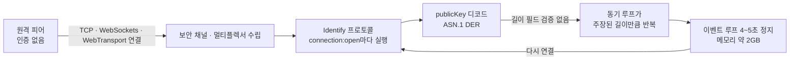
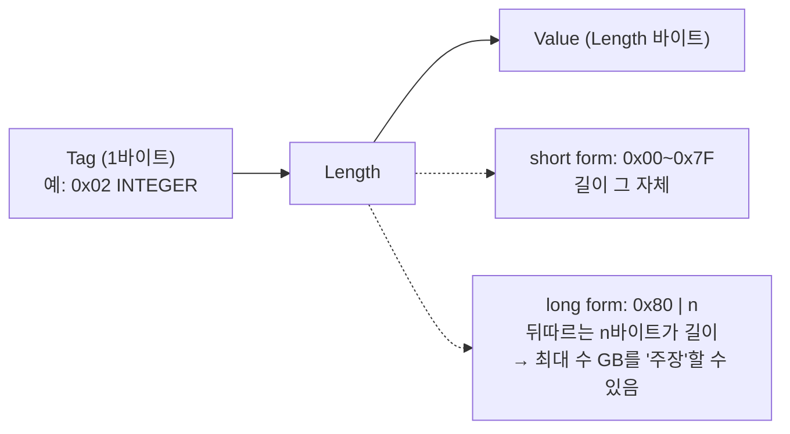
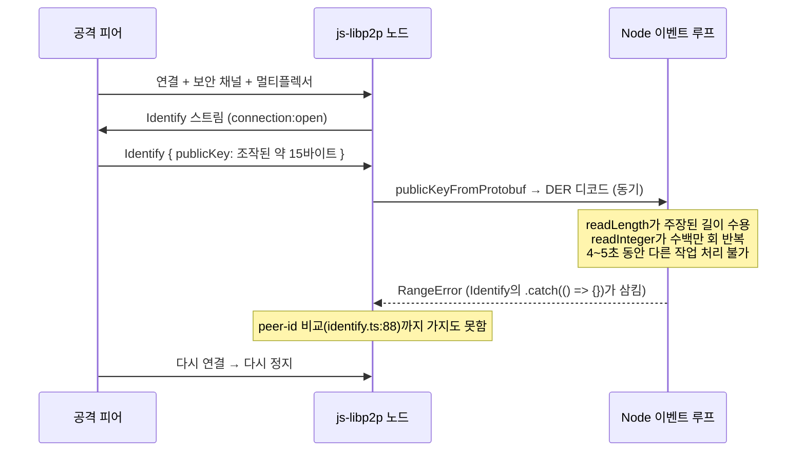

# 15바이트 공개키 하나로 P2P 노드가 4~5초 멈춘다… js-libp2p DER 디코더의 길이 검증 누락

### CVE-2026-110789는 `@libp2p/crypto`의 ASN.1 DER 디코더가 공격자가 적어 넣은 길이 값을 실제 버퍼 크기와 비교하지 않은 결함이다. Identify 메시지의 공개키가 peer-id 검증보다 먼저 해석되기 때문에 인증 전에 터진다. 연결 한 번마다 이벤트 루프가 약 4~5초 멈추고 메모리는 약 2GB까지 치솟는다. `@libp2p/crypto` 5.1.22로 올리면 막힌다

2026년 11월 18일 디지털애셋(박재연 기자)은 [「자바스크립트 기반 블록체인 통신 프로그램서 고위험 취약점…"15바이트로 서버 마비"」](https://www.digitalasset.works/news/articleView.html?idxno=44386)에서 js-libp2p의 서비스 거부 취약점을 전했다. 근거는 전날(현지시각 11월 17일) GitHub Advisory Database에 올라온 [GHSA-rvfr-cqwq-rc4j](https://github.com/advisories/GHSA-rvfr-cqwq-rc4j)다.

이 글은 기사를 뼈대로 삼는다. 여기에 원 권고문, 수정 PR과 커밋, libp2p Identify 스펙, [CVEReports의 기술 분석](https://cvereports.com/reports/CVE-2026-110789)을 엮었다. 무엇이 왜 멈추는지, 누가 영향을 받는지, 어떻게 고치고 점검하는지를 정리한다. **공격 페이로드의 바이트 구성은 싣지 않는다.**

## 1. 한눈에 보기

| 항목 | 내용 |
|---|---|
| CVE / GHSA | CVE-2026-110789 / GHSA-rvfr-cqwq-rc4j |
| 제목 | libp2p: ASN.1 DER decoder drives an unbounded synchronous loop on attacker-controlled length fields, stalling the Node event loop pre-auth |
| 대상 | npm `@libp2p/crypto` **5.1.21 이하** (js-libp2p의 암호 패키지) |
| 수정 | `@libp2p/crypto` **5.1.22** (커밋 `ef6e185`, PR #3587). 분석 글 기준 `libp2p` 패키지는 3.3.8 이상 |
| 심각도 | High, CVSS 3.1 **7.5** (`AV:N/AC:L/PR:N/UI:N/S:U/C:N/I:N/A:H`) |
| CWE | CWE-130 (길이 매개변수 불일치 처리 부적절), CWE-400 (통제되지 않은 자원 소비) |
| 공격 | Identify 메시지에 약 15바이트(분석 글은 7~15바이트)의 조작된 `publicKey` 전송 |
| 영향 | 연결당 이벤트 루프 약 **4~5초** 정지, 메모리 일시 약 **2GB**(측정 피크 RSS 약 1980MB) |
| 인증 | 불필요. peer-id와 서명 검증 **전에** 터짐. 재연결로 무한 반복 가능 |
| 보고자 | X1AOxiang |
| 악용 | 실제 디지털자산 탈취나 Filecoin 네트워크 장애는 확인되지 않음. CISA KEV 미등재 |



## 2. libp2p는 무엇이고, 왜 블록체인 기사에 나왔나

libp2p는 여러 컴퓨터가 중앙 서버 없이 직접 연결해 데이터를 주고받게 하는 **P2P 네트워킹 스택**이다. 전송(TCP, WebSockets, WebTransport, WebRTC), 보안 채널(Noise, TLS), 스트림 멀티플렉싱(yamux), 피어 탐색, 피어 정보 교환(Identify)을 모듈로 제공한다. Go, Rust, JavaScript, Python 등 언어별 구현이 있고, **js-libp2p**는 그 JavaScript(TypeScript) 구현이다.

기사가 짚었듯 libp2p는 분산 파일 저장 시스템 **IPFS**와 가상자산 **Filecoin(FIL)** 네트워크의 기반이다. CVEReports는 js-libp2p를 쓰는 다운스트림 예로 브라우저와 Node용 IPFS 구현 **Helia**, 이더리움 합의 클라이언트 **Lodestar**, 공개 릴레이·부트스트랩 노드를 들었다.

기사는 두 가지 선을 분명히 그었다.

- 이 취약점으로 디지털자산이 탈취되거나 Filecoin 네트워크에 장애가 났다는 사실은 **확인되지 않았다.**
- **JavaScript 언어의 문제가 아니라 특정 라이브러리(js-libp2p)의 구현 결함**이다.

## 3. 원리: 길이를 믿은 디코더

### 3.1 ASN.1 DER의 TLV 구조

공개키(RSA, ECDSA 등)는 흔히 ASN.1 DER로 인코딩한다. DER의 모든 요소는 **T**ag, **L**ength, **V**alue 순서로 적힌다.



long form을 쓰면 몇 바이트만으로 **"뒤에 수십억 바이트가 이어진다"고 주장할 수 있다.** 그래서 디코더는 주장된 길이가 실제로 남은 바이트 수를 넘지 않는지 반드시 확인해야 한다. js-libp2p의 `packages/crypto/src/keys/rsa/der.ts`에 있는 `readLength()`는 이 확인을 하지 않았다.

### 3.2 무엇이 빠져 있었나

권고문이 제시한 `readInteger()`의 흐름은 이렇다(의사코드).

```ts
function readInteger (buf, context) {
  const length = readLength(buf, context)   // 공격자가 정한 값, 거의 무제한까지 주장 가능
  const end = context.offset + length
  for (let i = context.offset; i < end; i++) // buf.byteLength를 훨씬 넘어서까지 반복
    vals.push(buf[i])                         // 끝을 넘으면 undefined를 계속 push
}
```

CVEReports는 수정 전 `readLength()`의 결함을 세 가지로 정리했다.

1. long-form 길이 헤더를 읽는 동안 **헤더 자체가 버퍼를 넘는지** 확인하지 않는다(끝을 넘으면 `undefined`에서 TypeError).
2. `0x80`(indefinite form)이면 길이가 `NaN`이 된다. 결과가 **정수가 아니거나 음수인지** 확인하지 않는다.
3. 결과 길이가 **남은 바이트 수보다 큰지** 확인하지 않는다. 이것이 이번 DoS의 핵심이다.

몇 바이트짜리 입력이 수백만 번의 반복과 거대한 배열·문자열 할당으로 바뀐다. CVEReports는 7바이트 입력이 100만 회 루프를 만들어 **14만 배가 넘는 증폭**이 일어난다고 설명했다. 약 2GB 메모리 급증도 이 반복 할당에서 나온다.

### 3.3 왜 '인증 전'인가: Identify의 순서 문제

[Identify 스펙](https://github.com/libp2p/specs/blob/master/identify/README.md)에 따르면 두 피어는 연결된 뒤 `/ipfs/id/1.0.0` 프로토콜로 자기 정보를 교환한다.

```protobuf
syntax = "proto2";
message Identify {
  optional string protocolVersion = 5;
  optional string agentVersion = 6;
  optional bytes publicKey = 1;     // peer-ids 스펙의 바이너리 형식 공개키
  repeated bytes listenAddrs = 2;
  optional bytes observedAddr = 4;
  repeated string protocols = 3;
}
```

권고문에 따르면 js-libp2p의 Identify는 **연결이 열릴 때마다(`connection:open`)** 실행된다. 순서는 이렇다.

1. 받은 `publicKey`를 먼저 `publicKeyFromProtobuf(publicKey)`로 디코드한다 (`packages/protocol-identify/src/identify.ts:85`).
2. 그 뒤에야 이 키가 연결 상대의 peer-id와 일치하는지 `connection.remotePeer.equals(id)`로 확인한다 (`identify.ts:88`).

즉 **"이 키가 정말 상대의 키인가"를 검증하기 전에 이미 키를 해석한다.** 보안 채널 핸드셰이크는 끝났더라도 Identify 메시지 내용은 아직 검증 전이므로, 아무 피어나 조작된 키를 넣어 보낼 수 있다.



### 3.4 왜 타임아웃이 소용없나

Identify에는 5초 타임아웃이 있다. 하지만 이 디코딩은 **동기 코드 한 틱(tick)** 안에서 끝까지 돈다. JavaScript는 싱글 스레드 이벤트 루프라, 동기 루프가 도는 동안에는 타이머도 `AbortSignal`도 실행될 기회를 얻지 못한다. 결국 그 노드의 **모든 피어 연결, RPC, 타이머가 함께 멈춘다.** 권고문은 이를 "한 피어가 노드를 모든 피어에 대해 응답 불가로 만든다"고 표현했다.

권고문은 다른 방어 장치의 빈틈도 지적했다.

- `pkixToRSAPublicKey`의 `MAX_RSA_JWK_SIZE` 가드는 **전체 blob 크기**만 제한한다. 그 안의 길이 필드는 제한하지 않는다.
- ECDSA 경로(`unmarshalECDSAPublicKey`)에는 아예 상한이 없다.

## 4. 측정 결과와 피해 범위

권고문에 첨부된 재현 시험의 결과다(저자 측정값). 기사가 말한 "공개된 공격 재현 시험"이 바로 이것이다.

| 회차 | 페이로드 전송 | 피해 노드 이벤트 루프 정지 | 피크 RSS |
|---|---|---|---|
| 1 | 성공 | 약 4초 | 약 1980MB |
| 2 | 성공 | 약 4초 | 약 1980MB |
| 3 | 성공 | 약 4~5초 | 약 1980MB |
| 대조군 (정상 Identify) | – | **0초** | – |

- 검증 환경은 js-libp2p 커밋 `a04f5e0`(`@libp2p/crypto` 5.1.21)이다. 정지 시간은 피해 노드에 둔 1초 간격 heartbeat 타이머가 얼마나 밀리는지로 쟀다.
- 디코더가 마지막에 던지는 `RangeError`는 Identify의 `.catch(() => {})`가 삼킨다. 그래서 노드는 죽지 않고 살아남는데, 바로 그 때문에 **연결할 때마다 다시 멈춘다.**
- 컨테이너처럼 메모리 제한이 있는 환경에서는 약 2GB 급증 때문에 **OOM으로 프로세스가 강제 종료**될 수 있다. 기본 V8 힙 한계(약 2~4GB)에 닿는 경우다.

영향 대상은 **기본 Identify 서비스를 켠 채(기본값) 외부에서 닿는 리스너(TCP, WebSockets, WebTransport 등)를 연 모든 js-libp2p 노드**다. 공개 부트스트랩·릴레이 노드처럼 누구나 연결할 수 있는 노드가 가장 위험하다.

## 5. 수정: 길이를 남은 바이트와 비교한다

수정은 PR [#3587](https://github.com/libp2p/js-libp2p/pull/3587) "fix(crypto): reject invalid DER element lengths"다. 커밋 [`ef6e185`](https://github.com/libp2p/js-libp2p/commit/ef6e1851cb00511a4793a5e68948e0cdad385332)는 `der.ts`에 10줄을 더하고 테스트 파일 `der.spec.ts`(48줄)를 새로 만들었다.

```diff
--- a/packages/crypto/src/keys/rsa/der.ts
+++ b/packages/crypto/src/keys/rsa/der.ts
@@ -46,6 +46,10 @@ function readLength (buf: Uint8Array, context: Context): number {
     context.offset++
 
     for (let i = 0; i < count; i++, context.offset++) {
+      if (context.offset >= buf.byteLength) {
+        throw new Error('invalid DER element length')
+      }
+
       str += buf[context.offset].toString(16).padStart(2, '0')
     }
 
@@ -55,6 +59,12 @@ function readLength (buf: Uint8Array, context: Context): number {
       context.offset++
     }
 
+  // length can be NaN (indefinite-form 0x80), negative, or larger than the
+  // bytes that remain; reject all three
+  if (!Number.isInteger(length) || length < 0 || length > buf.byteLength - context.offset) {
+    throw new Error('invalid DER element length')
+  }
+
   return length
 }
```

- 길이 헤더 바이트를 읽기 전에 버퍼 끝인지 확인한다 (결함 1).
- 최종 길이가 `NaN`이거나 음수이거나 남은 바이트보다 크면 거부한다 (결함 2와 3).
- `readInteger`, `readObjectIdentifier`, `readBitString`, `readOctetString`이 모두 `readLength`를 거치므로 **한 곳만 고쳐 전부 막았다.** 정상 키는 영향이 없고, 길이가 버퍼를 정확히 채우는 경계 값은 계속 허용한다.

새 테스트는 다섯 가지다. 길이가 버퍼를 넘는 INTEGER 거부, 같은 조건의 OBJECT IDENTIFIER 거부, indefinite-form 길이 거부, 잘린 long-form 헤더 거부, 그리고 버퍼를 정확히 채우는 요소 허용.

권고문이 제안한 추가 방어(`decodeDer` 진입 시 요소 길이 상한, `unmarshalECDSAPublicKey` 바이트 길이 상한)는 이 커밋에 **들어가지 않았다.** 길이 검증 한 곳으로 공통 경로를 막는 최소 수정이다.

### 5.1 다른 언어 구현에도 있었던 '큰 키' 문제

libp2p에서 공개키 처리로 DoS가 난 것은 이번이 처음이 아니다.

- **go-libp2p** ([GHSA-876p-8259-xjgg](https://github.com/advisories/GHSA-876p-8259-xjgg)): 아주 큰 RSA 키로 노드를 공격할 수 있었다. RSA 키를 **8192비트 이하로 제한**해 고쳤다.
- **py-libp2p** ([CVE-2025-29606](https://osv.dev/vulnerability/GHSA-x8c6-gj59-6rx8)): 0.2.3 이전 버전에서 큰 RSA 키로 자원 소비형 DoS가 가능했다.

go와 py 사례는 키 자체가 너무 커서 생긴 문제였다. js 사례는 키는 15바이트로 작은데 **길이 필드가 거짓말을 하는** 문제다. 공통 교훈은 **검증 전의 피어 입력을 파싱할 때는 크기와 비용에 상한을 둔다**는 것이다.

## 6. 공개 일정: 넉 달의 간격

| 날짜 (2026) | 사건 |
|---|---|
| 7월 29~30일 | PR #3587 작성 (분석 글은 29일 오픈, PR 페이지는 30일 04:33 리뷰 요청) |
| 7월 30일 | 커밋 `ef6e185` 머지, `@libp2p/crypto` 5.1.22 릴리스 |
| 8월 18일 | libp2p 프로젝트가 js-libp2p 저장소에 보안 권고 게시 (작성 tabcat) |
| 11월 17일 | GitHub Advisory Database 등록·검토, NVD 분석, CVSS 7.5 |
| 11월 18일 | 디지털애셋 보도 |


수정 자체는 7월 말에 나왔다. 그러니 **넉 달 가까이 의존성을 올리지 않은 프로젝트가 영향 대상**이다. GitHub Advisory Database 등록은 11월 17일이므로, Dependabot이나 `npm audit` 경고도 그 무렵부터 뜨기 시작했을 것이다. 권고 정보는 자료마다 조금씩 다르니 참고한다. 저장소 권고 페이지에는 패치 버전이 "None"으로 남아 있고, GitHub DB와 GitLab은 5.1.22로 표기한다.

## 7. 대응과 점검

### 7.1 업그레이드

```bash
npm install libp2p@^3.3.8 @libp2p/crypto@^5.1.22
# 또는
bun add libp2p@^3.3.8 @libp2p/crypto@^5.1.22
```

`@libp2p/crypto`는 대개 `libp2p`, `helia` 같은 상위 패키지를 통해 **간접 의존성**으로 들어온다. 직접 올릴 수 없으면 강제로 덮어쓴다.

```json
{
  "overrides": { "@libp2p/crypto": "^5.1.22" },
  "resolutions": { "@libp2p/crypto": "^5.1.22" }
}
```

`overrides`는 npm과 Bun이, `resolutions`는 Yarn이 읽는다. 바꾼 뒤에는 lockfile을 다시 만들고 실제로 설치된 버전을 확인한다.

```bash
npm ls @libp2p/crypto        # 트리 전체에서 5.1.21 이하가 남았는지
bun pm ls --all | grep @libp2p/crypto
```

### 7.2 예제: Bun으로 lockfile 전수 점검

모노레포나 여러 서비스에서 `@libp2p/crypto`가 어느 버전으로 깔렸는지 한 번에 훑는 스크립트다. `node_modules` 안의 모든 `package.json`을 읽으므로 간접 의존성까지 잡는다.

```ts
// check-libp2p-crypto.ts
// 사용: bun run check-libp2p-crypto.ts [프로젝트 루트들...]
import { Glob } from "bun";

const FIXED = [5, 1, 22] as const;
const roots = Bun.argv.slice(2).length ? Bun.argv.slice(2) : ["."];

const older = (v: string) => {
  const p = v.split(/[.-]/).map(Number);
  for (let i = 0; i < 3; i++) if ((p[i] ?? 0) !== FIXED[i]) return (p[i] ?? 0) < FIXED[i];
  return false;
};

let vulnerable = 0;
for (const root of roots) {
  const glob = new Glob("**/node_modules/@libp2p/crypto/package.json");
  for await (const file of glob.scan({ cwd: root, dot: true, followSymlinks: false })) {
    const { version } = await Bun.file(`${root}/${file}`).json();
    const bad = older(version);
    if (bad) vulnerable++;
    console.log(`${bad ? "VULNERABLE" : "ok        "}  @libp2p/crypto@${version}  ${root}/${file.replace("/package.json", "")}`);
  }
}
console.log(vulnerable ? `\n${vulnerable}곳이 5.1.22 미만입니다. 업그레이드하거나 overrides를 쓰세요.` : "\n모두 5.1.22 이상입니다.");
process.exit(vulnerable ? 1 : 0);
```

CI 단계에 넣으면 취약 버전이 다시 들어오는 것을 막을 수 있다. 종료 코드가 1이면 빌드를 실패시킨다.

### 7.3 예제: 이벤트 루프 정지 감시

CVEReports는 **4,000~5,000ms 수준의 이벤트 루프 지연**과 **1.5~2GB 힙 급등**을 탐지 신호로 꼽았다. 권고문의 재현 시험도 1초 heartbeat가 얼마나 밀리는지로 정지를 쟀다. 같은 방식을 운영 노드에 넣으면 패치 전후 모두 이상 징후를 볼 수 있다. Node와 Bun 모두에서 동작한다.

```ts
// event-loop-watch.ts — libp2p 노드 프로세스 안에서 import 한다
const INTERVAL_MS = 1_000;
const STALL_WARN_MS = 1_000;   // 1초 이상 밀리면 경고
const RSS_WARN_MB = 1_500;

let last = performance.now();
setInterval(() => {
  const now = performance.now();
  const lag = now - last - INTERVAL_MS;   // 예정보다 늦게 깨어난 만큼이 정지 시간
  last = now;
  const rssMb = Math.round(process.memoryUsage().rss / 1024 / 1024);
  if (lag > STALL_WARN_MS || rssMb > RSS_WARN_MB) {
    console.warn(JSON.stringify({
      at: new Date().toISOString(),
      event: "event_loop_stall",
      lagMs: Math.round(lag),
      rssMb,
    }));
  }
}, INTERVAL_MS).unref();
```

패치한 노드라면 공격 시도는 디코더가 바로 거부한다. 이때 `libp2p:identify` 디버그 로그(`DEBUG=libp2p:identify*`)에 `invalid DER element length` 오류가 남으므로, 누가 시도했는지 추적할 수 있다.

### 7.4 예제: 길이를 검증하는 DER 리더와 테스트

수정 커밋과 같은 원칙(길이 헤더 범위 확인, 정수·비음수 확인, 남은 바이트와 비교)을 독립된 작은 함수로 옮기고 `bun:test`로 검증한 예다. 신뢰하지 않는 입력의 TLV를 파싱할 때 그대로 응용할 수 있다.

```ts
// der-length.ts
export function readDerLength(buf: Uint8Array, offset: number): { length: number; next: number } {
  if (offset >= buf.byteLength) throw new Error("invalid DER element length");
  const first = buf[offset++];
  let length = first;

  if (first & 0x80) {
    const count = first & 0x7f;
    // count 0 = indefinite form (DER에서 금지), 4바이트 초과는 2^32 이상이라 키에 불필요
    if (count === 0 || count > 4) throw new Error("invalid DER element length");
    length = 0;
    for (let i = 0; i < count; i++) {
      if (offset >= buf.byteLength) throw new Error("invalid DER element length"); // 잘린 헤더
      length = length * 256 + buf[offset++];
    }
  }

  // 남은 바이트보다 긴 값은 절대 받지 않는다
  if (!Number.isInteger(length) || length < 0 || length > buf.byteLength - offset) {
    throw new Error("invalid DER element length");
  }
  return { length, next: offset };
}
```

```ts
// der-length.test.ts — bun test
import { expect, test } from "bun:test";
import { readDerLength } from "./der-length";

const der = (...b: number[]) => Uint8Array.from(b);

test("short form, 버퍼를 정확히 채우는 길이는 허용", () => {
  expect(readDerLength(der(0x03, 0xaa, 0xbb, 0xcc), 0)).toEqual({ length: 3, next: 1 });
});

test("long form 정상 값", () => {
  const body = new Array(200).fill(0);
  expect(readDerLength(der(0x81, 200, ...body), 0)).toEqual({ length: 200, next: 2 });
});

test("남은 바이트보다 긴 길이는 거부", () => {
  expect(() => readDerLength(der(0x05, 0x00), 0)).toThrow("invalid DER element length");
});

test("indefinite form(0x80)은 거부", () => {
  expect(() => readDerLength(der(0x80, 0x00), 0)).toThrow("invalid DER element length");
});

test("잘린 long-form 헤더는 거부", () => {
  expect(() => readDerLength(der(0x82, 0x01), 0)).toThrow("invalid DER element length");
});
```

## 8. 정리: 개발·운영 체크리스트

- [ ] 모든 서비스와 모노레포에서 `@libp2p/crypto` 버전을 전수 확인했다 (간접 의존성 포함)
- [ ] `@libp2p/crypto` 5.1.22 이상, `libp2p` 3.3.8 이상으로 올렸다. 직접 못 올리면 `overrides`/`resolutions`를 썼다
- [ ] lockfile을 다시 만들고 `npm ls` / `bun pm ls`로 실제 설치 버전을 확인한 뒤 재배포했다
- [ ] 공개 부트스트랩·릴레이 노드를 먼저 패치했다
- [ ] 노드 프로세스에 이벤트 루프 지연과 RSS 감시를 넣었다. 컨테이너 메모리 제한에 따른 OOM 재시작을 알림으로 받는다
- [ ] 패치 후 `libp2p:identify` 로그의 `invalid DER element length`로 시도 흔적을 본다
- [ ] 직접 만든 프로토콜 파서도 "검증 전 입력의 길이 필드는 남은 바이트와 비교한다"는 원칙을 지키는지 점검했다

## 참고

- 디지털애셋, [자바스크립트 기반 블록체인 통신 프로그램서 고위험 취약점..."15바이트로 서버 마비"](https://www.digitalasset.works/news/articleView.html?idxno=44386) (2026-11-18)
- GitHub Advisory Database, [GHSA-rvfr-cqwq-rc4j / CVE-2026-110789](https://github.com/advisories/GHSA-rvfr-cqwq-rc4j) (2026-11-17)
- libp2p, [js-libp2p 저장소 보안 권고](https://github.com/libp2p/js-libp2p/security/advisories/GHSA-rvfr-cqwq-rc4j) (2026-08-18)
- GitLab Advisory, [CVE-2026-110789 (@libp2p/crypto)](https://advisories.gitlab.com/npm/@libp2p/crypto/CVE-2026-110789/)
- 수정: [PR #3587](https://github.com/libp2p/js-libp2p/pull/3587), [커밋 ef6e185](https://github.com/libp2p/js-libp2p/commit/ef6e1851cb00511a4793a5e68948e0cdad385332), [crypto-v5.1.22 릴리스](https://github.com/libp2p/js-libp2p/releases/tag/crypto-v5.1.22)
- Amit Schendel, [CVE-2026-110789 기술 분석](https://cvereports.com/reports/CVE-2026-110789), CVEReports (2026-11-17)
- [libp2p Identify 스펙 v1.0.0](https://github.com/libp2p/specs/blob/master/identify/README.md)
- 관련 권고: [go-libp2p GHSA-876p-8259-xjgg](https://github.com/advisories/GHSA-876p-8259-xjgg), [py-libp2p CVE-2025-29606](https://osv.dev/vulnerability/GHSA-x8c6-gj59-6rx8)
- 기타 분석: [Strix](https://www.strix.ai/cve/CVE-2026-110789), [OffSeq Radar](https://radar.offseq.com/threat/cve-2026-110789-cwe-130-improper-handling-of-length-parameter-inconsistency-in-libp2p-js-libp2p-fef121121d35d0cf)
- 같은 카테고리: [NoisyTCP](261121_2158_NoisyTCP_CVE_2026_99288_Linux_Kernel_TCP_Pre-auth_Remote_DoS.md), [Node.js와 Bun의 Brotli 디코더 범위 밖 쓰기](261022_1720_Node.js_and_Bun_Brotli_Decoder_Out-of-Bounds_Write.md)
