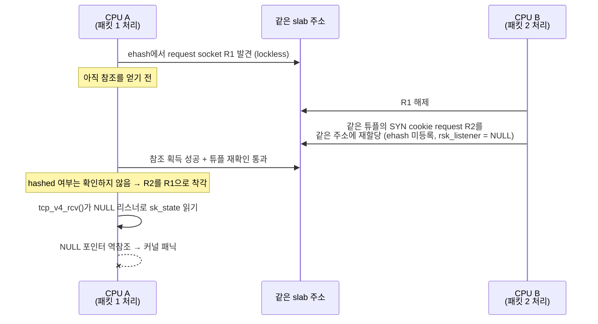
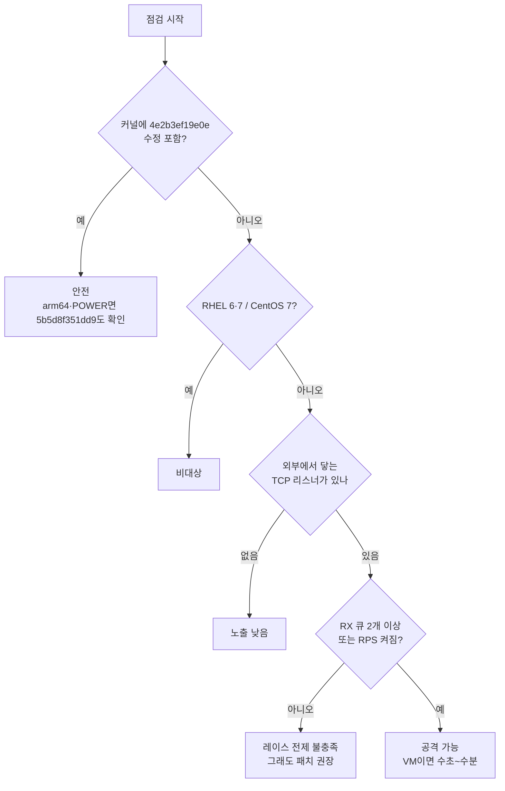
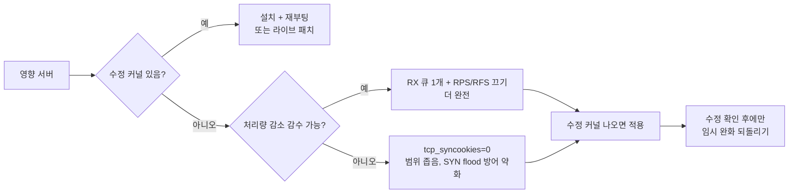
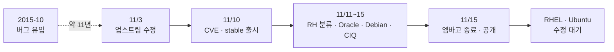

# 리눅스 커널 TCP에 11년 숨어 있던 '노이지TCP'… 로그인 없이 패킷만으로 서버가 멈춘다

### CVE-2026-99288은 established 소켓을 락 없이 찾는 경로의 레이스다. 재활용된 request socket을 정상 소켓으로 착각한 커널이 NULL 리스너를 읽고 패닉에 빠진다. 기본 설정 Nginx·Apache·SSH도 대상이다. QEMU/KVM 가상머신에서는 5초~2분, 조용한 베어메탈에서는 약 14시간이 걸렸다. 수정은 6.12.117, 6.18.63, 7.3.4. 당장 못 올리면 SYN cookie를 끄거나 수신 큐를 하나로 줄인다

2026년 11월 15일 16:00 UTC, 보안 연구원 김현우(Hyunwoo Kim, @v4bel)는 linux-distros 엠바고가 끝나자 oss-security 메일링 리스트에 [NoisyTCP: Linux Kernel TCP Pre-auth Remote Corruption (CVE-2026-99288)](https://openwall.com/lists/oss-security/2026/11/15/2)을 올렸다. 같은 내용은 [GitHub 저장소 V4bel/NoisyTCP](https://github.com/V4bel/NoisyTCP)에도 있다. 이틀 뒤 디일렉은 [「리눅스 커널서 11년 숨어 있던 고위험 취약점 '노이지TCP' 발견」](https://www.thelec.kr/news/articleView.html?idxno=65549)(박현선 전문기자, 2026-11-17)에서 이 결함을 가상화 인프라 관점에서 다뤘다.

이 글은 디일렉 기사를 뼈대로 삼는다. 여기에 연구자 원문, 커널 CVE 설명(Debian 보안 트래커에 실린 커밋 메시지), [TuxCare의 배포판별 분석](https://tuxcare.com/blog/noisytcp-cve/), [GeekNews 요약](https://news.hada.io/topic?id=37445)을 엮었다. **레이스를 맞추는 기법과 PoC 구성은 다루지 않는다.** 원리, 영향 조건, 점검, 패치, 임시 완화를 정리한다.

## 1. 한눈에 보기

| 항목 | 내용 |
|---|---|
| 이름 | NoisyTCP (노이지TCP) |
| CVE | CVE-2026-99288 |
| 발견 | 김현우 (Hyunwoo Kim, @v4bel) |
| 위치 | 리눅스 커널 TCP, established 소켓 lockless lookup (`__inet_lookup_established()` / `__inet6_lookup_established()`) |
| 결과 | 원격·비인증 커널 패닉 → 호스트 전체 다운 (DoS) |
| 코드 실행 | 입증되지 않음. 연구실 VM 한정, 보안 완화를 끈 제한적 익스플로잇만 존재 |
| 도입 | 커밋 `079096f103fa` (2015-10-03, "tcp/dccp: install syn_recv requests into ehash table"), Linux 4.4 (2016년 1월)부터 |
| 수정 | 커밋 `4e2b3ef19e0e` (2026-11-03, "inet: reject unhashed sockets during established lookups") |
| 수정 stable | **6.12.117, 6.18.63, 7.3.4** |
| 심각도 | Red Hat **Important**, 예비 CVSS 3.1 **7.5**. NVD 자체 점수는 11월 16일 기준 없음 |
| 전제 | 패치 안 된 커널 + 외부에서 닿는 TCP 리스너 + RX 큐 2개 이상 또는 RPS |
| 야생 악용 | 11월 16일 기준 보고 없음. 공개 익스플로잇 코드 없음 |


## 2. 왜 지금 이 버그가 주목받나

디일렉 기사는 가상화 시장 이야기로 시작한다. 브로드컴이 VMware 영구 라이선스 판매를 중단한 뒤, 비용 부담을 느낀 기업들은 오픈소스 가상화 플랫폼(QEMU/KVM 기반)을 대안으로 검토하고 있다. 바로 그런 **가상머신 환경에서 특히 빨리 터지는** 리눅스 커널 결함이 나온 것이다.

다만 기사가 강조하듯 **원인은 하이퍼바이저가 아니라 게스트 리눅스 커널**이다. VMware ESXi 같은 상용 하이퍼바이저를 써도 게스트 OS가 리눅스면 똑같이 영향받는다. 따라서 점검 대상은 하이퍼바이저 버전이 아니라 **각 VM 안의 커널 버전과 패치 여부**다.

컨테이너 환경에서는 피해가 더 커진다. 컨테이너는 호스트 커널을 함께 쓴다. 웹서버 컨테이너 하나가 공격받아도 커널이 패닉에 빠지면 그 호스트의 **모든 컨테이너와 서비스가 함께 내려간다.** 애플리케이션 버그라면 그 프로세스만 죽고 끝나지만, 커널 버그는 운영체제 전체를 멈춘다.

## 3. 원리: 재활용된 소켓을 옛 소켓으로 착각하다

### 3.1 배경 지식

- **ehash**: 커널은 이미 연결된(established) TCP 소켓을 4-튜플(출발지/목적지 IP·포트)로 찾는 해시 테이블에 넣어 둔다. 패킷이 들어올 때마다 여기서 소켓을 찾는다.
- **lockless lookup**: 성능을 위해 이 조회는 락 없이 RCU로 한다. 소켓 메모리 캐시는 `SLAB_TYPESAFE_BY_RCU`로 만들어져 있다. 그래서 **조회하는 동안 객체가 해제되고 같은 주소에 같은 타입의 새 객체가 들어올 수 있다.** 이를 감안해 조회 코드는 참조(refcount)를 얻은 뒤 "튜플이 아직 맞는지" 다시 확인한다.
- **request socket**: 3-way handshake 중인 연결을 나타내는 작은 객체다. 2015년 커밋 `079096f103fa` 이후 SYN_RECV 상태의 request도 ehash에 들어간다. 이때 각 request는 자신이 속한 리스너를 `rsk_listener`로 가리킨다.
- **SYN cookie**: SYN flood 방어 기법이다. 서버가 상태를 저장하지 않고 쿠키를 보냈다가, ACK가 돌아오면 그 쿠키로 request를 **재구성**한다. 이렇게 재구성된 request는 ehash에 넣지 않는 임시 객체다.

### 3.2 무엇이 빠져 있었나

커널 CVE 설명(커밋 메시지)에 따르면 `__inet_lookup_established()`와 `__inet6_lookup_established()`는 튜플이 일치하면 참조를 얻고 튜플을 다시 확인한다. 하지만 **새 객체가 실제로 해시 테이블에 들어 있는지(hashed)는 확인하지 않았다.**



연구자는 이런 상황을 **ABA 레이스**라 부른다. 같은 주소(A)에 있던 객체가 다른 객체(B)로 바뀌었다가 다시 "A처럼 보이는" 상태가 되어 검사를 통과한다는 뜻이다. 디일렉 기사는 이를 "조회 작업이 새 소켓을 예전 소켓으로 잘못 인식한다"고 풀었다.

커널 CVE 설명에 실린 oops 로그의 요지는 이렇다.

```text
BUG: kernel NULL pointer dereference, address: 0000000000000012
#PF: supervisor read access in kernel mode
RIP: tcp_v4_rcv+0x44e/0x1280
Kernel panic - not syncing: Fatal exception in interrupt
```

`interrupt` 문맥에서 난 예외라 커널은 복구하지 못하고 패닉으로 끝난다.

### 3.3 두 가지 트리거 경로

| 경로 | 결과 | 난도 |
|---|---|---|
| ① request_sock 재사용 ABA 레이스 | NULL 리스너 역참조 → 커널 패닉 (원격 DoS) | 연구자 표현으로 "어렵지 않게" 가능. 디일렉이 말한 소켓 검색·관리 오류 |
| ② full child socket ABA 레이스 | 원격 **use-after-free** 가능 | 중첩된 레이스가 모두 맞아야 해서 특수 기법 없이는 매우 어려움. 디일렉이 말한 "두 번째 공격 경로" |

### 3.4 수정 방법

수정 커밋 `4e2b3ef19e0e`의 핵심은 **참조를 얻은 뒤 "해시돼 있는가"를 확인하는 것**이다.

- IPv4/IPv6 established lookup에서 참조를 얻은 뒤 nulls node가 unhashed인지 본다. unhashed이거나 튜플이 맞지 않으면 참조를 놓고 lookup을 처음부터 다시 한다.
- 소켓이 TIME_WAIT 해시로 넘어갔거나 request가 child 소켓으로 바뀐 경우에도 다시 찾아 새 소켓을 잡는다.
- ehash에 넣지 않은 request socket도 이제 다른 CPU가 참조를 잡을 수 있다. 그래서 SYN cookie, TCP Fast Open, request migration 경로가 실패할 때 객체를 바로 해제하지 않고 `reqsk_put()`으로 참조를 놓는다.

TuxCare는 하나를 더 짚는다. arm64, POWER처럼 메모리 순서가 약한 CPU에서는 후속 커밋 `5b5d8f351dd9`("net: restore refcount ordering for lockless socket access")도 필요하다. 이 커밋은 6.12.117, 6.18.63, 7.3.4에 들어 있지 않으므로, 해당 아키텍처라면 **두 커밋이 모두 들어갔는지** 배포판에 확인해야 한다. 같은 2015년 커밋에서 비롯된 10월의 TCP UAF([CVE-2026-98432](https://tuxcare.com/blog/cve-2026-98432-linux-tcp-remote-root/)) 패치로는 NoisyTCP가 고쳐지지 않는다는 점도 지적했다.

## 4. 누가 실제로 맞을 수 있나



전제는 두 가지뿐이다. 연구자 FAQ에 따르면 특별한 설정은 필요 없다. 서비스가 `listen()`만 하고 있으면 된다.

1. 패치되지 않은 커널에서 공격자가 닿을 수 있는 TCP 리스너가 있을 것
2. 수신 패킷이 여러 CPU에서 동시에 처리될 것. 즉 NIC RX 큐가 2개 이상이거나 RPS(Receive Packet Steering)가 켜져 있을 것

요즘 서버와 클라우드 VM은 대부분 멀티 큐 NIC(virtio-net multiqueue, ENA 등)를 쓴다. 그래서 두 번째 조건도 기본으로 충족되는 경우가 많다.

### 4.1 VM이 훨씬 빨리 무너지는 이유

| 환경 | 대상 | 패닉까지 걸린 시간 |
|---|---|---|
| QEMU/KVM 가상머신 | 기본 설정 Nginx, Apache, SSH | **약 5초 ~ 2분** |
| 조용한 베어메탈 (RX 큐 8개) | 기본 설정 Nginx | **약 14시간** (타이밍을 맞춘 PoC를 썼는데도) |

레이스 창은 아주 좁다. 베어메탈에서는 두 CPU의 처리가 정확히 그 틈에 겹치기 어렵다. 반면 VM에서는 하이퍼바이저가 vCPU를 수시로 선점(preemption)한다. 한 vCPU가 lookup 도중에 멈춰 있는 동안 다른 vCPU가 해제와 재할당을 끝내 버리면, 좁던 창이 사실상 크게 벌어진다. 디일렉 기사가 "가상머신 환경서 수초 만에 서버 마비"라고 쓴 이유다.

**컨테이너는 방어막이 아니다.** 컨테이너 안 웹서버를 노려도 내려가는 것은 호스트 커널이다.

## 5. 원격 코드 실행까지 가나?

현재 답은 "아니오"다.

- 연구자 FAQ의 답은 "Not yet. and basically, no."다. 지금 있는 것은 **연구실 VM 대상의 제한적 익스플로잇**뿐이다. 디일렉 보도에 따르면 이마저도 특정 디버깅 설정을 켜고 보안 완화 기법(mitigation)을 끈 서버에서만 동작한다.
- ② 경로(UAF)를 원격으로 트리거하려면 아직 공개되지 않은 기술과 **오라클**이 필요하다고 연구자는 말했다. 오라클은 공격자가 입력을 보냈을 때 시스템의 응답이나 부수 반응으로 내부 상태나 조건 충족 여부를 추론하게 해 주는 관측 수단을 말한다. 일반 리눅스 서버에서 동작하는 범용 RCE가 연구 목표지만 난도가 매우 높을 것이라고 내다봤다.
- Red Hat도 데이터 변조나 임의 코드 실행은 불가능하다고 평가했다. 공개된 GitHub 저장소는 write-up이며 익스플로잇 코드가 아니다.

결론적으로 **지금 확인된 위험은 원격 DoS**다. 다만 인증이 필요 없고, 기본 설정 서비스가 대상이며, VM에서는 몇 초면 터진다. 그래서 가용성 관점에서는 충분히 심각하다.

### 5.1 CVSS 7.5를 어떻게 읽을까

| 평가 | 벡터 | 점수 |
|---|---|---|
| Red Hat 예비 | `AV:N/AC:H/PR:L/UI:N/S:U/C:H/I:H/A:H` | 7.5 (High), 등급 Important |
| TuxCare 가상 재계산 | `AV:N/AC:H/PR:N/UI:N/S:U/C:N/I:N/A:H` | 5.9 (Medium) |

TuxCare는 Red Hat 벡터가 본문 설명과 맞지 않는다고 지적했다. 벡터는 권한 필요(PR:L)와 기밀성·무결성 영향(C:H, I:H)을 가정하지만, Red Hat 설명 자체는 비인증이고 데이터 변조가 불가능하다고 한다. 설명대로 다시 계산하면 5.9가 나온다. 다만 TuxCare 스스로 이것은 **가상의 계산이지 Red Hat이 발표한 점수가 아니라고** 밝혔다. 점수보다 "인증 없는 원격 호스트 다운"이라는 실제 영향으로 우선순위를 정하는 편이 낫다.

## 6. 패치 현황 (2026-11-16 기준, TuxCare·Debian 트래커)

| 대상 | 상태 | 수정 커널 / 공지 |
|---|---|---|
| 업스트림 stable 6.12 / 6.18 / 7.3 | 수정됨 | **6.12.117 / 6.18.63 / 7.3.4** |
| 업스트림 6.6, 6.1, 5.15, 5.10 등 | 수정 릴리스 없음 | 배포판 백포트에 의존 |
| 업스트림 7.2 | 수정 전에 지원 종료(11-01, 7.2.15) | 7.3.4로 이동 |
| Debian 13 (trixie) | 수정됨 | linux **6.12.117-1** (DSA-6628-1) |
| Debian 12 (bookworm) | 수정됨 | linux **6.1.192-1** (DLA-4906-1). 트래커 상단 표에는 6.1.192-2로 표기 |
| Debian forky / sid | 수정됨 | 7.3.4-1 / 7.3.5-1 |
| Oracle Linux UEK | 수정됨 | ELSA-2026-500630, -500631, -500632 (11-12, 11-13) |
| CIQ Rocky 상용 빌드 | 11-15 수정 | [CIQ 공지](https://kb.ciq.com/article/security-advisories/cve-2026-99288-mitigation) |
| RHEL 8 / 9 / 10 | 영향, 수정 커널 날짜 없음 | [Red Hat CVE 페이지](https://access.redhat.com/security/cve/cve-2026-99288) |
| AlmaLinux, CloudLinux, 커뮤니티 Rocky, Oracle RHCK | 영향, 미출시 | RHEL을 따라감 |
| Ubuntu 16.04 ~ 26.10 | 평가 중 | [Ubuntu CVE 페이지](https://ubuntu.com/security/CVE-2026-99288) |
| RHEL 6 / 7, CentOS 7 | **영향 없음** | 해당 없음 |
| Amazon Linux, SUSE, Proxmox VE | 각 벤더 트래커 확인 | |

주의할 점은 **배포판 커널의 업스트림 버전 숫자만 보고 판단하면 안 된다는 것**이다. TuxCare에 따르면 업스트림 6.1.192에는 수정이 없지만 Debian은 `6.1.192-1`에 백포트했다. 설치된 패키지의 changelog나 보안 공지로 확인해야 한다. 또 커널을 설치만 하고 **재부팅하지 않으면** 실행 중인 커널은 여전히 취약하다.

## 7. 점검: 내 서버는 지금 안전한가

### 7.1 1분 점검 명령 (TuxCare)

```bash
uname -r                                           # 실행 중인 커널
ss -ltn                                            # 외부에 열린 TCP 리스너
ethtool -l eth0                                    # Current hardware settings의 Combined/RX 값
grep . /sys/class/net/eth0/queues/rx-*/rps_cpus    # 0이 아니면 RPS 켜짐
sysctl net.ipv4.tcp_syncookies                     # 1이면 SYN cookie 켜짐(기본값)

# Debian: 부팅된 커널 changelog에 CVE가 있으면 수정 포함 (0이 아니면 OK)
zgrep -c CVE-2026-99288 /usr/share/doc/linux-image-$(uname -r)/changelog*.gz
```

`eth0`은 실제 인터페이스 이름으로 바꾼다. `ethtool -l`의 Combined나 RX가 1보다 크거나 `rps_cpus`가 0이 아니면 레이스 전제 조건이 충족된 상태다.

### 7.2 예제: Bun으로 여러 신호를 한 번에

위 신호를 모아 판정하는 [Bun](https://bun.sh) 스크립트다. **패킷을 보내지 않고** 로컬 상태만 읽는다. 배포판 커널은 백포트 때문에 버전 숫자만으로 판정할 수 없으므로 업스트림 stable 버전만 자동으로 판정하고, 나머지는 "review"로 남긴다.

```ts
// check-noisytcp.ts
// 사용: bun run check-noisytcp.ts [인터페이스 이름, 기본 eth0]
import { $ } from "bun";

const iface = Bun.argv[2] ?? "eth0";

// 1) 커널 버전: 업스트림 stable 수정 버전과 비교
const release = (await $`uname -r`.text()).trim();
const [maj, min, patch] = (release.match(/^(\d+)\.(\d+)\.(\d+)/)?.slice(1) ?? ["0", "0", "0"]).map(Number);
const FIXED: Record<string, number> = { "6.12": 117, "6.18": 63, "7.3": 4 };
const line = `${maj}.${min}`;
let kernel: "fixed" | "vulnerable" | "review" | "not-affected";
if (maj < 4 || (maj === 4 && min < 4)) kernel = "not-affected"; // 4.4 이전 (RHEL 7 계열 포함)
else if (line in FIXED) kernel = patch >= FIXED[line] ? "fixed" : "vulnerable";
else if (maj > 7 || (maj === 7 && min > 3)) kernel = "fixed";
else kernel = "review"; // 6.6, 6.1, 5.x 등: 배포판 백포트 확인 필요

// Debian: 부팅된 커널 changelog에 CVE가 있으면 수정 포함
const debianChangelog = await $`sh -c 'zgrep -c CVE-2026-99288 /usr/share/doc/linux-image-$(uname -r)/changelog*.gz 2>/dev/null'`
  .nothrow()
  .text();
if (Number(debianChangelog.trim().split("\n").pop() || 0) > 0) kernel = "fixed";

// 2) 레이스 전제: RX 큐 수와 RPS
const ethtool = await $`ethtool -l ${iface}`.nothrow().text();
const current = ethtool.split("Current hardware settings:")[1] ?? "";
const queues = Math.max(
  Number(current.match(/Combined:\s+(\d+)/)?.[1] ?? 0),
  Number(current.match(/RX:\s+(\d+)/)?.[1] ?? 0),
);
const rps = (await $`sh -c ${`cat /sys/class/net/${iface}/queues/rx-*/rps_cpus 2>/dev/null`}`.nothrow().text())
  .split("\n")
  .some((v) => /[1-9a-f]/i.test(v.replace(/,/g, "")));
const multiCpuRx = queues > 1 || rps;

// 3) 열린 TCP 리스너 (루프백 제외)
const listeners = (await $`ss -ltnH`.nothrow().text())
  .split("\n")
  .filter((l) => l.trim() && !/\s(127\.0\.0\.1|\[::1\]):/.test(l)).length;

// 4) 임시 완화 상태
const syncookies = (await $`sysctl -n net.ipv4.tcp_syncookies`.nothrow().text()).trim();

const exposed = kernel !== "fixed" && kernel !== "not-affected" && listeners > 0 && multiCpuRx;
console.log({
  release, kernel, iface, rxQueues: queues, rps, multiCpuRx,
  externalTcpListeners: listeners, tcp_syncookies: syncookies,
  verdict: kernel === "fixed" ? "patched (재부팅 후 실행 중 커널 기준)"
    : kernel === "not-affected" ? "not affected"
    : exposed ? (syncookies === "0" ? "exposed, SYN cookie 완화만 적용됨 → 패치 필요" : "EXPOSED → 패치 또는 임시 완화")
    : "전제 일부 불충족. 그래도 패치 권장",
});
console.log("※ arm64·POWER는 후속 커밋 5b5d8f351dd9 포함 여부를 배포판에 확인할 것.");
console.log("※ 컨테이너가 별도 netns를 쓰면 tcp_syncookies는 네임스페이스마다 따로 확인할 것.");
```

## 8. 대응

### 8.1 1순위: 수정 커널 설치 후 재부팅

연구자와 TuxCare 모두 **`4e2b3ef19e0e` 패치 적용이 최우선**이라고 말한다. 배포판 수정 커널을 설치하고 재부팅하거나, 리부트 없는 라이브 패치를 쓴다. TuxCare KernelCare의 라이브 패치는 11월 16일 기준 아직 나오지 않았다. 자체 빌드 커널이라면 6.12.117, 6.18.63, 7.3.4 이상으로 올린다.

### 8.2 패치 전 임시 완화

**① SYN cookie 끄기.** 범위가 좁고 처리량에 영향이 없다.

```bash
sudo sysctl -w net.ipv4.tcp_syncookies=0
# 되돌리기
sudo sysctl -w net.ipv4.tcp_syncookies=1
```

입증된 경로는 SYN cookie로 request가 재구성되는 과정을 거친다. 이 설정은 그 경로를 막는다. 대가도 분명하다. SYN flood 방어가 약해진다. 이 값은 **네트워크 네임스페이스마다** 따로 관리되므로, 별도 netns를 쓰는 컨테이너(Kubernetes 파드 등)에는 각각 적용해야 한다. 새 네임스페이스는 커널 기본값(보통 1)으로 시작한다.

**② 수신 처리를 한 CPU로 직렬화하기.** 레이스 전제를 없애는 더 완전한 방법이지만 처리량이 줄어든다.

```bash
ethtool -L eth0 combined 1        # RX 채널이 따로 있는 NIC는: ethtool -L eth0 rx 1
for q in /sys/class/net/eth0/queues/rx-*/rps_cpus; do echo 0 > "$q"; done
sysctl -w net.core.rps_sock_flow_entries=0   # RFS 끄기
```

- 일부 물리 NIC에서는 큐를 바꿀 때 링크가 잠깐 끊긴다. 콘솔 접근을 준비해 두고 작업한다.
- `ethtool` 변경은 네트워크 설정이 다시 적용하지 않으면 재부팅 후 사라진다.



TuxCare는 두 완화책을 실제 익스플로잇으로 시험하지는 않았다고 밝혔다. 스테이징에서 먼저 시험하고, 수정 커널을 확인한 뒤에만 되돌린다.

### 8.3 이 버그의 '이상한' 공개 순서

TuxCare는 이것이 제로데이가 아니라고 강조한다. 수정이 공개보다 먼저 업스트림에 들어갔기 때문이다. 수정은 CVE 공개보다 일주일, 전체 write-up보다 12일 앞섰다. 하지만 엠바고가 끝난 시점에도 RHEL, Ubuntu 같은 주요 배포판의 수정 커널은 아직 없었다.

| 날짜 | 사건 |
|---|---|
| 2015-10-03 | 커밋 `079096f103fa`로 버그 유입 (Linux 4.4, 2016년 1월 배포) |
| 2026-11-03 | 김현우의 수정 `4e2b3ef19e0e` 업스트림 반영 |
| 2026-11-10 | 커널 CVE 팀이 CVE-2026-99288 발표, stable 6.12.117 · 6.18.63 · 7.3.4 출시 |
| 2026-11-11 | Red Hat이 RHEL 8/9/10을 영향으로 분류 (Important, 7.5) |
| 2026-11-12~13 | Oracle UEK 수정 커널 |
| 11-15 이전 | Debian trixie(DSA-6628-1), bookworm(DLA-4906-1) 수정 |
| 2026-11-15 | CIQ 패치 커널. 엠바고 종료, 16:00 UTC oss-security 공지 |
| 2026-11-17 | 디일렉 보도 |
| 대기 중 | RHEL과 리빌드, Ubuntu, 업스트림 6.6 이하, 라이브 패치 |



## 9. 연구자의 이전 발견: 더티 프래그

디일렉은 김현우 연구원의 이전 이력도 소개했다. 그는 지난 5월 xfrm-ESP와 RxRPC에 있던 두 가지 페이지 캐시 쓰기 취약점을 연결해, 일반 사용자가 root 권한을 얻는 **더티 프래그(Dirty Frag)** 를 공개했다. 그때는 배포판 패치가 준비되기 전에 동작하는 PoC가 공개돼 관리자들의 대응 부담이 컸다. 이번 NoisyTCP는 엠바고를 거쳐 공개됐고, 익스플로잇 코드도 공개되지 않았다.

## 10. 정리: 운영자 체크리스트

- [ ] 모든 리눅스 호스트와 **VM 게스트**의 실행 중 커널을 목록화했다. 하이퍼바이저 종류(ESXi, KVM)와 무관하게 확인했다
- [ ] 배포판 공지나 changelog로 `4e2b3ef19e0e` 포함 여부를 확인했다. 업스트림 버전 숫자만 보고 판단하지 않았다
- [ ] arm64·POWER 호스트는 `5b5d8f351dd9`도 포함됐는지 확인했다
- [ ] 수정 커널을 설치하고 **재부팅**했다. 또는 라이브 패치를 적용했다
- [ ] 수정이 없는 호스트에는 `tcp_syncookies=0` 또는 단일 RX 큐 완화를 적용했다. 컨테이너 netns마다 확인했다
- [ ] 외부에 열린 TCP 리스너를 줄이고, 관리용 SSH는 접근 제어 뒤로 옮겼다
- [ ] 이유 없는 커널 패닉(`tcp_v4_rcv` NULL 역참조)이 콘솔이나 kdump 로그에 남았는지 확인한다
- [ ] 수정 커널을 확인한 뒤에만 임시 완화를 되돌린다

## 참고

- 디일렉, [리눅스 커널서 11년 숨어 있던 고위험 취약점 '노이지TCP' 발견](https://www.thelec.kr/news/articleView.html?idxno=65549) (2026-11-17, 2026-11-20 갱신)
- Hyunwoo Kim, [NoisyTCP: Linux Kernel TCP Pre-auth Remote Corruption (CVE-2026-99288)](https://openwall.com/lists/oss-security/2026/11/15/2), oss-security (2026-11-15)
- [V4bel/NoisyTCP](https://github.com/V4bel/NoisyTCP) README (write-up과 FAQ)
- TuxCare, [NoisyTCP CVE-2026-99288 Can Crash Linux Servers Without a Login](https://tuxcare.com/blog/noisytcp-cve/) (2026-11-16)
- [Debian Security Tracker: CVE-2026-99288](https://security-tracker.debian.org/tracker/CVE-2026-99288)
- [Red Hat CVE-2026-99288](https://access.redhat.com/security/cve/cve-2026-99288), [Ubuntu CVE-2026-99288](https://ubuntu.com/security/CVE-2026-99288), [Oracle ELSA-2026-500630](https://linux.oracle.com/errata/ELSA-2026-500630.html), [NVD CVE-2026-99288](https://nvd.nist.gov/vuln/detail/CVE-2026-99288), [CVE.org 레코드](https://www.cve.org/CVERecord?id=CVE-2026-99288)
- 커널 CVE 공지: [linux-cve-announce 2026/11/10/4](https://lists.openwall.net/linux-cve-announce/2026/11/10/4)
- 수정 커밋: [4e2b3ef19e0e](https://git.kernel.org/stable/c/4e2b3ef19e0e04adca38442f07dd6bc93c712bf1), 후속: [5b5d8f351dd9](https://github.com/torvalds/linux/commit/5b5d8f351dd9)
- GeekNews, [NoisyTCP CVE-2026-99288: Linux 관리자가 알아야 할 사항](https://news.hada.io/topic?id=37445) (원문: [LinuxTeck](https://www.linuxteck.com/noisytcp-cve-2026-99288/))
- 추가 보도·분석: [BleepingComputer](https://www.bleepingcomputer.com/news/linux/new-noisytcp-linux-kernel-flaw-lets-attackers-crash-servers/), [Corgea](https://corgea.com/research/cve-2026-99288-noisytcp-linux-tcp-request-socket-race-remote-crash), [Ostorlab](https://blog.ostorlab.co/noisytcp-linux-kernel-pre-auth-remote-dos-cve-2026-99288.html), [SOC Prime](https://socprime.com/blog/cve-2026-99288-noisytcp-linux-kernel-flaw-enables-remote-server-crashes/)
- 디일렉 관련 기사: [인프라 장비가 위험하다... TCP/IP서 숨겨진 취약점 무더기 발견](https://www.thelec.kr/news/articleView.html?idxno=65503), [탈 VM웨어 고심](https://www.thelec.kr/news/articleView.html?idxno=65300), [VM웨어·리눅스 KVM, 잇단 치명적 보안 결함](https://www.thelec.kr/news/articleView.html?idxno=65717)
- 같은 카테고리: [nginx2root](261119_2133_nginx2root_Five_nginx_RCEs_and_a_Linux_SCTP_Privilege_Escalation.md), [Java4Shell](261118_2141_Java4Shell_OpenJDK_Base64_Intrinsic_Heap_Corruption_CVE_2026_114938.md)
