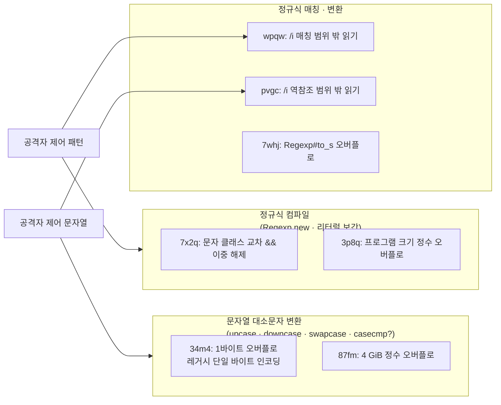
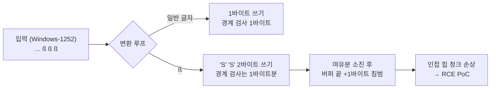
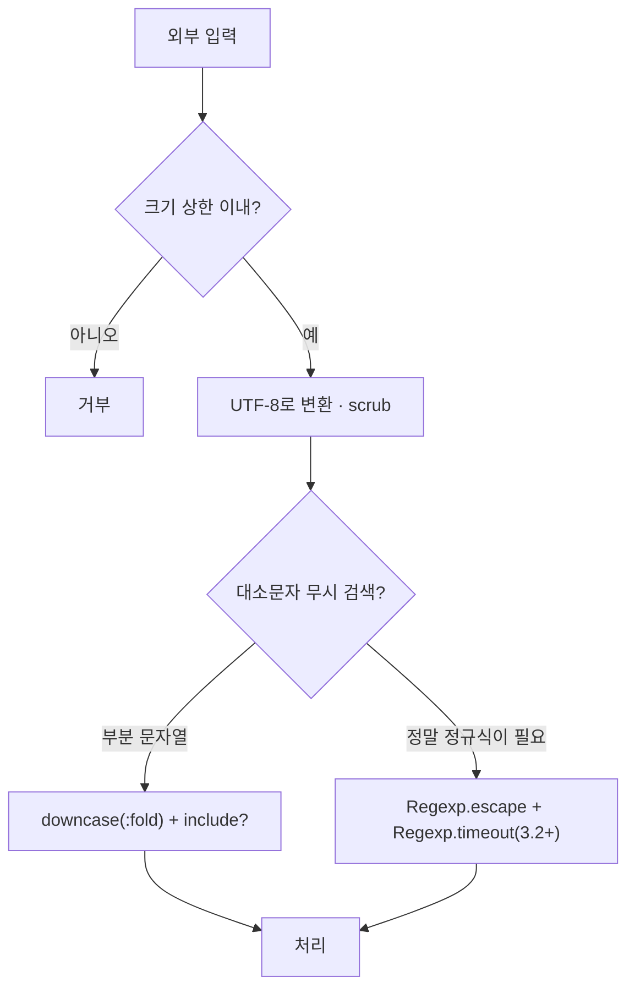

# 'ß' 하나가 'SS'가 되며 1바이트가 넘쳤다… Ruby 정규식·대소문자 변환 취약점 7건

### Ruby 코어의 문자열 대소문자 변환과 정규식 엔진에서 힙 버퍼 오버플로, 이중 해제, 범위 밖 읽기 7건이 한꺼번에 고쳐졌다. 5건은 원격 코드 실행 PoC가 있다. 가장 넓은 것은 레거시 단일 바이트 인코딩 문자열을 `upcase`하기만 해도 터지는 1바이트 오버플로로, 기본 설정 Rails까지 닿는다는 'Ruby2ßhell' 분석이 뒤따랐다. 수정판은 4.0.10, 3.4.13, 3.3.14이며 3.2 이하는 고쳐지지 않는다

Ruby 팀은 2026년 11월 18일(게시 시각 기준 11월 19일 00:00 UTC) [Security advisories: multiple vulnerabilities in Regexp and String case conversion](https://www.ruby-lang.org/en/news/2026/11/18/multiple-vulnerabilities-in-regexp-and-string/)을 공지하고 [4.0.10](https://www.ruby-lang.org/en/news/2026/11/18/ruby-4-0-10-released/), [3.4.13](https://www.ruby-lang.org/en/news/2026/11/18/ruby-3-4-13-released/), [3.3.14](https://www.ruby-lang.org/en/news/2026/11/18/ruby-3-3-14-released/)을 동시에 내놓았다. GeekNews([토픽 37458](https://news.hada.io/topic?id=37458))는 이를 요약하고 [Hacker News 토론](https://news.ycombinator.com/item?id=50554038)을 정리했다. 같은 날 Veria Labs는 그중 한 건을 기본 설정 Rails의 비인증 RCE 경로로 분석한 [Ruby2ßhell](https://verialabs.com/ruby2shell/)을 공개했다([GeekNews 37471](https://news.hada.io/topic?id=37471)).

이 글은 공식 공지와 GHSA 권고 7건, 릴리스 노트, Veria Labs 분석, HN 토론을 기사 형태로 엮는다. **트리거 입력의 구체적 구성과 PoC는 다루지 않는다.**

## 1. 한눈에 보기

| GHSA | 위치 | 유형 (CWE) | GitHub 심각도 | 영향 | 공격 조건 | 크레딧 |
|---|---|---|---|---|---|---|
| [GHSA-34m4-m9fh-gqp5](https://github.com/ruby/ruby/security/advisories/GHSA-34m4-m9fh-gqp5) | 문자열 대소문자 변환 | 1바이트 힙 오버플로 (CWE-193) | **Critical** | RCE (PoC) | 조작된 문자열의 대소문자 변환 | Stephan Lipp (Ada Logics), Anthropic |
| [GHSA-87fm-7w84-j2px](https://github.com/ruby/ruby/security/advisories/GHSA-87fm-7w84-j2px) | 문자열 대소문자 변환 | 정수 오버플로 → 힙 오버플로 (CWE-190) | High | RCE (PoC) | 변환 결과가 4 GiB 초과 | baba__yaga (HackerOne) |
| [GHSA-7x2q-68qv-6p8x](https://github.com/ruby/ruby/security/advisories/GHSA-7x2q-68qv-6p8x) | 정규식 컴파일 | 이중 해제 (CWE-415) | **Critical** | RCE (PoC) | 공격자가 패턴을 제어 | Stephan Lipp, Anthropic |
| [GHSA-3p8q-wmhx-vm2w](https://github.com/ruby/ruby/security/advisories/GHSA-3p8q-wmhx-vm2w) | 정규식 컴파일 | 정수 오버플로 → 힙 오버플로 (CWE-190) | **Critical** | RCE (PoC) | 공격자가 패턴을 제어 | aphantom (HackerOne) |
| [GHSA-7whj-cfh7-xgm4](https://github.com/ruby/ruby/security/advisories/GHSA-7whj-cfh7-xgm4) | `Regexp#to_s` | 힙 오버플로 (CWE-787) | High | 정보 유출 또는 RCE (PoC) | 정규식을 문자열로 변환 | Stephan Lipp, Anthropic |
| [GHSA-wpqw-5qxg-m68r](https://github.com/ruby/ruby/security/advisories/GHSA-wpqw-5qxg-m68r) | 대소문자 무시(`/i`) 매칭 | 범위 밖 읽기 (CWE-125) | High | 공격자가 통제하는 메모리 손상 (PoC) | 공격자가 패턴을 제어 | Stephan Lipp, Anthropic |
| [GHSA-pvgc-g7gj-pv6h](https://github.com/ruby/ruby/security/advisories/GHSA-pvgc-g7gj-pv6h) | 대소문자 무시 역참조 매칭 | 범위 밖 읽기 (CWE-125) | Moderate | 메모리 유출 또는 크래시 | 매칭 대상 문자열 | Hiroya Fujinami, Hiroshi SHIBATA |

| 항목 | 내용 |
|---|---|
| 영향 버전 | Ruby **3.3.13 이하**, **3.4.0 ~ 3.4.12**, **4.0.0 ~ 4.0.9** |
| 수정 버전 | **4.0.10**, **3.4.13**, **3.3.14** |
| EOL | **3.2 이하는 수정 없음** (Ruby2ßhell 경로는 2.4.0부터 존재) |
| CVE | 요청했으나 미배정. 그래서 GHSA ID로 부르고, CVSS 점수도 없다(GitHub 심각도 라벨만 있음) |
| 우회책 | 공식 권고는 **업그레이드만** 제시 |



입구는 크게 둘로 나뉜다. **문자열만 제어해도 되는 것**(대소문자 변환 2건, 역참조 매칭)과 **정규식 패턴까지 제어해야 하는 것**(컴파일 2건, `/i` 매칭)이다. 대부분의 웹 애플리케이션은 사용자 입력으로 정규식을 만들지 않는다. 하지만 사용자 입력의 대소문자를 바꾸는 코드는 어디에나 있다. 그래서 1번(GHSA-34m4)이 가장 넓은 파급을 가진다.

## 2. 가장 넓은 구멍: 'ß'와 1바이트 (GHSA-34m4, Ruby2ßhell)

### 2.1 왜 'ß'인가

독일어 소문자 **ß**(에스체트)는 대부분의 단일 바이트 인코딩에서 대응하는 대문자가 없다. 그래서 대문자로 바꾸면 **"SS" 두 글자**가 된다. 변환 결과가 입력보다 길어지는 것이다. UTF-8에서는 Ruby 2.4부터 이 규칙이 정확히 동작한다.

```ruby
"straße".upcase   # => "STRASSE"  (UTF-8, 6글자 → 7글자)
```

문제는 ISO-8859-1(Latin-1), Windows-1252 같은 **레거시 단일 바이트 인코딩**용 변환 루프였다. Veria Labs의 분석에 따르면 이 루프는 다음과 같이 동작했다.

- 출력 버퍼를 입력 길이에 **약간의 여유만 더해** 할당한다.
- 글자를 하나 쓸 때마다 **한 바이트 분량만** 경계 검사를 한다.
- ß를 만나면 두 바이트("SS")를 쓴다.

ß가 충분히 많으면 여유분이 바닥나고, 마지막 ß의 두 번째 바이트가 **버퍼 끝을 1바이트 넘어** 쓰인다. 넘치는 값도 정해져 있다. `upcase`면 `'S'`(0x53), case fold면 `'s'`(0x73)다. 1바이트, 그것도 값이 고정된 오버플로지만, 힙 메타데이터나 인접 객체 길이 필드의 최하위 바이트를 바꾸는 데는 충분하다. 공식 권고는 이것으로 RCE PoC가 만들어졌다고 밝혔다.



| 항목 | 내용 (Veria Labs 분석 기준) |
|---|---|
| 해당 인코딩 | ISO-8859-x, Windows-125x 계열 여러 단일 바이트 인코딩 (**UTF-8은 다른 코드 경로라 무관**) |
| 도달 메서드 | `String#upcase`, `#swapcase`, `#downcase(:fold)`, `#casecmp?` (및 `!` 변형) |
| 유입 시점 | Ruby **2.4.0**부터 (UTF-8 외 인코딩에 완전한 Unicode 대소문자 매핑이 들어온 때) |
| 수정 커밋 | [`ruby/ruby@d582f8f`](https://github.com/ruby/ruby/commit/d582f8f13d700d8e39714d3a8f11eb4bd2bc69f0) (Veria·GeekNews 인용) |

### 2.2 Ruby2ßhell: 기본 설정 Rails까지

Veria Labs는 이 버그가 **기본 설정 Rails와 classic 스타일 Sinatra에서 인증 없이** 닿을 수 있다고 분석했다. 프레임워크가 요청 처리 중에 외부 입력의 대소문자를 바꾸는 지점이 있고, 그 문자열의 인코딩을 공격자가 레거시 인코딩으로 만들 수 있다는 것이다. 다른 프레임워크와 순수 Rack은 기본적으로 노출되지 않는다고 봤다. 다만 레거시 인코딩 문자열을 직접 `upcase`하는 애플리케이션 코드는 어디서든 취약할 수 있다.

Hacker News에서는 같은 원리를 먼저 추론한 댓글이 화제가 됐다. multipart POST의 `Content-Type` charset으로 인코딩을 지정하면 Rails가 그 인코딩으로 문자열을 만든다는 추정이었다. 이 메커니즘은 댓글 작성자의 주장이며 Veria 글에는 명시되지 않았다.

Ruby를 번들하는 자체 호스팅 제품도 영향을 받는다. Veria Labs가 정리한 표는 다음과 같다.

| 제품 | 취약 버전 | 수정 버전 |
|---|---|---|
| GitHub Enterprise Server | 3.22.5 이하 (Ruby 4.0.9 포함) | 공개 시점 기준 **수정 없음** |
| GitLab | 19.6.0 이하 (Ruby 3.3.13 포함) | 19.6.1, 19.5.8, 19.4.10 |
| Mastodon | 4.7.5 이하 | 4.7.6, 4.6.12, 4.5.22, 4.4.29 |
| Chatwoot | 4.20.0 이하 (Ruby 3.4.4 포함) | 4.20.1 |
| OpenProject | 17.9.7 이하 | 17.9.8, 17.8.3 |
| Discourse (기본 이미지) | 2.0.20261119-0203 이전 | 2.0.20261119-0203 |

Veria는 Rails RCE PoC를 업그레이드 시간을 준 뒤(2026-11-25 이후, 주요 벤더 패치가 늦으면 더 늦게) 공개하겠다고 했다. 몇 가지 정보는 출처마다 다르다. Veria 글은 CVE-2026-132825를 적었지만, Ruby 공식 권고에는 아직 CVE가 배정되지 않았다. 또 Veria는 독자 발견을 주장하며 Moritz Sanft(OpenAI와 협업)도 따로 같은 버그를 찾았다고 언급했다. 공식 크레딧은 Stephan Lipp(Ada Logics)과 Anthropic이다.

## 3. 나머지 여섯 건

### 3.1 대소문자 변환의 정수 오버플로 (GHSA-87fm)

변환 결과 길이가 **4 GiB를 넘으면** 길이 계산이 32비트 범위에서 감싸져, 실제보다 작은 버퍼에 쓰게 된다. 공격자가 수 GB 문자열을 서버에 밀어 넣어야 하므로 일반 웹 요청에서는 조건이 까다롭다. 하지만 요청 본문 크기 제한이 없는 서비스라면 가능하다. 권고 본문은 크레딧을 baba__yaga(HackerOne)로 적었지만, 페이지 하단 크레딧 블록에는 "Gengyskan"이 표시돼 있어 표기가 엇갈린다.

HN에서는 Shift_JIS 문자열의 `downcase`에서 수 GB 문자열이 몇 바이트짜리 결과로 잘리는 현상을 재현했다는 댓글이 달렸다. 길이 계산이 감싸진다는 이 버그의 증상과 같다.

### 3.2 정규식 컴파일 두 건 (GHSA-7x2q, GHSA-3p8q)

- **이중 해제(7x2q)**: 문자 클래스 교차 문법 `[a-z&&[^aeiou]]`의 `&&`를 처리하는 파서가 같은 버퍼를 두 번 해제한다.
- **힙 오버플로(3p8q)**: 컴파일된 정규식 프로그램의 크기를 계산하다 정수가 넘쳐, 작게 잡힌 버퍼에 컴파일 결과가 넘쳐 쓰인다.

두 건 모두 **공격자가 정규식 패턴 문자열을 제어할 때** 성립한다. 사용자가 검색 패턴을 정규식으로 입력하는 기능, 설정 파일이나 DB에서 패턴을 읽어 `Regexp.new` 하는 기능이 해당한다.

### 3.3 `/i` 매칭과 역참조 (GHSA-wpqw, GHSA-pvgc)

대소문자 무시 매칭은 위에서 본 대소문자 변환 규칙(한 글자가 여러 글자로 바뀌는 경우)을 매칭 중에 적용한다. 이 과정에서 입력 끝을 넘어 읽는 버그가 두 경로에 있었다.

- **wpqw**: 일반 `/i` 매칭. PoC에서 공격자가 통제하는 형태의 메모리 손상까지 확인됐다. 패턴 제어가 필요하다.
- **pvgc**: `/i`와 역참조(`\1`)를 함께 쓸 때. 메모리 내용 유출이나 크래시로 이어진다. RCE는 언급되지 않았다.

### 3.4 `Regexp#to_s` (GHSA-7whj)

정규식 객체를 문자열로 바꾸는 `Regexp#to_s`(문자열 보간 `"#{re}"`, 로그 출력, `inspect` 계열에서도 쓰인다)에서 힙 오버플로가 났다. 권고는 정보 유출 또는 RCE 가능성을 밝혔다.

## 4. 대응

### 4.1 업그레이드가 유일한 공식 대책

| 사용 중 | 올릴 버전 | 비고 |
|---|---|---|
| 4.0.x | **4.0.10** | |
| 3.4.x | **3.4.13** | |
| 3.3.x | **3.3.14** | 3.3은 이번 릴리스부터 "legacy maintenance" 단계로 이름이 바뀌고 버그 백포트도 다시 받는다. 지원 종료는 2027년 3월 말 |
| 3.2 이하 | 3.3.14 이상으로 이전 | EOL. 수정 없음 |

공식 배포 tarball의 SHA256은 릴리스 공지에 있다. 직접 빌드한다면 내려받은 파일을 대조한다.

```bash
curl -O https://cache.ruby-lang.org/pub/ruby/3.4/ruby-3.4.13.tar.xz
echo "6474dff9c02ea685fc44877a4807a27366bf109b176dad182108bb8c96d09589  ruby-3.4.13.tar.xz" | shasum -a 256 -c
```

| 파일 | SHA256 |
|---|---|
| ruby-4.0.10.tar.xz | `1537f7a6003c436546ecab6b48b6e7725a9af2328f45a8af7f42f41c5df90ab8` |
| ruby-3.4.13.tar.xz | `6474dff9c02ea685fc44877a4807a27366bf109b176dad182108bb8c96d09589` |
| ruby-3.3.14.tar.xz | `e24ef6d97095a9c42bf8259a2de33a25aac8d92bb48fefdbdc81724b87784854` |

`.ruby-version`, `Gemfile`의 `ruby` 지시자, Dockerfile의 `FROM ruby:x.y.z`, CI 매트릭스를 모두 고친다. Ruby를 내장한 제품(GitLab, Mastodon, GHES 등)은 Ruby만 따로 올릴 수 없으므로 벤더 패치를 기다리거나 적용한다.

### 4.2 예제: 버전 점검 스크립트

실행 중인 Ruby 또는 넘겨준 버전 문자열이 영향 범위에 드는지 판정한다(로컬 Ruby 2.6에서 실행해 확인했다).

```ruby
# check_ruby_advisories.rb — Ruby 2026-11-18 보안 권고(Regexp·String 7건) 해당 여부 점검
#   ruby check_ruby_advisories.rb                 # 지금 실행 중인 Ruby
#   ruby check_ruby_advisories.rb 3.4.12 4.0.10   # 다른 버전 문자열도 판정
FIXED = { "3.3" => "3.3.14", "3.4" => "3.4.13", "4.0" => "4.0.10" }.freeze

def verdict(version)
  v = Gem::Version.new(version)
  series = v.segments.first(2).join(".")
  if (fixed = FIXED[series])
    v >= Gem::Version.new(fixed) ? "patched" : "VULNERABLE -> upgrade to #{fixed}"
  elsif v < Gem::Version.new("3.3")
    "EOL (no fix will be released) -> move to 3.3.14+ / 3.4.13+ / 4.0.10+"
  else
    "newer series: check its release notes"
  end
end

versions = ARGV.empty? ? [RUBY_VERSION] : ARGV
versions.each { |ver| puts format("%-8s %s", ver, verdict(ver)) }

if ARGV.empty?
  # Encodings affected by the case-conversion overflow (single-byte legacy encodings).
  legacy = Encoding.list.map(&:name).grep(/\A(ISO-8859-\d+|Windows-125\d)\z/)
  puts "legacy single-byte encodings available: #{legacy.size} (e.g. #{legacy.first(4).join(', ')})"
  puts "Regexp.timeout supported: #{Regexp.respond_to?(:timeout=)}"
end
```

```text
$ ruby check_ruby_advisories.rb
2.6.10   EOL (no fix will be released) -> move to 3.3.14+ / 3.4.13+ / 4.0.10+
legacy single-byte encodings available: 24 (e.g. ISO-8859-1, ISO-8859-2, ISO-8859-3, ISO-8859-4)
Regexp.timeout supported: false

$ ruby check_ruby_advisories.rb 3.3.13 3.4.13 4.0.9
3.3.13   VULNERABLE -> upgrade to 3.3.14
3.4.13   patched
4.0.9    VULNERABLE -> upgrade to 4.0.10
```

### 4.3 예제: 패치와 별개로 지킬 습관 (심층 방어)

공식 권고에 우회책은 없다. 아래는 **패치를 대신하지 않는**, 이번 버그 유형을 줄이는 일반적인 코딩 습관이다(Ruby 2.6에서 실행 확인).

1. 외부 입력은 **UTF-8로 바꾼 뒤에만** 대소문자를 변환한다. 레거시 인코딩 변환 루프를 아예 타지 않는다.
2. 대소문자 변환·정규식에 넘기는 입력의 **크기를 제한**한다. 4 GiB급 입력은 웹 서버나 프록시 단계에서 먼저 막는다.
3. **사용자 입력으로 정규식을 만들지 않는다.** 부분 문자열 검색이면 `include?`로 충분하다. 꼭 필요하면 `Regexp.escape`를 쓰고, Ruby 3.2 이상이면 `Regexp.timeout`도 건다.

```ruby
# safe_text.rb — 패치 전후 공통의 방어적 습관 (패치를 대신하지 않는다)
module SafeText
  MAX_BYTES = 1 * 1024 * 1024 # 대소문자 변환에 넘길 입력 상한 (1 MiB)

  # 외부 입력을 UTF-8로 바꾼 뒤에만 대소문자를 변환한다.
  # 레거시 단일 바이트 인코딩(ISO-8859-x, Windows-125x) 문자열이 취약 경로로 들어가지 않는다.
  def self.utf8(str)
    raise ArgumentError, "input too large" if str.bytesize > MAX_BYTES
    s = str.encoding == Encoding::UTF_8 ? str.dup : str.encode(Encoding::UTF_8, invalid: :replace, undef: :replace)
    s.valid_encoding? ? s : s.scrub
  end

  # 사용자 입력으로 정규식을 만들지 않는다. 부분 문자열 검색이면 include?로 충분하다.
  def self.contains?(haystack, needle, ignore_case: true)
    h = utf8(haystack)
    n = utf8(needle)
    ignore_case ? h.downcase(:fold).include?(n.downcase(:fold)) : h.include?(n)
  end
end

latin1 = "stra\xDFe".force_encoding(Encoding::ISO_8859_1)   # "straße" in ISO-8859-1
SafeText.utf8(latin1).upcase                                 # => "STRASSE" (UTF-8 경로)
SafeText.contains?("Hauptstraße 5", "STRASSE")               # => true
SafeText.contains?("a+b (c)", "+b (")                        # => true, 정규식 없이
```



### 4.4 헷갈리기 쉬운 것: CVE-2026-128084는 다른 버그

HN 댓글 하나가 "Rails에 영향을 주는 C 버그"로 CVE-2026-128084([GHSA-4fqr-96q8-xrfx](https://github.com/advisories/GHSA-4fqr-96q8-xrfx))도 확인하라고 했다. 하지만 이것은 Ruby 코어가 아니라 **sqlite3-ruby 젬**의 권고다.

- 4 GiB 이상 문자열의 길이를 `long`에서 `int`로 바꾸다 잘려, SQL 뒷부분(예: `WHERE` 절)이 잘릴 수 있다.
- Moderate, CVSS 3.1 4.8. 영향 버전 2.10.1 이하, 수정 2.10.2(2026-10-26 게시).
- 이번 7건과 원리(4 GiB 길이 잘림)는 닮았지만 별개이므로 따로 업그레이드해야 한다.

## 5. 커뮤니티 반응

- **ß 추론.** 공지 직후 한 댓글이 Windows-1252의 ß → SS 변환과 1바이트 경계 검사를 근거로 원인을 정확히 짚었다. "이름에 ß를 넣으면 올해 최고의 취약점 이름"이라는 농담은 실제로 'Ruby2ßhell'이 됐다. 이에 대해 API 퍼저 [CATS](https://github.com/Endava/cats)가 변환 시 길이가 늘어나는 유니코드 문자를 이미 테스트 데이터로 쓴다는 답, 프로그래밍 수업에서 같은 문자가 1학년 과제가 됐다는 경험담이 달렸다. 소문자로 바꾸면 두 글자가 되는 U+0130(İ)에도 비슷한 버그가 있을지 묻는 질문도 나왔다.
- **CVE 발급 지연.** CVE를 요청했는데 아직 안 나왔다는 공지 문구에 대해, rclone 프로젝트도 GitHub CNA를 통한 CVE 발급이 4주째 지연 중이라는 경험담이 나왔다(예전엔 2~3일). 신청이 몰리는 탓이며, GitHub 저장소는 다른 CNA의 범위 밖이라 우회할 길도 없다는 지적이 이어졌다.
- **C와 AI.** 7건이 모두 C 코드의 메모리 손상이고, 크레딧에 Anthropic이 다섯 번 등장한다는 점이 주목받았다. 자율 AI 모델이 오래된 C 코드에서 이런 버그를 쏟아낸다면, 안전장치를 걷어 낸 모델을 조용히 돌리는 공격자는 어떨지 생각해 보라는 의견이 나왔다. 업계는 C를 버리는 대신 버그마다 패치하는 길을 택해 왔다는 냉소, "Rust보다 오래 검증된 C가 더 안전하다던 사람들은 어디 있나"라는 비꼼이 이어졌다. 반대로 개발자도 출시 전에 같은 모델로 미리 고칠 수 있다는 관점도 있었다. Ruby 개발자는 메모리 안전 언어를 쓰는 줄 알았을 텐데 런타임은 아니었다는 지적은 [Java4Shell](261118_2141_Java4Shell_OpenJDK_Base64_Intrinsic_Heap_Corruption_CVE_2026_114938.md)과도 겹친다. "Java도 있었지만 누가 Base64를 최적화하려다…"라는 농담도 달렸다.
- **C 코딩 규율론.** `*p++ = c` 대신 경계 검사를 하는 `buf_putc(struct buf *b, int c)` 같은 추상화를 쓰고, 포인터 연산·NUL 종료 문자열·길이 없는 배열 전달을 금지하고 `struct ptrlen` 같은 구조체로 묶으면 이런 버그를 거의 없앨 수 있다는 주장이 나왔다. 대부분의 언어가 이미 이런 버그를 막는다는 답도 달렸다.
- **정규식 자체를 줄이자.** 정규식을 조건문·비교로 풀어 쓰면(직접 또는 LLM으로) 공격 표면이 줄어든다는 제안이 나왔다. 정규식을 C 코드로 컴파일하는 [re2c](https://re2c.org/)가 이미 있다는 답과, 많은 정규식의 복잡도를 과소평가한다는 반론이 이어졌다.
- **비ASCII의 일상.** Ålesund로 보낸 주문이 Lesund로 배송되고, 악보 주문서의 ÆØÅ가 `?`로 바뀌었다는 경험담이 나왔다. Latin-1조차 제대로 다루지 못하는 코드가 아직 많다는 것이다.

## 6. 정리: 체크리스트

- [ ] 모든 서비스·배치·CI·컨테이너 이미지의 Ruby 버전을 확인했다 (`.ruby-version`, `Gemfile`, `FROM ruby:`)
- [ ] 4.0.10 / 3.4.13 / 3.3.14로 올리고 재배포했다. 3.2 이하는 3.3.14 이상으로 이전 계획을 세웠다
- [ ] Ruby를 내장한 자체 호스팅 제품(GitLab, Mastodon, Discourse, Chatwoot, OpenProject, GHES)의 벤더 패치를 확인했다
- [ ] 사용자 입력으로 `Regexp.new`를 하는 코드를 찾아 없애거나 `Regexp.escape`와 타임아웃을 적용했다
- [ ] 외부 입력은 UTF-8로 변환한 뒤 대소문자를 바꾸도록 했다. 요청 본문 크기 상한을 확인했다
- [ ] sqlite3 젬을 쓰면 2.10.2 이상인지 따로 확인했다
- [ ] Veria Labs의 Rails PoC 공개(2026-11-25 이후) 전에 패치를 끝낸다

## 참고

- Ruby, [Security advisories: multiple vulnerabilities in Regexp and String case conversion](https://www.ruby-lang.org/en/news/2026/11/18/multiple-vulnerabilities-in-regexp-and-string/) (mame, 2026-11-18)
- 릴리스: [Ruby 4.0.10](https://www.ruby-lang.org/en/news/2026/11/18/ruby-4-0-10-released/), [Ruby 3.4.13](https://www.ruby-lang.org/en/news/2026/11/18/ruby-3-4-13-released/), [Ruby 3.3.14](https://www.ruby-lang.org/en/news/2026/11/18/ruby-3-3-14-released/)
- GHSA: [34m4-m9fh-gqp5](https://github.com/ruby/ruby/security/advisories/GHSA-34m4-m9fh-gqp5), [7x2q-68qv-6p8x](https://github.com/ruby/ruby/security/advisories/GHSA-7x2q-68qv-6p8x), [87fm-7w84-j2px](https://github.com/ruby/ruby/security/advisories/GHSA-87fm-7w84-j2px), [wpqw-5qxg-m68r](https://github.com/ruby/ruby/security/advisories/GHSA-wpqw-5qxg-m68r), [3p8q-wmhx-vm2w](https://github.com/ruby/ruby/security/advisories/GHSA-3p8q-wmhx-vm2w), [7whj-cfh7-xgm4](https://github.com/ruby/ruby/security/advisories/GHSA-7whj-cfh7-xgm4), [pvgc-g7gj-pv6h](https://github.com/ruby/ruby/security/advisories/GHSA-pvgc-g7gj-pv6h)
- Veria Labs, [Ruby2ßhell](https://verialabs.com/ruby2shell/), GeekNews [토픽 37471](https://news.hada.io/topic?id=37471)
- GeekNews, [Ruby 정규식과 문자열 대소문자 변환에서 취약점 7건 발견](https://news.hada.io/topic?id=37458), [Hacker News 토론](https://news.ycombinator.com/item?id=50554038)
- 별개 권고: [sqlite3-ruby GHSA-4fqr-96q8-xrfx (CVE-2026-128084)](https://github.com/advisories/GHSA-4fqr-96q8-xrfx)
- 크레딧 링크: [baba__yaga](https://hackerone.com/baba__yaga), [aphantom](https://hackerone.com/aphantom)
- 도구: [Endava/cats](https://github.com/Endava/cats), [re2c](https://re2c.org/)
- GeekNews 관련 글: [PHP 치명적 취약점 2건 수정](https://news.hada.io/topic?id=35759), [Ruby 3.2.0 릴리즈](https://news.hada.io/topic?id=8118), [Ruby 2.7.0 릴리즈](https://news.hada.io/topic?id=1149), [Rust 1.56.0 및 Rust 2021](https://news.hada.io/topic?id=5240)
- 같은 카테고리: [PHP2Shell](261023_1756_PHP2Shell_Critical_Remote_Code_Execution_in_the_PHP_Engine.md), [Java4Shell](261118_2141_Java4Shell_OpenJDK_Base64_Intrinsic_Heap_Corruption_CVE_2026_114938.md), [nginx2root](261119_2133_nginx2root_Five_nginx_RCEs_and_a_Linux_SCTP_Privilege_Escalation.md)
