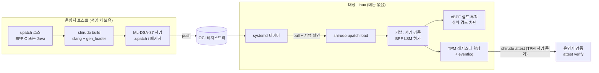
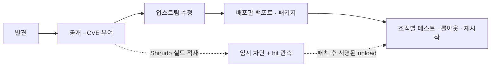
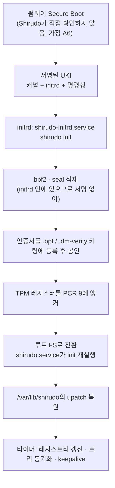
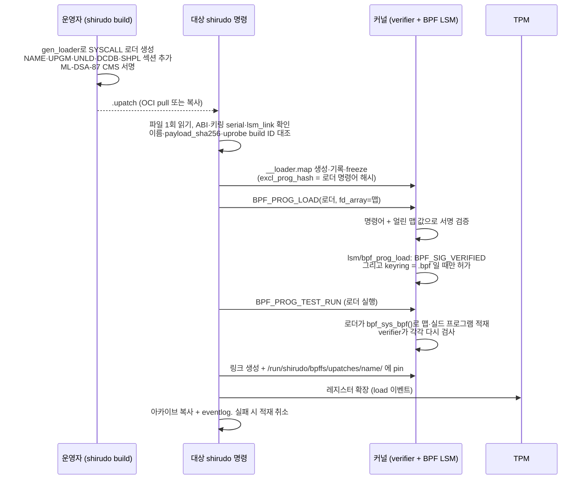
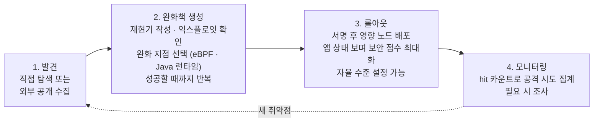
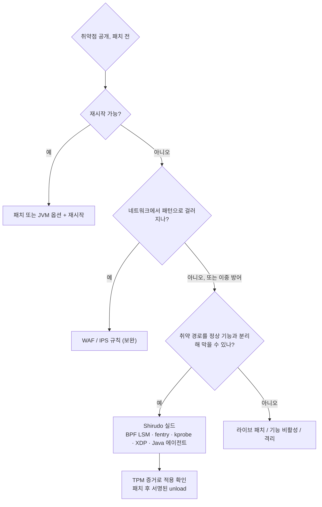

# Shirudo, 패치가 오기 전까지 실행 중인 Linux에 "방패"를 끼운다… OpenAI·Cisco의 서명된 eBPF 런타임

### OpenAI와 Cisco(Isovalent)가 2026년 11월 23일(미국 시간) 오픈소스 런타임 Shirudo를 공개했다. 영구 패치를 테스트·배포하는 며칠에서 몇 주 사이, 취약한 코드 경로만 막는 작은 eBPF 프로그램(실드, upatch)을 서비스 재시작 없이 붙인다. 핵심은 "막는다"보다 "누가 무엇을 붙였는지 증명한다"에 있다. 커널은 운영자가 ML-DSA-87로 서명한 로더만 받아들이고, 모든 적재·제거는 TPM에 기록된다. 통제된 시험에서는 Codex가 만든 실드가 실행 중인 Elasticsearch를 Java4Shell 공격에서 지켰다. 대가로 패치된 bpf-next 커널, TPM 2.0, 서명된 UKI 부팅이 필요하다


OpenAI는 2026년 11월 23일 [Introducing Shirudo](https://openai.com/index/introducing-shirudo/)를 올렸고, 같은 날 Isovalent(Cisco)의 Thomas Graf와 Liz Rice가 [Cisco and OpenAI introduce Shirudo](https://isovalent.com/blog/post/cisco-openai-shirudo/)로 기술 배경과 Java4Shell 시험을 풀었다. 코드는 [github.com/shirudo-dev/shirudo](https://github.com/shirudo-dev/shirudo), 문서는 [docs.shirudo.dev](https://docs.shirudo.dev/index.html)에 있다. GeekNews([토픽 37740](https://news.hada.io/topic?id=37740), 2026-11-24 09:21 KST)가 발표문을 한국어로 요약했고(취재 시점 GeekNews 댓글은 없음), [Hacker News](https://news.ycombinator.com/item?id=50619630)에는 89포인트·29댓글의 꽤 회의적인 토론이 붙었다. 이 프로젝트는 갑자기 나온 것이 아니다. 10월 6일 [Linux Plumbers Conference 2026](https://lpc.events/event/20/contributions/2437/)에서 Daniel Borkmann과 John Fastabend가 "BPF live-patching infra for the agentic era"라는 제목으로 먼저 발표했다(GeekNews [토픽 37741](https://news.hada.io/topic?id=37741)이 그 발표를 따로 소개한다).


이 글은 발표문, Isovalent 블로그, 공식 문서(아키텍처·서명 로더·위협 모델·시스템 요구사항·오버헤드·비교), HN 토론을 엮는다. 선행 사건인 Java4Shell 자체는 [이전 글](261118_2141_Java4Shell_OpenJDK_Base64_Intrinsic_Heap_Corruption_CVE_2026_114938.md)에서 다뤘다. **프로젝트는 스스로 "pre-release"라고 밝힌다. 성능 수치는 공식 문서의 [오버헤드](https://docs.shirudo.dev/operate/plan/overhead.html) 페이지에 테스트 VM 한 대 기준으로만 있고(9.1절), 실드 성공률 같은 통계는 없다. Java4Shell 시험은 한 건의 통제된 시연이다. 이 글의 BPF LSM 예제와 Java 가드 의사코드는 이해를 돕기 위한 재구성이며 실제 저장소의 실드가 아니다.**

## 0. 어디에 두는가

AI 에이전트가 등장하지만 본질은 **Linux 커널 보안 메커니즘(eBPF, BPF LSM, 서명, TPM 측정)** 이다. 특정 CVE 공지가 아니라 "패치 공백을 메우는 런타임 방어 인프라"라서 `docs/05_Network_and_Security/02_Security`에 둔다. 같은 폴더의 [Java4Shell](261118_2141_Java4Shell_OpenJDK_Base64_Intrinsic_Heap_Corruption_CVE_2026_114938.md), [NoisyTCP](261121_2158_NoisyTCP_CVE_2026_99288_Linux_Kernel_TCP_Pre-auth_Remote_DoS.md), [nginx2root](261119_2133_nginx2root_Five_nginx_RCEs_and_a_Linux_SCTP_Privilege_Escalation.md)가 "무엇이 깨졌나"라면, 이 글은 "고치기 전까지 어떻게 버티나"다.

## 1. 한눈에 보기

| 항목 | 내용 |
|---|---|
| 이름 | Shirudo (일본어 외래어 シールド, 영어 shield를 가타카나로 옮긴 말) |
| 만든 곳 | OpenAI + Cisco(Isovalent). Isovalent 블로그는 **Tetragon을 에이전트용으로 다시 쓴 것**이라고 설명 |
| 공개 | 2026-11-23 (미국 시간). LPC 2026 발표는 10-06 |
| 상태 | pre-release. GitHub 약 2.4k 스타, 1,890 커밋(취재 시점) |
| 하는 일 | 서명된 BPF 마이크로패치(**upatch**, 발표문 용어로 **shield**)를 재시작 없이 적재해 취약 경로를 차단·대체·관측 |
| 신뢰 모델 | 커널이 `.bpf` 키링으로 **서명된 로더만** 허용. "root라고 믿지 않는다" |
| 서명 | 운영자 키 하나, **ML-DSA-87**(양자내성 서명) |
| 기록 | 적재·제거·트리 변경마다 TPM NV 레지스터 확장(PCR 9에 앵커) + eventlog |
| 배포 | `.upatch`/패키지를 OCI 레지스트리에 올리고 대상이 **당겨 감(pull)**. 데몬·리슨 소켓 없음 |
| 요구사항 | 서명 로더 ABI가 있는 bpf-next 커널 + Shirudo 커널 패치, TPM 2.0, systemd-stub UKI 부팅, clang/LLVM 23 |
| 대표 시연 | Codex가 만든 Java 실드가 Elasticsearch 9.5.5에서 Java4Shell(CVE-2026-114938) 시도 거부 |
| 라이선스 | 런타임 BSD-2-Clause, BPF 프로그램 BSD/GPL 이중 |



## 2. 문제: 패치는 느리고, 막으면 서비스가 죽는다

발표문의 출발점은 단순하다. 취약점이 공개돼도 **패치를 테스트하고 배포하는 데 며칠에서 몇 주**가 걸린다. 그 사이 익스플로잇이 쓰는 Linux 동작을 통째로 막으면 정상 요청까지 막혀 서비스가 내려갈 수 있다. Isovalent 블로그는 여기에 AI를 더한다. AI로 익스플로잇은 빨라졌는데, 백포트·패키징·재부팅이라는 패치 과정은 그만큼 빨라지지 않았다.

쉽게 말하면, 수도관이 새는 것을 발견했는데 배관공은 다음 주에 온다. 집 전체 밸브를 잠그면 물을 못 쓴다. Shirudo는 **새는 지점에만 클램프를 채우는 도구**다. 그리고 그 클램프를 누가, 언제 채우고 풀었는지 봉인된 장부(TPM)에 남긴다.

노출 기간을 식으로 쓰면 이렇다(설명용 정의).

$$
W_{\text{patch}} = t_{\text{patched}} - t_{\text{disclosed}}, \qquad
W_{\text{shield}} = t_{\text{shielded}} - t_{\text{disclosed}}
$$

실드의 목표는 $W_{\text{shield}} \ll W_{\text{patch}}$로 만드는 것이다. 단, 실드가 정상 트래픽을 막으면 그것도 장애다. 그래서 발표문은 "정상 요청은 통과시키고 익스플로잇 동작만 막는다"를 계속 강조한다.

CVE의 일생으로 보면 실드가 들어갈 자리가 분명해진다. 발견 → (비공개 제보·엠바고) → 공개와 CVE 번호 → 업스트림 수정 → 배포판 백포트·패키징 → 각 조직의 테스트·롤아웃·재시작 순서인데, 공개 이후 마지막 단계까지가 공격자가 노리는 **패치 공백(patch gap)** 이다. 실드는 "공개"와 "롤아웃" 사이에 끼워 넣는 임시 칸막이고, 패치가 깔리면 서명된 unload로 걷어 낸다.



Java4Shell이 좋은 예다. 11월 17일 공개됐고, 당장 패치를 못 하면 `-XX:-UseBASE64Intrinsics` 같은 JVM 옵션으로 경로를 끄라는 권고가 나왔다. 하지만 이 옵션도 **JVM 재시작**이 필요하다. Shirudo 시연은 바로 이 재시작 없이 막는 쪽을 보여 준다(5장).

## 3. 배경 개념: eBPF, BPF LSM, 서명, TPM

다른 분야 독자를 위해 용어부터 정리한다.

| 용어 | 뜻 | 쉽게 말하면 |
|---|---|---|
| **커널 (kernel)** | 하드웨어·메모리·프로세스·네트워크를 관리하는 운영체제의 핵심. 앱은 커널 밖(사용자 공간)에서 돌고, 커널 버그는 기계 전체를 위협한다 | 건물의 기계실. 입주자(앱)는 직접 못 들어간다 |
| **시스템 호출 (syscall)** | 앱이 커널에 일을 부탁하는 공식 창구(`open`, `socket`, `execve`, `bpf` 등). 보안 검사도 대부분 이 창구 뒤에서 일어난다 | 기계실 앞 민원 창구 |
| **eBPF** | 커널 안의 정해진 지점(hook)에서 작은 프로그램을 안전하게 실행하는 Linux 기술. `bpf()` 시스템 호출로 적재한다 | 커널에 꽂는 검증된 플러그인 |
| **eBPF verifier** | 적재 직전 프로그램의 모든 경로를 기호적으로 따라가며 무한 루프, 범위 밖 메모리 접근, 허용되지 않은 헬퍼 호출을 거부하는 커널 검사기. 통과 후 JIT로 기계어가 된다 | 플러그인을 꽂기 전 안전 인증 시험. 단, "안전"이지 "올바름"을 보지는 않는다 |
| **hook / attach point** | 프로그램이 붙는 자리. `fentry`/`fexit`(BTF 기반 함수 진입·종료), `kprobe`(거의 아무 커널 명령어 위치), `uprobe`(사용자 공간 함수), `lsm`(보안 검사 지점), XDP(네트워크 드라이버) 등 | 플러그인을 꽂는 콘센트 |
| **kprobe vs fentry** | kprobe는 명령어를 중단점으로 바꿔 끼어드는 오래된 방식이라 유연하지만 느리고, fentry는 함수 앞 trampoline으로 들어가 빠르고 인자를 타입대로 읽는다. 둘 다 기본적으로 **관측**용이고, 반환값을 바꾸는 `fmod_ret`과 거부하는 `lsm`이 **차단**용이다 | 벽에 구멍 뚫는 청진기 vs 미리 낸 점검구 |
| **LSM** | Linux Security Modules. 파일 열기, 소켓 생성 같은 동작 직전에 "허용/거부"를 묻는 커널 프레임워크(SELinux, AppArmor가 여기에 붙는다) | 커널의 출입 검문소 |
| **BPF LSM (KRSI)** | LSM 검문소에 eBPF 프로그램을 붙이는 기능. 반환값이 음수면 해당 동작 거부 | 검문소 규칙을 런타임에 끼워 넣기 |
| **CO-RE / BTF** | 커널 구조체 정보를 BTF로 기술해, 한 번 빌드한 BPF가 같은 세대의 여러 커널 빌드에서 돌게 하는 방식 | 구조체 주소를 현장에서 다시 맞추는 설명서 |
| **측정 부팅 vs 보안 부팅** | Secure Boot는 서명이 틀린 부팅 단계를 **멈춘다**. Measured boot는 각 단계를 해시해 TPM에 **기록만** 하고, 판정은 나중에 원격 검증자가 한다 | 문지기 vs 출입 기록부 |
| **원격 증명 (remote attestation)** | 검증자가 임의 값(nonce)을 보내면, 대상 TPM이 자기 증명 키(AK)로 "현재 PCR 값 + nonce"에 서명한 quote를 돌려준다. nonce 덕분에 옛 증거를 재생할 수 없다 | 봉인된 장부를 그 자리에서 공증받아 보내기 |
| **TPM 2.0** | 메인보드의 보안 칩. PCR(Platform Configuration Register)에 값을 **덧붙이기(extend)만** 할 수 있고 되돌릴 수 없다. 칩 키로 서명한 "quote"를 원격 검증자에게 준다 | 지울 수 없는 블랙박스 기록계 |
| **UKI / dm-verity** | UKI는 커널+initrd+명령행을 묶어 서명한 단일 부팅 이미지. dm-verity는 디스크 블록을 루트 해시로 검증 | 봉인된 부팅 꾸러미, 변조 감지 디스크 |
| **ML-DSA-87** | NIST FIPS 204 양자내성 전자서명의 최고 보안 등급 | 양자컴퓨터 시대에도 위조가 어려운 도장 |

TPM의 extend 연산은 일반적으로 이렇게 쓴다.

$$
\text{PCR}_{n} = H\left(\text{PCR}_{n-1} \parallel d_n\right)
$$

$H$는 SHA-256, $d_n$은 새 사건의 다이제스트다. 해시는 되돌릴 수 없으므로, 최종값 하나가 **사건 순서 전체**를 요약한다. 운영자는 자기가 서명해 보낸 artifact 목록으로 기대값을 미리 계산하고(`shirudo attest predict`), TPM이 서명한 실제값과 비교한다. Shirudo 문서는 "도메인 분리 태그로 확장한다"고만 밝혀 정확한 바이트 구성은 이 글에서 확인하지 못했다. 위 식은 TPM 확장의 일반형이다.

## 4. 구조: 바이너리 하나, 데몬 없음, root도 못 믿는다

### 4.1 운영자와 대상

[아키텍처 문서](https://docs.shirudo.dev/internals/architecture.html)에 따르면 `shirudo` 실행 파일 하나가 두 역할을 다 한다. 역할은 그 기계에 무엇이 있느냐로 정해진다.

| 역할 | 가진 것 | 하는 일 |
|---|---|---|
| 운영자 | `signing_key.pem` (ML-DSA-87). **유일한 비밀** | `shirudo build`, `shirudo bpm push`. 별도 `shirudo-build` 헬퍼가 clang, libbpf gen_loader, `veritysetup`을 호출 |
| 대상 | 봉인된 커널 키링(`.bpf`, `.dm-verity`), 전용 bpffs, 이번 부팅의 TPM 레지스터 | `init`, `upatch load/unload`, `status`, `attest`. **모든 명령이 1회성**, 데몬·리슨 소켓 없음, 다른 프로그램을 띄우지 않음 |

운영자는 대상의 상태를 저장하지 않는다. 그래서 운영자 호스트를 잃어도 잃는 것은 키뿐이다. 반대로 키가 털리면 그 키로 서명된 것은 무엇이든 적재된다(위협 모델 ADV-F). 이 점은 7장에서 다시 본다.

### 4.2 부팅 때 무엇이 걸리는가



- `bpf2`는 BPF 허가, 전용 bpffs와 `/run/shirudo` 보호, mount·keyring·TPM 명령 감시, kexec·lockdown 거부를 맡는다.
- `seal`은 태스크 표식, 정책 비트, 프로세스 보호, 쓰기 가능한 상태의 레이블 검사를 맡는다.
- 런타임 바이너리는 읽기 전용 dm-verity 이미지(`/run/shirudo/runtime`)에, 설정은 `noexec` dm-verity 이미지(`/run/shirudo/config`)에 있다.

### 4.3 "런타임 권한": UID가 아니라 실행 출처로 판단

보통 리눅스 권한은 "root냐 아니냐"다. Shirudo는 그것을 버린다. **런타임 이미지 위의 파일을 exec한 태스크**만 표식(mark)을 얻고, 가드는 UID·capability·경로가 아니라 이 표식을 본다. 그래서 quickstart에서도 PATH의 일반 `shirudo status`는 "Permission denied"로 실패하고 런타임 바이너리로 실행해야 통과한다.

쉽게 말하면, 회사 금고를 여는 기준이 "사장이냐"가 아니라 "봉인된 공식 열쇠를 들고 왔냐"인 셈이다. 사장(root)이라도 공식 열쇠 없이는 금고에 손을 못 댄다. 위협 모델 문서의 표현대로 "root라서 믿지는 않는다".

다만 이 설계에는 함정이 있다. 위협 모델 A14는 런타임 이미지에 셸이나 인터프리터 같은 범용 도구가 들어가면 root에게 Shirudo의 권한을 넘겨주는 셈이라고 경고한다.

## 5. 핵심 메커니즘: 서명된 로더 경로

### 5.1 왜 프로그램이 아니라 "로더"에 서명하나

BPF 프로그램 명령어는 빌드 때와 커널 검증 때가 다르다. 맵 디스크립터가 끼워지고, CO-RE 재배치가 대상 BTF로 풀리고, 커널 심볼이 해석된다. 그래서 바이트를 그대로 서명할 수 없다. Shirudo는 libbpf의 **gen_loader**로 "맵을 만들고 프로그램을 적재하는 모든 단계"를 기록한 `BPF_PROG_TYPE_SYSCALL` 로더 프로그램을 만들고, 원래 명령어·맵 초기값·BTF는 로더의 데이터로 넣는다. 서명 대상은 `loader_insns || data`다.

쉽게 말하면, 완성품 가구에 도장을 찍을 수 없으니 **조립 설명서와 부품 봉투 전체에 도장을 찍는** 방식이다. 현장에서는 도장 찍힌 설명서대로만 조립할 수 있다.

### 5.2 단계별 흐름

[서명 로더 문서](https://docs.shirudo.dev/internals/signed-loader.html)를 요약한 순서다.



중요한 거부 규칙도 정리해 둔다.

| 훅 | 무엇을 보나 | 결과 |
|---|---|---|
| `lsm/bpf` | 맵 생성·쓰기, test run, 링크 부착, pin | 런타임 권한 없으면 거부(`EACCES` 등) |
| `lsm/bpf`, `lsm/bpf_prog_load` | 서명 없음, 검증 실패, 다른 키링(내장·보조·플랫폼 키링) | `LoadUnsigned`, `LoadUnverified`, `LoadKeyringKind` |
| `lsm/bpf` | `BPF_LINK_DETACH` | **Shirudo 자신을 포함해** 모든 사용자 공간 호출 거부 |
| `lsm/file_open` | pin을 파일로 열기 | 거부 |
| 명령 자체 | 실제 부착 범위가 서명된 메타데이터와 다름 | `attach_scope_mismatch`로 unpin 후 실패 |

여기서 TOCTOU(검사 시점과 사용 시점의 차이) 문제가 해결된다. 사용자 공간에서 파일 서명을 확인하고 적재하면, root가 그 사이 파일을 바꿀 수 있다. Shirudo는 **커널이 실제로 적재하는 바로 그 바이트**를 같은 `bpf()` 호출 안에서 검증한다.

### 5.3 제거도 서명이 필요하다

unload 지시서는 payload 없이 "이름 + 그 upatch가 가져야 할 payload 다이제스트"만 담은 서명 파일이다. 다이제스트가 다르면 `payload_mismatch`로 실패한다. 즉 **서명자가 의도한 바로 그 빌드만** 내릴 수 있다. 공격자가 실드를 떼어 내고 몰래 공격하는 시나리오를 막는 장치다. `--payload-sha256` 없이 만든 unload 지시서는 0으로 채운 다이제스트를 서명하므로 어디서도 동작하지 않는다.

### 5.4 upatch의 생김새

문서의 가장 작은 테스트 upatch는 `do_nanosleep`에 붙는 빈 `fentry` 프로그램이다(문서 원문).

```c
// SPDX-License-Identifier: GPL-2.0 OR BSD-2-Clause
#include "vmlinux.h"
#include <bpf/bpf_helpers.h>
#include <bpf/bpf_tracing.h>

char _license[] SEC("license") = "Dual BSD/GPL";

SEC("fentry/do_nanosleep")
int BPF_PROG(shirudo_test_basic)
{
        return 0;
}
```

평범한 libbpf 스타일 C다. 섹션 이름이 부착 지점을 정하고, LSM 프로그램은 GPL 호환 라이선스가 필수다. Shirudo는 일부러 **설정 DSL이 없다**(LPC 초록). 에이전트는 YAML 정책보다 코드를 직접 다루는 편이 낫다는 판단이다. Tetragon의 TracingPolicy와 가장 크게 갈리는 지점이다.

[허용되는 부착 종류](https://docs.shirudo.dev/upatches/write/attach-kinds.html)는 화이트리스트로 정해져 있다.

| 분류 | 허용 섹션 | 비고 |
|---|---|---|
| 함수 진입·종료·반환값 | `fentry`, `fexit`, `fmod_ret` (각각 sleepable `.s` 형태 포함) | `fmod_ret`은 함수를 실행하지 않고 오류를 돌려줄 수 있어 "기능 끄기"에 쓰인다 |
| 보안 검사 | `lsm/<hook>`, `lsm.s/<hook>` | `lsm_cgroup`은 불허 |
| 추적점·프로브 | `tp_btf`, `kprobe`(심볼, 심볼+오프셋), `kretprobe`, `kprobe.multi`, `uprobe`/`uretprobe`와 `.multi` | uprobe는 대상 바이너리의 build ID와 대조 |
| 네트워크 | `cgroup_skb/ingress·egress`, `netfilter`, `xdp/<decimal-mask>` | 맨 `xdp`, tc, socket filter, `sk_skb`는 거부 |
| 비부착 | `syscall` (직렬화기 `shirudo_serialize__<map>`, 적재 시 1회 실행하는 테스트 `shirudo_test__<id>`) | 테스트가 음수를 돌려주면 적재 실패 |

공통 제약도 있다. 고정(pin)할 수 있는 링크가 있는 프로그램 종류만 되고, 맵 이름은 15자 이하이며, CO-RE는 **같은 세대의 커널 빌드 사이**에서만 이식된다. 커널이 함수를 지우거나 이름을 바꾸면 실드도 다시 써야 한다.

아래는 "취약한 커널 기능으로 가는 길만 막는" 실드가 어떤 모양일지 보여 주는 **재구성 예제**다. 예컨대 [nginx2root](261119_2133_nginx2root_Five_nginx_RCEs_and_a_Linux_SCTP_Privilege_Escalation.md) 같은 SCTP 커널 버그가 나왔고 그 호스트가 SCTP를 쓰지 않는다면, SCTP 소켓 생성 자체를 거부할 수 있다. 저장소의 실제 실드가 아니며 컴파일·적재를 검증하지 않았다.

```c
// 재구성 예제: 실제 shirudo 저장소의 upatch가 아님
// SPDX-License-Identifier: GPL-2.0 OR BSD-2-Clause
#include "vmlinux.h"
#include <bpf/bpf_helpers.h>
#include <bpf/bpf_tracing.h>

#define AF_INET       2
#define AF_INET6      10
#define IPPROTO_SCTP  132
#define EPERM         1

char _license[] SEC("license") = "Dual BSD/GPL";

/* 차단 횟수(hit count). 관측용 */
struct {
        __uint(type, BPF_MAP_TYPE_ARRAY);
        __uint(max_entries, 1);
        __type(key, __u32);
        __type(value, __u64);
} hits SEC(".maps");

SEC("lsm/socket_create")
int BPF_PROG(deny_sctp, int family, int type, int protocol, int kern)
{
        if (kern)                       /* 커널 내부 소켓은 건드리지 않음 */
                return 0;
        if ((family == AF_INET || family == AF_INET6) && protocol == IPPROTO_SCTP) {
                __u32 k = 0;
                __u64 *v = bpf_map_lookup_elem(&hits, &k);
                if (v)
                        __sync_fetch_and_add(v, 1);
                return -EPERM;          /* 익스플로잇의 전제 조건만 거부 */
        }
        return 0;
}
```

빌드·서명·적재·검증은 [quickstart](https://docs.shirudo.dev/start/quickstart.html)의 명령을 그대로 따르면 이렇다(문서 원문 발췌, 테스트 VM 기준).

```bash
# 운영자: 빌드와 서명
KEYS=/tmp/shirudo-test-vm-private-$(id -u)/operator-keys/keys
shirudo build testing/fixtures/basic.bpf.c --keys-dir "$KEYS" \
  --vmlinux vendor/linux/vmlinux.h -o basic.upatch
PAYLOAD=$(shirudo upatch info --json basic.upatch | jq -r .payload_sha256)
shirudo build --unload basic --payload-sha256 "$PAYLOAD" --keys-dir "$KEYS" -o basic.unload.upatch

# 대상: 적재와 상태
shirudo upatch load basic.upatch
shirudo upatch list
shirudo status --show-full

# 대상: 운영자가 준 nonce로 TPM 증거 생성
shirudo attest --nonce=<nonce> --output=/mnt/shirudo-out/ev.json

# 운영자: 기대 레지스터 예측 후 증거 검증
shirudo attest predict --cert="$KEYS/cert.der" --cert="$OWN" --event=load:basic="$PAYLOAD"
shirudo attest verify --evidence="$EV" --nonce="$NONCE" \
  --ak-name="$(jq -r .ak.name "$EV")" --expect-chain=<register-after-events>

# 대상: 서명된 지시서로만 제거
shirudo upatch unload basic.unload.upatch
```

## 6. Java4Shell 시연: Codex가 만든 실드가 Elasticsearch를 지키다

### 6.1 무엇을 막았나

[Java4Shell(CVE-2026-114938)](https://calif.io/java4shell)은 OpenJDK HotSpot의 x86-64 AVX-512 Base64 intrinsic에서 패딩 꼬리를 처리할 때 출력 길이가 음수가 되고, 저장 마스크가 전부 1이 되어 배열 밖에 쓰는 버그다. 영향 조건은 OpenJDK 17.0.6 이상과 AVX-512 VBMI CPU다. Calif가 Elasticsearch에서 인증 후 RCE를 시연한 바로 그 대상이다.

Isovalent 블로그에 따르면 시험 환경은 **Elasticsearch 9.5.5**였다. 실드는 eBPF가 아니라 **Java 바이트코드**로, 실행 중인 프로세스에 붙어 `java.util.Base64$Decoder.decode0`에 입력 검사를 끼워 넣었다. 로그는 이렇게 남았다(블로그 인용).

```text
Base64 guard installed on java.util.Base64$Decoder.decode0 (classfile)
Base64 guard rejected candidate: length=65, padding=1, remainder=1, alphabet=standard
```

길이 65는 Calif 글의 예시 입력 길이와 같다. 65를 4로 나눈 나머지가 1이라 원래 유효한 Base64가 될 수 없는 입력이다. Elasticsearch는 계속 돌았고 공격은 실패했다. 이 실드는 OpenJDK가 패치될 때까지 유지하는 임시 조치다.

가드가 무엇을 검사했을지 보여 주는 **재구성 의사코드**다. 실제 실드 소스는 공개 범위에서 확인하지 못했다.

```java
// 재구성 예제: 실제 실드 코드가 아님
static void guard(byte[] src, int sp, int sl) {
    int len = sl - sp;
    int pad = 0;
    if (len > 0 && src[sl - 1] == '=') pad++;
    if (len > 1 && src[sl - 2] == '=') pad++;
    int rem = len % 4;
    // 정상 Base64는 rem==0(패딩 있음) 또는 rem 2·3(패딩 생략)만 가능하다.
    // rem==1이거나, 패딩이 있는데 길이가 4의 배수가 아니면 intrinsic에 넘기기 전에 거부
    if (rem == 1 || (pad > 0 && rem != 0)) {
        throw new IllegalArgumentException("Base64 guard rejected candidate");
    }
}
```

핵심은 **원래 Java 코드도 결국 거부할 입력**을, 네이티브 intrinsic이 이웃 메모리를 덮기 **전에** 거부한다는 점이다. 정상 입력에는 아무 영향이 없으니 "정상 요청은 통과"라는 조건을 만족한다. 단, 위협 모델 T15가 밝히듯 Java upatch는 JVM이 사용자 공간에서 jar 서명을 확인하는 방식이라, 커널 수준의 root 방어선이 아니라 **도달한 JVM 안의 완화책**이다.

### 6.2 에이전트 루프: 발견에서 모니터링까지

Isovalent 블로그는 Codex가 "에이전트형 컨트롤 플레인"으로 움직이는 네 단계를 설명한다.



발표문의 "기계 속도의 방어(defense at machine speed)"가 이 루프다. 사람은 무엇을 배포할지 **승인**하는 자리에 남는다. 완화 동작은 세 종류로 나뉜다. 필요한 코드 경로를 막거나, 취약한 코드를 고친 코드로 바꾸거나, 공격 탐지용 관측을 더한다.

Java4Shell이 Codex로 발견된 버그(Calif의 Quang Luong)라는 점도 흥미롭다. 같은 계열의 AI가 공격 쪽에서 찾고, 방어 쪽에서 막는 장면이다.

## 7. 위협 모델: 어디까지 막고 어디서 멈추나

[위협 모델 문서](https://docs.shirudo.dev/security/threat-model.html)는 이례적으로 솔직하다. 요점을 표로 묶는다.

| 공격자 | 설명 | Shirudo의 입장 |
|---|---|---|
| ADV-A | 권한 없는 로컬 코드 | 커널이 제한. tamper 카운터는 움직일 수 있음 |
| **ADV-B** | **서명 키 없는 root** | 주 대상. BPF 적재, Shirudo 프로그램 분리, 몰래 상태 변경, 망가진 대상을 건강해 보이게 하기를 막아야 함 |
| ADV-C | 마운트 네임스페이스·장치를 조작하는 root | 일부만 대응 |
| ADV-D | 네트워크·레지스트리 | 오래된 서명 콘텐츠를 재생하거나 보류할 수는 있지만 로더 위조는 불가 |
| ADV-E | 악성 텔레메트리 수집기 | 버리거나 지연만 가능 |
| ADV-F | 유출·폐기된 서명 키 보유자 | 설정으로 폐기하기 전까지 그 키로 서명된 것은 적재됨 |
| ADV-G | 물리 접근, TPM 하드웨어 공격 | 범위 밖 |

남는 위험(residual risk) 가운데 실무자가 알아야 할 것들이다.

- **R6/R7**: `init`이 실패하거나 건너뛰면 대상은 보호받지 못하고 대체 모드도 없다. `init` 전의 initrd 구간은 보호되지 않는다.
- **R2**: 런타임 바이너리의 명령 인터페이스가 경계다. root는 명령을 실행하거나 시그널로 멈출 수 있다.
- **R8**: 레지스트리가 새 콘텐츠를 보류하거나 예전 인덱스를 재생할 수 있다.
- status, keepalive, 카운터 같은 대상의 **자기 보고는 인증되지 않는다**. 증거로 치는 것은 운영자가 검증한 TPM quote뿐이다.

그리고 가장 중요한 한 줄. Shirudo는 **출처(provenance)를 보장할 뿐 정확성(correctness)을 보장하지 않는다.** 서명된 upatch도 틀릴 수 있고, 정상 호출을 거부하거나 패킷을 떨굴 수 있다. 카운터 증가는 공격 시도의 증거이지 침해의 증거가 아니다.

## 8. 기존 도구와 무엇이 다른가

공식 [비교 문서](https://docs.shirudo.dev/concepts/comparisons.html)를 정리하면 다음과 같다.

| 기존 방식 | 하는 일 | 남는 빈틈 | Shirudo와의 관계 |
|---|---|---|---|
| 커널 라이브 패치 (kpatch, Livepatch) | ftrace로 함수 호출을 대체 함수로 돌림 | verifier 없는 네이티브 코드, 특정 커널 빌드 전용, TPM 측정 없음 | **보완**. BPF는 함수 본문을 바꾸지 못하지만 훅에서 거부·관측 가능. 라이브 패치를 서명·측정 payload로 싣는 것은 계획(issue 83) |
| IMA / IPE | 실행·매핑 파일 측정, 출처 기반 실행 허가 | `bpf()`로 들어오는 바이트는 파일이 아니라 못 봄 | **보완**. `bpf()` 구간을 덮음 |
| Tetragon / KRSI | BPF LSM에 정책 프로그램 부착 | 누가 붙이고 떼는지 통제 없음, 에이전트가 신뢰 기반, root가 떼도 기록 없음 | **로더를 대체**. 정책을 서명된 upatch로 |
| 서명된 BPF / BPF 토큰 | 커널이 로더 서명 검증 | 서명만으론 거부하지 않음(LSM이 판정을 써야) | **기반으로 삼음**. `BPF_TOKEN_CREATE`는 거부 |
| dm-verity / 측정 부팅 | 디스크·부팅 구성 요소 측정 | 부팅 후 시스템 호출로 들어온 BPF는 기록 안 됨 | **기반으로 삼음**. 측정을 런타임 BPF 상태까지 확장 |
| 데몬형 보안 에이전트 | 상주 프로세스가 정책 수신·적용·보고 | 데몬과 채널 자체가 공격 표면, 자기 보고, 잘못된 업데이트가 전 호스트에 동시 도달 | **BPF 배포에서 대체**. 데몬·소켓 없음, 인벤토리·오케스트레이션 기능도 없음 |
| WAF / IPS / RASP | 트래픽을 규칙과 대조 | 파싱 못 하는 인코딩·암호화 구간은 놓침 | **보완**. 페이로드 인코딩과 무관하게 취약 코드가 도는 자리에서 거부 |

부작용도 있다. 강제 모드의 Shirudo 대상에서는 서명되지 않은 BPF가 모두 막히므로, **Falco 같은 eBPF 탐지 도구를 그대로 돌릴 수 없다.** 기존 관측 스택을 함께 쓰려면 그것까지 서명 체계로 들여와야 한다.

### 8.1 공식 비교표 밖의 이웃들

공식 문서가 직접 다루지 않는 도구까지 넓혀 보면 위치가 더 분명해진다. 아래는 이 글의 정리다.

| 도구 | 성격 | Shirudo와 비교 |
|---|---|---|
| **kpatch / kGraft → Livepatch** | Red Hat의 kpatch, SUSE의 kGraft가 합쳐져 업스트림 Livepatch(4.0)가 됐다. 함수 본문을 통째로 새 코드로 바꾼다 | 버그를 **진짜로 고친다**. 대신 빌드가 커널 빌드에 묶이고 verifier가 없다. Shirudo는 고치지 않고 길을 막거나 반환값을 바꾼다 |
| **seccomp-bpf** | 프로세스가 스스로 쓸 시스템 호출과 인자를 제한(classic BPF 필터) | 프로세스 시작 시 걸고 실행 중에 **풀 수 없으며** 그 프로세스만 대상이다. Shirudo는 실행 중에 시스템 전체 훅에 붙였다 뗀다 |
| **SELinux / AppArmor** | 정적 MAC 정책을 LSM 훅에서 강제 | 같은 LSM 훅을 쓰지만 정책 언어가 고정돼 있어 "이 CVE의 이 인자 조합만" 같은 세밀한 조건은 어렵다. 둘은 함께 쌓인다(LSM stacking) |
| **KRSI / BPF LSM** | 5.7에서 들어온 업스트림 기능. LSM 훅에 BPF 프로그램 부착 | Shirudo의 바탕 그 자체. Shirudo가 더하는 것은 "누가 붙였나"를 강제하는 서명·측정 계층이다 |
| **Falco / Tracee / Tetragon** | eBPF로 시스템 호출·커널 이벤트를 관측하는 런타임 보안 도구. Tetragon은 LSM·`bpf_send_signal`로 강제도 한다 | 상주 에이전트가 정책을 받아 BPF를 올리는 구조라 에이전트가 신뢰 기반이다. Shirudo 강제 모드에서는 서명 없이는 돌지 못한다 |
| **Cilium** | eBPF 기반 Kubernetes 네트워킹·네트워크 정책 | 같은 Isovalent 계보. Shirudo의 `cgroup_skb`·`netfilter`·`xdp` 실드와 겹치는 영역이 있지만, Cilium 자체가 서명된 upatch로 들어오는 구조는 아니다 |

**업스트림 서명 BPF의 현주소.** BPF 프로그램 서명 자체는 Shirudo의 발명이 아니다. KP Singh이 2025년 "Signed BPF programs" 패치 시리즈를 올렸고, 커널 문서 [BPF signing](https://docs.kernel.org/bpf/signing.html)이 그 설계(신뢰된 로더, `excl_prog_hash`로 맵을 특정 프로그램에 묶는 exclusive map)를 설명한다. 리뷰 과정에서는 키링 선택의 무결성 문제를 두고 논쟁이 있었고, 서명 검증 결과로 **거부할지 말지는 LSM에 맡긴다**는 쪽으로 정리됐다. 다른 접근으로 Microsoft 쪽에서 제안한 Hornet LSM 같은 별도 서명 검증 LSM도 논의됐다. Shirudo는 이 업스트림 기반 위에 ML-DSA-87 검증과, [자체 보유 커널 패치](https://docs.shirudo.dev/internals/kernel-patches.html) 5개(KP Singh의 TPM 명령 LSM 훅, Daniel Borkmann의 `security.bpf.` xattr 읽기·sleepable inode 훅·`d_parent` 신뢰 포인터·원격 mm 읽기 LSM 검사)를 얹는다. 문서는 이 5개가 확인한 bpf-next 커밋 `57fae4059380` 기준으로 **아직 bpf-next에 없다**고 밝힌다. 정확히 몇 번 메인라인 릴리스에 서명 BPF가 들어갔는지는 이 글에서 1차 출처(병합 커밋)로 확인하지 못했다.

### 8.2 한계와 우회 가능성

문서의 위협 모델과 BPF 자체 성질에서 나오는 약점을 묶으면 이렇다.

- **훅이 없는 곳은 못 막는다.** 취약 함수가 인라인되거나 `notrace`라 fentry·kprobe를 못 붙이면, 또는 버그가 LSM 훅보다 앞에서 터지면 실드는 우회 경로를 찾지 못한다. 공격자는 같은 버그로 가는 **다른 호출 경로**를 찾으면 된다. 좁게 막을수록 우회 위험이, 넓게 막을수록 장애 위험이 커진다.
- **커널 버그는 BPF로 고칠 수 없다.** 실드는 버그 코드를 바꾸지 못하고 문 앞에서 거부하거나 관측할 뿐이다. 이미 커널 메모리 쓰기 권한을 얻은 공격자에게는 BPF 프로그램도 커널 메모리의 일부라 무력하다(위협 모델의 물리·하드웨어 공격은 아예 범위 밖).
- **CO-RE 이식성의 한계.** 커널 업그레이드로 구조체·함수가 바뀌면 실드가 적재를 거부당하거나, 최악의 경우 다른 의미의 필드를 읽는다.
- **키 관리가 곧 보안.** 운영자 키 하나가 유일한 비밀이므로 키가 털리면 공격자가 서명된 "실드"로 무엇이든 올린다(ADV-F). 폐기는 설정 갱신으로만 된다.
- **자기 보고를 믿으면 안 된다.** 상태·카운터는 인증되지 않으니, 실제 판정은 운영자가 nonce를 넣어 받은 TPM quote로만 해야 한다.
- **Java 실드는 다른 신뢰 경계.** JVM이 jar 서명을 사용자 공간에서 확인하는 방식이라 같은 기계의 root에게는 약하다(T15).



## 9. 도입 비용: 요구사항이 가볍지 않다

[시스템 요구사항](https://docs.shirudo.dev/operate/plan/system-requirements.html)은 평범한 배포판 커널을 바로 지원하지 않는다.

| 범주 | 요구 |
|---|---|
| 커널 | 서명 로더 ABI가 있는 **bpf-next** 커널. 릴리스 번호로 지정되지 않음. 테스트는 bpf-next 커밋 `57fae4059380`, 커널 문자열 `7.4.0-rc1-bpf-next+` |
| 추가 패치 | `KEY_SPEC_DM_VERITY_KEYRING`, `tpm_command` LSM 훅, `security.bpf.` xattr 읽기, sleepable inode 훅, `mm_read_access` LSM 훅 등 |
| 커널 설정 | `BPF_LSM`, `bpf`가 포함된 `CONFIG_LSM`, `DEBUG_INFO_BTF`, `CRYPTO_MLDSA`, `DM_VERITY_VERIFY_ROOTHASH_SIG`, `TCG_TPM` 등 |
| 명령행 | `bpf.keyring_unsealed=1`, `dm_verity.keyring_unsealed=1`. 운영 환경에서는 서명된 UKI의 일부 |
| 부팅 | systemd-stub UKI, dracut systemd initrd, systemd 256 이상 |
| TPM | TPM 2.0 (`/dev/tpmrm0`) **필수, TPM 없는 모드 없음**. SHA-256 PCR 뱅크, NV 인덱스 `0x01818E00` 비어 있어야 함 |
| 아키텍처 | x86-64, arm64 (테스트 VM), riscv64 (VM 검증 대기) |
| 운영자 도구 | clang/LLVM 23, OpenSSL 3.5 이상(ML-DSA), tss2-esys 4.0 이상, LuaJIT |

### 9.1 오버헤드: 공식 수치 (테스트 VM 1대)

[오버헤드 문서](https://docs.shirudo.dev/operate/plan/overhead.html)는 Ryzen 9 3950X, QEMU/KVM 4 vCPU, swtpm 환경 한 대에서 잰 값이라 다른 하드웨어에서는 달라진다고 밝힌다. 그래도 감을 잡기에는 충분하다.

| 항목 | 수치 |
|---|---|
| 기본 가드 | BPF LSM 프로그램 48개가 훅 39개에 붙음. JIT 코드 28,281 B, 잠긴 메모리 196 KiB |
| 훅당 BPF 시간 (trampoline 제외) | `fork()`+`execve()` 3.2 µs, open·read·close 0.15 µs, create·write·rename·unlink 0.65 µs, `mmap()` 37 ns |
| 반복 부하 | fork/exec 2,000회 845 ms 중 6.4 ms, 파일 주기 10,000회 133 ms 중 6.5 ms |
| 타이머 | 합계 분당 CPU 0.43 s, vCPU 하나의 약 0.71% (keepalive 5초 간격 시절 측정, 지금은 1분) |
| 적재·제거 | 8.4 KiB upatch 기준 약 0.5 s. 그중 TPM 레지스터 확장이 0.44 s |
| 서명 크기 | 작은 upatch 8.4 KiB 중 ML-DSA-87 서명이 4,627 B |
| 큰 예시 (kernel-obs) | 프로그램 35개·맵 18개, 819 KiB. 적재 약 2 s, `fork()`+`execve()`당 4.1 µs 추가 |
| 부팅 | `shirudo-initrd.service` 1.17 s |

즉 상시 비용(훅 실행)은 마이크로초 단위로 작고, 적재·제거·증명 같은 **일회성 비용의 대부분은 TPM 왕복**에서 나온다. 문서는 펌웨어·외장 TPM에서는 `TPM2_CreatePrimary`가 수백 ms 걸릴 수 있다고 덧붙인다. 그리고 경고도 분명하다. Shirudo는 upatch가 가져오는 프로그램·맵 수나 실행 빈도를 제한하지 않으므로 **잘못 쓴 upatch는 대상을 느리게 하거나 메모리를 크게 쓸 수 있다.**

$$
\text{BPF 시간 비율} \approx \frac{6.4\ \text{ms}}{845\ \text{ms}} \approx 0.76\%\quad(\text{fork/exec 2,000회 반복, 기본 가드만})
$$

### 9.2 직접 해 보기와 가벼운 포크

`shirudo init --check-only`로 커널 ABI와 LSM 훅이 맞는지 미리 볼 수 있다. 직접 해 보려면 소프트웨어 TPM(swtpm)으로 VM을 띄우는 quickstart, Isovalent의 [자율 실습](https://labs.isovalent.com/#/lab/shirudo-getting-started), 12월 15일 [웨비나](https://isovalent.site/4t8Pjxc)가 있다.

이 무게 때문에 생긴 흐름도 있다. 공개 사흘 뒤 Conformal이 [shirudo.today](https://shirudo.today/blog/launch.html)라는 포크를 내놓았다. Linux 5.17 수준의 BPF만 있으면 Ubuntu·Debian·Fedora·RHEL 같은 **기본 배포판 커널**에서 돌고, 대신 root에 대한 보장(실드 유지, 몰래 변경 방지)을 포기한다. 그들 스스로 "업스트림이나 고친 커널을 대체하지 않는 임시 다리"라고 부른다. HN에는 CVE 실드 100개 이상을 담았다는 레지스트리 [upatch.dev](https://upatch.dev) Show HN도 올라왔다. **두 곳 모두 제3자 프로젝트이며 이 글에서 품질을 검증하지 않았다.**

## 10. 커뮤니티 반응 (Hacker News)

토론 분위기는 전반적으로 회의적이었다.

- **이름.** "shield를 가타카나로 옮긴 것뿐인 이상한 일본풍 작명"이라는 지적에, 일본어 화자도 잘 못 알아볼 것이라는 댓글이 이어졌다.
- **요구사항이 너무 무겁다.** 아이디어는 좋지만 TPM2와 UKI 기반 측정 부팅 전체가 필요해 못 쓰겠다, 패치 기능만 쓰는 낮은 보안 모드가 있으면 좋겠다는 의견. 9장의 shirudo.today 포크가 정확히 이 수요를 겨냥한다.
- **벤더 신뢰.** AI 벤더에 텔레메트리와 통제권을 주는 것이 불안하고, AI가 쓴 eBPF가 커널에서 도는 것도 공격 대상이라는 의견. 패치 속도에 허덕이는 대규모 플릿에는 맞지만 배포 주기가 짧은 팀에는 덜 필요하다고 봤다. OpenAI의 Codex 버그, Cisco의 보안 이력을 들어 커널 보안을 맡기기 어렵다는 댓글도 있었다.
- **사업 모델.** "Guardian Agent" 구독 모델을 보호비 갈취에 빗댄 냉소, 대형 보안 벤더가 upatch 구독을 팔게 될지 궁금하다는 의견.
- **가드레일.** 비슷한 방어용 프로토타입을 만들다 OpenAI 가드레일에 막혔다는 경험담, 분류기가 무해한 작업까지 잡는다는 불만. 결국 AI 대 AI 방어는 대기업이나 유료 고객의 것이 되리라는 우려.
- **면죄부 우려.** 팀이 이것을 탈출구로 쓰고 제대로 된 하드닝을 안 할 수 있다는 지적에, WAF·DDoS 방어 때도 같은 말이 나왔다는 반론과 "다음 골든 이미지까지의 임시 수단으로는 가치 있다"는 의견이 붙었다.
- **가장 날카로운 비판.** 에이전트 주장은 약하고, Java 패치는 유용하지만 eBPF도 에이전트도 아닌 기존 메커니즘을 썼으며, 커널 upatch는 대부분 모니터이고 실제 수정은 기능을 끄는 것뿐이라는 평가. 서명은 라이선시가 자기 BPF를 못 올리게 막는 Cisco 쪽 용도에 더 맞는다는 주장. 결론은 "slop"이었다. OS 보안 연구자라는 다른 댓글도 지금은 마케팅과 AI 비중이 크다고 봤다.

이 비판 중 일부는 문서와도 맞물린다. Java 실드가 커널 경계가 아니라 JVM 안 완화책이라는 점, 실드가 출처만 보장할 뿐 정확성은 보장하지 않는다는 점은 문서 스스로 인정한다. 반대로 "서명은 벤더 잠금용"이라는 주장은 문서의 설계 의도(키는 운영자가 쥐고, 운영자 키 하나가 유일한 비밀)와 다르다. 키를 누가 쥐느냐는 배포 형태에 달린 문제다.

## 11. 정리: "빨리 막기"보다 "증명 가능하게 막기"

Shirudo의 새로움은 eBPF로 취약 경로를 막는 아이디어 자체가 아니다. 그건 Tetragon, KRSI, 각종 런타임 보안 제품이 이미 해 왔다. 새로운 것은 세 가지를 한데 묶은 점이다.

1. **커널이 강제하는 출처.** 사용자 공간 에이전트가 아니라 커널이 같은 `bpf()` 호출 안에서 서명을 보고, `.bpf` 키링 외 서명은 거부한다. root도 예외가 아니다.
2. **TPM으로 이어지는 측정.** 측정 부팅이 "무엇으로 부팅했나"에서 멈췄다면, Shirudo는 "부팅 후 어떤 BPF가 붙었다 떨어졌나"까지 같은 사슬로 잇는다. 운영자는 대상의 말을 믿지 않고 TPM 서명을 검증한다.
3. **에이전트가 다루기 쉬운 단위.** DSL 없는 C 코드, 1회성 CLI, 구조화된 JSON 출력, OCI 기반 단방향 배포. 사람이 승인하고 에이전트가 생성·검증·롤아웃하는 루프를 전제로 짰다.

대가는 분명하다. 패치된 bpf-next 커널, TPM, 서명된 UKI 부팅이라는 문턱이 높고, 서명되지 않은 기존 eBPF 도구와 공존하기 어렵다. 성능 수치는 테스트 VM 한 대 기준뿐이고 대규모 운영 사례도 아직 없다. 지금 단계에서 Shirudo는 "패치 공백을 메우는 완성품"이라기보다 **AI가 취약점을 찾는 속도에 맞춰 방어 인프라가 어떤 모양이어야 하는지에 대한 설계 제안**에 가깝다. 발표문 스스로도 커널·핵심 서비스 하드닝, 워크로드 권한 제한, 안전한 업데이트·복구로 가는 "첫 단계"라고 부른다. 취약점 공개와 함께 검증된 실드를 내놓겠다는 목표가 실제로 이뤄지는지가 다음 관전 포인트다.


## 참고

- OpenAI, [Introducing Shirudo](https://openai.com/index/introducing-shirudo/) (2026-11-23)
- Isovalent (Thomas Graf, Liz Rice), [Cisco and OpenAI introduce Shirudo](https://isovalent.com/blog/post/cisco-openai-shirudo/) (2026-11-23)
- 코드와 문서: [shirudo-dev/shirudo](https://github.com/shirudo-dev/shirudo), [docs.shirudo.dev](https://docs.shirudo.dev/index.html), [Quickstart](https://docs.shirudo.dev/start/quickstart.html), [Architecture](https://docs.shirudo.dev/internals/architecture.html), [Signed loader path](https://docs.shirudo.dev/internals/signed-loader.html), [upatch concepts](https://docs.shirudo.dev/upatches/learn/concepts.html), [Threat model](https://docs.shirudo.dev/security/threat-model.html), [System requirements](https://docs.shirudo.dev/operate/plan/system-requirements.html), [How shirudo compares](https://docs.shirudo.dev/concepts/comparisons.html), [Support](https://docs.shirudo.dev/contribute/support.html)
- LPC 2026, Daniel Borkmann · John Fastabend, [shirudo: BPF live-patching infra for the agentic era](https://lpc.events/event/20/contributions/2437/) (2026-10-06), [시연 영상](https://www.youtube.com/watch?v=4v2xA_NJHt0)
- 실습·행사: [Isovalent Lab: Shirudo Getting Started](https://labs.isovalent.com/#/lab/shirudo-getting-started), [12월 15일 웨비나](https://isovalent.site/4t8Pjxc)
- GeekNews, [OpenAI와 Cisco, 실행 중인 Linux 시스템을 보호하는 오픈소스 런타임 Shirudo 공개](https://news.hada.io/topic?id=37740)
- Hacker News: [HN 50619630](https://news.ycombinator.com/item?id=50619630), [Show HN: shirudo.today](https://news.ycombinator.com/item?id=50660493), [Show HN: upatch.dev](https://news.ycombinator.com/item?id=50644664)
- 선행 사건: Calif, [Java4Shell](https://calif.io/java4shell) (CVE-2026-114938, 2026-11-17)
- 제3자: Conformal, [shirudo.today 출시 글](https://shirudo.today/blog/launch.html) (2026-11-26), [upatch.dev](https://upatch.dev)
- 추가 문서: [Overhead](https://docs.shirudo.dev/operate/plan/overhead.html), [Attach kinds](https://docs.shirudo.dev/upatches/write/attach-kinds.html), [Carried kernel patches](https://docs.shirudo.dev/internals/kernel-patches.html), GeekNews [shirudo - 에이전트 시대를 위한 BPF 라이브 패치 인프라](https://news.hada.io/topic?id=37741)
- 배경: [Linux 커널 문서: BPF signing](https://docs.kernel.org/bpf/signing.html), [NIST FIPS 204 (ML-DSA)](https://csrc.nist.gov/pubs/fips/204/final), [Tetragon](https://tetragon.io), [Linux BPF LSM 문서](https://docs.kernel.org/bpf/prog_lsm.html)
- 같은 섹션: [Java4Shell](261118_2141_Java4Shell_OpenJDK_Base64_Intrinsic_Heap_Corruption_CVE_2026_114938.md), [NoisyTCP](261121_2158_NoisyTCP_CVE_2026_99288_Linux_Kernel_TCP_Pre-auth_Remote_DoS.md), [nginx2root](261119_2133_nginx2root_Five_nginx_RCEs_and_a_Linux_SCTP_Privilege_Escalation.md)
