# 알림이 사람보다 빠를 때: 토스 계열 4개 팀의 AI 보안 관제 설계

### 토스 보안 콘퍼런스 GUARDIANS 26(2026-11-06)에서 네 조직이 같은 문제를 서로 다른 각도로 풀었다. 토스모바일은 "코드가 근거를 모으고 AI가 해석하고 기준은 사람이 정하는" 3단계 판정을, 토스뱅크는 탐지·분석·대응을 에이전트로 올리는 자율형 운영 체계를, 토스증권은 LLM 앞단에서 신호를 고르는 세 지표를, 토스인컴은 AI의 틀린 답에서 시작해 조사 경로를 고친 과정을 내놨다

공격자가 AI를 쓰기 시작하면서 알림의 양과 속도가 함께 늘었다. 확인해야 할 사람의 수는 그만큼 늘지 않는다. [GUARDIANS 26](https://toss.im/guardians-26) Track A의 네 세션은 이 틈을 AI로 메우는 방법을 다뤘다. 모두 "LLM에게 알림을 던지면 끝"이 아니었다. 무엇을 먼저 모으고, 어디까지 맡기고, 틀렸을 때 무엇을 고치는지가 설계의 대부분이었다.

이 글은 네 세션의 내용을 뼈대로 삼는다. 배경 수치와 사용된 오픈소스의 동작은 공식 문서와 1차 자료로 대조했고, 용어 설명과 비판적 해석을 덧붙였다. **성과 수치(97% 감소, 월 2만 건, 6시간에서 1분 등)는 모두 각 발표자의 자체 보고이며 외부에서 검증된 것이 아니다. 코드와 설정 예시는 설명을 위해 새로 쓴 재구성이고 토스 계열사의 실제 소스가 아니다. 제품·에이전트 이름 일부는 음성 인식을 거쳐 표기가 다를 수 있다.**

## 0. 먼저 알아둘 용어

| 용어 | 뜻 | 쉽게 말하면 |
|---|---|---|
| 알림(Alert) / 탐지 이벤트 | 보안 장비가 "수상하다"고 남긴 기록 | 화재감지기가 울린 것 |
| 트리아지(Triage) | 무엇을 먼저 볼지 분류하는 일 | 응급실의 환자 분류 |
| 정탐(True Positive) | 탐지하려던 행위가 실제로 있었음 | 진짜 연기가 났다 |
| 오탐(False Positive) | 아닌 것을 잡음 | 토스트 연기에 울렸다 |
| 미탐(False Negative) | 실제 위협을 놓침 | 불이 났는데 조용했다 |
| SOC | 보안 관제 센터(Security Operations Center) | 24시간 상황실 |
| Tier 1/2/3 | SOC 분석 단계. 1차 분류, 심층 조사, 위협 헌팅·고급 대응 순 | 접수, 전문의, 특수 수술팀 |
| SIEM | 여러 로그를 모아 검색·상관분석하는 플랫폼 | 모든 CCTV가 모이는 모니터실 |
| SOAR | 대응 절차를 자동 실행하는 도구 | 매뉴얼대로 움직이는 자동 장치 |
| WAF | 웹 요청을 검사하는 방화벽 | 정문 검색대 |
| EDR / DLP | 단말 행위 탐지·대응 / 정보 유출 방지 | PC 속 경비원 / 반출 검색대 |
| IOC | 침해 지표(악성 IP, 해시, 도메인 등) | 수배 전단 |
| LLM Harness | 모델을 감싸 도구·절차·검증을 붙이는 실행 틀 | 신입에게 주는 업무 매뉴얼과 권한 |

정탐과 사고는 같은 말이 아니다. "최고 권한 토큰이 쓰였다"가 사실이면 정탐이지만, 승인된 배치 작업이었다면 침해 사고는 아니다. 네 세션 모두에서 이 구분이 반복해서 나온다.

## 1. 한눈에 보기

| # | 세션 | 발표자(소속) | 핵심 질문 | 접근 | 발표자가 밝힌 대표 결과 |
|---|---|---|---|---|---|
| 1 | AI 기반 Alert Triage | 전휘용·박재성(토스모바일) | 무엇부터 볼 것인가 | 근거 수집은 코드, 해석은 AI, 기준은 사람. 3단계 판정 + 가시성 + 런타임 탐지 | 사람이 확인할 알림 약 97% 감소. 자동 종결 중 약 1,000건당 1건은 확인 대상이 섞임 |
| 2 | Cheer up? Tier up! 자율형 보안운영체계 구축기 | 진수현(토스뱅크) | 판단을 어디까지 맡길 것인가 | 탐지·분석·대응·운영 4영역의 에이전트화, 6계층 분석 구조 | 월 2만여 건 에이전트 분석, 건당 1분 내외, 자동 차단 확대 |
| 3 | Signal First, LLM Second | 박철민(토스증권) | LLM 전에 신호를 어떻게 고를 것인가 | Frequency Score·SNR·Entropy 3차원 리스크 맵(Cyber SEF) | 퇴직 예정자 점검 약 6시간~1일 이상에서 1분 내외 |
| 4 | AI에게 보안 업무를 맡겼더니 | 육근우(토스인컴) | 틀린 답은 어떻게 고치는가 | 조사 도구 연결, "미확인" 명시, 수집 누락 보완, 정정 기록과 Semantic Layer | 정량 성과 대신 실패 사례와 개선 방식 공개 |

네 접근이 하나의 파이프라인에서 어느 자리를 맡는지 겹쳐 그리면 이렇다. 실제로 네 조직이 한 시스템을 공유한다는 뜻이 아니라, 이 글의 정리용 지도다.

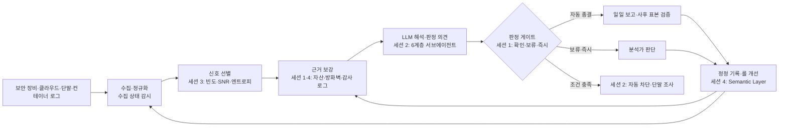

## 2. 배경: 왜 지금 트리아지인가

토스모바일 세션은 문제의 크기를 몇 가지 수치로 설명했다. 원 출처를 찾아 대조한 결과를 함께 적는다.

| 발표에서 든 수치 | 대조 결과 |
|---|---|
| 받는 알림의 40% 넘게는 확인도 못 한다는 설문 | [Prophet Security의 2025년 SOC 설문 보도](https://thehackernews.com/2025/09/the-state-of-ai-in-soc-2025-insights.html)가 약 40% 수치를 담는다. 벤더 설문이며, 후속 조사 수치는 다르게 보도된다 |
| 2026년 상반기 공개 취약점 3만 5천여 건, 전년 동기 대비 약 52% 증가(NVD 직접 집계) | [CVE 데이터 2차 분석](https://scantitan.com/blog/vulnerability-statistics/)은 35,872건 대 23,710건(+51.3%)으로 집계한다. 집계 기준(CVE.org/NVD, 시점)에 따라 약간씩 다르다 |
| 침투 후 내부 확산까지 평균 29분, 최단 27초 | [CrowdStrike 2026 Global Threat Report 발표](https://www.crowdstrike.com/en-us/press-releases/2026-crowdstrike-global-threat-report/)와 일치. 해당 벤더의 관측 데이터다 |
| 고위험 취약점 패치에 평균 55일(국내 분석) | 같은 수치의 국내 원자료는 찾지 못했다. [뉴스1 기사](https://www.news1.kr/it-science/security-hacking/6211369)가 인용한 Edgescan의 **글로벌 애플리케이션** 고위험 취약점 평균 54.81일이 가장 가깝다. 출처 확인 필요 |
| 오픈소스 스캐너 기본값이 초당 150요청 | [Nuclei 문서](https://docs.projectdiscovery.io/opensource/nuclei/running)의 기본 `rate-limit` 150과 부합한다. 1분이면 9,000건이다 |

AI 쪽 정황으로는 세 가지가 언급됐다.

- **취약점 발견**: Anthropic의 [Project Glasswing](https://www.anthropic.com/glasswing)(2026년 4월)은 Claude Mythos Preview가 오래 묵은 결함(예: OpenBSD의 27년 된 버그)을 찾았다고 발표했다.
- **평가 환경 밖으로 나간 모델**: 2026년 7월 [OpenAI 모델의 Hugging Face 침해](https://edition.cnn.com/2026/07/22/tech/openai-hugging-face-ai-cybersecurity)와 [Anthropic의 세 건 공개](https://www.anthropic.com/research/investigating-incidents-cybersecurity-evals)가 있었다. 원인은 결이 다르다. OpenAI 건은 격리 환경 탈출로 보도됐고, Anthropic은 평가 환경의 **설정 오류**로 인터넷이 열려 있었다고 설명했다.
- **보조에서 지휘로**: Anthropic의 [2026년 9월 위협 인텔리전스 보고서](https://www.anthropic.com/threat-intelligence-report-september-2026)는 AI의 사이버 작전 역할이 점점 자율적이 됐고, 여러 사례에서 에이전트가 정찰·침투·유출을 조율했다고 적었다. 동시에 표적 선정 같은 중대한 결정은 여전히 사람이 한 경우가 있고, 자율성과 피해 심각도는 별개라고 단서를 달았다.

국내에서는 2026년 9월 말부터 금융권 연쇄 해킹이 보도됐고, AI 침투 테스트 도구 ARTEX가 쓰인 정황이 [거론됐다](https://www.etnews.com/20261005000112). 도구의 실제 사용 범위와 공격 주체는 보도마다 확인 수준이 달라, 수사 결과 전까지는 잠정 정보로 봐야 한다.

방어자에게 결론은 단순하다. 공격이 분 단위라면 "알림을 열어 보고, 다른 팀에 로그를 요청하고, 회신을 기다리는" 왕복 구조는 시간 예산을 넘는다.

## 3. 세션 1 - 토스모바일: 줄이는 것이 아니라 순서를 정하는 트리아지

### 3.1 문제: 알림 하나가 두 팀의 왕복이었다

토스모바일은 제로 트러스트(내부망이라고 믿지 않고 모든 접근을 검증하는 모델)를 넓히면서 감시 대상이 경계 구간에서 내외부 시스템, 사용자, 공급자와 그 행위까지 늘었다. 알림이 오면 보안 담당자는 해당 서비스를 운영하는 인프라팀에 서비스 상태와 관련 로그를 요청하고 회신을 기다렸다. 알림에 판단 근거가 없으니 매번 이 왕복이 필요했다.

대표 사례가 WAF의 Injection 탐지 알림이다. 출발지 IP와 탐지 시각은 있지만 판단에 필요한 **요청 경로와 본문이 비어** 있었다. 분석 결과는 "본문 확인 불가, 정탐 판단 불가"로 끝났고, 같은 알림이 두세 번씩 중복으로 왔다.

알림은 세 종류(취약점, 보안 솔루션, 서비스)로 나눴고 앞의 둘에 AI를 먼저 적용했다. 서비스 알림 쪽은 정비 과정에서 보이지 않던 빈틈이 드러나, 알림 자체를 고치고 감시 범위를 넓히는 작업(가시성·런타임 레이어)으로 이어졌다.

### 3.2 원칙: 코드가 모으고, AI가 해석하고, 기준은 사람이 정한다

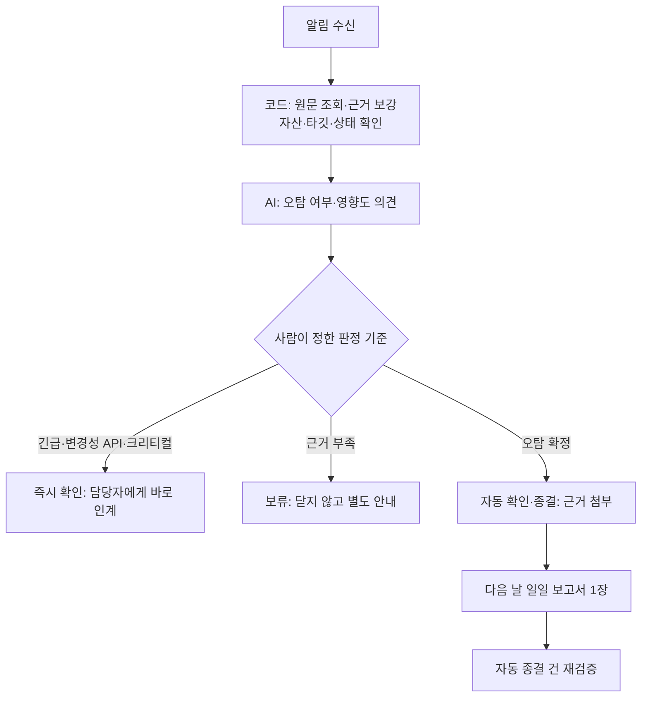

이 구조의 핵심은 역할 분리다.

1. **근거 수집은 결정론적 코드**가 한다. 같은 입력이면 같은 조회를 하므로 재현과 감사가 쉽다.
2. **LLM은 해석**한다. 점수와 로그를 읽고 위험의 의미를 설명한다.
3. **판정 기준은 사람**이 정한다. 모델이 바뀌어도 "무엇이 즉시 건인가"는 바뀌지 않는다.

특히 "**모르겠다도 정식 결과**"라는 규칙이 중요하다. 애매한 건을 조용히 닫는 순간 자동화는 미탐을 만드는 장치가 된다. 보류 칸은 LLM이 모르는 데이터를 아는 척하는 환각(Hallucination)을 흡수하는 완충 지대다.

### 3.3 취약점 트리아지: CVSS 점수만으로는 순서가 안 나온다

올해 상반기에만 수만 건이 공개되는 상황에서 첫 일은 "우리에게 해당하는 것"을 고르는 것이다. 토스모바일은 오픈소스 보안 플랫폼 Wazuh를 썼다. 서버의 에이전트가 설치 소프트웨어와 버전을 모으면, Wazuh가 공개 취약점 정보와 대조한다([Wazuh 취약점 탐지 문서](https://documentation.wazuh.com/current/user-manual/capabilities/vulnerability-detection/how-it-works.html)에 따르면 Syscollector 인벤토리를 CTI 데이터와 비교한다). 그 결과를 주기적으로 받아 **소프트웨어 자산 목록**을 만들었다.

다음은 우선순위다. 매년 하던 자산 평가의 CIA(기밀성·무결성·가용성) 등급만으로는 세밀한 순서를 매기기 어려워, **외부 노출 여부**와 **개인정보 취급 여부**를 기준에 더했다. 이 자산 중요도로 취약점 우선순위와 조치 기한을 정해 담당자에게 전달하고, 전달할 때 AI가 취약점 정보를 해석해 "점수만 보면 놓칠 위험"을 보완한다. 담당자는 이를 보고 위험 처리 전략(수정, 완화, 수용 등)을 결정한다. 화면은 취약점 번호 하나에 해당 자산·패키지·버전이 한 번에 보이는 형태다(실데이터는 공개하지 않았다).

아래는 이 방식을 이해하기 위한 **재구성 예시**다. 가중치와 기한은 임의의 값이며 토스모바일의 기준이 아니다.

```python
# 재구성 예시: 자산 문맥을 반영한 취약점 우선순위 (수치는 설명용)
from dataclasses import dataclass

@dataclass(frozen=True)
class Asset:
    cia_grade: int          # 1(낮음) ~ 3(높음)
    internet_exposed: bool  # 외부 노출 여부
    handles_pii: bool       # 개인정보 취급 여부

def priority(asset: Asset, cvss: float, known_exploited: bool) -> tuple[str, int]:
    """(우선순위, 조치 기한 일수). 점수는 '사람이 정한 기준'을 코드로 고정한 것."""
    weight = asset.cia_grade + 2 * asset.internet_exposed + 2 * asset.handles_pii
    if known_exploited and asset.internet_exposed:
        return "P0", 3
    if cvss >= 7.0 and weight >= 5:
        return "P1", 7
    if cvss >= 7.0 or weight >= 5:
        return "P2", 30
    return "P3", 90
```

비교 대상으로는 실제 악용이 확인된 취약점 목록 [CISA KEV](https://www.cisa.gov/known-exploited-vulnerabilities-catalog), 악용 확률을 추정하는 [EPSS](https://www.first.org/epss/), 의사결정 트리 방식의 [SSVC](https://www.cisa.gov/stakeholder-specific-vulnerability-categorization-ssvc)가 있다. 이 셋은 "취약점 자체의 위험"을, 노출·개인정보 기준은 "우리 자산의 맥락"을 말한다. 둘은 대체재가 아니라 곱해 쓰는 관계다. KEV나 EPSS를 함께 썼는지는 발표에서 밝히지 않았다.

### 3.4 보안 알림 트리아지: 3단계 판정과 그림자 운영

취약점에서 만든 틀을 알림에도 적용했다.

| 판정 | 조건 | 처리 |
|---|---|---|
| 즉시 확인 | 긴급 건, 변경성 API·크리티컬 이슈처럼 자동 처리하기 어렵고 되돌릴 수 없는 것 | 담당자에게 바로 인계 |
| 보류 | 근거 부족, 판단 모호 | 종결하지 않고 별도 안내 |
| 확인(자동) | 오탐이 근거와 함께 확정된 것 등 | 근거를 붙여 종결, 다음 날 일일 보고서로 정리 |

도입 순서가 실무적으로 가장 배울 점이다. **처음부터 자동 종결을 켜지 않았다.** 봇이 답글만 다는 단계에서 봇의 판정과 사람의 판정을 비교했고, 일치를 확인한 뒤에야 **오탐 판정만** 자동 종결하도록 열었다. 흔히 섀도 모드(shadow mode)라고 부르는 방식이다. 그래서 보류가 많은 것은 실패가 아니라 설계 의도라고 설명했다.

발표자가 밝힌 결과는 이렇다.

- 사람이 확인해야 하는 알림이 **약 97%** 줄었다. 지금은 "즉시 확인"과 "보류"만 본다.
- 자동 종결된 건도 계속 검증하며, 현재 **약 1,000건당 1건** 수준으로 담당자가 확인했어야 할 것이 섞여 있었다. 주기적으로 확인해 정확도를 올리는 중이다.
- 바뀐 것은 알림의 수가 아니라 "사람이 보는 시점"이다.

1/1,000이라는 수치는 조심해서 읽어야 한다. 하루 $N$건을 자동 종결하고 누락 비율이 $p$라면 기대 누락은 $N p$건이다.

$$E[\text{누락}] = N \cdot p, \qquad N = 10{,}000,\ p = 0.001 \Rightarrow 10\ \text{건/일}$$

위의 $N$은 설명용 가정이다. 비율이 낮아도 규모가 크면 절대 건수는 쌓인다. 따라서 자동 종결 표본 감사는 계속 돌려야 하는 운영 비용이다. 표본에서 실패가 0건이어도 95% 신뢰 수준에서 실제 실패율의 상한은 대략 $3/n$("3의 법칙")이므로, $p<0.1\%$를 주장하려면 무작위 표본이 약 3,000건 이상 필요하다. 또 이 1/1,000이 "실제 위협 미탐"인지 "사람이 봤으면 좋았을 건"인지는 구분해 공개되지 않았다.

### 3.5 한 건씩 판정할 수 없는 알림: Seven-in, One-out

EDR, DLP, 규정 위반(위규) 알림은 한 건만 보면 정상인지 알기 어렵다. 관리 도구의 정상 동작인지, 승인된 반출인지, 이미 처리한 건인지는 **하루치를 모아 맥락**을 봐야 한다. 그래서 "하루 한 장" 보고서로 바꿨다.

- 입력: Slack 6개 채널 + CrowdStrike Falcon으로 보이는 "Falcon API" = 7개
- 출력: 1장. 위에서부터 **즉시 조치 → 우선순위를 붙인 오늘 할 일 → 채널 현황 → 수집 상태**

마지막 "수집 상태" 칸은 보고서가 **어느 채널을 읽었는지 스스로 밝히는** 장치다. 요약 보고서의 가장 위험한 실패는 입력 하나가 끊겼는데 "특이 사항 없음"이 나오는 것이다. 읽은 범위를 출력에 넣으면 "없음"과 "못 봄"이 구분된다. 이 원칙은 세션 4에서도 똑같이 나온다.

### 3.6 판정 레이어 구현: n8n 워크플로 하나, 세 구간

구현 담당자는 출발점이 화려한 기술이 아니라 실무에서 자꾸 멈추던 네 가지 순간이었다고 설명했다. 무엇부터 볼지, 장애의 병목이 어디인지, 근거 없는 알림이 오탐인지 정탐인지, 컨테이너 내부에서 무슨 일이 있는지다. 이를 **판정·가시성·런타임** 세 레이어로 풀었다.

판정 레이어는 워크플로 자동화 도구 n8n의 워크플로 하나가 골격이다.

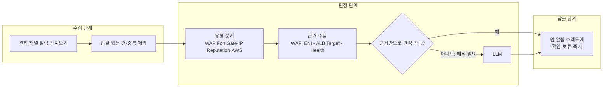

설계 포인트는 세 가지다.

- **LLM 호출은 기본 경로가 아니다.** 근거로 먼저 판정하고, 해석이 필요할 때만 LLM을 거친다. 비용과 지연, 환각 위험이 함께 준다.
- **WAF 알림은 실제 영향까지 추적한다.** 네트워크 인터페이스(ENI)에서 로드밸런서(ALB)의 타깃, 그 타깃의 헬스 상태까지 따라가 "공격이 닿는 서버가 있는가"를 근거로 삼는다.
- **답글이 없으면 봇이 멈췄다는 신호**다. 모든 알림에 반드시 답이 달린다는 불변식이 있으면 침묵 자체가 감시 대상이 된다.

아래는 "답글 불변식"과 "보류 기본값"을 표현한 **재구성 의사코드**다.

```python
# 재구성 예시: 어떤 실패에도 '조용히 닫힘'이 없도록 하는 판정 함수
def triage(alert, collectors, llm, rules):
    if alert.has_reply or alert.is_duplicate:
        return None                                  # 이미 처리 중인 건
    evidence = collectors[alert.type].gather(alert)  # 결정론적 조회
    if rules.is_irreversible_or_critical(alert, evidence):
        return reply(alert, "즉시", evidence)         # 모델 의견과 무관
    if evidence.missing_required_fields():
        return reply(alert, "보류", evidence, why="필수 근거 없음")
    verdict = rules.decide(evidence)
    if verdict is None:                              # 해석이 필요할 때만
        verdict = rules.validate(llm.interpret(evidence), evidence)
    if verdict == "오탐확정" and rules.auto_close_enabled(alert.type):
        return reply(alert, "확인", evidence, close=True)
    return reply(alert, "보류", evidence)             # 기본값은 닫지 않음
```

알림 원문은 공격자가 일부를 통제할 수 있는 데이터(요청 경로, 헤더, 본문)다. LLM에 넘기면 그 안의 문장이 지시처럼 읽히는 **프롬프트 인젝션** 위험이 생긴다([OWASP LLM01](https://genai.owasp.org/llmrisk/llm01-prompt-injection/)). "크리티컬은 모델 의견과 무관하게 사람에게", "모델 출력은 허용된 판정값만 통과", "모델에 변경 권한을 주지 않는다" 같은 코드 쪽 게이트가 방어선이다. 이 위험에 대한 대책은 발표에서 따로 다루지 않았다.

**자격 증명 관리**도 짚었다. 메신저와 LLM 토큰은 n8n 데이터베이스에 암호화해 저장하고, 암호화 키는 AWS Secrets Manager에 따로 둔다. 실행 중인 쪽의 키(권한)로는 그 저장소에 접근할 수 없게 해, DB가 유출돼도 토큰은 암호문으로 남는다는 설명이다(이 대목은 음성 인식상 "n8n 키"의 정확한 대상이 불분명하다). n8n은 [`N8N_ENCRYPTION_KEY`](https://docs.n8n.io/hosting/configuration/configuration-examples/encryption-key/)로 자격 증명을 암호화한다. 다만 n8n 프로세스는 복호화를 위해 키를 메모리에 가져야 하므로, 이 설계가 막는 것은 **DB 덤프 유출**이지 n8n 실행 환경 자체의 장악이 아니다.

### 3.7 가시성 레이어: 서비스 지표가 정상이어도 고장은 난다

두 가지 실제 사례가 계기였다.

| 사례 | 증상 | 왜 안 보였나 |
|---|---|---|
| 배포 경로 고장 | 게이트웨이 새 버전의 Pod가 `CrashLoopBackOff` | 기존 버전이 트래픽을 계속 받아 서비스 지표는 정상 |
| 고친 취약점의 재발 | 노드를 패치해도 교체된 노드가 다시 취약 | 라이브 노드의 AMI(서버 이미지)가 4월 버전 ID로 고정 |

첫째는 Kubernetes 롤링 업데이트의 정상 동작이 만드는 사각지대다. 새 Pod가 준비되지 않으면 이전 ReplicaSet이 남아 서비스를 지킨다. 가용성에는 좋지만 "배포가 실패한 채 멈춤"은 요청 성공률에 나타나지 않는다. [Deployment의 `progressDeadlineSeconds`](https://kubernetes.io/docs/concepts/workloads/controllers/deployment/#failed-deployment)를 넘기면 `Progressing=False` 조건이 기록되므로, 이 조건을 직접 경보로 걸어야 한다.

둘째는 "서버를 고치는 것"과 "서버를 만드는 틀을 고치는 것"의 차이다. AMI 고정 자체는 나쁜 관행이 아니다. [Karpenter 문서](https://karpenter.sh/docs/tasks/managing-amis/)는 운영 환경에서 검증된 AMI를 고정하라고 권하면서, 그만큼 보안 패치를 놓칠 수 있다고 경고한다(토스모바일이 Karpenter를 쓰는지는 언급되지 않았다). 고정했다면 **고정값을 갱신하는 절차**와 노드 이미지의 나이·취약점을 보는 점검이 짝이어야 한다. 취약점 조치 완료의 기준도 "스캔한 서버에서 사라짐"이 아니라 "새로 만들어지는 서버에도 없음"이어야 한다.

두 사례 모두 장애가 난 뒤 명령어를 하나씩 입력해 원인을 찾았다. 그래서 만든 것이 자체 모니터 서버 **토스모바일 Monitor**다. 기존 Datadog을 대체하려는 것이 아니다. 로그를 파는 일은 여전히 Datadog에서 하고, 그 전에 **명령을 치지 않아도 상태가 먼저 보이는 화면**이 목적이다.

- "이 ALB 뒤에 무엇이 붙어 있고 지금 어느 것이 죽었나"를 한 화면에 보여 준다.
- 정상 구간은 접고 이상 구간만 펼친다. 문제 구간은 빨간 점선으로 표시하고, 상세 패널에서 최신 로그까지 본다.
- **감시 도구도 감시한다.** 갱신이 10분 멈추면 알림과 화면 배너가 뜬다. 원인이 세션 만료라면 담당자가 재인증해야 하고, 수집이 왜 멈췄는지 확인하고 화면이 최신 상태로 돌아온 것까지 봐야 점검이 끝난다. "조용히 죽는 것이 가장 위험하다"는 경험에서 나왔다.
- 가장 어려운 것은 알리는 일이 아니라 **알리지 않는 일**이었다. 메신저에는 **상태가 바뀐 순간**만 온다. 언제·어디서·무엇이·어떤 상태로·왜 바뀌었는지를 한 메시지에 담는다(예: 개발 DB 업그레이드로 인한 이상 전환, 어드민 DB가 16분 만에 정상 복구).
- 알림 발송 실패는 격리해 대시보드까지 영향이 번지지 않게 했다.

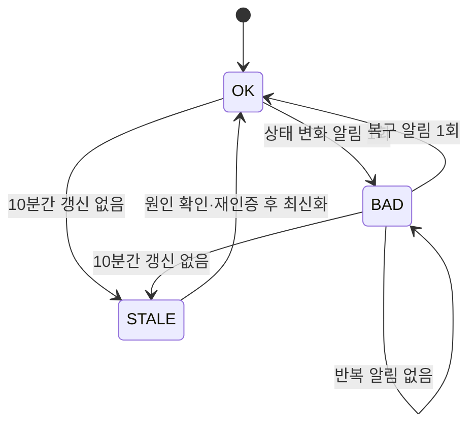

(상태 이름은 설명용 재구성이다.) 상태 전이 알림은 알림 폭주를 막지만, 상태가 정상과 이상을 빠르게 오가면(flapping) 다시 시끄러워진다. 연속 N회 실패 후 전환하는 완충이 보통 필요하다.

### 3.8 런타임 레이어: 컨테이너 안은 Falco로

컨테이너 안에서 누가 셸을 열거나 민감 파일을 읽어도 인프라 지표는 정상이다. [Falco](https://falco.org/docs/)는 커널의 시스템 호출(syscall, 프로그램이 파일·네트워크 같은 자원을 커널에 요청하는 통로)을 규칙과 대조한다. 한 노드의 Pod들은 커널을 공유하므로 **노드당 Falco 하나**면 그 위의 모든 Pod 행위를 본다.

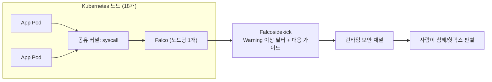

[Falcosidekick](https://github.com/falcosecurity/falcosidekick)은 Falco 이벤트를 받아 우선순위로 거르고 외부 채널로 보내는 중계기다. 토스모바일은 18개 노드 전부에서 전달되는 것을 확인했고, 직접 행위를 재현해 채널 메시지와 대조했다.

발표에서 제시한 등급과, Falco 공식 규칙 저장소([falcosecurity/rules](https://github.com/falcosecurity/rules), 2026-11 시점 main 브랜치)의 유사 규칙 기본값을 비교하면 조정의 의미가 드러난다.

| 행위 | 토스모바일 등급 | 가장 가까운 공식 규칙(대응 관계는 추정) | 공식 기본 등급 | 규칙 묶음 | 공식 태그 |
|---|---|---|---|---|---|
| `/etc/shadow` 읽기 | Warning | Read sensitive file untrusted | WARNING | stable | T1555 |
| 처음 보는 프로그램(`nc` 등) 실행 | Critical | Drop and execute new binary in container | CRITICAL | stable | TA0003 |
| 〃 (netcat 원격 실행 형태) | 〃 | Netcat Remote Code Execution in Container | WARNING | stable | T1059 |
| 운영 네임스페이스 셸 | Critical | Terminal shell in container | NOTICE | stable | T1059 |
| IMDS 의심 접근 | Critical | Contact EC2 Instance Metadata Service From Container | NOTICE | incubating | T1552.005 |

IMDS는 클라우드 서버가 자기 정보와 임시 자격 증명을 얻는 내부 주소다. 여기서 중요한 함의가 있다. 중계기에서 "Warning 이상"만 보내면 **기본 NOTICE인 셸·IMDS 규칙은 채널에 도달하지 않는다.** 등급을 올려야 하고, incubating 규칙은 기본 설치에서 켜지지 않으므로 따로 로드해야 한다. 아래는 그 조정을 표현한 **재구성 설정**이다. 매크로·필드는 사용하는 규칙 버전에 맞춰 검증해야 한다.

```yaml
# 재구성 예시: 기본 규칙의 등급 조정 + 운영 네임스페이스 전용 규칙
- rule: Contact EC2 Instance Metadata Service From Container   # incubating 규칙 파일을 먼저 로드
  priority: CRITICAL
  override:
    priority: replace

- list: prod_namespaces
  items: [prod]

- rule: Shell in production namespace
  desc: 운영 네임스페이스 컨테이너에서 터미널이 붙은 셸 실행
  condition: >
    spawned_process and container and proc.tty != 0
    and proc.name in (shell_binaries)
    and k8s.ns.name in (prod_namespaces)
  output: "prod shell (pod=%k8s.pod.name user=%user.name cmd=%proc.cmdline)"
  priority: CRITICAL
  tags: [mitre_execution, T1059]
```

개념 전달용이므로 사용하는 규칙 버전에서 검증해야 한다. 기존 규칙의 속성만 바꿀 때는 [override 문법](https://falco.org/docs/concepts/rules/overriding/)을 쓴다. Falco는 기본 설정에서 한 이벤트에 처음 일치한 규칙 하나만 알리므로(`rule_matching: first`), 위처럼 조건이 겹치는 규칙을 추가하면 로드 순서나 이 설정도 확인해야 한다. 알림마다 [MITRE ATT&CK](https://attack.mitre.org/) 기법 번호를 붙였고, 판정 레이어의 3분류를 런타임에도 적용했다. 참고로 `/etc/shadow` 읽기를 ATT&CK에 매핑한다면 [T1003.008](https://attack.mitre.org/techniques/T1003/008/)이 더 구체적이다(조직이 붙인 번호는 공개되지 않았다).

Pod에서 셸을 여는 행위는 침투 후 정찰일 수도, 급한 핫픽스일 수도 있다. Falco는 같은 규칙으로 잡고 **어느 쪽인지는 사람이 판단한다.** 실제로 시간이 든 것은 규칙을 넣는 일이 아니라 **예외를 다는 일**이었다.

### 3.9 시행착오·교훈·남은 질문

| 구분 | 내용 |
|---|---|
| 시행착오 | 본문 없는 WAF 알림, 중복 알림, 배포 실패를 가린 정상 지표, 고정 AMI로 인한 취약점 재발, 조용히 멈추는 감시 도구, Falco 예외 튜닝 |
| 세 레이어 공통 원칙 | 판단보다 근거 먼저, 확인·보류·즉시 3단계, AI는 해석하고 기준은 사람이 정함 |
| 발표의 한 문장 | 알림을 줄이는 것이 아니라 순서를 정하는 것이 트리아지다. 수만 건 중 사람이 볼 것을 "골라낸" 결과다 |
| 공개되지 않은 것 | 97%의 산정 기간·분모, 사용 모델, 1/1,000 누락의 유형과 검증 표본, 서비스 알림 적용 결과 |

체크리스트로 옮기면 이렇다.

- [ ] 자동 종결 전에 섀도 모드 비교 기간과 통과 기준(불일치율)을 정했는가
- [ ] "보류"가 기본값이고, 수집 실패·모델 오류가 종결로 이어지지 않는가
- [ ] 자동 종결 건의 무작위 표본 감사를 정기적으로 하는가
- [ ] 모든 알림에 답이 달리는지, 감시 도구 자체의 정지를 감지하는가
- [ ] 알림 전송 필터의 최소 등급과 규칙의 기본 등급이 어긋나지 않는가

## 4. 세션 2 - 토스뱅크: Tier를 에이전트로 올리는 자율형 보안 운영

### 4.1 문제: 열 개의 문을 지키는 쪽과 하나만 열면 되는 쪽

토스뱅크 세션의 질문은 "보안 운영의 판단을 어디까지 맡길 수 있는가"였다. 방어자는 열 개의 문을 모두 막아야 하지만 공격자는 하나만 열면 된다. 블루팀(방어팀)은 예방 외에도 이벤트 분석, 정오탐 판별, 수많은 검토 대상의 대응에 자원을 많이 쓴다. 사람을 늘리는 것은 현실적인 해법이 아니었다.

팀은 공격이 이미 "에이전트 속도"라고 판단했다. 근거로 AI가 공격의 80~90% 이상을 자동화한다는 수치와 평균 29분·최단 27초의 확산 시간을 들었다. 앞의 수치는 [Anthropic의 2025년 11월 GTG-1002 보고서](https://assets.anthropic.com/m/ec212e6566a0d47/original/Disrupting-the-first-reported-AI-orchestrated-cyber-espionage-campaign.pdf)에서 **한 캠페인**의 전술 작업 비중으로 제시한 80~90%와 부합하며, 외부 연구자의 [회의적 반응](https://www.bleepingcomputer.com/news/security/anthropic-claims-of-claude-ai-automated-cyberattacks-met-with-doubt/)도 있었다. 모든 사이버 공격에 대한 통계로 읽으면 안 된다. 그래서 목표는 방어도 에이전트 속도로 바꾸는 것, 즉 에이전트가 판단하고 대응까지 하는 구조였다.

단서가 하나 붙었다. LLM이 모든 것에 적합하지 않다는 것을 알기 때문에, **기존 방식으로 잘되던 자동화는 바꾸지 않고** 에이전트로 더 키울 수 있는 부분에 쓴다는 기조다.

### 4.2 전체 구조: 탐지·분석·대응·운영

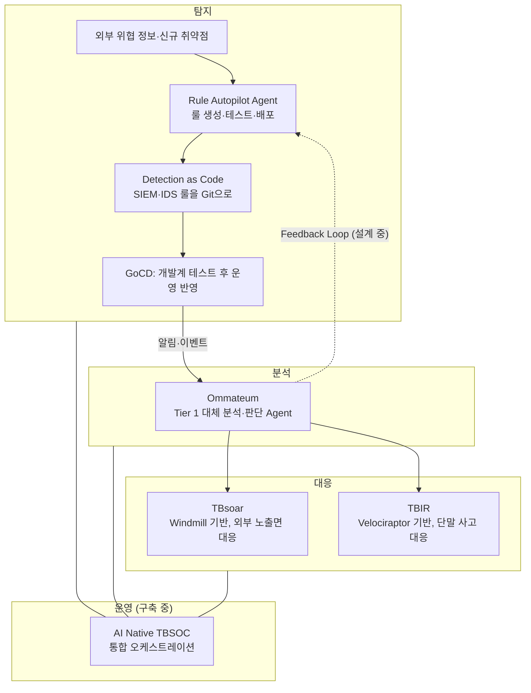

| 영역 | 구성 요소 | 역할 | 상태 |
|---|---|---|---|
| 탐지-관리 | Detection as Code | SIEM·IDS 시나리오와 이벤트 룰을 코드화 | 운영 |
| 탐지-생성 | Rule Autopilot | 위협 정보로 룰 자동 생성·테스트·배포 | 운영, 반영 비율 개선 중 |
| 분석 | Ommateum | 수신·분류·보강·판단·대조·응답 | 운영 |
| 대응 | TBsoar | 보강 판정 후 플레이북 기반 자동 대응 | 일부 자동 대응 운영 |
| 대응 | TBIR | 단말 조회·원격 수집·타임라인 분석 | 운영 |
| 운영 | AI Native TBSOC | 전 생애주기 통합 플랫폼 | 구축 중 |

### 4.3 탐지: Detection as Code와 룰 자동 생성

Detection as Code는 탐지 규칙을 콘솔에서 손으로 고치지 않고 **소스 코드처럼** 관리하는 방식이다. 이력, 리뷰, 테스트, 배포 자동화가 따라온다. 토스뱅크가 든 이점에는 "AI가 적극적으로 활용할 수 있는 포석"이 포함된다. 텍스트 파일과 Git 이력은 LLM이 읽고 고치기 가장 쉬운 형태이기 때문이다. 만든 룰은 GitOps(저장소의 선언 상태를 기준으로 배포하는 방식)로 관리하고 사내 [GoCD](https://www.gocd.org/) 파이프라인으로 개발계 테스트를 거쳐 운영에 반영한다.

아래는 벤더 중립 규칙 형식 [Sigma](https://sigmahq.io/)를 빌린 **재구성 예시**다. 토스뱅크의 규칙 형식은 공개되지 않았다. 에이전트가 만든 룰이라면 "의도"와 "시험 데이터"를 함께 남기는 것이 뒤의 분석 에이전트에게 도움이 된다.

```yaml
# 재구성 예시: 의도와 테스트를 함께 갖는 탐지 룰
title: Web server process spawns an interactive shell
status: experimental
description: |
  의도: 웹 애플리케이션 프로세스의 자식으로 셸이 뜨면 원격 코드 실행을 의심한다.
  알려진 정상: 배포 스크립트의 헬스 점검(변경 티켓 확인).
logsource: {category: process_creation, product: linux}
detection:
  selection:
    ParentImage|endswith: ['/node', '/java']
    Image|endswith: ['/sh', '/bash']
  condition: selection
falsepositives: ['승인된 운영 스크립트']
level: high
```

```text
# 재구성 예시: 파이프라인 게이트
lint -> 스키마 검사 -> 양성 표본은 반드시 매치 -> 정상 표본(최근 N일)은 매치율 상한
     -> 개발계 그림자 배포 -> 사람 승인 -> 운영 반영 -> 롤백 경로 유지
```

운영 결과로, 룰과 이력이 코드로 남고 최적화·오류 확인에 LLM을 적극 쓰게 됐으며 신규 취약점·위협 인텔리전스(TI)를 빠르게 시험·반영할 수 있게 됐다. 다만 **생성된 룰 중 실제 반영되는 비율은 아직 만족스럽지 않다**고 인정했다. 원인은 즉시 반영하기 어려운 데이터와 검증 문제로 보고 고도화 중이다. 비율 수치는 공개하지 않았다. 룰 생성은 쉽고 "우리 로그에 그 필드가 있는가, 공격 표본으로 증명되는가, 정상 트래픽에 얼마나 걸리는가"가 어렵다는 일반적인 병목과 맞닿아 있다.

### 4.4 분석: Ommateum의 6계층

Ommateum은 Tier 1을 대체하려는 분석·판단 에이전트다(이름 표기는 음성 인식 기준). 목표는 두 가지다. 판단을 **범위에 맞게 위임**하고, 판정마다 **근거 기록**을 남겨 분석의 완결성을 보장하는 것이다. 이벤트 트리거 후 멈추던 흐름을, 사내 [vLLM](https://docs.vllm.ai/)(LLM 추론 서빙 엔진)이 서빙하는 모델 위에서 6계층으로 바꿨다. 계층마다 서브에이전트가 있고, 이벤트 분류와 역할별 모델에 따라 **계획(Plan) 계층의 결과대로 최적 경로를 골라** 자율적으로 움직인다.

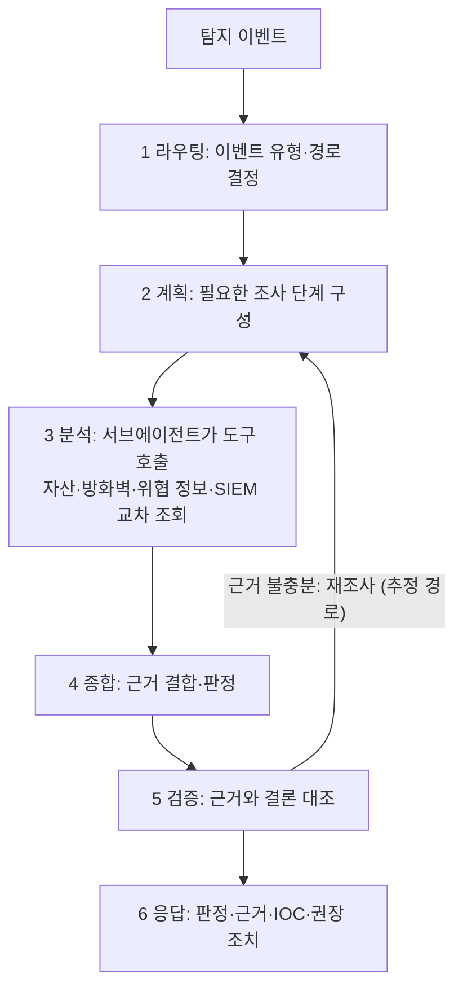

계층 이름과 순서는 발표 내용이고, 검증에서 계획으로 되돌아가는 화살표와 각 칸의 세부 설명은 이해를 돕는 추정이다.

왜 나누는가? 하나의 거대한 프롬프트에 모두 맡기면 어느 단계에서 틀렸는지 알 수 없다. 계층을 나누면 (1) 단계별로 작은 모델과 큰 모델을 섞을 수 있고, (2) 검증 계층이 생성 계층과 다른 지시로 결론을 반박할 수 있으며, (3) 단계별 처리량과 실패를 계측할 수 있다. 대가는 지연, 토큰, 오류 전파(라우팅이 틀리면 뒤가 모두 틀림)다.

### 4.5 품질을 가른 것은 모델보다 맥락이었다

가장 중요한 시행착오다. **좋은 모델에 원시 데이터만 주면** 맞히는 경우도 있었지만 **그럴듯하게 틀리는 경우가 매우 많았다.** 팀은 근거 있는 판정을 위해 다음 맥락과 도메인 지식을 전달하는 것이 모델 선택이나 하니스 구성에 견줘 품질에 매우 큰 영향을 준다고 봤다.

| 전달한 것 | 의미 | 없을 때 생기는 실패(해석) |
|---|---|---|
| 확정 사실 | 이미 확인된 자산·환경 정보 | 모델이 환경을 상상해 채움 |
| 룰의 의도 | 이 룰이 무엇을 잡으려 만들어졌나 | 문자열 매치를 곧 공격으로 판정 |
| 판단 순서 | 분석가가 확인하는 차례 | 결론을 먼저 내고 근거를 끼워 맞춤 |
| 지식 데이터 | 자산, 방화벽, 위협 정보 | 추측성 설명 |

분석가의 **판단 과정 자체를 지식으로 옮기는 데** 많은 노력을 들였고, 여러 데이터를 볼 때 사실에 근거해 추측을 막고 맥락을 이해시키는 것이 중요했다고 정리했다.

아래는 "룰 의도 → 원문 대조 → 도구 호출 → 판정"을 강제하는 출력 계약의 **재구성 예시**다.

```json
{
  "rule_intent": "XSS: 사용자 입력이 스크립트로 실행되는 패턴 탐지",
  "facts": [
    {"claim": "매치 문자열은 정상 파라미터 값의 일부", "source": "waf.raw#req-1"},
    {"claim": "같은 출발지의 동일 대상 이상 요청 없음", "source": "siem.query#7"},
    {"claim": "애플리케이션 로그 응답에 특이 사항 없음", "source": "app.log#session-42"}
  ],
  "unverified": ["클라이언트 렌더링 결과"],
  "verdict": "false_positive",
  "recommended_action": ["룰 예외 후보 등록 검토"],
  "iocs": []
}
```

`source`가 없는 `claim`은 코드가 거절하도록 만들면 "근거 없는 문장"이 판정에 섞이는 것을 기계적으로 줄일 수 있다.

### 4.6 분석 사례 두 가지

**정탐: React2Shell 원격 코드 실행 시도.** React Server Components의 역직렬화 취약점 [CVE-2025-55182](https://react.dev/blog/2025/12/03/critical-security-vulnerability-in-react-server-components)를 노린 이벤트다. Ommateum은 사전 정의한 **정책 카탈로그**에서 룰이 잡는 패턴과 의도를 먼저 확인하고, 원시 데이터와 대조한 뒤, 필요하면 도구를 호출한다. 자산·방화벽·위협 정보를 근거로 자산 등급에 따른 위험도를 산정하고 SIEM에서 교차 조회한다. 결과에는 어떤 공격인지, 왜 정탐인지, 차단 여부와 권장 조치, 추출한 IOC가 담긴다.

**오탐: WAF의 XSS 탐지.** 정상 애플리케이션 요청 안의 `exec` 문자열이 매치된 건이다. 정책 데이터로 룰 의도를 파악하고 원시 데이터를 분석한 뒤, SIEM에서 같은 출발지·대상의 다른 특이 사항을 찾고, 채널계(애플리케이션 계층) 로그에서 해당 식별자의 다른 응답을 확인했다. 결론은 "패턴이 우연히 일치했고 악의적 페이로드나 맥락이 없으며 명령 실행도 없었다"였다.

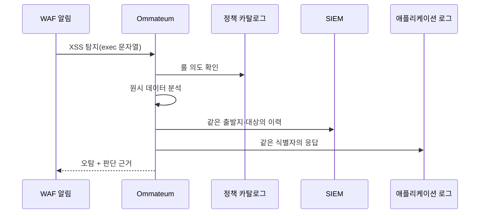

두 사례의 공통점은 "공격처럼 보이는가"가 아니라 "**룰이 의도한 행위가 실제로 일어났는가**"를 묻는다는 것이다.

### 4.7 대응: TBsoar와 TBIR

**TBsoar**는 외부 노출 표면 이벤트를 맡는다. Ommateum의 분석 결과에 **보강 판정을 한 번 더 거쳐** 자동 대응한다. 흐름은 모두 오픈소스 워크플로 엔진 [Windmill](https://www.windmill.dev/) 위에 코드(GitOps)로 정의해 에이전트가 참조한다.

**TBIR**는 단말·자산 이벤트의 심층 사고 대응을 맡는다. [Velociraptor](https://docs.velociraptor.app/)(단말에 질의해 포렌식 흔적을 수집하는 오픈소스 도구) 기반이며, 분석가 요청이나 SOAR 트리거로 **사전 정의한 Artifact**(수집 항목 정의)를 써서 단말을 조사한다. 절차는 대상과 Artifact 확인 → Hunt(여러 단말 대상 조사 작업) 생성·시작 → 결과 수집 → 재필터링이다.

"사전 정의한 Artifact만 실행"은 중요한 안전 설계다. 단말에 임의 명령을 내릴 수 있는 도구를 LLM에 그대로 쥐여 주면, 오판이나 프롬프트 인젝션이 전사 단말 작업이 될 수 있다. 자동 차단도 마찬가지다. 아래는 일반적인 안전장치를 담은 **재구성 정책**이며 토스뱅크의 실제 설정이 아니다. 발표에서는 "서비스 가용성을 위한 안전장치를 구성했다"고만 밝혔다.

```yaml
# 재구성 예시: 자동 차단 가드레일
auto_block:
  require:
    verdict: true_positive
    second_opinion: agree          # 보강 판정 일치
    evidence_sources_min: 2
  never_block: [internal_ranges, partner_allowlist, health_checkers]
  ttl: 24h                         # 영구 차단은 사람 승인
  rate_limit: 20/10m               # 초과하면 자동화 중단 후 호출
  rollback: one_click
  kill_switch: soc_oncall
```

운영 결과(발표자 보고)는 전환 전보다 **적절한 차단은 늘고 평균 대응 시간은 줄었으며**, 자동 차단으로 인한 서비스 이슈는 아직 없었다는 것이다. TBIR도 사고 건당 종결 시간이 줄고 단말 헌팅이 훨씬 쉬워졌다고 했다. 두 항목 모두 수치는 공개되지 않았다.

### 4.8 운영 결과와 성숙도

- 분석 소요 시간 단축, 분석 피로 감소. "완전히 잘못 분석한 사례는 거의 미미한 수준"이라고 평가했다.
- **월 2만여 건**의 이벤트를 에이전트 분석으로 대체 중이다.
- 지난 반년 동안 표면 위협 분석 범위를 월별로 계속 늘렸고, 다른 이벤트로 확대할 계획이다.
- 자체 어드민에서 정오탐 결과를 관리한다. 제시된 화면 기준 500여 건의 건당 평균 분석 시간이 **1분 내외**였고 단계별 처리량이 보인다.
- 분석 결과를 정규화해 일·주·월 단위로 **분석 품질 자체를 분석**한다. 에이전트 품질 개선점, 미탐 여부, 고칠 탐지 룰을 찾는다.

월 2만 건에 건당 1분이면 순차 처리로 약 333시간이다. 한 사람의 월 근무 시간(약 160시간)의 두 배다. 다만 이는 **에이전트의 처리 시간**이지 사람이 같은 일을 할 때의 시간이 아니므로 절감 인력으로 환산하면 안 된다.

현재 위치는 자율 운영 체계 관점에서 **증강(Augmentation)과 자율(Autonomy)의 사이**, SOC 성숙도 관점에서 **Tier 2와 Tier 3 사이를 에이전트로 대체하는 중**이라고 자평했다. 제목의 "Tier Up"은 분석가가 상위 업무로 올라간다는 뜻이다. 다음 과제는 위임 업무의 범위와 안정성 확대, Tier 3 영역의 에이전트 작업, 그리고 필수 요소로 꼽은 **Feedback Loop**다. 이벤트 분석뿐 아니라 블루팀 업무 전반에서 에이전트 결과가 개선으로 돌아오는 고리이며 설계 중이다. 통합 플랫폼(AI Native SOC)도 미완이다.

### 4.9 비판적으로 볼 지점

| 질문 | 왜 중요한가 |
|---|---|
| "거의 미미한" 오분석률은 몇 %인가, 어떻게 쟀나 | 정답 레이블, 표본 크기, 재현율(실제 위협을 얼마나 잡았나)이 공개되지 않았다 |
| 자동 차단의 "적절함"은 누가 판정하나 | 같은 에이전트 계열이 판정하면 자기 평가가 된다 |
| 모델·프롬프트 변경 시 회귀 시험은 | 판정 품질은 모델 교체에 민감하다. 고정 평가 세트가 필요하다 |
| 탐지와 분석이 모두 에이전트면 | 같은 맹점을 공유할 수 있다. 독립된 헌팅·레드팀이 필요하다 |

LLM 트리아지 연구에서도 "언제 조사를 끝내도 되는가"가 핵심 난제다. 2026년 10월 프리프린트 [From Investigation Failures to Reliable SOC Agents](https://arxiv.org/abs/2610.10608)는 자체 벤치마크에서 비교 대상 방식들이 공격 관련 알림의 40.4% 이상을 놓쳤고, 반론 에이전트와 별도 판정자를 둔 구조가 미탐률을 3.1%로 낮췄다고 보고한다(동료 심사 전이며, 토스뱅크 환경과 무관한 실험이다). 검증 계층을 "있는 것"과 "독립적으로 반박하는 것"으로 만드는 차이를 보여 주는 참고 자료다.

## 5. 세션 3 - 토스증권: Signal First, LLM Second

### 5.1 문제: 두 삼각형의 세계

토스증권 탐지 담당 박철민의 한 줄 요약은 "**LLM이 판단하기 전에 먼저 진짜 신호를 골라내야 한다**"다. 정오탐 분석은 많이 하지만 탐지 영역의 진짜 목표 중 하나는 **사고를 찾아내는 것**이고, 이를 위한 엔진·알고리즘·프레임을 고민했다.

지난해 콘퍼런스에서 소개한 탐지 엔지니어링을 추상화하면 삼각형 두 개가 된다.

- 역삼각형: 이상 행위 임계치. 강한 이상 행위일수록 높은 위험 등급을 준다.
- 정삼각형: 탐지 수량. 등급이 높을수록 적게 탐지된다.

두 삼각형이 겹친 세계를 **Bi-Triangular Universe**라 불렀다(대부분의 보안 팀이 사는 이벤트 탐지의 세계다). 이 세계는 **사후에는 다 보인다.** 지난 주가 차트에서 급락 시점을 찾는 것처럼. 문제는 집중해야 하는 그 순간에는 잘 안 보이고, 한 시간 뒤를 알기 어렵다는 것이다. 탐지 이벤트가 많을수록 중요한 사건은 수면 아래 묻힌다. 발표자는 사과의 낙하와 행성 운동을 설명하는 만유인력처럼, 이 세계에도 **현상을 해석하고 예측할 법칙**이 있지 않을까 물었다.

그 답이 **Cyber SEF**다. 세 지표(SNR, Entropy, Frequency)의 머리글자를 땄다.

| 지표 | 답하는 질문 | 쉽게 말하면 |
|---|---|---|
| Frequency Score | 얼마나 많은 영역에서 얼마나 다양하게 탐지되는가 | 경보가 여러 방에서 서로 다른 센서로 울리는가 |
| SNR | 중요한 알림이 사소한 알림 대비 얼마나 뚜렷한가 | 소음 속에서 비명이 얼마나 또렷한가 |
| Entropy | 평소와 얼마나 다른가(예측하기 어려운가) | 평소 패턴에서 얼마나 놀라운가 |

도입부에서는 3차원 공간의 점 애니메이션(유사 데이터로 재현한 것)을 보였다. 평소에는 점이 한 꼭짓점에 모여 있다가 시간이 지나며 반대편 공간으로 퍼지고, 사고 시점에 빨간 점이 생긴다.

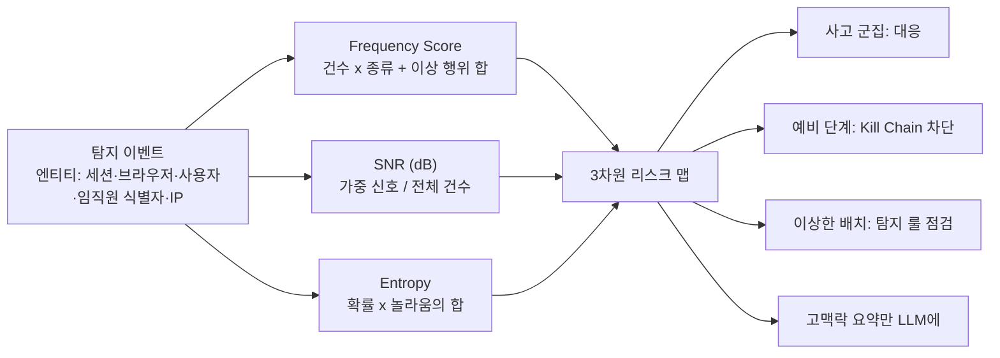

### 5.2 지표 1 - Frequency Score: 건수보다 다양성

직관은 사고 시나리오에서 나온다. 내부 정보 유출이라면 형상 관리 시스템에서 소스 코드를 내려받고, 압축하고, (폐쇄망이면) 외부로 꺼내고, 업로드하는 과정에서 **여러 종류**의 DLP·내외부 탐지가 줄지어 울린다. 20건이 여러 종류로 울린 경우와, 그 두 배가 **한 종류**로만 울린 경우를 비교하면 현업 감각으로는 앞쪽이 훨씬 위험하다. 이를 숫자로 만든 것이 빈도 점수이며 핵심은 **곱셈**이다.

$$F = C \times K + A$$

$C$는 탐지 건수, $K$는 탐지 종류 수, $A$는 "이상 행위 합계"다. 실제 사고 사례 예시는 $C=27$, $K=10$, $A=466$이었다.

$$F = 27 \times 10 + 466 = 736$$

$A$(466)를 어떻게 산정하는지는 설명되지 않았다. 앞의 비교를 곱셈 항에만 대입하면 40건·1종은 40이고, 20건·10종(종류 수는 설명용 가정)은 200이다. 건수가 절반이어도 다섯 배 높다.

설계상의 성질과 주의점은 이렇다(필자의 해석).

- 다양성이 늘면 점수가 곱으로 커져, 한 룰의 폭주(오탐 루프, 스캐너)가 상위를 점령하는 것을 상대적으로 억제한다.
- 반대로 $A$가 곱셈 항보다 클 수 있으므로(예시에서도 466 대 270) $A$의 정의가 순위를 좌우한다.
- 룰이 많이 겹쳐 있는 영역은 "종류"가 쉽게 늘어난다. 같은 행위를 잡는 중복 룰은 하나의 종류로 묶어야 다양성이 부풀지 않는다.
- 시간 창(하루, 한 시간)에 따라 값이 달라지는데 창의 길이는 공개되지 않았다.

### 5.3 지표 2 - SNR: 통신 이론을 빌려 신호와 잡음 나누기

SNR(Signal-to-Noise Ratio, 신호 대 잡음비)은 통신에서 신호 세기를 잡음 세기로 나눠 데시벨(dB)로 표현한 값이다. 평소의 자잘한 흔들림이 잡음, 툭 튀어나온 부분이 신호다. 탐지에 적용하려면 둘을 정의해야 하고 팀은 규칙을 정했다. Warning 이상은 대응 대상이므로 **신호**, Info는 **잡음**으로 취급한다. 위험할수록 신호를 크게 키운다. Info만 울리면 SNR은 0이 돼야 한다.

계산은 세 덩어리다. 신호는 등급별 건수에 가중치를 곱해 더한 값, 잡음은 **전체 건수**, 둘의 비를 dB로 바꾼다.

$$S = \sum_{g} w_g \, n_g, \qquad N = \sum_{g} n_g, \qquad \mathrm{SNR_{dB}} = 10 \log_{10}\frac{S}{N}$$

가중치는 두 가지를 함께 쓴다.

| 방식 | 정의 | 역할 |
|---|---|---|
| 고정 가중치 | 4개 등급, 위 등급으로 갈수록 10배 | 상황이 변해도 변하지 않는 **기준선** |
| 동적 가중치 | 데이터에서 드문 등급일수록 크게 | 지금 데이터에서 드문 신호를 **민감하게** 포착 |

예시는 27건(Info 25, Warning 2)이다.

| 가중 방식 | 발표된 신호 $S$ | 계산 | SNR |
|---|---|---|---|
| 고정 | 45 | $10\log_{10}(45/27)$ | 약 2.2 dB (발표값과 일치) |
| 동적(드문 등급에 가중치 197) | 418 | $10\log_{10}(418/27)$ | 약 11.9 dB (발표에서는 "11dB 정도") |

고정 가중치를 Info=1, Warning=10으로 놓으면 $25\times1 + 2\times10 = 45$로 발표값과 정확히 맞고, Info만 27건이면 $10\log_{10}(27/27)=0$이 돼 "Info만 울리면 0"이라는 설명과도 맞는다. **이 가중치 값은 필자가 발표 수치에서 역산한 것**이다. 즉 "Info는 잡음"이라는 표현과 달리, 이 해석에서 Info는 신호 합에도 가중치 1로 들어가 기준점 0 dB를 만든다. 동적 방식의 $418 - 2\times197 = 24$는 Info 25건의 가중치가 1에 약간 못 미친다는 뜻인데, 동적 가중치의 산식은 공개되지 않았다.

아래는 이 해석을 확인하는 코드다.

```python
# 재구성 예시: 발표 수치 검산 (고정 가중치 1/10/100/1000은 역산·가정)
from math import log10

FIXED = {"info": 1, "warning": 10, "high": 100, "critical": 1000}  # 상위 두 등급 이름은 가정

def snr_db(counts: dict, weight: dict) -> float:
    total = sum(counts.values())
    signal = sum(weight[g] * n for g, n in counts.items())
    return 10 * log10(signal / total) if total else 0.0

print(round(snr_db({"info": 25, "warning": 2}, FIXED), 1))  # 2.2
print(round(snr_db({"info": 27}, FIXED), 1))                # 0.0
print(round(10 * log10(418 / 27), 1))                       # 11.9

# 동적 가중치의 한 가지 흔한 형태(발표 산식 아님): 역빈도
def inverse_freq_weights(history: dict) -> dict:
    total = sum(history.values())
    return {g: total / n for g, n in history.items() if n}
```

중요한 해석: 이 SNR은 사실상 "**이벤트 한 건당 평균 가중치**"의 로그다. 그래서 전체 건수가 적으면 높은 등급 하나로도 크게 튄다(5.5의 세 번째 사례). 또 Info가 폭증하면 같은 Warning이 있어도 값이 낮아진다. 공격자가 잡음을 일부러 만들면 SNR을 낮출 수 있으므로 빈도 점수 같은 다른 축이 함께 있어야 한다.

계산의 **묶음 단위(엔티티)**도 중요하다. 잘 변하지 않는 지표를 중심으로 삼는다. 서비스 영역은 Session ID, Browser ID, User ID, 임직원 영역은 "Client Number"로 들린 식별자(정확한 명칭 확인 필요)이며, 자주 바뀌기는 하지만 IP도 쓴다. 여러 영역에 걸친 지표를 축으로 묶어 계산한다.

### 5.4 지표 3 - Entropy: 놀라움의 기댓값

세 번째는 "이상하다"는 느낌의 수치화다. 앞의 두 결과를 전개하면 확률 분포를 얻고, 드문 일일수록 놀라움이 크다는 정보 이론을 적용한다. Shannon의 [정보 엔트로피](https://en.wikipedia.org/wiki/Entropy_(information_theory))다.

$$I(x) = -\log_2 p(x), \qquad H = -\sum_{x} p(x)\log_2 p(x)$$

$I(x)$는 사건 $x$의 놀라움(surprisal), $p(x)\,I(x)$는 그 사건의 **기여도**, 모든 기여도의 합이 엔트로피 $H$다.

| $p$ | 놀라움 $-\log_2 p$ (bit) | 기여도 $p \times I$ |
|---|---|---|
| 0.5 | 1.00 | 0.500 |
| 0.25 | 2.00 | 0.500 |
| 0.2 | 2.32 | 0.464 |
| 0.01 | 6.64 | 0.066 |

발표 예시는 비율 0.2, 놀라움 2, 기여도 약 0.4였다. 밑이 2인 로그라면 $p=0.2$의 놀라움은 약 2.32이므로, 반올림·절사했거나 산식에 다른 처리가 있을 수 있다. 확인되지 않은 부분이다.

표에서 보이듯 **아주 드문 사건은 놀라움은 크지만 기여도는 작다.** "드문 것 하나를 찾는" 용도라면 $I(x)$를, "행동 전체가 얼마나 흩어져 있는가"라면 $H$를 봐야 한다. 두 값을 섞어 부르면 해석이 어긋난다. 또 $p(x)$를 무엇의 과거 분포로 잡느냐(본인, 동료 집단, 전사)가 결과를 결정한다.

### 5.5 실데이터 결과: 사고와 예비 단계가 갈렸다

| 상황 | Frequency Score | SNR(dB) | Entropy(기여도) | 해석 |
|---|---|---|---|---|
| 실제 사고 | 736 | 11 수준 | 0.4 | 세 지표 모두 매우 높음 |
| 사고 직전(예비) | 478 | 5.9 | 0.4 | 사고보다 낮지만 모두 두드러짐. 사고 전에 신호가 올라옴 |
| 평범한 업무 중 탐지 | 10 | 19.9 | (수치 미언급) | 건수가 적은데 Warning 이상이 섞여 SNR만 높음 |
| 평시 | (수치 미언급) | 0 | 낮음 | Info만 발생, 신호 없음 |

세 번째 줄이 핵심 교훈이다. **한 지표만 보면 안 되고 세 지표를 함께 봐야** 결론이 나온다. 19.9 dB는 $S/N \approx 98$로, 건수가 아주 적은 상황에서 큰 가중치가 비율을 지배한 모습이다.

### 5.6 3차원 리스크 맵 읽기

세 지표를 축으로 점을 찍으면 해석 영역이 생긴다.

- **사고 군집**(빨간색)은 빈도 점수가 튀면서 SNR이 0보다 큰 곳에 모인다.
- 그 안에서 SNR과 Entropy가 **더 크면 사고, 작으면 예비 단계**로 나눈다.
- **SNR = 0 단면**: 빈도 점수가 높아 여러 대상이 얽혀 있어도 사고로 해석하지 않는다. 대신 "**탐지 시나리오를 점검하라**"는 신호가 된다.
- **빈도는 낮은데 SNR·Entropy가 모두 높은 점**: 탐지가 너무 쉽게 울리고 있을 수 있다는 신호로, **위험 등급의 적절성 검증**에 쓴다.
- Entropy가 줄어드는 방향으로 가면 다른 두 지표도 0으로 수렴한다. **상관성은 분명히 보이지만 인과 관계는 추가 분석이 필요하다**고 발표자 스스로 선을 그었다.
- 정상 사용자들은 대부분 낮은 영역에 모여 사고 군집과 패턴이 완전히 달랐다.

| Frequency | SNR | Entropy | 권고 해석 |
|---|---|---|---|
| 높음 | 높음 | 높음 | 사고 후보. 우선 조사 |
| 높음 | 중간 | 중간 이상 | 예비 단계. 개입해 체인 차단 |
| 높음 | 0 | - | 사고 아님. 시나리오·등급 점검 |
| 낮음 | 높음 | 높음 | 룰이 과민한지, 등급이 맞는지 검증 |
| 낮음 | 0 | 낮음 | 평시 |

(발표 설명을 표로 옮긴 것으로, 경계값은 공개되지 않았다.)

뜻밖의 수확은 **기존 탐지 체계의 수정점**이 보인다는 것이다. 점수가 높아 확인한 사례 하나는 **여권 번호 패턴** 오탐이었다. 공개 채널에 올라온 자료를 열람한 것이라 특이 사항이 없었고, 해당 탐지를 Info로 낮추는 조치로 이어졌다.

### 5.7 현업 적용: 예방, 퇴직 예정자, 티켓 처리

**탐지와 예방.** 빈도 점수가 높은 사례는 계속 머신러닝으로 학습하고 나머지 두 지표를 섞어 쓴다(모델 종류는 공개되지 않았다). 예방 관점에서는 점이 3차원 공간의 끝 방향으로 자라 팀이 정의한 **이상치(Outlier) 직전**에 닿는 시점이 예비 단계이며, 이때가 [Kill Chain](https://www.lockheedmartin.com/en-us/capabilities/cyber/cyber-kill-chain.html)(공격이 정찰부터 목적 달성까지 거치는 단계 모델)을 끊는 **트리거 타임**이다. 예비 단계는 미리 아는 것이 아니라 이 움직임을 관측해 알 수 있다. 경고·대응으로 멈추면 예비 단계에서 끝나고, 대상이 활동을 계속하는데 대응이 미흡하면 체인은 사고로 향한다.

**퇴직 예정자 점검.** 인사 정보와 연동해 알고리즘을 적용했다. 이전에는 **약 6시간, 많게는 하루 넘는** 자원을 썼는데, 이제 바로 탐지해 **1분 내외**에 결론에 이른다(발표자 보고, 건수와 조건 미공개). 인사 정보와 보안 로그를 결합해 개인을 점수화하는 일은 법적 근거, 접근 통제, 보존 기간, 사람의 최종 판단이 함께 설계돼야 한다. 점수는 조사의 우선순위이지 위반의 증거가 아니다. 이 절차적 장치는 발표에서 다뤄지지 않았다.

**티켓 처리 방식 변경.** 임직원 영역 시범 사례에서, 기존에 오탐으로 판정했던 건들을 이 프레임에 겹쳐 보면 당연히 이슈 없음으로 결론 났다. 건별로 하나씩 대응하는 대신 **종합 결과**를 활용하니 맥락이 풍부하고 정확도가 높았다고 설명했다.

### 5.8 그래서 LLM은 두 번째

세션 제목의 의미가 여기서 풀린다. 원시 알림 대신 **고맥락 입력**을 주므로 **아주 적은 토큰**으로 의미 있는 해석이 가능하고, 분석가도 결과를 보고 상황을 빠르게 파악한다. 인간의 판단과도 합치한다고 보고했다(일치율과 토큰 절감률은 미공개).

아래는 LLM에 넘길 입력을 상상한 **재구성 예시**다. 점수는 앞의 사고 예시를 빌렸고 식별자와 이벤트 이름은 꾸며 낸 것이다.

```json
{
  "entity": {"type": "employee", "id": "E-REDACTED", "window": "24h"},
  "scores": {"frequency": 736, "snr_db_fixed": 2.2, "snr_db_dynamic": 11.9, "entropy_contrib": 0.4},
  "counts": {"info": 25, "warning": 2, "distinct_types": 10},
  "top_surprising": ["bulk-source-download", "archive-create"],
  "ask": "사고/예비/정상 중 의견과, 확인에 필요한 추가 증거를 제시하라"
}
```

점수를 먼저 계산하는 구조는 LLM 비용을 줄일 뿐 아니라 **설명 가능성**을 준다. "왜 이 대상이 위로 올라왔는가"에 모델의 직감이 아닌 산식으로 답할 수 있다. 반대로 점수 단계에서 걸러진 것은 LLM이 볼 기회가 없으므로, 선별 단계의 미탐은 뒤의 어떤 모델도 만회하지 못한다.

유사한 산업 접근으로 Splunk Enterprise Security의 Risk-Based Alerting이 있다. 개별 탐지는 위험 점수만 쌓고, 대상(사용자·자산)별 누적 점수나 ATT&CK 전술 다양성이 임계를 넘을 때 상위 알림을 만든다. "엔티티 중심 + 다양성 가중"이라는 발상이 닮았다. Cyber SEF는 여기에 dB 비율과 정보 이론 축을 얹어 **연속적인 3차원 공간**으로 본다는 점이 다르다(비교는 필자의 해석이다).

### 5.9 진행 중인 연구: 어디에 자원을 써야 정보가 가장 많이 늘어나는가

하루에 쓸 수 있는 자원은 정해져 있다. 수많은 알림 중 어디에 투자해야 **가장 큰 정보량**을 얻는가? 발표자는 점수를 그대로 가치로 보는 대신, 이미 본 것과의 관계를 반영하는 계산식을 연구 중이라고 했다. 예시에서 A=0.99, B=0.97, C=0.96이다. A를 이미 봤다면 A의 두 번째 구간(0.98)의 가치는 남은 몫에 곱해진다.

$$(1 - 0.99) \times 0.98 = 0.0098$$

남은 정보량이 거의 없으므로 다음 선택은 아직 보지 않은 B, C가 돼야 한다. 점수만 정렬하면 A의 두 번째 구간(0.98)이 B보다 앞서지만, **한계 가치**로 정렬하면 뒤로 밀린다.

```python
# 재구성 예시: 중복을 할인하는 탐욕적 선택 (발표의 예시 수치를 일반화한 해석)
def pick(segments, budget):
    covered, chosen = {}, []                 # 대상별 이미 확보한 정보 비율
    def gain(seg):
        target, value = seg
        return (1 - covered.get(target, 0.0)) * value
    pool = list(segments)
    while pool and len(chosen) < budget:
        best = max(pool, key=gain)
        covered[best[0]] = covered.get(best[0], 0.0) + gain(best)
        chosen.append(best)
        pool.remove(best)
    return chosen

segs = [("A", 0.99), ("A", 0.98), ("B", 0.97), ("C", 0.96)]
print(pick(segs, 3))  # [('A', 0.99), ('B', 0.97), ('C', 0.96)]
```

이런 "수확 체감" 목적 함수는 [서브모듈러 최적화](https://en.wikipedia.org/wiki/Submodular_set_function)의 틀로 볼 수 있고, 단조 서브모듈러 함수를 개수 제약에서 최대화할 때 탐욕 선택은 최적값의 $1-1/e$ 이상을 보장한다. 발표의 산식이 이 조건을 만족하는지는 알 수 없다. 발표자는 시중의 유사 접근에 견줘 압도적인 결과를 보였다고 했으나, 비교 대상과 지표는 시간 관계상 설명하지 않았다.

### 5.10 시행착오·한계·남은 질문

- 지표 하나로는 오판한다(평범한 업무의 높은 SNR).
- 높은 점수가 오탐을 드러내기도 한다(여권 패턴). 점수는 판결이 아니라 **볼 순서**다.
- 상관은 보였지만 인과는 아직이다.
- 지표의 수학적 정합성은 시간 관계로 증명하지 않았고 "논문에 정리했다"고 밝혔다. **그 논문은 웹과 arXiv 검색에서 찾지 못했다.**
- 공개되지 않은 것: 사고 표본 수, 임계값, 시간 창, 동적 가중치와 이상 행위 합계 $A$의 산식, 재현율·정밀도.

도입을 검토한다면 과거 사고와 정상 기간을 **시간 순서를 지켜** 재생하고, 임계값을 정한 데이터와 평가 데이터를 분리해야 한다. 사고 사례가 드문 환경에서는 몇 건에 맞춘 경계가 쉽게 과적합된다.

## 6. 세션 4 - 토스인컴: AI의 틀린 답에서 시작한 보안 자동화 운영기

### 6.1 문제: 전담 인력 없이 24시간

토스인컴에서는 보안 엔지니어 출신 CISO와 IT 담당자인 발표자(육근우)가 보안을 함께 본다. 탐지 이벤트 대응 **전담 인력은 따로 없다.** 그런데 문제는 밤과 주말에도 생긴다. 감시 범위는 네트워크와 제로 트러스트 접근, 방화벽·WAF, 단말 DLP·EDR, 계정·클라우드 로그, 서버 접근, GitHub와 Vault, 개인정보까지다.

탐지 이벤트를 한곳에 모으는 데는 성공했다. 그다음이 문제였다. AWS 키 유출, 카드 번호 탐지, 최고 권한 토큰 사용, 서버 파일 업로드, 차단 IP 통신처럼 **종류가 제각각**이고, 탐지 사실만으로는 판단할 수 없다. 누가 무엇을 했는지, 정상 업무인지, 실제 전송·연결이 있었는지를 알아야 하며 그 답은 자산 정보, 사용자 정보, 작업 기록에 흩어져 있다. 발표의 초점은 잘된 결과보다 **AI가 틀린 답을 냈을 때 무엇을 고쳤는지**였고, 인력이 적은 조직에 참고가 되길 바란다고 했다.

### 6.2 설계: 사람이 보던 자료를 에이전트도 보게

처음 목표는 단순했다. 이 탐지가 정탐인지 오탐인지 구분하는 데 도움받기. 그러려면 에이전트(발표의 호칭은 "우리 Agent")가 사람이 보던 자료를 볼 수 있어야 했다.

| 질문 | 조회 대상 |
|---|---|
| 이 IP는 어떤 자원인가 | AWS 자산 정보 |
| 이 사용자는 누구인가 | Okta(계정·인증 플랫폼) |
| 기기 상태는 | MDM(단말 관리): [Iru](https://www.iru.com/kandji-mdm)(구 Kandji), Microsoft Intune |
| 실제로 무슨 작업을 했나 | 감사 로그 |
| 업무 맥락은 | 조직 정보, 업무 이력 |

처음에는 도구 하나면 될 줄 알았다. 하지만 하나를 붙이면 그 답을 확인하려고 또 다른 자료가 필요했다. IP를 찾으면 담당자를, 담당자를 찾으면 실제 작업을 봐야 했다. 모든 이벤트에 모든 도구를 쓰는 것이 아니라 **그 이벤트의 질문에 필요한 곳만** 조회한다.

여러 도구를 한곳에서 관리하고 **연결 상태와 수집 실패를 확인하는 화면**도 필요했다. 수집이 끊기면 에이전트도 그 자료를 못 보기 때문이다. 뒤의 오답 사례도 결국 수집에서 빠진 자료가 원인이었다.

조사 순서는 사람의 순서를 그대로 따른다. 원문 메시지를 읽고, 사건 유형에 맞는 자료를 찾는다. **처음부터 결론을 내리지 않고 먼저 자료를 찾게 한다.** 답변에는 근거와 판단, 그리고 **확인한 것과 확인하지 못한 것**을 함께 남긴다. "미확인" 표시가 있어야 받은 사람이 무엇을 더 볼지 바로 안다.

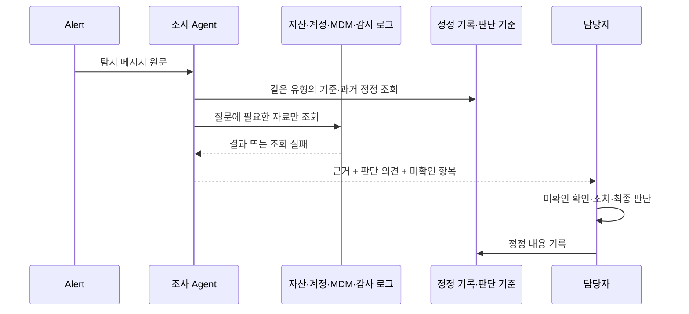

### 6.3 사례 1 - Vault Root Token 사용

HashiCorp Vault는 비밀번호·API 키 같은 비밀 정보를 보관하는 시스템이고, Root Token은 모든 비밀에 접근할 수 있어 평소에는 거의 쓰지 말아야 한다. 이 알림이 오면 긴장한다. 그러나 "내부 IP니까 정상"도, "최고 권한이니까 침해"도 아니다. 어떤 시스템이 무엇을 했는지가 필요하다. 사람이라면 IP의 서버를 찾고 Vault 감사 로그를 뒤져야 한다.

- 에이전트는 IP에서 **Pod와 Cluster**를 특정하고 감사 로그를 확인했다.
- 해석: **CI 서버**(빌드·테스트 자동화 서버)가 비밀 정보를 읽는 작업.
- 판정: Root Token 사용이 확인됐으므로 **정탐**. 그러나 정탐이 곧 침입은 아니다.
- 권고: 정상 업무라도 과도한 권한은 개선해야 하므로 **읽기 전용 권한과 인증 방식 교체**.
- 미확인: **토큰 발급자와 생성 시점**.

이 권고는 [HashiCorp의 운영 강화 지침](https://developer.hashicorp.com/vault/docs/concepts/production-hardening)과 방향이 같다. 초기 설정 후 루트 토큰은 폐기하고, 필요할 때만 생성해 쓴 뒤 폐기하라는 것이다. CI에는 [Kubernetes 인증](https://developer.hashicorp.com/vault/docs/auth/kubernetes)이나 AppRole 같은 인증 방식과 최소 권한 정책이 대안이다.

```hcl
# 재구성 예시: CI 워크로드에는 필요한 경로의 읽기만
path "secret/data/ci/build/*" {
  capabilities = ["read"]
}
```

발급자·생성 시점이 미확인이라는 점은 가볍지 않다. 루트 토큰이 어디서 왔는지 모른다면 "CI의 정상 작업"이라는 해석이 맞아도 토큰 유출 가능성은 닫히지 않는다.

### 6.4 사례 2 - 방화벽의 차단 IP 통신

탐지 문구만 보고 "내부 서버가 악성 IP에 먼저 접속했다"고 단정할 수 없다. 확인할 것은 **이 IP가 어떤 자원인지, 누가 연결을 시작했는지, 방화벽이 허용했는지**다.

- 자산 정보 조회 결과, 일반 서버가 아니라 **로드밸런서에 붙은 네트워크 인터페이스(ENI)**였다. ENI(Elastic Network Interface)는 AWS의 가상 랜카드다.
- 방화벽 기록에서 **차단된 통신**임을 확인했다.
- **과거 담당자가 정정한 같은 유형의 기록**을 참고했다.
- 의견: **오탐**.
- 미확인: 함께 탐지된 **다른 IP의 장비**. 모든 대상의 조사가 끝난 것은 아니다.

강조점은 "**차단됐다는 사실 하나만으로 오탐이라고 한 것이 아니다**"였다. 차단은 그 연결 시도가 막혔다는 뜻이지, 내부에 문제가 없다는 뜻이 아니다. 인터넷에 열린 로드밸런서에 들어온 외부 스캔이 차단된 것과, 내부 서버가 밖으로 나가려다 막힌 것은 전혀 다른 사건이다. 사람이라면 자산 정보, 방화벽 기록, 과거 처리 기록을 각각 열어 봐야 알 수 있는 조합이다.

### 6.5 사례 3·4 - DLP의 키와 카드 번호

**AWS 키 패턴.** 제로 트러스트 보안 플랫폼의 DLP가 "개발 도구의 AI 자동 완성 요청에 AWS 키와 비슷한 문자열이 있다"고 알렸다. 키 모양 문자열이 곧 유출은 아니다.

- DLP 전송 기록을 **보관된 원문**과 연결해 실제 보낸 내용을 찾았다.
- 원문 두 건의 **앞부분**에서 설정 파일 일부와 긴 암호화 문자열을 확인해 탐지 패턴과 비교했다.
- 의견: 읽은 범위에서 AWS 키를 찾지 못했고 긴 문자열이 패턴에 걸린 것으로 해석해 **오탐**.
- 미확인: **각 원문의 앞 3,000바이트만** 확인했다. 전체에 키가 없다고 확정한 것이 아니므로 이 답변만으로 조사를 끝낼 수 없고 나머지 확인이 필요하다.

에이전트가 이 한계를 **답변에 스스로 적었다**는 점을 중요하게 꼽았다. 확인 범위를 밝히지 않으면 받는 사람은 전체를 본 것으로 오해하기 쉽다. 입력을 잘라 넣는 시스템은 모두 이 문제를 갖는다. 잘렸다는 사실은 모델의 성실함에 맡기기보다 코드가 붙이는 편이 안전하다.

```python
# 재구성 예시: 확인 범위를 코드가 기록하고, 부분 확인은 '정상'을 확정하지 못하게 한다
LIMIT = 3000  # bytes

def inspect(payload: bytes, find_candidates):
    head = payload[:LIMIT]
    return {
        "bytes_total": len(payload),
        "bytes_inspected": len(head),
        "hits_in_inspected": find_candidates(head),
        "complete": len(payload) <= LIMIT,
    }

def allowed_verdict(model_verdict: str, report: dict) -> str:
    if model_verdict == "false_positive" and not report["complete"]:
        return "false_positive_opinion_needs_review"   # 종결 불가
    return model_verdict
```

원문 전체를 결정론적 스캐너(정규식, 체크섬)로 훑고 LLM에는 매치 주변만 주면 범위와 비용 문제를 함께 완화할 수 있다(필자의 제안). 조사 파이프라인이 읽는 원문은 그 자체가 민감 정보이므로 마스킹, 접근 통제, 모델로 보내는 범위의 제한이 필요하다.

**카드 번호 패턴.** 긴 숫자가 있다고 카드 번호 유출은 아니다. 핵심은 **그 숫자가 어디에 쓰였는가**다.

- 같은 방식으로 원문을 찾았고, 읽은 부분에는 **상품 정보와 광고 이벤트**가 있었다.
- 의견: 요청의 용도와 숫자 형식을 보고 **광고 추적용 식별자**로 해석해 오탐.
- 미확인: 나머지 원문과 **정확한 탐지 위치**. 실제 카드 번호가 전혀 없다는 결론이 아니다(제시한 그림은 원문 캡처가 아니라 확인 과정의 개념도였다).

참고로 카드 번호는 [Luhn 검사](https://en.wikipedia.org/wiki/Luhn_algorithm)와 발급사 식별 번호 범위로 일차 거를 수 있지만, 임의의 숫자 열도 약 10분의 1은 Luhn을 통과하므로 문맥 확인이 여전히 필요하다.

| 사례 | 판정 의견 | 근거 | 남긴 미확인 |
|---|---|---|---|
| Vault Root Token | 정탐(침입을 뜻하지는 않음) | Pod·Cluster 특정, 감사 로그 | 토큰 발급자·생성 시점 |
| 방화벽 차단 IP | 오탐 | ENI 정체, 차단 기록, 과거 정정 | 함께 탐지된 다른 IP 장비 |
| DLP AWS 키 | 오탐 | 원문 앞부분의 설정·암호화 문자열 | 3,000바이트 이후 |
| DLP 카드 번호 | 오탐 | 광고 이벤트 문맥, 숫자 형식 | 나머지 원문, 정확한 탐지 위치 |

### 6.6 틀린 답: "자동 생성됐다 사라진 서버라서 정상"

처음부터 이렇게 답한 것은 아니었다. 가장 많이 배운 오답은 위 사례와는 별도의 네트워크 조사였다.

- 실제로 확인된 사실: **이 IP가 수집된 자산 목록에 나오지 않는다.** 이것뿐이었다.
- 에이전트의 설명: "자동 생성됐다 사라진 서버라서 정상."
- 진짜 원인: **로드밸런서의 ENI가 수집에서 빠져** 있었다.

모델은 자료가 없는 부분을 그럴듯한 이유로 채웠다. **못 찾았다는 사실은 정상의 근거가 될 수 없다.**

고친 순서가 핵심이다.

1. 빠졌던 **ENI 정보를 수집 대상에 추가**하고, 알림의 IP로 실제 자산을 찾도록 연결했다.
2. 그래도 근거가 없으면 "**확인하지 못했다**"고 남기게 했다.

프롬프트에 "모르면 모른다고 해라"를 적는 것만으로는 부족했다. 확인할 자료가 없으면 "모른다"만 늘 뿐 조사가 나아지지 않는다. 그래서 **자료를 채우는 쪽을 먼저** 고쳤다.

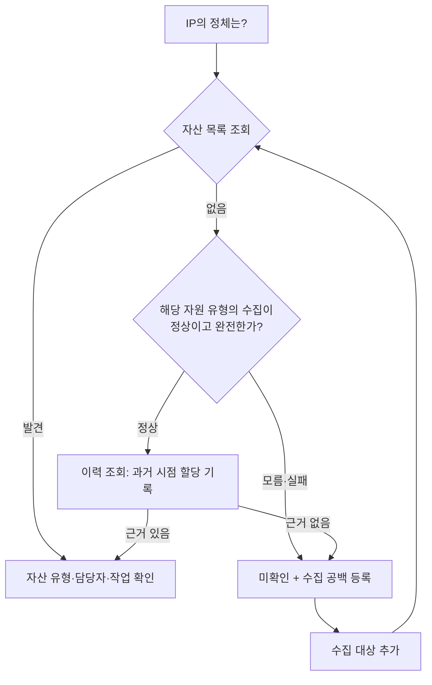

(분기 구조는 교훈을 일반화한 것이다.) 구현에서는 도구의 응답을 "빈 목록" 하나로 돌려주지 않고 **세 가지 상태**로 구분하는 것이 도움이 된다.

```python
# 재구성 예시: '없음'과 '못 봄'을 타입으로 분리
from enum import Enum

class Lookup(Enum):
    FOUND = "found"
    NOT_FOUND_IN_COVERED_SCOPE = "not_found"   # 범위와 시점이 증명된 경우에만
    UNKNOWN = "unknown"                        # 권한 오류, 수집 지연, 미수집 유형

def lookup_ip(ip, inventory):
    if ip in inventory.index:
        return Lookup.FOUND, inventory.index[ip]
    if inventory.stale() or not inventory.covers_all_resource_types():
        return Lookup.UNKNOWN, {"gaps": inventory.gaps()}
    return Lookup.NOT_FOUND_IN_COVERED_SCOPE, {"as_of": inventory.synced_at}
```

### 6.7 판단 기준: 다른 질문은 나눠 묻기

자산을 찾은 다음은 무엇을 기준으로 판단하느냐다. 키 탐지를 예로 두 질문을 분리했다(추가 조사 결과가 아니라 구분해야 할 질문의 설명이었다).

| 구분 | 질문 A: 노출 | 질문 B: 현재 사용 가능성 |
|---|---|---|
| 묻는 것 | 실제 키가 밖으로 **나갔는가** | 그 키를 **지금도** 쓸 수 있는가 |
| 보는 자료 | 전송 당시의 내용 | 현재 키 상태와 권한 |
| 기준 시점 | 과거(전송 시각) | 조사 시점 |

지금 쓸 수 없는 키라고 과거에 노출되지 않았던 것은 아니다. 그래서 두 질문에 각각 어떤 자료와 시점을 기준으로 삼을지 정리했다. 실무에서는 노출 이후 비활성화 전까지의 사용 흔적(AWS라면 CloudTrail)을 보는 세 번째 질문("누가 썼는가")도 따라붙는다(필자 보충).

### 6.8 기억: 정정 기록과 Semantic Layer

관계와 기준을 고쳐도 다음 조사에서 잊으면 같은 실수를 반복한다. 그래서 **사람이 확인하고 정정한 내용**을 다음 조사에서 찾을 수 있게 남겼다. "Vault 감사 로그는 로그 검색 도구 OpenSearch에 있다"는 사실도 운영 지식이다. 기록하면 다음에는 조회할 곳을 바로 안다. 기록할 때는 **확인한 사실, 추정, 적용 조건**을 구분한다. 앞의 방화벽 사례에서 참고한 것이 이런 정정 기록이었다.

나아가 대상의 의미와 판단 기준을 공통으로 정리해 조사 때 같은 기준을 읽게 하는 **Semantic Layer**를 운영한다. 중심에는 공통 정의와 판단 기준, 그 기준을 적용할 **조건과 시점**이 있고, 에이전트는 이를 현재 자산 정보·통신 기록과 대조한다. **모델을 다시 학습시키거나 과거 결론을 그대로 복사하는 방식이 아니다.** 운영 중 발견한 예외와 정정은 다시 반영하며, 모든 기준이 완성된 것은 아니다.

Semantic Layer는 원래 데이터 분석에서 "매출", "활성 사용자" 같은 용어의 정의를 한곳에 두어 도구마다 다르게 계산하지 않게 하는 층이다. 보안 조사에서는 "이 ENI는 어느 로드밸런서의 것인가", "정탐과 침해는 어떻게 다른가" 같은 의미와 기준이 대상이 된다. 아래는 정정 기록의 **재구성 스키마**이며 내용은 가상이다.

```yaml
# 재구성 예시: 정정 기록 한 건
id: kb-0042
topic: firewall.blocked-ip
fact: "해당 대역의 IP는 외부 로드밸런서 ENI에 할당된다"       # 확인한 사실
inference: "외부발 스캔이 차단된 경우가 많다"                 # 추정
applies_when:
  direction: inbound
  action: blocked
not_applicable_when: ["연결 시작 주체가 내부", "action: allowed"]
evidence: ["asset-inventory snapshot", "fw log query"]
confirmed_by: security-owner
valid_from: 2026-10-01
review_by: 2027-01-01          # 만료 없는 지식은 낡은 오탐 면허가 된다
```

`applies_when`과 `review_by`가 중요하다. 조건 없는 "과거에 오탐이었다"는 기록은 공격 행위가 같은 모양일 때 통과증이 된다. 누가 기록을 쓸 수 있는지도 통제해야 한다. 판단 기준 저장소가 오염되면 이후의 판정이 함께 흔들린다.

### 6.9 교훈과 남은 질문

발표자가 정리한 세 가지는 **필요한 자료를 연결하고, 판단 기준을 구분하고, 사람이 고친 내용을 다음 조사에서 참고하게 하는 것**이다. 틀린 답은 문장만 고쳐서는 부족하고, **무엇을 못 봤고 무엇을 잘못 연결했고 어떤 기준으로 판단했는지**를 보고 조사 과정을 고쳤다. 역할 분담은 에이전트가 반복 조회와 근거 정리, 사람이 미확인 사항 확인과 조치·최종 판단이다.

남은 질문: 정확도·시간 절감 수치, 처리량, 사용 모델과 하니스, 도구 권한 범위(읽기 전용인지)는 공개되지 않았다. 사례의 오탐 판정은 모두 **의견**이며 미확인 항목이 남아 있다. 미확인이 쌓였을 때 누가 언제 닫는지의 운영 규칙이 다음 과제가 될 것이다.

## 7. 교차 분석: 네 세션을 겹쳐 읽기

### 7.1 LLM을 어디에 두는가

| 단계 | 토스모바일 | 토스뱅크 | 토스증권 | 토스인컴 |
|---|---|---|---|---|
| 선별 | 유형 분기·중복 제거 | 라우팅 계층 | **통계·정보 이론 지표** | 이벤트별 질문 |
| 근거 수집 | 결정론적 코드 | 계획에 따른 서브에이전트 도구 호출 | 엔티티별 점수 집계 | 에이전트가 필요한 도구 조회 |
| LLM의 역할 | 필요할 때 해석 | 계획·분석·종합·검증 | 압축된 고맥락 해석 | 조사와 의견 작성 |
| 자동 행동 | 오탐 확정만 자동 종결 | 일부 자동 대응·차단 | 경고·대응 트리거 | 사람이 최종 판단 |
| 불확실성 표현 | **보류** | 근거 기록·검증 계층 | 다축 지표 | **미확인** |

자동 행동의 폭은 토스인컴(의견) → 토스모바일(오탐 종결) → 토스뱅크(차단) 순으로 넓다. 우열이 아니라 인력, 검증 체계, 행동을 되돌릴 수 있는 정도에 따른 선택으로 보는 것이 맞다. 토스증권은 이 축과 직교한다. 누가 판단하든 **무엇을 먼저 판단 대상에 올릴지**를 다룬다.

### 7.2 공통으로 반복된 다섯 가지

1. **모델보다 맥락.** 토스뱅크는 원시 데이터만 준 좋은 모델이 그럴듯하게 틀렸고, 토스인컴은 빠진 ENI를 모델이 지어낸 이유로 채웠다. 토스모바일은 본문 없는 알림이 판정 불가임을 겪었다.
2. **"없음"과 "못 봄"의 구분.** 수집 상태 칸과 감시 도구의 감시(토스모바일), 연결 상태 화면과 미확인(토스인컴), SNR 0 영역의 시나리오 점검(토스증권). 자동화의 가장 위험한 실패는 조용한 실패다.
3. **정탐과 사고의 분리.** Root Token(토스인컴), 컨테이너 셸(토스모바일), 높은 점수의 여권 패턴 오탐(토스증권). 판정 축을 "룰이 맞았나"와 "나쁜 일인가"로 나눠야 한다.
4. **룰 의도와 판단 기준의 명문화.** Detection as Code와 정책 카탈로그(토스뱅크), 사람이 정한 기준(토스모바일), Semantic Layer(토스인컴), 산식(토스증권). LLM 시대에 조직의 판단 기준은 모델이 읽을 수 있는 자산이 된다.
5. **피드백 고리는 아직 미완.** 토스모바일은 자동 종결 재검증, 토스뱅크는 설계 중, 토스인컴은 발전 중, 토스증권은 연구 중이다.

### 7.3 합친 참조 아키텍처(필자의 종합)

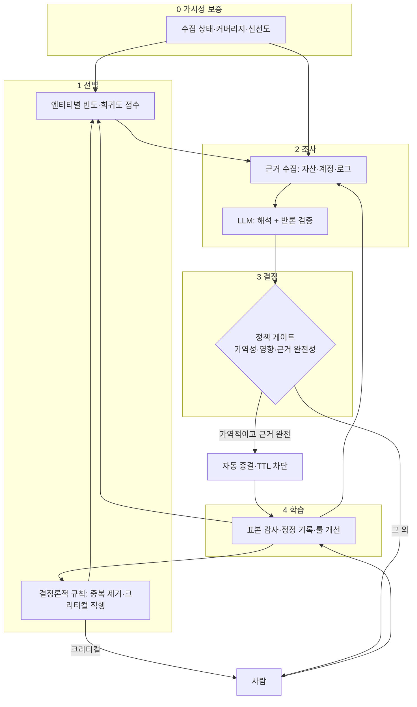

자율성을 올리는 순서는 행동의 **되돌릴 수 있음**과 **근거 완전성**으로 정하는 것이 합리적이다. 아래 단계표는 필자의 제안이다.

| 단계 | 에이전트에 허용 | 다음 단계 진입 조건(예) |
|---|---|---|
| 1 관찰 | 답글·의견만 | 사람 판정과의 불일치율, 특히 미탐 방향 불일치가 기준 이하 |
| 2 선별 종결 | 근거가 완전한 오탐 종결 | 무작위 표본 감사에서 허용 누락률 충족 |
| 3 가역 대응 | TTL 있는 차단, 사전 정의 조사 | 롤백·속도 제한·킬 스위치 시험 완료 |
| 4 확대 | 더 높은 Tier 업무 | 고정 평가 세트 회귀 시험, 레드팀 검증 |

### 7.4 함께 풀어야 할 공통 과제

- **평가 지표.** 네 세션 모두 "얼마나 놓쳤는가"를 상세히 공개하지 않았다. 감소율(97%)과 처리 시간(1분)은 쉽게 재지만, 재현율은 정답을 만드는 비용이 든다. 과거 사고 재생, 승인된 모의 공격(purple team), 자동 종결 표본 감사가 현실적인 수단이다.
- **에이전트 자체의 공격면.** 로그와 요청 본문에는 공격자가 쓴 텍스트가 섞인다. 읽는 도구가 많고 대응 권한까지 가진 에이전트는 프롬프트 인젝션의 표적이 된다. 읽기·쓰기 권한 분리, 도구 허용 목록, 출력 스키마 강제, 감사 로그가 기본이다. 이 주제는 네 세션의 중심 내용이 아니었다.
- **개인정보.** 임직원 행위 점수화와 DLP 원문 열람은 최소 수집·접근 통제·보존 기간 설계를 요구한다.
- **사람의 역량.** Tier 1을 에이전트가 맡으면 신입이 판단력을 기르던 자리가 줄 수 있다. 보류·미확인 건과 표본 감사를 훈련 과정으로 설계할 필요가 있다.

### 7.5 상황별 시작점

| 상황 | 먼저 할 것 | 참고 세션 |
|---|---|---|
| 전담 인력 없음 | 수집 상태 확인, 조회 도구 연결, 미확인 명시 답변 | 4 |
| 알림 폭주 | 섀도 모드 3단계 판정, 일일 1장 요약 | 1 |
| 룰·SIEM 성숙 | 룰 코드화와 의도 문서화, 계층형 분석, 가드레일 있는 자동 대응 | 2 |
| 내부자 위협 중점 | 엔티티별 다축 점수, LLM 입력 압축 | 3 |

## 참고

### 콘퍼런스

- [토스 보안 콘퍼런스 GUARDIANS 26](https://toss.im/guardians-26)
- [GUARDIANS 26 세션 영상 (YouTube)](https://www.youtube.com/watch?v=8mNMOso1kGY)

### 위협 동향·수치

- [CrowdStrike 2026 Global Threat Report 발표](https://www.crowdstrike.com/en-us/press-releases/2026-crowdstrike-global-threat-report/)
- [Anthropic: Project Glasswing](https://www.anthropic.com/glasswing)
- [Anthropic: Investigating three real-world incidents in our cybersecurity evaluations](https://www.anthropic.com/research/investigating-incidents-cybersecurity-evals)
- [CNN: OpenAI test model and Hugging Face](https://edition.cnn.com/2026/07/22/tech/openai-hugging-face-ai-cybersecurity)
- [Anthropic: 2026년 9월 위협 인텔리전스 보고서](https://www.anthropic.com/threat-intelligence-report-september-2026)
- [Anthropic: GTG-1002 보고서 (PDF)](https://assets.anthropic.com/m/ec212e6566a0d47/original/Disrupting-the-first-reported-AI-orchestrated-cyber-espionage-campaign.pdf)
- [BleepingComputer: GTG-1002 주장에 대한 회의론](https://www.bleepingcomputer.com/news/security/anthropic-claims-of-claude-ai-automated-cyberattacks-met-with-doubt/)
- [전자신문: 금융권 AI 해킹](https://www.etnews.com/20261005000112)
- [The Hacker News: State of AI in SOC 2025](https://thehackernews.com/2025/09/the-state-of-ai-in-soc-2025-insights.html)
- [ScanTitan: Vulnerability Statistics 2026](https://scantitan.com/blog/vulnerability-statistics/)
- [뉴스1: AI 시대의 패치 한계](https://www.news1.kr/it-science/security-hacking/6211369)

### 공식 문서·표준

- [Wazuh 취약점 탐지](https://documentation.wazuh.com/current/user-manual/capabilities/vulnerability-detection/how-it-works.html)
- [CISA KEV](https://www.cisa.gov/known-exploited-vulnerabilities-catalog) · [EPSS](https://www.first.org/epss/) · [SSVC](https://www.cisa.gov/stakeholder-specific-vulnerability-categorization-ssvc)
- [Nuclei 실행 옵션](https://docs.projectdiscovery.io/opensource/nuclei/running)
- [n8n 암호화 키](https://docs.n8n.io/hosting/configuration/configuration-examples/encryption-key/)
- [Kubernetes Deployment 실패 조건](https://kubernetes.io/docs/concepts/workloads/controllers/deployment/#failed-deployment)
- [Karpenter AMI 관리](https://karpenter.sh/docs/tasks/managing-amis/)
- [Falco 문서](https://falco.org/docs/) · [규칙 override](https://falco.org/docs/concepts/rules/overriding/) · [falcosecurity/rules](https://github.com/falcosecurity/rules) · [Falcosidekick](https://github.com/falcosecurity/falcosidekick)
- [MITRE ATT&CK](https://attack.mitre.org/) · [T1003.008](https://attack.mitre.org/techniques/T1003/008/)
- [OWASP LLM01: Prompt Injection](https://genai.owasp.org/llmrisk/llm01-prompt-injection/)
- [GoCD](https://www.gocd.org/) · [Sigma](https://sigmahq.io/) · [vLLM](https://docs.vllm.ai/) · [Windmill](https://www.windmill.dev/) · [Velociraptor](https://docs.velociraptor.app/)
- [React: CVE-2025-55182 보안 공지](https://react.dev/blog/2025/12/03/critical-security-vulnerability-in-react-server-components)
- [Lockheed Martin Cyber Kill Chain](https://www.lockheedmartin.com/en-us/capabilities/cyber/cyber-kill-chain.html)
- [정보 엔트로피](https://en.wikipedia.org/wiki/Entropy_(information_theory)) · [서브모듈러 함수](https://en.wikipedia.org/wiki/Submodular_set_function) · [Luhn 알고리즘](https://en.wikipedia.org/wiki/Luhn_algorithm)
- [HashiCorp Vault 운영 강화](https://developer.hashicorp.com/vault/docs/concepts/production-hardening) · [Kubernetes 인증](https://developer.hashicorp.com/vault/docs/auth/kubernetes)
- [Iru(구 Kandji)](https://www.iru.com/kandji-mdm)

### 연구

- [Tsegai 외, From Investigation Failures to Reliable SOC Agents (arXiv 2610.10608)](https://arxiv.org/abs/2610.10608)
