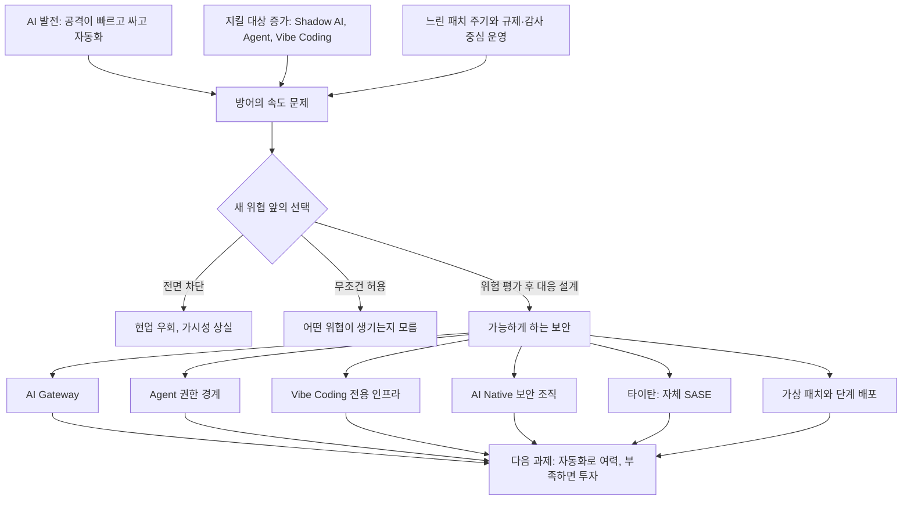
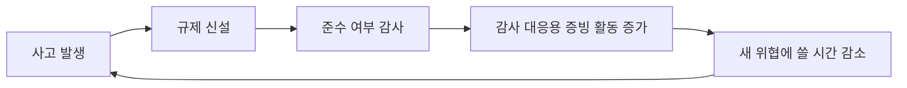
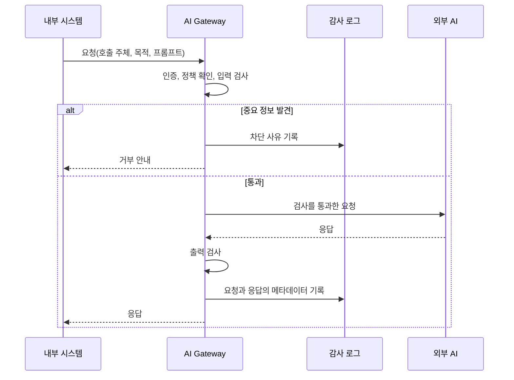
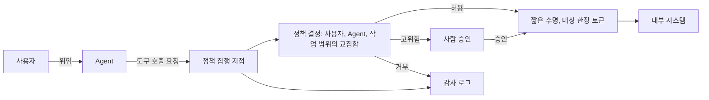
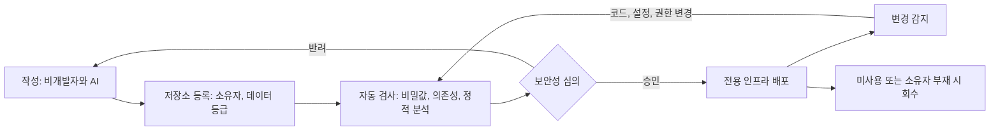
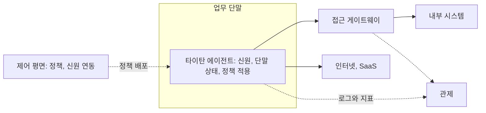
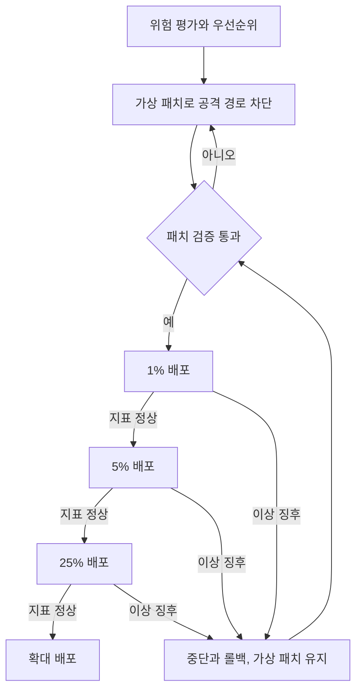
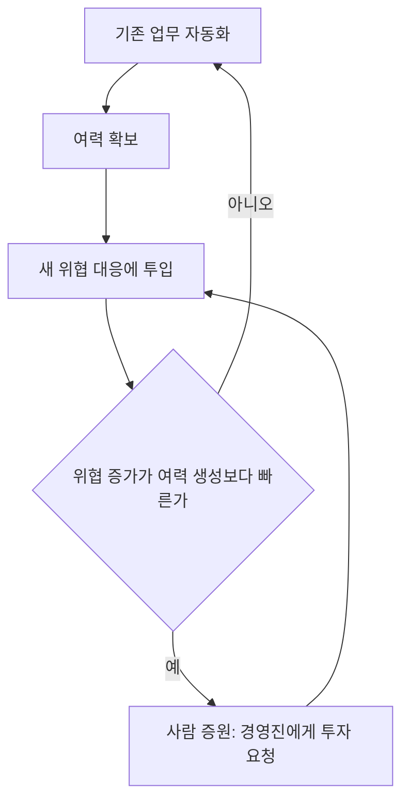

# 막지도, 대책 없이 열지도 않는다… Toss CISO가 말한 AI 시대 보안 운영: "Enable Innovation. Secure What's Next."

### AI가 공격을 더 빠르고 싸게 만드는 동안 방어의 패치 주기와 규제·감사 중심 운영은 그대로다. 토스(Toss) 지정호 CISO는 GUARDIANS 26 기조연설에서 답을 세 갈래로 내놓았다. 위험을 구체적으로 평가해 "안전하게 쓰는 길"을 만들고(AI Gateway, Agent 권한 경계, Vibe Coding 전용 인프라), 반복 업무를 자동화해 여력을 만들고(AI Native 보안 조직, 자체 SASE '타이탄', 단계적 패치), 그래도 모자라면 경영진의 언어로 사람과 돈을 요구하라는 것이다. 인용된 외부 수치를 1차 자료와 대조해 보니 대부분 맞았지만, 몇 가지는 읽는 법을 바로잡아야 한다


2026년 11월 6일 서울 코엑스에서 열린 토스 보안 콘퍼런스 [GUARDIANS 26](https://toss.im/newsroom/GUARDIANS26)의 슬로건은 "Enable Innovation. Secure What's Next."였다. 여는 기조연설에서 지정호 CISO(정보보호최고책임자)는 질문 하나를 던졌다. **어떻게 해야 보안이 혁신을 가로막지 않으면서 다가올 미래를 지킬 수 있는가.** 연설은 "무엇이 달라지고 있는가 → 어떻게 달라져야 하는가 → 다음 과제는 무엇인가" 순서로 흘렀다. 행사 구성과 연설 요지는 [ZDNet Korea](https://zdnet.co.kr/view/?no=20261106142612), [바이라인네트워크](https://byline.network/2026/11/6-467/), [보안뉴스](https://www.boannews.com/news/articleView.html?idxno=147078) 보도에서도 확인된다.

이 글은 그 연설을 뼈대로 삼는다. 인용된 외부 주장은 영국 AISI, Google Threat Intelligence Group(GTIG), VulnCheck, CrowdStrike, Anthropic, OpenSage 팀의 원문과 국내 보도로 다시 확인했다. 구현 방식 중 공개되지 않은 부분은 업계 표준을 바탕으로 보충했으며, 그런 설정과 코드에는 **재구성**이라고 표시했다.

**주의: 토스 내부 시스템의 설계 문서나 소스코드는 공개되지 않았다. 이 글의 아키텍처 그림·정책 예시·계산은 이해를 돕기 위한 재구성이며 토스의 실제 구현이 아니다. 토스의 투자·인력·타이탄 관련 수치는 발표자 측 주장이고 독립적으로 감사한 값이 아니다.**

## 1. 한눈에 보기

### 1.1 주제 지도

원 자료는 기조연설 하나다. 그 안의 주제를 장별로 나누면 다음과 같다.

| 묶음 | 주제 | 핵심 질문 | 발표자의 답 | 이 글 |
|---|---|---|---|---|
| 무엇이 달라지나 | AI의 자율 공격 능력 | 공격자의 기본 역량은 얼마나 올랐나 | 더 빠르고, 싸고, 자동화됐다 | 3장 |
| 무엇이 달라지나 | 취약점·사고·대회의 수치 | 변화가 숫자로 보이나 | CVE, RCE, 침해 신고, 해킹 시도, CTF | 4장 |
| 무엇이 달라지나 | 지킬 것의 증가와 방어 속도 | 우리 보안은 그만큼 빨라졌나 | Shadow AI, Agent, Vibe Coding. 패치와 감사 중심 운영은 느리다 | 5장 |
| 어떻게 달라지나 | 막는 조직에서 가능하게 하는 조직으로 | 허용과 차단 사이에 무엇이 있나 | 위험 평가 → 대응 설계 → 허용 | 6장 |
| 어떻게 달라지나 | 통제 ① AI Gateway | 외부 AI를 어떻게 연결하나 | 직접 연결 금지, 입출력 검사, 감사 로그 | 7장 |
| 어떻게 달라지나 | 통제 ② AI Agent | 직접 실행하는 주체를 어떻게 묶나 | 사전 검증, 접근 범위, 권한 경계 | 8장 |
| 어떻게 달라지나 | 통제 ③ Vibe Coding 인프라 | 비개발자가 만든 프로그램은 | 전용 인프라, 보안성 심의, 변경 감지 | 9장 |
| 어떻게 달라지나 | AI Native 보안 조직 | 보안 담당자를 대체하나 | 대체하지 않는다. 최종 판단은 사람 | 10장 |
| 어떻게 달라지나 | 보안 솔루션 내재화: 타이탄 | 벤더 의존 장애를 어떻게 줄이나 | 자체 SASE 개발, 상용 계약 해지 | 11장 |
| 어떻게 달라지나 | 패치 전략 | 무엇부터, 어떻게 안전하게 | 도달 가능성, 가상 패치, 1→5→25% | 12장 |
| 다음 과제 | 늘어나는 "문"과 여력 | 새 위협에 쓸 시간은 어디서 | 자동화 → 여력 → 부족하면 증원 | 13장 |
| 다음 과제 | 소통과 투자 | 어떻게 설득하나 | 자산 가치·예상 손실·필요 투자를 구분 | 14·15장 |
| 결론 | 세 가지 질문 | 내 조직의 다음 과제는 | 자동화 대상, 여력 배분, 부족분 설득 | 16장 |



### 1.2 수치 검증 요약

| 발표에서 인용한 주장 | 확인 결과 | 판정 |
|---|---|---|
| 32단계 시나리오에서 GPT-4o 1.7단계(2024-08), Claude Opus 4.6 9.8단계(2026-02) | AISI 원문과 일치. 단 **1천만 토큰 고정 예산** 조건 | 맞음, 조건 필요 |
| Claude Mythos Preview가 2026년 4월 처음 완주 | AISI: 10회 중 3회, **1억 토큰** 예산, 능동 방어 없음 | 맞음, 조건 필요 |
| 자율 수행 과업 길이가 5개월마다 두 배 | AISI 2026-02 추정 4.7개월. **좁은 사이버 과업, 80% 성공률** 기준 | 대체로 맞음 |
| "작년 9월" 국가 배후 추정 조직이 작업의 80–90%를 AI로 수행 | Anthropic: 2025년 9월 중순 **탐지**, 11월 13일 **공개** | 수치 맞음, 시점 정정 |
| 올해 10월 ARTEX가 국내 금융기관 공격에 쓰인 정황 | CrowdStrike 10월 7일 보고. 공격은 9월 말–10월 초 | 맞음 |
| 월간 CVE 1월 약 5천 → 8월 1만 | GTIG: 5,045 → 10,740 | 맞음 |
| "RCE 취약점 중 AI 발견이 50%, 그 외 26%" | 원문은 **AI 발견 취약점의 50%가 RCE**, 전체 CVE 생태계는 26% | **방향을 바꿔 읽어야 함** |
| 상반기 KISA 침해사고 1,236건, 19.5% 증가 | 다수 보도와 일치(전년 동기 1,034건) | 맞음 |
| 금융권 해킹 시도 4,299만 건, 31.8% 증가("9월 발표") | 수치 일치. 공개 보도는 **1–9월 누적**, 10월에 의원실 자료로 보도 | 수치 맞음, 발표 시점 미확인 |
| DEF CON 34에서 못 푸는 문제가 줄고 최저 점수가 올라감 | 전해 들은 후기. 원자료를 찾지 못함 | **미확인** |
| SageCTF가 686팀 중 상위 5%, No/Low AI 175팀 모두 앞섬 | OpenSage 원문과 일치. 단 **예선**이고 **플래그 미제출**(사후 채점) | 맞음, 조건 필요 |
| 약 23%는 하루 안에, 약 40%는 한 달 안에 악용. 중간값 120→80일 | VulnCheck의 **악용이 확인된 취약점(KEV) 495건** 기준 | **모집단 정정 필요** |
| 2021–2025 투자 102억(113%)·인력 22.6명(84%) 증가 | 보도된 공시 수치와 산술 일치. 2021년 값은 매체 간 불일치 | 부분 확인 |

## 2. 먼저 알아둘 용어

| 용어 | 뜻 | 쉽게 말하면 |
|---|---|---|
| CISO | 정보보호최고책임자 | 회사 보안의 최종 책임자 |
| CVE | 공개 취약점에 붙는 식별 번호 | 결함마다 붙는 주민번호 |
| RCE(Remote Code Execution) | 원격에서 임의 코드를 실행할 수 있는 취약점 | 남의 컴퓨터에 명령을 내릴 수 있는 구멍 |
| KEV(Known Exploited Vulnerabilities) | 실제 악용이 확인된 취약점 목록 | "이미 털리고 있는" 결함 명단 |
| CTF(Capture The Flag) | 취약점을 찾아 숨은 문자열(플래그)을 얻는 해킹 대회 | 해커들의 문제 풀이 시합 |
| 토큰 예산 | AI가 한 번의 시도에서 읽고 쓸 수 있는 총량 | AI에게 주는 시험 시간 |
| Shadow AI | 회사가 승인·파악하지 못한 AI 사용 | 몰래 쓰는 AI |
| AI Agent | 모델이 도구를 호출해 시스템에서 직접 작업하는 프로그램 | 키보드를 대신 잡은 AI |
| Vibe Coding | 자연어로 지시해 AI가 만든 코드를 거의 검토 없이 쓰는 개발 방식 | 말로 만드는 프로그램 |
| 인증·인가 | "누구인가" 확인과 "무엇을 해도 되는가" 결정 | 신분증 확인과 출입 권한 |
| SASE | 네트워크 연결과 보안 기능을 묶어 어디서 접속하든 같은 정책을 적용하는 구조 | 사무실 보안 데스크를 단말과 클라우드로 옮긴 것 |
| Zero Trust | 네트워크 위치를 믿지 않고 접근마다 검증하는 원칙 | 사내망이어도 매번 확인 |
| 망분리 | 업무망과 인터넷망을 나누는 국내 금융권 규제 | 두 개의 분리된 길 |
| 가상 패치 | 코드를 고치기 전에 앞단 규칙으로 공격 경로를 막는 임시 조치 | 수리 전에 두르는 차단선 |

## 3. 무엇이 달라지고 있나 ① AI의 자율 공격 능력

### 3.1 문제: 공격 비용 곡선이 꺾였다

공격은 원래 사람의 시간이 병목이었다. 정찰, 취약점 분석, 권한 상승, 내부 이동을 이어 붙이려면 숙련자가 며칠을 써야 했다. 발표의 첫 주장은 이 병목이 풀리고 있다는 것이다. 공격이 **더 빠르고, 더 싸고, 더 자동화**된다.

### 3.2 측정: AISI의 32단계 기업망 침투 시나리오

영국 AI Security Institute(AISI)는 "The Last Ones"라는 **사이버 레인지**(모의 기업망)를 만들었다. 정찰에서 시작해 자격 증명 탈취, 내부 이동, 전체 장악까지 32단계를 이어야 한다. AISI는 사람 전문가에게 약 20시간 걸리는 분량으로 추정한다(먼저 낸 [2026년 3월 글](https://www.aisi.gov.uk/blog/how-do-frontier-ai-agents-perform-in-multi-step-cyber-attack-scenarios)은 약 14시간으로 적었으므로 추정치 자체가 바뀌었다).

| 모델 | 공개 시점 | 토큰 예산 | 결과 | 출처 |
|---|---|---|---|---|
| GPT-4o | 2024-08 | 1천만 | 평균 1.7단계 | [AISI 3월](https://www.aisi.gov.uk/blog/how-do-frontier-ai-agents-perform-in-multi-step-cyber-attack-scenarios) |
| Claude Opus 4.6 | 2026-02 | 1천만 | 평균 9.8단계 | 같은 글 |
| Claude Opus 4.6 | 2026-02 | 1억 | 평균 16단계 | [AISI Mythos 평가](https://www.aisi.gov.uk/blog/our-evaluation-of-claude-mythos-previews-cyber-capabilities) |
| Claude Mythos Preview | 2026-04 | 1억 | 평균 22단계, 10회 중 3회 완주 | 같은 글 |


읽을 때 주의할 점이 네 가지 있다.

1. **"6배"는 단계 수의 비율이다.** $9.8 / 1.7 \approx 5.8$이고 두 모델 사이가 18개월이다. 단계마다 난이도가 다르므로 "성능이 6배"라는 말은 직관적 요약으로만 받아야 한다.
2. **예산이 결과를 바꾼다.** 같은 Opus 4.6이 1천만 토큰에서 9.8단계, 1억 토큰에서 16단계다. 다른 예산의 숫자를 섞어 비교하면 안 된다. AISI는 1억 토큰에서도 성능이 계속 오르고 있었다고 적었다.
3. **방어자가 없다.** 레인지에는 능동 방어자, 방어 도구의 차단, 경보 발생에 대한 불이익이 없다. 잘 방어된 망을 뚫을 수 있다는 증거는 아니다.
4. **편차가 크다.** 같은 모델·예산에서도 시도마다 결과가 크게 다르다. 그리고 Mythos Preview도 산업 제어 시스템 레인지("Cooling Tower")는 완주하지 못했다.

후속 [논문(arXiv 2603.11214)](https://arxiv.org/abs/2603.11214)의 최신판은 더 새로운 체크포인트와 GPT-5.5까지 포함하며, 완주 가능한 모델이 늘어 "방어 없는 레인지는 최상위 모델을 더 이상 잘 가르지 못한다"는 쪽으로 결론이 옮겨 갔다.

### 3.3 "5개월마다 두 배"의 정확한 뜻

AISI의 [2026년 5월 글](https://www.aisi.gov.uk/blog/how-fast-is-autonomous-ai-cyber-capability-advancing)에서 **시간 지평(time horizon)** 은 "사람 전문가가 그만큼 걸리는 과업을 AI가 80% 성공률로 해내는 길이"다. 2026년 2월 추정으로 이 값은 2024년 말 이후 **4.7개월마다 두 배**가 됐다(2025년 11월 추정은 약 8개월이었다).

$$H(t) = H_0 \cdot 2^{\,t/T_d}, \qquad T_d \approx 4.7\ \text{개월}$$

$T_d = 4.7$을 그대로 12개월 연장하면 $2^{12/4.7} \approx 5.9$배다. 다만 이것은 **예측이 아니다.** AISI 스스로 8시간 이상 과업이 6개뿐이고, 토큰 상한 250만이 능력을 낮게 잡으며, 적합에 쓴 모델 수가 적다고 밝혔다. 5월 글은 Mythos Preview와 GPT-5.5가 기존 추세선을 크게 넘었지만 일시적 도약인지 새 추세인지는 불확실하다고 적었다.

### 3.4 실제 공격 ① Anthropic이 공개한 AI 주도 첩보 작전

Anthropic은 [2025년 11월 13일 보고](https://www.anthropic.com/news/disrupting-AI-espionage)에서, 9월 중순 탐지한 작전을 중국 국가 배후로 높은 확신을 갖고 평가했다. 약 30개 조직을 노렸고 일부에서 성공했다. 공격자는 AI로 **작전의 80–90%** 를 수행했고 사람의 개입은 작전당 4–6개의 핵심 결정 지점 정도였다.

방어 관점의 교훈은 두 가지다.

- **안전장치 우회는 작업 분할과 역할 위장으로 이뤄졌다.** 무해해 보이는 작은 작업으로 쪼개고, 합법적 보안 업체의 방어 테스트라고 속였다. 모델의 거부에만 기대는 방어는 불충분하다.
- **AI도 틀린다.** Claude는 가끔 없는 자격 증명을 만들어 내거나, 공개 정보를 비밀 탈취 성과로 보고했다. 완전 자율 공격에는 아직 검증 비용이 붙는다.

### 3.5 실제 공격 ② 국내 금융권과 ARTEX

[CrowdStrike의 2026년 10월 7일 보고](https://www.crowdstrike.com/en-us/blog/unknown-threat-actor-uses-artex-to-target-south-korean-finance/)에 따르면 9월 말–10월 초 국내 여러 금융기관이 침입을 당하고 데이터가 유출됐다.

| 항목 | 보고 내용 |
|---|---|
| 도구 | **ARTEX**: 중국에서 개발된 오픈소스 에이전트형 모의침투 도구. 자체 모델 없이 외부 LLM을 연결한다 |
| 모델 | ARTEX의 주 모델은 DeepSeek 계열, 별도 Claude Code 작업에 다른 모델도 사용 |
| 단서 | 공격자 인프라의 공개 디렉터리에 Claude Code 세션 기록, ARTEX 설정, 메모리 파일이 노출 |
| 귀속 | 이름 붙인 조직과 연결하지 않음. 중국어 사용자이며 금전 목적이라고 **중간 확신**으로 평가 |
| 자율성 | 작전 중 어느 정도가 자율이고 어느 정도가 사람 조종인지는 보고서가 밝히지 않음 |

피해 기관 수는 매체마다 5곳에서 9곳 이상까지 다르다. [바이라인네트워크](https://byline.network/2026/10/11-704/)에 따르면 개발자는 10월 8일 공개 개발을 중단하고 저장소를 닫았다. 이미 퍼진 코드는 회수할 수 없다.

### 3.6 교훈과 열린 질문

- 방어 계획의 가정을 바꿔야 한다. "이 공격은 숙련자가 시간을 써야 하니 우리 차례는 늦게 온다"는 가정이 약해진다.
- 흔적 관점에서는 기회도 있다. ARTEX 사례처럼 에이전트는 세션 로그와 설정 파일을 남기고, 대량의 반복 요청은 탐지 신호가 된다.
- **열린 질문:** 방어 도구가 살아 있는 환경에서 AI의 성공률은 얼마인가? 공개된 측정은 아직 이 질문에 답하지 못한다.

## 4. 무엇이 달라지고 있나 ② 숫자로 보는 취약점·사고·대회

### 4.1 CVE 공개 건수

[GTIG의 2026년 9월 말 보고](https://cloud.google.com/blog/topics/threat-intelligence/vulnerability-discovery-and-exploitation-trends-in-the-ai-era)는 월간 공개 건수를 1월 **5,045건**, 7월 10,477건, 8월 **10,740건**으로 집계했다. 발표의 "약 5천 → 1만"과 맞는다.

교차 확인으로 [NVD API](https://nvd.nist.gov/developers/vulnerabilities)에서 게시일 기준(거절 항목 제외) 월별 건수를 직접 조회했다(2026-11-29 조회).

| 월(2026) | 1 | 2 | 3 | 4 | 5 | 6 | 7 | 8 | 9 | 10 |
|---|---|---|---|---|---|---|---|---|---|---|
| NVD 게시 건수 | 4,302 | 4,616 | 6,234 | 5,810 | 6,936 | 7,942 | 9,771 | 12,255 | 14,926 | 17,050 |

집계 원천과 게시일 정의가 달라 절댓값은 GTIG와 다르지만 방향은 같다. 8월 이후에도 늘어 10월은 1월의 약 4배다.

해석에는 함정이 있다. GTIG는 자동 CVE 발급이 원시 건수를 부풀릴 수 있다고 경고한다. 예를 들어 1–8월 "Linux Kernel" 설명을 가진 CVE만 약 5,000건인데 관찰된 제로데이 악용은 없었다. 2026년 공개분 중 실제 악용이 관찰된 비율은 **0.23%**(약 431건 중 1건)다. **"건수가 두 배"는 "위험이 두 배"가 아니라 "골라내야 할 모래가 두 배"에 가깝다.**

### 4.2 AI가 찾은 취약점과 RCE: 방향을 바로 읽기

발표에서는 "RCE 취약점 중 AI가 발견한 것이 50%, 그 외 방식이 26%"라고 소개됐다. GTIG 원문의 문장은 조건의 방향이 반대다.

| 읽는 법 | 의미 | 원문과 일치 |
|---|---|---|
| $P(\text{AI 발견} \mid \text{RCE}) = 50\%$ | RCE 취약점의 절반을 AI가 찾았다 | 아니다 |
| $P(\text{RCE} \mid \text{AI 발견}) = 50\%$ | AI가 찾은 취약점의 절반이 RCE다 | **맞다** |
| 비교값 $P(\text{RCE}) = 26\%$ | 더 넓은 CVE 생태계에서 RCE의 비율 | 맞다 |

따라서 이어진 해석, 즉 "AI가 찾는 취약점이 심각한 유형에 더 몰려 있다"는 결론은 바른 읽기에서 성립한다. 다만 GTIG의 위험 등급으로 보면 그림이 조금 더 복잡하다(2026년 1–8월).

| GTIG 위험 등급 | AI 발견 아님 | AI 발견 |
|---|---|---|
| Low | 69% | 39% |
| Medium | 28% | 58% |
| High | 3% | 4% |

차이의 대부분은 High가 아니라 **Low에서 Medium으로** 옮겨 간 것이다. 또 GTIG는 CVE 메타데이터에 AI 발견 표시가 없어 AI 발견분을 크게 과소 집계하고 있고, 연구 프로그램이 중요한 인프라와 권한 경계를 골라 에이전트를 투입한 **선택 효과**가 반영됐을 가능성이 크다고 밝혔다. 표본 수도 제시하지 않았다. GTIG 스스로 "확립된 추세가 아닌 초기 지표"로 본다.

### 4.3 악용까지의 시간

발표의 "23%는 하루 안, 40%는 한 달 안, 중간값 120일→80일"은 [VulnCheck의 State of Exploitation 1H-2026](https://www.vulncheck.com/blog/state-of-exploitation-1h-2026)(2026-07-28)과 맞아떨어진다. 중요한 것은 **분모**다.

| 발표 표현 | VulnCheck 정의 |
|---|---|
| 약 23% "하루도 안 돼" | 2026년 상반기 KEV에 추가된 **495건** 중 23.43%가 **CVE 공개일 당일 또는 그 이전**에 악용 증거가 있었다(2025년 28.93%) |
| 약 40% "한 달 안" | 공개 31일 안에 KEV가 된 CVE가 약 200건. $200/495 \approx 40\%$(비율은 이 글의 계산) |
| 중간값 120→80일 | **CVE 공개부터 KEV 등재까지**의 중간값 |

즉 "전체 취약점의 23%가 하루 안에 악용된다"가 **아니다.** 악용이 확인된 것들 중의 비율이다. 전체 대비 악용 비율은 앞의 GTIG 수치처럼 1% 미만이다. 또 당일 이전 악용 비중은 오히려 약간 내려갔고, 31일 내 건수(2024년 196, 2025년 194, 2026년 상반기 약 200)는 거의 같다. VulnCheck의 표현을 빌리면 초기 악용은 CVE 발급 속도만큼 늘지 않았다.


그래도 방어자에게 주는 결론은 같다. **어떤 것이 악용될지 맞히면, 그것에 쓸 수 있는 시간은 짧다.** 문제는 "맞히는" 일이고 12장의 우선순위가 그 답이다.

### 4.4 국내 사고와 공격 시도

| 지표 | 값 | 비교 | 확인 |
|---|---|---|---|
| KISA 침해사고 신고(2026 상반기) | 1,236건 | 전년 동기 1,034건 대비 +19.5% | [데일리시큐](https://www.dailysecu.com/news/articleView.html?idxno=207881), [news1](https://www.news1.kr/amp/it-science/security-hacking/6243807) |
| 금융권 해킹 시도(2026-01–09) | 4,299만 건(42,989,474) | 전년 동기 3,262만 건 대비 +31.8% | [한국경제](https://www.hankyung.com/article/2026100818601), [서울신문](https://www.seoul.co.kr/news/economy/finance/2026/10/16/20261016031002) |

두 수치는 성격이 다르다.

- **신고 건수**는 신고 문화의 영향을 받는다. 보도에 따르면 정부는 2025년 통신사 침해사고 이후 신고 인식이 높아진 것도 증가 요인으로 봤다. 직전 반기(2025년 하반기)보다는 줄었다.
- **시도 건수**는 침해나 피해 건수가 아니다. 차단된 트래픽이 섞인 값이며, 금융보안원은 우회 접속 때문에 공격 주체는 식별할 수 없다고 했다. 연간 추이도 단조롭지 않다(2024년 6,783만, 2025년 4,472만, 2026년은 9개월 만에 전년의 96.1%).
- 발표는 "금융보안원이 9월에 발표"했다고 했지만, 확인한 보도는 10월에 의원실이 받은 1–9월 누적 자료다. 9월의 별도 발표는 찾지 못했다.

### 4.5 해킹 대회의 변화: DEF CON과 SageCTF

**발표자가 전한 후기(1차 자료 미확인).** DEF CON 34에 출전한 토스 구성원들에 따르면, 예전에는 아예 못 푸는 문제가 있는 팀이 많아 순위 간 점수 차가 컸다. 지금은 AI를 써서 대부분의 문제를 풀고, 순위는 "누가 푸느냐"에서 "**AI로 누가 더 빨리 푸느냐**"로 옮겨 갔으며 최저 점수선이 올라갔다. 해당 그래프의 원자료와 DEF CON 34 본선 성적은 확인하지 못했다.

**SageCTF(원문 확인).** UC 산타바바라와 UC 버클리의 [OpenSage 팀 글](https://www.opensage-agent.ai/blog/sagectf.html)(2026-06-16) 내용이다.

| 항목 | 값 |
|---|---|
| 대회 | DEF CON CTF 2026 **예선**, 48시간 온라인 Jeopardy 방식(문제 풀이형), 23문제 |
| 성적 | 15문제 시도, 7문제 풀이, 플래그 8개, 1,743점 |
| 순위 | 점수판에 오른 686팀 중 상위 5% 수준 |
| AI 사용 신고 | No AI 36팀 + Low AI 139팀 = **175팀**을 모두 앞섬. Human-Led AI는 511팀 |
| 중요한 단서 | 완전 자동 봇의 제출이 금지돼 **플래그를 제출하지 않았다.** 순위는 사후 비교 |
| 비용 규모 | 푼 7문제에 모델 호출 23,919회, 24억 토큰. 완전 풀이 평균 약 5시간 |
| 구조 | 루트 에이전트가 하위 에이전트를 만들고, 계층 메모리와 외부 RAG(검색 보강)를 쓰며, 작업 성격에 따라 여러 모델을 배분 |
| 비교 실험 | 별도 50문제에서 SageCTF 39개, Claude Code 13개(같은 기반 모델·시간·예산 조건. 팀 자체 평가) |
| 실패 사례 | NES 화면 렌더링의 표시 순서를 놓쳐 글자는 맞고 순서가 틀린 플래그 후보를 냄 |


연설의 단서처럼 대회는 통제된 환경이다. 그래도 "AI를 쓰지 않거나 조금 쓰는 팀 전체보다 위"라는 결과는 **공격자의 바닥 실력**이 올라간다는 해석을 뒷받침한다. 반대편 단서도 있다. 저자들은 최상위 사람 팀이 여전히 더 강하다고 썼고, 24억 토큰은 공짜가 아니다. "더 싸다"는 주장은 숙련 인력 대비의 상대값이지, 어느 공격이나 저렴하다는 뜻은 아니다.

## 5. 무엇이 달라지고 있나 ③ 지킬 것은 늘고, 방어의 속도는 그대로

### 5.1 회사 안에서 생기는 새 대상

| 새 대상 | 무엇이 새로운가 | 필요한 질문 |
|---|---|---|
| **Shadow AI** | 임직원이 승인 안 된 AI 서비스를 업무에 씀 | 누가 어떤 AI에 무엇을 보내는가 |
| **프롬프트를 통한 데이터 유출** | 파일 전송이 아니라 대화창 입력으로 정보가 나감 | 입력 내용을 검사할 지점이 있는가 |
| **AI Agent** | 사용자 대신 시스템을 직접 호출하는 **권한 주체** | 사람과 구분되는 인증·인가가 있는가 |
| **Vibe Coding 산출물** | 비개발자도 프로그램을 만들어 관리 대상이 늘어남 | 어디서 돌고, 누가 책임지며, 점검되는가 |

공통점은 **자산 목록에 없던 것이 빠르게 생긴다**는 것이다. 보이지 않으면 평가할 수 없고, 평가하지 못하면 허용도 차단도 근거가 없다.

### 5.2 방어의 속도: 패치 주기

공격 취약점은 실시간에 가깝게 발견되는데 패치는 주 단위, 월 단위로 돈다. 노출 시간을 단순화하면 이렇다(이 글의 모형).

$$E = \max\big(0,\; T_{\text{patch}} - T_{\text{exploit}}\big)$$

$T_{\text{exploit}}$(공개부터 악용까지)가 줄어드는데 $T_{\text{patch}}$(공개부터 적용 완료까지)가 월 주기에 묶이면, 노출 $E$는 방어자가 아무것도 바꾸지 않아도 커진다. 당일 악용되는 취약점은 $T_{\text{exploit}} \le 0$이므로 패치 주기를 아무리 줄여도 $E>0$이다. 그래서 패치 속도 외에 **노출 면적 축소, 가상 패치, 탐지**가 함께 필요하다.

### 5.3 반복되는 운영 구조: 사고 → 규제 → 감사 → 증명

발표가 짚은 두 번째 문제는 운영의 방향이다.



IT 환경이 바뀌어 새 위협이 생겨도 보안 조직이 바로 대응하지 못하는 일은 예전부터 반복됐다는 진단이다. 쉽게 말하면 **지난 사고를 증명하느라 다음 사고를 준비할 시간이 없다.** AI가 만드는 변화 속도는 이 방식으로는 따라갈 수 없다는 것이 결론이다.

- **트레이드오프:** 감사와 증빙이 무가치하다는 말은 아니다. 규제는 최소선을 강제한다. 문제는 증빙이 사람 손에 의존할 때다. 설정과 로그에서 증빙을 자동 생성하면(policy as code) 같은 준수를 더 적은 시간으로 할 수 있다.
- **열린 질문:** 규제 준수 지표와 실제 위험 감소를 어떻게 구분해 측정할 것인가.

## 6. 어떻게 달라져야 하나: 막는 조직에서 가능하게 하는 조직으로

### 6.1 두 가지 나쁜 선택

새 위협에 바로 쓸 통제가 없으면 선택지는 둘로 좁혀진다.

| 선택 | 겉보기 | 실제 결과 |
|---|---|---|
| 전면 차단: "수단이 없으니 쓰지 마라" | 안전해 보임 | 회사가 멈추거나, 현업이 우회로를 찾아 **보안팀이 가시성을 잃는다** |
| 무조건 허용: 현업·경영의 압박에 일단 열기 | 빨라 보임 | 어떤 위협이 생기는지조차 모른다 |
| **세 번째 길** | 처음엔 일이 많음 | 위험을 파악하고, 대응을 설계하고, **조건부로 허용**한다 |

발표자는 토스가 창사 이래 "보안 사고 0건"이나 "인증심사 지적 사항 0건" 같은 목표를 **한 번도 세운 적이 없다**고 말했다. 위험을 0으로 만드는 가장 쉬운 방법이 새 시도를 막는 것이기 때문이다.

쉽게 말하면 "교통사고 0건"이 유일한 목표인 도시의 최적해는 차를 없애는 것이다. 목표 함수가 행동을 정한다. 다만 이것은 사고를 용인한다는 뜻으로 읽히면 안 된다. 대체 지표가 필요하다. 예를 들면 위험 평가에 걸린 시간, 승인 경로를 거친 사용 비율, 고위험 취약점의 노출 시간, 탐지·복구 시간 같은 것이다(이 지표 목록은 이 글의 제안이다).

### 6.2 핵심 활동은 위험 평가

연설이 가장 중요하다고 꼽은 활동이다. 논리 사슬은 짧다.

1. 리스크를 정확히 모르면 **막연한 우려**가 남는다.
2. 우려가 남아 있으면 **허용할 수 없다.**
3. 막연한 위험을 **구체적 위험으로 정의**하고, 정확히 평가하고, 적절한 대응을 마련해야 허용할 수 있다.

"AI는 위험하다"를 평가 가능한 문장으로 바꾸는 예다(**재구성**).

| 막연한 우려 | 구체화한 위험 | 측정할 것 | 대응 | 남는 위험 |
|---|---|---|---|---|
| 정보가 샐 것 같다 | 직원이 고객 식별정보를 프롬프트에 붙여 넣는다 | 게이트웨이 탐지 건수 | 입력 검사·차단, 교육 | 탐지 못 하는 형태 |
| AI가 우리 데이터를 학습할 것 같다 | 공급자가 입력을 학습에 사용한다 | 계약·관리 설정 확인 | 학습 제외를 통제할 수 있는 서비스만 허용 | 공급자 준수에 대한 신뢰 |
| 누가 쓰는지 모른다 | 개인 계정 사용 | 인증 연동률 | 표준 인증 연동 필수 | 개인 기기 사용 |
| 에이전트가 사고를 칠 것 같다 | 과도한 권한으로 쓰기 작업 실행 | 권한 범위, 거부 로그 | 최소 권한, 승인 게이트 | 허용 범위 안의 오작동 |

### 6.3 외부 AI 허용 기준 네 가지

발표자에 따르면 토스는 외부 AI가 다음을 만족하는지 확인되면 허용한다.

| 기준 | 왜 필요한가 | 확인 방법 예(이 글의 제안) |
|---|---|---|
| **표준 인증 연동** | 계정 생성·회수를 회사가 통제 | SAML/OIDC 단일 로그인, 퇴사자 자동 비활성화 |
| **모니터링 가능** | 사고 시 누가 무엇을 했는지 재구성 | 감사 로그 API, 보존 기간 |
| **입력 데이터의 학습 미사용을 제어** | 입력이 모델에 흡수되는 것을 방지 | 계약 조항, 관리자 설정, 보존·삭제 정책 |
| **회사가 통제 가능한 구조** | 정책을 강제할 지점 확보 | 테넌트 관리, 기능 on/off, 접속 경로 고정 |

네 기준은 **서비스의 안전성**이 아니라 **통제 가능성**을 본다는 점이 특징이다. 모델이 틀린 답을 내는 위험, 프롬프트 인젝션(외부 문서에 숨긴 지시로 AI를 조종하는 공격), 공급자 장애 같은 항목은 별도로 평가해야 한다. [OWASP GenAI Security Project](https://genai.owasp.org/llm-top-10/)의 목록이 점검표의 출발점이 된다.

## 7. 통제 ① AI Gateway: 내부망과 외부 AI 사이의 단일 관문

### 7.1 문제

현업은 외부 AI를 써야 하고, 내부 시스템에는 개인정보와 인증 정보가 있다. 시스템마다 외부 AI에 직접 붙으면 검사 지점이 흩어지고, 무엇이 나갔는지 알 수 없다.

### 7.2 공개된 설계

- 내부 시스템은 외부 AI에 **직접 연결하지 못한다.**
- 반드시 **AI Gateway를 거친다.**
- Gateway는 **입력과 출력**에 개인정보·인증 정보 같은 중요 정보가 있는지 **검사**하고 **감사 로그**를 남긴다.

쉽게 말하면 건물의 모든 택배가 지나는 검색대다. 검색대가 하나여야 규칙을 한 번만 고치면 된다.



위 흐름에서 차단 시의 처리 방식은 이 글의 가정이다.

### 7.3 정책 예시(재구성)

토스의 정책 형식은 공개되지 않았다. 아래는 같은 요구를 선언형으로 적어 본 **재구성**이다.

```yaml
# 재구성 예시: 토스의 실제 설정이 아니다
gateway:
  default_action: deny            # 목록에 없는 공급자와 모델은 차단
  fail_mode: closed               # 검사기가 죽으면 통과시키지 않는다
  providers:
    - name: approved-llm
      requires: [sso, audit_log, no_training, tenant_control]
  inspectors:
    - id: personal-identifier
      apply_to: [request, response]
      on_match: block
    - id: credential              # API 키, 토큰, 비밀번호 형태
      apply_to: [request, response]
      on_match: block
    - id: source-code-marker
      apply_to: [request]
      on_match: review
  audit:
    store: [caller, purpose, model, decision, rule_id, content_hash]
    raw_content: encrypted        # 원문 보관은 별도 키, 접근 승인 필요
    retention_days: 365           # 예시값. 법정 보존 기간은 따로 확인
```

### 7.4 설계할 때 부딪히는 지점

| 쟁점 | 선택지 | 트레이드오프 |
|---|---|---|
| 검사 실패 시 | fail-closed / fail-open | 닫으면 Gateway가 **전사 단일 장애점**, 열면 장애가 우회로가 됨 |
| 탐지 방식 | 정규식·체크섬 / 개체명 인식 / LLM 분류기 | 정규식은 빠르지만 변형에 약함. 모델 분류기는 비싸고 판정이 흔들림 |
| 스트리밍 응답 | 전체 버퍼 후 검사 / 조각 단위 검사 | 버퍼링은 체감 지연, 조각 검사는 경계에 걸친 문자열 누락 |
| 감사 로그 | 원문 저장 / 해시·메타데이터 | 원문은 조사에 유용하지만 **로그가 새로운 민감정보 저장소**가 됨 |
| 우회 차단 | 네트워크 egress(외부로 나가는 통신) 통제 | DNS·프록시·단말 정책까지 막지 않으면 직접 접속이 남음 |
| 출력 검사 | 민감정보 / 실행 가능 내용 | 출력은 신뢰하지 않는 입력으로 취급해야 함 |

**한계.** Gateway는 지나가는 내용만 본다. 바꿔 쓴 정보, 이미지 속 글자, 여러 요청에 나눠 보낸 정보는 놓칠 수 있다. 데이터 접근 권한 자체를 줄이는 통제가 앞에 있어야 한다. 차단율, 오탐률, 지연 같은 운영 수치와 시행착오는 기조연설에서 공개되지 않았다.

**체크리스트**
- [ ] 내부에서 외부 AI로 가는 다른 경로가 네트워크 계층에서 막혀 있는가
- [ ] 모든 호출에 사람 또는 서비스의 신원이 남는가
- [ ] 검사기 장애 시 동작이 문서화되고 시험됐는가
- [ ] 감사 로그 접근에도 승인과 기록이 있는가
- [ ] 오탐을 신고하고 고치는 절차가 있는가(없으면 우회가 생긴다)

## 8. 통제 ② AI Agent: 화면이 아니라 시스템을 만지는 권한 주체

### 8.1 문제

Agent는 사람이 보는 화면이 아니라 **내부 시스템에 접근해 직접 실행**한다. 채팅형 AI의 위험이 "말"이라면 Agent의 위험은 "행동"이다. 그래서 새로운 인증·인가 방식이 필요하다.

### 8.2 공개된 통제 순서

1. 연결하기 **전에 검증**한다.
2. Agent가 접근할 수 있는 **범위를 설정**한다.
3. 그 **권한 경계**에서 허가된 범위에만 접근하게 통제한다.

보도([바이라인네트워크](https://byline.network/2026/11/6-467/))에 따르면 Agent에는 별도의 접근 권한을 부여한다. 검증 항목, 정책 엔진, 토큰 방식 같은 구현 세부와 운영 중 겪은 문제는 기조연설에서 공개되지 않았다.

### 8.3 권한 경계를 만드는 방법(재구성)



핵심은 교집합이다.

$$P_{\text{effective}} = P_{\text{user}} \cap P_{\text{agent}} \cap P_{\text{task}}$$

사용자가 관리자라도 "문서 요약 Agent"가 계정을 삭제할 수 있으면 안 되고, Agent가 많은 도구를 가졌어도 권한 없는 사용자를 대신해 그것을 쓰면 안 된다.

```python
# 재구성 예시: 거부를 기본값으로 하는 권한 판정
from dataclasses import dataclass

@dataclass(frozen=True)
class Call:
    agent: str
    action: str      # 예: "ticket:read"
    resource: str

HIGH_RISK = {"account:delete", "payment:execute", "config:write"}

def decide(call: Call, user_perm: set, agent_perm: set, task_scope: set,
           approved_agents: set) -> str:
    if call.agent not in approved_agents:                  # 연결 전 검증을 통과했는가
        return "deny"
    need = (call.action, call.resource)
    if need not in (user_perm & agent_perm & task_scope):  # 교집합 밖이면 거부
        return "deny"
    if call.action in HIGH_RISK:                           # 범위 안이어도 사람 확인
        return "require_human_approval"
    return "allow"
```

### 8.4 표준과 위협 모델

- 도구 연결 표준인 MCP(Model Context Protocol)의 [인가 규격](https://modelcontextprotocol.io/specification/2026-07-28/basic/authorization)은 OAuth 기반이다. 토큰이 어느 서버용인지 명시하는 [Resource Indicators(RFC 8707)](https://www.rfc-editor.org/rfc/rfc8707)를 요구해, 한 서버용 토큰이 다른 곳에서 재사용되는 것을 줄인다. 받은 토큰을 하위 API에 그대로 넘기는 방식(token passthrough)은 금지 대상이다.
- [OWASP Top 10 for Agentic Applications](https://genai.owasp.org/2025/12/09/owasp-top-10-for-agentic-applications-the-benchmark-for-agentic-security-in-the-age-of-autonomous-ai/)는 정당한 도구의 오남용, 신원·권한 남용 등을 에이전트 고유 위험으로 다룬다.

| "연결 전 검증" 점검 항목(이 글의 제안) | 막으려는 것 |
|---|---|
| 도구 목록과 설명의 고정·변경 감지 | 설명문에 숨긴 지시, 업데이트 후 동작 변경 |
| 실행 주체와 소유자 등록 | 주인 없는 Agent |
| 읽기/쓰기 분리, 파라미터 제한 | 과도한 권한 |
| 호출 빈도·비용 상한, 중지 스위치 | 폭주 |
| 신뢰할 수 없는 입력과 위험 도구의 동시 보유 여부 | 프롬프트 인젝션이 실제 행동으로 이어짐 |

**한계와 열린 질문.** 권한 경계는 "허용 범위 밖"은 막지만 **범위 안의 잘못된 행동**은 못 막는다. Agent가 다른 Agent를 부를 때 위임 사슬을 어떻게 추적할지, 승인 요청이 너무 많아 사람이 습관적으로 승인하게 되는 문제를 어떻게 막을지가 남는다.

## 9. 통제 ③ Vibe Coding 전용 인프라

### 9.1 문제

업무 효율화를 위해 비개발자도 AI로 프로그램을 만든다. 관리할 프로그램이 늘고, 마땅한 실행 환경이 없으면 개인 클라우드, 외부 호스팅, 개인 PC로 흩어지기 쉽다. 회사 업무용 프로그램이 **회사 밖에서** 운영될 수 있다.

### 9.2 공개된 설계

- 업무용 Vibe Coding 산출물이 회사 밖에서 운영되지 않도록 **전용 인프라로 모은다.**
- **보안성 심의**를 거쳐 전용 인프라에 배포되도록 **파이프라인**을 구성한다.
- **변경 사항을 자동으로 감지**해 지속 점검한다.

쉽게 말하면 "몰래 하지 마라"가 아니라 "**여기서 하면 가장 편하다**"를 만드는 방식이다. 포장도로(paved road) 전략이라고도 부른다.



그림에서 심의, 배포, 변경 감지 외의 단계(데이터 등급, 자동 검사 종류, 회수)는 이 글의 보충이다.

### 9.3 전용 인프라가 기본으로 줘야 하는 것(재구성)

| 영역 | 플랫폼 기본값 | 이유 |
|---|---|---|
| 인증 | 사내 단일 로그인이 앞단에 자동 적용 | 앱마다 로그인을 만들게 하면 틀리기 쉽다 |
| 네트워크 | 인바운드는 사내만, 아웃바운드는 허용 목록 | 외부 노출과 데이터 반출 차단 |
| 비밀값 | 코드 밖 보관소에서 주입 | AI가 만든 코드에 키가 박히는 문제 |
| 데이터 | 승인된 API로만 접근, DB 직접 접속 금지 | 과도한 조회 방지 |
| 로그 | 접근·실행 로그 자동 수집 | 사후 추적 |
| 수명 | 소유자 지정, 만료·재심사 | 방치된 도구 정리 |

**트레이드오프.** 심의가 느리면 다시 밖으로 나간다. 위험 등급에 따라 경로를 나누는 것이 현실적이다. 예를 들어 사내 공개 정보만 쓰는 읽기 전용 도구는 자동 검사만, 개인정보나 쓰기 권한이 있으면 사람 심의를 거친다. "변경 감지 후 재점검"이 중요한 이유는 AI로 고치기가 쉬워 **승인 당시와 지금의 코드가 빠르게 달라지기** 때문이다.

**열린 질문.** 만든 사람이 코드를 이해하지 못할 때 취약점의 수정 책임은 누가 지는가. 심의 대상 수가 보안팀 처리량을 넘으면 무엇을 자동 승인할 것인가. 등록된 앱 수나 반려 비율 같은 수치는 공개되지 않았다.

## 10. AI Native 보안 조직: 1인분에서 "Agent와 함께"로

### 10.1 원칙

- AI는 보안 담당자를 **대체하지 않는다.**
- 분석가 한 사람이 1인분을 하던 것에서, Agent와 함께 **더 많은 일**을 처리하게 된다.
- 그래도 모든 일을 Agent에게만 맡기면 안 된다. **반복 점검은 Agent가 해도 최종 판단은 사람이** 한다.

13장의 사례처럼 AI를 활용해 여력을 만든 업무는 **보안 문의, 보안성 심의, 보안 이벤트 분석**이다. 셋 다 건수가 많고 반복적이며 판단 근거가 문서와 로그에 남는 일이다(공통점 분석은 이 글의 해석).

### 10.2 역할 분담 설계(재구성)

| 업무 | Agent | 사람 | 실패 시 위험 | 검증 방법 |
|---|---|---|---|---|
| 보안 문의 | 정책 검색, 초안 답변 | 예외 승인 | 틀린 허용 안내 | 근거 문서 링크 필수, 표본 검수 |
| 보안성 심의 | 체크리스트 대조, 변경점 요약 | 승인·반려 | 놓친 설계 결함 | 과거 심의로 재현 시험 |
| 이벤트 분석 | 문맥 수집, 분류, 우선순위 | 사고 선언, 차단 | **진짜 공격을 정상 처리** | 주입 훈련, 미탐 재검토 |
| 패치 우선순위 | 위험도·자산·악용 가능성 분석 | 최종 결정 | 도달 가능 취약점 누락 | KEV 등재분 역추적 |

### 10.3 "사람이 최종 판단"이 이름뿐이 되지 않으려면

Agent가 하루 1,000건을 정리해 올리고(가상의 수치) 사람이 몇 초씩 승인한다면 판단은 사실상 Agent가 한다. 이를 **자동화 편향**(기계의 제안을 의심 없이 받아들이는 경향)이라고 한다. 대응은 다음과 같다(이 글의 제안).

- 결론과 함께 **근거 원자료**를 보여 주고, 확신이 낮은 건을 분리한다.
- "정상"으로 닫은 건에서 무작위 표본을 뽑아 다시 본다.
- 알려진 악성 시나리오를 섞어 넣어 **Agent와 사람 모두**의 미탐률(놓친 비율)을 잰다.
- Agent가 읽는 로그와 티켓에는 공격자가 쓴 문장이 섞일 수 있다. 그 안의 문장을 지시로 따르지 않게 분리한다.
- 처리 건수만이 아니라 오탐률, 미탐률, 사람이 뒤집은 비율을 함께 본다.

**열린 질문.** 초급 분석가가 하던 반복 업무를 Agent가 가져가면 다음 세대의 판단력은 어디서 길러지는가.

## 11. 보안 솔루션 내재화: 자체 SASE '타이탄'

### 11.1 문제

발표자에 따르면 토스는 **2022년부터 상용 SASE**로 Zero Trust Architecture를 운영했다. SASE가 네트워크 접근 통제의 길목이다 보니 **장애가 나면 전사에 영향**이 갔고, 해결을 **해외 벤더에 의존**해 오래 걸리는 일이 종종 있었다.

SASE는 [NIST SP 800-215](https://csrc.nist.gov/pubs/sp/800/215/final)가 다루는 현대 기업 네트워크 구성 요소의 하나이고, 그 바탕의 Zero Trust 원칙은 [NIST SP 800-207](https://csrc.nist.gov/pubs/sp/800/207/final)에 정리돼 있다. 모든 접속이 지나는 통제점은 정책 일관성에는 유리하고 가용성에는 부담이 된다.

### 11.2 전개 과정

| 시점 | 사건(발표자 설명) |
|---|---|
| 2022년 | 상용 SASE 기반 Zero Trust 운영 시작 |
| 개발 단계 | 기획자, 보안 엔지니어, 보안 연구원, 서버 개발자, 프론트엔드 개발자가 모여 자체 개발 |
| 2025년 말 | 개발 완료, 배포 시작 |
| 2026년 초 | 전사 배포 완료. 이후 타이탄만 사용하고 **상용 계약 해지** |
| 2026년 11월 현재 | 망분리 규제 완화를 준비하며 **망분리 PC**까지 배포 확대 중 |
| 예정 | 토스(비바리퍼블리카)를 넘어 전 계열사로 점진 확대, 기능 추가 |

[보안뉴스](https://www.boannews.com/news/articleView.html?idxno=147078) 보도는 2022년부터 내재화 개발을 한 것으로 읽히게 적었다. 연설의 문장은 2022년을 **상용 SASE 운영 시작**으로 말하며, 자체 개발의 착수 시점은 밝히지 않았다.

### 11.3 얻은 것과 구조

- 장애 원인을 **직접 분석해** 빠르게 해결한다.
- 필요한 기능을 빠르게 추가한다.
- 타이탄은 **엔드포인트(단말)에 설치하는** 네트워크 보안 솔루션이라 보안 기능을 확장하기 쉬운 형태다.

내부 프로토콜, 게이트웨이 구성, 성능, 장애율, 비용은 **기조연설에서 공개되지 않았다.** 아래는 일반적인 단말형 SASE의 개념도다(**재구성**).



### 11.4 망분리 완화와의 관계

금융위원회는 2024년 8월 망분리 개선 로드맵 이후 단계적으로 규제를 풀고 있다. [ZDNet Korea](https://zdnet.co.kr/view/?no=20260420161504)에 따르면 2026년 4월부터 평가를 통과한 SaaS의 내부 업무망 사용이 허용됐고, 고유식별정보·개인신용정보를 처리하는 경우는 예외 대상이 아니다. 망을 나누던 보호가 느슨해지는 자리는 **단말과 접근마다의 통제**가 채워야 한다(이 해석은 이 글의 것이다). 타이탄의 확대는 완화 준비의 맥락에서 언급됐다.

### 11.5 만들 것인가, 살 것인가

| 축 | 상용 | 내재화 |
|---|---|---|
| 장애 대응 | 벤더 지원에 의존 | 직접 분석·수정. 단 **24시간 당직도 내 몫** |
| 기능 | 로드맵에 의존 | 필요한 것을 먼저 |
| 취약점 | 벤더가 패치 | **자체 제품의 취약점**을 스스로 찾고 고쳐야 함. 외부 검증이 필요 |
| OS 대응 | 벤더 책임 | OS 업데이트마다 호환성 시험 |
| 인력 | 계약 비용 | 상시 개발 조직, 핵심 인력 이탈 위험 |
| 인증·감사 | 기존 인증 자료 활용 | 직접 증빙 |

단말 에이전트는 **높은 권한으로 많은 PC에서 도는 코드**다. 결함 하나가 전사 장애나 공격 통로가 될 수 있다. 2024년 7월 보안 에이전트의 콘텐츠 업데이트로 전 세계 Windows 장비가 대량 중단된 [CrowdStrike Channel File 291 사건](https://www.crowdstrike.com/wp-content/uploads/2024/08/Channel-File-291-Incident-Root-Cause-Analysis-08.06.2024.pdf)이 이 위험을 보여 줬다. 직접 만들면 이 책임도 직접 진다.

**내재화 전 체크리스트(이 글의 제안)**
- [ ] 에이전트가 죽었을 때의 동작(차단/우회)과 비상 해제 절차
- [ ] 정책·바이너리 배포의 단계화와 자동 롤백
- [ ] 제어 평면 장애 시 캐시된 정책의 유효 시간
- [ ] 외부 보안 점검, 코드 서명, 업데이트 공급망 보호
- [ ] 여러 해의 총비용(인력 포함)과 해지 후 되돌릴 방법

**열린 질문.** 타이탄 전환 후 장애 빈도와 복구 시간이 실제로 얼마나 줄었는지는 수치가 제시되지 않았다. 계열사 확대 때 서로 다른 규제와 환경을 한 제품이 감당할 수 있는가도 남는다.

## 12. 패치 전략: 무엇부터 막고, 어떻게 안전하게 적용할 것인가

### 12.1 우선순위: CVSS에 도달 가능성을 더한다

공개된 원칙은 이렇다.

- [CVSS](https://www.first.org/cvss/v4-0/) 점수(취약점의 심각도)뿐 아니라 **그 공격이 우리 서비스에 실제로 도달할 수 있는지**를 함께 본다.
- AI가 **위험도, 대상 자산, 악용 가능성**을 분석해 우선순위를 매긴다.
- **최종 판단은 사람**이 한다.

CVSS가 "이 자물쇠 결함이 얼마나 심각한가"라면, 도달 가능성은 "그 자물쇠가 우리 집 어느 문에 달려 있고 길에서 손이 닿는가"다. 공개 지표를 함께 쓰면 더 낫다(아래 표의 EPSS, KEV, SSVC는 이 글의 보충).

| 신호 | 답하는 질문 | 출처 |
|---|---|---|
| CVSS | 성공하면 얼마나 나쁜가 | FIRST |
| [EPSS](https://www.first.org/epss/) | 가까운 시일에 악용될 확률은 | FIRST |
| [CISA KEV](https://www.cisa.gov/known-exploited-vulnerabilities-catalog) | 이미 악용 중인가 | CISA |
| [SSVC](https://www.cisa.gov/stakeholder-specific-vulnerability-categorization-ssvc) | 어떤 조치를 언제 해야 하나(결정 트리) | CISA |
| 도달 가능성 | 취약 코드가 실행되고 공격 입력이 닿는가 | 자산 목록, 네트워크 경로, 호출 그래프 |
| 자산 가치 | 뚫리면 무엇을 잃나 | 데이터 등급, 서비스 중요도 |

참고로 CISA는 2026년 6월 연방기관 대상 [BOD 26-04](https://www.cisa.gov/news-events/directives/bod-26-04-prioritizing-security-updates-based-risk)에서 위험 기반 우선순위를 도입했고, 보도에 따르면 최상위 등급에는 3일 시한을 둔다.

```python
# 재구성 예시: 점수 합산보다 "설명 가능한 결정 트리". 임계값은 예시다
def triage(v):
    if not v["present"]:                 # 자산에 해당 구성요소가 없음
        return "기록만"
    if v["reachable"] is False:          # 근거가 있는 도달 불가
        return "정기 패치"
    exposed = v["internet_facing"] or v["reachable"] is None  # 모르면 보수적으로
    if v["in_kev"] and exposed:
        return "즉시: 가상 패치 후 긴급 배포"
    if v["in_kev"] or v["epss"] >= 0.1 or v["cvss"] >= 9.0:
        return "우선: 며칠 안에"
    return "정기 패치"
```

가장 중요한 규칙은 "모름"을 "안전"으로 처리하지 **않는** 것이다. AI가 "도달 불가"라고 판단했다면 어떤 경로를 확인했는지 근거를 남겨야 사람이 검토할 수 있다.

### 12.2 안전한 적용: 시간을 벌고, 넓혀 가고, 되돌린다

발표자는 이 부분이 어려운 과제라고 했다. 순서는 다음과 같다.

1. **가상 패치**를 만들어 공격 경로를 막고 시간을 번다.
2. 그 사이 패치를 **검증**한다.
3. **1% → 5% → 25%** 식으로 범위를 넓히며 배포한다.
4. 확대하는 동안 모니터링 지표에 **이상 징후**가 없는지 확인한다.
5. 문제가 보이면 **즉시 중단하고 롤백**한다.



25% 이후의 단계, 각 단계의 관찰 시간, 중단 기준 수치는 공개되지 않았다.

### 12.3 왜 1%부터인가: 간단한 계산

아래는 이 글의 예시 계산이다. 서버가 10,000대이고, 각 서버가 독립적으로 0.5% 확률로 패치 문제를 일으키며, 생긴 문제는 반드시 관측된다고 가정한다. $n$대에 배포했을 때 **하나 이상 발견할 확률**은 다음과 같다.

$$P_{\text{detect}}(n) = 1 - (1 - p)^{n}, \qquad p = 0.005$$

| 단계 | 배포 대수(누적) | 발견 확률 | 의미 |
|---|---|---|---|
| 1% | 100 | 약 39% | **첫 카나리만으로는 드문 결함을 놓칠 수 있다** |
| 5% | 500 | 약 92% | 대부분 여기까지 걸린다 |
| 25% | 2,500 | 99.999% 이상 | 거의 확실. 그러나 영향 범위도 크다 |

카나리 배포는 일부에 먼저 적용해 위험을 확인하는 방식이다(탄광에서 유해 가스를 먼저 감지하던 새에서 온 말이다). 실제로는 장애가 독립적이지 않고(특정 커널·하드웨어에 몰림) 몇 대의 오류는 평소 노이즈와 구분하기 어렵다. 그래서 첫 단계는 **환경 다양성이 담기도록** 고르고, 단계마다 충분한 관찰 시간을 두며, 배포 전 기준선과 비교해야 한다. [Google SRE Workbook의 카나리 배포](https://sre.google/workbook/canarying-releases/) 장이 이 판정 방법을 다룬다.

### 12.4 게이트 설정(재구성)

```yaml
# 재구성 예시: 임계값은 서비스마다 다르게 정해야 한다
rollout:
  preconditions: [virtual_patch_active, rollback_tested]
  stages:
    - { percent: 1,  soak: 2h, cohort: diverse_canary }
    - { percent: 5,  soak: 4h }
    - { percent: 25, soak: 12h }
    - { percent: 100 }
  abort_if:
    - "error_rate > baseline * 1.5"
    - "latency_p99 > baseline * 1.3"
    - "crash_loop > 0"
    - "telemetry_missing"        # 지표가 안 보이면 정상이 아니라 중단
  on_abort: [halt, rollback, keep_virtual_patch, page_owner]
```

### 12.5 가상 패치의 한계

- 알려진 공격 형태만 막는 규칙은 **변형에 우회**될 수 있다. 영구 수정이 아니다.
- 차단 규칙 자체가 정상 요청을 막을 수 있다. 관찰 모드로 확인한 뒤 차단으로 올리는 것이 안전하지만, 이미 악용 중이면 그 시간도 비용이다.
- "막았으니 됐다"며 임시 규칙이 쌓인다. **만료일과 소유자**가 필요하다.
- 롤백할 수 없는 변경(데이터 마이그레이션 등)은 단계 배포의 전제가 깨진다.

커널 수준에서는 서명된 eBPF(커널 안에서 검증을 거쳐 실행되는 작은 프로그램)로 취약 경로만 막는 [OpenAI·Cisco의 Shirudo](https://openai.com/index/introducing-shirudo/)처럼 "시간 벌기"를 도구화하려는 시도도 나오고 있다. 콘퍼런스 이후 공개된 것으로 토스와는 무관하다.

패치 관리 절차 전반의 기준 문서로는 [NIST SP 800-40r4](https://csrc.nist.gov/pubs/sp/800/40/r4/final)가 있다.

연설이 강조한 것은 **패치 속도만큼 패치를 배포하는 운영 체계의 수준도 중요하다**는 점이었다. 빠른 패치는 안전한 롤백이 있어야 가능하다.

## 13. 다음 과제: 문은 늘고, 지킬 사람은 한정돼 있다

### 13.1 사대문과 사소문

서울에는 동서남북의 4대문이 있었고 그 사이에 4소문이 있었다. 대문 4개를 하나씩 지키려면 최소 4명, 소문까지면 최소 8명이 필요하다. AI 때문에 지금이 **문이 늘어나는 상황**이라는 비유다. 새 AI 서비스, Agent, Vibe Coding 산출물이 모두 지킬 자산이다.

비유에서 중요한 것은 **옛 문이 사라지지 않는다**는 점이다. 새 위협이 생겨도 기존 업무를 그만둘 수 없다.

### 13.2 3단계 대응



이를 용량 모형으로 쓰면 이렇다(이 글의 정식화).

$$N(t)\,h + F(t) - M(t) \;\ge\; W_{\text{old}}(t) + W_{\text{new}}(t)$$

- $N$은 인원, $h$는 1인당 가용 시간, $F$는 자동화로 되찾은 시간, $M$은 자동화 유지비, $W$는 업무량이다.
- $W_{\text{old}}$가 일정할 때 $W_{\text{new}}$의 증가 속도가 $F-M$의 증가 속도보다 계속 크면 여유분이 소진되고 부등식이 깨진다. 이때 조절할 수 있는 것은 $N$을 늘리거나 $W$ 자체를 줄이는 것이다.
- $M$을 잊으면 안 된다. Agent의 오류 검수, 연동 유지, 토큰 비용이 든다.

### 13.3 토스의 적용 사례

| 여력을 만든 곳(AI 활용) | 그 여력을 쓴 곳(새 위협) |
|---|---|
| 보안 문의 | AI 사용 통제 |
| 보안성 심의 | AI Coding Agent 통제 |
| 보안 이벤트 분석 | 개발 환경과 서비스 환경 보호 |

표의 행은 일대일 대응이 아니라 두 목록을 나란히 놓은 것이다. 절감 시간, 처리 건수, 정확도는 기조연설에서 제시되지 않았고 이어지는 세션들에서 더 다룬다고 소개됐다. **따라서 "자동화가 얼마의 여력을 만들었는가"는 이 글의 범위에서 검증할 수 없다.**

### 13.4 여력을 어디에 먼저 쓸까(이 글의 제안)

1. **가시성:** AI 사용, Agent, 새 앱의 목록화. 목록이 없으면 나머지가 어렵다.
2. **되돌릴 수 없는 피해:** 개인정보 유출, 자금 이동처럼 복구가 어려운 경로.
3. **외부에서 닿는 것:** 인터넷 노출 자산과 KEV 해당 취약점.
4. **확산이 빠른 것:** 하나가 뚫리면 전체로 번지는 신원·배포·단말 관리 체계.

## 14. 소통: 보안의 언어를 경영과 현업의 언어로

보안 조직이 경영진·임직원과 충분히 소통해 **공감과 참여**를 얻어야 투자를 받고 정보보호가 제대로 동작한다는 것이 연설의 주장이다.

### 14.1 경영진에게: 세 가지를 구분해서

| 구분 | 질문 | 예(이 글의 보충) |
|---|---|---|
| 지켜야 할 **자산의 가치** | 무엇을 잃을 수 있나 | 고객 데이터, 결제 흐름, 신뢰 |
| 위협으로 예상되는 **손실** | 일어나면 얼마인가, 얼마나 자주 | 중단 시간, 보상, 과징금, 이탈 |
| 손실을 막기 위한 **투자** | 얼마를 쓰면 무엇이 줄어드나 | 인력, 도구, 기간, 남는 위험 |

실무자는 투자가 필요하다는 것을 잘 알지만, **보안팀의 언어**로 말하면 경영진은 공감하기 어렵다. 고전적인 정량화 틀을 붙이면 다음과 같다(연설에서 이 공식을 쓰지는 않았다).

$$\text{ALE} = \text{SLE} \times \text{ARO}, \qquad V = \text{ALE}_{\text{before}} - \text{ALE}_{\text{after}} - C_{\text{control}}$$

SLE는 사고 1회 예상 손실, ARO는 연간 발생 빈도, ALE는 연간 예상 손실, $V$는 통제의 순효과다. **가상의 예**로 SLE가 20억 원이고 통제로 ARO가 0.2에서 0.05로 줄며 통제 비용이 연 1억 원이면, ALE는 4억 원에서 1억 원이 되어 $V = 4 - 1 - 1 = 2$(억 원)이다. 드문 대형 사고는 빈도 추정이 매우 불확실하므로 단일 값보다 범위와 가정을 함께 보여 줘야 한다.

### 14.2 임직원에게: "왜 안 되는지"보다 "어떻게 하면 되는지"

| 약한 메시지 | 참여를 끌어내는 메시지(예시) |
|---|---|
| "외부 AI에 자료를 넣지 마세요" | "이 경로로 쓰면 됩니다. 중요 정보는 관문에서 검사합니다" |
| "개인 서버에 앱을 올리면 규정 위반입니다" | "전용 인프라에 올리면 심의와 배포가 한 흐름으로 끝납니다" |
| "Agent 연결은 금지입니다" | "이 검증을 통과하면 필요한 범위만큼 열립니다" |

7–9장의 세 통제는 이 메시지를 **시스템으로 구현한 것**으로 읽을 수 있다. 안전한 길이 실제로 편해야 말이 통한다.

## 15. 투자와 인력: 공시 숫자 읽기

### 15.1 발표 수치와 보도된 공시 수치

| 항목 | 2021 | 2025 | 증가 | 확인 |
|---|---|---|---|---|
| 정보보호 투자액 | 90.4억 원 | 192.5억 원 | +102.1억 원(+113%) | [바이라인](https://byline.network/2026/11/6-467/), [딜사이트](https://dealsite.co.kr/articles/169916) |
| 정보보호 인력 | 26.9명 | 49.5명 | +22.6명(+84%) | [딜사이트](https://dealsite.co.kr/articles/169916), [ZDNet](https://zdnet.co.kr/view/?no=20261106142612) |
| 2026년 11월 6일 현재 인력 | | **70명** | 2025 공시 대비 +20.5명(+41%) | 발표자 주장 |
| 남은 채용 TO(정원 여유) | | **27개** | 모두 채우면 97명(단순 합) | 발표자 주장 |

"정보보호 공시"는 국내에서 기업이 정보보호 투자·인력·활동을 공개하는 제도다. 인원에 소수점이 있는 것은 업무 비중을 환산해 세기 때문이다. 산술은 맞는다.

$$\frac{192.5-90.4}{90.4} \approx 1.13, \qquad \frac{49.5-26.9}{26.9} \approx 0.84$$

41%와 97명은 이 글의 계산이다. 공시 기준(환산 인원)과 "현재 70명"의 산정 방식이 같은지는 확인되지 않았다.

### 15.2 맞지 않는 부분

[디지털데일리](https://www.ddaily.co.kr/page/view/2026063016202693053)가 공시를 인용해 쓴 2021년 값은 다르다.

| 2021년 값 | 딜사이트(발표 수치와 일치) | 디지털데일리 |
|---|---|---|
| 정보보호 투자액 | 90.4억 원 | 59억 원 |
| IT 투자액 | 522.6억 원 | 617.2억 원 |
| IT 대비 비중 | 17.3% | 9.6% |
| 인력 | 26.9명 | 24.4명 |

2025년 값(192.5억 원, IT 1,943.4억 원, 9.9%, 49.5명)은 두 매체가 일치한다. 연설의 "IT 대비 보안 투자와 인력 비율을 평균 약 10% 수준으로 유지"는 디지털데일리의 투자 비중 계열(9.6, 11.5, 10.5, 10.7, 9.9%)과는 잘 맞는다. 다만 같은 매체 기준 인력 비중은 2023년 10.3%에서 **2025년 7.4%** 로 낮아졌다. 2021년 값의 차이는 공시 연도·범위·정정 때문일 수 있으나 **원공시를 확인하지 못해 원인은 미확인**이다. 장기 추세를 인용할 때는 어느 기준인지 밝혀야 한다.

### 15.3 메시지

- 서비스 규모와 임직원이 늘면 지킬 자산이 늘고, 투자도 비례해 늘리겠다.
- 2026년은 AI로 인한 새 위협이 특히 많이 늘어 투자를 **더 크게** 늘리고 있으며 다른 계열사에서도 크게 늘리고 있다.
- 중요한 것은 TO 27개라는 숫자가 아니라, **다른 회사들도 그만큼 빠르게 투자를 늘릴 시기**라는 점이다.
- 충분히 투자해도 100% 보장은 없다. 그러나 **충분한 투자 없이 기존 방식만으로는** 새 위협에 대응할 수 없다.

반론도 놓치지 말아야 한다. 투자액과 인원은 **투입 지표**다. 위험이 줄었는지는 노출 시간, 미탐률, 복구 시간 같은 결과 지표로 따로 봐야 한다. 모든 조직이 이 속도로 늘릴 수 있는 것도 아니다. 작은 조직은 자동화, 관리형 서비스, 지킬 문 자체를 줄이는 선택(노출 축소, 도구 통합)의 비중이 커진다.

## 16. 결론: 돌아가서 물을 세 가지 질문

막는 것도, 대책 없이 허용하는 것도 답이 아니다. 보안 조직의 일은 **리스크를 빠르고 명확하게 파악하고, 속도감 있게 대응 방안을 설계해, 조직이 IT 변화를 받아들일 수 있게 돕는 것**이다. 발표자는 세 가지를 스스로 물어 보라고 했다.

| 질문 | 첫 단계로 해 볼 일(이 글의 제안) |
|---|---|
| 지금 **자동화할 수 있는 일**은 무엇인가 | 2주간 업무 시간을 유형별로 기록하고, 반복되고 근거가 명확하며 되돌리기 쉬운 일을 고른다 |
| 확보한 여력을 **어떤 위협에 먼저** 쓸 것인가 | AI 사용·Agent·새 앱 목록을 만들고 13.4의 기준으로 정렬한다 |
| 모자란 부분을 **어떻게 설명해 사람과 투자로** 채울 것인가 | 자산·손실·투자를 한 장으로 분리하고, 하지 않을 때 남는 위험을 적는다 |

콘퍼런스는 이 기조연설에 이어 3개 트랙 21개 세션으로 구성됐고, 토스가 겪은 성공과 실패의 경험, 특히 AI 자동화로 확보한 자원을 어디에 집중하는지를 보여 주겠다고 예고했다.

## 17. 교차 분석

### 17.1 같은 원리, 다른 대상

연설의 통제 사례들은 몇 가지 원리를 서로 다른 대상에 적용한 것으로 읽을 수 있다(이 글의 해석).

| 원리 | AI Gateway | Agent 통제 | Vibe 인프라 | 타이탄 | 패치 |
|---|---|---|---|---|---|
| **길목을 모은다** | 외부 AI 연결 | 접근 권한 경계 | 배포 파이프라인 | 단말의 네트워크 접근 | 배포 체계 |
| **보이게 한다** | 감사 로그 | 접근 범위 설정 | 변경 감지 | 직접 원인 분석 | 지표 모니터링 |
| **조건부로 허용** | 검사 통과 시 | 허가 범위 안 | 심의 통과 시 | 정책 충족 시 | 단계 통과 시 |
| **되돌린다** | 정책 변경 | 권한 회수 | 재심의·회수 | 직접 수정 | 롤백 |
| **대가** | 단일 장애점 | 승인 피로 | 심의 병목 | 개발·운영 책임 | 속도와 안전의 긴장 |

길목을 모으면 통제와 관찰이 쉬워지지만 **그 길목이 가장 중요한 장애 지점이자 공격 목표**가 된다. 타이탄을 만들게 된 동기가 바로 길목의 장애였다는 점에서, 같은 질문은 Gateway와 Agent 정책 지점에도 던져야 한다.

### 17.2 공격 측 관찰과 방어 설계의 대응

| 관찰 | 설계에 주는 함의 |
|---|---|
| AI의 다단계 자율 능력 향상(3장) | 한 층이 뚫린다고 가정하고 내부 이동을 막는 Zero Trust와 권한 최소화 |
| CVE 급증, 관찰된 악용은 소수(4.1) | 전량 패치 경쟁이 아니라 도달 가능성·악용 증거 기반 선별 |
| 악용 확인 취약점의 상당수가 빠름(4.3) | 패치와 별도로 가상 패치와 노출 축소를 준비 |
| CTF 결과의 상향(4.5) | 숙련도가 낮은 공격자도 강해졌다는 전제로 위험 평가 갱신 |
| Shadow AI·Agent·Vibe Coding(5장) | 차단보다 승인 경로, 자산 목록 자동화 |

### 17.3 비판적으로 볼 지점

- **자기 보고 위주다.** 통제의 효과(차단 건수, 오탐률, 우회 사례, 타이탄의 가용성)는 기조연설에서 수치로 제시되지 않았다. 시행착오로 구체적으로 공개된 것은 상용 SASE의 장애·벤더 의존 문제 정도다.
- **공격 수치는 조건부다.** 레인지는 무방어이고, SageCTF는 미제출 사후 비교이며, GTIG의 AI 귀속은 불완전하다. 방향은 일관되지만 크기는 조건에 따라 달라진다.
- **AI로 AI를 막는 구조.** 방어 Agent도 공격 표면이다. 10장의 검증과 8장의 권한 경계가 방어용 Agent에도 똑같이 적용돼야 한다.
- **이전 가능성.** 개발자와 보안 연구원이 충분한 조직의 해법(자체 SASE)은 많은 회사에 그대로 옮기기 어렵다. 옮길 수 있는 것은 위험 평가, 길목 설계, 단계 배포, 소통 구조다.

### 17.4 종합 체크리스트

- [ ] AI 사용 현황(승인·비승인)을 파악하는 수단이 있다
- [ ] 외부 AI 허용 기준이 문서화돼 있고 신청부터 결정까지의 시간을 잰다
- [ ] 외부 AI 호출은 검사·기록 지점을 거치며 우회 경로가 막혀 있다
- [ ] Agent마다 소유자, 권한 범위, 중지 방법이 있다
- [ ] 비개발자 산출물이 돌 수 있는 공식 환경이 있다
- [ ] 취약점 우선순위에 도달 가능성과 악용 증거가 들어간다
- [ ] 가상 패치, 단계 배포, 롤백을 **훈련**해 봤다
- [ ] 보안 도구 자체의 장애 시나리오가 있다
- [ ] 자동화의 미탐률과 유지비를 잰다
- [ ] 투자 요청이 자산·손실·비용·남는 위험으로 구분돼 있다

## 18. 확인하지 못한 것

- DEF CON 34 본선의 점수 분포와 "최저 점수 상승" 그래프의 원자료.
- 금융보안원의 "9월 발표" 자료(확인한 것은 10월에 보도된 1–9월 누적 수치).
- KISA 상반기 보고서 원문(접속 오류로 열지 못해 복수 보도로 대체).
- 토스의 정보보호 공시 원문과, 2021년 값이 매체마다 다른 원인.
- AI Gateway·Agent 통제·Vibe Coding 인프라·타이탄의 구현 세부, 성능, 효과 수치.
- 패치 단계 배포의 25% 이후 절차, 관찰 시간, 중단 기준.

## 참고

- 원 자료: [GUARDIANS 26 기조연설 "Enable Innovation. Secure What's Next."](https://www.youtube.com/watch?v=TsCsfVaNKWU)
- 행사: [토스 뉴스룸 GUARDIANS 26](https://toss.im/newsroom/GUARDIANS26) · [ZDNet Korea](https://zdnet.co.kr/view/?no=20261106142612) · [바이라인네트워크](https://byline.network/2026/11/6-467/) · [보안뉴스](https://www.boannews.com/news/articleView.html?idxno=147078) · [이코노믹리뷰](https://www.econovill.com/news/articleView.html?idxno=756442)
- AISI: [다단계 사이버 레인지 평가](https://www.aisi.gov.uk/blog/how-do-frontier-ai-agents-perform-in-multi-step-cyber-attack-scenarios) · [Claude Mythos Preview 평가](https://www.aisi.gov.uk/blog/our-evaluation-of-claude-mythos-previews-cyber-capabilities) · [자율 사이버 능력의 증가 속도](https://www.aisi.gov.uk/blog/how-fast-is-autonomous-ai-cyber-capability-advancing) · [arXiv 2603.11214](https://arxiv.org/abs/2603.11214)
- 위협 사례: [Anthropic, AI 주도 첩보 작전 차단](https://www.anthropic.com/news/disrupting-AI-espionage) · [CrowdStrike, ARTEX](https://www.crowdstrike.com/en-us/blog/unknown-threat-actor-uses-artex-to-target-south-korean-finance/) · [바이라인네트워크, ARTEX 개발 중단](https://byline.network/2026/10/11-704/)
- 취약점 통계: [GTIG, AI 시대의 취약점 발견·악용 추세](https://cloud.google.com/blog/topics/threat-intelligence/vulnerability-discovery-and-exploitation-trends-in-the-ai-era) · [VulnCheck, State of Exploitation 1H-2026](https://www.vulncheck.com/blog/state-of-exploitation-1h-2026) · [NVD API](https://nvd.nist.gov/developers/vulnerabilities)
- 국내 통계: [데일리시큐, 상반기 침해사고](https://www.dailysecu.com/news/articleView.html?idxno=207881) · [news1](https://www.news1.kr/amp/it-science/security-hacking/6243807) · [한국경제, 금융권 해킹 시도](https://www.hankyung.com/article/2026100818601) · [서울신문](https://www.seoul.co.kr/news/economy/finance/2026/10/16/20261016031002)
- 대회: [OpenSage, SageCTF](https://www.opensage-agent.ai/blog/sagectf.html)
- 투자 공시 보도: [딜사이트](https://dealsite.co.kr/articles/169916) · [디지털데일리](https://www.ddaily.co.kr/page/view/2026063016202693053)
- 표준·지침: [NIST SP 800-207](https://csrc.nist.gov/pubs/sp/800/207/final) · [NIST SP 800-215](https://csrc.nist.gov/pubs/sp/800/215/final) · [NIST SP 800-40r4 패치 관리](https://csrc.nist.gov/pubs/sp/800/40/r4/final) · [MCP 인가 규격](https://modelcontextprotocol.io/specification/2026-07-28/basic/authorization) · [RFC 8707](https://www.rfc-editor.org/rfc/rfc8707) · [OWASP LLM Top 10](https://genai.owasp.org/llm-top-10/) · [OWASP Agentic Top 10](https://genai.owasp.org/2025/12/09/owasp-top-10-for-agentic-applications-the-benchmark-for-agentic-security-in-the-age-of-autonomous-ai/)
- 우선순위·배포: [CVSS v4.0](https://www.first.org/cvss/v4-0/) · [EPSS](https://www.first.org/epss/) · [CISA KEV](https://www.cisa.gov/known-exploited-vulnerabilities-catalog) · [CISA SSVC](https://www.cisa.gov/stakeholder-specific-vulnerability-categorization-ssvc) · [CISA BOD 26-04](https://www.cisa.gov/news-events/directives/bod-26-04-prioritizing-security-updates-based-risk) · [Google SRE Workbook, Canarying Releases](https://sre.google/workbook/canarying-releases/) · [CrowdStrike Channel File 291 RCA](https://www.crowdstrike.com/wp-content/uploads/2024/08/Channel-File-291-Incident-Root-Cause-Analysis-08.06.2024.pdf) · [OpenAI, Shirudo](https://openai.com/index/introducing-shirudo/)
- 규제 동향: [ZDNet Korea, 망분리 규제 완화](https://zdnet.co.kr/view/?no=20260420161504)
