# 토스 자체 ZTNA ‘Titan’ 1년: 접속을 붙이는 일보다 어려운 것은 정책을 믿지 않는 일이었다

### 토스 보안 콘퍼런스 GUARDIANS 26의 Titan 세 세션은 한 제품을 세 층에서 본다. 네트워크 층(재접속·터널·전송 비용), 발행 층(검증·보류·복구·감사), 운영 층(켜져 있는 정책이 실제로 동작하는지 매일 대조)이다. 공통 결론은 “정책이 배포됐다”와 “정책이 의도대로 집행된다”가 서로 다른 명제라는 것이다

2026년 11월 6일 서울에서 열린 [토스 보안 콘퍼런스 GUARDIANS 26](https://toss.im/newsroom/GUARDIANS26)에는 토스가 직접 만든 접근 보안 제품 **Titan**을 다룬 세션 세 개가 이어졌다. 오지환(네트워크 소프트웨어 엔지니어)의 「토스 맞춤형 ZTNA, Titan 배포 운영기」, 이호열(Titan Admin 서버 개발자)의 「ZTNA 정책 변경도 배포다」, 최승용(Security Engineer)의 「ZTNA 정책에도 제로 트러스트를」이다. 토스는 [GUARDIANS 25](https://toss.im/guardians-25)에서 왜 새 ZTNA를 만들기 시작했는지를 먼저 다뤘고, [ZDNet Korea 보도](https://zdnet.co.kr/view/?no=20260831231056)는 Titan이 기존 상용 SASE(Zscaler)를 대체했으며 2025년 9월 첫 배포 후 약 2,000명이 쓰고 있다고 전했다.

이 글은 세 세션의 내용을 뼈대로 삼고, 각 주장에 필요한 배경을 AWS·IETF·NIST·제품 공식 문서로 보충했다. **발표자가 말한 수치와 동작 방식은 토스 내부 사례이며 외부에서 재현·검증하지 못했다. 코드와 설정 예시는 설명을 위해 새로 쓴 재구성이고 Titan의 실제 구현이 아니다.** “해석”, “추정”으로 표시한 문장은 이 글의 분석이다.

## 0. 먼저 용어: 다른 분야 독자를 위한 지도

| 용어 | 뜻 | 쉽게 말하면 |
|---|---|---|
| **ZTNA** (Zero Trust Network Access) | 사내망 전체를 열지 않고, 사용자·기기·요청을 확인해 필요한 대상만 연결하는 방식 | 건물 출입증 하나로 전 층을 다니는 대신, 문마다 다시 확인한다 |
| **SASE** (Secure Access Service Edge) | 네트워크 연결과 보안 기능(웹 필터, 데이터 유출 방지, 사설망 접근)을 한 체계로 묶은 구조 | VPN, 웹 차단, 유출 감시를 한 프로그램으로 |
| **정책(policy)** | “누가, 어디에, 어떤 조건이면 허용/차단”을 적은 규칙 | 출입 규칙표 |
| **Client / Gateway / Connector** | 직원 PC의 프로그램 / 정책을 적용하는 중계 서버 / 사내망 쪽에서 중계 서버와 이어지는 터널 부품 | 입구 / 검문소 / 건물 안쪽 연결 통로 |
| **SSL(TLS) Inspection** | 암호화된 통신을 보안 장비가 한 번 풀어(복호화) 내용을 검사하고 다시 암호화하는 것 | 봉투를 열어 확인한 뒤 다시 봉하기 |
| **DLP** (Data Loss Prevention) | 중요한 데이터가 밖으로 나가는 것을 탐지·차단 | 반출 물품 검사 |
| **IdP** (Identity Provider) | 계정·그룹·로그인을 관리하는 시스템(Keycloak, LDAP, Entra ID 등) | 인사 명부와 출입증 발급처 |
| **Hit Count** | 특정 정책이 실제 요청에 적용된 횟수 | 그 규칙이 몇 번 발동했나 |

## 1. 한눈에 보기

| 구분 | 세션 1 | 세션 2 | 세션 3 |
|---|---|---|---|
| 제목 | 토스 맞춤형 ZTNA, Titan 배포 운영기 | ZTNA 정책 변경도 배포다 | ZTNA 정책에도 제로 트러스트를 |
| 발표자 | 오지환 | 이호열 | 최승용 |
| 질문 | 업무를 막지 않으면서 통제하려면, 직접 만들면 무엇을 책임지는가 | 잘못된 정책 변경을 어떻게 막고 되돌리는가 | 변경이 없어도 정책이 고장 나는 것을 어떻게 아는가 |
| 핵심 장치 | HTTP Body 조건, 원래 DB 주소 유지, NRD, Client 측 서버 선택, yamux/QUIC, Direct Connect | PITR(발행 Head 전환), Large Diff, 정책 평가 가드, Outbox 감사 로그 | 변경 후 로그 대조, 외부 의존성 점검, Hit Count 이상, LLM 분석 |
| 발표자가 밝힌 수치 | 월 최대 약 24,000달러 egress, 약 1만 달러 절감, Connector 3배, 사용자 약 2,000→3,000명 | 설명용 예: 1,000명→600명(40% 감소), 임계값 30% | 정책 약 1,700개, 목적지 그룹 약 1,800개, 도메인·IP 약 16만 개 |
| 한 줄 교훈 | 통합의 이득만큼 복구·성능·비용도 내 책임이 된다 | 정책 발행은 코드 배포처럼 검증·보류·복구가 필요하다 | “켜져 있다”는 “동작한다”의 증거가 아니다 |

세 세션의 위치를 한 장으로 그리면 다음과 같다. 그림은 세션 내용을 바탕으로 한 **재구성**이다.

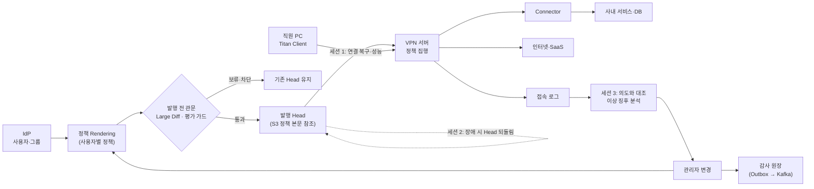

---

## 2. 세션 1 — Titan 배포 운영기: 직접 만들면 얻는 것과 떠안는 것 (오지환)

### 2.1 출발점: 기존 제품에서 불편했던 것

Titan은 토스가 직접 개발한 접근 보안 제품이다. 임직원의 사내 시스템 접속과 인터넷 통신에 보안 정책을 적용한다. 사용자는 평소 쓰던 업무 도구를 그대로 쓰고, Titan이 사용자·기기·요청에 맞는 정책을 얹는다. 발표자가 꼽은 기존 제품의 문제는 세 가지였다.

1. 정책을 갱신하려면 **사용자의 조작**이 필요했다.
2. 네트워크가 바뀌면 **연결 복구가 느렸다**.
3. 업무에 필요한 **기능을 추가하기 어려웠다**.

그래서 정책을 서버에서 바로 적용하고, 연결 복구를 개선하고, 필요한 정책을 직접 구현할 수 있는 정책 엔진을 만들었다. 배포해 보니 “연결이 잘 된다”만으로는 부족했다. 저사양 PC, 다른 보안 프로그램과의 충돌, 재택·카페·핫스팟 같은 네트워크 환경, 사용자 증가에 따른 터널 성능과 인프라 비용이 뒤따랐다.

설계 기준으로 삼은 말은 “보안이 일을 방해하면 사람들은 우회 방법을 찾는다”였다. 정책이 업무와 어긋나면 사용자는 예외를 요청하고, 예외가 늦거나 복잡하면 다른 경로를 찾는다. 발표자는 이를 사용자의 보안 의식 탓으로만 보지 않고 (a) 사용자가 해야 하는 일을 이해했는지, (b) 집행 방식이 맞는지, (c) 추가된 절차가 감당할 만한지를 먼저 보라고 했다.

### 2.2 통제의 해상도: Method와 Path로는 부족하다

예시는 “PR(코드 변경 요청) **조회**는 허용하고 **생성**은 막고 싶다”였다. 전통적인 웹 필터 조건인 HTTP Method와 Path만 보면 [GraphQL](https://graphql.org/learn/) API에서는 두 작업이 모두 `POST /graphql`이다. 경로 전체를 막으면 조회도 안 되고, 열면 생성까지 열린다. 쉽게 말하면 **봉투 겉면이 똑같아서** 안을 봐야 구분되는 상황이다.

Titan은 정책 조건을 요청 **Body**까지 넓혔다. 같은 `POST /graphql`이라도 Body의 작업 필드를 읽어 조회에 쓰이는 `pullRequests`는 허용하고 생성에 쓰이는 `createPullRequest`([GitHub GraphQL 문서](https://docs.github.com/en/graphql/reference/pulls))는 차단한다. 두 번째 예는 값 기반이다. 같은 `POST /login`이라도 `email` 필드가 회사 도메인일 때만 허용한다. 개인 계정으로 SaaS에 로그인해 자료를 옮기는 경로를 막는 전형적인 방법이다.

다음은 개념을 보여 주기 위한 **재구성 설정**이다. Titan의 실제 문법이 아니다.

```yaml
# 재구성 예시: Body 조건이 있는 HTTP 정책
- name: "BLOCK-github-create-pr"
  when:
    method: POST
    host: api.github.example
    path: /graphql
    body:
      graphql_root_field: createPullRequest   # 문자열 검색이 아니라 파싱 결과로 판정
  action: block

- name: "ALLOW-saas-corp-login-only"
  when:
    method: POST
    host: saas.example.com
    path: /login
    body:
      json_field: email
      matches_domain: corp.example.com
  action: allow
# 위 두 조건에 맞지 않는 /login 은 후순위의 차단 규칙이 받아야 의미가 있다
```

Body 검사를 실제로 만들 때 챙겨야 할 것(이 글의 분석이며 Titan이 어떻게 처리하는지는 공개되지 않았다):

| 함정 | 왜 문제인가 | 방어 방향 |
|---|---|---|
| 문자열 포함 검사 | GraphQL은 별칭, 한 요청의 여러 작업, 프래그먼트를 허용해 이름이 본문 어디에 있는지로는 의미를 알 수 없다 | 문서를 파싱해 실제 실행될 작업 타입과 루트 필드 전부를 평가 |
| Persisted query | 본문에 해시만 있고 쿼리가 없을 수 있다 | 알려진 해시만 허용하거나 해석 불가 시 차단 |
| 크기·압축·스트리밍 | 본문을 다 읽기 전에는 판정할 수 없다 | 상한을 정하고 초과 시 동작(차단/통과)을 명시 |
| 파서 차이 | 프록시와 서버가 중복 JSON 키나 인코딩을 다르게 해석할 수 있다 | 모호한 입력은 거절 |
| 전제 | 본문을 보려면 TLS Inspection이 먼저 성립해야 한다 | 복호화 예외 목록과 함께 검토(세션 3의 첫 사례) |

GraphQL 자체의 방어 지침은 [OWASP GraphQL Cheat Sheet](https://cheatsheetseries.owasp.org/cheatsheets/GraphQL_Cheat_Sheet.html)를 참고할 만하다.

### 2.3 데이터베이스 접근: 원래 알던 주소를 그대로

어떤 DB 접근 제어 제품은 Gateway/Proxy와 Agent를 두고 **바뀐 주소**로 접속하게 한다. 발표의 예시는 만 번대 포트를 1씩 늘려 서버와 권한을 구분하는 방식이었다. 문제는 세 가지다.

- 외우기 어렵고, 권한이 재할당되면 포트 번호가 바뀔 수 있다.
- 원래 알던 DB 주소와 별개로 접속 방법을 새로 익혀야 한다.
- 공식 Proxy를 거치지 않는 길이 남으면 보안 구멍이 된다. Proxy에서 권한을 회수해도 **기존 DB 계정과 직접 경로**가 살아 있으면 여전히 접속되고, 그 연결에는 Proxy 정책이 적용되지 않는다. 이렇게 생기는 비공식 경로(**Shadow IT**)는 누가 어떤 데이터에 접근했는지 추적하기도 어렵게 만든다.

토스가 지향하는 방식은 사용자가 알던 주소(예: `alpha-mysql`)를 그대로 입력하는 것이다. 트래픽이 어차피 Titan을 지나므로 별도 주소·포트 없이 정책을 적용할 수 있고, 관리자는 관리 밖의 `shadow-mysql` 같은 연결도 **발견**해 검토·허용·차단할 수 있다. 다만 발표 끝의 로드맵을 보면 DB 접근 제어는 **개발 중**인 항목이다.

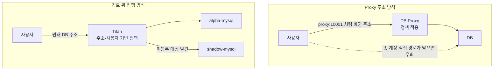

해석: 후자도 “모든 DB 트래픽이 Titan을 지난다”는 전제가 있어야 성립한다. 서버 간 통신, Titan Client가 없는 장비, 데이터센터 내부의 직접 경로는 네트워크 방화벽과 DB 계정 관리가 따로 막아야 한다.

### 2.4 왜 오픈소스 조합 대신 직접 만들었나

발표자는 오픈소스를 먼저 고려할 수 있고, 이미 필요한 기능이 있다면 유지할 코드가 줄어든다고 전제했다. 그다음 두 계열을 비교했다.

| 계열 | 예 | 하는 일 | 발표자가 본 한계 |
|---|---|---|---|
| 오버레이 VPN(Peer 연결) | [NetBird](https://docs.netbird.io/manage/networks/how-routing-peers-work), [Tailscale](https://tailscale.com/docs/features/subnet-routers) | 단말·서버를 Peer로 등록하고 허용된 Peer 사이에 암호화 연결. Routing Peer(서브넷 라우터)로 Agent 없는 사내망도 연결 | 대상을 터널로 “연결”하는 수준이라 내부 프로토콜의 세부 제어가 어렵다 |
| 프로토콜 인지 접근 게이트웨이 | [Warpgate](https://github.com/warp-tech/warpgate), [Teleport](https://goteleport.com/docs/enroll-resources/database-access/) | Gateway를 통해 SSH·DB·웹에 접속, 권한 확인과 세션 기록 | 접속 방식의 불편과 Shadow IT 문제가 남는다 |

토스는 내부 자산 접근뿐 아니라 **인터넷으로 나가는 트래픽**(앞의 Body 정책)도 보호하고, 사내 인증과 **결재 라인**까지 연결하고 싶었다. 여러 제품을 조합할 수도 있지만 그러면 다음을 계속 책임져야 한다.

- 사용자 권한 변경이 네트워크 정책과 서비스 정책에 함께 반영돼야 한다.
- 접속 실패 시 어느 제품에서 막혔는지 찾아야 한다.
- 감사 때 여러 시스템의 기록을 같은 접속 기준으로 이어야 한다.
- 업그레이드할 때마다 연계가 유지되는지 확인해야 한다.

결론은 “하나의 Client와 하나의 운영 체계”였다. 대신 보안 패치, 호환성, 장애 대응이 전부 자기 몫이 된다는 비용을 명시적으로 받아들였다.

### 2.5 지난 1년에 추가한 보안 기능

| 기능 | 내용 | 배경 지식 |
|---|---|---|
| **NRD** (Newly Registered Domain) | 새로 등록된 도메인 접근을 제어 | 등록일은 [RDAP](https://www.rfc-editor.org/rfc/rfc9083)/WHOIS로 조회 |
| **LNA** (Local Network Access) | 로컬 네트워크 접근 보안 강화 | 웹페이지가 사용자 내부망·localhost를 두드리는 문제. [Chrome도 권한 확인을 도입](https://developer.chrome.com/blog/local-network-access)했다 |
| **TPM** | 단말의 신뢰 기반 강화(도입 중) | 보안 칩에 키를 묶어 기기 위장을 어렵게 함 |
| **Network Trust** | 접속한 네트워크와 AP(무선 공유기) 정보를 보고 접근 판단 | 같은 사람·기기라도 장소에 따라 다르게 |
| **Connector Failover** | 연결 경로 장애 시 복구 | 안정성 |

#### NRD가 겨냥하는 시간 창: axios 사건

2026년 3월, 널리 쓰이는 npm 패키지 `axios`의 악성 버전이 배포됐다. 설치 과정에서 악성 의존성이 실행되고 외부 서버와 통신하는 방식이었다. 발표자는 공격 도메인이 3월 30일 등록되고 악성 버전이 31일 게시돼 **약 8시간**의 간격밖에 없었다고 짚었다. 이 수치는 공개 기록으로 확인된다.

| 시각(UTC) | 사건 | 출처 |
|---|---|---|
| 2026-03-30 16:03:46 | C2(공격자 명령 서버) 도메인 `sfrclak[.]com` 등록 | [Verisign RDAP](https://rdap.verisign.com/com/v1/domain/sfrclak.com) (2026-11-29 조회) |
| 2026-03-30 23:59 | 악성 의존성 `plain-crypto-js@4.2.1` 게시 | [Elastic Security Labs](https://www.elastic.co/security-labs/threat-command/axios-one-rat-to-rule-them-all) |
| 2026-03-31 00:21 | 악성 `axios@1.14.1` 게시 | 같은 글, [StepSecurity](https://www.stepsecurity.io/blog/axios-compromised-on-npm-malicious-versions-drop-remote-access-trojan) |

$$
\Delta t = \text{03-31 00:21} - \text{03-30 16:03} \approx 8\text{시간 }17\text{분}
$$

평판(reputation) 기반 차단은 누군가 먼저 당하고 분석돼야 목록에 오른다. NRD는 “**나이가 어린 도메인은 일단 막는다**”는 규칙으로 그 빈틈을 메운다. Titan은 RDAP/WHOIS로 등록일을 확인해 새 도메인 접근을 **기본 차단**한다.

한계도 분명하다(분석). 오래된 도메인이나 탈취된 정상 도메인, 대형 클라우드·SaaS의 하위 도메인을 쓰는 공격은 걸리지 않는다. 일부 국가 도메인은 RDAP이 없거나 등록일을 내주지 않으므로 “조회 실패”를 허용으로 볼지 차단으로 볼지 정해야 하고, 정상 신생 서비스에는 예외 절차가 필요하다. NRD는 평판 데이터의 대체가 아니라 보완이며, 패키지 설치 자체를 막는 것은 의존성 잠금·설치 스크립트 제한 같은 다른 층의 일이다.

### 2.6 매일 겪는 불편도 기능이다

- 모드 전환 대기처럼 짧은 시간도 하루에 여러 번 반복되면 업무에 영향을 준다. 모바일 Titan 사용자 의견 중에는 “옆 동료가 모드 전환을 기다리는 동안 나는 20번 전환했다”는 말이 있었다.
- PC에 이미 설치된 Client에 **사내 인증과 Vault(비밀정보 저장소) 사용을 돕는 기능**을 넣어 업무 시작 절차를 줄였다.
- Titan이 멈추면 네트워크가 막혀 일을 못 하므로, PC 상태와 네트워크 환경을 빠르게 파악하는 **진단 도구**를 Client에 내장했다.

### 2.7 직접 만든 덕을 본 사례: 10분 뒤에만 끊기는 Redis

자체 팀이 생기자 상용 SASE 시절부터 남아 있던 문제를 끝까지 팔 수 있게 됐다. 그중 하나가 macOS 개발 환경 장애다. 개발용 애플리케이션이 처음에는 잘 돌다가 **약 10분 뒤** Redis(메모리 기반 데이터 저장소)에 연결하지 못했다.

추적 순서는 애플리케이션 오류 → 실제 통신 과정 → 사용자 PC → 보안 프로그램 → 운영체제였고, 실패 지점은 Redis 서버 주소를 찾는 **DNS 질의**였다. 요청은 개발 앱 → 보안 프로그램 Falcon → macOS가 제공하는 VPN 통로 순으로 흘렀는데, **앱의 DNS 질의 방식**과 **Falcon의 패킷 재작성 동작**이 맞물리면 macOS 커널이 올바른 VPN 통로를 찾지 못하는 버그가 드러났다는 것이 토스의 분석이다.

왜 10분이었나. 다른 DNS 서버로 전환하면 잠시 다시 동작했고, 서버를 차례로 바꾸다가 **더 바꿀 서버가 없어지면** 연결 실패가 사용자에게 보였다.

| 단계 | 조치 | 효과 |
|---|---|---|
| 임시 | 전환 가능한 **가상 DNS 서버를 10개**로 늘림 | 증상 발현 시점이 약 10분 → **30분** |
| 근본 | 사내 공통 라이브러리를 패치해 **Connected UDP** 대신 일반 UDP 방식으로 질의 | 커널 버그 발생 조건을 회피 |

배경: UDP는 연결 개념이 없지만 소켓에 [`connect()`](https://man7.org/linux/man-pages/man2/connect.2.html)를 호출하면 상대 주소를 커널에 고정할 수 있다(Connected UDP). 이 경우 커널은 상대와 경로에 관한 상태를 소켓에 묶어 두고, 일반(unconnected) UDP는 `sendto()`마다 목적지를 지정한다. 해석하면 문제의 버그는 “소켓에 고정된 경로 상태”와 “중간에서 바뀌는 패킷”이 어긋나는 계열로 보인다. 다만 **버그의 정확한 커널 내부 원인, macOS·Falcon 버전, Apple이나 CrowdStrike의 공식 확인 여부는 공개되지 않았고 이 글에서도 같은 버그의 공개 기록을 찾지 못했다.** 특정 벤더의 결함으로 일반화해서는 안 된다.

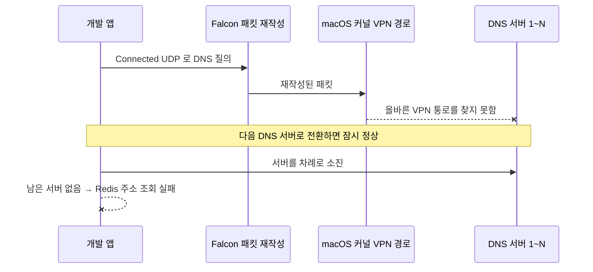

배울 점은 두 가지다. 첫째, “N분 뒤에만 실패”는 타임아웃만이 아니라 **유한한 대체 자원의 소진**일 수 있다. 둘째, 완화(서버 수 늘리기)는 원인을 없애지 않고 발현을 늦출 뿐이므로 근본 수정과 구분해 관리해야 한다.

### 2.8 직접 만든 대가 ① 이동 후 VPN이 돌아오지 않는다

회의를 마치고 엘리베이터를 타면 Wi-Fi가 잠깐 끊기는데, 통신이 가능해진 뒤에도 VPN이 복구되지 않는 일이 있었다.

원래 구조는 Client → **NLB**(AWS Network Load Balancer, 패킷을 여러 서버에 나누는 장치) → VPN 서버였다. 같은 UDP **Flow**(출발지·목적지 IP와 포트 조합)의 패킷은 같은 서버 A로 가고, 세션 정보는 A에 있다. 그런데 (1) 한동안 통신이 없어 NLB가 Flow 상태를 버리거나 (2) 이동 중 IP·포트가 바뀌면, 다음 패킷이 서버 B로 갈 수 있다. 세션은 A에, 패킷은 B에 있는 상황이다.

AWS 문서가 이 동작을 확인해 준다. NLB는 출발지·목적지 IP와 포트로 UDP Flow 상태를 유지하고, **UDP idle timeout은 120초로 고정이며 바꿀 수 없다**. 시간이 지나면 들어온 패킷을 새 Flow로 보고 새 대상에 보낸다([NLB 문서](https://docs.aws.amazon.com/elasticloadbalancing/latest/network/network-load-balancers.html#connection-idle-timeout)).

해결은 **서버를 고르는 책임을 NLB에서 Client로 옮기는 것**이었다.

1. Profile 서버가 접속 후보 서버 목록을 내려 준다.
2. Client가 각 서버의 응답 상태를 Health Check한다.
3. 결과와 목록 순서로 서버를 정한다.
4. VPN 통신은 선택한 서버의 **Pod로 직접** 보낸다.

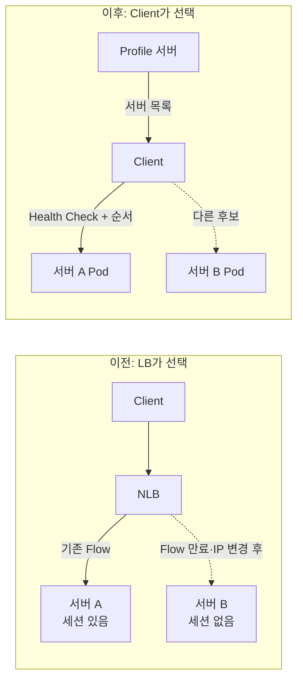

아래는 선택 로직의 **재구성 의사코드**다. “직전 서버 우선”(sticky)은 세션이 서버에 있다는 문제 정의에서 이 글이 추론해 넣은 것이다.

```python
# 재구성 예시: Client 측 서버 선택
def choose(servers, current, probe):
    """servers: Profile 서버가 내려 준 우선순위 목록, probe(s) -> bool"""
    if current in servers and probe(current):
        return current              # 세션이 있는 곳으로 돌아간다
    for s in servers:               # 목록 순서 = 운영자의 선호
        if probe(s):
            return s
    return None                     # 백오프 후 목록 갱신
```

남은 숙제도 공개됐다. 서버를 교체·종료할 때 **새 연결을 막고 기존 연결을 마무리(drain)** 하는 동작은 여전히 Ingress에 의존한다. 이것까지 원하는 대로 제어하려고 장기적으로 **자체 Router**를 검토 중이다.

설계 비교(분석):

| 선택지 | 장점 | 비용·위험 |
|---|---|---|
| L4 LB의 5-tuple 분배(원래) | 단순, 서버 주소 은닉 | 이동·유휴 후 다른 서버로 갈 수 있음 |
| **Client가 서버 선택**(채택) | 이동해도 같은 서버를 지목 가능 | 서버별 도달 주소 노출, 부하 분산·drain·목록 배포를 직접 책임 |
| 연결 ID 기반 라우팅 | IP가 바뀌어도 ID로 같은 서버. NLB도 2025년 11월부터 [QUIC passthrough](https://aws.amazon.com/about-aws/whats-new/2025/11/aws-network-load-balancer-quic-passthrough-mode/)에서 Connection ID 기반 라우팅 지원 | 터널 프로토콜이 QUIC이어야 함. VPN 접속 구간에 그대로 적용 가능한지는 별개 |
| 세션 상태 공유 | 어느 서버로 가도 복구 | 키·재전송 상태 동기화가 어렵고 지연·보안 부담 |
| 자체 Router(검토 중) | drain까지 제어 | 또 하나의 핵심 인프라를 직접 운영 |

참고로 [WireGuard](https://www.wireguard.com/#built-in-roaming)처럼 상대의 IP 변화를 따라가는 로밍 설계도 **패킷이 세션을 가진 서버에 도착해야** 성립한다. 로드 밸런서 뒤에서는 프로토콜의 로밍 능력과 인프라의 라우팅이 함께 맞아야 한다.

### 2.9 직접 만든 대가 ② 트래픽이 늘면 여러 연결이 함께 느려진다

VPN 서버와 사내망을 잇는 **Connector**의 터널 프로토콜은 초기 구현을 그대로 쓰고 있었다. 여러 연결을 **하나의 TCP 터널**에 실었고, 연결에서 읽은 데이터를 다시 IP 패킷으로 만들어 터널에 넣었다. 결과적으로 **TCP 패킷을 TCP 연결 안에 싣는** 구조(TCP-over-TCP)였다. 앞선 데이터 전달이 지연되면 뒤의 모든 통신이 기다렸고(Head-of-Line blocking), 트래픽이 쌓이자 여러 연결이 동시에 느려졌다.

쉽게 말하면 **1차선 터널에 모든 차를 줄 세웠고**, 앞차 하나가 멈추면 뒤차가 전부 서는 셈이다. 게다가 안쪽 TCP와 바깥 TCP가 각각 재전송 타이머와 혼잡 제어를 돌려 서로의 지연을 손실로 오해할 수 있다.

단일 TCP 흐름의 처리량은 흔히 Mathis 근사식으로 가늠한다.

$$
\text{Throughput} \lesssim \frac{MSS}{RTT}\cdot\frac{C}{\sqrt{p}}, \qquad C \approx 1.22
$$

$MSS$는 세그먼트 크기, $RTT$는 왕복 시간, $p$는 손실률이다. 모든 사용자 흐름이 TCP 연결 하나를 공유하면 **전체 합**이 이 한도를 나눠 갖고, 손실 한 번의 영향도 전원에게 간다. 이 식은 일반론이며 토스의 측정값이 아니다.

대응은 두 단계였다.

1. **응급**: Connector 수를 **3배**로 늘려 부하 분산.
2. **구조 변경**: 터널이 나르는 단위를 IP 패킷에서 **애플리케이션 데이터**로 바꿈. Connector는 받은 데이터를 목적지 연결에 쓰고, 목적지와의 TCP/IP 처리는 **OS 커널**이 맡는다. Benchmark로 설정값을 정해 전환.

현재 Connector는 TCP 기반 [**yamux**](https://github.com/hashicorp/yamux/blob/master/spec.md)와 UDP 기반 [**QUIC**](https://www.rfc-editor.org/rfc/rfc9000)을 **둘 다** 쓰며, 대상 인프라의 방화벽 구성과 스위치 특성에 따라 고른다.

| 구조 | 터널에 싣는 것 | 이중 TCP | 스트림 간 HoL(분석) | 네트워크 제약 |
|---|---|---|---|---|
| 이전: IP-in-TCP | 재구성한 내부 IP 패킷 | 있음 | 큼 | TCP만 통과하면 됨 |
| yamux over TCP | 스트림 데이터 | 제거 | 스트림별 흐름 제어는 있으나 바깥 TCP 손실은 전체에 영향 | TCP만 통과하면 됨 |
| QUIC over UDP | 스트림 데이터 | 해당 없음 | 전송 계층에서 스트림 단위로 분리 | UDP 허용·장비 처리 특성에 의존 |

QUIC이 항상 답이 아니라는 점이 실무적이다. 방화벽이 UDP를 제한하거나 장비가 UDP를 불리하게 처리하는 환경에서는 TCP 기반이 낫다. **전송 방식을 환경별 선택지로 두는 것** 자체가 설계 결정이다.

### 2.10 터널 밖의 병목: 지표가 있어야 좁힌다

구현을 바꾼 뒤에도 실제 성능은 Benchmark만큼 나오지 않았다. 대시보드에서 연결 생존 여부뿐 아니라 **응답 시간, 트래픽, Active Stream 수**(각 Connector가 동시에 처리 중인 흐름 수)를 함께 보며 구간을 좁혔고, 다음 원인을 식별해 대응했다.

- 물리 스위치 문제
- 인터넷 회선 대역폭 부족 같은 외부 의존성
- 같은 자원을 쓰는 다른 워크로드의 간섭

“프로토콜을 고쳤으니 빨라질 것”이라는 가정은 경로 전체의 측정으로만 확인된다.

### 2.11 직접 만든 대가 ③ 전송 비용

당시 환경에서 **AWS에서 밖으로 나가는 데이터 전송(egress) 비용만 월 약 24,000달러까지** 나왔다. VPN을 클라우드에 두면 사용자의 거의 모든 업무 트래픽이 클라우드에서 “나가는” 트래픽이 되므로, 사용량에 비례해 청구액이 늘어난다.

| 조치 | 내용 |
|---|---|
| 관측 | 트래픽 지표로 어디로 얼마나 가는지 파악 |
| 경로 정리 | AWS 내부에서 끝낼 수 있는 통신은 밖을 거치지 않게 함 |
| 전용 회선 | 일부 통신을 [**Direct Connect**](https://aws.amazon.com/directconnect/pricing/pay-as-you-go/)(AWS와 사내망을 잇는 전용선, DX) 경로로 전환 |
| 결과 | **월 약 1만 달러 절감**(발표자 수치) |
| 다음 | **데이터센터 전환** 준비. 정액 회선으로 트래픽이 늘어도 비용 예측이 쉬운 구조 |

24,000달러는 “까지 나왔다”는 상한 표현이므로, 1만 달러 절감 뒤의 월 비용을 단순 뺄셈으로 확정해서는 안 된다. DX도 포트 요금과 전송 요금이 있어, 절감 폭은 트래픽량·리전·회선 위치에 따라 달라진다.

### 2.12 앞으로의 계획과 남은 질문

발표자는 사용자가 **약 2,000명에서 3,000명**으로 단기간에 늘어난 상황을 지원한 경험을 언급하며 다음을 제시했다.

- 계열사 사용을 위한 애플리케이션·배포 구조 개선
- 방화벽 규칙 중심의 **망분리 환경**에도 Titan을 적용해 요청 맥락 기반 접근 제어
- 기존 DB 주소·도구를 유지하는 DB 접근 제어, 이후 **망간 자료 연계** 통합
- HTTP 지연 시간과 상태 코드로 **서비스별 지연·오류 가시화**(Titan이 서비스들의 SLA 지표 수집 지점이 되는 구상)

남은 질문(이 글의 것): Client가 서버를 고르는 구조의 부하 편중은 어떻게 막는가. Titan 장애 시 업무 통신은 닫히는가(fail-closed), 우회 절차가 있는가. 모든 트래픽이 지나는 지점이 늘수록 Titan 자체의 가용성과 관리 권한이 가장 큰 위험이 된다. 뒤의 두 세션은 그중 “관리”의 위험을 다룬다.

---

## 3. 세션 2 — 정책 변경도 배포다: 보안 회복력 (이호열)

### 3.1 문제 정의

코드를 배포할 때는 테스트하고 되돌릴 준비를 한다. 접근 권한 정책도 사용자의 업무에 직접 영향을 준다. 관리자가 정책 하나를 바꿨는데 직원이 업무 포털에 접속하지 못한다면 어떻게 해야 하는가?

- 반영 **전**에 발견하면 막는다.
- 이미 반영됐다면 **빠르게 되돌린다**.
- 복구 후 원인을 찾아 **다음 검사에 넣는다**.

발표자는 이를 **보안 회복력(resilience)** 이라 불렀다. Titan은 네 가지 장치로 구현한다.

| 장치 | 역할 | 시점 |
|---|---|---|
| **PITR** | 저장된 정상 정책으로 빠르게 복구하면서 변경은 보존 | 사고 후 |
| **Large Diff** | 발행 대상 사용자 수가 급감하면 발행 보류 | 발행 전 |
| **정책 평가 가드** | 실제 평가 엔진으로 변경 의도를 검증 | 발행 전 |
| **감사 로그** | 변경 전후를 설명 가능하게 기록 | 항상 |

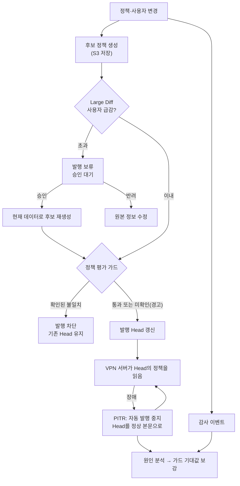

### 3.2 PITR: 정책을 다시 만들지 않고 가리키는 곳만 바꾼다

PITR은 보통 데이터베이스의 “시점 복구(Point-In-Time Recovery)”를 뜻하는 약어다. Titan에서의 핵심은 **재 Rendering 없는 복구**다. Rendering은 사용자·그룹·규칙을 조합해 실제 배포할 사용자별 정책 본문을 만드는 계산이다. 발표의 버전 번호와 정책 A·B는 설명용 예시다.

| 버전 | 참조 본문 | 상태 |
|---|---|---|
| V10 | 정책 A | 업무 접근 정상 |
| V11 | 정책 B | 발행 후 접근 차단 발생 |
| V12 | **정책 A** (S3의 기존 객체) | 복구. 버전은 앞으로, 본문은 과거의 정상본 |

정책 본문은 이미 S3에 저장돼 있으므로, 복구는 (1) 자동 발행을 멈추고 (2) **발행 Head**(서버가 읽어야 할 본문을 가리키는 포인터)를 정상 본문으로 바꾸는 일이다. 쉽게 말하면 Git에서 과거 내용을 다시 가리키는 **새 커밋**을 만드는 것에 가깝고, 이력을 지우지 않는다.

중요한 성질은 **복구가 변경의 흐름을 되감지 않는다**는 것이다.

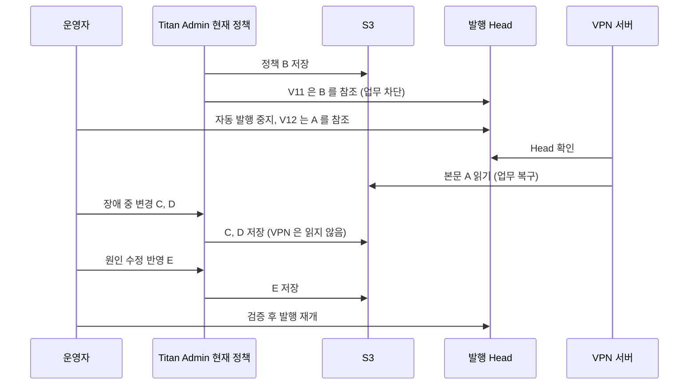

- 복구 중에도 운영자는 정책을 계속 바꿀 수 있고, C·D·E는 실제로 생성돼 S3에 저장된다.
- 저장됐다고 VPN 서버가 읽지는 않는다. 서버는 Head가 가리키는 A만 읽는다.
- **서비스 상태**와 **현재 정책**이 분리된 두 흐름으로 움직인다. 업무를 먼저 살리고, 쌓인 변경과 원인을 함께 정리한 뒤 검증해 복귀한다.
- 복구 후에는 **실제 업무 접근이 돌아왔는지** 확인한다.

개념을 코드로 옮기면 다음과 같다(**재구성**).

```python
# 재구성 예시: 불변 본문 + 가변 Head
class PolicyPublisher:
    def __init__(self, store):
        self.store = store          # 본문 키 -> 본문 (덮어쓰지 않는 저장)
        self.history = []           # (version, body_key, reason)
        self.auto_publish = True

    def save(self, body_key, body):
        self.store.setdefault(body_key, body)  # 차단·중지 중의 후보도 보존

    def publish(self, body_key, reason):
        version = len(self.history) + 1
        self.history.append((version, body_key, reason))
        return version

    def on_change(self, body_key, body):
        self.save(body_key, body)
        if self.auto_publish:       # 가드 호출은 생략
            self.publish(body_key, "auto")

    def recover(self, good_version):
        self.auto_publish = False   # 먼저 멈춘다 (덮어쓰기 방지)
        _, good_key, _ = self.history[good_version - 1]
        return self.publish(good_key, f"recover from v{good_version}")  # 재 Rendering 없음
```

#### 상용 제품과의 비교(발표자 설명)

발표자는 익명의 A 솔루션은 복원 지점의 정책·설정을 복구하는 Backup & Restore를, B 솔루션은 작업 중인 후보 구성을 유지한 채 이전 실행 구성을 복구하는 기능을 제공한다고 했다. Titan의 차별점으로는 **저장된 본문을 재사용해 Head만 전환**하는 속도와, 중지 중에 들어온 변경도 모두 Snapshot으로 남는다는 점을 들었다. 같은 계열의 공개 표준·제품 기능으로는 NETCONF의 candidate 구성과 **confirmed commit**(확인이 없으면 자동 원복, [RFC 6241](https://datatracker.ietf.org/doc/html/rfc6241#section-8.4)), Junos의 [commit 모델](https://networkingdocs.hpe.com/documentation/us/en/software/junos/cli/topics/topic-map/junos-configuration-commit.html)을 참고할 만하다.

#### 숨어 있는 trade-off(분석)

**과거 본문으로 돌아가면 그 사이의 정상적인 보안 강화도 함께 되돌아갈 수 있다.** 정상 본문 이후에 권한 회수나 악성 도메인 차단이 추가됐다면, Head가 과거 본문을 가리키는 동안은 Titan 정책으로는 집행되지 않는다. 변경이 “보존”되는 것과 “집행”되는 것은 다르다. 따라서 복구 절차에는 최소한 다음이 필요하다.

- [ ] 되돌아갈 본문과 현재 정책의 diff에서 **권한 회수·차단 추가** 항목을 따로 뽑아 본다.
- [ ] 계정 비활성화처럼 IdP에서 막히는 통제와 Titan 정책으로만 막는 통제를 구분한다.
- [ ] 자동 발행 중지 상태에 **알림과 시간 제한**을 둔다(방치하면 집행 정책이 계속 낡는다).
- [ ] 긴급 차단을 중지 상태에서도 내보낼 수 있는 별도 경로가 있는지 정한다.
- [ ] 서버가 새 Head를 읽기까지의 지연(폴링·푸시·캐시)을 측정한다. 실제 복구 시간은 Head를 쓴 시점이 아니라 **마지막 서버가 반영한 시점**까지다.

발표에서는 실제 복구 소요 시간, 서버의 Head 반영 방식, 긴급 차단의 처리 방식은 제시되지 않았다.

### 3.3 Large Diff: 사용자가 갑자기 줄면 일단 멈춘다

IdP는 사용자·그룹 정보를 공급한다. 사람이 설정하므로 실수할 수 있다. 예컨대 동기화 대상 범위를 잘못 좁혀 정상 사용자 일부가 Titan에 전달되지 않으면, 그대로 정책에 반영할 때 여러 업무 접근이 막힌다. **IdP가 보낸 변화라도 영향 확인 후 발행해야 한다.**

비교 대상은 IdP 전체 계정 수가 아니라 **정책을 실제로 발행받을 사용자 수**다. 발표의 예는 직전 발행본 1,000명, 이번 후보 600명, 임계값 30%다.

$$
r = \frac{N_{prev} - N_{cand}}{N_{prev}} = \frac{1000-600}{1000} = 0.40 > \theta = 0.30
$$

임계값을 넘었으므로 발행이 보류되고 기존 발행본이 유지된다. 운영자는 **누가 왜 빠졌고 업무에 어떤 영향이 있는지**를 확인한다.

| 확인 결과 | 처리 |
|---|---|
| 원인 불명 | 승인하지 않고 보류 유지 |
| 실수 확인 | 사유를 남겨 **반려**, 원본 정보 수정 |
| 계획된 변경(예: 조직 이관), 영향 확인 | **승인**. 승인자·승인 시각 기록 |

두 가지 구분이 강조됐다. **승인은 진행해도 된다는 판단이고, 발행 성공은 그 뒤의 처리 결과**다. 승인 후에는 현재 데이터로 후보를 **다시 만들고** 평가기를 거치며, 실제 무엇이 나갔는지는 발행 이력과 평가 결과, 사용자의 업무 접근 확인으로 본다. 또 Large Diff는 **Titan의 정책 발행만** 멈춘다. IdP의 계정 비활성화나 로그인 문제를 되돌리지는 않는다.

비교로, A 솔루션은 위험 분석·승인·구현을 변경 요청 워크플로로 관리하고, B 솔루션은 SCIM(사용자 정보를 자동 동기화하는 표준) 연동에서 Entra의 대량 삭제 보호를 설정할 수 있다고 소개됐다. Microsoft Entra의 [accidental deletions prevention](https://learn.microsoft.com/en-us/entra/identity/app-provisioning/accidental-deletions)은 임계값을 넘으면 프로비저닝 작업을 격리하고 관리자가 허용하거나 거부하게 한다. 해석하면 Entra 방식은 **보내는 쪽**에서, Titan은 **받아서 정책 후보로 만든 결과**에서 막는 위치 차이가 있다.

한계(분석). 인원 수 비교만으로는 못 보는 변화가 있다.

```python
# 재구성 예시: 인원 수 비교 대 집합 비교
prev = {f"u{i}" for i in range(1000)}
swap = {f"u{i}" for i in range(400, 1000)} | {f"new{i}" for i in range(400)}

count_drop = (len(prev) - len(swap)) / len(prev)   # 0.0  -> 통과
removed    = len(prev - swap) / len(prev)          # 0.4  -> 집합 비교로는 감지
```

- 400명이 빠지고 400명이 들어오면 **수는 그대로**다.
- 전체의 5%여도 특정 팀 **전원**이 빠지면 그 팀의 업무가 멈춘다. 그룹별 임계값이 필요할 수 있다.
- 감소만 보면 **증가**(예외 그룹에 의도치 않은 사람이 대량 유입)는 놓친다. 세션 3의 “정책 밖 변화”가 이 영역이다.
- 매번 임계값 바로 아래로 줄면 연속으로 통과한다. 직전본 대비뿐 아니라 기간 누적 변화도 볼 만하다.

Titan이 집합 비교나 그룹별 기준을 함께 쓰는지는 알 수 없다. 설명된 것은 사용자 수 기준이다.

### 3.4 정책 평가 가드: 저장했다와 의도대로 동작한다는 다르다

업무 포털을 허용하려고 규칙을 추가했는데, 후보 정책을 테스트하면 **다른 규칙이 먼저 선택돼 차단**될 수 있다. 가드는 후보 정책에서 의도가 실제로 성립하는지 **실제 평가 엔진**으로 확인한다. 두 종류가 있다.

| 구분 | 사전 정의 가드 | 자동 파생 가드 |
|---|---|---|
| 입력 | “누가 어디에 접근하면 결과는 X”를 미리 등록 | 바뀐 규칙의 대상·조건에서 **대표 요청을 자동 생성** |
| 지키는 것 | 유지해야 하는 업무 접근 | 방금 바꾼 규칙의 효력 |
| 예 | 업무 사용자의 업무 포털 접근은 ‘허용’이어야 함 | HTTP 허용 규칙을 넣었는데 앞 단계의 차단 규칙이 선택돼 반대 결과 |
| 불일치 시 | 후보 발행 차단 | 후보 발행 차단 |
| 비용·한계(분석) | 사람이 기대값을 관리해야 함 | 등록 없이 동작하지만 대표 요청이 놓치는 경우가 있을 수 있음 |

단, “다른 규칙이 선택됐다”는 사실만으로 모두 막는 것은 아니다. 규칙이 **실제 평가 흐름에서 효력을 내는지**를 본다. 또 최종 접근 판정 하나만으로 모든 단계의 규칙 효력을 대신 판단하지 않는다. 쉽게 말하면 여러 단계가 있는 엔진에서 “최종 차단”은 내가 넣은 차단 규칙 때문일 수도, 다른 단계 때문일 수도 있다.

#### 가장 중요한 설계: 판정 코드 공유

VPN이 실제 트래픽에 쓰는 **정책 판단 코드를 평가기가 똑같이 실행**한다. 접근 제어와 방화벽의 판단 구현을 재사용하고, HTTP 정책도 실제 처리와 같은 규칙 구현으로 평가한다. 정책 판단을 전송 처리와 분리했기 때문에, 평가를 위해 VPN 터널을 열거나 업무 포털에 실제 요청을 보내지 않는다.

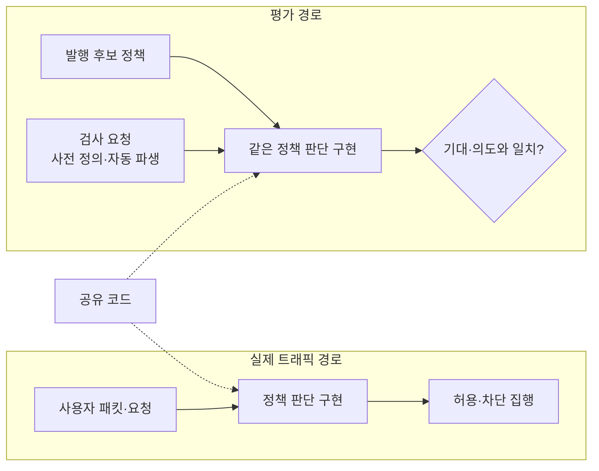

평가용 해석기를 따로 만들면 두 구현이 벌어지면서 “검사는 통과했는데 실제는 차단”이 생긴다. 코드 공유는 이 **시뮬레이터 괴리**를 줄인다. 반대로(분석) 엔진 자체의 버그는 평가기에도 똑같이 있으므로, 가드는 “이 정책이 이 엔진에서 어떻게 판정되는가”를 확인할 뿐 “엔진이 옳은가”는 확인하지 않는다. 평가기와 VPN 서버의 **코드 버전 차이**, DNS 응답·SNI·본문처럼 실행 시점에 정해지는 입력도 남는 차이다.

같은 평가기는 **수동 진단**에도 쓴다. 사용자와 접속 대상을 지정하면 ‘허용 안 됨’ 결과와 차단 사유, 평가에 쓴 정책 정보가 나온다. “이 사람은 왜 포털에 못 들어가나”에 답할 수 있다.

#### 세 가지 결과: 불확실을 어떻게 처리하는가

| 평가 결과 | 처리 |
|---|---|
| 기대와 일치 | 발행 진행 |
| **확인된 불일치** | 후보 발행 차단, 기존 Head 유지(차단된 후보도 S3에 보존) |
| **미확인**(평가 오류, 시간 예산 초과) | 다른 불일치가 없으면 **경고만 남기고 발행**. 성공으로 세지 않음 |

```python
# 재구성 예시: 3값 판정
from enum import Enum

class Result(Enum):
    PASS = 1
    MISMATCH = 2
    UNKNOWN = 3      # 평가 오류, 시간 예산 초과

def decide(results):
    if Result.MISMATCH in results:
        return "block", []
    unknown = [i for i, r in enumerate(results) if r is Result.UNKNOWN]
    return ("publish_with_warning" if unknown else "publish"), unknown
```

이유는 평가기의 일시 장애 때문에 **모든 정책 발행이 멈추는 상황**을 피하기 위해서다. 즉 이 관문은 **미확인에 대해 fail-open**이다. 긴급 차단 정책도 같은 경로로 나가야 한다면 합리적인 선택이지만 조건이 붙는다(분석). 미확인 비율에 경보를 걸고, 핵심 업무 접근이나 민감 자산 차단 같은 가드는 미확인도 차단하도록 등급을 나누는 방안을 검토할 수 있다. 그렇지 않으면 시간 예산을 넘기기 쉬운 큰 변경일수록 덜 검사된 채 나갈 수 있다.

#### 불일치가 났을 때 무엇을 고치나

“기대는 허용, 실제는 차단”만으로는 어느 쪽이 틀렸는지 모른다. 선택된 규칙, 변경 의도, 영향을 함께 본다.

- 열려 있어야 할 업무가 막혔다면 **정책 오류**다. 조건·우선순위를 고쳐 새 후보를 만들고 다시 평가한다.
- 실제로 막아야 하는데 기대값이 ‘허용’으로 남았다면 계획과 대상을 확인하고 **기대값을 수정**한 뒤 사전 정의 가드를 재실행한다.

재평가에서는 불일치 유무뿐 아니라 **경고와 검사 건수**도 본다. 검사가 0건이면 “불일치 0건”은 아무 의미가 없다. 자동 발행 재개는 운영자가 별도로 확인한다.

비슷한 발상의 공개 도구로 [Tailscale 정책 파일의 `tests` 절](https://tailscale.com/docs/reference/syntax/policy-file)(허용·거부 단언)과 [Open Policy Agent의 정책 테스트](https://www.openpolicyagent.org/docs/policy-testing)가 있다. 발표자는 A 솔루션의 진단 기능이 **이미 일어난 실제 접속**을 조사하는 것인 데 비해, Titan은 **발행할 후보**에 요청을 넣어 미리 평가한다는 점(입력과 시점)을 차이로 들었다.

### 3.5 감사 로그: 한 규칙을 옮기면 다른 규칙도 움직인다

설명용 예: 같은 HTTP 평가 단계에서 업무 포털 요청에 허용 정책 A와 차단 정책 B가 모두 일치한다. A를 5번에서 7번으로 옮기면 B는 6→5, C는 7→6이 된다. 먼저 선택되는 규칙이 A에서 B로 바뀌어 **결과가 허용에서 차단**으로 뒤집힐 수 있다. “A를 수정했다”는 기록만으로는 설명이 안 된다.

| 정책 | 변경 전 순위 | 변경 후 순위 | 비고 |
|---|---:|---:|---|
| A (허용) | 5 | 7 | 직접 수정 |
| B (차단) | 6 | 5 | 연쇄 이동, 이제 먼저 선택됨 |
| C | 7 | 6 | 연쇄 이동 |

Titan의 감사 이벤트는 **행위자, 시각, 대상, 작업 결과, 변경 전후 내용**을 남긴다. A의 Snapshot 비교로 5→7을 확인하고, 함께 밀린 정책은 식별자·이전 순위·이후 순위로 같은 이벤트에 남긴다.

```json
{
  "_comment": "재구성 예시. 필드 이름은 이 글이 만든 것",
  "event_id": "evt-0001",
  "actor": "admin@corp.example",
  "at": "2026-11-01T10:15:00+09:00",
  "target": "policy:A",
  "result": "success",
  "before": { "priority": 5, "action": "allow" },
  "after":  { "priority": 7, "action": "allow" },
  "cascaded": [
    { "policy": "B", "from": 6, "to": 5 },
    { "policy": "C", "from": 7, "to": 6 }
  ]
}
```

#### 기록이 빠지지 않게: Transactional Outbox

정책만 바뀌고 기록이 빠지면 감사 로그는 믿을 수 없다. Titan은 **운영 레코드 변경과 감사 이벤트 레코드(Outbox) 저장을 한 트랜잭션**으로 묶는다. Outbox는 나중에 전달할 이벤트를 먼저 보관하는 곳이고, 저장에 실패하면 정책 변경도 Rollback된다. [Transactional Outbox 패턴](https://microservices.io/patterns/data/transactional-outbox.html)으로, DB와 메시지 브로커(Kafka)에 따로 쓰면 둘 중 하나만 성공할 수 있는 **이중 쓰기 문제**를 피한다.

```sql
-- 재구성 예시 (PostgreSQL 문법)
BEGIN;
UPDATE policy SET priority = priority - 1
 WHERE stage = 'http' AND priority BETWEEN 6 AND 7;
UPDATE policy SET priority = 7 WHERE id = 'A';
INSERT INTO audit_outbox (event_id, payload, status, attempts, created_at)
VALUES ('evt-0001', '{"target":"policy:A"}', 'PENDING', 0, now());
COMMIT;  -- 변경과 '전달할 기록'이 함께 확정

-- 원장 쪽: 같은 이벤트가 두 번 와도 한 번만 남긴다
INSERT INTO audit_ledger (event_id, payload)
VALUES ($1, $2)
ON CONFLICT (event_id) DO NOTHING;
```

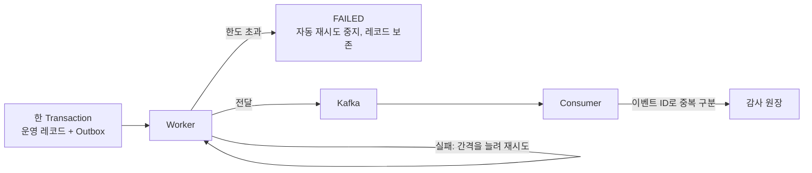

운영에서 구분해야 할 상태:

| 상태 | 의미 | 감시 항목 |
|---|---|---|
| Pending | 아직 전달이 끝나지 않음 | 건수, **가장 오래 기다린 시간** |
| Failed | 재시도 한도 초과, 자동 재시도 중지 | 레코드는 보존, 후속 조치 |
| Kafka 전달 완료 | 원장 적재 완료와 **다름** | Consumer 적재 오류, 소비 지연. 재처리 가능한 오류는 같은 레코드 재처리 |

원장 적재는 정책 변경 트랜잭션 뒤의 **비동기** 과정이므로 감사 조회에는 지연이 있을 수 있다. 원자성이 보장되는 것은 “변경 + 보낼 기록”까지이고, 원장까지는 **재처리 가능성 + 이벤트 ID 기반 멱등성**(같은 일을 여러 번 해도 결과가 같음)으로 맞춘다. 발표자는 직접 전달 경로의 실패도 지표와 로그로 확인한다고 덧붙였다(그 경로가 무엇을 나르는지는 설명되지 않았다).

원장의 **변조 방지**(추가 전용 저장, 별도 권한, 해시 체인 등)는 설명 범위 밖이었다. 정책을 바꿀 수 있는 사람이 원장도 고칠 수 있으면 감사의 의미가 약해진다.

### 3.6 조사 흐름과 정리

“우선순위를 바꾼 뒤 업무 포털에 접속할 수 없다”는 문의가 오면:

1. **변경 좁히기**: 문제 시작 시각과 관련 대상으로 이력 조회
2. **발행과 대조**: 그 변경이 언제 어떤 버전으로 발행됐는지 확인
3. **확인 후 보강**: 해당 사용자와 요청을 수동 평가해 선택 규칙을 확인하고, 결과를 다음 검증에 반영

발표자는 A 솔루션도 감사 로그의 행위자·시각·동작, 전후 diff 화면, 전후 값 JSON 다운로드를 제공한다고 했고, Titan은 전후 Snapshot과 **연쇄 순위 변화**까지 남겨 diff를 한눈에 보게 한다고 설명했다.

전체 흐름은 “발행 전에 큰 변화를 멈추고 의도를 검증 → 문제가 나면 저장된 정상 정책으로 먼저 복구하고 변경은 보존 → 감사 로그와 발행 이력으로 원인 확인 → 놓친 업무 접근을 가드 기대값에 반영”이다. 발표자의 결론은 이 준비를 **운영자의 주의와 경험에 맡기지 말고 시스템과 절차에 담자**는 것이다.

---

## 4. 세션 3 — 정책에도 제로 트러스트를 (최승용)

### 4.1 배포된 정책을 믿지 않는다

**제로 트러스트(Zero Trust)** 는 인증을 받았다는 이유로 사용자나 기기를 계속 믿지 않고 요청마다 다시 검증하는 원칙이다([NIST SP 800-207](https://csrc.nist.gov/pubs/sp/800/207/final)). 이 세션은 같은 태도를 **정책 자체**에 적용한다. 정책이 배포된 뒤에도 의도대로 동작한다고 믿지 않고 확인한다.

계기는 기존 SASE에서 Titan으로의 정책 이관이었다. 과정은 꼼꼼했다.

1. 두 제품의 동작 방식과 기능을 나눠 분석
2. 동작 차이에 맞춰 기존 정책을 Titan 정책으로 **변환**하고 API로 기계적 배포
3. 배포 후 정책끼리 **대조**
4. 사용자를 **직군별로** 옮기며 계속 검증

그 결과 기존 정책과 동일하게 동작하게 만들 수 있었다. 하지만 이것이 “**기존 정책이 잘 동작하게** 들어갔다”는 뜻은 아니었다. 원본이 틀렸다면 동일한 이관은 틀림까지 옮긴다.

이관하며 구조도 정리했다. 정책을 목적에 따라 **다섯 층**으로 나눠 우선순위를 맞추고, 이름 접두사로 **차단·허용·예외**를 구분하고, 설명란에 만든 이유를 적었다. 의도가 한눈에 보여 잘 관리될 것 같았지만, 로그를 함께 보니 **정책상으로는 동작해야 하는데 실제로는 동작하지 않는 것**이 나왔다.

### 4.2 정책 한 줄은 세 곳의 영향을 받는다

| 구성 요소 | 내용 | 흔드는 것 | 바뀌는 시점 |
|---|---|---|---|
| **사용자 그룹** | 누구에게 | LDAP·Keycloak 같은 계정 시스템의 변동 | 운영 중 계속 |
| **목적지 그룹** | 도메인·IP·경로 | 대상 서버 변화, 서비스의 API 경로 변경 | 운영 중 계속 |
| **처리** | 허용/차단, 평가 순서 | 처음 구성한 관리자의 판단 | 설계·배포 때 |

흐름은 요청 확인 → 설계 → 배포 → 운영 → 회수다. 관리자의 판단은 설계·배포에서 들어가지만, 두 그룹은 **배포 후에도 계속 변한다**. 검증이 부족했던 이유는 정책을 **하나씩** 보았을 뿐 영향을 주는 것들을 **엮어서** 본 적이 없었기 때문이다.

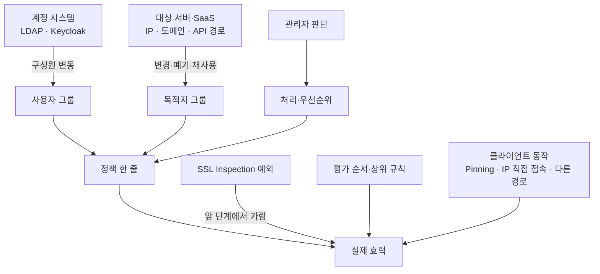

### 4.3 정책 화면에서는 문제없어 보였던 네 가지 순간

#### 사례 1. SSL Inspection 예외가 HTTP·DLP를 통째로 비껴가게 한다

`drive.example.net/upload` 업로드는 막힐까? 차단 정책만 보면 알 수 없다. Titan은 계층에 따라 정책을 판단한다. 먼저 **SSL Inspection에서 복호화할지** 정하고, 그다음 HTTP·DLP 정책 등을 본다. `*.example.net` Wildcard가 복호화 예외라면 `drive.example.net`은 복호화되지 않고 HTTP·DLP 정책도 동작하지 않은 채 **Bypass**된다. 관리자는 화면의 차단이 켜져 있어 동작한다고 알았고, 사용자는 불편이 없어 **아무도 몰랐다**. Wildcard는 도메인이 포함되는지 눈으로 판단하기가 더 어렵다.

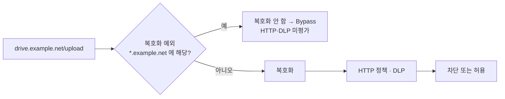

이는 Titan만의 성질이 아니다. 예를 들어 Cloudflare Gateway 문서도 Do Not Inspect로 빠진 트래픽에서는 [HTTP 요청의 기록·차단, DLP, 악성코드 검사 능력을 잃는다](https://developers.cloudflare.com/cloudflare-one/traffic-controls/http-policies/)고 적고, Do Not Inspect를 Allow·Block보다 [먼저 평가](https://developers.cloudflare.com/cloudflare-one/traffic-controls/order-of-enforcement/)한다.

#### 사례 2. IP를 넣었는데 도메인 요청이 안 막힌다

파일 공유 서비스들을 `File-Share` Host 그룹에 넣고 차단한다. 그 안에는 `file-share.example.com` 서버의 **IP**가 들어 있다. 사용자가 **도메인**으로 업로드하면? 서버 IP를 넣었으니 막힐 것 같지만, Titan에서는 목적지 그룹 안의 IP가 **SSL Inspection에서는 동작하고 HTTP 정책에서는 동작하지 않는다**. 같은 목적지 그룹을 두 정책이 함께 참조해도 단계에 따라 효력이 달라진다. 도메인으로 넣었다면 HTTP 차단이 동작했을 것이다. 발표자도 솔루션마다 동작 방식이 다르다고 전제했다.

해석: 연결을 맺는 단계에서는 목적지 IP가 보이지만, HTTP 단계의 대상 판정이 요청에 적힌 이름(Host)을 기준으로 하기 때문으로 이해하면 쉽다. 쉽게 말하면 **이름으로 찾는 명부에 주소만 적어 둔** 격이다.

#### 사례 3. 변경 이력이 비어 있어도 의미는 바뀐다

`payroll.example.com`의 export 경로를 허용하는 정책이 있고, Titan의 변경 기록에는 아무것도 없다. 변화가 없으니 잘 동작한다고 봐도 될까? 꼭 그렇지 않다.

| 정책 밖 변화 | 결과 |
|---|---|
| 예외 승인으로 관리되는 사용자 그룹에 **의도치 않은 사람**이 들어감 | 정책은 맞는데 엉뚱한 사람에게 적용 |
| 허용한 서버가 바뀌거나 사라짐, **IP·도메인 재사용** | 허용이 다른 서버로 이어짐 |
| 서비스가 `/export`를 `/exporting` 같은 경로로 바꿈 | 정책이 새 경로에 맞지 않음 |

셋 다 정책은 그대로라 **변경 기록만 봐서는 보이지 않는다**.

#### 사례 4. Hit Count 0은 미사용의 증거가 아니다

| Hit 0의 원인 | 의미 | 권장 조치(분석) |
|---|---|---|
| 우선순위 | 앞 규칙이 먼저 가져감(가려짐, shadowing) | 순서·중복 점검 |
| 목적지 그룹 | 그 단계에서 맞지 않는 항목 형식, 낡은 값 | 대상 수정 |
| SSL 예외 | 평가 단계에 도달하지 못함 | 예외 범위 재검토 |
| 정책 밖 변화 | 그룹·서버·경로 변경 | 의존성 확인 |
| 진짜로 요청 없음 | 불필요하거나, 차단 목적이라 정상 | 확인 후 회수 판단 |

“0이면 삭제”라는 흔한 정리 작업이 위험한 이유다. Hit 0은 **검토 신호**이지 결론이 아니다. 규칙 가림(shadowing)은 방화벽 분야에서 오래 연구된 이상(anomaly) 유형이다([Al-Shaer & Hamed, INFOCOM 2004](https://doi.org/10.1109/INFCOM.2004.1354680)).

형식으로 쓰면, 순서가 있는 규칙 $r_1,\dots,r_n$이 first-match로 평가될 때 규칙 $r_i$가 실제로 처리하는 요청 집합은 다음과 같다.

$$
E_i = M_i \setminus \Big( B \cup \bigcup_{j<i} M_j \Big)
$$

$M_i$는 $r_i$의 조건에 맞는 요청, $B$는 앞 단계(복호화 예외 등)에서 빠져 이 단계에 도달하지 않는 요청이다. $M_i$가 비어 있지 않은데 $E_i = \varnothing$이면 **죽은 규칙**이다. $M_i$와 $B$는 IdP 구성원, DNS, 서비스 경로, 다른 정책에 따라 변하므로 $E_i$는 **해당 규칙을 편집하지 않아도** 변한다. 이 식은 이 글의 정리다.

### 4.4 사람이 따라가기 어려운 규모

| 대상 | 규모(발표자 수치) |
|---|---:|
| 여러 종류의 정책 | 약 1,700개 |
| 목적지 그룹 | 약 1,800개 |
| 그룹 안의 도메인·IP | 약 16만 개 |

이것들이 서로 간섭하며 평가된다. 상용 솔루션의 사전 정의 카테고리는 안에 든 도메인을 하나씩 조회해야 알 수 있어 더 따라가기 어려울 수 있다. 그래서 **종속성을 코드로 계산하고 LLM을 함께 써서** 정책을 관리하게 됐다.

단순한 점검기가 어떤 모습인지 보이는 **재구성 예시**다. 사례 1과 2를 설정만으로 찾는다.

```python
# 재구성 예시: 설정만으로 '효력이 없는 차단 대상'을 찾는 최소 점검
from fnmatch import fnmatch
import ipaddress

TLS_BYPASS = ["*.example.net"]
GROUPS = {
    "drive": ["drive.example.net"],
    "file-share": ["203.0.113.10"],            # file-share.example.com 의 IP
}
HTTP_BLOCKS = [("BLOCK-drive-upload", "drive"), ("BLOCK-file-share", "file-share")]
DNS = {"file-share.example.com": "203.0.113.10"}   # 점검 시점의 DNS 스냅샷

def is_ip(s):
    try:
        ipaddress.ip_address(s)
        return True
    except ValueError:
        return False

def lint():
    for rule, group in HTTP_BLOCKS:
        for target in GROUPS[group]:
            if is_ip(target):
                names = [h for h, ip in DNS.items() if ip == target]
                yield rule, f"IP {target}: HTTP 단계에서 도메인 요청에 안 맞음, 해당 이름 {names}"
                continue
            for pat in TLS_BYPASS:
                if fnmatch(target, pat):
                    yield rule, f"{target}: 복호화 예외 {pat} 에 덮여 HTTP/DLP 미평가"

for finding in lint():
    print(" | ".join(finding))
```

실행 결과(이 장난감 코드만 로컬 Python으로 확인했으며 Titan과는 무관하다):

```text
BLOCK-drive-upload | drive.example.net: 복호화 예외 *.example.net 에 덮여 HTTP/DLP 미평가
BLOCK-file-share | IP 203.0.113.10: HTTP 단계에서 도메인 요청에 안 맞음, 해당 이름 ['file-share.example.com']
```

실제 환경에서는 경로·메서드 조건, 사용자 그룹의 교집합, 첫 일치 순서, 제품별 Wildcard 의미(`*.a.com`이 `a.com`을 포함하는지 등), 공유 IP(CDN)까지 모델링해야 한다. 위 코드의 `fnmatch`는 어느 제품의 매칭 규칙도 아니다.

### 4.5 배포와 점검의 순환

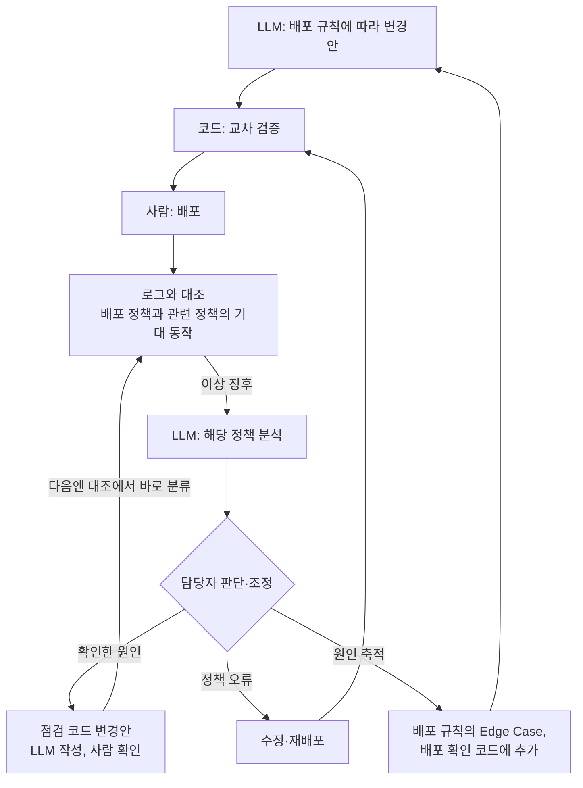

돌수록 정책은 고쳐지고 원인은 **배포 규칙과 코드에 쌓인다**. 같은 원인을 두 번 LLM에게 묻지 않고 코드가 바로 분류하게 만드는 방향이다. “기대 동작과 로그 대조 → 이상 징후 식별” 단계에서 세 가지 점검을 한다.

#### 점검 1. 바꾼 뒤에도 의도대로 동작하는가

- 출발점은 **바뀐 설정**이다. 추가·수정·켜고 끔이 있었는지 확인한다.
- 그에 따른 기대 동작과 로그를 대조한다. 보는 대상은 **배포한 정책**이 잘 동작하는지, **같은 도메인에 적용되는 다른 정책**이 영향받았는지 둘이다.
- 동작하지 않게 된 정책이 있으면 이상 징후 → LLM 분석 → 담당자. 없으면 결과만 기록한다.
- 배포한 정책 자체는 **로그가 쌓인 뒤** 실제 동작을 본다.
- 네 가지 사례와 그 밖의 Edge Case를 모아 반복 점검한다. 배포 규칙에 아직 없는 케이스를 놓쳐 잘못된 정책이 나갈 수 있지만, 로그 비교로 빨리 잡아낼 수 있었다.

#### 점검 2. 정책 밖에서 바뀐 것은 없는가

| 대상 | 위험 | 확인 방법 |
|---|---|---|
| **IdP 그룹** | 잘못된 인원 추가, 연동 오류, 그룹 잘못 재사용 → 잘못된 예외 | 정책 적용 대상자가 속한 **다른 그룹들과 견줘 이상치** 확인 |
| **내부 대상 서버** | 변경 | **자산 목록**과 비교 |
| **외부 서비스** | 개인 계정 로그인, 외부 자산과의 세션 릴레이처럼 반출 위험이 있는 기능의 API 경로가 바뀜 | 그 경로를 **주기적으로 직접 요청**해 차단이 되는지, 경로가 맞는지 확인 |

외부 요인을 직접 확인해 정책이 남에게 의존하는 부분을 줄인다. 외부 서비스 능동 점검은 (분석) 자기 조직에 허용된 범위에서, 부작용 없는 요청과 전용 테스트 계정으로, 상대 서비스의 약관과 요청 빈도 제한을 지키며 해야 한다. 차단이 성공하면 요청이 밖으로 나가지 않지만, 점검이 실패하는 날에는 실제로 나간다는 점을 전제로 설계해야 한다.

#### 점검 3. Hit Count가 갑자기 변했는가

평소 비슷하던 정책의 하루 Hit Count가 어느 날 갑자기 줄었는데 정책 변경 내역이 없다면 이상 징후다. 점검 1·2가 **원인** 쪽을 본다면, 원인을 미리 다 알 수는 없으므로 점검 3은 **결과**를 본다. 평소보다 크게 늘거나 줄면 원인을 몰라도 일단 잡는다. 예로 든 원인:

- 사용자가 **다른 출발지나 경로**로 접속
- 앱 업데이트로 [**Certificate Pinning**](https://community.owasp.org/controls/Certificate_and_Public_Key_Pinning)(앱이 특정 인증서만 신뢰해 중간 복호화가 실패하게 되는 설정)이 켜짐
- 이름 대신 **IP로 바로 접속**

확인한 원인 중 코드로 판별 가능한 것은 점검 코드에 추가한다.

급변 탐지의 단순한 형태로 중앙값 기반 편차 점수를 쓸 수 있다. **아래는 이 글의 예시이며 토스의 알고리즘은 공개되지 않았다.**

$$
z_t = \frac{h_t - \mathrm{median}(H)}{1.4826 \cdot \mathrm{MAD}(H) + \epsilon}, \qquad |z_t| > k \Rightarrow \text{review}
$$

$h_t$는 오늘의 Hit, $H$는 비교 기간(예: 같은 요일)의 값, MAD는 중앙값 절대 편차다. 원래 0에 가까운 정책, 휴일, 조직 개편, 배포 직후에는 오탐이 많으므로 예외 창이 필요하다. 그리고 **처음부터 계속 0인** 고장 정책은 급변 탐지로 잡히지 않는다. 그 몫은 점검 1과 사례 4의 원인 분해다.

### 4.6 LLM에게 무엇을 줄 것인가

처음에는 LLM에게 **정책 목록만** 주고 의도대로 동작하는지 물었다. **절반이 틀렸다.** 더 중요한 것은 틀린 방향이다. 대부분 **실제로는 동작하지 않는 통제를 동작한다**고 답했다. “막혀 있다”고 **안심시키는 쪽으로** 틀린 것이며, 보안에서는 가장 위험한 오류다. 목록만으로는 솔루션이 요청을 어떤 순서로 처리하는지 알 수 없으니 당연할 수 있다는 설명이다.

지금 주는 것은 세 가지다.

| 입력 | 내용 |
|---|---|
| 상태 | 현재 정책 설정과 **코드가 찾은 이상 징후** |
| 의미론 | 솔루션의 동작 방식. 예: “정책은 순서대로 보다가 **처음 맞는 하나**로 결정된다” |
| 조직 규칙 | Naming, 우선순위, Edge Case 같은 배포 규칙 |

이를 함께 주자 **기존에 절반만 맞힌 질문을 모두 맞혔다**고 한다. 질문 수, 모델, 반복 측정 방식은 공개되지 않았으므로 일반적인 정확도로 읽으면 안 된다. 같은 질문 집합을 보며 컨텍스트를 보강했다면 새 유형의 질문에 대한 성능은 따로 확인해야 한다.

LLM에게 맡기는 일은 세 가지다.

1. 코드가 아는 원인을 빼고 **남은 이상 징후의 원인 추정**
2. 잘못된 정책의 **수정안 작성**
3. 새로 막고 싶은 것의 **새 정책안 작성**

**LLM은 여기까지다. 고칠지 판단하고 배포하는 것은 담당자**이며, LLM이 쓴 변경안도 배포 전에 **코드가 한 번 더** 확인한다.


분석: 이 배치는 LLM의 약점을 잘 우회한다. **알려진 판정은 코드, 가설과 초안은 LLM, 결정은 사람**이다. 여기에 (a) LLM 답변에 근거 규칙 ID와 평가 경로를 요구해 코드로 대조하고, (b) “동작한다”는 긍정 답변은 로그나 실행 증거 없이는 채택하지 않으며, (c) 정책 설명란과 로그의 URL처럼 **외부에서 들어오는 문자열이 프롬프트 주입 통로**가 될 수 있으므로 데이터로만 취급하고, (d) 정책·로그에 담긴 개인정보의 모델 전송 범위를 제한하는 것이 좋다. 발표에서 이 네 항목은 다뤄지지 않았다.

### 4.7 바뀐 것과 확장

| 이전에 믿던 것 | 지금 하는 것 |
|---|---|
| 정책은 켜져 있으니 동작한다 | **매일 로그와 맞춰** 본다 |
| Hit 0이면 안 쓴다 | **왜 0인지**부터 본다 |
| 로그를 보다 우연히 문제를 발견 | 매일 **이상 징후로 올라온다** |

발표자의 요약은 기존 정책 관리 흐름에 **실제로 검증하는 흐름만 추가했다**는 것이다. 관리자가 누구든, 누가 배포했든 매일 같은 기준으로 실제 동작을 확인한다.

| 적용 대상 | 점검 방법 |
|---|---|
| Titan | 여러 종류의 정책을 엮어 보고 로그와 대조해 동작하지 않게 되는 정책을 찾음 |
| 방화벽 | 방화벽 정책과 웹 필터를 가져와 **판정 순서대로 계산**, 위 정책에 밀려 동작하지 않는 웹 필터를 찾음 |
| 클라우드 인프라 | WAF·Security Group·LB 규칙으로 막았다고 생각하는 **인터넷 노출 자원**에, 설정상 막혀야 하는 경로를 직접 요청해 실제 차단 확인 |

정책 간 관계가 복잡하거나 설정 오류에 민감한 솔루션이라면 같은 자동화를 적용해 볼 수 있다는 제안이다. 관리자로서 “정책들이 잘 관리되고 있나요?”라는 질문에 **어떻게 증명할지** 난처했는데, 적용·운영 단계의 지속 검증으로 해소됐다고 한다. 시작도 작았다. **SSL 예외에 덮인 DLP 정책 하나**를 골라 설정상 어떻게 동작해야 하는지 적고 로그와 맞춰 봤다. **정책 읽기 권한과 로그만 있으면** 시작할 수 있다.

#### 오늘 할 수 있는 점검 목록(이 글의 정리)

- [ ] 복호화 예외의 Wildcard가 차단·DLP 대상 도메인을 덮는지 교집합을 계산한다.
- [ ] HTTP 단계 규칙이 참조하는 그룹에 IP 항목이 있는지 찾고, 제품의 단계별 매칭 의미를 확인한다.
- [ ] Hit 0 규칙을 원인별로 분류하고, 분류 전에는 삭제하지 않는다.
- [ ] 예외 사용자 그룹의 구성원 변화에 알림을 건다.
- [ ] 허용 대상 도메인·IP를 자산 목록과 대조해 폐기·재사용을 찾는다.
- [ ] 중요 차단 규칙마다 **테스트 요청**과 기대 결과를 정하고 주기적으로 실행한다.
- [ ] 검사 로그가 남지 않는 구간(복호화 예외, Client 밖 경로)은 “증거 없음”으로 표시한다. 이상 없음으로 세지 않는다.

---

## 5. 세 세션을 엮어 읽기

### 5.1 동작한다는 것의 증명 사다리

| 단계 | 증명하는 것 | 증명하지 못하는 것 | 담당 장치 |
|---|---|---|---|
| 0. 전제 | 트래픽이 **Titan을 지난다** | 정책의 옳고 그름 | 연결 안정성, 비공식 경로 발견(세션 1) |
| 1. 저장됨 | 규칙과 변경 기록이 존재한다 | 서버가 읽는다 | 정책 저장·감사 로그(세션 2) |
| 2. 발행됨 | Head가 가리킨다 | 의도대로 판정한다 | 발행 이력(세션 2) |
| 3. 평가 통과 | 후보가 **검사한 요청**을 의도대로 판정 | 검사하지 않은 요청, 실행 시점 입력 | 평가 가드(세션 2) |
| 4. 로그 일치 | 실제 트래픽에서 기대대로 | 아직 발생하지 않은 요청 | 점검 1·3(세션 3) |
| 5. 능동 확인 | 지정한 위험 요청이 지금 막힌다 | 목록에 없는 경로 | 외부 경로 점검(세션 3) |

0번 전제가 중요하다. 세션 1의 연결 복구와 터널 성능은 편의의 문제처럼 보이지만, **느리고 끊기는 통제는 우회를 부르고, 우회한 트래픽에는 세션 2와 3의 어떤 검증도 적용되지 않는다**.

### 5.2 같은 위험, 다른 층의 방어

| 위험 | 세션 1 | 세션 2 | 세션 3 | 남는 틈(분석) |
|---|---|---|---|---|
| 관리자의 잘못된 변경 | — | 평가 가드, PITR | 변경 후 로그 대조 | 기대값 자체가 틀린 경우 |
| IdP 대상자 **감소** | — | Large Diff | 점검 2 | 수는 같고 구성만 바뀜 |
| IdP 대상자 **증가** | — | 설명된 기준은 감소 | 점검 2 이상치 | 다수가 함께 잘못 들어오면 이상치로 안 보일 수 있음 |
| 복호화 예외에 가림 | Body 정책의 전제가 무너짐 | 평가기가 이 단계까지 모사해야 검출 | 사례 1, 점검 1 | 가드 범위에 SSL 단계 포함 여부 미공개 |
| 외부 서비스 경로 변경 | Body·경로 정책 | 가드는 **옛 경로**로 통과할 수 있음 | 점검 2 능동 요청 | 점검 목록 밖의 새 기능 |
| 비공식 접속 경로 | 원래 주소 방식, 연결 발견 | — | Hit 급변 | Titan을 안 지나는 경로 |
| 통제 장치 자체의 장애 | Connector Failover, 진단 도구 | PITR | 이상 징후 | Titan 전체 장애 때의 업무 연속성 |

가장 시사적인 조합은 **자동 파생 가드와 세션 3의 사례**다. 규칙의 대상과 조건에서 대표 요청을 만들면, 규칙이 현실을 잘못 표현한 경우(도메인이어야 하는데 IP, 이미 바뀐 API 경로)에는 **그 잘못된 표현대로 만든 요청**이 통과할 수 있다. 정책에서 파생한 테스트는 정책의 내부 일관성을 보고, 현실과의 일치는 **정책 바깥에서 온 정답**(자산 목록, 실제 로그, 직접 요청, 사람이 적은 업무 기대)이 있어야 본다. 사전 정의 가드, 로그 대조, 능동 점검이 서로의 대체재가 아닌 이유다. 이 추론이 Titan 구현에 실제로 해당하는지는 확인되지 않았다.

### 5.3 되돌리기와 최신성의 긴장

세션 2의 복구는 “예전의 정상”으로 가는 것이고, 세션 3은 “예전에 정상이던 것이 지금도 정상인가”를 의심한다. 둘을 합치면 **복구 대상 본문도 검증 대상**이다. 그 본문이 정상이었던 시점 이후에 서버·경로·그룹이 바뀌었다면 복구 직후에도 일부가 어긋날 수 있다. 업무 접근 확인에 더해 차단 쪽의 능동 점검까지 돌리는 것이 합리적이다.

두 세션의 실패 처리 방향도 비교할 만하다. 세션 2의 가드는 “확인 못 함”이면 발행을 진행하고(경고), 세션 3은 LLM의 “동작함” 답변을 믿었다가 절반이 틀린 경험을 했다. **확인 못 함과 확인함을 같은 색으로 칠하지 않는 것**이 두 층 모두의 조건이다.

### 5.4 직접 만든다는 것의 손익

| 얻은 것(발표 사례) | 떠안은 것 |
|---|---|
| Body 조건, 원래 DB 주소 방식 같은 맞춤 정책 | 파서·프로토콜 처리의 안전성 책임 |
| 커널·보안 제품 상호작용까지 추적해 우회 패치 | 원인 조사 인력과 시간 |
| Client 측 서버 선택, 터널 교체, 비용 최적화 | 라우팅·drain·성능·egress 비용 |
| 평가 코드 공유, Head 전환 복구, 연쇄 순위 감사 | 감사 파이프라인과 평가기의 운영 |
| 제품 동작을 정확히 알기에 가능한 점검 코드와 LLM 컨텍스트 | 동작이 바뀔 때마다 점검 코드·문서 동기화 |

비용에 대해 [ZDNet Korea 2026년 8월 31일 보도](https://zdnet.co.kr/view/?no=20260831231056)는 초기 개발비 때문에 아직 이전과 비슷한 수준이며 규모가 커지면 절감을 기대한다는 토스의 설명을 전했다. **자체 개발은 “싸다”보다 “원인을 설명할 수 있고 바꿀 수 있다”를 사는 선택**으로 읽는 편이 안전하다(해석). 전담 팀을 계속 유지할 수 없는 조직이라면 상용·오픈소스 제품을 쓰면서 세션 2·3의 방법(발행 전 단언 테스트, 연쇄 변화까지 남기는 감사, 로그 대조)만 가져오는 것이 현실적이다.

### 5.5 우리 환경에 옮기는 순서(제안)

| 순서 | 작업 | 필요한 것 | 난이도 |
|---|---|---|---|
| 1 | 중요 차단 정책 하나를 로그와 대조 | 정책 읽기 권한, 로그 | 낮음 |
| 2 | 복호화 예외와 차단 대상의 교집합 점검 | 설정 export | 낮음 |
| 3 | 유지해야 할 접근·차단의 단언 목록을 만들고 변경 때 실행 | 평가 API 또는 테스트 계정 | 중간 |
| 4 | 대상 사용자 급변 시 보류(수, 집합, 그룹별) | 발행 파이프라인 제어 | 중간 |
| 5 | 불변 버전 저장과 포인터 전환 복구, 정기 훈련 | 배포 구조 변경 | 중~높음 |
| 6 | 변경과 감사 기록의 원자적 저장 | 자체 관리 계층 | 중간 |
| 7 | LLM 원인 분석 보조 | 1~3의 결정적 점검이 먼저 | 중간 |

상용 제품을 쓰면 4~6은 벤더 기능의 범위에 묶일 수 있다. 그래도 1~3은 대부분 시작할 수 있다.

---

## 6. 확인하지 못한 것과 한계

- 세 세션의 **내부 수치와 동작**(egress 비용과 절감액, 사용자 수, 정책·그룹 규모, LLM 정답률, Titan의 단계별 매칭 의미)은 발표자 설명이며 외부 검증이 없다.
- macOS **커널 버그**의 정확한 원인, 영향 버전, 벤더 확인 여부, 패치한 사내 라이브러리의 이름은 공개되지 않았다.
- PITR의 **복구 소요 시간**, 서버의 Head 반영 방식, 복구 중 긴급 차단 처리, 평가 가드가 **SSL Inspection 단계**까지 모사하는지, Large Diff의 실제 임계값은 설명되지 않았다(30%는 예시다).
- Connector의 **Benchmark 수치**, yamux·QUIC 선택 기준의 세부, Client 측 서버 선택의 부하 분산 결과는 공개되지 않았다.
- 상용 비교의 **A·B 솔루션**은 익명이며 비교 내용은 발표자의 설명이다. 이 글은 제품을 특정하지 않았다.
- 코드·YAML·JSON·SQL과 mermaid 그림은 설명용 **재구성**이다. 로컬에서 실행해 본 것은 4.4절의 장난감 점검 코드뿐이다.
- axios 사건의 도메인 등록 시각은 2026년 11월 29일 RDAP 조회 값이고, 게시 시각은 인용한 보안 업체 분석에 따른다.

## 7. 결론

세 세션은 순서대로 “붙인다, 안전하게 바꾼다, 믿지 않고 확인한다”를 말한다. 접속을 직접 책임지면 DNS와 로드 밸런서, 터널과 청구서까지 보안 팀의 일이 된다. 정책을 코드처럼 다루면 발행 앞에는 관문이, 뒤에는 복구와 기록이 필요하다. 그리고 그 모두를 갖춰도 IdP 구성원, 서버 주소, API 경로, 앱의 동작은 정책 편집 화면 밖에서 바뀐다. **“정책을 켰다”는 보고를 “오늘 로그와 요청으로 확인했다”로 바꾸는 것**이 세 발표가 함께 가리키는 운영 기준이다. 시작은 정책 하나와 그 로그면 충분하다.

## 참고

### 원 세션

- 토스 보안 콘퍼런스 GUARDIANS 26, 오지환 「토스 맞춤형 ZTNA, Titan 배포 운영기」, 이호열 「ZTNA 정책 변경도 배포다」, 최승용 「ZTNA 정책에도 제로 트러스트를」: https://www.youtube.com/watch?v=8yN4vkMsJCo
- [토스 뉴스룸: 보안 콘퍼런스 가디언즈 26](https://toss.im/newsroom/GUARDIANS26)
- [토스 GUARDIANS 25](https://toss.im/guardians-25)
- [ZDNet Korea: 토스의 SASE 자체 개발(Titan)](https://zdnet.co.kr/view/?no=20260831231056)

### 네트워크·접근 제어

- [AWS: Network Load Balancer의 연결 idle timeout](https://docs.aws.amazon.com/elasticloadbalancing/latest/network/network-load-balancers.html#connection-idle-timeout)
- [AWS: NLB QUIC passthrough 지원(2025년 11월)](https://aws.amazon.com/about-aws/whats-new/2025/11/aws-network-load-balancer-quic-passthrough-mode/)
- [AWS Direct Connect 요금](https://aws.amazon.com/directconnect/pricing/pay-as-you-go/)
- [RFC 9000: QUIC](https://www.rfc-editor.org/rfc/rfc9000), [yamux 명세](https://github.com/hashicorp/yamux/blob/master/spec.md)
- [WireGuard: Built-in Roaming](https://www.wireguard.com/#built-in-roaming)
- [connect(2) 매뉴얼](https://man7.org/linux/man-pages/man2/connect.2.html)
- [NetBird: Routing Peer](https://docs.netbird.io/manage/networks/how-routing-peers-work), [Tailscale: Subnet router](https://tailscale.com/docs/features/subnet-routers)
- [Warpgate](https://github.com/warp-tech/warpgate), [Teleport Database Access](https://goteleport.com/docs/enroll-resources/database-access/)
- [GraphQL 학습 문서](https://graphql.org/learn/), [GitHub GraphQL: Pull requests](https://docs.github.com/en/graphql/reference/pulls), [OWASP GraphQL Cheat Sheet](https://cheatsheetseries.owasp.org/cheatsheets/GraphQL_Cheat_Sheet.html)
- [Chrome: Local Network Access](https://developer.chrome.com/blog/local-network-access), [RFC 9083: RDAP 응답 형식](https://www.rfc-editor.org/rfc/rfc9083)

### axios 공급망 사건

- [Elastic Security Labs 분석](https://www.elastic.co/security-labs/threat-command/axios-one-rat-to-rule-them-all)
- [StepSecurity 분석](https://www.stepsecurity.io/blog/axios-compromised-on-npm-malicious-versions-drop-remote-access-trojan)
- [axios 저장소 이슈 #10611](https://github.com/axios/axios/issues/10611)
- [Verisign RDAP 조회 결과(도메인 등록 시각)](https://rdap.verisign.com/com/v1/domain/sfrclak.com)

### 정책 운영·검증

- [NIST SP 800-207: Zero Trust Architecture](https://csrc.nist.gov/pubs/sp/800/207/final)
- [Cloudflare Gateway: HTTP 정책](https://developers.cloudflare.com/cloudflare-one/traffic-controls/http-policies/), [집행 순서](https://developers.cloudflare.com/cloudflare-one/traffic-controls/order-of-enforcement/)
- [Microsoft Entra: 우발적 삭제 방지](https://learn.microsoft.com/en-us/entra/identity/app-provisioning/accidental-deletions)
- [RFC 6241: NETCONF confirmed commit](https://datatracker.ietf.org/doc/html/rfc6241#section-8.4), [Junos commit](https://networkingdocs.hpe.com/documentation/us/en/software/junos/cli/topics/topic-map/junos-configuration-commit.html)
- [Tailscale 정책 파일 문법(tests)](https://tailscale.com/docs/reference/syntax/policy-file), [OPA 정책 테스트](https://www.openpolicyagent.org/docs/policy-testing)
- [Transactional Outbox 패턴](https://microservices.io/patterns/data/transactional-outbox.html)
- [Al-Shaer & Hamed, Discovery of Policy Anomalies in Distributed Firewalls, INFOCOM 2004](https://doi.org/10.1109/INFCOM.2004.1354680)
- [OWASP: Certificate and Public Key Pinning](https://community.owasp.org/controls/Certificate_and_Public_Key_Pinning)
