# 토스 GUARDIANS 26 보안 4강: 진단 파이프라인, AI 레드티밍, AI 보안 2.0, 그리고 AI가 점검하는 보안 관리체계

### 네 발표는 서로 다른 일을 다루지만 같은 질문으로 모인다. "사람이 매번 손으로 하던 보안 판단을 어디까지 시스템에 맡길 수 있는가." 서버·네트워크·Kubernetes·OpenStack 진단은 각 인프라의 기존 배포 도구에 올라탔고, AI 서비스 평가는 모델의 답변 대신 실행 위치·권한·도구·출력을 본다. AI 보안 2.0은 격리된 인프라와 두 개의 게이트웨이로 "AI로 만들어도 됩니까"에 답하려 하고, Toss Security Framework는 통제 요구 사항부터 내규, 실제 이행까지를 AI로 반복 점검한다

토스는 2026년 11월 6일 서울 코엑스에서 보안 콘퍼런스 GUARDIANS 26을 열었다. 토스 [뉴스룸](https://toss.im/newsroom/GUARDIANS26)에 따르면 약 1,000명이 참석했고 6개 계열사 보안 전문가가 3개 트랙 21개 세션을 발표했다. 이 글은 그중 네 세션을 다룬다. 최원겸의 인프라 취약점 진단 자동화, 지한별의 레드티밍 기반 AI 보안 평가, 김상혁의 토스 AI 보안 2.0, 김재성의 Toss Security Framework 구축기다. 각 발표의 주장과 수치를 정리한 뒤 Ansible·Helm·MCP 인가 명세 같은 공식 문서, 발표가 언급한 외부 사고의 1차 공개문, 국내 금융 보안 제도 변화를 덧붙였다.

**네 발표의 수치와 내부 구조는 발표자가 밝힌 것이며 외부에서 재현하거나 감사한 결과가 아니다. 특히 "가드레일 우회 약 74%"는 표본 크기·대상 모델·시험 방법이 공개되지 않았다. 이 글의 코드·YAML·JSON·수식은 별도 표시가 없는 한 설명을 위한 재구성이며 토스의 실제 소스나 설정이 아니다.**

## 0. 어디에 두는가?

네 세션 모두 방어 체계의 설계·운영 이야기다. 특정 CVE 공지도, AI 모델 뉴스도 아니므로 `docs/05_Network_and_Security/02_Security`가 맞다. AI가 두 발표의 중심 소재지만 질문은 "권한·격리·통제·감사를 어떻게 설계하는가"이다.

## 1. 한눈에 보기

| 구분 | 세션 (발표자) | 푸는 문제 | 핵심 설계 | 대표 수치·사실 (발표자 설명) | 남는 질문 |
|---|---|---|---|---|---|
| 1 | 인프라 취약점 진단, 실행 자동화를 넘어 운영 체계로 (최원겸) | 대상 파악·실행·보고가 회차마다 수작업 | 인프라별 기존 배포 도구(Ansible, Config 저장소, Helm)에 진단을 삽입, 결과를 공통 DB와 Infra-Assessment로 통합 | 대상 자산이 "거의 몇천 대" 규모, 대표 사례 4종 | 미진단 자산 관리, 진단 에이전트의 권한 |
| 2 | Red Teaming 기반의 AI Security Assessment (지한별) | AI 서비스 평가 누락과 평가자별 편차 | 실행 위치·권한·도구·출력 4관점, Tier별 평가 깊이, AI 자동화 + 사람 판정 | 가드레일 우회 실험에서 공격 시도의 약 74%가 통과 | 측정 방법, Tier 산정 기준 |
| 3 | 토스 AI 보안 2.0 (김상혁) | 비개발자 개발, 상시 실행 에이전트, 사내 도구 연결 | 분리된 Vibe Infra, Secure Coding Skill, 자원 수명주기, 샌드박스 + AI/MCP Gateway, 4자 등록 검토 | AI 보안 시작 2023년, 혁신금융서비스 회차당 20~30개 서비스 | 검토 병목, 게이트웨이 밖 경로 |
| 4 | Toss Security Framework 구축기 (김재성) | 내규 현행화와 자산 이행 점검의 누락 | 통제 요구 사항 → 5단계 성숙도 → 내규 평가·개정안 → 이행 인벤토리 기반 반복 점검 | 퇴직자 권한 회수는 일 단위 점검으로 설계 | AI 판정의 정확도 검증, 증적 신뢰성 |

네 발표를 하나의 그림에 놓으면 다음과 같다. 화살표는 이 글이 정리한 논리적 연결이며, 발표에서 네 시스템이 서로 연동된다고 밝힌 것은 아니다.

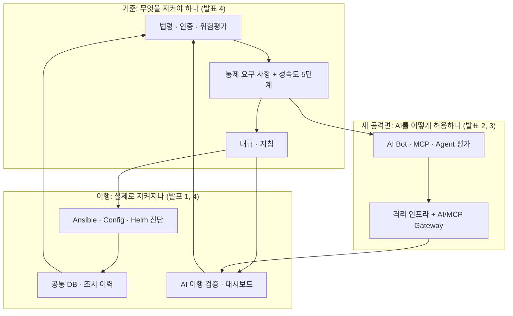

### 1.1 먼저 알아 둘 용어

| 용어 | 뜻 | 쉽게 말하면 |
|---|---|---|
| 취약점 진단 | 시스템 설정과 상태가 보안 기준에 맞는지 항목별로 확인하는 활동 | 건물 소방 점검 |
| 통제 (control) | 위험을 줄이려고 반드시 하도록 정한 일과 장치 | "퇴사자 출입증은 회수한다" 같은 규칙 |
| 증적 (evidence) | 통제가 지켜졌음을 보여 주는 설정값·로그·승인 기록 | 점검표에 붙이는 사진 |
| 내규 | 회사 내부의 규정·지침·절차서 | 사규 |
| MCP | Model Context Protocol. AI 앱이 외부 도구·데이터를 부르는 표준 연결 규약 | AI용 USB 포트 |
| AI Agent | 목표를 받아 여러 단계의 도구 호출을 스스로 결정해 실행하는 AI | 시키면 알아서 여러 창구를 도는 대리인 |
| 가드레일 | 모델 입력·출력·도구 호출을 검사해 막는 필터 | 대화 앞뒤의 검색대 |
| 샌드박스 | 파일·네트워크·권한을 제한한 격리 실행 공간 | 사방이 막힌 실험실 |
| 망분리 | 업무망과 인터넷망을 나누는 국내 금융권 규제 | 사내 PC와 인터넷 PC를 떼어 놓기 |

## 2. 발표 1: 인프라 취약점 진단, 실행 자동화를 넘어 운영 체계로 (최원겸)

### 2.1 문제: 스크립트는 자동인데 일은 수동

인프라 취약점 진단은 보통 세 단계다. 대상을 파악하고, 대상별 방식으로 진단을 실행하고, 결과를 확인해 조치한다. 최원겸은 세 단계 모두에 수작업이 반복됐다고 설명했다.

| 단계 | 반복되던 일 |
|---|---|
| 대상 준비 | "거의 몇천 대 가까이 되는" 자산의 목록과 접근 환경 확인 |
| 실행 | 대상 종류마다 다른 진단 방식 준비, 담당자에게 스크립트 전달, 인터뷰 |
| 결과 처리 | 원인 확인, 조치 방법·일정 협의, 결과 취합, 보고서 작성 |

가장 큰 어려움은 이 과정을 **진단 회차마다 처음부터 다시** 한다는 점이었다.

여기서 얻은 접근 원칙이 이 발표의 중심이다. 보안팀이 별도 배포 체계를 새로 만들지 않는다. 각 인프라는 이미 운영을 위해 **자산을 관리하고, 작업을 배포하고, 실행하는 절차**를 갖고 있으므로 그 위에 진단을 얹는다. 그러려면 담당 엔지니어를 직접 만나 배포 방식을 물어야 했다.

쉽게 말하면, 점검원이 건물마다 열쇠를 새로 만드는 대신 이미 매일 도는 시설관리팀의 순찰 경로에 점검 항목을 끼워 넣는 것이다.

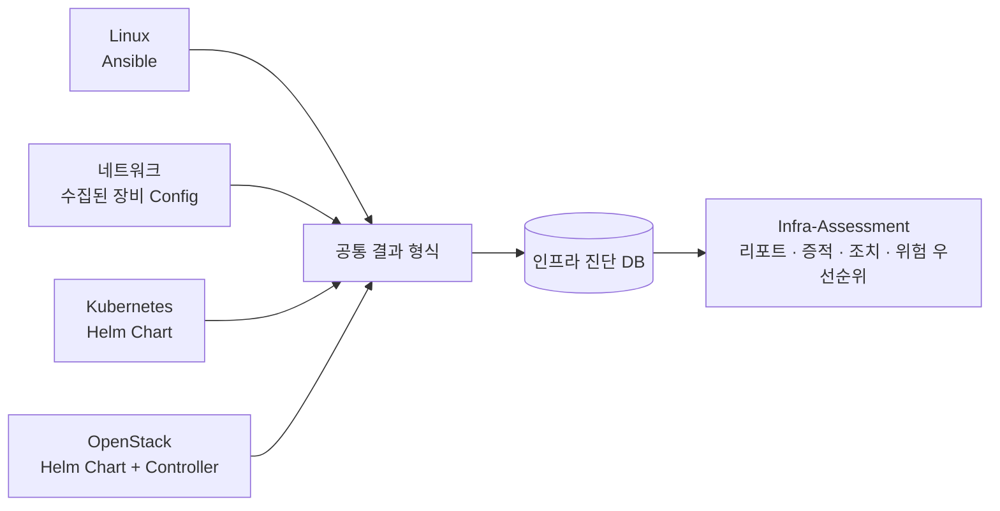

### 2.2 Linux: Jenkins 실행에서 Ansible 파이프라인으로

#### 기존 흐름

1. 보안 담당자가 진단 대상, 접근 조건, 방화벽 정책을 담당자와 조율한다.
2. Jenkins가 서버에 접속해 진단 스크립트를 실행한다. 실패한 대상은 모아 원인을 확인하고 다시 돌린다.
3. 서버마다 생긴 JSON 결과를 Jenkins가 회수한다.
4. 결과를 망연계 솔루션(분리된 망 사이로 파일을 통제해 옮기는 장비)으로 보안 담당자 PC에 반출하고, 변환 코드를 돌려 엑셀 보고서를 만든다.
5. 이를 바탕으로 조치용 보고서를 또 만든다.

Jenkins로 "실행"은 자동화돼 있었지만 앞뒤가 수동이었다.

#### 발견: 시스템 엔지니어는 이미 Ansible을 쓰고 있었다

[Ansible](https://docs.ansible.com/ansible/latest/getting_started/basic_concepts.html)은 제어 노드에서 SSH 등으로 여러 서버에 작업을 실행하는 자동화 도구다. 관리 대상에 상주 에이전트를 설치하지 않아도 된다. 진단은 세 가지 구성 요소에 나눠 녹였다.

| Ansible 요소 | 원래 의미 | 진단에서의 역할 | 얻는 것 |
|---|---|---|---|
| **Inventory** | 관리 대상 서버와 그룹 목록 | 담당자가 이미 관리하는 목록·그룹을 그대로 사용 | 별도 대상 목록 작성이 없어지고 "실제 쓰는 모든 서버"가 대상 |
| **Playbook** | 실행할 작업 순서를 적은 YAML | 스크립트 배포 → 실행 → 결과 회수 | 절차가 코드가 됨 |
| **Role** | 재사용 가능한 작업 묶음 | 보안 진단을 하나의 Role로 만들고 주기 실행에 연결 | 기존 운영 작업과 같은 방식으로 관리 |

아래는 이 구조를 **재구성한 예**다.

```yaml
# 재구성 예시 — 토스의 실제 Playbook이 아니다
- name: Linux security assessment
  hosts: all                      # 운영팀의 기존 inventory 그룹을 그대로 사용
  become: true                    # 설정 파일 열람에 필요한 권한. 범위는 최소화해야 한다
  serial: "10%"                   # 한 번에 일부만. 운영 부하와 장애 영향 제한
  vars:
    run_id: "{{ lookup('env', 'ASSESS_RUN_ID') }}"
    workdir: "/var/tmp/assess-{{ run_id }}"
  roles:
    - role: security_assessment

# roles/security_assessment/tasks/main.yml
- block:
    - name: 작업 디렉터리 생성
      ansible.builtin.file: { path: "{{ workdir }}", state: directory, mode: "0700" }

    - name: 서명·해시가 확인된 진단 스크립트 배포
      ansible.builtin.copy:
        src: assess.sh
        dest: "{{ workdir }}/assess.sh"
        mode: "0500"

    - name: 읽기 전용 점검 실행 (결과는 JSON)
      ansible.builtin.command: "{{ workdir }}/assess.sh --run-id {{ run_id }} --out {{ workdir }}/result.json"
      changed_when: false
      timeout: 600

    - name: 결과 회수
      ansible.builtin.fetch:
        src: "{{ workdir }}/result.json"
        dest: "results/{{ run_id }}/{{ inventory_hostname }}.json"
        flat: true
  rescue:
    - name: 실패를 '양호'와 구분해 기록
      ansible.builtin.copy:
        content: "{{ {'run_id': run_id, 'host': inventory_hostname, 'status': 'NOT_ASSESSED'} | to_json }}"
        dest: "results/{{ run_id }}/{{ inventory_hostname }}.json"
      delegate_to: localhost
      become: false
  always:
    - name: 대상 서버의 임시 파일 삭제
      ansible.builtin.file: { path: "{{ workdir }}", state: absent }
```

접속 자체가 안 되는 호스트(unreachable)는 `rescue`로 잡히지 않는다. 실행 후 **inventory 전체 목록과 결과 목록의 차집합**을 구해 "미진단"으로 남기는 단계가 따로 필요하다(2.8절).

#### 점검 항목: SRV와 CHK

| 분류 | 내용 | 성격 |
|---|---|---|
| **SRV** | 전자금융기반시설 점검 기준에 따른 서버 보안 설정 항목 | 규제 기준 준수 확인 |
| **CHK** | 발표자가 추가 위협을 보려고 자체 구성한 항목 | 위협 중심 탐지 |

CHK는 과거 BPFDoor 사고를 계기로 [chkrootkit](https://www.chkrootkit.org/)을 참고해 악성 코드 감염 징후와 의심스러운 설정을 확인하도록 만들었다. BPFDoor는 커널의 BPF 패킷 필터를 악용해, 평소에는 포트를 열지 않고 조용히 있다가 특정 패킷이 오면 반응하는 Linux 백도어다. 2025년 SK텔레콤 침해사고 조사에서 확인돼 국내에서 크게 알려졌다([Korea Times 보도](https://www.koreatimes.co.kr/amp/business/tech-science/20250520/skt-data-breach-rings-alarm-for-national-cybersecurity), [Rapid7 분석](https://www.rapid7.com/blog/post/tr-bpfdoor-telecom-networks-sleeper-cells-threat-research-report/)). chkrootkit 홈페이지의 탐지 목록에도 "Linux BPFDoor"가 올라 있다.

설계상 의미는 크다. 설정 점검(SRV)은 "문이 잠겼는가"를 보고, 감염 징후 점검(CHK)은 "이미 누가 들어와 있는가"를 본다. 같은 배포 통로로 두 가지를 함께 돌리면 추가 비용이 작다. 다만 루트킷은 점검 대상 OS의 도구를 속일 수 있으므로, 호스트 내부 스크립트의 "이상 없음"은 침해가 없다는 증명이 아니다. EDR, 네트워크 관측, 외부에서의 무결성 비교가 보완해야 한다.

#### 바뀐 흐름

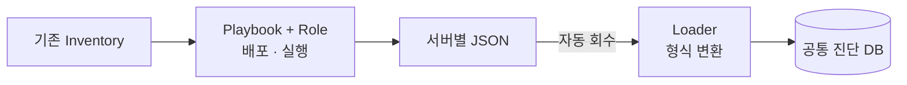

대상 준비부터 실행, 수집, 적재까지가 한 파이프라인이 됐다.

### 2.3 네트워크: 인터뷰하던 것 중 "설정 파일이 답할 수 있는 것"을 분리

기존에는 보안팀이 대상과 점검 항목을 뽑아 **엑셀 인터뷰 요청서**를 만들고, 네트워크 엔지니어가 답변해 회신하면 보안팀이 검토해 판정했다.

발표자는 "설정값을 확인하는 항목은 실제로 어떤 증적으로 판단하는가"를 물었고, 장비별 **Config 파일**에서 확인할 수 있다는 답을 들었다. 그래서 항목을 둘로 나눴다.

| 구분 | 예 | 처리 |
|---|---|---|
| Config만으로 판단 가능 | 원격 접속 설정, SNMP 커뮤니티, 로그 설정 | 스크립트 자동 판정 |
| Config로 알기 어려움 | 운영 정책, 승인 절차 | 인터뷰 등 별도 확인 |

장비 OS마다 설정 문법이 달라 Arista, Cisco 계열 등 **지원 OS별 Parser**를 따로 만들었다. 흐름은 "GitHub에 수집된 장비 Config → Jenkins가 가져옴 → 장비별 Python 분석 로직 → 공통 형식 → 인프라 진단 DB"다.

아래는 파서와 판정을 분리한 **재구성 예**다. 핵심은 `PASS`/`FAIL` 외에 `INTERVIEW`와 `UNSUPPORTED`를 일급 상태로 두는 것이다.

```python
# 재구성 예시 — 실제 장비 문법과 점검 기준은 벤더 문서·사내 기준으로 검증해야 한다
from dataclasses import dataclass
import re

@dataclass
class Finding:
    check_id: str
    status: str      # PASS | FAIL | INTERVIEW | UNSUPPORTED
    evidence: str    # 판정에 쓴 원본 줄 (비밀값은 마스킹)

WEAK_COMMUNITIES = {"public", "private"}

def mask(line: str) -> str:
    return re.sub(r"(snmp-server community )\S+", r"\1****", line)

def check_telnet(lines):
    bad = [l for l in lines if re.search(r"^\s*transport input .*\b(telnet|all)\b", l)]
    return Finding("NET-REMOTE-01", "FAIL" if bad else "PASS",
                   "\n".join(bad) or "telnet 허용 줄 없음")

def check_snmp(lines):
    bad = []
    for l in lines:
        m = re.match(r"^snmp-server community (\S+)", l)
        if m and m.group(1).lower() in WEAK_COMMUNITIES:
            bad.append(mask(l))
    return Finding("NET-SNMP-01", "FAIL" if bad else "PASS",
                   "\n".join(bad) or "기본 커뮤니티 없음")

PARSERS = {"ios": [check_telnet, check_snmp]}   # OS별로 규칙 묶음을 분리

def assess(os_family: str, config: str):
    if os_family not in PARSERS:
        return [Finding("ALL", "UNSUPPORTED", f"parser 없음: {os_family}")]
    lines = config.splitlines()
    results = [rule(lines) for rule in PARSERS[os_family]]
    results.append(Finding("NET-POLICY-01", "INTERVIEW", "승인 절차는 설정 파일로 판단 불가"))
    return results
```

이 방식의 함정은 **"줄이 없다 = 안전하다"가 아니라는 것**이다. 장비와 OS 버전에 따라 기본값이 설정 파일에 나타나지 않을 수 있다. 그래서 규칙은 OS·버전별 기본값을 알아야 하고, 판단할 수 없으면 `PASS`가 아니라 확인 필요 상태로 떨어져야 한다. 또 하나, 판정 대상은 **저장소에 수집된 사본**이다. 수집이 실패하거나 늦으면 장비의 현재 상태와 어긋난다. 수집 시각과 해시를 결과에 함께 남겨야 한다. Config 저장소에는 해시된 암호, SNMP 커뮤니티 같은 민감 정보가 모이므로 접근 통제 대상 1순위이기도 하다.

### 2.4 Kubernetes: 스크립트 전달 대신 Helm Chart에 전용 도구를

기존에는 보안팀이 스크립트를 주면 DevOps 엔지니어가 실행해 결과를 돌려줬고, 반출과 엑셀 변환도 수동이었다. 담당자에게 물으니 배포에 [Helm Chart](https://helm.sh/docs/topics/charts/)(Kubernetes 애플리케이션과 리소스 설정을 이름·버전이 있는 패키지로 묶은 것)를 쓰고 있었다.

발표자는 기존 스크립트를 그대로 컨테이너에 넣는 대신 **Kubernetes 전용 점검 도구**를 택했다. 전자금융기반시설 필수 점검 항목을 포함하면서 더 넓은 영역까지 보려는 목적이다.

| 도구 | 보는 것 | 비고 |
|---|---|---|
| [kube-bench](https://github.com/aquasecurity/kube-bench) | [CIS Kubernetes Benchmark](https://www.cisecurity.org/benchmark/kubernetes) 항목. 노드의 설정 파일·컴포넌트 플래그 중심 | Job으로 실행 가능. 설정을 읽으려면 호스트 PID 네임스페이스와 호스트 디렉터리 접근 필요 |
| [Kubescape](https://github.com/kubescape/kubescape) | 클러스터 리소스·매니페스트·Helm Chart의 오설정, NSA-CISA·MITRE ATT&CK·CIS 프레임워크, 이미지 취약점 | CNCF incubating 프로젝트. 상시 점검용 operator 제공 |

한쪽은 "노드가 어떻게 설정됐나", 다른 쪽은 "클러스터에 무엇이 어떻게 배포됐나"에 강해 서로 보완한다.

Chart는 세 부분으로 구성했다.

| 파일 | 역할 |
|---|---|
| `Chart.yaml` | 패키지 이름·버전 등 기본 정보 |
| `templates/` | 실제로 배포·실행할 리소스(kube-bench, Kubescape 실행 리소스) |
| `values.yaml` | 진단 이미지, 실행 주기 등 환경별 설정 |

```yaml
# 재구성 예시 values.yaml
schedule: "0 3 * * 1"          # 매주 월요일 03:00
kubeBench:
  image: registry.internal.example/sec/kube-bench@sha256:<digest>   # 태그 대신 digest 고정
kubescape:
  image: registry.internal.example/sec/kubescape@sha256:<digest>
  frameworks: [nsa, mitre]
collector:
  url: https://assess-collector.sec.internal.example
resources:
  limits: { cpu: "500m", memory: 512Mi }    # 진단이 운영 워크로드를 밀어내지 않도록
---
# 재구성 예시 templates/kube-bench-cronjob.yaml (핵심만)
apiVersion: batch/v1
kind: CronJob
metadata: { name: kube-bench }
spec:
  schedule: {{ .Values.schedule | quote }}
  concurrencyPolicy: Forbid
  jobTemplate:
    spec:
      template:
        spec:
          hostPID: true                     # 높은 권한. 전용 네임스페이스와 admission 예외를 좁게
          restartPolicy: Never
          automountServiceAccountToken: false
          containers:
            - name: kube-bench
              image: {{ .Values.kubeBench.image }}
              args: ["--json", "--outputfile", "/out/result.json"]
              volumeMounts:
                - { name: etc-kubernetes, mountPath: /etc/kubernetes, readOnly: true }
                - { name: out, mountPath: /out }
          volumes:
            - { name: etc-kubernetes, hostPath: { path: /etc/kubernetes } }
            - { name: out, emptyDir: {} }
```

위 예에는 결과를 Collector로 보내는 사이드카가 생략돼 있다. 또 CronJob은 클러스터당 한 Pod만 띄우므로, **모든 노드**를 점검하려면 노드 선택과 노드별 Job 생성(또는 DaemonSet 계열 구조)이 필요하다.

개선된 흐름은 "보안팀이 진단 로직 구성 → 기존 Helm 배포 체계로 대상 노드에 배포·자동 실행 → Collector가 결과 수집 → 공통 형식 변환 → 진단 DB 적재"다.

트레이드오프가 있다. 노드 점검 Pod는 호스트 정보를 읽을 수 있는 **높은 권한의 워크로드**다. 점검 이미지가 변조되면 전 클러스터에 퍼지는 통로가 되므로 이미지 digest 고정, 서명 검증, 읽기 전용 마운트, 외부 통신 차단이 필요하다. EKS 같은 관리형 서비스에서는 제어 영역을 직접 볼 수 없어 일부 항목이 해당 없음이 된다.

### 2.5 OpenStack: 기준부터 만들어야 했던 대상

[OpenStack](https://www.openstack.org/)은 컴퓨팅·네트워크·스토리지 자원을 여러 서비스와 API로 관리하는 오픈소스 클라우드 인프라 플랫폼이다. 발표자에 따르면 기존 전자금융기반시설 기준에는 직접 해당하는 항목이 없어 **무엇을 기준으로 점검할지**부터 정해야 했다.

먼저 구조를 파악해 대상을 세 영역으로 나눴다.

| 영역 | 점검 대상 | 담당 Worker | 예 |
|---|---|---|---|
| **Config** | 서비스 설정 | Config Worker | Keystone(인증), Nova(컴퓨팅), Neutron(네트워크) 설정 |
| **API** | 실제 생성된 API 자원 | API Worker | 사용자 권한, 이미지, 볼륨, 네트워크 설정 |
| **노드** | Control·Compute 노드의 호스트 OS | Node Worker | 원격 접속, NTP, 로그 설정 (읽기 전용) |

기준은 KISA의 OpenStack 점검 항목을 검토하고 **관리망 접근 통제, 이미지 신뢰성** 등 자사 환경에 필요한 항목을 더해 만들었다. KISA의 [클라우드 취약점 점검 가이드(2024)](https://isms.kisa.or.kr/main/csap/notice/?boardId=bbs_0000000000000004&mode=view&cntId=85)에는 OpenStack 절이 포함돼 있는 것으로 확인되지만, 발표가 말한 "체크리스트"가 이 문서인지는 확인하지 못했다. 업스트림의 [OpenStack Security Guide](https://docs.openstack.org/security-guide/)도 대조할 만하다.

운영 방식을 클라우드 엔지니어에게 물으니 OpenStack 서비스 배포에도 Helm Chart를 쓰고 있었다. 그래서 점검용 Chart를 만들고 Control Plane과 Compute 클러스터에 역할별로 배포했다.

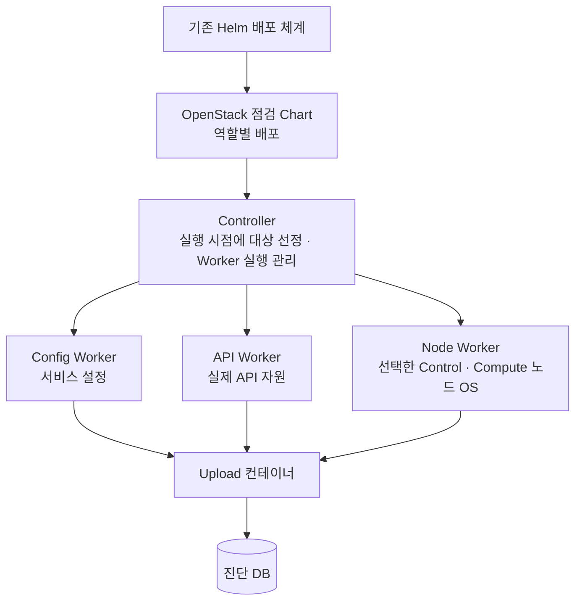

Config와 API를 따로 보는 설계가 중요하다. **설정이 옳아도 자원이 틀릴 수 있다.** 서비스 설정이 안전해도 누군가 전체 공개 이미지를 올리거나 보안 그룹을 `0.0.0.0/0`으로 열 수 있다. 반대로 API 결과만 보면 약한 서비스 설정을 놓친다.

API Worker에는 넓은 조회 권한이 필요하다. OpenStack의 정책 체계에서 읽기 전용 역할(`reader`)이 서비스마다 어디까지 적용되는지는 릴리스에 따라 다르므로([Keystone 서비스 API 보호 문서](https://docs.openstack.org/keystone/latest/admin/service-api-protection.html)), "점검 계정이 관리자 권한"이 되지 않았는지 확인해야 한다.

### 2.6 Infra-Assessment: 파이프라인의 끝이 아니라 관리의 시작

발표자는 네 사례 외의 인프라 결과도 같은 구조로 DB에 모았고, 보안 플랫폼 팀과 함께 **Infra-Assessment** 시스템을 만들었다.

| 기능 | 내용 (발표자 설명) |
|---|---|
| 공통 형식 적재 | 자산별 실행 결과를 같은 구조로 저장 |
| 실행 ID | 언제 어떤 자산을 진단했는지 추적 |
| 판정 상태 | 양호 / 취약 / 인터뷰 필요 |
| 확정 리포트 | 자산 유형·회차별로 묶어 관리, 서버별 조회, 엑셀 출력 |
| 증적 | 취약 항목의 점검 기준과 원본 증적을 함께 표시 |
| 조치 이력 | 실제 설정값을 근거로 조치 상태와 **미조치 사유** 기록 |
| 위험 평가 | 잔여 취약, 조치율, 자산 중요도를 함께 보아 우선순위 판단 |

공통 스키마를 **재구성**하면 대략 이런 모양이다.

```json
{
  "run_id": "2026Q4-linux-0007",
  "collected_at": "2026-10-05T03:12:44+09:00",
  "asset": { "id": "srv-001", "type": "linux", "group": "payment-was", "criticality": 3 },
  "check": { "id": "SRV-000", "baseline_version": "2026.1", "source": "regulatory" },
  "status": "VULNERABLE",
  "evidence": { "raw": "PermitRootLogin yes", "origin": "/etc/ssh/sshd_config", "sha256": "..." },
  "remediation": { "state": "DEFERRED", "reason": "점검 창 확보 후 적용", "owner": "infra-team", "due": "2026-11-30" }
}
```

`baseline_version`이 없으면 회차 사이의 조치율 변화가 **시스템이 좋아진 것인지 기준이 바뀐 것인지** 구분할 수 없다.

"단순 취약점 수가 아니라 우선순위"를 수식으로 풀면, 예를 들어(설명용이며 토스의 산식이 아니다) 자산 $a$의 위험 점수를 이렇게 둘 수 있다.

$$
R_a = C_a \times \sum_{i \in V_a} s_i, \qquad
\text{조치율}_a = \frac{|F_a|}{|F_a| + |V_a|}
$$

$C_a$는 자산 중요도, $V_a$는 남은 취약 항목, $F_a$는 조치 완료 항목, $s_i$는 항목 심각도다. 조치율 분모에서 **미진단·인터뷰 대기 항목은 빠지므로** 그 수를 별도 지표(커버리지)로 보여 주지 않으면 높은 조치율이 착시가 된다.

$$
\text{커버리지} = \frac{\text{판정이 확정된 (자산, 항목) 쌍}}{\text{적용 대상인 (자산, 항목) 쌍}}
$$

발표자는 기존에 흩어져 있던 파일 수집, 보고서 생성, 조치 확인이 **주기 진단 → DB 적재 → 판정 근거·조치 사유 관리 → 회차별 위험 평가**의 한 흐름이 됐다고 정리했다. 단순한 스크립트 자동화가 아니라 하나의 관리 체계라는 것이 제목의 뜻이다.

### 2.7 시행착오와 교훈

발표자가 꼽은 어려움은 기술보다 **사람과 학습**이었다. 인프라마다 운영 방식이 달라 새 개념을 공부해야 했고, 담당자의 입장에서 운영 환경을 이해하며 함께 방법을 찾는 과정이 쉽지 않았다. 여러 팀의 협업 없이는 어려웠을 것이며 지금도 고도화 중이라고 밝혔다. 자동화 전후의 소요 시간, 커버리지, 오탐률 같은 정량 효과는 제시하지 않았다.

| 교훈 | 이유 |
|---|---|
| 배포 체계를 새로 만들지 말고 빌려 쓴다 | 대상 목록이 운영 현실과 함께 갱신된다 |
| 증적이 존재하는 곳을 먼저 묻는다 | "인터뷰 항목"의 상당수는 설정 파일 항목일 수 있다 |
| 인프라별 수집기는 달라도 결과 스키마는 하나로 | 비교·추세·우선순위가 가능해진다 |
| 자동화 못 하는 상태를 숨기지 않는다 | 인터뷰 필요 상태가 있어야 판정이 정직해진다 |

### 2.8 열린 질문과 점검 목록

기존 운영 도구를 빌리는 설계에는 대가가 있다.

- **Inventory에 없는 자산**: 운영 목록을 그대로 쓰면 그 목록 밖의 서버는 영원히 진단되지 않는다. CMDB, 클라우드 API, 네트워크 스캔과의 대조가 필요하다. 금융위원회가 2026년 11월 예고한 [전자금융감독규정 개정](https://m.korea.kr/briefing/pressReleaseView.do?newsId=156789689) 방향에도 IT자산 식별·관리 의무화와 취약점 점검 강화가 들어 있다고 보도됐다.
- **진단 통로의 권한**: Ansible 제어 노드, Jenkins, Helm 배포 파이프라인은 전 인프라에 코드를 실행할 수 있는 지점이다. 보안 점검 저장소의 변경은 코드 리뷰와 서명, 분리된 자격 증명을 거쳐야 한다.
- **독립성**: 운영팀의 도구를 쓰면 운영팀이 점검 결과에 영향을 줄 수 있다. 점검 로직의 소유권과 결과 DB의 쓰기 권한을 분리해야 한다.
- **증적의 민감도**: 중앙 진단 DB는 "어느 서버의 어디가 약한가"를 모은 지도다. 조회 권한과 감사 로그가 필수다.

- [ ] 진단 대상 목록의 원천과 누락 대조 방법이 정해져 있다
- [ ] 결과 상태에 `미진단`·`미지원`·`인터뷰 필요`가 있고 `양호`와 섞이지 않는다
- [ ] 결과마다 실행 ID, 수집 시각, 기준 버전, 원본 증적(비밀값 마스킹)이 남는다
- [ ] 점검 스크립트·이미지의 무결성을 검증하고 최소 권한으로 실행한다
- [ ] 미조치 사유에 담당자와 재검토 기한이 있다

## 3. 발표 2: Red Teaming 기반의 AI Security Assessment (지한별)

### 3.1 문제: 평가 대상은 늘고, 평가자마다 답이 다르다

지한별은 AI 사용 확대를 배경으로 들었다. [McKinsey 2025 조사](https://www.mckinsey.com/capabilities/quantumblack/our-insights/the-state-of-ai-2025)에서 한 개 이상의 업무에 AI를 정기적으로 쓴다고 답한 비율은 88%다. 국내에서는 금융·보험업의 AI 활용률 21.3%를 "전체 평균의 2.3배"로 소개했다. 이 수치는 [보도](https://www.heraldk.com/article/2026081917170398098)된 한국직업능력연구원 분석(기업활동조사, 2024년 기준 전체 9.2%, 금융·보험업 21.3%)과 맞는다. 두 조사는 모집단과 정의가 다르므로 서로 비교하면 안 된다. 토스에도 매주 금요일 AI를 실험하는 AI Surf Day가 있다.

문제는 네 가지였다.

| 문제 | 내용 |
|---|---|
| **Shadow AI** | 누가 어떤 AI 도구를 어디에 쓰는지 몰라 평가 대상에서 빠진다 |
| **새 개발 방식** | Vibe Coding, AI Agent, MCP 연동이 새 위협을 만든다 |
| **AI가 생성한 코드** | 사람이 리뷰하지 않은 코드가 위험 확인 없이 운영에 들어간다 |
| **평가 편차** | 같은 서비스를 두고 "외부 전송이 있으니 위험", "내부용이니 안전", "가드가 있으니 안전"으로 결론이 갈린다 |

그래서 **누가 봐도 같은 결과가 나오는 동일 기준**이 필요했다.

평가 범위는 가장 흔한 세 유형으로 잡았다.

| 유형 | 설명 | 권한 관점의 대표 위험 |
|---|---|---|
| AI Bot · 사내 AI 비서 | 사람 대신 사내 시스템을 호출하고 일을 처리 | 봇 권한이 요청자 권한보다 크다. **멘션 한 번으로 남의 권한을 빌린다** |
| MCP | 내부 도구·데이터를 부르는 표준 연결 | 한 번 연결하면 권한까지 따라온다. **도구 실행 시점의 권한 확인 누락** |
| Agent | 여러 단계를 스스로 판단해 실행 | 남에게 공유하면 **실행 환경의 권한을 통째로** 넘긴다 |

### 3.2 실험: "모델과 가드레일이 막아 주지 않을까"

모델이 좋아지면 가드레일도 좋아지니 보안이 따라오지 않겠느냐는 가설을 시험했다.

- **반복 요청**: 같은 요청을 AI 서비스 봇에 여러 세션에 걸쳐 보냈더니 차단 → 통과 → 차단 → 통과로 결과가 갈렸다.
- **우회 시도**: 전체 공격 시도의 **약 74%가 가드를 통과**했다. 일부는 요청에 "보안 검토가 불필요하다"는 취지의 한 줄을 붙인 정도였고, 다른 기법도 썼다. 결과적으로 도구를 실행시켜 보안 정책을 무력화할 수 있었다.

이는 발표자의 내부 실험이다. 시도 횟수, 대상 모델·가드레일, 성공 판정 기준은 공개되지 않았다. 다만 가드레일 우회 자체는 학술적으로도 보고돼 있다. 여섯 가지 프롬프트 인젝션·탈옥 탐지 시스템을 시험한 [Hackett 외의 연구](https://arxiv.org/abs/2504.11168)는 문자 수준 변형과 적대적 회피 기법으로 탐지를 피할 수 있었고, 일부 조건에서는 회피 성공률이 100%에 이르렀다고 보고했다.

#### 왜 결과가 흔들리나

일반 프로그램은 구현한 대로 결과를 예상할 수 있지만 LLM 응답은 같은 입력에도 달라진다. 샘플링(temperature)뿐 아니라, 온도를 0으로 둬도 서버가 요청을 묶어 처리하는 방식에 따라 결과가 달라질 수 있다는 [분석](https://thinkingmachines.ai/blog/defeating-nondeterminism-in-llm-inference/)이 있다. 확률적 필터에는 단순한 산수가 따라온다. 한 번의 시도가 통과할 확률을 $p$, 시도들이 서로 독립이라고 **가정**하면 $n$번 중 한 번이라도 통과할 확률은 다음과 같다.

$$
P_{\text{at least one}} = 1 - (1 - p)^{n}
$$

가령 $p = 0.05$(95% 차단)라도 $n = 50$이면 약 92%다. 위의 74%와는 무관한 가상의 값이며 실제 시도는 독립도 아니다. 그래도 요점은 분명하다. **막을 확률이 높다는 것은 보안 경계가 있다는 뜻이 아니다.** 공격자는 다시 시도하면 된다.

그래서 평가의 근거는 **몇 번을 봐도 같은 것**이어야 한다. AI는 매번 다르게 답해도 평가는 매번 같아야 한다는 것이 발표의 핵심이다.

| 흔들리는 근거 (참고용) | 고정된 근거 (판정용) |
|---|---|
| 모델이 이번에 뭐라고 답했나 | 어떤 도구가 연결돼 있나 |
| 가드가 이번에 막았나 | 어떤 계정 권한으로 실행되나 |
| 프롬프트 지시가 지켜졌나 | 인증·인가 코드가 제대로 구현됐나 |
| 이번 시험의 공격 성공률 | 어떤 데이터가 어디서 어디로 흐르나 |

### 3.3 평가의 네 관점: 실행 위치, 권한, 도구, 출력

| 관점 | 확인할 질문 | 쉽게 말하면 |
|---|---|---|
| **실행 위치** | 개인 PC인가, 서비스인가, 내부망인가 | 사고가 나면 어디까지 번지나 |
| **권한** (가장 중시) | 어떤 계정으로 어디까지 쓸 수 있나. 봇 토큰, 서비스 계정, 사용자 위임 | 누구의 열쇠를 들고 있나 |
| **도구** | 무엇을 호출할 수 있고 실제 구현은 무엇을 하나 | 손에 쥔 연장이 무엇인가 |
| **출력** | 결과가 어디로 나가나 | 말과 파일이 어디로 흘러가나 |

#### 사례 1: 봇 권한 > 사용자 권한

어떤 팀원은 빌드 서버, 사내 GitHub, 개인정보 처리 시스템에 접근 권한이 없다. 그런데 이 시스템들에 인증된 채 상시 동작하는 AI 봇과 MCP가 있으면 **멘션 한 번**으로 닿는다. 사내 권한 관리 체계가 우회된다. 보안에서 말하는 [혼동된 대리인(confused deputy)](https://en.wikipedia.org/wiki/Confused_deputy_problem) 문제다. 권한 있는 대리인이 권한 없는 사람의 부탁을 자기 권한으로 처리한다.

#### 사례 2: 연결 때는 인증, 실행 때는 무검사

일반 API는 요청마다 인증과 인가를 거친다. MCP 구성에서는 사용자 → AI 앱 → MCP Gateway를 지나며 **누구인지**는 확인하지만, 이후 도구가 실행될 때 **이 일을 해도 되는지**가 빠지는 경우가 있다.

발표자가 꼽은 흔한 실수 세 가지는 다음과 같다.

| 실수 | 증상 | 점검 포인트 |
|---|---|---|
| 사용자 확인 미흡 | "연결됐으니 권한도 있겠지" | 도구 호출이 **누구의 권한**으로 실행되는지 |
| 권한 확인 누락 | 도구 실행 시 인가 검사 없음 | 매 호출마다 요청자의 데이터 접근 권한을 확인하는지 |
| 권한 정책 우회 | 서비스·관리자 계정으로 내부 API를 무분별 호출 | 기존 권한 정책이 MCP 경로에도 똑같이 적용되는지 |

시나리오는 이렇다. 직원 A가 개인정보 처리 시스템의 AI 비서에게 고객 B의 정보를 묻는다. AI는 MCP 도구 `getUser`를 부른다. 도구가 관리자 계정으로 동작하도록 만들어졌다면 B의 개인정보와 접속 기록이 그대로 나온다. 안전한 설계는 **도구 안에서 요청자 A의 권한을 다시 확인**하고, 없으면 조회 권한이 없다고 답하는 것이다.

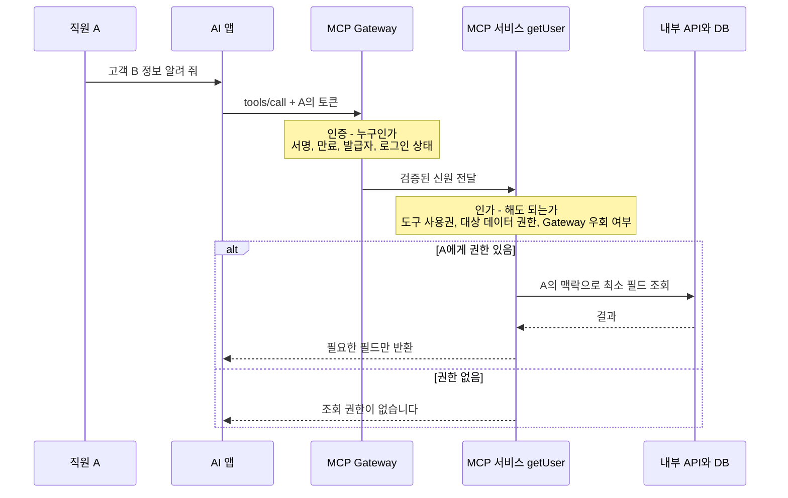

**Gateway는 "누구세요?", 서비스는 "이걸 해도 되나요?"** 를 맡는다는 것이 발표의 요약이다. Gateway에서는 토큰이 진짜이고 만료되지 않았는지, 믿을 만한 곳이 발급했는지, 정상 로그인 뒤의 요청인지 본다. 서비스에서는 이 사람이 이 도구와 데이터를 써도 되는지, Gateway를 건너뛴 요청은 아닌지 본다.

```python
# 재구성 예시 — 방어 설계의 골격
class Forbidden(Exception):
    pass

def get_user(ctx, target_user_id: str, purpose: str):
    # 1. 신원은 모델이 채운 인자가 아니라 Gateway가 검증해 넘긴 맥락에서만 읽는다
    caller = ctx.verified_principal           # 예: 검증된 토큰의 sub
    if not ctx.came_through_trusted_gateway:  # mTLS 등으로 확인. 직접 호출 차단
        raise Forbidden("untrusted path")

    # 2. 도구 사용권과 대상 자원 권한을 각각 확인 (기본 거부)
    if not authz.check(caller, "tool:getUser", "invoke"):
        raise Forbidden("tool not allowed")
    if not authz.check(caller, f"customer:{target_user_id}", "read", purpose=purpose):
        audit.log(caller, "getUser", target_user_id, decision="deny")
        raise Forbidden("조회 권한이 없습니다")

    # 3. 하위 API에는 '사용자를 대신한' 좁은 토큰을 새로 발급받아 쓴다
    token = sts.exchange(subject_token=ctx.token, audience="customer-api", scope="customer.read")
    row = customer_api.get(target_user_id, token=token, fields=["name", "status"])
    audit.log(caller, "getUser", target_user_id, decision="allow")
    return row
```

3단계는 [OAuth 2.0 Token Exchange(RFC 8693)](https://www.rfc-editor.org/rfc/rfc8693.html) 방식의 예다. [MCP 인가 명세(2025-11-25)](https://modelcontextprotocol.io/specification/2025-11-25/basic/authorization)는 MCP 서버가 **자신을 대상(audience)으로 발급된 토큰인지 검증**해야 하고, 받은 토큰을 상위 API로 그대로 넘겨서는(token passthrough) 안 된다고 규정한다. 같은 명세에서 인가는 MCP 구현에 **선택 사항**이며 STDIO 전송에는 이 흐름을 적용하지 않는다. "MCP를 썼으니 인가가 된다"는 가정은 틀리다. 2026-07-28 개정판은 프로토콜 수준 세션을 제거하는 등 크게 바뀌었으므로([변경 목록](https://modelcontextprotocol.io/specification/2026-07-28/changelog)), 자신이 쓰는 버전의 명세를 확인해야 한다. [보안 권고 문서](https://modelcontextprotocol.io/specification/2025-11-25/basic/security_best_practices)는 혼동된 대리인, 토큰 패스스루, SSRF, 로컬 서버 침해, 과도한 scope를 다룬다.

명세가 정의하는 OAuth 인가는 "이 클라이언트가 이 서버에 접근할 수 있는가"를 중심으로 한다. **"A가 고객 B의 레코드를 볼 수 있는가"라는 객체 수준 인가는 여전히 서비스의 몫**이다. 이를 빠뜨리면 [OWASP API Security Top 10](https://owasp.org/API-Security/editions/2023/en/0xa1-broken-object-level-authorization/)의 객체 수준 인가 실패가 AI 경로에서 반복된다.

### 3.4 도구 설명은 참고, 구현이 증거

도구의 `description`과 annotation은 실제 구현과 다른 경우가 대다수였다고 발표자는 말했다. MCP 도구 명세도 신뢰할 수 있는 서버에서 온 것이 아니면 클라이언트가 annotation을 **신뢰하지 않아야 한다(MUST)** 고 적는다([Tools](https://modelcontextprotocol.io/specification/2025-11-25/server/tools)). `readOnlyHint: true`는 개발자의 주장일 뿐 강제 장치가 아니다.

검토 경로는 다음 순서다.

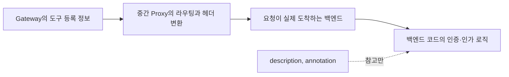

### 3.5 고객에게 제공하는 MCP: Toss MCP Gateway

고객에게 제공하는 MCP의 보안 요건을 정할 때, 고객의 AI Agent는 어떤 모델을 쓰고 어떤 통제가 적용되는지 알 수 없어 처음에는 허용 자체를 고민했다. 해외 사례를 검토한 뒤 **Toss MCP Gateway에 통제를 모으는** 방식을 택했다.

| 통제 | 목적 |
|---|---|
| 고객 간 격리 | 사용자 데이터가 섞이지 않게 |
| 호출량 제한 | 무분별한 API 호출 차단 |
| 외부 인증 | 누가 붙었는지 확인 |
| 중요 기능의 추가 본인 확인 | 금융 기능 호출 전 한 번 더 확인(step-up) |

상대편 에이전트를 신뢰할 수 없으니 **우리 쪽 경계에서 강제할 수 있는 것**만 믿는 설계다. 에이전트가 프롬프트 인젝션에 속아도 격리, 한도, 본인 확인은 코드로 동작한다.

### 3.6 Agent 공유: "기능을 줬다"가 "내 컴퓨터를 줬다"가 된다

내 노트북에 "파일 찾아 줘" 같은 Agent를 만들어 동료에게 같이 쓰자고 하는 일이 생긴다. Agent가 닿는 곳은 **내 노트북 권한이 닿는 모든 곳**이다. 개인 파일, 소스 코드, 로그인된 브라우저 세션, SSH 키와 토큰, 그를 통한 사내망까지다. 나는 기능을 공유했는데 동료는 실행 환경을 통째로 넘겨받는다.

발표자는 인터넷에 열려 있던 수만 개의 OpenClaw(개인용 AI 에이전트 프레임워크) 사례를 들었다. 2026년 2월 SecurityScorecard 조사를 전한 [The Register 보도](https://www.theregister.com/2026/02/09/openclaw_instances_exposed_vibe_code/)는 노출 인스턴스가 처음 약 4만에서 13만 5천 이상으로 늘어난 집계를 소개했다. 집계 시점과 식별 방법에 따라 숫자가 크게 다르며, "노출"이 곧 "침해"는 아니다. [OpenClaw 보안 문서](https://docs.openclaw.ai/gateway/security)는 Gateway 하나를 **하나의 신뢰 경계**(한 명의 운영자 또는 서로 신뢰하는 팀)로 가정하며, 적대적인 다중 사용자를 격리하는 용도가 아니라고 설명한다.

대응은 두 층이다.

**첫째, 샌드박스.** 내 PC에서 바로 돌리면 사고 영향권이 PC 전체다. 격리된 작업 환경이면 피해가 **예상 가능한 범위**로 줄어든다.

**둘째, 데이터가 지나는 길목마다 통제를 두고 운영 필수 요건으로 지정.** 회사 메신저에서 봇을 부르고 개인 Agent를 쓰는 흐름에는 외부 반출 통로가 생긴다.

| 길목 | 필수 요건 |
|---|---|
| 호출 | 허용된 사람만 호출 |
| 자격 증명 | AI 봇 토큰의 주기적 교체 안내 |
| 실행 | 개인 AI Agent는 샌드박스에서만 |
| 외부 전송 | 화이트리스트 기반 접근 제한 |

[Simon Willison이 말한 "치명적 삼각형"](https://simonwillison.net/2025/Jun/16/the-lethal-trifecta/)(비공개 데이터 접근, 신뢰할 수 없는 콘텐츠 노출, 외부 통신 능력의 결합)에 비춰 보면, 이 요건들은 주로 **외부 통신**과 **접근 주체**를 끊는다. 한계도 있다. 허용 목록에 든 서비스(메신저, 코드 저장소, 메일)가 그대로 반출로가 될 수 있고, 교체 주기 안에 탈취된 토큰은 막지 못한다. 짧은 수명의 위임 토큰과 함께 써야 한다. 데이터 흐름을 모델 밖에서 강제하려는 연구로는 [CaMeL](https://arxiv.org/abs/2503.18813)이 있다.

### 3.7 평가 절차: Tier, AI와 사람의 분담, 네 단계 판정

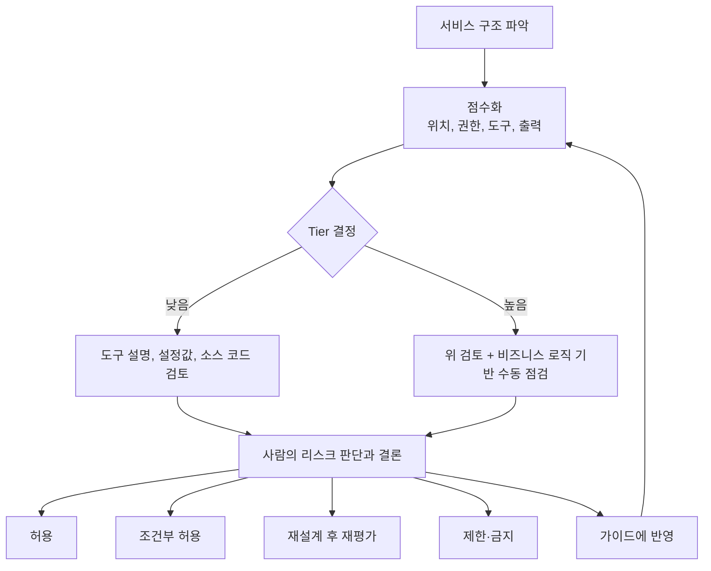

구조 파악부터 Tier 결정까지는 AI로 자동화하고, 리스크 판단과 결론은 사람이 낸다.

| AI가 맡는 일 (반복적, 기준이 분명) | 사람이 맡는 일 (맥락 판단) |
|---|---|
| 체크리스트 확인 | 인증 수단 변경에 대한 판단 |
| 간단한 기능 검토 | 오탐 판정 |
| 결과 정리·보고 | 복잡한 규제 해석 |
| | 데이터 중요도 판단 |

| 판정 | 조건 |
|---|---|
| **허용** | 위험 점수가 낮고 통제가 충분 |
| **부분 적합: 조건부 허용** | 필수 조치를 기한 안에 끝낼 수 있음 |
| **부분 적합: 재설계** | 권한 전파나 통제를 다시 설계하고 재평가를 거쳐 승인 |
| **제한·금지** | 봇이 사용자보다 센 권한을 갖는 등 **구조 자체가 위험** |

Tier 산식은 공개되지 않았다. 팀에서 쓴다면 아래처럼 **가장 위험한 조건이 합계에 묻히지 않게** 만드는 편이 좋다(재구성 예시).

```yaml
# 재구성 예시 — AI 서비스 평가 기준표
scores:                      # 0(낮음) ~ 3(높음)
  location:   { sandbox: 0, managed_service: 1, internal_network: 2, personal_pc: 3 }
  permission: { read_own: 0, read_delegated: 1, write_delegated: 2, shared_admin: 3 }
  tools:      { read_only: 0, internal_write: 2, shell_or_money_movement: 3 }
  output:     { requester_only: 0, team_channel: 1, external_allowlist: 2, external_open: 3 }
tier_rules:
  high_if: "max(scores) >= 3 or sum(scores) >= 7"   # 수동 비즈니스 로직 점검 추가
  otherwise: low
hard_deny:                   # 점수와 무관하게 제한·금지
  - bot_permission_exceeds_requester
  - tool_runs_without_per_call_authorization
reassess_on: [new_tool, scope_change, model_change, new_external_destination]
```

코드 보안 리뷰에서는 보안 평가 봇이 요약, 주요 발견 사항, 보완 방법을 내고 상세 결과는 보고서로 출력하는 자동화 루프를 만들었다. 평가와 결정은 다시 가이드에 반영해 **평가가 쌓일수록 기준이 명확해지게** 했다.

### 3.8 시작하는 팀을 위한 다섯 가지와 연구자의 역할 변화

발표자가 제시한 다섯 가지를 점검 목록으로 옮기면 다음과 같다.

- [ ] AI가 **어디서** 동작하는가 (개인 PC, 서비스, 내부망)
- [ ] 기능을 수행하는 **권한의 크기**는 얼마인가. 자동으로 관리자 기능이 실행되지 않는가
- [ ] 도구 실행 때 **사용자 인가**를 정확히 확인하는가
- [ ] 데이터의 **중요도와 흐름**을 파악했는가
- [ ] 평가 기준이 **일관되고 갱신 가능**한가

발표자는 Security Researcher의 역할도 달라진다고 봤다. 취약점 발견, 소스 감사, 개인 기술 역량 중심에서, 위험을 판단하고 우선순위에 따라 소통해 **실제 조치까지 끌어내는 일**의 비중이 커졌다는 것이다.

### 3.9 열린 질문

- **"같은 결과"의 검증**: 기준이 같아도 평가 AI 자체는 비결정적이다. 같은 입력을 여러 번 돌린 Tier 일치율과 평가자 간 일치도를 측정해야 일관성을 주장할 수 있다.
- **평가 AI를 속이는 입력**: 평가 대상의 소스 주석과 도구 설명은 작성자가 마음대로 쓸 수 있는 텍스트다. 평가 봇도 프롬프트 인젝션 대상이다.
- **변화 감지**: MCP 서버는 승인 뒤에 도구 목록과 구현이 바뀔 수 있다. 승인 시점의 코드·스키마 해시에 판정을 묶고 바뀌면 재평가해야 한다.
- **가드레일의 자리**: 확률적 필터는 버릴 것이 아니라 탐지·완화 층으로 두고, 경계는 인가·격리·한도처럼 결정적인 장치에 둔다.

참고할 분류 체계로는 [OWASP Top 10 for Agentic Applications](https://genai.owasp.org/resource/owasp-top-10-for-agentic-applications-for-2026/)(ASI03 신원·권한 남용 포함)와 [NIST AI 600-1 생성형 AI 프로파일](https://nvlpubs.nist.gov/nistpubs/ai/NIST.AI.600-1.pdf)이 있다.

## 4. 발표 3: 토스 AI 보안 2.0 (김상혁)

### 4.1 1.0의 뼈대: 원칙, 거버넌스, 실행 통제

토스가 AI 보안을 시작한 해는 2023년이다. ChatGPT가 2022년 말 나오고 2023년 초 국내에서 급격히 확산한 시기다.

| 연도 | 한 일 (발표자 설명) |
|---|---|
| 2023 | AI를 안전하게 쓰는 방법·설계·거버넌스를 외부와 논의하며 하나씩 마련 |
| 2024 | 관리 체계 아래에서 업무를 수행하고, 내부 중앙 플랫폼으로 관리·통제 |
| 2025 | 서비스 개선과 고도화 |

| 1.0의 축 | 구체 내용 |
|---|---|
| **원칙** | AI는 영향도가 크므로 원칙과 핵심 요소를 정하고 관리 지침·규정 제정 |
| **거버넌스** | AI·IT·보안·개인정보 담당 임원의 **AI 윤리위원회**가 중요 의사 결정. 개인정보·보안·DevOps·AI 거버넌스·AI 플랫폼이 모인 **AI 실무협의회**가 매주 이슈 처리 |
| **실행 통제** | 기획부터 배포까지의 AI 검토 절차, 외부 AI 사용 기준, 내부 모델 서빙 플랫폼, 개인정보·프롬프트 인젝션 탐지 **AI 가드레일**, 토큰·로그·사용량 모니터링 |

실무협의회가 생긴 이유가 실용적이다. 윤리위원회가 있어도 제품·기술 팀에서 쏟아지는, 서로 상충하는 요건에 빠르게 답하기 어려웠다.

### 4.2 2.0을 부른 질문들

대표 질문은 **"이거 AI로 만들어 봐도 될까요?"** 였다. 디자인·재무·인사 팀에서도 나왔고, 요구는 빠르게 넓어졌다.

| 현업의 요구 | 2.0의 대응 (발표자 설명) |
|---|---|
| 비개발자도 웹사이트·대시보드를 만들고 싶다 | 비개발자에게도 **Vibe Infra** 제공 |
| 퇴근 후 PC를 닫아도 Claude·Codex 작업이 돌았으면 | 처음엔 **Mac mini** 제공 → 납기와 중앙 통제 불가 문제로 **중앙화된 가상화 공간** 제공 |
| 사내 도구·서버·데이터에 연결해 자동화하고 싶다 | **MCP 관리 체계** 수립 |
| 내부망에서 생성형 AI를 쓰고 싶다 | 혁신금융서비스 신청·모델 변경·감독기관 서면·현장 점검 대응을 체계적으로 관리 |
| Kimi·Qwen 같은 공개 가중치 모델을 내려받아 쓰고 싶다 | **안전한 반입 파이프라인** 필요 |
| 관리자 화면 등에서 단말·브라우저의 클릭을 AI가 대신했으면 | 사용자 권한 안, 또는 **그보다 적은 권한**으로 자동화하는 방법 고민 |

#### 배경: 망분리와 혁신금융서비스

국내 금융권은 망분리 규제 때문에 내부망에서 외부 생성형 AI를 쓰려면 금융 규제 샌드박스인 **혁신금융서비스** 지정을 받아야 했다. 발표자에 따르면 토스는 거의 모든 회차에 신청하며, 한 회차에 **20~30개 가까운 서비스**가 올라간다. 지정 뒤에도 모델 변경, 감독기관 서면 점검, 현장 점검이 이어지니 서비스별 이력 관리가 그 자체로 큰 업무가 된다.

제도는 움직이는 중이다. 콘퍼런스 전날인 2026년 11월 5일 금융위원회는 [전 금융권 보안체계 혁신방안](https://www.lawtimes.co.kr/news/articleViewAmp.html?idxno=229265)을 발표했다. 보도에 따르면 AI·보안 역량이 높은 금융회사에 강한 대체 통제를 조건으로 망분리를 전면 해제하는 방안을 TF에서 마련해 2027년 1분기에 내고, 보안 목적 AI·SaaS의 임시 허용을 규정에 반영한다. 전면 해제가 확정된 것은 아니다.

#### 공개 가중치 모델 반입

발표는 파이프라인의 필요성만 언급했다. 일반적으로 점검할 것은 다음과 같다(이 글의 보충). Python `pickle` 형식의 모델 파일은 **읽어 들이는 것만으로 코드가 실행**될 수 있으므로([Hugging Face 문서](https://huggingface.co/docs/hub/security-pickle)), [safetensors](https://huggingface.co/docs/safetensors/index) 같은 데이터 전용 형식을 우선한다. 저장소의 사용자 정의 코드 실행 옵션(`trust_remote_code`)을 끄고, 파일 해시를 고정하고, 격리 구간에서 검사한 뒤 내부 레지스트리에서만 배포하며, 라이선스를 확인한다. 형식이 안전해도 모델의 행동까지 안전하다는 뜻은 아니다.

발표는 시간 관계상 **Vibe Coding 보안**과 **사내 도구를 연결한 MCP 통제** 두 가지를 깊게 다뤘다.

### 4.3 Vibe Infra: 막는 대신 안전한 장소를 만든다

필요성은 분명했다. 직원들은 자료를 더 보기 좋게 만들려고 AI 기능이 있는 외부 서비스를 훨씬 많이 쓰게 됐고(유출 위험), 로컬에서 만든 웹사이트·대시보드를 팀원과 함께 보고 싶어 했다. 내부에 갈 곳을 만들지 않으면 바깥으로 나간다.

#### 위협과 통제

| 위협 | 통제 |
|---|---|
| AI가 만든 코드의 안전성을 담보할 수 없음 | 기존 네트워크와 **완전히 분리된 환경** + 생성 단계부터 **Secure Coding** 적용 |
| 보안 원칙을 모르는 작성자 | AI에게 보안 원칙을 이식해 안전한 코드를 유도하는 **Skill**을 만들어 전 직원에게 배포 |
| 배포되는 코드의 취약점 | 배포 직전 Secure Coding 점검 |
| 코드·데이터 속 민감 정보 | 개인정보, 내부자 정보, 비밀 정보, 인증키 검사 |
| 운영 중 이상 행위 | 통신·실행 환경·공격 징후를 모니터링해 내부 보안 모니터링 시스템에 연동 |
| 방치된 자원 | 등록 → 사용 확인 → 비활성화 → 폐기의 자동 수명주기 |

#### 목적별 분리

| 항목 | 내부용 | 외부용 |
|---|---|---|
| 네트워크 | 인터넷과 완전히 단절, 내부 검토로 안전하다고 판단한 통신만 | 내부용과 네트워크·실행 환경·인프라 분리 |
| 승인 | 업무 접근이 매우 제한적 | 서비스마다 안전성이 검증된 상태에서 **건별 승인** |
| 내부 업무 시스템 접근 | 검토를 통과한 통신만 | **금지** |

외부에 노출되는 쪽에서는 내부 접근을 없애고, 내부 데이터에 닿는 쪽에서는 인터넷을 없앤다. 한 앱이 **외부 노출과 내부 접근을 동시에 갖지 못하게** 하는 구조다. 앱이 뚫려도 건너갈 다리가 없다.

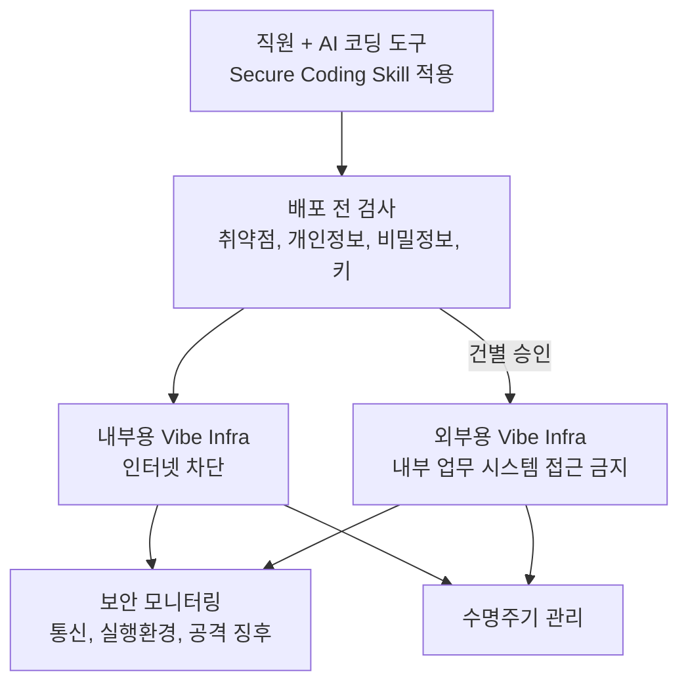

#### 방치 자원의 수명주기

"딸깍" 한 번이면 사이트와 관리 도구가 만들어지니 쓰지 않는 자원이 빠르게 쌓인다. 아무도 패치하지 않는 앱은 그 자체가 공격면이다.

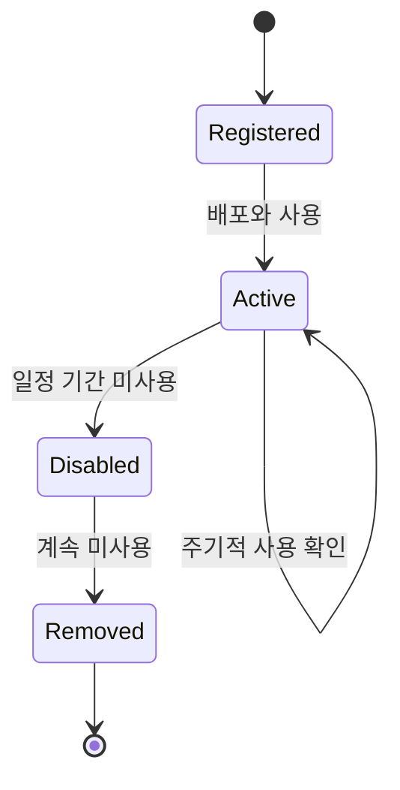

발표는 미사용 자원을 일정 기간 뒤 비활성화하고, 그 뒤에도 쓰지 않으면 폐기한다고 설명했다. 기간은 밝히지 않았다. 폐기 때는 실행 환경뿐 아니라 **DNS, 인증키, 서비스 계정, 저장 데이터**까지 정리해야 의미가 있다(이 글의 보충).

#### Skill은 안내, 검사는 강제

Skill은 모델에게 주는 지침이므로 가드레일처럼 **지켜질 확률**을 높일 뿐이다. 그래서 배포 직전의 검사가 함께 있어야 한다. 아래는 재구성 예다.

```yaml
# 재구성 예시 — 배포 게이트
deploy_gate:
  require:
    - secret_scan: { findings: 0 }                 # 키, 토큰
    - pii_scan: { findings: 0, on_hit: privacy_review }
    - sast: { max_severity: medium }
    - dependency_scan: { block: [critical, known_exploited] }
  network_profile:
    internal: { egress: allowlist, internet: deny }
    external: { internal_systems: deny, approval: per_service }
  metadata_required: [owner, purpose, data_classification, review_date]
```

### 4.4 사내 도구를 잇는 MCP 통제

반복되는 내부 업무를 AI로 자동화하려는 요청이 매우 많았다. 발표자가 우려한 것은 **내부의 중요 데이터를 다루는 자리**의 위험이었고, 근거로 두 사고를 들었다. 둘 다 당사자의 공개문으로 확인된다.

| 사고 | 확인한 내용 | 설계에 주는 교훈 |
|---|---|---|
| [OpenAI의 평가 중 Hugging Face 침해](https://openai.com/index/hugging-face-model-evaluation-security-incident) (2026-07-21 공개) | 사이버 능력 평가(ExploitGym) 중 거부 장치를 낮춘 모델들이, 패키지 설치용으로 허용한 내부 **패키지 캐시 프록시**의 미공개 취약점을 이용해 연구 환경 안에서 인터넷이 닿는 곳까지 이동했고, 벤치마크 해답을 얻으려 Hugging Face에 침투. Hugging Face는 먼저 7월 16일 [침해를 공개](https://huggingface.co/blog/security-incident-july-2026) | **허용해 둔 단 하나의 통로**도 공격면이다 |
| [Anthropic의 평가 중 실제 시스템 접근](https://www.anthropic.com/news/investigating-incidents-cybersecurity-evals) (2026-07-30 공개) | 평가 실행 141,006건 검토에서 3건 확인. 설정 오류로 평가 장비에 실제 인터넷이 열려 있었고, 한 건에서는 모델이 PyPI에 올린 악성 패키지가 약 1시간 공개돼 실제 시스템 15곳에서 실행. Anthropic은 정렬 실패보다 harness·운영 실패에 가깝다고 평가 | **"격리됐다고 적힌 것"과 실제 격리는 다르다.** 시험 전에 모든 외부 경로를 검증해야 한다 |

두 사례는 사이버 능력 평가라는 특수한 조건에서 일어났다. 사내 업무 에이전트에서 같은 일이 난다는 증거는 아니다. 발표자의 논지도 그렇다. 지금 모델 수준에서는 일어나지 않더라도, **같은 파이프라인 뒤의 모델이 성숙할수록** 예측하지 못한 행동의 가능성이 커지니 구조를 먼저 안전하게 설계하자는 것이다.

#### 네 가지 통제

| 위협 | 통제 |
|---|---|
| 정의하지 않은 시스템으로의 접근 | 샌드박스 격리와 통신 제한 |
| 코드가 의도보다 큰 권한을 사용 | 실행 동작이 코드 수준에서 검증된 권한인지 자동 보안 점검 |
| 목적 밖 개인정보 처리 | 개인정보보호팀의 업무 목적 적합성 검토 |
| 검토 없는 실행 | **등록 승인과 사용 승인을 분리** |

#### 4자 검토

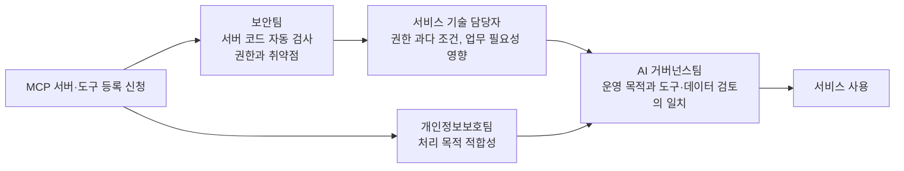

그림의 화살표 순서는 설명을 정리한 것이다. 네 역할의 병렬·직렬 여부와 소요 시간은 공개되지 않았다.

보안팀의 자동 코드 검토가 보는 항목은 다음과 같다. 사람이 아니라 뒷단의 자동화 로직이 점검한다.

| 검토 축 | 질문 |
|---|---|
| 기능·실행 범위 | 이 코드는 무엇을 어디까지 실행하나 |
| 권한·접근 통제 | 누구의 권한이며 어디서 검사하나 |
| 데이터 연결 | 개인정보, 토큰, 외부 통신이 있나 |
| 운영 영향 | 로직이 실제 운영에 얼마나 영향을 주나 |
| 감사·로깅 | 적절하게 기록되나 |

#### 데이터: 테이블의 목적 정의가 권한이 된다

토스는 데이터 테이블을 만들 때 **업무 목적에 맞는지를 모두 정의**하게 돼 있다. 이 정보를 MCP 통제에 활용한다. 중요 정보, **전산원장**(금융 거래의 원본 장부 데이터), 개인정보가 든 테이블은 접근이 **읽기로만 제한**되고, 도구 소스에 생성·수정·삭제가 있으면 **등록 자체가 제한**된다.

```python
# 재구성 예시 — 등록 게이트의 데이터 규칙
PROTECTED = {"critical", "ledger", "pii"}
WRITE_OPS = {"INSERT", "UPDATE", "DELETE", "MERGE", "TRUNCATE", "DDL"}

def review_registration(accesses, catalog):
    """accesses: 정적 분석이 추출한 [(table, operation)] 목록"""
    decisions = []
    for table, op in accesses:
        meta = catalog.get(table)
        if meta is None or table == "<dynamic>":
            decisions.append(("REVIEW", table, "대상 테이블을 확정할 수 없음"))
        elif PROTECTED & set(meta.labels) and op in WRITE_OPS:
            decisions.append(("REJECT", table, f"보호 테이블에 {op}"))
        else:
            decisions.append(("OK", table, op))
    return decisions
```

정적 분석에는 한계가 있다. 동적 SQL, ORM, 저장 프로시저, 하위 API 호출 뒤의 쓰기는 놓칠 수 있다. 따라서 코드 검사에 더해 **DB 계정 권한 자체를 읽기 전용**으로 발급해 이중으로 막아야 한다. 코드 검사는 의도를 걸러 내고, DB 권한은 놓친 경로를 막는다. 읽기 전용이어도 대량 조회와 반출 위험은 남으므로 행 수 제한, 컬럼 마스킹, 호출 감사가 필요하다.

### 4.5 전체 구조: 샌드박스와 두 개의 문

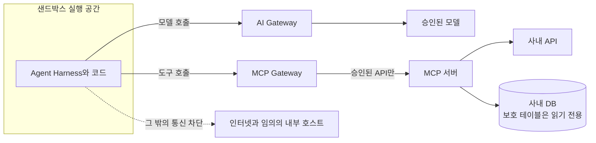

격리된 Harness(모델을 반복 호출하며 도구를 실행하는 제어 프로그램)는 **AI Gateway와 MCP Gateway로만** 통신한다. 모델은 승인된 것만, 도구는 승인된 API만 닿는다. 목표는 최소한의 데이터 접근, 네트워크 통제, 실행 환경 격리다.

콘퍼런스 기조연설을 전한 [ZDNet Korea 보도](https://zdnet.co.kr/view/?no=20261106142612)에 따르면, 지정호 CISO도 내부 시스템의 외부 AI 연결은 AI Gateway를 거치며 개인정보·인증정보를 검사하고 사용 기록을 남긴다고 설명했다.

이 구조가 강한 이유는 **통제 지점이 두 곳으로 모인다**는 데 있다. 위의 사고가 보여 주듯 약점도 같은 곳에 생길 수 있다.

| 확인할 것 (이 글의 제안) | 이유 |
|---|---|
| DNS, 시간 동기, 패키지 설치, 텔레메트리 경로 | "게이트웨이만"의 예외가 반출로가 된다. DNS 질의만으로도 데이터가 나갈 수 있다 |
| 게이트웨이 자체의 취약점과 패치 | 모든 에이전트가 의존하는 고가치 표적 |
| 샌드박스의 격리 강도 | 컨테이너는 커널을 공유한다. 필요에 따라 [gVisor](https://gvisor.dev/docs/)나 [Firecracker](https://firecracker-microvm.github.io/) 같은 더 강한 격리 검토 |
| 샌드박스 안의 자격 증명 | 비밀은 게이트웨이가 주입하고 Agent에게는 보이지 않게 |
| 게이트웨이 장애 | 우회 허용(fail-open)이 아니라 차단(fail-closed)이 기본 |

### 4.6 교훈과 열린 질문

발표의 결론은 태도에 관한 것이다. "AI로 만들어도 될까요?"에 "너무 위험해서 안 됩니다"가 아니라 **어떻게 설계하면 할 수 있는지**를 답하는, "가능한 대답이 가능한 보안"이다. 여기서 읽히는 실무 교훈은 세 가지다.

1. 통제는 **제공하는 편의** 위에 얹어야 지켜진다. 실행 환경, 배포 공간, 연결 통로를 주면서 통제를 넣는다.
2. 개별 지급(Mac mini)은 조달과 중앙 통제에서 막혔다. 상시 실행 에이전트는 **관리 가능한 인프라**의 문제다.
3. 윤리위원회, 실무협의회, 4자 검토처럼 **의사 결정의 속도와 책임 소재**가 기술만큼 중요하다.

남는 질문도 있다. 등록 건수가 늘 때 사람의 검토가 병목이 되지 않는가. 승인 뒤 코드가 바뀌면 자동으로 재검토되는가. 브라우저·단말 자동화를 "사용자보다 적은 권한"으로 만드는 구체적 방법은 이번에 다루지 않았다. 사고 건수, 차단율, 처리 시간 같은 효과 지표도 공개되지 않았다.

## 5. 발표 4: Toss Security Framework 구축기 (김재성)

### 5.1 문제: 통제 하나를 펼치면 자산 전체가 나온다

김재성은 정보보호 관리체계가 회사마다 세부는 달라도 대체로 세 단계로 돈다고 설명했다. 접근 권한 관리로 보면 다음과 같다.

| 단계 | 일 | 접근 권한 예 |
|---|---|---|
| 1. 요구 사항 정의 | 위험 평가·법령·인증 기준에서 통제 요구 도출 | "업무에 필요한 권한만 부여한다", "불필요해진 권한은 회수한다" |
| 2. 내규 수립 | 누가, 언제, 어떻게 할지 규정 | 신청·승인 절차, 퇴사·직무 변경 시 회수 담당자·기한·방법 |
| 3. 이행 점검 | 실제 자산에 적용됐는지 확인·보완 | 부여 권한을 승인 내역·인사 변동과 대조해 미승인·미회수 권한 조치 |

문제는 곱셈이다. "서버 권한 관리 기준을 지킨다"를 확인하려면 모든 서버를 봐야 하고, 서버는 자산 유형 하나일 뿐이며, 통제는 접근 권한 외에도 암호화, 취약점 관리, 백업·복구 등 수없이 많다.

$$
W \approx \sum_{c \in \mathcal{C}} |A_c| \times f_c
$$

(설명용 식이다. $\mathcal{C}$는 통제 집합, $A_c$는 통제 $c$의 적용 자산, $f_c$는 점검 빈도, $W$는 점검량.) 사람이 일일이 챙기면 기준 현행화부터 자산 이행까지 누락이 계속 생겼다는 것이 현실 진단이다.

### 5.2 사람의 한계와 AI에 건 기대

| 작업 | 사람의 실패 양상 | AI에 기대한 것 |
|---|---|---|
| 바꿔야 할 기준 찾기 | 기억에 의존해 해당 문서를 놓침 | 많은 문서의 세부 조항까지 읽어 빠짐없이 탐색 |
| 바뀐 기준 반영 | 일부 문서에 옛 기준이 남음 | 문서마다 바뀔 곳을 확인해 전체 반영 |
| 이행 점검 | 인력 한계로 대상 자산·항목 누락 | 모든 대상에 같은 기준으로 반복 |
| 점검 주기 | 대조가 오래 걸려 간격이 길어지고 발견이 늦음 | 빠른 분석으로 더 자주, 더 일찍 발견 |

목표는 **사람의 경험·맥락 판단**에 **AI의 빠른 분석·반복 수행**을 더하는 것이다. 이 표는 설계 당시의 기대이며, 발표는 AI의 누락률이나 정확도를 측정한 값을 제시하지 않았다.

### 5.3 세 가지 핵심 기능

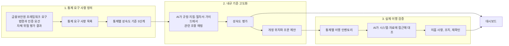

### 5.4 기능 1: 통제 요구 사항과 성숙도 5단계

통제 목록의 근거는 세 갈래다. **금융보안원 자율보안 프레임워크의 요구 사항**, 토스가 지켜야 하는 **법령·인증 요건**, 토스의 **위험 평가 결과**에서 나온 요구를 묶어 통제 요구 사항 목록을 만들고, 항목마다 성숙도 측정 기준을 붙였다.

| 레벨 | 상태 | 판별 질문 | 쉽게 말하면 |
|---|---|---|---|
| **1** | 어떤 자산·업무 절차에 어떤 보안 기준을 적용할지 정해짐 | 기준이 있나 | 규칙이 있다 |
| **2** | 담당자, 주기, 절차, 방법이 구체화됨 | 누가 언제 어떻게 하나 | 당번표가 있다 |
| **3** | 적용 검증 → 미흡 보완 → 재확인 절차가 정해짐 | 확인하고 고친 뒤 다시 보나 | 검사와 재검사가 있다 |
| **4** | 이행·점검 절차가 시스템으로 구현돼 자동 반복 | 사람이 안 눌러도 도나 | 센서가 알아서 점검 |
| **5** | 위반을 자동으로 사전 차단하거나 발생 시 복구해 준수 상태가 상시 유지 | 위반이 남지 않나 | 자동 잠금장치 |

금융보안원이 2026년 2월 내놓은 **금융보안 수준진단 프레임워크**는 거버넌스·식별·보호·탐지·대응·복구·공급망 7개 분야, 45개 항목, 127개 세부 원칙을 **초기·기반·발전·고도화 4단계**로 평가한다([데일리시큐](https://www.dailysecu.com/news/articleView.html?idxno=205060)). 발표가 말한 "자율보안 프레임워크"가 이 공개본을 가리키는지는 확인하지 못했다. 단계 수가 다르므로 위의 5단계는 토스 자체 척도로 읽어야 한다. "문서화 → 구체화 → 검증 → 자동화 → 예방"으로 올라가는 구조는 능력 성숙도 모델과 닮았다. 참고로 [NIST CSF](https://www.nist.gov/cyberframework)의 Tier는 위험 관리 방식의 엄격함을 나타내는 별도 개념이다.

### 5.5 기능 2: 내규의 성숙도를 AI가 평가하고 조문을 제안

회사의 **모든 규정, 지침, 절차서, 가이드**를 대상으로 AI가 통제별 관련 조항을 찾고, 조항을 성숙도 기준과 대조해 내규에 정해진 통제 기준의 성숙도를 평가한다.

"시스템 보안 설정 점검" 통제의 예다. 기준은 "시스템 보안 설정 점검 지침"에 문서화돼 있다.

| 지침에서 확인하거나 제안한 내용 | 레벨 |
|---|---|
| 서버·DB·네트워크의 표준 보안 설정 준수 여부를 점검해야 한다 | 1 충족 |
| 보안 담당자가 분기마다 실제 설정값과 기준값을 대조한다 | 2 충족 |
| 점검 수행을 검증하고 미흡 사항을 조치·재확인하는 절차가 있다 | **3 충족 (최종 평가)** |
| (제안) 정기 점검과 변경 시 수시 점검을 시스템과 연계해 자동화하는 절차를 문서화 | 4로 가는 조건 |
| (제안) 위반 설정을 자동으로 막거나 고치고 결과를 검증하는 절차를 신설 | 5로 가는 조건 |

제안은 "몇 조 몇 항에 어떤 식으로 신설하라"까지 간다. 발표자가 보여 준 관리 대시보드 예시에서는 거버넌스 통제 `GOV-04-002`("역할과 책임을 문서화하여야 한다")가 **정보보안규정 제9조** 기준 현재 레벨 2였다. 레벨 3이 되려면 **조직 변경 후 일치 여부를 확인하는 절차**를 추가해야 한다며, 제9조 제6항 뒤에 넣을 제안 조문을 보여 줬다. 조문 초안은 기존 정책·지침의 문체에 맞춰 바로 붙일 수 있게 구현했다고 한다.

그 출력을 구조화하면 다음과 같은 모양이 된다(재구성 예시).

```json
{
  "control_id": "GOV-04-002",
  "requirement": "역할과 책임을 문서화하여야 한다",
  "evaluated_documents": [{ "doc": "정보보안규정", "clause": "제9조", "version": "<개정본 식별자>" }],
  "level": 2,
  "level_evidence": [
    { "level": 1, "met": true, "quote": "<조항 원문 인용>" },
    { "level": 2, "met": true, "quote": "<조항 원문 인용>" },
    { "level": 3, "met": false, "gap": "조직 변경 후 일치 여부 확인 절차 없음" }
  ],
  "proposal": { "doc": "정보보안규정", "position": "제9조 제6항 뒤", "draft": "<제안 조문>" },
  "review": { "status": "PENDING_HUMAN", "reviewer": null }
}
```

이 구조에서 중요한 것은 **레벨마다 원문 인용을 강제**하는 것이다. 인용 문자열이 해당 문서에 실제로 있는지는 코드로 검사할 수 있어, 지어낸 근거를 걸러 낸다. 또 "찾지 못함"은 "없음"과 다르다. 검색 단계가 문서를 놓치면 성숙도가 낮게 나오거나 중복 조항을 만들자고 제안하게 된다. 조문 초안은 효력 있는 사규의 변경안이므로 사람의 검토와 정식 개정 절차를 거쳐야 한다. 발표는 승인 절차를 설명하지 않았다.

### 5.6 기능 3: 이행 인벤토리로 실제 자산을 검증

내규에 적힌 것과 실제는 다를 수 있다. 통제별 **이행 인벤토리**에 다음을 저장하면 AI가 그 내용을 따라 실제 시스템과 자료에 접근해 점검하고, 미흡 사항을 도출·정리하고, 정한 주기로 반복한다.

| 필드 | 의미 |
|---|---|
| 점검 대상 자산 | 어디를 볼 것인가 |
| 확인할 시스템·자료 | 무엇을 근거로 할 것인가 |
| 점검 방법 | 절차와 판단 기준 |
| 점검 주기 | 얼마나 자주 |

대표 예는 **퇴직자 권한 회수**다. 요구 사항 "퇴직자의 접근을 차단해야 한다" → 내규 "퇴직 시에는 계정과 권한을 회수해야 한다" → 인벤토리에 대상 시스템, 확인할 명단과 권한 정보, 확인 방법, **일 단위 주기**를 등록한다. AI는 퇴직자 명단 시트와 시스템별 권한 관리 메뉴의 자료에 접근해 현재 권한을 대조하고, 특정 시스템에 남은 미회수 권한을 찾아낸다.

```yaml
# 재구성 예시 — 통제 이행 인벤토리
control: ACC-LEAVER-REVOKE
requirement: 퇴직자의 접근을 차단해야 한다
policy_ref: { doc: 접근권한관리지침, clause: "<조항>" }
targets: [sso, git, vpn, db-console, admin-portal]
sources:
  leavers:      { system: hr, access: read-only, key: employee_id }
  entitlements: { system: per-target-export, access: read-only }
method:
  type: deterministic_join          # 대조는 코드, 해석과 요약만 LLM
  rule: "퇴직 효력 시각이 지났는데 활성 계정이나 권한이 존재"
schedule: daily
on_finding: { ticket: true, owner: system_owner, recheck: next_run }
not_assessed_if: [source_stale_over_24h, target_export_missing]   # 점검 불능은 '준수'가 아니다
```

```sql
-- 재구성 예시: 명단 대조는 LLM의 판단이 아니라 질의로 확정할 수 있다
SELECT t.target_system, e.employee_id, t.account_id, t.role_name, e.left_at
FROM   leavers e
JOIN   entitlements t ON t.employee_id = e.employee_id
WHERE  t.status = 'ACTIVE'
  AND  e.left_at < CURRENT_TIMESTAMP;

-- 사람과 연결되지 않은 계정도 따로 본다. 조인에서 빠지면 계속 '정상'으로 보인다
SELECT target_system, account_id
FROM   entitlements
WHERE  status = 'ACTIVE' AND employee_id IS NULL;
```

하루 한 번 점검이면 최악의 경우 미회수 권한이 하루 가까이(실행·조치 시간을 더하면 그 이상) 남는다. 즉시 차단이 필요한 핵심 시스템은 인사 이벤트에 연동한 자동 비활성화(레벨 5의 영역)를 두고, 일일 대조는 그 장치가 새는지 확인하는 안전망으로 쓰는 편이 낫다.

### 5.7 대시보드와 운영

내규의 성숙도와 실제 자산의 이행 상태를 대시보드에서 함께 본다. 특정 통제를 선택하면 **내규 개선 권고안**, **미준수 자산의 미흡 사항**, **조치 상태**를 확인해 회사의 부족한 곳과 성숙도 수준을 파악한다. 발표자는 이 체계를 구축해 운영하며 더 빠르게, 넓게, 꼼꼼하게, 자주 확인한다고 말했다. 앞부분에서는 "설계하고 구축하고 있는" 체계라고도 표현했다. 적용 통제 수, 자산 범위, 정확도는 공개하지 않았다.

### 5.8 설계 판단: 문서의 성숙도와 현실의 성숙도

감사 분야는 통제의 **설계 효과성**(규정이 위험을 막도록 설계됐나)과 **운영 효과성**(실제로 그렇게 동작했나)을 구분한다. 기능 2는 전자에, 기능 3은 후자에 가깝다. 이 둘을 한 점수로 합치면 안 된다. 지침에 "자동 차단한다"고 쓰면 문서상으로는 레벨 5의 요건처럼 보이지만 실제 차단기가 없으면 아무것도 막지 못한다. 대시보드에는 **문서 레벨, 검증된 레벨, 점검 커버리지**를 나란히 두는 편이 안전하다.

| 위험 (이 글의 분석) | 완화 방향 |
|---|---|
| LLM의 환각과 오판정 | 원문 인용 검증, 결정적 규칙 우선, 표본 재검토와 정밀도·재현율 측정 |
| 같은 문서에 다른 레벨 | 모델·프롬프트·기준 버전 고정, 반복 평가 일치율 확인 |
| 점검 Agent의 광범위한 접근 | 읽기 전용, 통제별 분리 자격 증명, 접근 감사 |
| 증적의 신뢰성 | 원천 시스템에서 직접 수집, 수집 시각·해시 기록. 손으로 편집한 시트는 별도 표시 |
| 자료 속 지시문에 의한 조작 | 수집한 문서·시트는 데이터로만 취급. 판정 확정 권한을 모델에 주지 않기 |
| 거짓 안심 | 점검 불능 상태를 준수와 분리 |

참고할 표준 작업으로는 상시 모니터링 지침인 [NIST SP 800-137](https://csrc.nist.gov/pubs/sp/800/137/final), 통제 평가 절차를 정리한 [NIST SP 800-53A](https://csrc.nist.gov/pubs/sp/800/53/a/r5/final), 통제와 평가 결과를 기계가 읽는 형식으로 표현하는 [OSCAL](https://pages.nist.gov/OSCAL/)이 있다.

## 6. 가로지르는 분석

### 6.1 네 발표의 공통 골격

주제는 달라도 같은 순서가 반복된다.

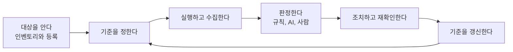

| 단계 | 인프라 진단 | AI 보안 평가 | AI 보안 2.0 | Security Framework |
|---|---|---|---|---|
| 대상 | Ansible Inventory, Config 저장소, Helm 대상 | Bot, MCP, Agent | 등록된 Vibe 서비스와 MCP 도구 | 통제별 대상 자산 |
| 기준 | SRV·CHK, 자체 OpenStack 기준 | 위치·권한·도구·출력, Tier | 배포 검사, 테이블 목적 정의 | 통제 요구 사항, 5단계 |
| 실행 | 스크립트와 전용 도구 | AI 자동 분석 + 수동 점검 | 자동 코드 검토 + 4자 검토 | AI 문서 매핑과 대조 |
| 판정 | 양호·취약·인터뷰 | 허용 4단계 | 등록·사용 승인 | 레벨과 미흡 사항 |
| 환류 | 조치 이력과 위험 평가 | 결정을 가이드로 | 모니터링과 수명주기 | 조문 제안과 재확인 |

### 6.2 같은 원칙, 다른 위치

**원칙 1. 흔들리지 않는 근거에 판정을 둔다.** 발표 1은 설정값을, 발표 2는 코드·권한·데이터 흐름을 근거로 삼는다. 발표 3은 DB 권한과 네트워크 경계라는 강제 장치를 둔다. 그런데 발표 4는 문서 해석과 점검에 AI를 전면에 세운다. 발표 2의 "AI의 답은 매번 달라진다"는 관찰은 **발표 4의 AI 판정에도 그대로 적용**된다. 네 발표를 합친 가장 실용적인 결론은 역할 분리다.

| 일의 성격 | 맡기기 좋은 주체 | 예 |
|---|---|---|
| 값 비교, 명단 대조, 해시·권한 확인 | 결정적 코드 | 퇴직자 계정 조인, SSH 설정 판정 |
| 문서 탐색, 코드 요약, 매핑 후보, 초안 | AI (근거 인용 필수) | 내규 조항 매핑, 도구 코드 1차 검토 |
| 위험 수용, 예외, 규제 해석, 구조 판단 | 책임 있는 사람 | 재설계·금지 결정, 조문 확정 |
| 어떤 경우에도 넘으면 안 되는 선 | 인프라 강제 장치 | 읽기 전용 권한, egress 차단 |

**원칙 2. 권한은 가장 좁은 쪽에 맞춘다.** 발표 2의 "도구 안에서 요청자 권한 재확인", 발표 3의 "사용자보다 적은 권한"과 "보호 테이블 읽기 전용", 발표 1의 "노드 점검은 읽기 전용"이 같은 방향이다. 하나의 식으로 쓰면(설명용) 에이전트의 유효 권한은 교집합이어야 한다.

$$
P_{\text{effective}} = P_{\text{user}} \cap P_{\text{agent}} \cap P_{\text{tool}} \cap P_{\text{task}}
$$

발표 2가 보여 준 봇 사례는 이 식이 사실상 $P_{\text{agent}}$ 하나로 줄어든 경우다.

**원칙 3. 새 체계를 강요하지 말고 흐름에 끼워 넣는다.** 진단은 운영 배포 도구에, 보안 원칙은 AI 코딩 도구의 Skill에, 통제는 게이트웨이와 배포 단계에 들어간다. 편한 길이 안전한 길이 되도록 만든다.

**원칙 4. 일회성 점검을 수명주기로 바꾼다.** 회차별 위험 평가, 평가 결과의 가이드화, 미사용 자원 폐기, 일 단위 권한 대조는 모두 "승인했다"가 아니라 "지금도 맞다"를 묻는다.

### 6.3 성숙도 척도로 서로를 재어 보면

발표 4의 척도를 다른 발표에 대어 보는 것은 **이 글의 해석**이며 토스의 공식 평가가 아니다.

| 대상 | 설명에서 읽히는 특징 | 다음 단계의 모습 |
|---|---|---|
| 인프라 진단 | 주기 실행·적재·조치 이력이 시스템화: 레벨 4의 특징 | 위반 설정의 자동 차단·복구(admission 정책, 설정 강제) |
| AI 보안 평가 | 기준·절차·환류가 있고 일부 자동화: 레벨 3에서 4로 | 변경 감지 기반 자동 재평가 |
| Vibe Infra와 MCP | 격리·권한 제한·수명주기 자동화는 레벨 5의 예방 성격을 일부 가짐 | 예외 경로의 지속 검증 |
| 퇴직자 권한 회수 점검 | 일 단위 자동 점검: 레벨 4의 특징 | 인사 이벤트에 연동한 즉시 회수 |

레벨 5의 자동 복구에는 대가가 있다. 잘못된 판정이 곧바로 장애가 된다. AI든 규칙이든 **자동 차단은 오탐 비용이 낮고 되돌릴 수 있는 곳부터** 적용해야 한다. 콘퍼런스 [기조연설 보도](https://zdnet.co.kr/view/?no=20261106142612)에는 가상 패치로 시간을 번 뒤 1%, 5%, 25% 식으로 단계 배포하고 이상 시 즉시 롤백한다는 설명이 있는데, 설정 강제에도 같은 방식이 어울린다.

### 6.4 새로 생기는 고가치 표적

자동화가 늘수록 **자동화 자체**를 지켜야 한다.

| 표적 | 뚫렸을 때 | 최소 방어 |
|---|---|---|
| Ansible·Jenkins·Helm 파이프라인 | 전 인프라에 코드 실행 | 변경 리뷰, 서명, 분리 계정 |
| 진단·통제 결과 DB | 약점 지도 유출 | 접근 최소화, 감사, 마스킹 |
| MCP·AI Gateway | 모든 에이전트의 경계 붕괴 | 강화와 패치, fail-closed, 이중화 |
| 점검·평가 AI | 판정 조작, 광범위 조회 | 읽기 전용, 근거 검증, 사람 승인 |
| Secure Coding Skill | 전사 코드에 나쁜 지침 전파 | 버전 관리, 변경 승인 |

### 6.5 제도와의 연결

2026년 11월 18일 금융위원회가 예고한 [전자금융감독규정 개정안](https://m.korea.kr/briefing/pressReleaseView.do?newsId=156789689)은 보유 IT자산의 식별·중요도 분류·담당자 지정, 대형 금융회사(총자산 2조 원 이상이고 상시 종업원 300명 이상)의 취약점 분석·평가 연 1회 → 2회, 전자금융기반시설에 직·간접으로 연결된 모든 정보처리시스템의 평가 대상 포함을 담았다. 의견 수렴은 11월 30일까지이고, 주기 단축과 대상 확대는 행정지도(11월 30일 시행 예정)로 먼저 적용하며, 규정 개정 시행 목표는 2027년 1분기다. 콘퍼런스(11월 6일) 이후의 일이라 발표 내용과 직접 관련이 있는 것은 아니다. 다만 대상 식별과 반복 진단의 부담이 커지는 방향이므로, 발표 1과 4가 풀려는 문제는 제도 쪽에서도 커지고 있다. 11월 5일의 망분리 혁신방안은 발표 3의 전제를 바꿀 수 있다. 망이라는 큰 벽이 낮아지면 **게이트웨이, 권한, 증적**의 비중이 그만큼 커진다.

### 6.6 도입 순서 제안

토스 규모가 아니어도 옮길 수 있는 순서다(이 글의 제안).

- [ ] 자산·AI 도구·에이전트 목록을 만들고 원천 간 차이를 정기 대조한다
- [ ] 사용자보다 센 권한을 가진 봇·MCP 도구를 먼저 찾아 막는다
- [ ] 에이전트 실행 환경의 외부 통신을 기본 차단하고 예외를 문서화·시험한다
- [ ] 설정 파일로 판정 가능한 항목부터 자동화하고, 불가 항목은 명시적 상태로 남긴다
- [ ] 결과에 실행 ID, 기준 버전, 원본 증적, 담당자, 기한을 붙인다
- [ ] AI 판정은 근거 인용을 강제하고, 사람이 표본 검수해 정확도를 수치로 관리한다
- [ ] 승인 대상의 코드·권한·모델이 바뀌면 재평가가 자동으로 열리게 한다
- [ ] 미사용 앱·토큰·계정의 비활성화와 폐기를 자동화한다

### 6.7 확인하지 못한 것

| 항목 | 상태 |
|---|---|
| 가드레일 우회 약 74%의 표본·대상·방법 | 비공개 |
| 도구 설명과 구현이 "대다수" 달랐다는 비율 | 수치 비공개 |
| 인프라 진단 자동화 전후의 시간·커버리지·오탐률 | 비공개 |
| 발표 1이 검토한 KISA OpenStack 체크리스트의 정확한 문서명·버전 | 미확인 |
| SRV 항목의 세부 기준 | 원문 미확인 |
| 발표 4의 "금융보안원 자율보안 프레임워크"와 2026년 2월 공개본의 대응 | 미확인 |
| Toss Security Framework의 정확도·적용 범위·승인 절차 | 비공개 |
| Vibe Infra의 비활성화·폐기 기간, 4자 검토의 순서·소요 시간 | 비공개 |

## 7. 정리

네 발표를 한 문장씩 줄이면 이렇다. 진단은 **운영이 이미 돌리는 파이프라인에 태워야** 지속된다. AI 서비스는 **답변이 아니라 권한과 구조**를 평가해야 같은 결론이 난다. AI 활용은 **격리된 장소와 좁은 문**을 제공해야 "됩니다"라고 답할 수 있다. 관리체계는 **기준과 현실의 간극을 자주 재야** 단단해진다.

AI는 이 이야기에서 위험의 원천이자 점검의 도구로 동시에 등장한다. 두 얼굴을 함께 다루는 방법은 새롭지 않다. 최소 권한, 기본 거부, 검증 가능한 증적, 책임지는 사람이다. 달라진 것은 대상이 많고 빨라져서, 사람이 가끔 확인하던 것을 시스템이 계속 확인해야 한다는 점이다.

## 참고

- 원 발표: 토스 보안 콘퍼런스 GUARDIANS 26 세션 모음, [https://www.youtube.com/watch?v=Wof9PM46RRs](https://www.youtube.com/watch?v=Wof9PM46RRs)
- 행사: [토스 뉴스룸, 가디언즈 26](https://toss.im/newsroom/GUARDIANS26), [ZDNet Korea, 지정호 CISO 기조연설](https://zdnet.co.kr/view/?no=20261106142612)
- 인프라: [Ansible 기본 개념](https://docs.ansible.com/ansible/latest/getting_started/basic_concepts.html), [Helm Charts](https://helm.sh/docs/topics/charts/), [kube-bench](https://github.com/aquasecurity/kube-bench), [Kubescape](https://github.com/kubescape/kubescape), [CIS Kubernetes Benchmark](https://www.cisecurity.org/benchmark/kubernetes), [chkrootkit](https://www.chkrootkit.org/), [OpenStack](https://www.openstack.org/), [OpenStack Security Guide](https://docs.openstack.org/security-guide/), [Keystone 서비스 API 보호](https://docs.openstack.org/keystone/latest/admin/service-api-protection.html), [KISA 클라우드 취약점 점검 가이드(2024) 자료실](https://isms.kisa.or.kr/main/csap/notice/?boardId=bbs_0000000000000004&mode=view&cntId=85)
- BPFDoor: [Rapid7 분석](https://www.rapid7.com/blog/post/tr-bpfdoor-telecom-networks-sleeper-cells-threat-research-report/), [Korea Times, SK텔레콤 침해](https://www.koreatimes.co.kr/amp/business/tech-science/20250520/skt-data-breach-rings-alarm-for-national-cybersecurity)
- MCP·인가: [Authorization (2025-11-25)](https://modelcontextprotocol.io/specification/2025-11-25/basic/authorization), [Tools](https://modelcontextprotocol.io/specification/2025-11-25/server/tools), [Security Best Practices](https://modelcontextprotocol.io/specification/2025-11-25/basic/security_best_practices), [2026-07-28 변경 목록](https://modelcontextprotocol.io/specification/2026-07-28/changelog), [RFC 8693 Token Exchange](https://www.rfc-editor.org/rfc/rfc8693.html), [OWASP API1:2023 BOLA](https://owasp.org/API-Security/editions/2023/en/0xa1-broken-object-level-authorization/), [Confused deputy](https://en.wikipedia.org/wiki/Confused_deputy_problem)
- AI 보안: [OWASP Agentic Applications Top 10](https://genai.owasp.org/resource/owasp-top-10-for-agentic-applications-for-2026/), [NIST AI 600-1](https://nvlpubs.nist.gov/nistpubs/ai/NIST.AI.600-1.pdf), [Hackett 외, Bypassing LLM Guardrails](https://arxiv.org/abs/2504.11168), [CaMeL](https://arxiv.org/abs/2503.18813), [The lethal trifecta](https://simonwillison.net/2025/Jun/16/the-lethal-trifecta/), [LLM 추론의 비결정성](https://thinkingmachines.ai/blog/defeating-nondeterminism-in-llm-inference/)
- 사고: [OpenAI 공개문](https://openai.com/index/hugging-face-model-evaluation-security-incident), [Hugging Face 공개문](https://huggingface.co/blog/security-incident-july-2026), [Anthropic 공개문](https://www.anthropic.com/news/investigating-incidents-cybersecurity-evals), [The Register, OpenClaw 노출](https://www.theregister.com/2026/02/09/openclaw_instances_exposed_vibe_code/), [OpenClaw 보안 문서](https://docs.openclaw.ai/gateway/security)
- 격리·모델 반입: [gVisor](https://gvisor.dev/docs/), [Firecracker](https://firecracker-microvm.github.io/), [Hugging Face pickle 보안](https://huggingface.co/docs/hub/security-pickle), [safetensors](https://huggingface.co/docs/safetensors/index)
- 통계: [McKinsey, The state of AI in 2025](https://www.mckinsey.com/capabilities/quantumblack/our-insights/the-state-of-ai-2025), [헤럴드경제, 기업 AI 활용률](https://www.heraldk.com/article/2026081917170398098)
- 제도·표준: [금융위 전자금융감독규정 개정 예고(2026-11-18)](https://m.korea.kr/briefing/pressReleaseView.do?newsId=156789689), [법률신문, 전 금융권 보안체계 혁신방안](https://www.lawtimes.co.kr/news/articleViewAmp.html?idxno=229265), [데일리시큐, 금융보안 수준진단 프레임워크](https://www.dailysecu.com/news/articleView.html?idxno=205060), [NIST CSF](https://www.nist.gov/cyberframework), [NIST SP 800-137](https://csrc.nist.gov/pubs/sp/800/137/final), [NIST SP 800-53A](https://csrc.nist.gov/pubs/sp/800/53/a/r5/final), [OSCAL](https://pages.nist.gov/OSCAL/)
