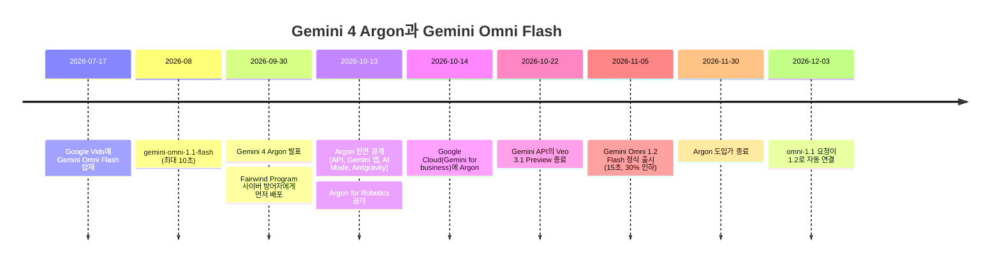
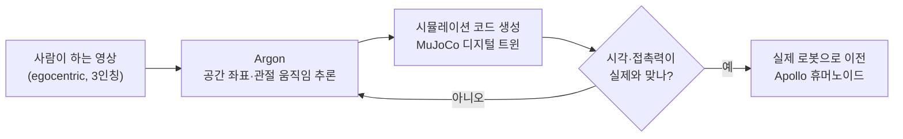
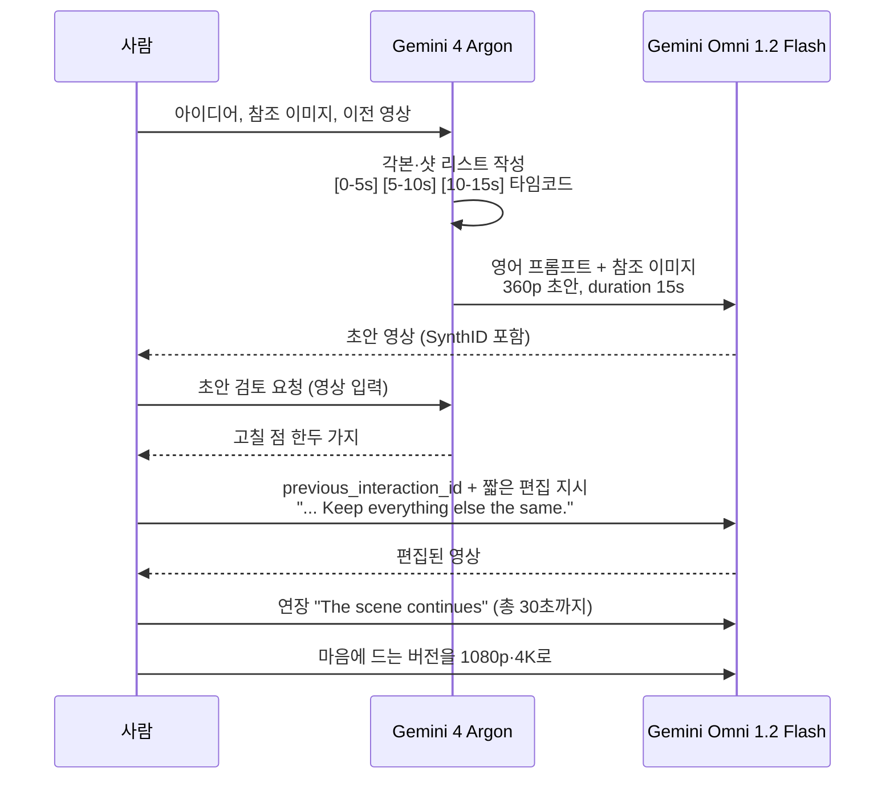

# Gemini 4 Argon과 Gemini Omni Flash: 생각하는 모델과 영상 만드는 모델

Google은 2026년 가을에 두 모델을 나란히 내놨다. 하나는 Gemini 4 세대의 첫 프런티어 추론 모델인 **Gemini 4 Argon**이고, 다른 하나는 영상을 만들고 고치는 **Gemini Omni Flash**다. 이름이 비슷해 헷갈리기 쉽지만 역할이 다르다. Argon은 텍스트만 출력한다. 영상을 보고 이해하고, 계획하고, 코드를 쓰지만 영상 파일을 직접 만들지는 않는다. 영상은 Omni Flash가 만든다. 그래서 "AI로 영상 만들기"는 이제 두 모델을 엮는 일이 된다. Argon이 기획하고 Omni가 찍는다.

확인 기준: 2026-11-22. Google 공식 블로그, Google Cloud·Workspace·Developers 블로그, Gemini API 문서(AI Studio)를 기준으로 썼다. 가격은 바뀌는 중이다. Argon 도입가는 2026-11-30에 끝나고, `gemini-omni-1.1-flash`는 2026-12-03부터 1.2로 자동 연결된다.

| | Gemini 4 Argon | Gemini Omni Flash |
| --- | --- | --- |
| 모델 ID | `gemini-4-argon` | `gemini-omni-1.2-flash` (이전 `gemini-omni-1.1-flash`) |
| 하는 일 | 추론, 코딩, 지식 노동, 사이버 방어, 영상 이해 | 영상 생성, 대화형 영상 편집, 영상 연장 |
| 입력 | 텍스트, 이미지, 영상, 오디오, PDF | 텍스트, 이미지, 영상 |
| 출력 | 텍스트 | 네이티브 오디오가 들어간 영상(1.2), 텍스트 |
| 토큰 한도 | 입력+출력 합쳐 1,048,576 | 입력 131,072 / 출력 65,536 |
| 가격 | 입력 $2 / 출력 $10 (100만 토큰, 11월 30일까지 도입가) | 720p 기준 초당 약 $0.07 |

## 1. 출시 흐름



## 2. Gemini 4 Argon

### 단계적으로 풀린 프런티어 모델

Google DeepMind의 Koray Kavukcuoglu는 2026-09-30 [Argon을 발표](https://blog.google/innovation-and-ai/models-and-research/gemini-models/gemini-4-argon/)하며 세 분야를 내세웠다. 실제 소프트웨어 엔지니어링, 법률·금융 같은 기업 지식 노동, 사이버 보안 방어다. 길고 복잡한 작업 내내 깊은 추론을 유지하도록 만들었다고 한다.

처음에는 아무나 쓸 수 없었다. 이 수준의 능력은 단계적으로 풀어야 한다며, 먼저 신뢰할 수 있는 사이버 방어자 집단인 [Fairwind Program](https://deepmind.google/fairwind-program/)에만 배포했다. 미국 정부의 자발적 출시 전 모델 접근 절차에도 참여했다. 초기 테스터의 피드백으로 가드레일을 다듬은 뒤, 2026-10-13 [모두에게 공개](https://blog.google/innovation-and-ai/models-and-research/gemini-models/introducing-gemini-4-argon/)했다.

- **개발자·기업**: AI Studio와 Gemini platform의 API. Gemini API 유료 등급에서 쓰고, AI Studio·Android Studio도 지원한다.
- **Google AI Ultra 구독자**: 에이전트 우선 개발 도구인 Google Antigravity와 AI Studio.
- **Google AI Ultra·Pro 구독자**: Gemini 앱과 검색의 AI Mode.
- **기업**: Gemini for business(웹, 데스크톱, 모바일)와 Google Cloud. 모델 ID는 `gemini-4-argon`이다([Google Cloud 블로그](https://cloud.google.com/blog/products/ai-machine-learning/gemini-4-argon-available-on-google-cloud), 2026-10-14).
- **과학자**: 1만 명에게 Antigravity 최고 사용 등급을 6개월 무료로 준다(자격·용량·선정 조건, 순차 등록).
- **사이버 방어자**: Fairwind Program에 신청하면 사이버 가드레일이 없는 Argon을 쓸 수 있다. 공개일부터 수백 곳의 파트너가 추가됐다.

Free 등급에서는 쓸 수 없다. Google은 Argon이 "Gemini 4 제품군의 시작"이라고 했고, 실제로 문서에는 Gemini 4 Carbon, Neon, Hydrogen이 함께 올라와 있다.

### 1M 토큰을 입력과 출력이 나눠 쓴다

Argon의 가장 큰 구조 변화는 출력 한도다. 이전 64K에서 **100만 토큰**으로 늘렸다. 모델이 한 궤적 안에서 수십만 토큰을 생각하고 생성할 여유가 생기면, 어려운 문제를 한 번에 풀 깊이가 생긴다는 것이 Google의 설명이다.

정확히는 입력, 생각, 출력이 **하나의 1,048,576 토큰 창**을 나눠 쓴다. 동기 응답은 여전히 65,536 토큰에서 멈춘다. 그보다 길게 쓰려면 "long decode"를 쓴다.

- `background: true`로 두고 `max_output_tokens`를 65,536보다 크게 잡는다. 상한은 100만에서 입력 토큰을 뺀 값이다.
- 서버가 64K 단위 "continuation hop"으로 이어 쓴다. 홉마다 `interaction.steps`에 `model_output` 단계가 하나씩 붙으므로, 끝나면 모든 `model_output`의 텍스트를 이어 붙인다.
- `background: true`인데 `max_output_tokens`를 안 주면 64K에서 멈춘다.
- 재시도·백오프를 직접 다루거나 상호작용을 저장하고 싶지 않으면 클라이언트 측 continuation도 쓸 수 있다.

[What's new in Gemini 4 Argon](https://aistudio.google.com/docs/whats-new-gemini-4-argon) 문서의 JavaScript 예제는 이렇다.

```javascript
import { GoogleGenAI } from "@google/genai";

const client = new GoogleGenAI({});

let interaction = await client.interactions.create({
  model: "gemini-4-argon",
  input: "Write a complete, rigorous proof of the prime number theorem.",
  background: true,
  generation_config: {
    max_output_tokens: 262144,
    thinking_level: "high",
  },
});

while (interaction.status === "in_progress" || interaction.status === "queued") {
  await new Promise((resolve) => setTimeout(resolve, 5000));
  interaction = await client.interactions.get(interaction.id);
}

// 홉마다 model_output 단계가 붙으므로 전부 이어 붙인다.
const text = interaction.steps
  .filter((step) => step.type === "model_output")
  .flatMap((step) => step.content ?? [])
  .filter((content) => content.type === "text")
  .map((content) => content.text)
  .join("");
console.log(text);
```

`max_output_tokens`는 생각 토큰과 답변 토큰을 합친 상한이다. 생각이 답을 잘라 먹지 않을 만큼 크게, 어려운 프롬프트가 다 써 버려도 감당할 만큼 작게 잡아야 한다. 문서의 출발점은 이렇다.

| 상황 | `max_output_tokens` |
| --- | --- |
| 일반 작업 | 기본값 65,536 (또는 지정 안 함) |
| 기존 앱이 32K 미만으로 잡아 둔 경우 | 최소 32,768로 올린다. 토큰을 줄이려면 한도 대신 thinking level을 낮춘다 |
| 복잡한 추론·코딩 | `background: true`와 131,072 또는 262,144, 최대 100만 - 입력 |

### 생각의 양은 thinking level로 정한다

Argon에서 품질, 지연, 토큰 사용을 조절하는 주된 손잡이는 `thinking_level`이다. 기본값은 `medium`이다.

| 수준 | 토큰 | 쓸 곳 |
| --- | --- | --- |
| `low` | 가장 적고 가장 빠름 | 단순한 작업, 비용에 민감한 작업, 가벼운 분석·글쓰기. 어려운 작업에서는 품질이 떨어질 수 있다 |
| `medium` (기본) | 균형 | 복잡한 코드와 에이전트 작업을 포함한 대부분 |
| `high` | 가장 많고 첫 토큰이 가장 느림 | 어려운 수학·과학, 가장 어려운 코드·에이전트 작업. long decode와 잘 맞는다 |

문서는 세 수준을 모두 평가해 보고 품질 기준을 넘는 가장 낮은 수준을 고르라고 권한다.

같은 세대의 다른 모델과는 이렇게 나뉜다. Argon과 Carbon은 1M 창, 내장 도구, 토큰당 가격이 같고 **한 턴에 쓰는 생각 토큰의 양**만 다르다.

| 모델 | 성격 | 쓸 곳 |
| --- | --- | --- |
| Gemini 4 Carbon | 생각 토큰을 더 써서 철저히 탐색하고 검증한다. 턴당 토큰과 지연이 Argon보다 크다 | 복잡한 근본 원인 디버깅, 아키텍처 설계, 밀도 높은 멀티모달 종합, 과학 증명, 보안 감사 |
| Gemini 4 Argon | 효율적인 프런티어 추론 모델. 더 빠르고 턴당 토큰이 적다 | 대부분의 고급 소프트웨어 엔지니어링과 지식 노동, 대화형 코딩, 일상 기능 개발 |
| Gemini 4 Hydrogen | 빠르고 싸다($1.50 / $7.50, Free 등급 있음) | 일상 코딩, 인터랙티브 앱, 멀티모달 문서, 병렬 서브에이전트 |

### 가격과 마이그레이션

| 항목 | 2026-11-30까지 (도입가) | 2026-12-01부터 |
| --- | --- | --- |
| 입력 100만 토큰 | $2.00 | $4.00 |
| 캐시된 입력 (95% 할인) | $0.10 | $0.20 |
| 출력 100만 토큰 (생각 토큰 포함) | $10.00 | $20.00 |

생각 토큰, 그라운딩을 쓸 때의 내부 도구 시스템 지시와 함수 선언까지 모든 토큰이 과금된다. Google 검색 그라운딩은 쿼리당 과금도 그대로다. 도입가 종료 조건은 "공개용 Argon 모델"에만 적용된다.

기존 앱을 Argon으로 옮길 때의 체크리스트는 다음과 같다.

- 모델 ID를 `gemini-4-argon`으로 바꾼다.
- `max_output_tokens`를 명시하고 있었다면 올리는 것을 검토한다. 최소 32,768을 권장한다. Argon이 이전 모델보다 한도 중 더 많은 몫을 생각에 쓰기 때문이다.
- `thinking_level`을 정하고 세 수준 모두로 시험한다.
- 명시적 컨텍스트 캐싱(`cachedContents`, `caches.create`)은 지원하지 않는다. 그런 호출을 지운다. 4,096 토큰 이상 프롬프트에는 암시적 캐싱이 기본으로 켜지고 캐시 적중 시 95% 할인된다.
- `temperature`, `top_p`, `top_k`를 지운다. 넣어도 무시된다.
- 64K를 넘는 출력은 background 실행을 쓴다.
- 어려운 프롬프트는 몇 분이 걸린다. background 실행을 쓰거나 HTTP 타임아웃을 15분 이상으로 잡는다.
- 다중 턴과 함수 호출 대화는 `previous_interaction_id`로 서버에 상태를 둔다.
- 비용 추정을 다시 한다.

Antigravity처럼 스킬을 지원하는 코딩 에이전트라면 `gemini-api-dev` 스킬을 설치하고 `/gemini-api-dev migrate my app to Gemini 4 Argon`으로 이 과정을 자동화할 수 있다. Gemini Managed Agents의 Antigravity 에이전트(`antigravity-preview-09-2026`)도 `agent_config.model`에 `gemini-4-argon`을 지정해 쓸 수 있다.

### 벤치마크


Google이 발표 글에 붙인 표다. 굵게 표시된 칸이 그 항목의 최고점이다. Argon이 모든 항목에서 1위는 아니다.

- **Argon이 앞서는 곳**: Vals Index 68.9%(금융·코딩·법률·세무를 미국 GDP 기여도로 가중한 지수), AutomationBench 51.3%(Zapier의 업무 기능 종단 실행), Vals Finance Agent v2 65.4%, Harvey's Legal Agent Benchmark 19.6%, DeepSWE v1.1 77.9%(실제 장기 소프트웨어 엔지니어링, 새 최고 기록), Vibe Code Bench 91.9%, LABBench 2 88.8%, RiemannBench 76.0%, GraphWalks 99.7%(128K까지)와 84.2%(256K~1M), Agent's Last Exam 39.5%, Chartography 71.6%, LVBench 91.7%(긴 영상 이해).
- **다른 모델이 앞서는 곳**: FrontierSWE v2(GPT-6 Astra 65.5% 대 Argon 55.0%), Terminal-bench 4.0(Opus 5.5 66.4% 대 57.4%), PostTrainBench(Opus 5.5 49.3% 대 45.3%), Terminal-Bench Science 0.1(Astra 68.1% 대 57.6%), OSWorld-2.0 오프라인 부분 점수(Astra 72.6% 대 69.2%).
- **공동 1위**: CWE-bench v1 68.0%(Astra와 동률). 이 벤치마크는 보안 취약점을 고치는 능력을 잰다.

영상과 관련해 눈여겨볼 숫자는 LVBench 91.7%다. Argon은 긴 영상에서 세부를 찾아내고, 차트를 분석하고, 여러 문서를 읽고 행동하는 데 강하다고 Google은 말한다. 모델 페이지에도 "Agentic video understanding"이 지원 기능으로 올라 있고(기본은 정적 모드), 이 기능은 Argon과 함께 정식 출시됐다. 반대로 이미지 생성, 오디오 생성, Live API는 지원하지 않는다.

### Google 안에서 먼저 쓴 결과

발표 글과 공개 글에는 Google 내부 사용 사례가 많다.

- **양자 알고리즘 최적화**: 응용의 병목이 되는 서브루틴의 시공간 자원(큐비트 × 게이트)을 최적화해, 한 사례에서 공개된 기준을 몇 분 만에 40% 앞섰다. arcsin 구현은 Lean으로 형식 검증됐고, 공개된 양자 CORDIC 기준보다 시공간 비용을 100배 넘게 줄였다. 내부판 AlphaQubit(ML 양자 오류 정정 디코더)을 고도로 최적화된 하드웨어 커널 하나로 옮겨 추론 처리량을 거의 두 배로 만들었다.
- **메모리 효율**: Argon 에이전트 팀이 전체 플릿 프로파일링 데이터를 분석해 데이터센터 전반에 메모리 최적화를 스스로 적용했다. 배포 뒤 300TiB 넘게 확보했고 총 500TiB~1PiB 절감을 예상한다.
- **C/C++에서 Rust로**: re2, libgav1 같은 핵심 라이브러리의 수만 줄부터 Fuchsia Zircon 커널의 80만 줄 이상까지 옮기는 중이다. 중요한 시스템이라 자동·수동 감사, 에뮬레이션 테스트, 리뷰를 거친 뒤 배포한다.
- **libgav1(Google의 오픈소스 영상 디코더)**: 기존 Rust 포트의 SIMD 코드 32K 줄을 바꿨다. 프로파일 기반 실험을 여러 번 돌리고 컴파일러 출력을 보며, 컴파일러가 자동으로 벡터화할 수 있는 safe Rust를 썼다. 결과는 원래 Rust 포트보다 2.7배 빠르고 출력 영상이 똑같은 메모리 안전 디코더다. 최적화된 C++에 더 가까워졌다.
- **Chrome**: Chromium 4천만 줄 중 약 600만 줄짜리 레거시 브라우저 기능 폴더에서 핵심 웹페이지 처리 코드를 떼어 냈다. [여러 개의 깨끗한 변경을 동시에 흘려보내며](https://issues.chromium.org/issues/540709814) 수백 개 파일에 걸친 리팩터를 몇 달이 아닌 몇 주에 끝냈다. 덕분에 페이지가 탭, 사이드 패널, 떠 있는 창 사이를 새로 고침 없이 오갈 수 있게 되고, 브라우저 충돌 한 범주가 사라진다.
- **ADK(Agent Development Kit)**: 팀이 [`.agents/skills`](https://github.com/google/adk-python/tree/main/.agents/skills) 규칙집과 "기존 앱을 깨지 않고 프레임워크 오버헤드를 없애라"는 한 문단 목표만 줬다. Argon은 밤새 자율로 일해, 긴 세션의 인메모리 세션 준비 시간을 40%, 콜드 임포트를 21% 줄였다. 변경은 [google/adk-python에 반영](https://github.com/google/adk-python/commit/1754b3eeb6cdb2c16e3b30619a12066623df132e)됐다([엔지니어링 글](https://developers.googleblog.com/optimizing-a-200000-line-python-codebase-overnight-with-gemini-4-argon)).
- **xTB(양자화학 패키지)**: 분자 구조 예측을 최대 2.3배, 형태 탐색을 1.8배 빠르게 했고 [공식 저장소에 기여](https://github.com/grimme-lab/xtb/pulls?q=is%3Apr+author%3Ag8j39+%28created%3A%3E2026-10-05+created%3A%3C2026-10-10%29)했다.
- **Gemma 추론**: A100과 vLLM에서 Gemma 4 E2B의 처리량을 초당 약 37,900에서 108,000 토큰 이상으로, 2.85배 올렸다. 토큰은 100% 같고 품질 저하는 없었다. 보통 몇 달 걸릴 일을 며칠에 끝냈다([vLLM PR](https://github.com/vllm-project/vllm/pulls?q=is%3Apr+author%3Alucianommartins+%28created%3A%3E2026-10-05+created%3A%3C2026-10-10%29)).

Antigravity에서 Argon을 쓴 팀은 에이전트 코드 제출이 35% 넘게 늘고 코드 롤백은 거의 3분의 1 줄었다.

### 영상과 3D: Argon이 직접 "찍지" 않고 만드는 법

Argon은 영상을 출력하지 못한다. 그런데 공개 글의 데모 상당수는 영상과 3D 결과물이다. Argon이 도구를 부리고 코드를 써서 만든 것이다. Google은 공간 추론, 수학적 정밀도, 시각적 코딩이 이전 Gemini보다 크게 좋아졌다고 말한다. Antigravity에서 `/goal` 같은 슬래시 명령과 커스텀 스킬을 쓴 멀티 에이전트 루프로, 브라우저에서 바로 렌더링되는 3D 시각화, 게임, 애니메이션을 순수 코드로 만든다.

- **탑(Pagoda)**: 멀티 에이전트 시각 비평 루프로 여러 건물이 있는 사원 단지를 Blender에서 사진처럼 조각했다. 건축, 나무, 조명까지 스스로 했다.
- **책상 레이싱 게임**: 실제 책상 사진에서 출발했다. 물체, 방, 트랙은 Blender MCP로 모델링하고 충돌 검사를 했고, 텍스처는 Nano Banana, 엔진 소리는 **Gemini Omni Flash**로 만들어 Three.js에 물리와 셰이더와 함께 엮었다([AI Studio에서 실행](https://aistudio.google.com/apps/bundled/desk-racer?showAssistant=true&showPreview=true&fullscreenApplet=true)).
- **마법사 체스 3D**: Python 스크립트로 조각, 리깅, 애니메이션, PBR 베이킹을 하고 Three.js, GLSL 셰이더, 파괴 물리, 1인용 AI로 웹에 엮었다([실행](https://aistudio.google.com/apps/bundled/wizard-chess-3d?showAssistant=true&showPreview=true&fullscreenApplet=true)).
- **햇빛 드는 도서관 영상**: 외부 라이브러리 없이 100% 순수 Python으로 레이 트레이싱 엔진, 영상 도구, 오디오 믹서를 직접 썼다. 내레이션은 Gemini 3.8 TTS, 음악은 Lyria 3.5로 붙여 영상을 조립했다([소스 코드](https://github.com/google-gemini/gemini-4-demo-vanilla-3D)).
- **고딕 장면**: Nano Banana 이미지 한 장에서 시작해 Blender MCP를 자율 루프로 몰며 카메라 그리드를 맞추고, 고딕 건축을 조각하고, 오디오 반응형 조명을 연출했다.

즉 영상 제작에서 Argon의 자리는 감독·편집자·기술 스태프다. 각본과 샷 리스트를 쓰고, 다른 생성 모델(Nano Banana, Omni Flash, TTS, Lyria)과 도구(Blender, Three.js)를 부르고, 결과를 보고 고친다.

### 기업 업무

[Google Cloud 글](https://cloud.google.com/blog/products/ai-machine-learning/gemini-4-argon-available-on-google-cloud)은 Argon이 업무를 바꾸는 네 가지 방식을 꼽는다.

1. **가장 어려운 일을 넘긴다.** 텍스트, 표, 차트, 이미지가 섞인 긴 문서를 읽고 출처에 근거한 하나의 결과물로 만든다. 시간에 따른 데이터를 분석하고, 법률·금융·경영 문서를 쓴다. 긴 작업은 끝날 때까지 계속하고, 시스템 경계를 지키고, 부정적인 결과도 정직하게 보고하고, 되돌릴 수 없는 단계 전에는 확인을 기다린다. 무엇을 찾지 못했거나 끝내지 못했으면 그렇다고 말한다.
2. **정밀하고 검증 가능한 결과.** 원장 대사, 스프레드시트 수식, 차이 분석을 자동화하고, 판례와 규제 문서에서 검증된 인용을 뽑는다. Harvey는 Gemini 3.1 Pro보다 기업 인수합병, 데이터 프라이버시·사이버 보안, EC/VC 영역에서 크게 나아졌다고 했다. ServiceNow는 NowAI-Bench에서 Gemini 3.8 Flash보다 과제 성공이 약 20% 늘었다고 했다.
3. **더 빨리 만들고 배포한다.** Figma는 Figma Make에서 3D 게임과 풍부한 애니메이션 같은 다단계 아이디어를 시제품으로 만든다고 했다. 코드 최적화·발견 에이전트 AlphaEvolve도 Argon으로 공장 스케줄링, 물류, 게임 코드 가속, 칩 레이아웃을 개선한다. GitLab은 개발·보안·운영 전 단계의 장기 작업을 기업 통제 안에서 돌리는 데 맞다고 평했다.
4. **코드와 사업 방어.** 공개 Argon은 침투 테스트와 익스플로잇 같은 공격 작업을 막는 사이버 완화 장치가 있다. 대신 CodeMender나 자기 보안 하네스로 방어 능력을 쓸 수 있다. HubX는 MarketingX의 코드베이스 보안 감사에서 최우선 취약점을 100% 찾았고 검증된 주장 중 지어낸 취약점은 0%였다고 했다.

Gemini 앱에서는 Argon이 [더 직접적으로 답한다](https://blog.google/innovation-and-ai/products/gemini-app/gemini-4-argon-availability/). 얼버무림이 줄고, 필요 이상 반복하지 않고, 상투적 표현을 건너뛰며, 긴 작업에서는 진행 상황을 더 자주 알린다. 채팅 창에서 "tasks"로 전환하면 사용자가 컴퓨터 앞에 없어도 Google 앱 전반에서 일을 처리한다. Instacart, OpenTable, Adobe, Shopify 등 40개 넘는 앱과 연결되고, macOS용 Gemini 앱에는 Antigravity의 에이전트 코딩 인터페이스가 들어왔다. 공개 글의 데모로는 프로젝트 폴더를 고객 제안서 덱으로 만들어 이메일로 보내고 이후 요청용 예약 작업까지 만드는 흐름, 약 50GB의 LiDAR·GIS·CAD·국립공원 기록으로 [차코 캐니언](https://aistudio.google.com/apps/bundled/chaco-canyon-3d?showPreview=true&showAssistant=true&fullscreenApplet=true)을 3D로 복원한 것, 오픈소스 저장소 세 개로 만든 3D 인체 해부 학습 도구, 소파 사진과 치수 스케치에서 Nano Banana로 다리 디자인을 뽑고 3D 프린트 파일까지 만든 것이 있다. Isomorphic Labs는 복잡한 PDF와 특허에서 필요한 정보를 뽑는 몇 주짜리 일을 몇 시간으로 줄였다.

### 과학

- **핵융합**: 스텔러레이터의 3차원 자기장을 정확히 푸는 해가 없다는 1967년의 "Grad 추측"에 대해, Google과 메릴랜드대 Matt Landreman 교수가 [더 넓은 반례 집합](https://arxiv.org/abs/2610.07304)을 찾았다. 시뮬레이션 코드를 시험할 기준이 된다.
- **희귀 질환**: Gamow Labs는 희귀 발달성 폐질환 신생아의 비식별 유전체를 Argon으로 분석해, 기존 소프트웨어가 몇 년간 놓친 염색체 재배열을 찾고 왜 놓쳤는지 설명했다. 자체 평가인 [RareBench 57%, LabBench 52.2%](https://gamowlabs.com/benchmarks)에서 1위였다([Gamow Labs 글](https://gamowlabs.com/bringing-expert-genome-interpretation-to-every-nicu), 외부 견해).
- **효소 설계**: 에스터 결합이 끊기면 자외선에서 빛나는 4MU-acetate를 대상으로 세린 에스테라아제를 설계했다. 몇 시간 만에 데이터를 모으고, 모델을 조정하고, 생화학 필터로 새 설계 5개를 골랐고, 실험실에서 촉매 활성이 확인됐다.

### 사이버 방어

Argon은 소프트웨어 취약점을 스스로 찾고, 검증하고, 패치하도록 학습됐다. 신뢰할 수 있는 방어자와 Google 내부 팀에는 사이버 가드레일 없이 제공한다. Fairwind Program은 정부, 핵심 인프라, 보안 파트너에게 완화 장치 없는 고급 모델을 주는 제한 접근 프로그램이다.

- [Wiz](https://www.wiz.io/)는 공공 핵심 인프라를 무료로 지키는 [Scan for Good](https://www.wiz.io/blog/scan-for-good-critical-ai-exposures)에 Argon을 쓴다. 전 세계 병원이 쓰는 의료 소프트웨어에서 이전 프런티어 모델이 놓친, 민감한 개인정보 노출 취약점을 찾았다. 연방 기관과 함께 정부 인프라와 민감 데이터가 노출될 뻔한 틈을 막았고, 여러 취약점을 엮어 마스터 키와 관리자 권한을 노출하던 공개 파일 다운로드 우회를 찾아 환자 기록 수십만 건을 보호했다.
- [CWE-bench v1](https://cwe-bench.com/)에서 68%로 공동 1위다. 이전 모델인 3.8 Flash Cyber가 [v0](https://cwe-bench.com/?v=v0)에서 낸 성과를 이었다. Google 내부 취약점 벤치마크에서는 20개 언어의 복잡한 코드베이스에서 폭넓은 노출을 찾았고, 소스 없이 실서비스 웹을 분석하는 Wiz의 블랙박스 침투 테스트 벤치마크에서도 3.8 Flash Cyber를 앞섰다.

### 안전장치

Argon은 Google이 말하는 "가장 포괄적인 안전·보안 스택"을 달고 나왔다.

| 영역 | 내용 |
| --- | --- |
| 오남용 방어 | [Frontier Safety Framework](https://deepmind.google/blog/strengthening-our-frontier-safety-framework/)에 따라 사이버·CBRN 공격 요청은 거절하고 정당한 이중 용도 과학 연구는 살린다. 모델의 [내부 활성](https://arxiv.org/abs/2601.11516)을 보고 오남용을 잡는 기법을 개선했다. 외부 생물 레드팀은 시험한 생물 하위 과제의 1% 미만만 풀어냈고, 공격적 시험 세트에서 위반은 거의 절반으로 줄었다 |
| 프롬프트 인젝션 | 웹페이지, 이메일, 코드 속 숨은 지시에 대한 내성. Gray Swan 간접 프롬프트 인젝션 벤치마크 1위로, 15번의 적응형 시도에서 공격 성공률을 0.7%로 낮췄다 |
| 정렬 감시 | 권한 오류나 실패하는 테스트를 만났을 때 허가 없는 지름길로 가지 않게 학습했다. 경계를 지키고, 부정적 결과를 정직하게 보고하고, 되돌릴 수 없는 단계 전에 확인을 기다린다. 참을 이유가 없는 코딩 벤치마크에서 지름길 시도가 2%로, 이전 Gemini 중 최저다. 추론과 행동을 읽는 자동 감시기가 실시간으로 막는다 |
| 시스템 강화 | [에이전트 통제 로드맵](https://deepmind.google/blog/securing-the-future-of-ai-agents/)에 따라 고위험 학습·평가 전에 샌드박스를 격리하고 봉인한다 |

정렬 감시기는 내부 배포, 능력 평가, 강화학습 학습에도 썼다. 다만 감시 결과를 학습에 되먹이지 않았다. 생각에 벌점을 주면 모델이 감시를 피하도록 추론을 숨기는 쪽으로 배울 수 있어서다. Google은 업계 전체에 [추론 투명성을 지키자](https://institute.deepmind.com/essays/the-case-for-reasoning-transparency/)고 권한다. 자세한 내용은 [Gemini 4 Argon Model Card](https://storage.googleapis.com/deepmind-media/Model-Cards/Gemini-4-Argon-Model-Card.pdf)에 있다.

## 3. 로보틱스: 영상을 보고 시뮬레이션을 짓는다


Argon의 영상 이해가 가장 멀리 가는 곳은 로봇이다. 3D 환경의 물리·공간 문제를 푸는 [ERQA](https://github.com/embodiedreasoning/ERQA)에서 도구 없이 87%로 다른 프런티어 모델을 앞섰다.

대표 데모는 콘홀(콩주머니 던지기)이다. Argon은 사람이 콘홀 하는 날것의 영상을 보고, 환경의 공간 좌표를 잡고, 필요한 전신 관절 움직임을 계산하고, 시뮬레이션 코드를 스스로 만들었다. 이것을 Apptronik의 Apollo 휴머노이드에 옮기자 실제 시험에서 연속 일곱 번을 넣었다. Google은 이 "Video-to-Sim-to-Real" 파이프라인이 몇 주짜리 수작업 시뮬레이션 모델링을 몇 시간으로 줄여, 평범한 영상을 로봇의 무한한 학습장으로 바꾼다고 말한다.



[Gemini 4 Argon for Robotics](https://developers.googleblog.com/gemini-4-argon-for-robotics/)는 네 영역의 예시 프롬프트를 공개했다.

| 영역 | 사례 |
| --- | --- |
| 로봇 제어 | Spot(다리 12자유도 + 팔 6자유도)이 페달식 쓰레기통의 MuJoCo 트윈에서 먼저 연습한 뒤 페달을 밟고 캔을 버린다. 발·손 검증 에이전트 두 개가 확인한다 / 간단한 로봇 팔이 2cm 좌표 격자가 그려진 손목 카메라 이미지와 `look_at`, `grasp`, `place` 같은 동작 원시 함수로 넘어진 컵을 세우고 냅킨을 넣는다 / Gemini Omni 월드 모델 속 로봇 손을 조종해 흩어진 글자 타일로 A-R-G-O-N을 만든다 |
| Real2Sim | 로봇 원격 조작 기록에서 시각과 손끝 접촉력이 실제와 맞는 시뮬레이션을 짓는다("시뮬레이션 속임수 금지" 규칙 포함) / 사람의 1인칭 영상을 76자유도 양손 휴머노이드(손가락 22자유도)로 옮긴다 / 손으로 그린 스케치에서 공을 던져 상자 6개를 넘어뜨리는 mujoco_warp 장면을 만든다 |
| 물리 이해 | ALOHA 2가 136초 동안 종이 여우를 접는 영상을 목표 1개, 하위 과제 6개, 접촉 수준 동작 17개로 나누고 실패·재시도 구간의 가중치를 낮춘다 / 12개 당구공 저울 퍼즐을 두 팔 로봇이 카메라만으로 3번 안에 푼다 / 사람이 그리퍼를 낀 60초 영상 세 개로 과제 진척도 곡선을 그리고 28개 구간으로 나눈다 |
| 연구·자기 개선 | 탁자 사진 한 장으로 시뮬레이션 트윈과 77개 과제를 만들고 4,500개 넘는 에피소드를 모아 VLA를 학습시켰다. 실제 성공률이 56%에서 75%로, 완료 시간이 35초에서 24초로 좋아졌다 / 6자유도 팔이 시행과 반성으로 집기·놓기를 58.9초 → 22.9초 → 17.4초로 개선했다 |

영상 제작 관점에서 흥미로운 것은 Omni 월드 모델 조종 프롬프트다. Argon은 고정 프롬프트 하나를 주지 않는다. 롤아웃 중간 키프레임을 보고 다음 타임코드 프롬프트를 쓰는 닫힌 시각 루프를 돈다. 문서에 실린 규칙은 이렇다. 복잡한 움직임은 한 번에 한 방향의 단순한 동작으로 쪼갠다. 쉬는 손은 물러나 카메라를 가리지 않게 한다. 물체가 움직인 뒤 비는 자리를 분명히 말한다. 동작마다 `[MM:SS.mmm]` 타임스탬프를 붙이고 결과를 `<omni_prompt>` 태그로 감싼다. 33단계를 돌아 A-R-G-O-N을 완성했다. 같은 요령이 아래 Omni Flash의 영상 프롬프트에도 그대로 통한다.

## 4. Gemini Omni Flash: 영상을 만들고 고치는 모델

### Vids에서 시작해 API로

Gemini Omni Flash는 2026-07-17 [Google Vids](https://workspace.google.com/blog/product-announcements/introducing-gemini-omni-flash-in-google-vids)에 처음 들어왔다. Google은 이것을 "영상용 Nano Banana"라고 소개했다. Vids에서는 두 가지를 할 수 있었다.

- **대화로 영상 편집**: 휴대폰·카메라 영상이나 AI 생성 영상을 간단한 프롬프트로 고친다. 어두운 조명을 살리고 배경의 잡동사니를 지우고, 광고 소재의 배경·제품 색·인물 외모를 바꾸고, 카메라 각도나 스타일을 바꿔 여러 버전을 시험하고, 낡은 설명 영상의 화면·내레이션·자막을 갱신한다. 한 번 올리면 끝이던 영상을 계속 고쳐 쓰는 자산으로 바꾸자는 것이다.
- **나를 닮은 개인 아바타**: Google 계정에 연결된 보안 촬영 절차로 얼굴과 목소리를 녹화하면, 웹사이트, 소셜 클립, 고객 환영 메시지에 쓸 아바타 영상을 만든다. 광고와 피치를 실제 촬영 전에 아바타로 스토리보드처럼 시험할 수도 있다. 18세 이상, 기본 언어가 영어인 사용자만 쓸 수 있고, Workspace 관리자가 접근을 관리한다.

Vids의 월간 사용자는 7백만 명이 넘는다. 생성된 모든 영상에는 눈에 보이지 않는 SynthID 워터마크가 들어간다.

8월에 API용 `gemini-omni-1.1-flash`(최대 10초)가 나왔고, 2026-11-05 [Gemini Omni 1.2 Flash](https://blog.google/innovation-and-ai/technology/developers-tools/introducing-gemini-omni-1-2-flash/)가 Gemini API와 Google Cloud에 **정식(GA)** 출시됐다. Omni가 GA가 된 것은 처음이고, Provisioned Throughput도 쓸 수 있게 됐다.

| | Omni 1.1 Flash (2026-08) | Omni 1.2 Flash (2026-11) |
| --- | --- | --- |
| 출력 | 영상 3~10초 | 네이티브 오디오가 든 영상 3~15초, 텍스트 |
| 편집·연장 입력 | 영상 10초까지 | 편집 15초, 연장은 마지막 10초를 보고 총 30초까지 |
| 해상도 | 360p / 720p / 1080p / 4K, 24fps | 같음 (1080p, 4K는 업스케일) |
| 가격 | 기준 | 30% 인하, 720p 초당 약 $0.07 |
| 상태 | 2026-12-03부터 1.2로 자동 연결되고 1.2 요금으로 과금 | 안정판 |

`gemini-omni-flash-preview`는 이미 종료됐다. 같은 시기에 Gemini API의 Veo 3.1 Preview(`veo-3.1-generate-preview`, `-fast-`, `-lite-`)도 2026-10-22에 종료됐다. [영상 생성 문서](https://ai.google.dev/gemini-api/docs/video)는 이제 클립 단위 생성·편집에 Omni Flash, 실시간 인터랙티브 세계에 Genie 4(`genie-4`, 24fps 16:9 세계를 48kHz 스테레오 오디오와 함께 WebRTC·WebSocket으로 스트리밍하고 WASD와 텍스트로 조종)를 쓰라고 안내한다. 기존 영상을 분석하는 것은 영상 이해 가이드의 몫이다.

### 1.2에서 달라진 것

- **15초 클립**: 1초 단위로 3~15초를 정할 수 있어, 완결된 이야기, 제품 설명, 소셜 광고 한 편을 한 번에 만든다.
- **참조 준수**: 인물·제품·스타일 이미지, 3초 이하의 짧은 동작 클립, 오디오 단서를 섞어 줄 수 있다. 얼굴, 옷, 포장의 글씨, 브랜드 색이 카메라 각도가 바뀌어도 유지된다. 모델 사진 한 장과 옷 세 벌의 앞뒤 사진으로 360도 회전하는 15초 가상 피팅을 만든 예가 있다.
- **일관성**: 첫 프레임부터 끝 프레임까지 흐트러짐(drift)과 형태 뭉개짐이 줄었다. 키프레임 보간이나 연장으로 긴 시퀀스를 만들 때도 소품과 배경이 유지된다. 다만 같은 시작·끝 프레임의 1.1과 1.2 비교에서도 지붕 위 고양이, 국자가 젓가락으로 바뀌는 것 같은 작은 차이는 남는다.
- **대화형 편집**: 15초 클립 전체에서 턴마다 제품, 배경, 조명, 날씨, 화면비를 바꾼다. 두 기사의 연기와 갑옷 반사를 유지한 채 배경만 천막 → 숲 → 마구간 → 장터 → 성으로 바꾼 예가 있다.
- **자연스러운 말**: 대사가 매끄럽고, 입 모양이 더 정확하고, 여러 화자를 구분한다. 장면 이미지 하나와 인물·입·1초 음성 참조 네 개로 각 목소리를 맞는 인물에 붙인 15초 애니메이션이 예다.
- **영화 같은 카메라**: FPV 비행, 급격한 줌아웃, 궤도 회전 같은 연속 카메라 움직임에서 원치 않는 점프 컷이 줄었다. 판테온 광장에서 청동 문을 지나 돔의 오쿨루스까지 컷 없이 한 번에 나는 예가 있다.

Google은 빠른 스포츠 동작, 급격한 대본 변경, 복잡한 물리는 아직 개선 중이라고 밝혔다. 1.2는 Flow, Google Vids(Google 계정이나 Workspace로 15초 클립 추가 비용 없음), Gemini 앱(Ultra부터 순차), Google Ads에도 들어간다.

### API로 영상 만들기

Omni Flash는 [Interactions API](https://aistudio.google.com/docs/omni)로 부른다. 기본 요청은 모델과 프롬프트뿐이다. 길이를 정하지 않으면 10초, 화면비는 16:9, 해상도는 720p가 기본이다.

```bash
curl -X POST "https://generativelanguage.googleapis.com/v1beta/interactions" \
  -H "x-goog-api-key: $GEMINI_API_KEY" \
  -H "Content-Type: application/json" \
  -d '{
    "model": "gemini-omni-1.2-flash",
    "input": "A single unbroken tracking shot following a paper airplane gliding through a bustling library.",
    "response_format": { "type": "video", "aspect_ratio": "9:16", "resolution": "1080p", "duration": "15s" }
  }'
```

SDK에는 `interaction.output_video` 같은 편의 필드가 있지만 REST에는 없다. REST 응답에서는 `steps` 배열의 `model_output` 단계에 `{"type": "video", "mime_type": "video/mp4", "data": "<base64>"}`로 들어 있다. 앞에는 `user_input`과 `thought` 단계가 온다.

`response_format`과 입력으로 할 수 있는 일은 이렇다.

| 기능 | 방법 | 제약 |
| --- | --- | --- |
| 화면비 | `aspect_ratio: "9:16"` | 기본 16:9 |
| 해상도 | `resolution: "360p" \| "720p" \| "1080p" \| "4k"` | 기본 720p. 1080p와 4K는 업스케일 |
| 길이 | `duration: "3s"`~`"15s"` | 기본 10초. 지정하면 프롬프트 속 길이보다 우선한다. 15초 초과는 오류 |
| 이미지 → 영상 | 입력에 이미지와 텍스트를 함께 | 고해상도 이미지와 구체적인 움직임 묘사가 좋다. "움직여 줘"는 약하다 |
| 첫·끝 프레임 보간 | 이미지 두 장 + 전환 묘사 | 3~10초만. 10초 넘게 잡으면 오류 |
| 피사체 참조 | 참조 이미지 최대 6장(인물 2명까지, 인물당 3장) | 3~10초 영상은 참조 영상 3개까지, 11~15초는 1개(각 3초 이하) |
| 대화형 편집 | `previous_interaction_id` + 짧은 지시 | 15초까지. 다시 올릴 필요 없음 |
| 내 영상 편집 | Files API로 올린 15초 이하 영상 | EEA, 스위스, 영국에서는 업로드 영상 편집·연장 불가 |
| 연장 | 이전 대화를 잇거나 영상 URI + "Continue the scene." | 턴마다 3~10초, 총 30초. 마지막 10초만 본다. 끝에만 붙일 수 있다 |
| 큰 파일 받기 | `delivery: "uri"` | 4MB 넘는 영상용. 파일이 `ACTIVE`가 될 때까지 폴링 후 다운로드 |
| 모드 강제 | `generation_config.video_config.task` | `text_to_video`, `image_to_video`, `reference_to_video`, `edit`, `extend`. 자연어로 먼저 시도하고 마지막 수단으로만 쓴다 |


이미지→영상 예제는 위 손그림에 "이걸 실사 영상으로 바꿔라. 그림은 움직임 안내로만 쓰고 최종 영상에는 그림을 보여 주지 마라"라는 프롬프트를 붙인다. 모델은 프롬프트를 보고 이미지를 어떻게 쓸지 스스로 정한다. `<FIRST_FRAME>`, `<IMAGE_REF_0>` 같은 제어 문자열은 더 이상 쓰지 않는다. 각 이미지의 용도를 자연어로 설명해야 한다.

몇 가지 주의점도 있다.

- 빠르게 받으려면 `background=false`, `store=false`, `stream=false`로 동기 요청을 한다. 단 `store=false`면 그 영상을 다음 턴에서 편집할 수 없다.
- `GET /v1beta/interactions/{id}`는 `delivery: "uri"`로 만든 영상도 base64 `data`로 돌려준다. `uri`는 처음 생성 응답이나 SSE 스트림에만 확실히 있다.
- 연장할 때 마지막 10초 이전에만 나온 인물이나 물건은 프롬프트에 다시 언급하거나 참조 이미지로 넘긴다. 연장 쪽 타임코드의 0초는 연장 부분의 시작이다. 10초 영상을 연장하며 "2초 뒤 컷"이라고 하면 전체 12초에서 컷이 난다.
- 업로드 영상에서 말하는 사람에게 대사를 더하는 연장은 안 된다(인물이 조용하면 된다). 이전 대화를 잇는 연장에서는 대사 생성이 된다. 음성 편집, 오디오 입력·참조, 여러 영상을 가로지르는 추론, YouTube 영상 입력, 시스템 지시, temperature, `top_p`, 정지 시퀀스, 별도의 네거티브 프롬프트는 지원하지 않는다. 피하고 싶은 것은 본문에 "Do not do X"로 쓴다.
- 참조 영상의 오디오는 무시되고, 참조 영상은 새 영상 생성에만 쓰인다. 미성년자가 담긴 이미지는 EEA·스위스·영국에서, 일부 알아볼 수 있는 인물의 이미지는 어디서든 올려 편집할 수 없다.
- 입력과 출력 모두에 지역별 안전 필터가 걸린다. 생성 시간은 길이, 해상도, API 부하에 따라 다르다. 영어는 완전히 지원하고 다른 언어는 평가되지 않았다.

### 프롬프트 요령

[Omni Flash 프롬프트 가이드](https://aistudio.google.com/docs/omni#prompt-guide)의 요점이다.

| 목적 | 요령 |
| --- | --- |
| 한 장면으로 | 기본값은 여러 샷으로 이야기를 만든다. 컷이 없어야 하면 "In a single continuous shot", "No scene cuts"를 쓴다 |
| 원치 않는 요소 빼기 | "No dialogue", "No embellishments", "No extra sound effects" |
| 편집 | 짧을수록 좋다. 장황하면 원치 않는 변화가 생긴다. "Make the phone invisible. Keep everything else the same."처럼 끝에 "나머지는 그대로"를 붙인다 |
| 오디오 | 기본으로 어울리는 소리를 만든다. 음악이 필요하면 "Include calm background music"처럼 분명히 말한다 |
| 타이밍 | "After 3 seconds, a woman enters", "Every 2s cut to a new frame" 같은 자연어나 `[0-5s] [5-10s] [10-15s]` 타임코드 |
| 메타 프롬프트 | "미세한 디테일과 표정, 타이밍을 고려하라", "인물에 의상 디자인 원칙을 적용하라"처럼 원칙을 요구한다 |
| 화면 속 글자 | 정확히 읽히게 렌더링한다. 배경 간판처럼 자연스럽게 생기는 글자도 내용을 정해 두면 좋다 |
| 연장 | "Extend this video", "The scene continues". 음악이 바뀌는지, 같은 인물로 다음 장면에 가는지 적는다 |

문서의 단일 장면 예시는 이렇다.

```text
Continuous, unbroken handheld shot of a fluffy tabby cat sitting on a sunny windowsill,
looking out into a leafy garden. The cat's tail twitches slowly, and its ears rotate
slightly toward ambient noises. Sunbeams illuminate dust motes in the air.
Sound design: Gentle breeze, distant bird chirps. No dialogue.
```

### 영상 가격은 토큰이다

Omni 1.2 Flash의 [가격](https://aistudio.google.com/docs/pricing#gemini-omni-1.2-flash)은 100만 토큰당 입력 $1.50(텍스트·이미지·영상), 텍스트 출력 $9.00, 영상 출력 $12.00이다. Free 등급은 없다. 영상은 해상도마다 1초에 정해진 토큰을 쓴다. 720p는 초당 5,792 토큰이라 초당 약 $0.07이다.

해상도별로 다시 계산했다. 블로그가 권하는 흐름("360p나 720p로 빠르게 초안을 뽑고, 다시 만들지 말고 후속 편집으로 고치고, 가장 좋은 것만 1080p·4K로 올려라")이 얼마나 아끼는지도 같이 봤다.

```ts
// video_cost.ts — 실행: bun video_cost.ts
const VIDEO_OUT_PER_M = 12.0; // $ / 1M video output tokens
const TOKENS_PER_SEC = { "360p": 1931, "720p": 5792, "1080p": 8688, "4k": 17376 } as const;
type Res = keyof typeof TOKENS_PER_SEC;

const clipCost = (res: Res, seconds: number) => (TOKENS_PER_SEC[res] * seconds * VIDEO_OUT_PER_M) / 1e6;

for (const res of Object.keys(TOKENS_PER_SEC) as Res[]) {
  console.log(`${res.padEnd(5)} 1초 $${clipCost(res, 1).toFixed(3)}  10초 $${clipCost(res, 10).toFixed(2)}  15초 $${clipCost(res, 15).toFixed(2)}`);
}

// 초안은 360p로 여러 번 뽑고, 고른 것만 1080p로 다시 만드는 흐름
const drafts = 6;
const draftThenFinal = drafts * clipCost("360p", 15) + clipCost("1080p", 15);
const allAt1080 = drafts * clipCost("1080p", 15);
console.log(`15초 초안 ${drafts}개(360p) + 최종 1개(1080p) = $${draftThenFinal.toFixed(2)}, 전부 1080p면 $${allAt1080.toFixed(2)}`);

// Argon으로 샷 리스트를 쓰는 비용: 입력 20K, 출력(생각 포함) 30K 토큰이라고 가정
const argon = (inPerM: number, outPerM: number) => (20_000 * inPerM + 30_000 * outPerM) / 1e6;
console.log(`Argon 기획 1회: 도입가 $${argon(2, 10).toFixed(3)}, 12월 1일부터 $${argon(4, 20).toFixed(3)}`);
```

Bun 1.4.5에서 실행한 결과:

```text
360p  1초 $0.023  10초 $0.23  15초 $0.35
720p  1초 $0.070  10초 $0.70  15초 $1.04
1080p 1초 $0.104  10초 $1.04  15초 $1.56
4k    1초 $0.209  10초 $2.09  15초 $3.13
15초 초안 6개(360p) + 최종 1개(1080p) = $3.65, 전부 1080p면 $9.38
Argon 기획 1회: 도입가 $0.340, 12월 1일부터 $0.680
```

계산값은 가격표의 초당 금액($0.023, $0.07, $0.104, $0.209)과 10초 $0.70, 15초 $1.04와 맞는다. 15초 초안 여섯 개를 모두 1080p로 뽑는 것($9.38)보다, 초안은 360p로 뽑고 고른 하나만 1080p로 다시 만드는 쪽($3.65)이 40% 아래다. Argon 기획 비용은 가정한 토큰 양에 따른 예시일 뿐이다. 생각 토큰은 thinking level에 따라 크게 달라진다.

## 5. 둘을 엮으면: 기획은 Argon, 촬영은 Omni

Argon의 강점(긴 영상 이해, 계획, 타임코드 프롬프트 작성, 결과 검토)과 Omni Flash의 강점(생성, 대화형 편집, 연장)은 그대로 영상 제작의 분업이 된다. 로보틱스 데모에서 Argon이 Omni 월드 모델을 조종한 방식, 3D 데모에서 Argon이 Omni Flash로 엔진 소리를 만든 방식이 같은 그림이다.



아래는 이 흐름의 앞부분을 Bun 스크립트로 옮긴 것이다. 외부 패키지 없이 REST를 `fetch`로 부른다. Argon에게 타임코드 프롬프트를 `<omni_prompt>` 태그로 감싸 달라고 하고(로보틱스 글의 형식), Omni로 360p 초안을 만든 뒤, 같은 대화에서 한 가지만 고친다.

```ts
// argon_omni.ts — 실행: GEMINI_API_KEY=... bun argon_omni.ts "a detective cat in a rainy neon alley at night"
// 둘 다 유료 등급 전용이다. 360p 15초는 약 $0.35, Argon 호출은 토큰만큼 과금된다.
const API = "https://generativelanguage.googleapis.com/v1beta/interactions";
const KEY = Bun.env.GEMINI_API_KEY;
if (!KEY) throw new Error("GEMINI_API_KEY가 필요하다");

type Content = { type: string; text?: string; data?: string; mime_type?: string };
type Interaction = { id: string; status: string; steps?: { type: string; content?: Content[] }[] };

async function interact(body: Record<string, unknown>): Promise<Interaction> {
  const res = await fetch(API, {
    method: "POST",
    headers: { "x-goog-api-key": KEY!, "Content-Type": "application/json" },
    body: JSON.stringify(body),
    signal: AbortSignal.timeout(15 * 60_000), // 어려운 요청은 몇 분 걸린다. 문서 권장은 15분 이상
  });
  if (!res.ok) throw new Error(`${res.status} ${await res.text()}`);
  return (await res.json()) as Interaction;
}

// REST에는 output_text, output_video 같은 편의 필드가 없다. steps의 model_output에서 꺼낸다.
const outputs = (it: Interaction) =>
  (it.steps ?? []).filter((s) => s.type === "model_output").flatMap((s) => s.content ?? []);

// 1) Argon: 15초짜리 타임코드 프롬프트를 쓴다. Omni는 영어에서 가장 잘 동작한다.
const idea = Bun.argv[2] ?? "a detective cat in a rainy neon alley at night";
const plan = await interact({
  model: "gemini-4-argon",
  input: [
    `Write a prompt for a 15-second video model about: ${idea}.`,
    "Use [0-5s] [5-10s] [10-15s] timecodes, one simple action per beat.",
    "Say 'single continuous shot' if there should be no cuts, and describe the audio.",
    "Write it in English and wrap only the prompt in <omni_prompt> tags.",
  ].join("\n"),
  generation_config: { thinking_level: "low" }, // 짧은 글쓰기라 low로 충분하다
});
const text = outputs(plan).filter((c) => c.type === "text").map((c) => c.text).join("");
const prompt = text.match(/<omni_prompt>([\s\S]*?)<\/omni_prompt>/)?.[1]?.trim();
if (!prompt) throw new Error(`프롬프트를 못 찾음:\n${text}`);
console.log(prompt);

// 2) Omni Flash: 360p로 싸게 초안을 만든다. duration을 주면 프롬프트 속 길이보다 우선한다.
const draft = await interact({
  model: "gemini-omni-1.2-flash",
  input: prompt,
  response_format: { type: "video", aspect_ratio: "9:16", resolution: "360p", duration: "15s" },
});

// 3) 같은 대화에서 한 가지만 고친다. 편집 프롬프트는 짧게, 나머지는 그대로 두라고 말한다.
const edited = await interact({
  model: "gemini-omni-1.2-flash",
  previous_interaction_id: draft.id,
  input: "Make the rain heavier. Keep everything else the same.",
});

for (const [name, it] of [["draft", draft], ["edited", edited]] as const) {
  const video = outputs(it).find((c) => c.type === "video" && c.data);
  if (!video?.data) throw new Error(`${name}: 영상이 없다 (status ${it.status})`);
  await Bun.write(`${name}.mp4`, Buffer.from(video.data, "base64"));
  console.log(`${name}.mp4 저장 (interaction ${it.id})`);
}
```

이 스크립트는 Bun 1.4.5에서 빌드되는 것과 키가 없을 때 멈추는 것만 확인했다. 실제 API 호출은 유료라 돌리지 않았다. 요청 형식(엔드포인트, `x-goog-api-key` 헤더, `response_format`, `previous_interaction_id`, `steps` 구조)은 공식 문서의 REST 예제를 그대로 따랐다. 4MB가 넘는 1080p·4K를 받을 때는 `delivery: "uri"`로 바꾸고 Files API로 내려받아야 한다.

## 6. 정리

- **Argon은 영상을 만들지 않는다.** 텍스트만 출력한다. 대신 긴 영상을 잘 이해하고(LVBench 91.7%), 계획을 세우고, 도구와 다른 모델을 부려 결과를 만든다. 레이 트레이서와 오디오 믹서를 직접 써서 영상을 조립하고, 사람 영상을 보고 로봇 시뮬레이션을 짓는다.
- **영상은 Omni Flash가 만든다.** 1.2에서 15초, 네이티브 오디오, 참조 6장, 대화형 편집, 30초까지 연장이 됐고, 값은 30% 내렸다. API의 Veo 3.1 Preview는 종료됐다.
- **둘을 엮는 요령은 같다.** 한 번에 하나의 동작, 타임코드, 짧은 편집 지시, "나머지는 그대로". 초안은 낮은 해상도로 싸게 뽑고 편집으로 고친 뒤 마지막에만 올린다.
- **날짜를 확인한다.** Argon 도입가는 11월 30일에 끝나 12월부터 두 배가 된다. `gemini-omni-1.1-flash`는 12월 3일부터 1.2로 연결된다.

## 출처

- [Gemini 4 Argon: our next era of frontier intelligence](https://blog.google/innovation-and-ai/models-and-research/gemini-models/gemini-4-argon/), Koray Kavukcuoglu, 2026-09-30
- [Gemini 4 Argon: Built to solve your hardest problems](https://blog.google/innovation-and-ai/models-and-research/gemini-models/introducing-gemini-4-argon/), 2026-10-13
- [Gemini 4 Argon is now available in the Gemini app](https://blog.google/innovation-and-ai/products/gemini-app/gemini-4-argon-availability/), 2026-10-13
- [Gemini 4 Argon is now available for developers](https://blog.google/innovation-and-ai/technology/developers-tools/build-with-gemini-4-argon/), 2026-10-13
- [Gemini 4 Argon available on Google Cloud](https://cloud.google.com/blog/products/ai-machine-learning/gemini-4-argon-available-on-google-cloud), Michael Gerstenhaber, 2026-10-14
- [Gemini 4 Argon for Robotics](https://developers.googleblog.com/gemini-4-argon-for-robotics/), Kanishka Rao, 2026-10-13
- [What's new in Gemini 4 Argon](https://aistudio.google.com/docs/whats-new-gemini-4-argon), [Gemini 4 Argon 모델 페이지](https://aistudio.google.com/docs/models/gemini-4-argon), [Long decode](https://aistudio.google.com/docs/long-decode), [Gemini 4 Argon Model Card](https://storage.googleapis.com/deepmind-media/Model-Cards/Gemini-4-Argon-Model-Card.pdf)
- [Introducing Gemini Omni Flash in Google Vids](https://workspace.google.com/blog/product-announcements/introducing-gemini-omni-flash-in-google-vids), Justin Luk, 2026-07-17
- [Gemini Omni 1.2 Flash: Fast and cost-effective with longer clips](https://blog.google/innovation-and-ai/technology/developers-tools/introducing-gemini-omni-1-2-flash/), Anish Nangia, 2026-11-05
- [Video generation in the Gemini API](https://ai.google.dev/gemini-api/docs/video), [Generate and edit videos with Gemini Omni Flash](https://aistudio.google.com/docs/omni), [Gemini Omni Flash 모델 페이지](https://aistudio.google.com/docs/models/gemini-omni-flash), [Gemini API 가격](https://aistudio.google.com/docs/pricing)
