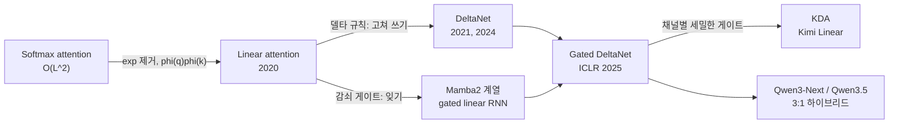
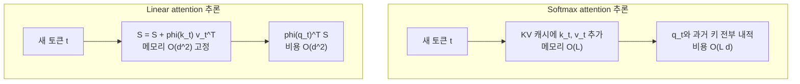
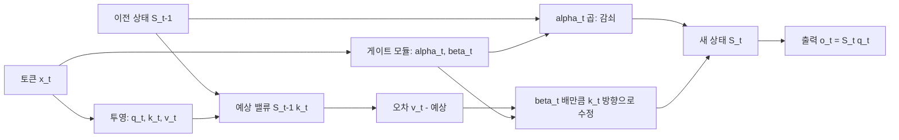
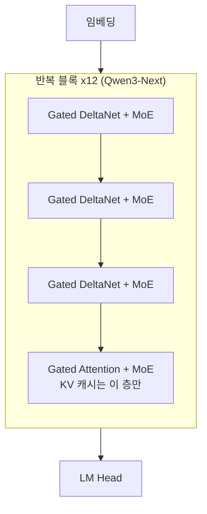

# 소프트맥스를 빼면 어텐션이 선형이 된다… Linear Attention에서 Gated DeltaNet, 그리고 3:1 하이브리드 LLM까지

### 어텐션이 컨텍스트 길이 $L$의 제곱으로 비싸지는 원인은 $QK^\top$를 감싼 지수 함수 하나다. 이것을 "양수를 내는 특징 함수"로 바꾸면 행렬 곱의 결합 법칙이 살아나고, 계산은 $O(L)$, 추론 메모리는 길이와 무관한 $d\times d$ 상태 하나로 줄어든다. 대가는 표현력이다. 그래서 최근의 가벼운 LLM은 선형 어텐션을 전면 도입하지 않고, 상태 갱신을 "더하기"에서 "망각 + 교정"으로 바꾼 Gated DeltaNet 계열을 3층, 풀 어텐션을 1층 섞는 하이브리드를 표준처럼 쓴다

선형 어텐션(linear attention)의 출발점은 Katharopoulos 외의 [Transformers are RNNs](https://arxiv.org/abs/2006.16236)(ICML 2020)다. 이 논문은 소프트맥스 대신 커널 특징 함수의 내적으로 어텐션을 다시 쓰면 복잡도가 $O(N^2)$에서 $O(N)$으로 내려가고, 매우 긴 시퀀스의 자기회귀 예측이 "최대 4000배" 빨라진다고 적었다. 그 상태 갱신을 고친 계보가 Schlag 외의 [Linear Transformers Are Secretly Fast Weight Programmers](https://arxiv.org/abs/2102.11174)(DeltaNet, 2021), Yang 외의 [Parallelizing Linear Transformers with the Delta Rule](https://arxiv.org/abs/2406.06484)(2024), 그리고 Yang·Kautz·Hatamizadeh의 [Gated Delta Networks: Improving Mamba2 with Delta Rule](https://arxiv.org/abs/2412.06464)(ICLR 2025)이다. 실제 LLM으로는 Alibaba의 [Qwen3-Next](https://www.alibabacloud.com/blog/qwen3-next-towards-ultimate-training-%26-inference-efficiency_602580)와 Qwen3.5, Moonshot의 [Kimi Linear](https://arxiv.org/abs/2510.26692), 그보다 앞선 [MiniMax-01](https://github.com/MiniMax-AI/MiniMax-01)이 이 구조를 쓴다.

이 글은 수식을 하나씩 풀어 "선형"이 무엇의 선형인지부터, 선형 어텐션이 왜 성능을 조금 잃는지, 게이트와 델타 규칙이 그 손실을 어떻게 메우는지, 왜 하이브리드 비율이 3:1로 수렴했는지까지 따라간다. 수식은 각 논문의 표기를 따르되 설명을 위해 행·열 방향을 일부 통일했다.

**모델별 수치(속도, KV 캐시 절감률)는 각 회사의 자체 발표이고 독립 재현 결과는 확인하지 못했다. 층 구성은 공식 모델 카드와 논문으로 확인했다.**


*Kimi Linear 공식 저장소의 구조 그림. KDA(Kimi Delta Attention) 층과 전역 MLA 층을 3:1로 쌓는다.*

## 1. 한눈에 보기

| 항목 | 소프트맥스 어텐션 | 선형 어텐션 | Gated DeltaNet |
|---|---|---|---|
| 가중치 계산 | $\exp(q^\top k)$ 후 정규화 | $\phi(q)^\top\phi(k)$, $\phi\ge 0$ | 선형 어텐션 + 감쇠 게이트 $\alpha_t$ + 쓰기 강도 $\beta_t$ |
| 학습 시 복잡도 | $O(L^2 d)$ | $O(L d^2)$ | $O(L d^2)$ (청크 병렬화) |
| 추론 시 토큰당 비용 | $O(L d)$, KV 캐시가 계속 커짐 | $O(d^2)$, 고정 크기 상태 | $O(d^2)$, 고정 크기 상태 |
| 기억 방식 | 과거 K, V를 전부 보관 | 과거를 $d\times d$ 행렬 하나에 누적 합 | 누적 + 지우기 + 교정 |
| 강점 | 정확한 검색(recall), 날카로운 집중 | 속도, 메모리 | 속도 + 개선된 문맥 내 학습 |
| 약점 | 길이 제곱 비용 | 희석, 약한 recall | 여전히 유한 상태 |
| 실제 쓰임 | 하이브리드의 25% 층 | 초기 연구, MiniMax-01(Lightning Attention 변형) | Qwen3-Next, Qwen3.5, Kimi Linear(KDA)의 75% 층 |

쉽게 말하면 이렇다. 소프트맥스 어텐션은 지금까지 받은 편지를 전부 서랍에 넣어 두고, 새 질문이 올 때마다 서랍을 처음부터 뒤진다. 선형 어텐션은 편지를 받는 즉시 한 장의 요약 노트에 덧적고 원본은 버린다. Gated DeltaNet은 그 노트에 덧적기 전에 "오래된 메모는 조금 흐리게, 틀린 메모는 고쳐 쓰기"를 한다. 하이브리드 LLM은 요약 노트 3권에 원본 서랍 1개를 같이 두는 사무실이다.



## 2. "선형"은 무엇이 선형인가

### 2.1 제곱은 $QK^\top$에서 나온다

용어부터 정리한다. 길이 $L$짜리 토큰 시퀀스가 있고, 각 토큰은 어텐션 헤드 하나 안에서 $d$차원 벡터로 표현된다. 쿼리(query, 무엇을 찾는가), 키(key, 나는 무엇에 관한 정보인가), 밸류(value, 실제로 전달할 내용) 행렬은 모두 $L\times d$다.

$$
\mathrm{Attn}(Q,K,V)=\mathrm{softmax}\!\left(\frac{QK^\top}{\sqrt d}\right)V
$$

$Q\,(L\times d)$와 $K^\top\,(d\times L)$를 곱하면 가운데 $d$가 사라지고 $L\times L$ 행렬이 남는다. 모든 토큰 쌍의 관련도 표다. 이 표를 만들고 $V$와 곱하는 데 $O(L^2 d)$가 들고, 표 자체도 $L^2$ 크기다. 컨텍스트가 128K, 1M 토큰으로 늘어나는 지금 이것이 병목이다. "선형 어텐션"의 선형은 바로 이 **시퀀스 길이 $L$에 대한 계산 복잡도**를 말한다.

### 2.2 결합 법칙으로 순서를 바꾸면 $L\times L$이 사라진다

소프트맥스가 없다고 잠시 가정하자. 그러면 계산은 그냥 세 행렬의 곱이다.

$$
(QK^\top)V \;=\; Q(K^\top V)
$$

왼쪽은 $(L\times d)(d\times L)=L\times L$을 먼저 만든다. 오른쪽은 $(d\times L)(L\times d)=d\times d$를 먼저 만든다. 결과는 같고 중간 크기만 다르다. 오른쪽 순서의 비용은 $O(L d^2)$로, $L$에 대해 선형이다.

| 순서 | 중간 결과 | 비용 |
|---|---|---|
| $(QK^\top)V$ | $L\times L$ | $O(L^2 d)$ |
| $Q(K^\top V)$ | $d\times d$ | $O(L d^2)$ |

$d^2$가 걱정될 수 있지만 여기서 $d$는 모델 전체 히든 크기가 아니라 **헤드 하나의 차원**이다. 보통 64~256이다. Qwen3-Next는 풀 어텐션 헤드 차원을 128에서 256으로 올렸다고 밝혔다. 반면 $L$은 수십만~백만이다. $256^2\approx 6.6\times10^4$와 $(10^6)^2=10^{12}$는 비교가 안 된다. 참고로 "히든 크기는 보통 1만을 넘지 않는다"는 통념은 정확하지 않다. 예컨대 Llama 3 405B의 히든 크기는 16,384다. 다만 멀티헤드로 나뉘면 헤드당 $d$는 여전히 작으므로 결론은 같다.

### 2.3 걸림돌은 지수 함수다

실제 어텐션에는 소프트맥스가 있다. 행 $i$의 출력을 풀어 쓰면 이렇다.

$$
o_i=\frac{\sum_{j}\exp(q_i^\top k_j)\,v_j}{\sum_{j}\exp(q_i^\top k_j)}
$$

$\exp$가 $q_i^\top k_j$라는 내적 전체를 감싸고 있다. 결합 법칙을 쓰려면 이 값이 $f(q_i)^\top g(k_j)$처럼 쿼리만의 함수와 키만의 함수의 내적으로 갈라져야 한다. 커널 이론으로 말하면 $\exp(q^\top k)$는 유효한 커널이지만, 그에 대응하는 특징 공간은 **무한 차원**이다(테일러 전개의 모든 차수 항이 필요하다). 유한한 $d'$차원 벡터 두 개의 내적으로는 정확히 쪼갤 수 없다. 논문들이 "커널"을 꺼내는 이유가 이것이다. Performer([Choromanski 외, 2020](https://arxiv.org/abs/2009.14794))처럼 무작위 특징으로 근사하는 길도 있지만, 선형 어텐션의 주류는 **아예 다른 유사도 함수를 정의**하는 쪽을 택했다.

### 2.4 지수 함수는 왜 썼나: 가중치는 양수여야 한다

$\exp$의 역할은 두 가지다. 하나는 **어떤 실수든 양수로 바꾸는 것**이다. 가중치가 음수면 "반대로 관련 있다"는 애매한 의미가 생기고, 정규화(합이 1이 되도록 나누기)도 불안정해진다. 다른 하나는 뒤에서 다룰 **증폭**이다.

첫 번째 역할만 보면, 양수를 보장하면서 분리 가능한 함수를 쓰면 된다. 그래서 선형 어텐션은 특징 함수 $\phi$를 먼저 각각 적용하고 그다음 내적한다.

$$
\mathrm{sim}(q,k)=\phi(q)^\top\phi(k),\qquad \phi(x)\ge 0
$$

$\phi$의 출력이 모든 성분에서 0 이상이면, 그 내적도 0 이상이다. Katharopoulos 외는 $\phi(x)=\mathrm{elu}(x)+1$을 썼다. ELU(Exponential Linear Unit)는 양수 구간에서는 $x$, 음수 구간에서는 $e^x-1$이라 최솟값이 $-1$에 수렴한다. 여기에 1을 더하면 항상 양수다. ReLU와 달리 음수 입력에서도 기울기가 0이 아니라 학습이 덜 막힌다.

$$
\mathrm{elu}(x)+1=\begin{cases}x+1 & x>0\\ e^{x} & x\le 0\end{cases}
$$

### 2.5 정규화 분모도 미리 합해 두면 된다

남는 의문은 분모다. 소프트맥스는 각 쿼리마다 모든 키에 대한 가중치 합으로 나눈다. 쿼리마다 모든 키를 봐야 하니 다시 $L^2$이 아닐까. 선형 어텐션에서는 아니다.

$$
o_i=\frac{\phi(q_i)^\top\sum_{j}\phi(k_j)\,v_j^\top}{\phi(q_i)^\top\sum_{j}\phi(k_j)}
=\frac{\phi(q_i)^\top S}{\phi(q_i)^\top z},\quad
S=\sum_j\phi(k_j)v_j^\top\in\mathbb R^{d\times d},\;
z=\sum_j\phi(k_j)\in\mathbb R^{d}
$$

소프트맥스에서는 $\exp$가 내적 뒤에 오므로 키를 먼저 더해 둘 수 없다. 선형 어텐션에서는 내적이 마지막이라, 키 특징을 미리 합한 $d$차원 벡터 $z$ 하나와 쿼리를 내적하면 분모가 나온다. 분자는 $O(Ld^2)$, 분모는 $O(Ld)$다.

참고로 이 분모는 나중에 대부분 빠졌다. $\phi(q)^\top z$가 0에 가까워지면 출력이 튀어 학습이 불안정해지기 때문이다([Qin 외, The Devil in Linear Transformer, 2022](https://arxiv.org/abs/2210.10340)). 그래서 TransNormer, GLA, DeltaNet 계열은 분모로 나누는 대신 출력에 RMSNorm 같은 정규화를 거는 쪽을 택했다. 쉽게 말하면 "가중치 합을 정확히 1로 맞추기"를 포기하고 "출력 크기만 일정하게 유지하기"로 바꾼 것이다.

### 2.6 인과 마스크를 걸면 RNN이 된다

언어 모델은 토큰 $i$가 자기 이전($j\le i$)만 보게 한다. 그러면 $S$와 $z$는 누적 합이 된다.

$$
S_t=S_{t-1}+\phi(k_t)v_t^\top,\qquad z_t=z_{t-1}+\phi(k_t),\qquad
o_t=\frac{\phi(q_t)^\top S_t}{\phi(q_t)^\top z_t}
$$

논문 제목이 "Transformers are RNNs"인 이유다. 추론 시에는 토큰 하나가 들어올 때마다 고정 크기 상태 $S_t$를 한 번 갱신하고 쿼리를 한 번 곱하면 끝이다. 소프트맥스 어텐션의 KV 캐시처럼 길이에 비례해 커지는 메모리가 없다.

```python
import torch
import torch.nn.functional as F

def phi(x):
    return F.elu(x) + 1                      # 항상 > 0

def softmax_attn(q, k, v):                   # (L, d)
    L = q.shape[0]
    s = q @ k.T / q.shape[-1] ** 0.5         # (L, L)  <- 제곱 병목
    s = s.masked_fill(torch.triu(torch.ones(L, L, dtype=torch.bool), 1), float("-inf"))
    return s.softmax(-1) @ v

def linear_attn_recurrent(q, k, v):          # 추론 형태: 토큰마다 상태 갱신
    d = q.shape[-1]
    S = torch.zeros(d, v.shape[-1])          # (d, d) 상태, 길이와 무관
    z = torch.zeros(d)
    out = []
    for t in range(q.shape[0]):
        fk, fq = phi(k[t]), phi(q[t])
        S = S + torch.outer(fk, v[t])        # 그냥 더한다
        z = z + fk
        out.append((fq @ S) / (fq @ z + 1e-6))
    return torch.stack(out)
```



학습 시에는 이 순환을 그대로 돌리면 GPU 병렬성을 못 쓴다. 그래서 실제 구현은 시퀀스를 청크로 나눠 청크 안은 행렬 곱으로, 청크 사이는 상태로 넘기는 chunkwise 병렬 알고리즘을 쓴다. 오픈소스 커널 모음으로는 [flash-linear-attention](https://github.com/fla-org/flash-linear-attention)이 사실상 표준이다.

## 3. 수학적으로 깔끔한데 왜 성능이 떨어지나

결합 법칙은 근사가 아니라 항등식이다. 그러니 선형 어텐션이 소프트맥스 어텐션을 "잘라낸 근사"는 아니다. 그런데도 품질이 떨어지는 이유는 **유사도 함수 자체가 다르기 때문**이다. $\exp$의 두 번째 역할, 증폭이 사라졌다.

### 3.1 지수 함수는 강한 관련을 증폭한다

내적 점수가 $[5, 4, 1, 0]$인 키 네 개를 생각하자. 소프트맥스 가중치는 대략 $[0.72, 0.26, 0.01, 0.005]$다. 1점 차이가 $e\approx2.7$배 차이로, 5점 차이는 $e^5\approx148$배 차이로 벌어진다. 관련 있는 소수에 집중하고 나머지는 사실상 버린다. 이 날카로움(sharpness)이 "정확히 그 토큰을 찾아오는" 검색(recall) 능력의 원천이다.

$\phi(q)^\top\phi(k)$는 이런 지수적 대비를 만들지 않는다. 가중치 분포가 상대적으로 평평해지고, 무관한 토큰도 조금씩 섞인다.

### 3.2 그렇다고 $\phi$를 지수 함수로 바꾸면 안 된다

$\phi=\exp$를 성분별로 적용하면 되지 않을까. 이것은 내적 **전에** 각 벡터를 증폭한다. 큰 성분끼리 우연히 겹치기만 해도 내적이 커져, 실제로는 관련이 없는 쌍의 점수가 높게 나올 수 있다. 증폭은 "관련도를 계산한 뒤"에 해야 의미가 있는데, 분리 가능성을 지키려면 그 순서를 쓸 수 없다. 이것이 선형 어텐션의 구조적 딜레마다.

### 3.3 유한 상태의 용량 한계

더 근본적인 제약도 있다. 길이 $L$의 과거 전부를 $d\times d$ 행렬 하나에 우겨넣는다. 행렬이 정확히 구별해 저장할 수 있는 키-밸류 쌍은 대략 $d$개 수준이다(키가 서로 직교할 때 최대 $d$개). 그보다 많이 쓰면 서로 간섭한다. Qwen3-Next 팀도 "선형 어텐션은 빠르지만 recall이 약하다"고 정리했다.

> 쉽게 말하면, 소프트맥스 어텐션은 "가장 비슷한 몇 개를 확대경으로 골라 보는" 방식이고, 선형 어텐션은 "모든 것을 조금씩 섞은 평균"에 가깝다. 평균은 싸지만 특정 이름이나 숫자를 정확히 다시 꺼내는 데 약하다.

## 4. 상태를 "그냥 더하기"에서 "잊고, 고쳐 쓰기"로

### 4.1 상태는 키를 넣으면 밸류가 나오는 연상 기억이다

$S_t=\sum_j\phi(k_j)v_j^\top$를 다시 보자. 어텐션 출력은 결국 밸류의 가중합이고, 선형 어텐션은 가중치 재료의 한쪽인 키를 미리 밸류에 "묻혀 둔" 것이다. 그래서 $S$에 어떤 벡터 $x$를 넣으면 $x^\top S=\sum_j (x^\top\phi(k_j))v_j^\top$, 즉 $x$와 닮은 키에 붙어 있던 밸류들이 튀어나온다. $S$는 **키를 주소로, 밸류를 내용으로 하는 연상 기억(associative memory)**이다. Schlag 외는 이를 입력에 따라 가중치가 바뀌는 "fast weight"로 해석했다.

### 4.2 문제: 더하기만 하면 희석되고 덮어쓰지 못한다

$S_t=S_{t-1}+v_tk_t^\top$ (이하 표기 편의상 $\phi$를 생략하고 밸류를 행, 키를 열 방향으로 쓴다)는 덧셈만 한다.

- **망각이 없다.** 오래된 정보와 최신 정보가 같은 무게로 영원히 남는다. 맥락이 바뀌어도 이전 주제가 계속 섞인다.
- **교정이 없다.** 같은 키에 새 밸류가 오면, 예전 밸류를 지우지 않고 위에 겹쳐 쌓는다. "변수 x는 3"이었다가 "x는 7"로 바뀌면 상태는 3과 7을 섞은 무언가를 기억한다.

이것은 RNN의 역사와 정확히 같다. 바닐라 RNN은 상태를 계속 갱신하기만 했고, LSTM과 GRU가 망각 게이트와 갱신 게이트로 "얼마나 남기고 얼마나 쓸지"를 정하게 하면서 긴 의존성을 다루게 됐다.

### 4.3 두 처방: 게이트(잊기)와 델타 규칙(고쳐 쓰기)

[Gated DeltaNet 논문](https://arxiv.org/html/2412.06464v3)은 네 가지 갱신 규칙을 나란히 놓는다.

| 모델 | 상태 갱신 | 의미 |
|---|---|---|
| Linear attention | $S_t=S_{t-1}+v_tk_t^\top$ | 더하기만 |
| Mamba2 (gated) | $S_t=\alpha_tS_{t-1}+v_tk_t^\top$ | 전체를 $\alpha_t$만큼 감쇠 후 더하기 |
| DeltaNet | $S_t=S_{t-1}(I-\beta_tk_tk_t^\top)+\beta_tv_tk_t^\top$ | 해당 키 자리만 고쳐 쓰기 |
| Gated DeltaNet | $S_t=S_{t-1}\big(\alpha_t(I-\beta_tk_tk_t^\top)\big)+\beta_tv_tk_t^\top$ | 감쇠 + 고쳐 쓰기 |

$\alpha_t\in(0,1)$은 입력에 따라 정해지는 감쇠 게이트, $\beta_t\in(0,1)$은 쓰기 강도다. 둘 다 고정 상수가 아니라 현재 토큰에서 작은 학습 모듈이 계산하는 값이다.

델타 규칙이 왜 "고쳐 쓰기"인지는 식을 재배열하면 보인다($\alpha_t=1$, $\|k_t\|=1$로 둔다).

$$
S_t=S_{t-1}+\beta_t\big(v_t-S_{t-1}k_t\big)k_t^\top
$$

$S_{t-1}k_t$는 "지금의 기억에 새 키를 넣었을 때 나올 예상 밸류"다. $v_t-S_{t-1}k_t$는 예상과 실제의 오차(델타)다. 상태는 그 오차의 $\beta_t$배만큼만 해당 키 방향으로 수정된다. 결과적으로 키 $k_t$ 자리에 저장된 밸류는

$$
S_tk_t=(1-\beta_t)\,S_{t-1}k_t+\beta_t\,v_t
$$

즉 **옛 예상값과 새 밸류 사이를 $\beta_t$로 보간(interpolation)**한 값이 된다. $\beta_t=1$이면 완전히 덮어쓰고, 0이면 무시한다. 이는 온라인 회귀에서 $\frac12\|Sk_t-v_t\|^2$를 한 스텝 경사하강한 것과 같아, "상태를 매 토큰마다 학습되는 작은 선형 모델"로 보는 관점(test-time training)과도 연결된다. Gated DeltaNet은 여기에 $\alpha_t$를 곱해 이전 상태 전체를 얼마나 남길지도 정한다. 논문 초록의 표현대로 게이트는 빠른 기억 소거를, 델타 규칙은 표적 갱신을 맡아 서로 보완한다.

```python
def gated_delta_step(S, q, k, v, alpha, beta):
    # S: (d_v, d_k), k는 L2 정규화된 키, alpha/beta는 스칼라(헤드별) 게이트
    k = k / k.norm()
    pred = S @ k                                   # 지금 기억이 내놓을 밸류
    S = alpha * S                                  # 1) 전체를 조금 잊는다
    S = S + beta * torch.outer(v - alpha * pred, k)  # 2) 그 키 자리의 오차만 고친다
    return S, S @ q                                # 출력: 쿼리로 기억을 읽는다
```

위 코드는 표의 Gated DeltaNet 식을 전개한 것과 같다($S_{t-1}\alpha_t(I-\beta_tk_tk_t^\top)+\beta_tv_tk_t^\top=\alpha_tS_{t-1}+\beta_t(v_t-\alpha_tS_{t-1}k_t)k_t^\top$). 설명용 예시이며 실제 학습 커널은 청크 병렬 형태다([NVlabs/GatedDeltaNet](https://github.com/NVlabs/GatedDeltaNet), flash-linear-attention).



> 비유하면, 선형 어텐션의 상태는 계속 덧적기만 하는 화이트보드다. Mamba2식 게이트는 매번 보드 전체를 살짝 지우개로 문지르는 것이고, 델타 규칙은 "x = 3"이라고 적힌 바로 그 칸만 지우고 "x = 7"로 고치는 것이다. Gated DeltaNet은 둘 다 한다.

### 4.4 KDA: 게이트를 채널 단위로

Kimi Linear의 KDA(Kimi Delta Attention)는 Gated DeltaNet을 확장해 감쇠 게이트를 더 세밀하게 만든 것이다. [논문](https://arxiv.org/abs/2510.26692)은 Gated DeltaNet의 게이트를 "헤드 단위의 거친 망각 게이트"로 보고, KDA에서는 **특징 차원(채널)마다 독립된 망각률**을 두는 채널별 변형을 도입했다고 적었다. 식으로 쓰면 스칼라 $\alpha_t$가 대각 행렬 $\mathrm{Diag}(a_t)$로 바뀐다.

$$
S_t=S_{t-1}\,\mathrm{Diag}(a_t)\big(I-\beta_tk_tk_t^\top\big)+\beta_tv_tk_t^\top
$$

쉽게 말하면 화이트보드 전체를 같은 세기로 문지르던 지우개가, 칸마다 세기를 따로 정하는 지우개가 된 것이다. 어떤 채널은 오래 기억하고 어떤 채널은 빨리 잊게 할 수 있다. 이 전이 행렬은 "대각 + 저랭크"(DPLR, Diagonal-Plus-Low-Rank) 형태의 특수한 경우라, 논문은 일반 DPLR보다 계산을 줄인 전용 청크 알고리즘을 함께 냈다.

Kimi Linear는 KDA 3층마다 MLA(Multi-Head Latent Attention, DeepSeek가 쓰는 KV 압축 어텐션) 1층을 둔다. 특이하게 **MLA 층에는 위치 인코딩을 넣지 않는다(NoPE)**. 순서 정보는 순환 구조인 KDA 층이 담당한다는 설계다. 공개 체크포인트는 총 48B, 활성 3B 파라미터의 MoE이며 5.7T 토큰으로 학습했다. 커널은 [Kimi-Linear 저장소](https://github.com/MoonshotAI/Kimi-Linear)와 flash-linear-attention에 있다.

### 4.5 실제 층에는 부품이 더 붙는다

위 갱신 식은 핵심만 보인 것이다. 실제 Gated DeltaNet 층([논문](https://arxiv.org/abs/2412.06464), 공식 구현)에는 안정성과 표현력을 위한 부품이 더 있다.

- **$q$, $k$의 L2 정규화.** 델타 규칙의 $(I-\beta_tk_tk_t^\top)$가 상태를 폭주시키지 않으려면 $\|k_t\|=1$이어야 한다. 앞의 코드에서 `k / k.norm()`이 이 역할이다. 그래서 $\mathrm{elu}+1$ 같은 양수 특징 함수 대신 SiLU 뒤 L2 정규화를 쓴다. 델타 규칙은 지우기(빼기)를 하므로 "가중치는 양수"라는 2.4절의 제약이 사실상 풀린 셈이다.
- **짧은 합성곱(short convolution).** $q, k, v$ 투영 뒤에 커널 크기 4 정도의 1D 합성곱을 둬서 바로 옆 토큰 정보를 섞는다. 상태만으로는 약한 "직전 몇 토큰" 패턴을 싸게 보강한다.
- **출력 게이트와 정규화.** 출력에 RMSNorm을 걸고 입력에서 계산한 게이트를 곱한다. 2.5절의 분모를 대신하는 장치다.

하이브리드의 풀 어텐션 층도 그냥 소프트맥스 어텐션이 아니다. Qwen3-Next와 Qwen3.5의 "Gated Attention"은 어텐션 출력에 시그모이드 게이트를 곱하는 구조로, Qwen 팀의 [Gated Attention for Large Language Models](https://arxiv.org/abs/2505.06708)(NeurIPS 2025)에서 왔다. 이 논문은 출력 게이트가 첫 토큰에 어텐션이 몰리는 attention sink 현상을 줄이고 학습을 안정시킨다고 보고했다.

## 5. 왜 전부 바꾸지 않고 3:1로 섞나

### 5.1 레이어 단위 레시피

LLM은 어텐션 블록과 FFN(또는 MoE) 블록을 묶은 층을 수십 개 쌓는다. 선형 어텐션은 그중 어텐션 블록의 한 방식이다.

- 전부 풀 어텐션: 표현력은 최고지만 $O(L^2)$ 계산과 길이 비례 KV 캐시.
- 전부 선형 어텐션: 빠르고 가볍지만 recall과 정밀 검색이 크게 약해진다.
- 섞기: 대부분 층은 선형으로 문맥을 싸게 압축하고, 일부 층에서 풀 어텐션으로 정확히 찾아온다.

실제 모델들이 고른 비율은 다음과 같다.

| 모델 | 선형 계열 층 | 전역 층 | 비율 | 공개 수치(자사 발표) |
|---|---|---|---|---|
| [MiniMax-01](https://github.com/MiniMax-AI/MiniMax-01) (2025-01) | Lightning Attention | Softmax | 7:1, 총 80층 | 8층마다 7층 선형, 1층 소프트맥스 |
| [Qwen3-Next-80B-A3B](https://www.alibabacloud.com/blog/qwen3-next-towards-ultimate-training-%26-inference-efficiency_602580) (2025) | Gated DeltaNet | Gated Attention | 3:1 | 총 80B, 활성 약 3B. Qwen3-32B 대비 학습 GPU 시간 10% 미만, 32K 이상에서 prefill·decode 처리량 10배 이상 |
| [Kimi Linear 48B-A3B](https://arxiv.org/abs/2510.26692) (2025-10) | KDA | MLA | 3:1 | KV 캐시 최대 75% 절감, 1M 컨텍스트에서 디코딩 최대 6배 |
| [Qwen3.5-397B-A17B](https://huggingface.co/Qwen/Qwen3.5-397B-A17B) (2026-02) | Gated DeltaNet | Gated Attention | 3:1 | 공식 모델 카드 기준 60층 = 15 × (GDN 3 + Gated Attention 1), 기본 262K, 최대 약 1M 컨텍스트 |

Qwen3-Next의 블록 배치는 "(Gated DeltaNet → MoE) 3번, (Gated Attention → MoE) 1번"을 12번 반복하는 48층 구성으로 알려져 있다(36층 선형, 12층 풀). Alibaba는 이 하이브리드가 단일 구조 모델보다 일관되게 성능과 효율이 좋았고, Gated DeltaNet이 슬라이딩 윈도 어텐션이나 Mamba2보다 문맥 내 학습 능력이 강했다고 적었다. Qwen3.5 플래그십은 같은 4층 블록을 15번 반복한 60층이고, 선형 층은 헤드 차원 128(V 헤드 64개, QK 헤드 16개), Gated Attention 층은 헤드 차원 256에 KV 헤드 2개의 GQA다. Sebastian Raschka의 아키텍처 갤러리는 이후 Qwen3.6 계열도 같은 3:1 배치를 쓴다고 정리했다.



### 5.2 왜 하필 3:1인가

3:1은 이론에서 도출된 숫자가 아니라 실험적 합의다. 전역 층의 비중이 25%면 KV 캐시와 제곱 비용도 대략 그 비율로 줄어든다. Kimi Linear의 "KV 캐시 최대 75% 절감"은 정확히 이 계산과 맞는다(4층 중 3층에서 KV 캐시가 사라진다). 반대로 MiniMax-01처럼 7:1로 더 공격적으로 가면 효율은 더 좋지만, 정밀 검색을 맡을 층이 줄어든다. 여러 기술 보고서가 3:1 부근을 품질과 비용의 균형점으로 보고하고 있지만, **"3:1이 최적"이라는 일반 법칙을 증명한 연구는 확인하지 못했다.** 모델 크기, 데이터, 선형 층의 종류에 따라 최적점은 달라질 수 있다.

반대 사례도 있다. 7:1 하이브리드를 냈던 MiniMax는 후속 모델 MiniMax-M2(2025-10)에서 **풀 어텐션으로 되돌아갔다**. [공식 글](https://huggingface.co/blog/MiniMax-AI/why-did-m2-end-up-as-a-full-attention-model)의 설명은 이렇다. 작은 규모에서는 하이브리드가 공개 벤치마크에서 풀 어텐션과 비슷해 보였지만, 규모를 키우자 다단계 추론(multi-hop reasoning) 같은 과제에서 약점이 드러났다. 또 선형 어텐션 커널이 덜 성숙했고, 수치 정밀도에 민감하며, 프리픽스 캐시·추측 디코딩(speculative decoding) 같은 추론 인프라와의 결합이 아직 숙제라고 적었다. 이 주장에 대해 선형 어텐션 연구자 쪽에서는 평가 방식이 선형 어텐션을 과소평가했다는 반론도 나왔다. 정리하면 하이브리드는 "검증된 정답"이라기보다 아직 진행 중인 실험이다.

### 5.3 비용을 숫자로 감 잡기

헤드당 차원 $d=128$, 컨텍스트 $L=10^6$인 한 층·한 헤드를 단순 계산하면 이렇다(상수와 커널 효율 무시).

| | 풀 어텐션 | 선형/델타 어텐션 |
|---|---|---|
| 전체 시퀀스 처리 | $L^2d\approx1.3\times10^{14}$ | $Ld^2\approx1.6\times10^{10}$ |
| 추론 시 보관 메모리 | K, V 각 $L\times d$ → 약 $2.6\times10^8$개 값 | $d\times d\approx1.6\times10^4$개 값 |

자릿수로 4~5자리 차이다. 하이브리드는 이 차이를 75% 층에서 가져가고, 25% 층은 비싸지만 정확한 검색에 쓴다. 실제 벽시계 속도 차이(위 표의 6배, 10배)가 이보다 훨씬 작은 이유는 FFN/MoE 비용, 풀 어텐션 층의 잔존 비용, 메모리 대역폭 같은 요소가 함께 작용하기 때문이다.

## 6. 다른 길: 긴 문맥 비용을 줄이는 경쟁 접근

선형 어텐션 하이브리드만이 답은 아니다. 같은 문제(풀 어텐션의 제곱 비용과 KV 캐시)를 다르게 푸는 방법들이 나란히 쓰인다.

| 접근 | 아이디어 | 대표 사례 | 선형 하이브리드와 비교 |
|---|---|---|---|
| 슬라이딩 윈도 하이브리드 | 대부분 층은 최근 $W$ 토큰만 보는 로컬 어텐션, 일부 층만 전역 | Gemma 3(로컬 5 : 전역 1), gpt-oss(교대 배치) | 로컬 층의 KV 캐시는 $W$로 묶이지만 윈도 밖은 아예 못 본다. 선형 층은 압축된 형태로라도 전체를 본다 |
| SSM(Mamba) 하이브리드 | 상태 공간 모델 층을 어텐션과 섞음 | Jamba, NVIDIA Nemotron-H | Mamba2는 4.3절 표의 "감쇠만 있는" 갱신이다. Gated DeltaNet은 여기에 델타 규칙을 더한 상위 호환을 표방한다 |
| 델타 규칙 RNN | 선형 RNN에 일반화된 델타 규칙 적용 | RWKV-7 | 같은 계보의 다른 가지다 |
| 희소 어텐션 | 소프트맥스는 유지하고 쿼리마다 일부 키만 골라 계산 | DeepSeek-V3.2의 DSA | 정확한 검색 능력은 지키지만 KV 캐시는 여전히 길이에 비례한다 |
| 풀 어텐션 유지 | 아키텍처 대신 커널·캐시 압축(GQA, MLA)으로 최적화 | MiniMax-M2, 다수의 대형 모델 | 품질 리스크가 가장 작고 비용이 가장 크다 |

쉽게 말하면, 슬라이딩 윈도는 "최근 편지만 서랍에 두기", 선형 어텐션은 "요약 노트", 희소 어텐션은 "서랍은 다 두되 색인으로 몇 통만 꺼내 보기"다. 실제 모델은 이 중 둘 이상을 섞기도 한다.

## 7. 정리: 세 줄 요약과 남은 질문

1. **선형 어텐션의 핵심은 순서 바꾸기다.** $\exp$를 분리 가능한 양수 함수 $\phi$로 바꾸면 $Q(K^\top V)$ 순서로 계산할 수 있고, 정규화 분모도 미리 합해 두면 되어 전체가 $O(L)$이 된다.
2. **대가는 증폭과 용량이다.** 지수적 대비가 없어 집중이 무뎌지고, $d\times d$ 상태에 모든 과거를 넣다 보니 희석과 간섭이 생긴다.
3. **Gated DeltaNet은 상태 갱신을 RNN처럼 똑똑하게 만든다.** $\alpha_t$로 잊고, $\beta_t$로 해당 키 자리만 고쳐 쓴다. 그래도 남는 정밀 검색 약점은 25% 풀 어텐션 층이 맡는다.

남은 질문도 있다.

- 하이브리드 비율을 층 위치별로 어떻게 배치하는 것이 최선인가(앞쪽, 뒤쪽, 균등).
- 유한 상태가 백만 토큰 문맥에서 정말로 필요한 정보를 유지하는지, "needle in a haystack" 유형을 넘어서는 실사용 평가.
- 선형 층이 커질수록 $d$를 키워야 하는데, 그때 $d^2$ 비용과 품질의 교환 관계.

## 참고 링크

- Katharopoulos, Vyas, Pappas, Fleuret, [Transformers are RNNs: Fast Autoregressive Transformers with Linear Attention](https://arxiv.org/abs/2006.16236), ICML 2020
- Choromanski 외, [Rethinking Attention with Performers](https://arxiv.org/abs/2009.14794), 2020
- Schlag, Irie, Schmidhuber, [Linear Transformers Are Secretly Fast Weight Programmers](https://arxiv.org/abs/2102.11174), ICML 2021
- Yang 외, [Parallelizing Linear Transformers with the Delta Rule over Sequence Length](https://arxiv.org/abs/2406.06484), 2024
- Yang, Kautz, Hatamizadeh, [Gated Delta Networks: Improving Mamba2 with Delta Rule](https://arxiv.org/abs/2412.06464), ICLR 2025 · 코드 [NVlabs/GatedDeltaNet](https://github.com/NVlabs/GatedDeltaNet)
- Qin 외, [The Devil in Linear Transformer](https://arxiv.org/abs/2210.10340), EMNLP 2022
- Qiu 외(Qwen), [Gated Attention for Large Language Models](https://arxiv.org/abs/2505.06708), NeurIPS 2025
- [flash-linear-attention](https://github.com/fla-org/flash-linear-attention) 커널 라이브러리
- Alibaba Cloud, [Qwen3-Next: Towards Ultimate Training & Inference Efficiency](https://www.alibabacloud.com/blog/qwen3-next-towards-ultimate-training-%26-inference-efficiency_602580)
- Sebastian Raschka, [LLM Architecture Gallery: Qwen3-Next 80B-A3B](https://sebastianraschka.com/llm-architecture-gallery/models/qwen3-next-80b-a3b/), [Hybrid attention](https://sebastianraschka.com/llm-architecture-gallery/hybrid-attention/)
- Qwen, [Qwen3.5-397B-A17B 모델 카드](https://huggingface.co/Qwen/Qwen3.5-397B-A17B) · Sebastian Raschka, [LLM Architecture Gallery: Qwen3.5 397B](https://sebastianraschka.com/llm-architecture-gallery/models/qwen3-5-397b/)
- Maxime Labonne, [Qwen3.5: Nobody Agrees on Attention Anymore](https://huggingface.co/blog/mlabonne/qwen35) (2차 자료)
- MiniMax, [Why Did MiniMax M2 End Up as a Full Attention Model?](https://huggingface.co/blog/MiniMax-AI/why-did-m2-end-up-as-a-full-attention-model)
- Kimi Team, [Kimi Linear: An Expressive, Efficient Attention Architecture](https://arxiv.org/abs/2510.26692), 2025 · [MoonshotAI/Kimi-Linear](https://github.com/MoonshotAI/Kimi-Linear)
- MiniMax, [MiniMax-01](https://github.com/MiniMax-AI/MiniMax-01) · [Hugging Face 블로그](https://huggingface.co/blog/MiniMax-AI/minimax01)
- 원 자료: [15분만에 Linear attn ~ Delta attn까지 (YouTube)](https://www.youtube.com/watch?v=zaIEz9ANTNQ)
