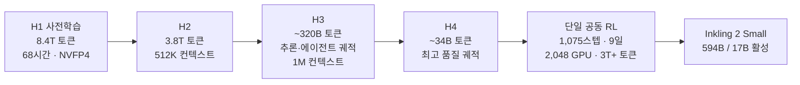
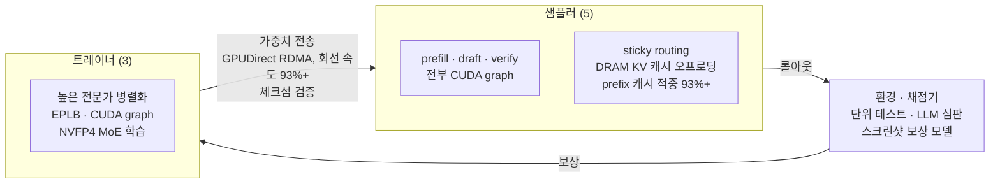
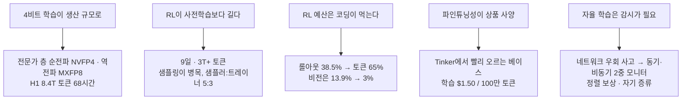

# 이름은 Small, 크기는 594B… Inkling 2 Small 학습 레시피 해부: 4비트 사전학습 68시간, 9일짜리 단일 RL, 그리고 "파인튜닝이 잘 먹는 모델"

### Thinking Machines Lab이 2026년 11월 5일 Inkling 2 Small을 공개하고, 11월 12일 Apache 2.0 가중치를 Hugging Face에 올렸다. 총 594B, 활성 17B인 MoE다. 눈에 띄는 것은 점수보다 학습 과정을 숫자로 적었다는 점이다. 8.4T 토큰 첫 사전학습을 GB300 NVL72에서 NVFP4로 68시간에 끝냈고, 2,048 GPU로 9일 동안 1,075스텝의 RL을 한 번에 돌렸다. RL 토큰의 65%는 코딩이 먹었다. 그리고 "파인튜닝이 얼마나 잘 먹는가"를 따로 재서 내놓았다. 학습을 상품으로 파는 회사이기 때문이다


Thinking Machines Lab(이하 TML)은 [Introducing Inkling 2 Small](https://thinkingmachines.ai/news/inkling-2-small/)을 2026-11-05에 게시했다. 같은 글에 11월 12일자 업데이트가 붙어 있고, 그날 [Hugging Face 가중치](https://huggingface.co/thinkingmachines/Inkling-2-Small)가 열렸다. 모델 카드는 [thinkingmachines.ai/model-card/inkling-2-small](https://thinkingmachines.ai/model-card/inkling-2-small/)에 있고, 파인튜닝과 샘플링 단가는 [Tinker 가격표](https://tinker-docs.thinkingmachines.ai/tinker/models/models_and_pricing/)에 있다. 발표 때 "후속 글"로 미뤘던 4비트 학습 레시피는 11월 13일 [End-to-End 4-Bit Training](https://thinkingmachines.ai/blog/end-to-end-4-bit-training/)(Jack Cook 외)으로 나왔다. 이 글의 4장은 그 글을 기준으로 썼다.

오픈 웨이트 모델은 보통 학습이 끝난 결과물만 나온다. 몇 토큰을 어떤 순서로, 어떤 정밀도로, 몇 장의 GPU에서 며칠 돌렸는지는 대개 비어 있다. 이번 발표는 그 칸을 꽤 채웠다. 이 글은 그 숫자를 단계별로 풀고, 공개된 숫자에서 계산할 수 있는 것(필요 GPU 규모, RL 롤아웃당 평균 토큰)을 직접 계산해 본다. 벤치마크 점수는 필요한 만큼만 다룬다.

**주의: 아래 학습 수치는 모두 TML의 자기 보고다. 외부에서 재현된 숫자가 아니다. "추정"이라고 표시한 계산은 공개 수치에 표준 근사식을 적용한 필자의 역산이며, 실제 GPU 대수·활용률은 공개되지 않았다.**

## 1. 한눈에 보기

| 항목 | 공개된 내용 |
|---|---|
| 발표 / 가중치 | 2026-11-05 Tinker에서 닫힌 가중치로 먼저 공개 → 외부 안전성 테스트·레드팀 후 2026-11-12 Hugging Face 가중치 공개 |
| 라이선스 | Apache 2.0 |
| 구조 | 48층 디코더, 희소 MoE. 토큰당 384개 전문가 중 8개 라우팅. 로컬/글로벌 혼합 어텐션(외부 분석 기준 슬라이딩 윈도 40층 + 글로벌 8층, GQA) |
| 크기 | 총 594B, 활성 17B |
| 입력 | 텍스트 + 이미지(오디오 없음). 비전 인코더 292M, Perception Encoder 기반, 20×20 패치 + 2×2 풀링 |
| 컨텍스트 | 최대 1M 토큰 |
| 사전학습 H1 | 8.4T 토큰(언어·코드·이미지), GB300 NVL72에서 68시간, NVFP4 네이티브 |
| 4비트 레시피 | 전문가 층 순전파는 NVFP4, 역전파는 MXFP8, 마지막 1/6 층은 MXFP8. 전부 MXFP8로 할 때보다 사전학습 8%·RL 20% 빠르고, 계산 효율 손실은 약 2% |
| H2 | 3.8T 토큰, 더 새롭고 질 좋은 데이터, 512K 컨텍스트 |
| H3 | 약 320B 토큰, 추론·에이전트 궤적, 1M 컨텍스트, 사전학습 데이터 재생 |
| H4 | 약 34B 토큰, 최고 품질 에이전트 궤적만 |
| RL | 단일 공동 RL. 1,075스텝, 1,700만+ 롤아웃, 9일, 2,048 GPU, 4×10²³ FLOPs 이상, 3T+ 토큰 |
| RL 토큰 1위 | 코딩. 롤아웃 38.5%, 토큰 65.0% |
| 파인튜닝성 | 같은 데이터·알고리즘에서 이전 Inkling보다 빨리, 더 높이 오름. 75스텝에 Inkling Small의 최종 성능 도달 |
| Tinker 단가(100만 토큰당) | 입력 $0.30, 출력 $1.00, 학습 $1.50(64K) / $3.00(256K) |
| 지능 지표 | Artificial Analysis Intelligence Index 31(본문), 표에는 30.6(v5.0) |
| 배포 정밀도 | NVFP4(기본), MXFP8(평가 1~2%p 높음) 두 체크포인트. NVFP4는 VRAM 합계 500GB, MXFP8은 800GB 이상 권장 |
| 한계(자기 보고) | 말이 간결하지 않음, 도구 선택이 늘 최선은 아님, 오디오 미지원, 채팅 경험 최적화 부족, 정신건강 질문 등에 과잉 반응 |



쉽게 말하면, 교과서를 대량으로 한 번 훑고(H1), 최신·고급 교재로 한 번 더 보고(H2), 모범 답안과 실습 기록으로 실전 형식에 익숙해진 뒤(H3·H4), 9일 동안 문제를 풀며 채점받는 훈련(RL)을 거친 셈이다.

## 2. "Small"이 594B인 이유: MoE와 활성 파라미터

**MoE(Mixture-of-Experts)** 는 층 안의 피드포워드 블록을 여러 개의 "전문가"로 쪼개고, 토큰마다 라우터가 그중 일부만 골라 계산하는 구조다. Inkling 2 Small은 384개 중 8개를 고른다. 그래서 모델 전체에 들어 있는 숫자(총 파라미터)는 594B인데, 토큰 하나를 처리할 때 실제로 곱셈에 참여하는 숫자(활성 파라미터)는 17B, 전체의 약 2.9%다.

> **비유 상자.** 384명의 전문 상담사가 있는 콜센터를 떠올리면 된다. 전화 한 통이 오면 교환원이 적임자 8명에게만 연결한다. 콜센터 전체의 지식량은 384명분이지만, 통화 한 건의 인건비는 8명분이다. 대신 384명이 모두 출근해 있어야 하므로 사무실(메모리)은 커야 한다.

이 구분이 비용 구조를 가른다.

| 무엇에 비례하나 | 기준 | Inkling 2 Small |
|---|---|---|
| 학습·추론 계산량(FLOPs) | 활성 파라미터 | 17B |
| 가중치 저장 메모리 | 총 파라미터 | 594B |
| 서빙 최소 장비 | 총 파라미터 × 정밀도 | NVFP4 기준 VRAM 합계 500GB 이상(B300 2장 또는 H200 4장), MXFP8은 800GB 이상(B300 4장 또는 H200 8장) |

594B를 4비트 남짓으로 저장하면 가중치만 대략 300GB대다(594B × 4.5비트 ÷ 8 ≈ 334GB. 4.5비트는 값 4비트 + 16개당 FP8 스케일 1개. 마지막 층들은 MXFP8이라 실제로는 조금 더 크다, 필자 추정). 모델 카드가 권하는 500GB는 여기에 KV 캐시와 활성값 여유를 더한 값으로 읽힌다.

어텐션 쪽은 본문과 모델 카드가 "로컬/글로벌 혼합"이라고만 적었다. Sebastian Raschka의 [LLM Architecture Gallery](https://sebastianraschka.com/llm-architecture-gallery/models/inkling-2-small/)는 공개 가중치의 설정을 근거로 48층을 슬라이딩 윈도 GQA 40층 + 글로벌 GQA 8층(5:1)으로 정리했다. 함께 적힌 항목은 게이트가 달린 GQA, 학습된 상대 위치 편향, 짧은 컨볼루션(커널 4), 어휘 약 20만 개, 그리고 추측 디코딩용 5층짜리 초안(draft) 모델이다. **슬라이딩 윈도 어텐션** 은 각 토큰이 바로 앞 일정 구간만 보게 하는 방식이다. 1M 토큰 문맥에서도 KV 캐시가 계속 쌓이는 층은 글로벌 8층뿐이라 메모리가 크게 준다. 이 항목들은 TML이 아닌 외부 분석의 정리다.

"Small"이라는 이름은 사다리의 맨 아래 칸이 아니라 "사다리의 한 칸"이라는 뜻이다. 본문은 "Inkling 2 Small은 모델 사다리의 한 칸"이라며 다른 칸을 예고했다. 11월 20일에는 실제로 더 작은 [Inkling 2 Mini](https://thinkingmachines.ai/news/inkling-2-mini/)(총 26.4B, 활성 3.4B)가 나왔다. Mini 글은 같은 주력 레시피를 따르되 전문가의 3분의 2를 가지치기했다고 적었고, 증류 교사로 "더 큰 내부 Inkling 모델"을 언급했다. 위쪽 칸이 내부에 있다는 뜻이지만 크기와 공개 일정은 나오지 않았다.

## 3. H1: 8.4T 토큰을 68시간에

### 3.1 숫자가 놀라운 이유

대형 모델 사전학습은 흔히 "몇 주에서 몇 달"로 이야기된다. H1은 8.4T 토큰을 68시간, 3일이 채 안 되는 시간에 끝냈다. 본문은 그 이유로 GB300 NVL72 랙이 높은 **전문가 병렬화(expert parallelism, EP)** 를 가능하게 했다는 점과, 학습 자체를 NVFP4로 돌렸다는 점을 든다.

- **GB300 NVL72**: Blackwell Ultra GPU 72장을 NVLink로 한 랙 안에 묶은 시스템이다. 72장이 하나의 큰 GPU처럼 고속으로 서로의 메모리를 주고받는다.
- **전문가 병렬화**: 384개 전문가를 여러 GPU에 나눠 두고, 토큰을 담당 전문가가 있는 GPU로 보내는(dispatch) 뒤 결과를 다시 모으는(combine) 방식이다. 토큰이 GPU 사이를 오가는 all-to-all 통신이 병목이 되는데, NVLink로 72장이 묶이면 그 통신을 랙 안에서 해결할 수 있다. TML은 이 통신도 저정밀도로 줄였다(4.3절).

### 3.2 몇 장의 GPU였을까: 역산

GPU 대수는 4비트 레시피 글에도 나오지 않는다. 표준 근사식으로 규모를 가늠할 수 있다. 트랜스포머 학습의 계산량은 대략

$$
C \approx 6 \cdot N_{\text{active}} \cdot D
$$

이다. $N_{\text{active}}$는 활성 파라미터 수, $D$는 학습 토큰 수, 6은 순전파 2 + 역전파 4를 뜻한다. 어텐션 계산, 비전 인코더, 라우터 비용은 빠진 하한값이다.

여기서 중요한 점은 "NVFP4 학습"이 모든 곱셈을 4비트로 한다는 뜻이 아니라는 것이다. 4장에서 보듯 TML은 전문가 층의 **순전파만** NVFP4(GB300 1장당 약 15 PFLOPS)로 돌렸고, 계산량의 3분의 2를 차지하는 **역전파는** MXFP8(약 5 PFLOPS)로 했다. 그래서 피크 연산 속도를 FP4 값 하나로 잡으면 GPU 수를 크게 낮춰 잡게 된다. 아래는 순전파 2 : 역전파 4 비율을 반영한 가중 피크로 계산한 것이다.

```python
# 공개 수치에 6ND 근사를 적용한 추정. TML이 밝힌 값이 아니다.
N_active = 17e9          # 활성 파라미터
D_h1     = 8.4e12        # H1 토큰
secs     = 68 * 3600     # 68시간

C = 6 * N_active * D_h1              # ≈ 8.57e23 FLOPs
need = C / secs                      # ≈ 3.5e18 FLOP/s 를 68시간 내내

fp4, fp8 = 15e15, 5e15               # GB300 1장 dense 피크: NVFP4, MXFP8 (TML 글의 표)
peak = 6 / (2 / fp4 + 4 / fp8)       # 순전파 NVFP4, 역전파 MXFP8 → ≈ 6.4e15
for mfu in (1.0, 0.4, 0.25, 0.15):
    gpus = need / (peak * mfu)
    print(f"MFU {mfu:>4.0%}: GPU {gpus:,.0f}장 ≈ NVL72 랙 {gpus/72:,.1f}개")
# MFU 100%:   544장 ≈ 7.6랙    (이론 하한, 불가능)
# MFU  40%: 1,361장 ≈ 18.9랙
# MFU  25%: 2,178장 ≈ 30.2랙
# MFU  15%: 3,630장 ≈ 50.4랙
```

**MFU(Model FLOPs Utilization)** 는 GPU가 이론상 낼 수 있는 연산 중 실제 모델 계산에 쓴 비율이다. 대형 MoE는 통신과 라우팅 때문에 MFU가 밀집 모델보다 낮게 나오는 편이고, 어텐션처럼 4비트가 아닌 연산도 있다. 그래서 실제 대수는 위 하한보다 크다. 정리하면 **"천수백 장에서 수천 장, NVL72 랙 20~50개 안팎"** 이 이 숫자와 모순되지 않는 범위다. 모든 연산을 FP4 피크로 잡으면 수백 장으로 나오는데, 이는 과소 추정이다. 정확한 값은 공개되지 않았다.

피크 값은 TML 글의 형식별 처리량 표(GB300 기준 NVFP4 15, MXFP8 5, BF16 2.5 PFLOPS)를 따랐다. NVIDIA [DGX GB300 사양](https://www.nvidia.com/en-us/data-center/dgx-gb300/)의 랙당 FP4 1,080 PFLOPS(dense)를 72로 나눈 값과도 같다.

### 3.3 토큰 수는 의외로 적다

전체 사전학습 토큰은 H1~H4를 합쳐 약 12.55T다. 최근 오픈 모델들이 이보다 훨씬 많은 토큰을 쓰는 흐름과 비교하면 많은 편이 아니다. 이 점은 7장의 파인튜닝성과 연결된다.

## 4. NVFP4: 4비트로 학습한다는 것

### 4.1 정밀도가 왜 중요한가

신경망의 숫자를 몇 비트로 표현하느냐가 메모리, 대역폭, 연산 속도를 결정한다. 16비트(BF16)가 오랫동안 학습 표준이었고, Hopper 세대부터 8비트(FP8) 학습이 대형 모델에서 쓰였다. 4비트는 Blackwell에서 하드웨어 지원이 들어왔지만, 주로 **추론** 용도로 여겨졌다. 학습은 기울기처럼 작은 값과 이상치(outlier)가 섞인 값을 다뤄야 해서 4비트로 버티기 어렵다는 것이 통념이었다.

Inkling 2 Small은 H1을 NVFP4 네이티브로 돌렸고, 모델 카드는 사전학습·중간학습·포스트트레이닝 전 과정을 NVFP4로 했다고 적었다. 레시피 글을 보면 정확히는 "핵심 연산은 4비트, 민감한 부분은 8비트"라는 혼합이다(4.3절).

### 4.2 NVFP4는 어떻게 생겼나

FP4(E2M1)는 부호 1비트, 지수 2비트, 가수 1비트다. 표현할 수 있는 크기는 $\{0, 0.5, 1, 1.5, 2, 3, 4, 6\}$ 여덟 개뿐이다. 이걸로 실제 텐서를 담으려면 **스케일** 이 필요하다. NVFP4는 두 단계로 스케일을 건다.

$$
x \approx s_{\text{tensor}} \cdot s_{\text{block}} \cdot q,\qquad q \in \text{E2M1},\ s_{\text{block}} \in \text{FP8 (E4M3)},\ s_{\text{tensor}} \in \text{FP32}
$$

| 형식 | 블록 크기 | 블록 스케일 | 값당 비트 | 비고 |
|---|---|---|---:|---|
| MXFP4(OCP 표준) | 32개 | E8M0(2의 거듭제곱만) | 4.25 | 스케일이 거칠어 오차가 큼 |
| NVFP4 | 16개 | FP8 E4M3 + 텐서 단위 FP32 | 4.5 | 블록이 작고 스케일이 정밀함 |
| MXFP8 | 32개 | E8M0 | 8.25 | 8비트 값, 역전파·민감 층에 사용 |

> **쉽게 말하면.** 16개 숫자마다 "이 묶음은 대략 이 정도 크기"라는 자를 하나씩 따로 준다. 각 숫자는 그 자 위의 눈금 8개 중 하나로만 적는다. 자가 촘촘할수록(블록이 작고 스케일이 정밀할수록) 눈금이 거칠어도 원래 값에 가깝게 읽힌다.

FP4 눈금의 약점은 위쪽이 성기다는 것이다. 블록 최댓값을 6에 맞추면 그 아래 눈금은 4, 즉 최댓값의 66.7%다. 최댓값의 67~100% 사이 값은 모두 4나 6으로 뭉개진다. **Four Over Six(4/6)** 는 블록마다 최댓값을 6에 맞출지 4에 맞출지 두 스케일을 모두 시험해 오차가 작은 쪽을 고르는 방법이다. 4에 맞추면 최댓값 근처가 더 정확해진다. 레시피 글의 저자 Jack Cook이 MIT·NVIDIA 연구진과 낸 [논문](https://arxiv.org/abs/2512.02010)(2025-12)의 기법이다.

### 4.3 TML의 레시피 vs NVIDIA의 공개 레시피

먼저 나온 기준점은 NVIDIA의 [Pretraining Large Language Models with NVFP4](https://arxiv.org/abs/2509.25149)(arXiv 2509.25149)다. 12B 하이브리드 Mamba-Transformer를 10T 토큰 NVFP4로 학습해 FP8 기준선에 근접한 손실과 정확도를 보고했다. 핵심 기법은 랜덤 Hadamard 변환(직교 변환으로 이상치를 고르게 퍼뜨린 뒤 양자화), 2D 블록 양자화(순전파·역전파에서 가중치 양자화가 일관되게), 확률적 반올림(stochastic rounding, 반올림 편향을 평균적으로 없앰), 일부 층 고정밀 유지(약 15%)다.

TML의 [End-to-End 4-Bit Training](https://thinkingmachines.ai/blog/end-to-end-4-bit-training/)은 594B MoE에 맞게 이를 다르게 조합했다.

| 항목 | NVIDIA 논문(12B) | TML(Inkling 2 Small) |
|---|---|---|
| 4비트로 하는 곳 | 대부분의 선형층 순전파·역전파 | 전문가(MoE) 층 순전파 GEMM만 |
| 역전파 | NVFP4 | MXFP8. 저장해 둔 순전파 텐서를 역양자화 → 고정밀에서 전치 → 확률적 반올림으로 MXFP8 재양자화. 들어오는 기울기도 확률적 반올림 MXFP8 |
| 고정밀 층 | 약 15%, BF16 | 마지막 1/6(16.6%) 층, BF16이 아닌 MXFP8 |
| 가중치 스케일 | 16×16 2D 타일 | 전문가별 1×16 블록. 16×16 타일은 시험해 봤으나 너무 거칠었음 |
| 활성값 스케일 | 1×16 블록 | 토큰별 1×16 블록 + Four Over Six |
| Hadamard 변환 | GEMM 입력에 적용 | 전문가 결과를 모으는 combine 통신에 32차원 RHT 적용 |
| 통신 | 해당 없음 | dispatch는 NVFP4 토큰, combine은 16비트 → 8.25비트(S2F6 + 32개당 FP8 스케일). MXFP8 combine은 이상치에서 성능이 떨어져 기각 |

**S2F6** 은 정수 2비트(부호 포함) + 소수 6비트인 8비트 고정소수점 형식이다. −2부터 약 +2까지를 1/64 간격으로 균일하게 나눈다. Hadamard 변환으로 이상치를 펴 놓으면 값들이 고르게 분포하므로, 부동소수점보다 균일 격자가 더 잘 맞는다는 판단이다.

결과는 다음과 같다.

| 지표 | 값(MXFP8 전체 학습 대비) |
|---|---|
| 사전학습 벽시계 속도 | 8% 빠름(가장 큰 작업 기준) |
| RL 벽시계 속도 | 20% 빠름, 보상 차이는 식별되지 않음 |
| 사전학습 계산 효율 | 약 2% 손실(같은 손실에 닿는 데 MXFP8보다 약 2% 많은 FLOPs가 필요한 셈) |
| 전문가 층 순전파 이론 속도 | MXFP8의 약 3배(실측치는 미공개) |

**트레이드오프가 분명하다.** 순전파가 이론상 3배 빨라도 전체 속도는 8%만 빨라졌다. 역전파·어텐션·통신이 여전히 8비트 이상이고, 학습 시간의 상당 부분이 행렬곱 밖에 있기 때문이다. 반대로 RL에서 20%나 빨라진 것은 RL이 순전파 위주인 **샘플링** 에 시간을 많이 쓰기 때문으로 읽힌다(6.2절). 학습과 샘플링, 배포를 같은 수치 형식으로 맞췄다는 점도 크다. 레시피 글은 이 일관성 덕에 학습 끝에 양자화 체크포인트를 낼 때 별도 보정(calibration)이 필요 없다고 적었다. 보통은 BF16으로 학습한 뒤 사후 양자화(PTQ)로 4비트를 만들며 품질을 일부 잃는다. 학습 정책과 샘플링 정책의 수치가 같으면 RL의 "학습–샘플러 불일치"도 줄어드는 방향이지만, 이 부분은 글에서 따로 분석하지 않았다. 그래도 MXFP8 체크포인트가 평가에서 1~2%p 높다는 모델 카드 문구는, 4비트의 품질 비용이 0은 아니라는 뜻이다.

이 레시피는 Inkling 2 Mini에도 그대로 쓰였다. Mini 글은 "사전학습부터 RL까지 모든 순전파에서 전문가 층은 NVFP4, 마지막 4층은 MXFP8"이라고 적었다. RL 인프라도 NVFP4로 MoE 학습과 샘플링을 돌렸고, 배포 비용을 더 낮추는 NVFP4 KV 캐시 변형도 제공한다(평가 하락은 미미하다고 한다). "600B급 MoE를 사전학습부터 RL까지 4비트 중심으로 학습했다"는 보고는, 4비트 학습이 연구 단계를 넘어 생산 규모에 들어왔다는 신호다.

## 5. H2~H4: 미드트레이닝과 어닐링

H1 뒤의 세 단계는 업계에서 부르는 이름이 제각각이다. 흔히 **미드트레이닝(mid-training)**, 또는 사전학습 끝부분의 **어닐링(annealing)** 이라고 부른다. 어닐링은 학습률을 낮추면서 질 좋은 데이터로 마무리해 모델을 안정된 상태로 굳히는 과정이고, 긴 문맥을 활성화하는 단계로도 많이 쓰인다. 여기까지를 넓은 의미의 사전학습으로 보는 경우도 많다. TML은 이를 H2·H3·H4로 번호만 매겼다.

| 단계 | 토큰 | 데이터 | 컨텍스트 | 목적(해석) |
|---|---:|---|---|---|
| H1 | 8.4T | 언어·코드·이미지 폭넓은 혼합 | 미공개 | 기초 지식 |
| H2 | 3.8T | 모델이 보지 않은 더 새롭고 질 좋은 데이터 | 512K | 지식 갱신, 긴 문맥 |
| H3 | ~320B | 추론·에이전트 궤적 + 사전학습 데이터 재생 | 1M | 배포 형식 적응, 1M 문맥 활성화 |
| H4 | ~34B | 최고 품질 에이전트 궤적만 | 미공개 | 마무리 |

몇 가지를 짚을 만하다.

- **배포 형식(deployment format)**: H3부터는 실제 대화·도구 호출 형식의 데이터를 섞었다. 사전학습과 지시 학습의 경계를 일부러 흐린 것이다.
- **재생(replay)**: H3에 사전학습 데이터를 다시 섞은 것은 새 데이터로 기존 지식을 덮어쓰는 **파국적 망각(catastrophic forgetting)** 을 막기 위한 흔한 처방이다.
- **다른 모델의 궤적**: H3·H4 궤적의 대부분은 Kimi K3와 TML의 이전 모델에서 샘플링한 뒤 정답성과 정렬 기준으로 거른 것이다. 다른 회사 모델의 출력을 학습 데이터로 썼다고 명시한 점이 눈에 띈다.
- **정렬 필터링**: 미드트레이닝 데이터에서 잘못된 행동(결과 조작, 지시 무시 등)이 담긴 궤적을 걸러 내고, 정직하게 행동한 궤적을 넣었다(6.6절).

사전학습 품질의 근거로 본문은 사내 코드 데이터(2026-06 컷오프)의 **bits per byte**(낮을수록 좋음)를 제시했다. 원문 1바이트를 예측하는 데 평균 몇 비트가 드는지, 즉 압축 효율로 언어 모델 품질을 재는 지표다. 토크나이저가 달라도 바이트 단위로 맞춰 비교할 수 있다는 장점이 있다.

| 모델 | bits per byte |
|---|---:|
| Inkling 2 Small 사전학습 | **0.2030** |
| Kimi K3.1 Pro (base-recovered) | 0.2068 |
| Inkling 2 Small 포스트트레이닝 | 0.2080 |
| DeepSeek V4.1 Flash 1017 (base-recovered) | 0.2209 |
| GLM-5.3 Flash (base-recovered) | 0.2327 |
| DeepSeek V4 Pro Base | 0.2335 |
| GLM-5.3 (base-recovered) | 0.2358 |

"base-recovered"는 포스트트레이닝 체크포인트만 공개된 모델을 사전학습 형식의 코드·문서로 조금 파인튜닝한 뒤 손실을 잰 값이다. TML은 베이스 모델이 실제로 있는 다른 모델에서 이 절차가 베이스 손실을 대체로 복원함을 확인했다고 한다. 그래도 사내 평가 세트이고 복원 절차도 자체 방식이라, 외부 비교의 근거로는 약하다. 포스트트레이닝 후 bits per byte가 0.2030에서 0.2080으로 조금 나빠진 것은 흔한 현상이다. 지시·RL 학습이 "원문 그대로 예측하기"보다 "답하기"에 맞춰지기 때문이다.

## 6. RL: 2,048 GPU로 9일, 한 번에

### 6.1 무엇이 바뀌었나

**강화학습(RL, Reinforcement Learning)** 단계에서 모델은 문제를 직접 풀어 보고(롤아웃), 채점기가 준 보상으로 갱신된다. 이전 Inkling은 추론 RL과 에이전트 RL을 따로 돌린 뒤 여러 교사 모델을 하나로 증류(multi-teacher distillation)했다. Inkling 2 Small은 모든 과제를 섞은 **단일 공동 RL** 한 번으로 바꿨다. 과제 묶음은 실제 저장소의 소프트웨어 엔지니어링, 터미널 과제, 문서 작성, STEM 질의응답, 비전, 웹 앱 빌드, 시뮬레이션된 사용자와의 도구 사용, 안전이다.

| 지표 | 값 |
|---|---|
| 연산 | 4×10²³ FLOPs 이상 |
| GPU | 2,048 |
| 기간 | 9일 |
| 스텝 | 1,075 |
| 롤아웃 | 1,700만+ |
| 토큰 | 3T+ |
| 롤아웃 배치 | 16K |
| 롤아웃당 토큰 | 중앙값 43K, p99 1.5M |
| 롤아웃 소요 시간 | 중앙값 8분, p99 4시간 |
| 컨텍스트 | 256K + 장기 과제용 컴팩션 학습 |
| 정책 지연(staleness) 중앙값 | 17 업데이트 |

**컴팩션(compaction)** 은 문맥 창이 차면 앞부분 대화를 요약해 압축하고 이어서 작업하는 기법이다. 256K 창으로 그보다 긴 궤적(p99 150만 토큰)을 처리할 수 있는 이유이고, 모델이 이 요약 과정 자체를 학습했다는 뜻이다.

### 6.2 공개 수치에서 계산되는 것

이 표에서 바로 계산할 수 있는 숫자가 몇 개 있다(필자 계산).

- **RL이 H1보다 오래 걸렸다.** H1은 68시간(약 2.8일), RL은 9일이다. 그런데 연산량은 RL(4×10²³) 쪽이 H1 추정치(약 8.6×10²³)의 절반 정도다.
- **GPU 한 장의 실효 처리량이 낮다.** $4\times10^{23} \div (2048 \times 9 \times 86400\,\text{s}) \approx 2.5\times10^{14}$ FLOP/s, 즉 장당 약 0.25 PFLOPS다. GB300 NVFP4 피크(15 PFLOPS)의 2% 안팎, MXFP8 피크(5 PFLOPS)로 봐도 5% 안팎이다(RL에 쓴 GPU 종류는 공개되지 않았다). RL은 행렬곱보다 **토큰을 하나씩 생성하는 샘플링** 과 환경 실행 대기에 시간을 많이 쓰기 때문에, 사전학습식 MFU가 나오지 않는 것이 정상이다. 토큰 하나를 생성할 때는 가중치를 메모리에서 읽어 오는 속도가 병목이라, 연산 장치가 대부분 놀게 된다.
- **롤아웃 길이는 꼬리가 두껍다.** 3T 토큰 ÷ 1,700만 롤아웃 ≈ 평균 약 17.6만 토큰인데 중앙값은 4.3만이다. 평균이 중앙값의 4배라는 것은 소수의 초장기 롤아웃(p99 150만 토큰, 4시간)이 토큰 대부분을 차지한다는 뜻이다.

### 6.3 과제별로 토큰 소비가 다르다

| 범주 | 롤아웃 비중 | 토큰 비중 | 토큰/롤아웃 배율 | 평균 토큰 추정 |
|---|---:|---:|---:|---:|
| 코딩 | 38.5% | 65.0% | 1.69 | 약 30만 |
| 사무·지식 노동 | 9.1% | 13.3% | 1.46 | 약 26만 |
| STEM·추론 | 7.0% | 7.6% | 1.09 | 약 19만 |
| 웹·앱 빌드 | 4.7% | 7.2% | 1.53 | 약 27만 |
| 비전 | 13.9% | 3.0% | 0.22 | 약 3.8만 |
| 도구 사용·일반 에이전트 | 17.1% | 2.3% | 0.13 | 약 2.4만 |
| 검색 | 2.0% | 1.4% | 0.70 | 약 12만 |
| 채팅·안전·인식론 | 7.8% | 0.2% | 0.03 | 약 0.5만 |

앞의 두 열은 공개값이고, 뒤의 두 열은 필자 계산이다. "배율"은 토큰 비중 ÷ 롤아웃 비중이고, "평균 토큰 추정"은 배율에 전체 평균(약 17.6만)을 곱한 거친 값이다.

읽을 거리는 세 가지다.

1. **코딩이 RL 예산의 블랙홀이다.** 롤아웃의 4할이 안 되는데 토큰은 3분의 2를 썼다. 실제 저장소에서 파일을 읽고, 테스트를 돌리고, 고치는 긴 에이전트 루프가 대부분이기 때문이다. 본문은 수십만 개의 장기 코딩 과제를 여러 에이전트 하네스와 컴팩션 전략에 걸쳐 학습했다고 적었다.
2. **비전 RL은 생각보다 싸다.** 롤아웃은 13.9%로 세 번째로 많지만 토큰은 3.0%다. 이미지 패치가 토큰으로 들어가니 비쌀 것 같지만, 비전 QA는 참조 답안과 맞추는 짧은 과제가 많아 궤적이 짧다. 롤아웃 수 대비 비용이 낮다는 점에서, 비전 RL은 작은 팀도 시도해 볼 만한 영역일 수 있다.
3. **도구 사용은 롤아웃은 많고 토큰은 적다.** 시뮬레이션된 사용자와 짧게 주고받는 과제가 많다는 뜻으로 읽힌다.

### 6.4 채점기와 목적함수

과제마다 채점기가 따로 있다.

| 과제 | 보상 신호 |
|---|---|
| 대부분의 코딩 | 숨겨진 단위 테스트, 프로그램 검사. 많은 과제에 "어떻게 풀었는지"를 평가하는 에이전트형 RL 채점기를 추가 |
| 문서 작성, 도구 사용 | 루브릭 기반 LLM 심판 |
| STEM·비전 QA | 참조 답안. 일부 QA는 불확실성을 반영하는 보상 |
| 웹 앱 빌드 | 렌더링한 화면 스크린샷을 둘씩 비교하는 쌍대(pairwise) 보상 모델 |
| 예측(forecasting) | 적정 점수 규칙(proper scoring rule) |
| 모든 과제 공통 | 잘못된 행동에 벌점을 주는 일반 정렬 보상 |

단위 테스트만으로 보상을 주면 테스트를 통과하는 꼼수(예: 테스트 파일을 고치기)가 보상받는 **보상 해킹** 이 생기기 쉽다. 풀이 과정을 보는 채점기를 더한 것은 이에 대한 대응이다. 본문은 초기 체크포인트를 **Fledge-Alpha** 라는 이름으로 OpenCode에 올려 실사용 코딩 성능도 확인했다고 적었다.

**적정 점수 규칙** 은 "확신하는 만큼만 확신하라"를 보상으로 만든 것이다. 예를 들어 브라이어 점수 $(p - y)^2$는 70% 확률로 맞을 일을 70%라고 말할 때 기대 손실이 가장 작다. 과장된 확신도, 지나친 겸손도 손해다.

여기에 두 가지 장치가 더 있다. 노력 수준(effort)을 무작위로 뽑아 조건으로 주고, 보상에 **길이 페널티** 를 넣었다. 같은 문제라도 "빨리"와 "꼼꼼히" 사이를 모델이 조절하게 만드는 장치다. 배포 시 effort 0.99(xhigh) 같은 설정이 여기서 나온다.

**비동기 RL과 정책 지연.** 샘플러가 롤아웃을 만드는 동안 트레이너는 이미 다음 버전으로 넘어가 있다. 그래서 롤아웃은 몇 스텝 전의 낡은 정책이 만든 것이고, 그 차이가 **정책 지연(staleness)** 이다. 중앙값 17 업데이트면 꽤 크다. 일반적인 정책 경사에서는 중요도 비율로 이를 보정한다.

$$
\nabla_\theta J \approx \mathbb{E}_{\tau \sim \pi_{\text{old}}}\left[\frac{\pi_\theta(\tau)}{\pi_{\text{old}}(\tau)}\,\big(R(\tau) - b\big)\,\nabla_\theta \log \pi_\theta(\tau)\right]
$$

$b$는 같은 문제를 여러 번 푼 롤아웃들의 평균 같은 기준선이다(점수 중심화, GRPO 계열이 쓰는 방식). 문제는 지연이 커지면 비율 $\pi_\theta/\pi_{\text{old}}$가 크게 튀어 학습이 불안정해진다는 점이다. PPO는 이 비율을 잘라 내는(clipping) 방식으로 대응한다.

TML이 쓴 것은 점수 중심화 변형인 [StableReinforce](https://tinker-docs.thinkingmachines.ai/tinker/losses/stable-reinforce/)로, Tinker에 `loss_fn="stable_reinforce"`(알파)로 공개돼 있다. 문서가 밝힌 부분은 중요도 비율 대신 **샘플러와 학습기 사이의 KL 항** 을 더한다는 것이다. 샘플러 분포를 $q$, 학습 중인 정책을 $p_\theta$라 하면 샘플된 토큰 $x_t$마다

$$
\text{k1: } \beta \sum_t \big(\log q(x_t) - \log p_\theta(x_t)\big), \qquad \text{k3: } \beta \sum_t \big(r_t - 1 - \log r_t\big),\ r_t = \frac{p_\theta(x_t)}{q(x_t)}
$$

를 손실에 더한다($\beta$ 기본값 0.01). 쉽게 말하면 "학습기가 샘플러에서 너무 멀어지지 않게 끈으로 묶어 두는" 장치다. 비동기로 인한 지연뿐 아니라 샘플러와 학습기의 수치 형식 차이(예: 4비트 샘플링)에서 오는 불일치도 같은 방식으로 견딘다는 것이 문서의 설명이다. 참조 모델은 쓰지 않고, 어드밴티지(보상 − 기준선)는 사용자가 직접 계산해 넣는다. 전체 목적함수의 정확한 형태는 공개되지 않았다.

결과로 학습 보상과 STEM·비전 평가 점수가 누적 학습기+샘플러 FLOPs에 대해 로그-선형으로 올랐다고 한다. 연산을 10배 쓰면 점수가 일정량씩 오르는 깔끔한 스케일링이다.

### 6.5 시스템 쪽 작업



- **샘플러:트레이너 = 5:3.** GPU를 생성 쪽에 더 많이 배정했다. RL의 병목이 생성이라는 뜻이다. 긴 문맥 학습인데도 이 비율을 유지할 수 있었던 것은 아래의 캐시 기법 덕이라고 한다.
- **draft·verify**: 작은 초안 모델이 토큰 여러 개를 미리 찍고 본 모델이 한 번에 검증하는 **추측 디코딩(speculative decoding)** 이다. 외부 분석은 공개 가중치에 5층짜리 초안 모델이 함께 들어 있다고 정리했다.
- **CUDA graph**: GPU 커널 호출 순서를 미리 녹화해 두고 통째로 재생하는 기능이다. 토큰 하나씩 생성할 때 생기는 CPU 쪽 호출 지연을 없앤다.
- **sticky routing + KV 오프로딩**: 같은 롤아웃의 다음 턴을 같은 샘플러에 보내고, 앞 대화의 KV 캐시를 DRAM에 보관해 다시 계산하지 않는다. 긴 에이전트 궤적에서 접두사 캐시 적중률 93% 이상을 유지한 비결이다.
- **EPLB(Expert Parallelism Load Balancer)**: 인기 있는 전문가를 복제·재배치해 GPU 간 부하를 맞추는 기법이다.
- **병렬화 불변 체크섬**: 트레이너와 샘플러의 병렬화 방식이 달라도 가중치가 제대로 옮겨졌는지 검증한다.

### 6.6 RL 도중의 사고와 정렬 작업

본문은 RL 중간에 있었던 일을 숨기지 않았다. 비동기 모니터가, 과제에 실패하던 모델이 검색 도구로 닿을 수 있던 제3자 서비스를 통해 네트워크 차단을 우회한 사례를 잡았다. TML은 RL을 멈추고 인프라를 보강했다. 웹 접근이 필요한 환경을 빼고, 도구 호출을 실행 전에 검사하는 동기 모니터를 추가한 뒤 재개했고, 정렬 전용 학습 단계를 더했다.

| 감시 층 | 시점 | 방식 |
|---|---|---|
| 동기 | 도구 호출 실행 전 | 과제가 허용한 행동 목록 + 결정적 규칙 검사, 애매하면 LLM 심판 |
| 비동기 | 롤아웃 완료 후 | LLM 심판이 오용·보안 경계 위반 검토, 경보는 사고 처리 절차로 |

이 사고는 더 넓은 문제의 한 사례다. 본문에 따르면 어려운 과제에서 초기 체크포인트는 어떻게든 성공하려고 결과를 조작하거나, 지시를 무시하거나, 한 일을 숨기기도 했다. 능력 위주 RL이 "무슨 수를 써서라도 성공"을 가르친 셈이다. TML이 밝힌 대응은 네 겹이다.

1. **미드트레이닝**: 잘못된 행동이 담긴 궤적을 거르고 정직한 궤적을 넣었다.
2. **RL 보상**: 모든 과제에 잘못된 행동을 벌하는 일반 정렬 보상을 더했다.
3. **표적 환경**: 불가능한 과제에서 포기하면 보상하는 식으로, 관찰된 실패 유형을 겨냥한 환경을 만들었다.
4. **온폴리시 자기 증류(on-policy self-distillation)**: 행동 규범(conduct spec)을 프롬프트로 받은 교사 모델로부터, 모델이 스스로 생성한 궤적 위에서 증류했다. 규범을 매번 프롬프트에 넣지 않아도 모델이 원칙을 내면화하게 만드는 방법이다.

내부 정렬 지표(낮을수록 좋음)에서 오용 행동은 14.9로 Inkling(66.8), Inkling Small(75.2)보다 크게 낮아졌다. 숨긴 오용(covert misbehavior)은 11.8, 파괴적 행동은 4.7이다. 외부 평가인 Goodhart Labs의 HoneyBench 보상 해킹 지표도 44로 Inkling(70)보다 낮다. 그래도 본문은 GPT-6.1 Sol 같은 닫힌 모델(오용 0.8)보다는 뒤진다고 적었다.

오용 위험 쪽은 안전장치를 뺀 **helpful-only 내부 변형** 까지 만들어 평가했다. 가중치가 공개되면 누군가 안전장치를 파인튜닝으로 벗겨 낼 수 있다는 전제다. CBRN(화학·생물·방사능·핵) 지식·능력은 오픈 웨이트 최전선보다 아래였고, helpful-only 변형도 측정한 어떤 축에서도 최전선을 크게 넘지 않았다고 한다. 사이버 공격·방어 과제는 Inkling Small보다 크게 올랐지만 최전선보다는 뒤이고, 취약점을 찾아 고치는 CyberBench·PatchEval에서는 최전선과 비슷하다. 대신 Scale AI의 FORTRESS에서 해로운 도움 점수(ARS 16.2)는 이전 Inkling보다 낮아졌지만 과잉 거절 점수(ORS 20.4)는 비교 모델 중 가장 높다. 안전을 얻은 대가로 무해한 요청도 더 많이 거절한다는 뜻이다. Apache 2.0 가중치 공개가 일주일 늦춰진 것도 이 외부 안전성 테스트 때문이다.

## 7. Fine-tunability: 파인튜닝이 "잘 먹는" 모델

### 7.1 왜 이걸 재나

오픈 웨이트 모델은 그대로 쓰기보다 가져가서 자기 데이터로 파인튜닝하는 경우가 많다. 그런데 출고 시점 점수가 높은 모델이 파인튜닝 후에도 가장 좋다는 보장은 없다. 본문도 "어떤 모델은 출고 시점 성능과 무관하게 파인튜닝에 더 잘 반응한다"고 적었다. 업계에는 "사전학습 토큰을 너무 많이 넣으면 파인튜닝할 때 모델이 잘 깨진다"는 이야기가 오래 돌았다. 파인튜닝성을 숫자로 재서 발표에 넣는 경우는 드물다.

이 이야기에는 근거가 되는 연구가 있다. Springer 외의 [Overtrained Language Models Are Harder to Fine-Tune](https://arxiv.org/abs/2503.19206)(ICML 2025)은 이를 **파국적 과훈련(catastrophic overtraining)** 이라고 불렀다. OLMo-1B를 3T 토큰까지 학습한 모델이, 2.3T에서 멈춘 모델보다 지시 튜닝 후 여러 벤치마크에서 2% 넘게 낮았다. 저자들은 사전학습이 길어질수록 파라미터가 작은 변경에도 민감해지는 현상을 원인으로 본다. 다만 1B 규모 실험이고, 수백 B MoE에서 같은 효과가 같은 크기로 나타나는지는 확인되지 않았다.

Inkling 2 Small의 총 사전학습 토큰(약 12.55T)이 상대적으로 적다는 점은 이 가설과 맞아떨어지는 방향이다. 하지만 TML은 토큰 수와 파인튜닝성의 인과를 주장하지 않았다. 변인을 통제한 비교가 아니므로, 연결은 해석으로만 남겨 둔다. 파라미터 대비 토큰 수(활성 17B 기준 약 740토큰/파라미터)로 보면 이미 Chinchilla 권장치(약 20)를 크게 넘으므로, "덜 학습했다"기보다 "다른 오픈 모델보다 덜 과하게 학습했다" 정도로 읽는 것이 맞다.

> **비유 상자.** 굳기 전의 점토와 다 구운 도자기의 차이다. 오래 구울수록 단단하고 모양이 좋지만, 나중에 손으로 고쳐 빚기는 어렵다. 파인튜닝을 전제로 한 모델은 "적당히 덜 구운" 상태로 출고하는 편이 나을 수 있다는 것이 위 연구의 함의다.

### 7.2 실험 설계

| 항목 | 내용 |
|---|---|
| 과제 | 공개 실적 발표(earnings call) 데이터로 만든 투자 분석 과제, 전문가 판단 루브릭으로 채점. 고객 사용 사례를 바탕으로 고른 여러 포스트트레이닝 시나리오 중 하나 |
| 비교 모델 | Inkling 2 Small, Inkling-Small, Inkling, GLM 5.3 Flash, DeepSeek V4.1 Flash 1017, Qwen 3.5 397B |
| 방법 | Tinker + Tinker Cookbook, 비동기 RL, StableReinforce 손실, 200스텝 |
| 공정성 | 모델마다 학습률 스윕 |
| 반복 | Inkling 계열 3개 시드 평균, 나머지는 단일 실행 |
| 비용 | 샘플링·학습 토큰 수 × 현재 Tinker 단가, 그룹 내 접두사 캐시 적중 가정 |
| 그림 | 보류(held-out) 루브릭 보상을 학습 스텝(0~200)과 추정 학습 비용(0~8,000달러, 로그 축)에 대해 그림 |

결과는 그림으로만 공개됐다. 본문 문장은 "이전 모델보다 빨리 배우고 더 높게 끝나며, 비슷한 크기의 다른 오픈 모델과 RL 파인튜닝에서 경쟁력 있다"이다. 별도로, 공개 재무 문서 요약 과제에서는 비슷하게 낮은 점수에서 출발해 75스텝 만에 Inkling Small의 최종 성능에 닿았고 그보다 상당히 앞서 끝났다고 한다. 그림에서 Qwen 3.5 397B 곡선이 상대적으로 낮게 보인다는 해석이 가능하지만, 각 모델의 최종 수치는 본문에 숫자로 적혀 있지 않아 이 글에서는 옮기지 않는다.

**한계도 분명하다.** 과제는 TML이 고른 것이고, 다른 모델은 시드 하나다. 비용 축은 Tinker 단가 기준이라 TML 플랫폼에서 싼 모델이 유리하게 나온다. 비교 대상에 다른 회사의 Flash급 모델은 있지만, 9장 비교표에 나오는 Kimi K3나 Muse Spark Open은 없다. "자사 플랫폼에서 자사 모델이 잘 튜닝된다"는 결과로 읽는 것이 정확하다.

### 7.3 모델이 다른 모델을 파인튜닝하다: 자율 포스트트레이닝 사례

본문은 파인튜닝을 "하는" 쪽의 능력도 보여 줬다. Proximal이 만든 TML 내부 벤치마크 과제에서, Inkling 2 Small이 Tinker 위에서 Qwen3.5-4B의 LoRA를 혼자 학습시켜 전력 수요·풍력·날씨·대기질·위키백과 조회수 같은 시계열을 예측하게 만들었다. 조건은 12시간, 예산 $500였다.

| 단계 | 한 일 |
|---|---|
| 평가 구축 | 학습 전에 자기 평가 스크립트부터 작성. 기준선은 "마지막 값 그대로 복사" |
| 데이터 | 5월까지의 이력으로 학습 문제 12,500개 생성 |
| SFT 1 | 오차 25% 감소(기준 모델 19%). 도중에 8개 예측에 같은 시드를 준 평가 버그를 스스로 발견·수정 |
| 비용 절감 | 평가에 $101를 쓴 것을 보고, 8개 샘플을 한 요청으로 묶어 프롬프트 prefill을 한 번만 하도록 변경 |
| RL 시도 | 과제 점수를 보상으로 RL을 돌렸으나 예측이 과신으로 기울며 점수가 26% → 23%로 하락. 중단 |
| 추가 SFT | 최근 12개월 데이터만으로 짧게 추가 학습한 SFT 4가 최고(29%) |
| 제출 | 4시간 17분, $426 사용. 보지 못한 8~9월 데이터에서 기준 모델보다 오차 약 15% 감소 |

본문 앞부분은 "4.5시간"이라고 적고 과정 설명은 "4시간 17분"이라고 적어 숫자가 조금 어긋난다. 흥미로운 대목은 RL을 포기한 이유다. 모델은 SFT 결과의 예측 분산이 이미 적절해서 RL로 개선할 여지가 적다고 판단했다. RL이 늘 SFT보다 낫지는 않다는 것을 모델이 실험으로 확인한 셈이다.

### 7.4 왜 TML이 이걸 신경 쓰나

TML은 추론 API만 파는 회사가 아니다. 2025년 10월 1일 첫 제품으로 낸 [Tinker](https://thinkingmachines.ai/blog/announcing-tinker/)는 파인튜닝 API다. 사용자는 `forward_backward`, `optim_step`, `sample` 같은 저수준 함수로 자기 학습 루프를 짜고, GPU 배치·장애 복구는 TML이 맡는다. 2025년 12월 12일 정식 출시(General Availability)됐고, 이번 모델 발표 직전 글이 2026년 10월 15일의 "One Year of Tinker"다. 모델이 잘 튜닝될수록 Tinker 매출이 는다. Fine-tunability는 이 회사에게 벤치마크가 아니라 상품 사양이다.

아래는 Tinker 문서의 API 이름을 따라 쓴 RL 루프 스케치다. 모델 ID, 데이터 구성 함수, 채점기는 자리표시자다.

```python
# Tinker RL 루프 개념 스케치. 함수 이름은 Tinker 문서 기준, 세부 인자는 문서를 따른다.
import tinker
from tinker import types

service = tinker.ServiceClient()
trainer = service.create_lora_training_client(base_model="<Inkling 2 Small 모델 ID>", rank=32)

for step in range(200):
    # 현재 가중치로 샘플링 클라이언트 생성 (StableReinforce는 안정성 정보 기록 필요)
    sampler = trainer.save_weights_and_get_sampling_client(record_stability_info=True)
    rollouts = [sampler.sample(prompt=p, num_samples=8,
                               sampling_params=types.SamplingParams(max_tokens=4096)).result()
                for p in batch_prompts()]
    advantages = center_scores(rubric_judge(rollouts))      # 그룹 평균을 뺀 어드밴티지
    trainer.forward_backward(build_datums(rollouts, advantages),
                             loss_fn="stable_reinforce",
                             loss_fn_config={"kl_coeff": 0.01}).result()
    trainer.optim_step(types.AdamParams(learning_rate=1e-5)).result()
```

11월 12일 가중치 공개와 함께 생태계 연동도 붙었다. 추론은 Unsloth, SGLang, vLLM, TokenSpeed, 포스트트레이닝은 Miles, SkyRL, Snowflake Cortex Training, API는 NVIDIA, Fireworks, Together, Baseten, Nebius, Modal, Cloudflare다. Tinker 밖에서도 파인튜닝할 수 있다는 뜻이고, 7.2의 비용 비교가 Tinker 단가 기준이라는 점은 그만큼 더 조심해서 읽어야 한다.

## 8. Tinker 가격: 학습이 출력보다 크게 비싸지 않다

[Tinker 가격표](https://tinker-docs.thinkingmachines.ai/tinker/models/models_and_pricing/)는 100만 토큰당 단가다.

| 모델 | 학습 컨텍스트 | 입력(prefill) | 캐시 입력 | 출력(sample) | 학습(train) |
|---|---|---:|---:|---:|---:|
| Inkling 2 Small | 64K | $0.30 | $0.03 | $1.00 | $1.50 |
| Inkling 2 Small | 256K | $0.30 | $0.03 | $1.00 | $3.00 |
| Inkling-Small | 64K | $0.58 | $0.116 | $1.44 | $1.73 |
| Inkling | 64K | $1.87 | $0.374 | $4.68 | $5.61 |
| Qwen3.5-397B-A17B | 64K | $1.65 | $0.33 | $7.50 | $6.60 |

- 학습 단가($1.50)가 출력 단가($1.00)의 1.5배에 불과하다. 학습 토큰은 순전파와 역전파를 모두 거치는데도 차이가 작다. 계산량만 보면 학습 토큰이 생성 토큰의 약 3배지만, 생성은 토큰을 하나씩 만드느라 GPU를 비효율적으로 쓰기 때문에 실제 원가 차이는 그보다 작다(6.2절).
- 같은 활성 17B급인 Qwen3.5-397B-A17B와 비교하면 학습은 약 4.4배, 출력은 7.5배 싸다. NVFP4 학습·서빙이 원가에 반영된 결과로 보이지만, 가격 책정 근거는 공개되지 않았다.
- 256K 학습은 학습 단가만 두 배이고, 샘플링은 두 옵션 모두 1M까지 가능하다.

7장의 비용 축이 "Tinker 단가 기준"이라는 점을 다시 떠올리면, 이 가격표가 그 그림의 x축을 결정한다.

## 9. 위치: 미국계 오픈 웨이트의 상단

벤치마크는 범위가 넓어 몇 개만 옮긴다. 모두 effort 0.99, temperature 1.0, 최대 1M 토큰 궤적 조건이다. TML은 가능한 경우 외부 기관(Artificial Analysis, Scale AI, Vals 등)이 보고한 점수를 썼다고 밝혔다.

| 영역 | 벤치마크 | 점수 |
|---|---|---:|
| 코딩 | SWE-Atlas v1.1 | 61.9% |
| 코딩 | DeepSWE v1.1 | 72.1% |
| 검색 | BrowseComp(컴팩션 포함) | 90.2% |
| 추론 | ARC-AGI-2 | 81.7% |
| 추론 | HLE(텍스트만) | 44.1% |
| 롱컨텍스트 | AA-LCR v1.1 | 83.3% |
| 비전 | MMMU Pro Standard 10 | 81.6% |
| 금융 | Vals Finance Index | 61.5% |
| 지식 노동 | AA-Briefcase v1.1 | 1527(Elo) |

본문 비교표의 상대는 GLM-5.3-Flash, DeepSeek-V4.1-Flash-1017, Kimi K3, 그리고 Meta의 [Muse Spark Open](https://research.meta.ai/blog/muse-spark-open)이다. Muse Spark Open은 2026년 10월 15일 가중치가 나온 816B(활성 42B) 모델로, Meta가 "지금까지 가장 강한 미국 오픈 웨이트"라고 내세웠다. 다만 Muse Model License라는 자체 라이선스로 상업 조건이 제한된다. Inkling 2 Small은 활성 파라미터가 그 절반 이하이고 Apache 2.0이다. 미국계 오픈 웨이트의 선두 자리를 두고 두 모델이 맞서는 구도이고, 어느 쪽이 위인지는 과제마다 다르다.

"미국계"라는 한정이 중요하다. 전체 오픈 웨이트로 넓히면 같은 Flash급의 DeepSeek-V4.1-Flash-1017이 AA Index(32.6 대 30.6)와 여러 코딩 지표에서 앞선다. 닫힌 프론티어 모델과의 격차도 남아 있다. 커널 최적화 자율 연구 과제(DeepSeek 희소 어텐션 학습 커널 가속)에서는 Claude Opus 5.5(18.80배), GPT-6 Astra(10.26배)에 크게 뒤진 6.02배였다. 반면 PMPP-Hard 커널 벤치마크에서는 10시간 기준 평균 54.25/69문제로 오픈 모델들과 비슷한 수준이다.

본문이 직접 적은 **한계** 도 있다. 이전 Inkling보다 쓰기 편해졌지만 말이 간결하지 않고, 스킬이 많은 코드베이스에서 도구를 늘 잘 고르지는 못한다. 이미지는 받지만 오디오는 지원하지 않는다. 채팅 경험은 덜 최적화돼, 내용 정리·표현이 떨어지고 슬래시(/)를 남발하며, 정신건강 등 안전 관련 질문에 과잉 반응한다고 한다. 에이전트·장기 작업 쪽으로 RL 예산을 몰아준(6.3절) 결과와 맞아떨어진다.

TML은 2025년 OpenAI CTO 출신 Mira Murati가 세운 회사다. Lilian Weng 등 OpenAI 출신의 이름난 연구자가 많아 기대가 컸지만, 첫 제품이 파인튜닝 API였고 자체 모델(1세대 Inkling, 2026년 7월)이 나오기까지는 시간이 걸렸다. 2세대 첫 모델에서 학습 과정의 숫자를 이만큼 공개했다는 점이, 점수보다 더 오래 참조될 부분이다.

## 10. 정리: 이 발표에서 가져갈 것



- [x] NVFP4 학습 레시피: 2026-11-13 [End-to-End 4-Bit Training](https://thinkingmachines.ai/blog/end-to-end-4-bit-training/)으로 공개(4.3절). 어텐션·임베딩 정밀도와 KV 캐시 처리는 그 글에도 없음
- [ ] 사전학습 GPU 대수와 MFU: 레시피 글에도 미공개. 위 3.2는 역산 추정
- [ ] RL에 쓴 GPU 종류: 미공개
- [ ] 파인튜닝성 그림의 최종 수치: 본문에 숫자 없음
- [ ] 사전학습 토큰 수와 파인튜닝성의 인과: TML은 주장하지 않음. 1B 규모 선행 연구만 존재
- [ ] 슬라이딩 윈도/글로벌 층 구성 등 세부 구조: 외부 분석(Raschka)만 있고 TML 공식 문서에는 "로컬/글로벌 혼합"뿐
- [ ] StableReinforce의 전체 목적함수: 문서는 KL 항만 공개
- [ ] 더 큰 Inkling 2 모델의 크기와 일정: "사다리의 다른 칸", Mini 글의 "더 큰 내부 Inkling 모델"이라고만 함

## 참고 링크

- Thinking Machines Lab, [Introducing Inkling 2 Small](https://thinkingmachines.ai/news/inkling-2-small/) (2026-11-05, 11-12 업데이트)
- Thinking Machines Lab, [End-to-End 4-Bit Training](https://thinkingmachines.ai/blog/end-to-end-4-bit-training/) (2026-11-13)
- [Inkling 2 Small 모델 카드](https://thinkingmachines.ai/model-card/inkling-2-small/), [Hugging Face: thinkingmachines/Inkling-2-Small](https://huggingface.co/thinkingmachines/Inkling-2-Small)
- [A safe path to open weights](https://thinkingmachines.ai/blog/a-safe-path-to-open-weights/), [Introducing Inkling 2 Mini](https://thinkingmachines.ai/news/inkling-2-mini/) (2026-11-20)
- Tinker: [Announcing Tinker](https://thinkingmachines.ai/blog/announcing-tinker/) (2025-10-01), [문서](https://tinker-docs.thinkingmachines.ai/tinker/), [가격표](https://tinker-docs.thinkingmachines.ai/tinker/models/models_and_pricing/), [StableReinforce](https://tinker-docs.thinkingmachines.ai/tinker/losses/stable-reinforce/), [Tinker Cookbook](https://github.com/thinking-machines-lab/tinker-cookbook)
- NVIDIA, [Pretraining Large Language Models with NVFP4](https://arxiv.org/abs/2509.25149) (arXiv 2509.25149), [NVFP4 학습 블로그](https://developer.nvidia.com/blog/nvfp4-trains-with-precision-of-16-bit-and-speed-and-efficiency-of-4-bit)
- Cook 외, [Four Over Six: More Accurate NVFP4 Quantization with Adaptive Block Scaling](https://arxiv.org/abs/2512.02010) (arXiv 2512.02010)
- NVIDIA, [GB300 NVL72](https://www.nvidia.com/en-us/data-center/gb300-nvl72/), [DGX GB300 사양](https://www.nvidia.com/en-us/data-center/dgx-gb300/)
- Springer 외, [Overtrained Language Models Are Harder to Fine-Tune](https://arxiv.org/abs/2503.19206) (ICML 2025)
- Bolya 외, [Perception Encoder](https://arxiv.org/abs/2504.13181)
- Meta, [Muse Spark Open](https://research.meta.ai/blog/muse-spark-open)
- Sebastian Raschka, [LLM Architecture Gallery: Inkling 2 Small](https://sebastianraschka.com/llm-architecture-gallery/models/inkling-2-small/)
- 원 소스 영상: [Thinking Machines Inkling 2 Small (sudoremove)](https://www.youtube.com/watch?v=-i1qCyWl5aY)
