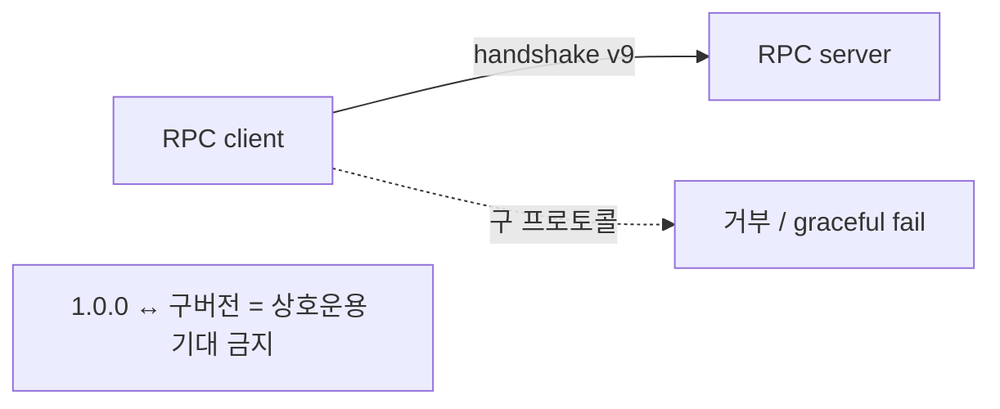
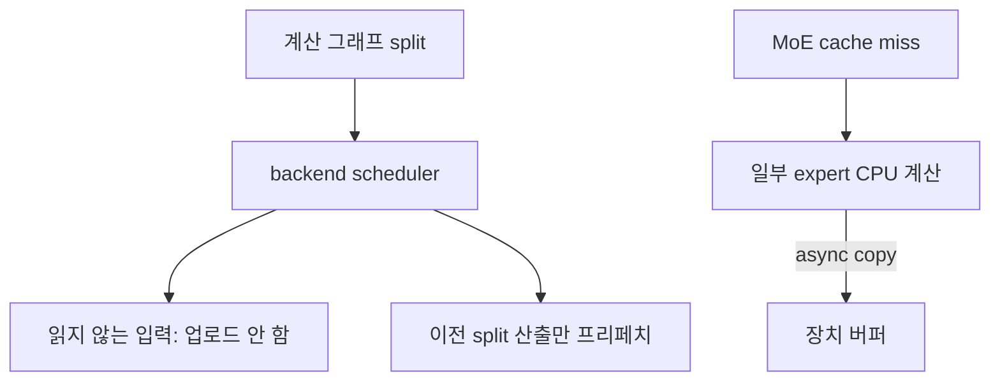
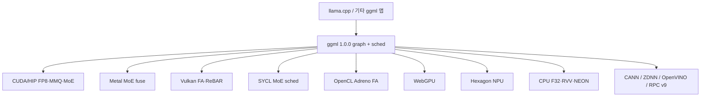

# ggml 1.0.0… 폐기 API를 걷고, FP8·YaRN·백엔드 전선에서 로컬 추론을 다시 조이다

### llama.cpp의 텐서 엔진이 v0.29 이후 첫 major로 올라갔다. `DIAG_MASK`·구 API 제거와 RPC v9 강제 업그레이드, YaRN truncate·OCP FP8, CUDA/Metal MoE·FlashAttention부터 Vulkan·SYCL·OpenCL·WebGPU·Hexagon·CPU·CANN·ZDNN까지 릴리스 노트를 한 기사로 모은다. README가 말하는 ‘설정 부담 적은 이식형 텐서 라이브러리’와 HN·GeekNews 현장 감각도 같이 읽는다


2026년 11월 13일 [ggml-org/ggml](https://github.com/ggml-org/ggml)가 **[v1.0.0](https://github.com/ggml-org/ggml/releases/tag/v1.0.0)** 을 찍었다. GeekNews([토픽 37153](https://news.hada.io/topic?id=37153))는 이를 “폐기 예정 API 제거, FP8 지원과 백엔드 성능 개선”으로 요약했고, 댓글·HN 스레드는 “로컬 AI의 Linux”, 낡은 AMD+Vulkan, MoE 호스트 캐시, s390x/ZDNN, **공개 C API 안정성 약속이 있는지**까지 물었다.

릴리스 Overview 한 문장이 범위를 고정한다. 폐기 공개 API와 legacy `DIAG_MASK` ops를 걷고, 설정 가능한 YaRN truncation과 FP8을 넣으며, CUDA/Metal의 few-row 양자화 matmul·MoE 융합, Vulkan 프리필 FlashAttention, SYCL 장치 측 MoE 스케줄러, OpenCL Adreno 분해형 FlashAttention, WebGPU 커널, Hexagon op 확대, **읽지 않는 입력 업로드 생략** 스케줄러 개선을 한꺼번에 실었다. changelog 기준은 **v0.29.0 이후**다.

이 글은 GeekNews 전문 요약, 공식 릴리스 노트, [README](https://github.com/ggml-org/ggml) 목표·빌드, 예제 코드, 토론을 **빠짐없이** 기사 형태로 다시 정리한다.

## 0. 디렉터리

ggml은 LLM 가중치·어텐션·MoE·양자화가 돌아가는 **로컬 추론 텐서 스택**이다. typeboard에서는 `docs/06_AI/01_LLM`에 둔다. 모델 내부 문서(GQA·preLN·MTP)와 같은 층에서 “그 아래 엔진의 1.0”으로 읽히고, `07_Tech_Trends`의 일반 인프라 릴리스와도 겹치지만 실무 탐색 경로는 LLM 쪽이 더 가깝다.

## 1. ggml이 무엇인지 — README가 고정하는 목표

README의 한 줄 목표:

> 설정 부담이 적고, 단순·이식·효율적인 머신러닝용 텐서 라이브러리.

| 축 | 내용 |
|---|---|
| 구현 | 외부 의존성 없는 plain C/C++ |
| CPU ISA | x86, ARM, RISC-V, LoongArch, PowerPC, **s390x**, WebAssembly |
| SIMD | x86·ARM·RISC-V 최적화 커널 |
| 백엔드 | CPU, GPU, NPU, 브라우저 |
| 양자화 | 2–8비트 정수 + **MXFP4·NVFP4** 마이크로스케일 |
| 런타임 | **실행 중 메모리 할당 없음**(zero allocations during runtime) |
| 라이선스 | MIT |
| 문서 | [GGUF](https://github.com/ggml-org/ggml/blob/master/docs/gguf.md), HF *Introduction to ggml*, llama.cpp wiki Tips & Tricks |
| 기여 | 코어·CMake 변경은 가시성·테스트·리뷰를 위해 **[llama.cpp](https://github.com/ggml-org/llama.cpp)에 PR**을 여는 것을 권장. ggml 저장소는 sync로 따라감 |

```bash
git clone https://github.com/ggml-org/ggml
cd ggml
mkdir build && cd build
cmake ..
cmake --build . --config Release -j 8
```

최소 주석 예제는 `examples/simple`(행렬곱).

GeekNews/HN 표현을 빌리면 ggml·llama.cpp는 “AI 세계의 Linux”에 가깝다. Vulkan만 되는 낡은 AMD에서도 쓸 만하게 돌린다는 체감, RISC-V로 가까운 미래까지 준비한다는 평가, 메인프레임 쪽 **s390x·ZDNN**(칩 내장 가속기 C 라이브러리) 지원 환영이 같은 문장 위에 쌓인다. Telum II on-chip 가속만으로도 작은 모델이 “Spyre 카드 필수” 예상을 깼다는 경험담도 있다.

## 2. 1.0.0이 깨는 것 — API prune과 RPC v9

### 2.1 제거·거부

- 폐기 예정 **공개 API** 정리(prune)
- legacy 연산 **`DIAG_MASK_INF` / `DIAG_MASK_ZERO`** 제거 (예제 `simple`도 이에 맞춤)
- **RPC 프로토콜 v9** — 호환되지 않는 peer를 **거부**. 로딩 시간 개선, 접근 불가 엔드포인트·핸드셰이크 실패는 **graceful failure**

실무: RPC 클라이언트·서버는 **함께** 올려야 한다. 한쪽만 1.0이면 핸드셰이크에서 끊긴다. 롤백용 구빌드를 노드마다 남겨 두라는 운영 조언이 토론·2차 해설에 반복된다.



### 2.2 추가·정밀

| 항목 | 내용 |
|---|---|
| YaRN | `ggml_rope_set_truncate` / `ggml_rope_get_truncate` — correction-bound 반올림 제어. `truncate=false` 지원 |
| YaRN 전파 | OpenVINO, SYCL, Vulkan, WebGPU, RPC에도 설정 적용 |
| `TRI` | **역전파(backward)** 구현 |
| `MUL_MAT` | src1 정밀도 테스트·게이팅, `ggml_prec_set_acc`가 기준 정밀도 따르도록 |
| llama 쪽 | FP8 **KV-cache** 지원도 같은 창의 sync에 포함 |

```c
/* 개념: YaRN truncation 경계 반올림을 런타임에 고름 */
ggml_rope_set_truncate(ctx_or_tensor, /* truncate = */ false);
bool t = ggml_rope_get_truncate(/* ... */);
```

주의: HN 댓글이 물은 “1.0 = 공개 C API가 2.0까지 안정?”에 대해 **릴리스 노트는 ABI/semver 장기 동결을 명시하지 않는다**. 약속된 것은 prune·RPC 비호환·기능 추가와 백엔드 성능이다. 임베드·Python 바인딩을 짜려는 사람은 “major 번호”와 “libghostty식 ABI 정책”을 혼동하지 말아야 한다.

## 3. 공통 스케줄러·MoE 캐시·Meta

| 변경 | 효과 |
|---|---|
| 읽지 않는 입력 **업로드 생략** | PCIe/버스 낭비↓ |
| 프리페치는 **이전 split이 만든 입력만** | 불필요 전송↓ |
| MoE 캐시 | 캐시 미스 **일부를 CPU에서 계산** 후 결과를 **비동기 복사** |
| Meta 백엔드 | 텐서 수가 적은 버퍼의 **compute view 한도↑** |

GeekNews 댓글 해석: GPU VRAM을 살짝 넘는 MoE를 올릴 때, 실패 대신 **사용 빈도 낮은 expert를 호스트 메모리에 캐시**할 수 있다 — 위 MoE 캐시 경로와 맞닿는다.



## 4. CUDA / HIP — FP8·few-row·MoE·그래프

- **MMQ** batch 2–24 few-row, **MMVF** BF16 few-row
- **OCP FP8** 지원; MMQ에서 **NVFP4** gate/up matmul + **GLU 융합**
- FlashAttention: sm70 head-size **256**, MMA head **40/72**
- MoE: 빈 MMQ stream-k 타일 skip, 레이아웃 선형화, bias 후 **NaN sanitize**
- CUDA graph: 재사용 시 compat 검사 skip, cluster-dim 변경 시 **재인스턴스**, graph state 이동
- VMM 풀 예약 **절반** + 실패 시 재시도; debug buffer pool
- `SSM_SCAN` **d_state=64** fast path
- radix Top-K: 동률에서도 **결정적** 선택 (Metal과 공통)
- HIP: 고정 BLAS workspace; CDNA2 **MFMA lightning indexer**

## 5. Metal

- MoE **라우팅 융합**; 융합 가능 노드 그룹을 **단일 command buffer** 안에 유지
- `mul_mm`을 **32 ≤ K < 64**에 적용; `TRI`를 select로
- 수정: `GROUP_NORM` (`ne03>1`, 비연속), FA 출력 버퍼·`SOLVE_TRI` **OOB**
- radix Top-K 동률 결정성 (CUDA와 동일 이슈)

## 6. Vulkan

- **Intel** FlashAttention **프리필** 커널
- CM2에서 역양자화 KV 최적화; RDNA3/4 **large-tile split-K**
- AMD proprietary driver **26.10.1+**에서 large coopmat matmul 재활성
- 텐서 **일괄 복사**, test-fusion 인터페이스, **ReBAR** 감지(없으면 BAR 할당 회피)
- tiled-transpose concat (Qwen 등); block width>512 **FWHT**
- 수정: MoltenVK OOB, `GROUP_NORM` workgroup, FA scratch 크기
- Qualcomm 대형 헤드: scalar FA를 **8행**으로 제한

낡은 AMD+Vulkan만 되는 카드 사용자 댓글과 직결되는 층이다.

## 7. SYCL

- **장치 측 MoE 스케줄러**
- oneDNN FA 캐시 **스레드 안전**; Alchemist `head_dim=64` 융합 SDPA 게이트 해제
- VRAM 초과 device buffer **거부**; device-id 캐시
- 4GB 초과 할당 **AOT** 수정
- Q4_1/Q5_1/Q8_0 복사 **exact rounding**, stride `CLAMP`, f16 `SWIGLU_OAI`

## 8. OpenCL (Adreno 중심)

- **분해형 FlashAttention** + 디코드 성능
- q6_k tiled multi-col GEMV, q8_0, f32/q5_k multi-col GEMV, f32 `MUL_MAT_ID`
- Adreno **X2**에서 f32/q5_k multi-col GEMV **기본 ON**
- arange, 비연속 sigmoid, f16/i32/i16/bf16 `repeat`, DSV4 HC pre/post

## 9. WebGPU · Hexagon · CPU · CANN · ZDNN · OpenVINO

**WebGPU**  
batched tensor API (`get_tensor_n` / `set_tensor_n`); `get_max_size` → `maxBufferSize`; 커널 `GROUP_NORM`, `MEAN`, `COUNT_EQUAL`, `PAD_REFLECT_1D`; YaRN truncation.

**Hexagon**  
Q5_0/Q5_1; `conv_2d` 최적화·`conv_3d`; post-norm residual을 `RMS_NORM_MUL`에 융합; `set_tensor_n`; 구 환경변수 없이 **libhtp 자동 로딩**; 64-bit FastRPC handle truncation 수정; Windows ARM64 **clang-cl** 호스트 빌드 수정.

**CPU**  
`MUL_MAT` src1 → **F32**; FlashAttention V를 **F32 누적**; SpacemiT `GATED_DELTA_NET` RVV, Q4_1 32×256 HP, IME2 **MXFP4** repack; ARM NEON 4×4 `simd_gemm`; llamafile bf16/q8_0 **VXE**.

**CANN**  
미지원 buffer type **조기 거부**.

**ZDNN**  
non-zdnn 텐서 허용, op마다 compute tensor invalidate, 릴리스 바이너리 백엔드 lib 감지 수정 — 메인프레임 댓글의 Telum/zLinux 실험과 맞물림.

**OpenVINO**  
YaRN truncation 설정 지원.



## 10. 예제: 백엔드 스케줄러로 행렬곱

`examples/simple`의 backend 경로는 1.0 시대의 사용 패턴을 보여 준다. 그래프는 `no_alloc`으로 짓고, 스케줄러가 버퍼를 할당한 뒤 텐서에 데이터를 올린다.

```cpp
// 발췌·정리: examples/simple/simple-backend.cpp
ggml_backend_load_all();
model.backend = ggml_backend_init_best();
model.cpu_backend = ggml_backend_init_by_type(GGML_BACKEND_DEVICE_TYPE_CPU, nullptr);

ggml_backend_t backends[2] = { model.backend, model.cpu_backend };
model.sched = ggml_backend_sched_new(
    backends, nullptr, 2, GGML_DEFAULT_GRAPH_SIZE, false, true);

// 그래프: result = a * b^T
model.a = ggml_new_tensor_2d(ctx, GGML_TYPE_F32, cols_A, rows_A);
model.b = ggml_new_tensor_2d(ctx, GGML_TYPE_F32, cols_B, rows_B);
struct ggml_tensor * result = ggml_mul_mat(ctx, model.a, model.b);
ggml_build_forward_expand(gf, result);

ggml_backend_sched_reset(model.sched);
ggml_backend_sched_alloc_graph(model.sched, gf);
ggml_backend_tensor_set(model.a, matrix_A, 0, ggml_nbytes(model.a));
ggml_backend_tensor_set(model.b, matrix_B, 0, ggml_nbytes(model.b));
ggml_backend_sched_graph_compute(model.sched, gf);
```

1.0 스케줄러 개선(“읽지 않는 입력은 올리지 않음”)은 바로 이 `sched` 경로의 전송 정책을 조인 것이다.

## 11. 토론이 남긴 마찰 — 서버·감시·포크

GeekNews에 다시 붙은 HN 맥락:

- llama.cpp가 CLI에서 서버를 띄우고 요청을 HTTP로 보내는 구조는 “단순”과 반대로 **복잡·원격 정보 수집(감시)** 이라는 비판 ([PR #17824](https://github.com/ggml-org/llama.cpp/pull/17824) 등).
- 빌드가 Hugging Face·대량 JS를 받고, 그중 일부에 백도어가 있었으나 버전 핀으로 하위가 피했다는 주장.
- 자체 패치·무시되는 PR·호환성 깨짐에 지쳐 [picolm](https://github.com/whoreson/picolm) 엔진으로 갈라섰다는 이야기 ([issue #24410](https://github.com/ggml-org/llama.cpp/issues/24410)).
- 삭제된 줄 안 줄 논쟁과 “댓글은 여기 있다” 링크.

기사가 취할 선은 명확하다. **1.0.0 릴리스 본문의 기술 변경과, llama.cpp UX·공급망·거버넌스 논쟁은 겹치되 동일하지 않다.** 텐서 라이브러리 major와 앱 UX 갈등은 같은 조직(`ggml-org`) 아래에서도 따로 추적해야 한다.

## 12. 실무 체크리스트

1. **RPC 쓰면 전 노드 동시 1.0** — v9는 구 peer 거절.
2. **DIAG_MASK·구 API 호출 제거** 후 재빌드.
3. **YaRN 모델**은 `truncate` 설정을 백엔드별로 검증 (위치 인코딩이 바뀜).
4. **FP8 / NVFP4 / MXFP4** 체크포인트는 CUDA·CPU 경로 노트와 맞춰 로드 테스트.
5. **VRAM을 살짝 넘는 MoE**는 호스트 캐시·CPU miss 경로를 옵션으로 실험.
6. **Vulkan-only GPU**는 Intel FA prefill·RDNA split-K·ReBAR 변경 후 회귀 확인.
7. **임베드 API**는 1.0을 “ABI 동결”로 읽지 말 것 — prune은 했으나 libghostty급 약속을 문서로 주지 않음.
8. 코어 패치는 **llama.cpp PR → ggml sync** 흐름을 따른다.

## 13. 결론

ggml v1.0.0은 축하용 major 스티커가 아니다. **구 API와 DIAG_MASK를 잘라 내고 RPC를 v9로 잠근 뒤**, YaRN·FP8을 열고, 스케줄러·MoE 캐시와 CUDA부터 ZDNN까지 **같은 하드웨어에서 더 빠르게** 돌리겠다는 로컬 추론 스택의 정리다. README가 약속한 무의존·다ISA·양자화·제로 런타임 할당 철학은 그대로이고, 1.0은 그 위에 “쓰지 말라고 해 둔 구멍을 실제로 메운” 버전에 가깝다.

GeekNews가 포착한 현장 감각은 세 갈래다. 낡은 GPU와 메인프레임까지 끌어안는 이식성, MoE를 VRAM 밖으로 살짝 넘기는 실용, 그리고 **버전 숫자와 API 안정성 약속을 혼동하지 말 것**. llama.cpp UX·공급망 논쟁은 별 이슈로 두고, 텐서 엔진만 보면 이 릴리스의 문장은 짧다. **호환되지 않는 것을 거절하고, 읽지 않는 것을 올리지 않으며, 백엔드마다 FlashAttention과 MoE를 한 칸씩 더 밀어라.**

---

**원문 및 참고 자료**

- ggml v1.0.0 Release: https://github.com/ggml-org/ggml/releases/tag/v1.0.0
- ggml 저장소·README: https://github.com/ggml-org/ggml
- GeekNews 토픽 요약·댓글: https://news.hada.io/topic?id=37153
- 예제: `examples/simple` / `simple-backend.cpp`
- 문서: GGUF (`docs/gguf.md`), [Introduction to ggml](https://huggingface.co/blog/introduction-to-ggml), [GGML Tips & Tricks](https://github.com/ggml-org/llama.cpp/wiki/GGML-Tips-&-Tricks)
- 토론에서 이어진 링크: llama.cpp [#17824](https://github.com/ggml-org/llama.cpp/pull/17824), [#24410](https://github.com/ggml-org/llama.cpp/issues/24410), [picolm](https://github.com/whoreson/picolm); HN item 언급은 GeekNews 스레드 참고

※ 본 기사는 공식 릴리스 노트, README, GeekNews·HN 토론을 바탕으로 재구성한 해설이다. 커널·플래그·심볼은 릴리스에 적힌 범위를 따르며, 하드웨어·드라이버별로 실제 성능은 달라진다. v1.0.0을 공개 C ABI의 장기 동결 선언으로 해석하지 말 것. llama.cpp UX·텔레메트리 논쟁은 별도 이슈다.
