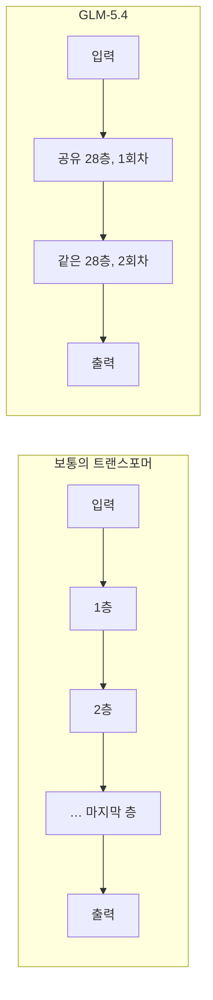
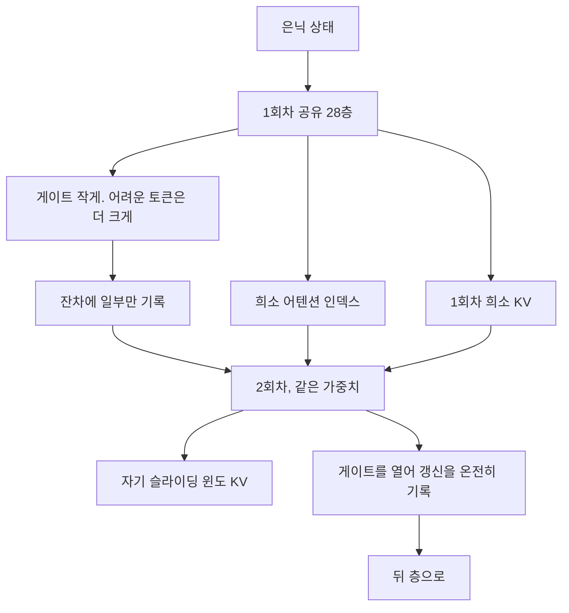
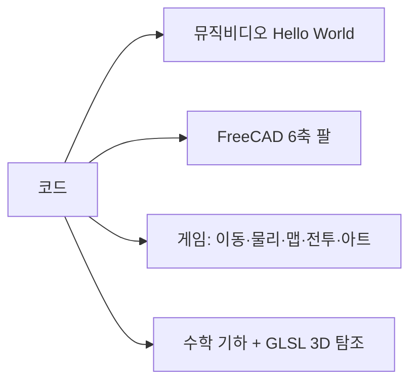

# 같은 층을 두 번 통과시킨다… GLM-5.4, 첫 플래그십 루프 트랜스포머

### Z.ai가 2026년 11월 23일 GLM-5.4를 올렸다. GLM-5 베이스의 가운데 28개 층을 가중치를 공유한 채 두 번 돌린 첫 플래그십이다. 파라미터를 2조~3조 개짜리 모델만큼 늘리지 않고, 같은 계산 블록을 반복해 그 수준에 닿는다고 주장한다. 코딩을 영상·게임·3D·기계 설계의 공통 언어로 넓히는 Generalized Coding의 시작점이라고도 적었다. 가중치는 아직 공개하지 않았고, API는 Coming Soon이다

Z.ai 리서치 블로그는 [GLM-5.4: Toward Generalized Coding with Our First Loop Transformer](https://z.ai/blog/glm-5.4)를 2026-11-23에 게시했다. 페이지 앱이 가리키는 문서 주소는 [docs.z.ai/guides/llm/glm-5.4](https://docs.z.ai/guides/llm/glm-5.4)인데, 이 글을 쓰는 시점에 그 주소는 404였다. 블로그 본문이 안내하는 입구는 코딩 플랜, ZCode, 채팅이고, API는 곧 연다고만 되어 있다.

이 글은 그 블로그 본문을 빠짐없이 기사로 옮긴다. 막대 그래프의 눈금은 이미지 안에만 있고 본문에는 숫자로 다시 적혀 있지 않다. 아래 점수 표에 없는 숫자는 지어 넣지 않았다.


## 1. 한눈에 보기

| 항목 | 블로그가 적은 내용 |
|---|---|
| 게시 | 2026-11-23, Research |
| 한 줄 | 첫 Loop Transformer 플래그십. Generalized Coding의 시작 |
| 규모 | 750B 스케일. GLM-5 베이스의 28개 층을 2회 반복 |
| 지능 주장 | 파라미터 2T–3T 모델에 견줄 만한 수준. 독립 리더보드 점수는 이 글에 없다 |
| 학습 방식 | 처음부터 루프로 사전학습하지 않음. 이미 사전학습된 베이스를 이어서 학습해 루프로 바꿈 |
| 작은 모델 검증 | 1B, 4B, 30B, 750B 순으로 확인. 30B에서 파라미터 수를 맞춘 비교 |
| 30B 비교 조건 | 같은 아키텍처, 학습 컴퓨트 약 10% 추가, 20만 스텝 롱컨텍스트 SFT 뒤, thinking 모드 |
| 생각 토큰 | GPQA-Diamond, MMLU-Pro 등에서 평균 출력 길이 10–14% 감소. 주로 짧은 사고 사슬 |
| 컨텍스트 | 1M 길이에서, 루프를 하나 더해도 KV 캐시 증가가 전체 컨텍스트가 아니라 슬라이딩 윈도 하나 |
| 속도 | 한산할 때 최대 200 tokens/s, 피크 70–80 tokens/s. 하드웨어 구성은 본문에 없음 |
| 한계 | 지나치게 긴 “marathon thinking” 루프에 빠지는 경향. 그 긴 자기 수정이 정확도는 올린다고 함 |
| 가중치 | 안전 보강을 마친 뒤 책임 있게 오픈소스할 계획. 지금 공개된 상태는 아님 |
| API | [Coming Soon](https://z.ai/model-api) |
| 바로 쓰는 곳 | [GLM Coding Plan](https://z.ai/subscribe), [ZCode](https://zcode.z.ai/en), [Z.ai Chat](https://chat.z.ai) |

지난 석 달 동안 루프 깊이와 모델 크기를 동시에 키웠다고 한다. 첫 놀라움은 Loop Transformer 자체에서 왔다. 층을 공유한 블록을 여러 번 실행하면 파라미터를 더하지 않고도 더 깊게 추론하고, 훨씬 큰 모델의 성능에 맞출 수 있다는 것이다.



비전공자에게 이 그림은 이렇게 읽으면 된다. 보통 모델은 노트를 한 장씩 다른 공책으로 넘긴다. 루프 모델은 같은 공책을 두 번 읽으며 여백을 고친다. 공책이 두 권이 되는 것이 아니라, 같은 공책을 한 번 더 펼친다. Z.ai는 그 반복이 2조~3조 파라미터 모델을 쌓는 일과 비슷한 지능을 낸다고 말한다. 그 문장은 자사 주장이다.

## 2. 왜 층을 더 쌓지 않았나

[GLM-5.3](https://z.ai/blog/glm-5.3) 기술 블로그를 인용하며 이렇게 적는다. 기억량이 많은 일은 파라미터가 돕고, 추론량이 많은 일은 계산을 더 효과적으로 쓰는 쪽이 돕는다. 대규모 소프트웨어 공학, 사이버보안, 3D 모델링, 물리 제어는 전부 아주 긴 인과 사슬이다. 여러 단계의 원인을 따라가면서 전체 논리도 유지해야 한다. 파라미터를 쌓고 데이터를 외우는 것으로는 이 일이 안 끝난다는 판단이다.

GLM-5.3은 2026-08-14 글에서, 베이스는 GLM-5.2와 같고 이득은 포스트트레이닝에서 왔다고 밝혔다. 5.4가 “5.3에서 말했던 원칙”으로 인용하는 문장과, 5.3 본문의 실제 주제(환경 확장, 긴 작업, 사이버 능력)는 같은 글의 다른 층이다. 5.4의 새 결정은 그 다음에 온다. 베이스를 더 키우는 대신, 이미 있는 베이스의 가운데 층을 반복한다.

### 2.1 사전학습된 모델을 루프로 고친다

표준 트랜스포머는 층마다 한 번의 순전파에서 한 번만 돈다. 루프 트랜스포머는 가중치를 공유하는 층 묶음이 여러 번 돌면서, 이전 통과의 은닉 상태를 다듬는다. 파라미터 수는 그대로 두고 네트워크의 계산 깊이만 늘어난다.

아이디어는 새것이 아니라고 밝힌다. 2018년 [Universal Transformer](https://arxiv.org/abs/1807.03819)가 가중치를 공유하는 깊이를 제안했고, 그 뒤 recurrent depth와 looped language model 연구가 작은 규모에서 이득을 보였다. 다만 가중치 공유는 파라미터 효율은 올려도, 처음부터 루프로 사전학습한 모델은 같은 사전학습 컴퓨트에서는 가중치를 안 공유한 모델에 뒤진다고 한다. 그래서 처음부터 다시 학습하지 않았다. 이미 사전학습된 베이스를 추가 학습으로 루프 트랜스포머에 맞췄다. 지능의 상한을, 비교적 작은 컴퓨트 추가로 올리려는 선택이다.

비전공자에게는 재교육에 가깝다. 새 교과서를 처음부터 외우게 하지 않고, 이미 배운 사람에게 “이 단원은 두 번 읽고 고쳐 써라”를 가르친 것이다. 처음부터 루프만 연습한 학생은, 같은 공부 시간에는 층을 한 번씩만 쓰는 학생보다 못했다는 것이 그들이 인용한 선행 결과다.

## 3. 750B에서 고친 세 가지

GLM-5.4는 GLM-5 베이스의 28개 층을 두 번 돌린다. 750B 규모에서 성능과 배포 비용을 맞추려고, 실험을 거친 뒤 세 가지를 바꿨다.


*블로그의 구조 그림. 본문은 캡션을 달지 않았고, 층 번호와 수식은 그림 안에만 있다.*

그림이 나눈 블록은 이렇다. 본문이 “28개 층을 두 번”이라고 한 구간은 가운데 Loop이고, 앞뒤는 한 번만 돈다.

| 블록 | 그림의 표기 | 하는 일 |
|---|---|---|
| 입력 | Text Embedding + Projected 24-layer ViT Features | 글자와, 24층 비전 특징을 받아 시작 |
| Prelude | L1–26, 26층 | L1–2만 층마다 자기 indexer. L3–26은 top-k 인덱스를 재사용 |
| Loop Pass 1 | L27–54, 28층 | DSA 블록 후 Damp Gate 1. 식은 \(x_1 = x_0 + \beta_1(h_1 - x_0)\) |
| 캐시 | Per-Layer Cache, L27–54, k=2048 | KV latent와 top-k를 층마다 보관 |
| Loop Pass 2 | L27–54, 가중치 공유 | indexer 없음. Two-Bank Sparse MLA. 1회차 prefix와 2회차 128토큰 윈도를 한 softmax로 봄. Damp Gate 2: \(x_2 = x_1 + \beta_2(h_2 - x_1)\) |
| Coda | L55–78, 24층 | 루프 밖. top-k 인덱스 재사용 후 Final RMSNorm, LM Head |

DSA는 그림에 적힌 블록 이름이다. 본문은 이걸 “희소 어텐션”이라고만 부른다. ViT는 이미지를 패치로 나눠 읽는 비전 모델이고, 그림은 그 24층 특징을 글자 임베딩과 같이 넣는다고 그린다. 본문 문장만 보면 텍스트 모델처럼 읽히지만, 그림은 이미지 입력을 전제로 한다.

### 3.1 게이트로 조금씩 덮어쓴다

이미 있는 모델의 가운데 층을 여러 번 통과로 바꾸면서, 은닉 상태를 곧장 덮어쓰면 반복마다 activation norm이 폭발한다. 뒤 층은 자기가 기대하던 크기와 분포 밖의 표현을 받는다.

GLM-5.4는 반복마다 토큰 단위로 독립된 게이트를 둔다. 후보 갱신을 그 비율만큼만 residual stream에 다시 쓴다. 학습이 끝나면 게이트가 역할을 나눈다.

- 1회차는 전역 맥락을 만들고, 게이트 값을 작게 둬 규모가 흔들리지 않게 보수적으로 쓴다.
- 2회차는 그 상태를 재사용해 출력을 다듬고, 게이트를 열어 갱신을 온전히 쓴다.
- 게이트는 토큰 난이도에 따라 보폭도 바꾼다. 어려운 토큰에서는 1회차가 더 세게 써서, 복잡한 예측이 반복 교정에서 더 이득을 본다.

한 줄로 줄이면, 첫 통과는 연필로 밑줄만 긋고 둘째 통과에서 문장을 고친다. 어려운 문장만 첫 통과에서도 펜을 세게 누른다.

### 3.2 KV 캐시는 전부 복사하지 않는다

순진한 구현은 루프마다 KV 캐시를 통째로 둔다. 그러면 메모리가 루프 횟수만큼 곱해진다. 그들은 루프 사이 KV 공유에, 새 통과용 지역 슬라이딩 윈도를 더했다. 2회차는 1회차가 고른 희소 KV를 재사용하고, 슬라이딩 윈도 안에서 자기 KV만 새로 유지한다. 두 KV 흐름은 같은 위치에서 겹칠 수 있다. 그래서 1회차의 맥락 표현과 2회차가 갱신한 지역 표현을 둘 다 볼 수 있다.

결과적으로 루프를 하나 더 붙이는 비용은 전체 컨텍스트 캐시가 아니라 슬라이딩 윈도 하나다. 1M 컨텍스트에서 GLM-5.3 대비 배포 비용 증가를 통제할 수 있다고 한다. “잘 통제된다”의 퍼센트는 본문에 없다.

KV 캐시는 모델이 “지금까지 어디를 봤는지” 적어 두는 메모지다. 루프마다 메모지를 통째로 복사하면 책상 위의 종이가 두 배가 된다. 그들은 첫 통과의 메모지를 같이 쓰고, 둘째 통과는 최근 구간만 자기 메모를 추가한다.

### 3.3 희소 어텐션 인덱스를 다시 계산하지 않는다

베이스는 희소 어텐션을 쓴다. 2회차는 1회차 인덱서가 만든 어텐션 인덱스를 그대로 재사용한다. 인덱싱 오버헤드는 0이다. 실험에서는 매 통과마다 인덱스를 다시 계산하는 것과 거의 같았다고 한다.



아래는 그림의 식을 옮긴 예시다. Z.ai가 공개한 코드가 아니다. \(\beta\)가 본문의 게이트다.

```python
def damp(x, h, beta):
    # 그림: x_next = x + β (h - x). β가 0이면 그대로, 1이면 h로 덮인다.
    return x + beta * (h - x)

def loop_l27_54(x0):
    h1, cache = shared_l27_54(x0, indexer=True)          # top-k, k=2048
    x1 = damp(x0, h1, beta1(h1))                         # 1회차는 β가 작게 남는다
    h2, window = shared_l27_54(
        x1,
        indexer=False,                                   # 1회차 인덱스를 재사용
        prefix=cache,                                    # 1회차 KV latent + top-k
        local_window=128,                                # 그림의 Pass 2 SWA KV
    )
    x2 = damp(x1, h2, beta2(h2))                         # 2회차는 β를 연다
    return x2
```

## 4. 작게 확인한 뒤에 750B에 올렸다

루프는 Scaling Correctness의 시험이기도 하다고 한다. 아키텍처를 바꾸면 그 변경이 큰 규모에서도 작동해야 한다. 플래그십에 쓰기 전에 1B, 4B, 30B, 750B 베이스에서 차례로 확인했다.

750B 베이스와 아키텍처가 똑같은 30B에서, 파라미터 수를 맞춘 비교를 했다. 파라미터는 같고 총 학습 컴퓨트만 약 10% 많을 때, 루프 버전이 분명한 이득을 보였다. 평가는 30B를 20만 스텝 롱컨텍스트 SFT한 뒤, thinking 모드를 켠 상태다.


*30B, 20만 롱컨텍스트 SFT 이후, thinking 모드. 칸 숫자는 이 표에만 있고 본문은 다시 적지 않았다.*

| 벤치마크 | Baseline | + Loop | 차이 | 평균 길이 변화 |
|---|---:|---:|---:|---|
| AIME25 | 19.17 | 30.42 | +11.3 | −635토큰 (−2%) |
| GPQA-Diamond | 47.58 | 56.26 | +8.7 | −2,473토큰 (−11.7%) |
| AA-LCR | 40.33 | 47.67 | +7.3 | −539토큰 (−9.7%) |
| MMLU-Pro | 71.65 | 75.05 | +3.4 | −863토큰 (−14.9%) |
| IFBench | 50.20 | 53.47 | +3.3 | −763토큰 (−13.0%) |

AIME25는 미국 수학 경시대회 문제를 모델에게 풀게 한 세트다. 점수가 19점에서 30점으로 가장 크게 올랐고, 말의 길이는 2%만 줄었다. GPQA-Diamond는 박사급 과학 객관식이고, MMLU-Pro는 더 어려운 폭넓은 지식 문제다. AA-LCR과 IFBench는 그림에 이름만 있고, 블로그는 무엇을 재는지 적지 않는다. 이 표는 750B 플래그십의 점수가 아니라 30B 대조 실험이다. Claude, GPT, Gemini와 맞춘 점수는 이 글에 없다.

본문이 문장으로 뽑은 발견은 둘이다.

- **긴 추론이 더 이득을 본다.** 가장 큰 이득은 수학, 과학 추론, 롱컨텍스트다. Generalized Coding의 핵심이라고 부르는 영역이다.
- **생각에 쓰는 토큰이 줄어든다.** GPQA-Diamond와 MMLU-Pro를 포함한 대부분 벤치마크에서 평균 출력 길이가 10–14% 줄었다. 주로 사고 사슬이 짧아져서다. 추론의 일부가 출력 토큰에서 루프의 숨은 깊이로 옮겨 간 셈이라고 해석한다.

“출력이 10–14% 짧아졌다”는 본문이 GPQA-Diamond와 MMLU-Pro를 예로 든 구간과 맞다. 표에서 그 둘은 −11.7%와 −14.9%다. AIME25는 점수는 가장 많이 올랐는데 길이는 −2%라, “대부분”이라는 말 밖에 있다.

## 5. 두 번 돌려도 속도가 나와야 한다

GLM-5.4는 한산한 시간에 최대 200 tokens/s, 피크에도 70–80 tokens/s를 유지한다고 한다. 층을 두 번 도는 구조에서 이 처리량을 내려면 모델과 추론 인프라를 같이 설계해야 했다. KV 캐시와 희소 인덱스로 메모리·검색을 줄인 것에 더해, 코어 커널을 합쳐 중간 메모리 읽기·쓰기를 줄였다. 루프가 키우는 잘게 쪼개진 오버헤드를 없애려는 작업이다.

tokens/s는 모델이 초당 뱉는 토큰 수다. 채팅에서 글자가 채워지는 속도에 해당한다. 한산할 때 200, 사람이 몰릴 때 70–80이라는 숫자는 그 서비스의 체감 속도이고, 어떤 GPU 몇 장인지는 이 글이 적지 않는다.

## 6. Generalized Coding

코딩이 모델 능력을 넓히는 토대가 되었다고 한다. 2025년 초부터 코딩에 올인한 뒤 Agentic Engineering, Long-Horizon Tasks, Cybersecurity를 열었고, 이제 Generalized Coding으로 민다고 한다. 천장이 더 높고 파급이 더 넓으며, GLM-5.4는 그 시작점일 뿐이라고 적었다.

코딩과 시각이 같이 나아지면서, 전통적인 소프트웨어 개발 밖으로 일반화된다고 한다. 코드를 짜서 영상을 만들고 고치고, 게임을 통째로 만들고, 3D 모델링과 기계 설계를 다룬다. 데모는 네 개다.

- **영상을 코드로.** 스스로 내레이션하는 뮤직비디오 *"Hello World,"*. [영상](https://z-ai-bj.oss-cn-beijing.aliyuncs.com/prompts-rich-media-resources/5.4-blog/27570_1795400681.mp4)
- **공학을 코드로.** FreeCAD에서 엔지니어링 등급 CAD로 6축 로봇 팔을 구성. [영상](https://z-ai-bj.oss-cn-beijing.aliyuncs.com/prompts-rich-media-resources/5.4-blog/1517_1795370530%28%E5%8E%9F%E8%A7%86%E9%A2%91%29.mp4)
- **게임을 코드로.** 캐릭터 이동, 물리, 맵, 전투, 아트 에셋을 포함한 완성 게임. [영상](https://z-ai-bj.oss-cn-beijing.aliyuncs.com/prompts-rich-media-resources/5.4-blog/a2b99f0a783fafdbfdd9b6b19d104595_raw.mp4)
- **3D를 코드로.** 순수 수학 기하와 자체 GLSL 셰이더로, 상호작용하는 3D 매크로 탐조 체험을 처음부터 생성. [영상](https://z-ai-bj.oss-cn-beijing.aliyuncs.com/prompts-rich-media-resources/5.4-blog/331_1795422567_raw.mp4)

GLSL은 그래픽 카드에게 “이 픽셀을 이렇게 칠하라”고 적는 작은 프로그램이다. 새 그림을 학습한 영상 모델을 부순 것이 아니라, 코드를 써서 기하와 셰이더를 만들게 했다는 것이 이 문장의 내용이다. 로봇 팔도 마찬가지다. 팔을 사진으로 찍은 것이 아니라 FreeCAD 모델을 코드로 만들게 했다.



## 7. 어디서 쓰고, 무엇이 아직 아닌가

성능, 속도, 더 넉넉한 사용 한도 때문에 일상 업무에 쓸 만하다고 한다. 한도의 숫자와 토큰 단가는 이 블로그에 없다. 제품 문서에는 있다. 아래는 블로그가 아니라 [Coding Plan 문서](https://docs.z.ai/devpack/latest-model)와 [중국 문서](https://docs.bigmodel.cn/cn/coding-plan/latest-model)에 적힌 내용이다.

지금 호출되는 경로는 Coding Plan이다. 모델 ID는 `glm-5.4`이고, 1M 창은 `glm-5.4[1m]`이다. 중국 Codex 카탈로그는 `context_window`를 1,048,576으로 적는다. 같은 중국 문서는 모델은 1M를 받지만, 코딩 품질을 위해 클라이언트 창은 512,000을 권한다. 국제 Claude Code 예시는 `CLAUDE_CODE_AUTO_COMPACT_WINDOW=1000000`이다. 종량제 Chat Completion의 모델 목록에는 `glm-5.4`가 없고 예제는 `glm-5.3`이다. 블로그의 “API (Coming Soon)”과 맞다. [USD 가격표](https://docs.z.ai/guides/overview/pricing)와 [중국 API 가격표](https://open.bigmodel.cn/pricing)에도 5.4 행이 없다.

크레딧은 토큰을 이렇게 센다. 캐시된 입력은 일반 입력보다 싸다. 한산한 시간의 크레딧은 이 값의 50%다. 피크는 월–금 14:00–18:00(UTC+8)이다.

```text
credits = (input × 4.6 + cached_input × 1.1 + output × 16) / 10000
```

| 모델 | 입력 | 캐시 입력 | 출력 |
|---|---:|---:|---:|
| GLM-5.4 | 4.6 | 1.1 | 16 |
| GLM-5.3 | 6.9 | 1.7 | 24 |
| GLM-5.3-Flash | 2.3 | 0.56 | 8 |

주간 크레딧은 Lite 10,000, Pro 60,000, Max 140,000이다. 5시간 창은 2,000 / 12,000 / 28,000이다. 구독 표시 가격은 페이지가 서로 다르다. 국제 개요는 월 18달러부터라고 하고, 중국 상품 페이지는 Lite 월 94.4위안부터 적는다. 종량제 100만 토큰당 달러 단가는 확인한 문서에 없다.

국제 베이스 URL은 Anthropic `https://api.z.ai/api/anthropic`, OpenAI Chat `https://api.z.ai/api/coding/paas/v4`, Responses `https://api.z.ai/api/v1`이다. 중국은 같은 경로가 `open.bigmodel.cn`이다. Coding Plan 키와 표준 API 키는 서로 쓰지 못한다.

```python
# Cline 문서가 적은 국제 Coding Plan 설정. 표준 종량제 API가 아니다.
base_url = "https://api.z.ai/api/coding/paas/v4"
model = "glm-5.4"          # 1M 창을 켜면 "glm-5.4[1m]"
```

GLM-5.4부터 `thinking.clear_thinking` 기본값은 모든 엔드포인트에서 `false`다. 이전 모델은 Coding Plan에서 기본으로 켜져 있었다. 중국 문서는 사고 강도를 `low` / `high` / `max`로 두고 기본은 `max`다. 사고를 끄면 `low`로 처리되며, 다른 모델로 바뀌지는 않는다. AutoClaw는 Coding Plan V2·V3·Team에서 GLM-5.4를 쓸 때 쿼터를 1.5배로 센다고 적는다. Zixuan Li의 공지는 주간 할당이 있는 사용자에게 GLM-5.3 대비 50% 더 준다고 했는데, 적용 범위 문장이 AutoClaw와 달라 한 정책으로 합치지 않는다. Cursor 문서만 모델명을 대문자 `GLM-5.4`로 넣으라고 한다. 중국 Codex 메타데이터의 입력은 `text`, `image`, `audio`다. 구조 그림의 ViT 입력과 맞는 쪽은 이미지다.

Hugging Face `zai-org/GLM-5.4` 카드는 없다. [GLM-5 README](https://github.com/zai-org/GLM-5)의 744B-A40B는 GLM-5 계열 표의 숫자이고, 5.4의 파라미터 수로 적혀 있지 않다. 블로그의 “750B scale”과 나란히 두되 같은 숫자로 합치지 않는다. MoE라는 단어는 5.4 문서에 없다.

| 입구 | 주소 | 블로그의 상태 |
|---|---|---|
| GLM Coding Plan | https://z.ai/subscribe | 안내함 |
| ZCode | https://zcode.z.ai/en | 안내함 |
| Z.ai Chat | https://chat.z.ai | 안내함 |
| API | https://z.ai/model-api | Coming Soon |
| 오픈 웨이트 | 없음 | 안전 보강 후 공개 예정 |

페이지 스크립트는 문서 버튼, 채팅, 구독, ZCode를 켜 두었고 try/call 버튼은 꺼 두었다. 문서 URL은 위에 적었듯 확인 시점에 404였다.

한계는 본문이 스스로 적는다. 지나치게 긴 marathon thinking 루프에 빠지는 경향이 있다. 그 늘어난 반추와 자기 수정이, 파라미터 수를 넘는 정확도 향상으로 이어진다고도 한다. 오래 생각하는 것이 품질에는 도움이 되고, 끝나지 않는 생각에는 빠질 수 있다는 뜻이다. 사용자가 보는 증상은 답이 나오기 전에 내부 독백이 길어진다는 쪽에 가깝다.

앞일은 두 질문으로 열어 둔다. 어려운 토큰이 반복 횟수를 스스로 더 받게 하는 adaptive compute, 그리고 루프 횟수와 모델 크기가 같이 커질 때 이득이 어떻게 줄어드는지. 깊이와 크기 중 하나를 고르지 않고 둘 다 밀겠다고 한다. GLM-5.4는 계산 깊이를 검증한 모델이고, 다음의 훨씬 큰 모델이 여기서 배운 것을 이어받는다. 곧 준비된다고만 했다. 이름과 날짜는 없다.

## 8. 계보와 당일 반응

날짜는 각 공식 글의 표기다. GLM-5 계열은 올해 들어 대략 두 달마다 한 번씩 나왔다.

| 모델 | 글 | 그 글이 적은 차이 |
|---|---|---|
| [GLM-5](https://z.ai/blog/glm-5) | 2026-02-12 | 744B, 활성 40B. 복잡한 시스템 작업. 웨이트는 MIT |
| [GLM-5.1](https://z.ai/blog/glm-5.1) | 2026-04-07 | 코딩과 장기 과제. 중문 글은 최대 8시간 독립 작업. MIT |
| [GLM-5.2](https://z.ai/blog/glm-5.2) | 2026-06-16 | 장기 과제를 1M 맥락 위에. IndexShare. MIT |
| [GLM-5.3](https://z.ai/blog/glm-5.3) | 2026-08-14 | 5.2와 같은 베이스. 이득은 포스트트레이닝. 웨이트는 2주 뒤. 현재 HF 라이선스 제목은 “GLM-5.3 License”이고 MIT가 아니다 |
| GLM-5.4 | 2026-11-23 | 첫 루프 플래그십. 웨이트와 라이선스 이름은 아직 없다 |

회사 문서도 날짜가 둘이다. 홍콩거래소 중간보고서는 법인 Z.AI Co., Ltd.(北京智谱华章科技股份有限公司)의 설립을 2019년 6월 11일, H주 2513 상장을 2026년 1월 8일로 적는다. 회사 사이트는 2019년 3월 15일 설립이라고 적는다. 법인 문서로 적힌 날짜는 6월 11일이다.

[Hacker News](https://news.ycombinator.com/item?id=50609685)는 블로그가 올라온 뒤에 갈렸다. 오전 글([50608662](https://news.ycombinator.com/item?id=50608662))은 벤치마크와 모델 카드 없이 코딩 플랜만 열렸다는 반응이었다. 이후에는 루프를 2018년 Universal Transformer의 연장으로 읽는 쪽, 같은 파라미터에서 연산을 더 하는 구조라는 쪽, 회사가 인정한 marathon thinking 때문에 쉬운 일도 프론티어보다 오래 걸린다는 쪽이 나왔다. 오픈 웨이트가 API와 달라질 것이라는 읽기에는, 글이 말한 것은 안전 검토뿐이라는 반박이 붙었다. X에서는 장면 품질을 칭찬하는 글과, 1시간 30분이 지나도 교차 검증이 끝난다는 글, 제로샷이 깨졌다는 글이 같은 날 있었다. 이 데모들은 코딩 벤치마크가 아니다.

## 9. 아직 문서에 없는 것

블로그와 제품 문서를 대조한 뒤에도 비어 있는 항목이다.

- [ ] 750B 플래그십의 공개 벤치마크 점수는 없다. 숫자 표는 30B 대조 실험이다
- [ ] 종량제 100만 토큰당 달러·위안 단가는 없다. 있는 가격은 Coding Plan 구독과 크레딧 계수다
- [ ] 가중치, 웨이트 라이선스, 최소 GPU 대수는 없다
- [ ] 200 tokens/s의 측정 하드웨어와 배치 크기는 없다
- [ ] 2T–3T 비교의 대상 모델 이름과 벤치마크 이름은 없다
- [ ] 활성 파라미터, 어텐션 헤드 수, 어휘 크기, 최대 출력 토큰은 5.4 문서에 없다. 128K 출력 한도는 5.3 이하에만 적혀 있다

## 참고

- Z.ai, [GLM-5.4: Toward Generalized Coding with Our First Loop Transformer](https://z.ai/blog/glm-5.4) (2026-11-23)
- 구조 그림: [image.png](https://z-ai-bj.oss-cn-beijing.aliyuncs.com/prompts-rich-media-resources/5.4-blog/image.png)
- 30B 비교 그림: [ablation](https://z-ai-bj.oss-cn-beijing.aliyuncs.com/prompts-rich-media-resources/5.4-blog/img_v3_0217n_2d1a655c-5bce-4b3f-9115-2ad7c397ce5g.png)
- 페이지 이미지: [20261123-173242.jpeg](https://z-ai-bj.oss-cn-beijing.aliyuncs.com/prompts-rich-media-resources/5.4-blog/20261123-173242.jpeg?w=1280&h=720&fit=fill)
- 데모 영상: [Hello World](https://z-ai-bj.oss-cn-beijing.aliyuncs.com/prompts-rich-media-resources/5.4-blog/27570_1795400681.mp4), [FreeCAD](https://z-ai-bj.oss-cn-beijing.aliyuncs.com/prompts-rich-media-resources/5.4-blog/1517_1795370530%28%E5%8E%9F%E8%A7%86%E9%A2%91%29.mp4), [게임](https://z-ai-bj.oss-cn-beijing.aliyuncs.com/prompts-rich-media-resources/5.4-blog/a2b99f0a783fafdbfdd9b6b19d104595_raw.mp4), [3D 탐조](https://z-ai-bj.oss-cn-beijing.aliyuncs.com/prompts-rich-media-resources/5.4-blog/331_1795422567_raw.mp4)
- 이전 글: [GLM-5](https://z.ai/blog/glm-5) (2026-02-12), [GLM-5.1](https://z.ai/blog/glm-5.1) (2026-04-07), [GLM-5.2](https://z.ai/blog/glm-5.2) (2026-06-16), [GLM-5.3](https://z.ai/blog/glm-5.3) (2026-08-14)
- 회사: [홍콩거래소 중간보고서](https://www1.hkexnews.hk/listedco/listconews/sehk/2026/0924/2026092401583.pdf), [z.ai/company](https://z.ai/company)
- 당일 토론: [HN 50608662](https://news.ycombinator.com/item?id=50608662), [HN 50609685](https://news.ycombinator.com/item?id=50609685)
- Mostafa Dehghani 외, [Universal Transformers](https://arxiv.org/abs/1807.03819) (2018)
- 사용 입구: [Coding Plan](https://z.ai/subscribe), [ZCode](https://zcode.z.ai/en), [Chat](https://chat.z.ai), [API](https://z.ai/model-api)
- 제품 문서: [국제 모델 전환](https://docs.z.ai/devpack/latest-model), [중국 모델 전환](https://docs.bigmodel.cn/cn/coding-plan/latest-model), [Thinking Mode](https://docs.z.ai/guides/capabilities/thinking-mode), [USD 가격](https://docs.z.ai/guides/overview/pricing), [Coding Plan 개요](https://docs.z.ai/devpack/overview)
- 웨이트 부재: [Hugging Face zai-org 검색](https://huggingface.co/zai-org), [GLM-5 README](https://github.com/zai-org/GLM-5)
