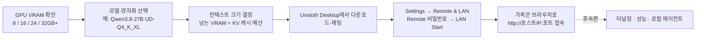
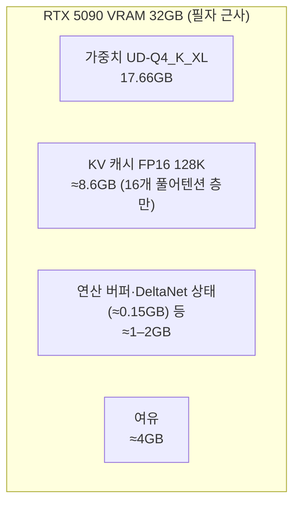
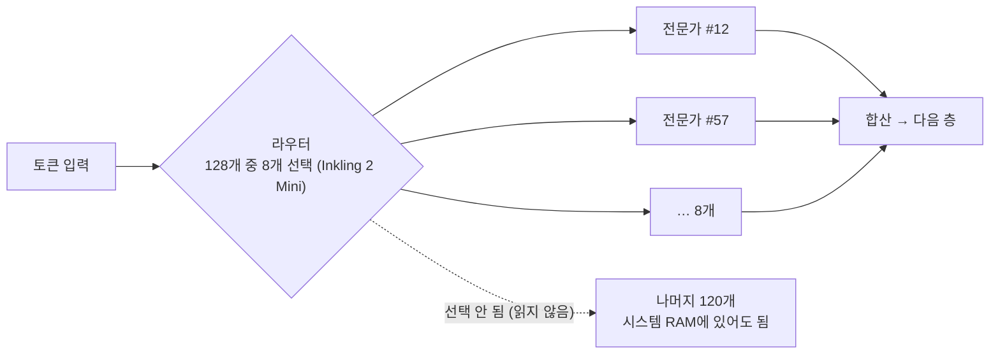
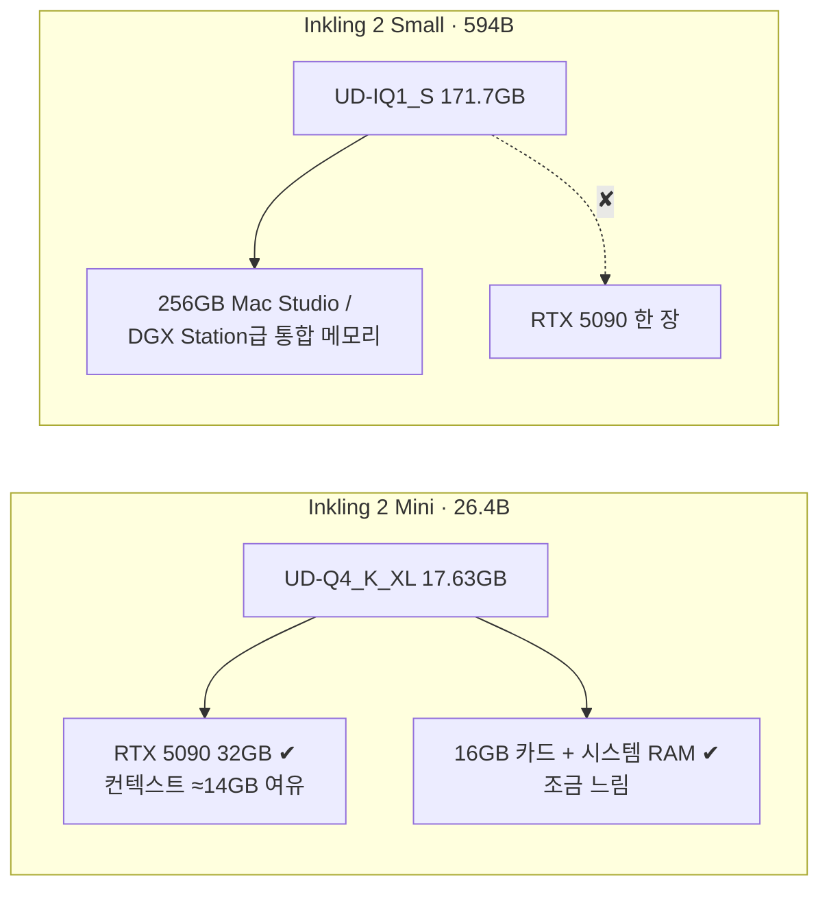
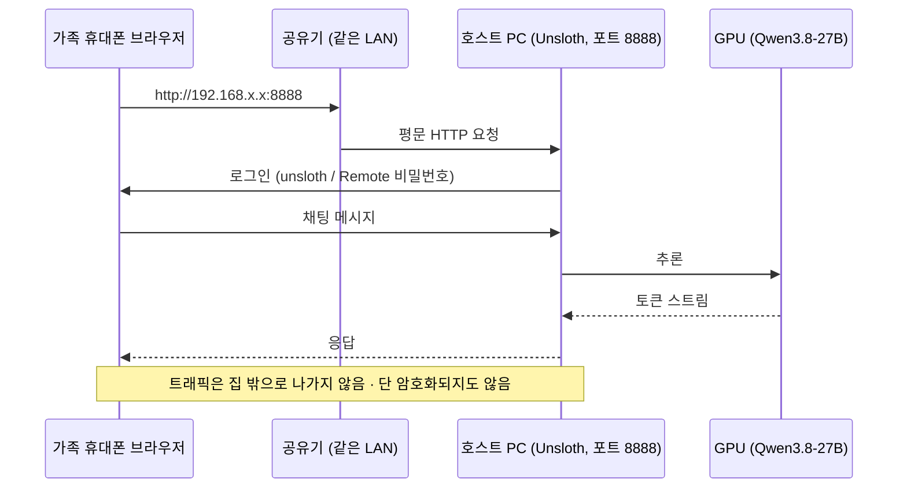

# 집에 AI가 있다… Inkling 2 Mini·Qwen3.8-27B·Unsloth Desktop으로 꾸리는 로컬 AI 입문

### GPU 판매사 GPUPartner의 테크니컬 마케팅 에디터가 RTX 5090 한 장, Windows, Unsloth Desktop만으로 구독 없는 개인용 채팅 AI를 세우고 가족에게 LAN으로 나눠 준 과정을 정리했다. 핵심은 ‘가장 큰 모델’이 아니라 VRAM을 가중치와 컨텍스트(KV 캐시)에 어떻게 나눠 주느냐다. 4비트 Qwen3.8-27B(17.66GB)와 128K 컨텍스트, 같은 크기의 새 MoE 모델 Inkling 2 Mini가 그 예시다. HN에서는 “로컬 AI는 플라스마 TV 단계”, “300달러 P40으로도 된다”, “업무 비용 절감이 목적이면 아직은 구독이 낫다”가 부딪쳤다


GPUPartner 블로그에 Jerry James(Senior Technical Marketing Editor)가 2026년 11월 22일 [A beginner's guide to Local AI with Inkling, Qwen, and Unsloth](https://www.gpupartner.com/blog/beginners-guide-local-ai-inkling-qwen-unsloth)를 올렸다. GeekNews([토픽 37670](https://news.hada.io/topic?id=37670))는 2026-11-23 08:35 KST에 이를 “Inkling, Qwen, Unsloth로 시작하는 로컬 AI 입문 가이드”로 요약했고, [Hacker News](https://news.ycombinator.com/item?id=50603845)에서는 782포인트·319댓글이 붙었다. 원문은 터미널 명령도, Python 환경 구성도, 구독도 없이 **하드웨어만 있으면 다운로드 시간을 빼고 10~15분**이면 된다고 말한다.

이 글은 원문, GeekNews 요약, HN 토론에 더해 원문이 출처로 든 [Unsloth Desktop 문서](https://unsloth.ai/docs/desktop), [LAN access 문서](https://unsloth.ai/docs/desktop/lan), [Inkling 2 Mini 실행 가이드](https://unsloth.ai/docs/models/inkling-2-mini), Hugging Face의 [Qwen3.8-27B](https://huggingface.co/Qwen/Qwen3.8-27B)·[Inkling-2-Mini](https://huggingface.co/thinkingmachines/Inkling-2-Mini) 모델 카드와 GGUF 파일 목록을 직접 대조해 다시 쓴다.

**주의: 원문은 GPU를 파는 회사의 블로그이고(HN에서도 “광고로 봐야 한다”는 지적이 나왔다), 실측 벤치마크가 아니라 한 사람의 첫 구축기다. 본문의 KV 캐시 용량 계산(4장)과 대역폭 기반 속도 추정(6장)은 모델 카드 수치로 필자가 따로 계산한 근사치이며, 원문이나 Unsloth가 발표한 숫자가 아니다. 필자는 Unsloth Desktop을 직접 설치·실행해 보지 않았다.**

이 글은 특정 모델 출시 뉴스가 아니라 **로컬 LLM 추론에서 VRAM·양자화·컨텍스트를 어떻게 배분하는가**와 그것을 GUI 앱 하나로 감싸는 방법을 다룬다. 같은 분류의 [ggml 1.0.0](261116_0151_ggml_v1_0_0_API_FP8_and_Backend_Speedups.md)이 “그 아래 텐서 엔진”이라면 이 글은 “그 엔진 위에서 일반인이 모델 파일 하나를 고르는 법”이고, [GLM-5.4 루프 트랜스포머](261123_2230_GLM_5_4_First_Loop_Transformer_and_Generalized_Coding.md)와는 Inkling 2 Mini의 루프 구조(7장)에서 맞닿는다.

## 1. 한눈에 보기

| 항목 | 내용 |
|---|---|
| 원문 | GPUPartner 블로그, Jerry James, 2026-11-22 (메타데이터 `datePublished` 2026-11-22T16:00Z) |
| GeekNews | 토픽 37670, 2026-11-23 08:35 KST, 21P |
| HN | item 50603845, 782 points, 319 comments |
| 예시 장비 | Windows PC + NVIDIA RTX 5090 (32GB GDDR7) |
| 앱 | Unsloth Desktop (무료·오픈소스, macOS/Windows/Linux, GGUF·MLX 실행) |
| 주 모델 | Qwen3.8-27B `UD-Q4_K_XL` (17.66GB) + 128K 컨텍스트 |
| 대안 모델 | Inkling 2 Mini `UD-Q4_K_XL` (17.63GB), 26.4B MoE |
| 공유 | Unsloth 내장 LAN access, 같은 홈 네트워크의 브라우저에서 접속 |
| 범위 밖 | 인터넷 외부 접속(터널링), 성능 튜닝, 로컬 에이전트 → 후속편 예고 |

원문 스스로의 한 줄 요약은 이렇다. **Unsloth Desktop을 설치하고, GPU VRAM에 맞는 양자화 모델을 받고, 컨텍스트 크기를 정한 뒤, LAN access를 켜서 집 안 모두가 쓰게 한다.**



| 질문 | 원문의 답 | 보충 |
|---|---|---|
| 무엇이 필요한가 | GPU 달린 Windows PC, Unsloth Desktop, VRAM에 맞는 모델 | HN: “Windows·GPU 필수는 사실이 아니다” — Mac·CPU도 된다(8장) |
| 왜 원본이 아닌 양자화인가 | Qwen3.8-27B 16비트 원본은 약 56GB | 모델 카드 파라미터 27.78B × 2바이트 ≈ 55.6GB |
| 왜 가장 큰 모델이 아닌가 | 긴 대화를 위해 컨텍스트에 VRAM을 남김 | 128K KV 캐시 ≈ 8GiB(필자 계산, 4장) |
| 왜 XL인가 | M·S보다 원본에 가깝고 VRAM은 안 넘침 | Q4_K_M 16.56GB vs Q4_K_XL 17.66GB |
| Inkling 2는 | Mini는 5090에 들어가고 Small(594B)은 안 들어감 | Small 최소 파일 171.7GB |
| 공유는 | LAN access, 사용자명 `unsloth` + Remote 비밀번호 | LAN은 평문 HTTP, 서버 도구 기본 ON(10장) |
| 다른 앱은 | LM Studio와 비교 후 Unsloth 선택 | llama.cpp·Ollama·vLLM·MLX와의 관계는 9.5절 |

## 2. 왜 로컬인가 — 원문의 동기와 그 전제

원문은 오픈 웨이트(open-weight, 가중치 파일을 공개해 누구나 내려받아 돌릴 수 있는 모델) 모델의 등장으로, 일상적인 작업에서는 클라우드 LLM 사업자가 **인프라·가전 사업**처럼 보이기 시작했다고 쓴다. 전환 동기로 꼽은 것은 네 가지다.

1. 토큰을 많이 쓰는 연구·데이터 수집·코딩을 **사용량 한도를 쳐다보지 않고** 돌리고 싶다.
2. 클라우드 비용이 불어난다.
3. 개인정보 우려.
4. OpenAI·Anthropic이 ‘최신’ 버전에서 품질을 낮추고 실행 가능한 범위를 통제하는 패턴을 보였다는 불만(저자의 주관적 평가다).

쉽게 말하면 “내가 산 기계에서, 내가 고른 모델을, 한도 없이”가 목적이다. 다만 저자는 첫 시도라 **단순함과 Windows 호스팅**을 최우선에 뒀고, 그래서 터미널 대신 GUI 앱을 골랐다.

앱 후보는 LM Studio와 Unsloth Desktop이었다. 둘 다 터미널 명령, Python 환경, 의존성 관리를 UI 뒤로 숨긴다. 저자가 Unsloth를 고른 이유는 솔직하다. **이름이 더 마음에 들었고, 웹사이트를 열었을 때 자신이 도망치려던 바로 그것 — 구독 — 을 권하지 않았다.** 커뮤니티 평판도 좋다는 점을 덧붙였다.

Unsloth 문서 기준으로 Unsloth Desktop(현재 Beta 표기)은 macOS·Windows·Linux(WSL 포함)용 무료 오픈소스 앱으로, LLM·확산(diffusion) 이미지/영상·MLX·GGUF·오디오 모델을 **실행하고 학습(파인튜닝)** 할 수 있다. NVIDIA·AMD·Intel GPU와 Mac, CPU를 지원하지만 “오래된 하드웨어는 잘 지원되지 않을 수 있다”고 적었다. 채팅에는 도구 호출·샌드박스 코드 실행·웹 검색·딥 리서치가 붙어 있고, OpenAI·Anthropic·Ollama·llama.cpp·vLLM 같은 외부 제공자에 연결할 수도 있다. 원래 파인튜닝 라이브러리로 알려진 Unsloth가 추론·서빙까지 하나의 데스크톱 앱으로 묶은 형태이며, 내부 추론 엔진은 llama.cpp다(문서가 “Day Zero 모델 지원”의 공을 llama.cpp와 Hugging Face에 돌린다). 웹 UI 기반의 [Unsloth Studio](https://news.hada.io/topic?id=27606)가 먼저 나왔고, LAN 문서의 CLI 명령도 여전히 `unsloth studio`다.

원문 스크린샷 기준 첫 실행 화면은 왼쪽 사이드바에 **New chat·Model hub·Library**, 위쪽에 모델 선택기, 가운데 빈 채팅창이 있는 ChatGPT형 구성이다.

## 3. VRAM·양자화·컨텍스트 — 세 변수의 줄다리기

### 3.1 용어부터

| 용어 | 뜻 | 비유 |
|---|---|---|
| VRAM | 그래픽카드에 붙은 전용 메모리. 모델 가중치와 대화 기록이 여기 올라가야 빠르다 | 작업대 넓이 |
| 파라미터(B) | 모델이 학습한 숫자(가중치)의 개수. 27B = 270억 개 | 책의 글자 수 |
| 정밀도(비트) | 가중치 하나를 몇 비트로 저장하나. BF16=16비트, Q4≈4비트 | 사진 한 픽셀의 색 비트 수 |
| 양자화(quantization) | 가중치 정밀도를 낮춰 모델을 압축하는 것 | 고화질 사진을 저용량 JPEG로 |
| 컨텍스트 윈도 | 모델이 한 번에 참고할 수 있는 대화의 양(토큰 수) | 한 번에 펼쳐 볼 수 있는 페이지 수 |
| KV 캐시 | 컨텍스트를 기억하기 위해 토큰마다 저장하는 Key·Value 벡터. 가중치와 **별도로** 메모리를 먹는다 | 읽은 페이지마다 붙이는 메모지 |
| GGUF | llama.cpp 계열이 쓰는 단일 파일 모델 포맷(가중치+메타데이터) | 앱 설치 파일 하나 |
| MLX | Apple Silicon 전용 머신러닝 프레임워크/포맷 | Mac 전용 버전 |
| 토큰, tok/s | 모델이 읽고 쓰는 단위(영어 단어의 3/4쯤, 한국어는 음절 1~2개쯤). tok/s는 초당 생성 토큰 수 | 타자 속도 |
| 프리필 / 디코드 | 프리필(prefill)은 입력 프롬프트 전체를 한 번에 읽는 단계(연산 위주), 디코드(decode)는 답을 한 토큰씩 쓰는 단계(메모리 대역폭 위주) | 문제 읽기 / 답 쓰기 |
| 오프로딩(offloading) | VRAM에 안 들어가는 층·전문가를 시스템 RAM에 두고 CPU나 PCIe로 처리하는 것 | 작업대가 좁아 일부 자료를 옆 책상에 두기 |

### 3.2 원본은 왜 안 들어가는가

VRAM이 클수록 큰 모델을 돌린다. 원문의 대략적 기준은 **8~12GB면 9B~12B급, 32GB면 27B~35B급에 긴 대화 여유까지**다.

16비트 가중치는 파라미터당 2바이트다. Hugging Face API가 보고하는 Qwen3.8-27B의 safetensors 파라미터 수는 27,781,427,952개이므로

$$
27.78 \times 10^9 \times 2\ \text{bytes} \approx 55.6\ \text{GB}
$$

원문의 “약 56GB”와 맞는다. RTX 5090(32GB)의 1.7배다. 통합 메모리 Mac이 아니라면 소비자용 카드에 통째로 올릴 수 없고, 그래서 양자화가 등장한다.

### 3.3 양자화는 무엇을 버리는가

원문은 같은 사진을 픽셀당 8·4·2비트로 저장한 그림으로 설명한다. Q8 → Q4 → Q2로 내려갈수록 가중치도 같은 식으로 세부를 잃는다.


조금 더 깊이 들어가면, GGUF의 K-quant(예: `Q4_K`)는 가중치를 작은 블록으로 나누고 블록마다 **스케일 $d$와 최소값 $m$** 을 따로 저장한다. 블록 안의 각 가중치는 4비트 정수 $q \in \{0,\dots,15\}$ 로만 기록된다.

$$
\hat{w}_i = d \cdot q_i + m,\qquad q_i = \operatorname{round}\!\left(\frac{w_i - m}{d}\right)
$$

복원값 $\hat{w}_i$ 와 원래 $w_i$ 의 차이가 양자화 오차다. 블록 단위 스케일 덕분에 “평균 4비트 남짓”으로도 분포를 꽤 잘 따라간다. 파일 이름의 접미사는 대략 다음 뜻이다.

| 표기 | 의미 |
|---|---|
| `Q4_K_S / _M / _L / _XL` | 같은 4비트 K-quant 계열 안에서, 민감한 텐서(어텐션·임베딩 등)에 더 높은 비트를 얼마나 배분하느냐. S < M < L < XL 순으로 크고 정확 |
| `IQ2_XXS`, `IQ3_S` … | importance matrix(어떤 가중치가 출력에 중요한지 측정한 통계)를 쓰는 저비트 i-quant |
| `UD-` 접두사 | Unsloth Dynamic. 레이어별로 비트를 다르게 배정하는 Unsloth의 동적 양자화 |
| `Q8_0`, `Q8_K_XL` | 8비트. Unsloth는 Inkling 2 Mini의 `UD-Q8_K_XL`을 full precision/lossless 기준점으로 쓴다 |

실제 Hugging Face [unsloth/Qwen3.8-27B-GGUF](https://huggingface.co/unsloth/Qwen3.8-27B-GGUF) 파일 크기는 다음과 같다(API의 바이트 수를 10⁹로 나눈 값).

| 파일 | 크기(GB) | 가중치당 평균 비트(≈ 크기×8 / 27.78B) |
|---|---:|---:|
| `UD-IQ1_S` | 6.19 | ≈1.8 |
| `UD-IQ2_XXS` | 7.21 | ≈2.1 |
| `UD-Q2_K_XL` | 9.95 | ≈2.9 |
| `UD-Q3_K_XL` | 13.15 | ≈3.8 |
| `UD-Q4_K_S` | 15.36 | ≈4.4 |
| `UD-Q4_K_M` | 16.56 | ≈4.8 |
| **`UD-Q4_K_XL`** | **17.66** | **≈5.1** |
| `UD-Q5_K_XL` | 20.98 | ≈6.0 |
| `UD-Q6_K` | 21.98 | ≈6.3 |
| `Q8_0` | 29.05 | ≈8.4 |
| `UD-Q8_K_XL` | 31.46 | ≈9.1 |
| `mmproj-F16` (비전 프로젝터, 선택) | 0.93 | — |

“4비트 모델”이라고 불러도 실제로는 5비트 남짓이라는 점이 보인다. 중요한 텐서를 높은 비트로 남겨 두기 때문이다.

이 손실이 감수할 만한가에 대한 원문의 답은 “**작업에 따라 다르다**”다. 어떤 작업은 원본과 거의 같은 출력을 내고, 어떤 작업은 거의 쓸 수 없을 만큼 무너진다.

GeekNews 관련 글 [Qwen3.8 27B 양자화 벤치마크](https://news.hada.io/topic?id=33396)가 같은 모델로 이를 실제 과제 점수로 쟀다. BF16·Q8_0·Q4_K_M(약 17GB)·UD-Q2_K_XL(약 10.7GB)·UD-IQ1_M·UD-IQ1_S를 GPQA Diamond(과학 지식), IFBench(지시 따르기), Terminal-Bench 2.1(에이전트 코딩 89개 과제)에 돌린 결과다.

- **4비트**: 세 벤치마크 모두 원본과 사실상 같았다. 24GB RTX 4090에 64K 안팎 컨텍스트와 함께 들어간다.
- **2비트**: 지시 따르기는 버텼지만 과학·코딩 점수가 떨어졌고, 푼 코딩 과제에서도 출력 토큰을 약 25% 더 썼다.
- **1비트**: GPQA가 찍기 수준 이하로 붕괴. 추론을 길게 하다 토큰 예산을 다 써 빈 답을 내는 일이 잦아, 추론 노력을 높이면 오히려 점수가 떨어지기도 했다.

결론은 “**품질 저하는 비선형**이다. 4비트까지는 평평하고, 2비트에서 미끄러지고, 1비트에서 무너진다”였다(Q8_0의 Terminal-Bench는 측정 누락).

정량 지표로는 Unsloth가 Inkling 2 Mini에 대해 공개한 표가 좋은 감각을 준다. **KLD**(Kullback–Leibler divergence, 기준 모델과 양자화 모델의 다음 토큰 확률 분포가 얼마나 다른지; 0이면 동일)와 **같은 1순위 토큰 비율**이다.

$$
D_{\mathrm{KL}}(P\,\|\,Q) = \sum_{t} P(t)\,\log\frac{P(t)}{Q(t)}
$$

| Inkling 2 Mini 양자화 | 크기(GB) | 평균 KLD (vs UD-Q8_K_XL) | 1순위 토큰 일치 |
|---|---:|---:|---:|
| UD-IQ1_S | 7.76 | 0.0911 | 89.4% |
| UD-IQ1_M | 8.02 | 0.0867 | 90.2% |
| UD-IQ2_XXS | 8.49 | 0.0726 | 90.6% |
| UD-Q2_K_XL | 9.14 | 0.0595 | 91.6% |
| UD-IQ3_XXS | 11.66 | 0.0269 | 94.7% |
| UD-Q3_K_XL | 13.63 | 0.0174 | 96.3% |
| UD-IQ4_XS | 15.73 | 0.0109 | 97.7% |
| UD-Q4_K_M | 16.61 | 0.0108 | 97.9% |
| **UD-Q4_K_XL** | **17.63** | **0.0107** | **98.0%** |
| UD-Q8_K_XL | 22.87 | 기준 | — |

4비트 구간에서 곡선이 거의 평평해지고, 3비트 아래부터 급격히 나빠진다. 원문이 4비트를 기본값으로 삼은 이유를 숫자로 보면 이렇다. 단, “1순위 토큰 98% 일치”도 긴 생성에서는 갈림길이 누적된다는 점은 HN 토론(11장)이 상기시킨다.

흥미로운 대비는 큰 모델이다. 594B인 Inkling 2 Small은 `UD-Q4_K_XL`의 평균 KLD가 **0.0029**로 Mini(0.0107)의 4분의 1 수준이다. 파라미터가 많을수록 같은 비트 수에서도 양자화에 더 강하다는 경험칙과 맞는다. 그래서 “작은 모델을 덜 양자화” 대 “큰 모델을 더 양자화”는 정답이 하나가 아니고, 메모리 예산 안에서 실제 과제로 비교해야 한다.

### 3.4 컨텍스트도 메모리를 먹는다

원문이 가장 강조하는 지점이다. 32GB면 한 단계 큰 모델도 넣을 수 있지만, 저자는 **가장 큰 모델을 욱여넣기보다 컨텍스트 윈도를 넓히는 쪽**을 택했다. 원문의 VRAM 계산기 그림은 Qwen3.8-27B를 정밀도별로 128K 컨텍스트와 함께 올렸을 때를 보여 주며, 4비트에서 모델과 컨텍스트 합계가 **약 25GB**로 32GB 카드에 여유 있게 들어간다.


## 4. 128K는 왜 들어가는가 — KV 캐시 직접 계산

> 이 장은 필자가 모델 카드 구조로 계산한 근사치다. 원문·Unsloth가 제시한 수치가 아니며, 실제 런타임의 버퍼·단편화·비전 입력에 따라 달라진다.

트랜스포머는 이전 토큰을 다시 계산하지 않으려고 어텐션 층마다 토큰별 Key·Value를 저장한다. 표준 공식은

$$
\text{KV bytes} = 2 \times L_{\text{attn}} \times H_{\text{kv}} \times d_{\text{head}} \times b \times T
$$

($2$ = K와 V, $L_{\text{attn}}$ = 풀 어텐션 층 수, $H_{\text{kv}}$ = KV 헤드 수, $d_{\text{head}}$ = 헤드 차원, $b$ = 원소당 바이트, $T$ = 토큰 수)다.

[Qwen3.8-27B 모델 카드](https://huggingface.co/Qwen/Qwen3.8-27B)의 구조는 64층이지만 레이아웃이 `16 × (3 × (Gated DeltaNet → FFN) → 1 × (Gated Attention → FFN))` 이다. 즉 **64층 중 16층만 KV 캐시를 쌓는 풀 어텐션**이고, 나머지 48층은 Gated DeltaNet(선형 어텐션의 일종으로, 토큰 수와 무관하게 고정 크기 상태만 유지)이다. 풀 어텐션 층은 KV 헤드 4개, 헤드 차원 256이다(GQA, Grouped-Query Attention: 쿼리 헤드 24개가 KV 헤드 4개를 공유). `config.json`으로도 확인된다: `num_hidden_layers: 64`, `full_attention_interval: 4`, `num_key_value_heads: 4`, `head_dim: 256`. 기본 최대 컨텍스트(`max_position_embeddings`)는 **262,144토큰(256K)** 이라, 원문의 128K는 모델 한계가 아니라 메모리 예산으로 고른 값이다.

양자화하지 않은 FP16 KV 캐시(원문 설정 “128K (unquantized)”)라면

$$
2 \times 16 \times 4 \times 256 \times 2\,\text{B} = 65{,}536\,\text{B/token} = 64\,\text{KiB/token}
$$

$$
64\,\text{KiB} \times 131{,}072\ \text{tokens} = 8\,\text{GiB} \approx 8.6\,\text{GB}
$$

DeltaNet 층의 고정 상태는 `config.json`의 선형 어텐션 값(값 헤드 48개 × 키 차원 128 × 값 차원 128, `mamba_ssm_dtype: float32`)으로 셈하면 층당 $48 \times 128 \times 128 \times 4\,\text{B} \approx 3.1\,\text{MB}$, 48층 합쳐 **약 0.15GB**로 컨텍스트 길이와 무관하다(대화 1개 기준, 필자 계산). 여기에 연산 버퍼를 더해도

$$
\underbrace{17.66}_{\text{UD-Q4\_K\_XL}} + \underbrace{8.6}_{\text{KV 128K}} + \underbrace{\sim 1\text{–}2}_{\text{버퍼 등}} \approx 27\text{–}28\ \text{GB} < 32\ \text{GB}
$$

원문의 “여유 있게 들어간다”와 일치한다. 계산기 그림의 “약 25GB”와 1~2GB 차이가 나는 것은 단위 탓으로 보인다. 가중치 17.66GB는 16.45GiB이므로 $16.45 + 8 + \sim 1 \approx 25.5\ \text{GiB}$ 가 되어 계산기 값에 가깝다(계산기가 GiB 기준이라는 것은 필자 추정). HN에서는 이 계산기가 **오버헤드를 1GB로 고정**해 설정에 따라 틀린다는 지적도 나왔다.

비교를 위해, 같은 크기의 모델이 64층 전부 풀 어텐션이었다면 KV 캐시는 4배인 약 32GiB가 되어 128K는 5090 한 장에 불가능했을 것이다. **하이브리드 어텐션 구조가 “소비자 카드에서 긴 컨텍스트”를 가능하게 하는 숨은 조건**이다. 원문은 이 구조를 언급하지 않는다.



KV 캐시를 Q8_0으로 양자화하면 대략 절반이 된다. Unsloth는 Inkling 2 Mini에서 Q8_0 KV 캐시가 디코드 속도를 3~7% 깎는 대신 **같은 메모리로 2배 컨텍스트**를 준다고 적었다(B200 기준 103.06 vs 110.77 tok/s). 11월 23일 업데이트 전에는 Q8_0 KV 캐시가 오히려 F16보다 VRAM을 더 먹는 문제가 있었다고 한다. 저자는 우선 128K 비양자화로 두고 몇 주 일상 작업에 쓴 뒤 재검토하겠다고 했다. HN에서는 “24GB에 16K 컨텍스트로 시작하라는 원문 표는 지나치게 보수적이고, 4비트 모델 + Q8 KV 캐시면 훨씬 긴 컨텍스트가 들어간다”는 반론이 나왔다.

여러 사람이 동시에 쓰면 사정이 달라진다는 점도 짚어 둔다. KV 캐시는 **대화마다 따로** 잡히므로, 가족 셋이 동시에 128K 대화를 열면 이론상 KV 캐시도 세 배가 필요하다. llama.cpp 계열 서버는 보통 전체 컨텍스트를 동시 슬롯 수로 나눠 쓰므로, 실제로는 “한 사람당 컨텍스트가 줄어든다”거나 “요청이 줄을 선다”로 나타난다(Unsloth Desktop의 동시 처리 방식은 문서에서 확인하지 못했다).

## 5. VRAM 등급별 출발점

원문 표를 그대로 옮긴다. 모델·양자화·컨텍스트는 “여기서 시작하라”는 출발점이지 보장값이 아니다.

| 등급 | VRAM | 시도할 모델 | 양자화 | 컨텍스트 | 해당 카드 예 |
|---|---|---|---|---|---|
| Small | 8~12GB | Qwen3.5-9B, Gemma 4 12B | UD-Q4_K_S 또는 Q4_K_M | 8K~16K | RTX 5060 8GB, RTX 3060 12GB, RTX 5070 12GB |
| Medium | 16GB | Qwen3-14B, gpt-oss-20b(MoE), Gemma 4 26B(MoE), Qwen3-Coder-30B(MoE), Qwen3.6-35B(MoE), Inkling 2 Mini(MoE) | Q4_K_M 또는 Q5_K_M | 16K~32K | RTX 5060 Ti 16GB, RTX 5070 Ti, RTX 5080, RTX PRO 2000 |
| Large | 24GB | Gemma 4 31B, Qwen3.8-27B, Inkling 2 Mini | UD-Q4_K_M 또는 Q4_K_S | 16K~32K | RTX 3090, RTX 4090, RX 7900 XTX, RTX PRO 4000 |
| Extra Large | 32GB+ | Qwen3.8-27B, Inkling 2 Mini | UD-Q4_K_XL 또는 Q6_K | 64K~128K+ | RTX 5090 32GB, RTX PRO 4500 32GB, RTX PRO 5000 48GB, RTX PRO 6000 96GB |

여러 모델을 직접 시험해 보고, 원문 운영사의 [VRAM Calculator](https://www.gpupartner.com/tools/vram-calculator)로 필요량을 추정하라는 것이 원문의 권고다. 가격에 대해서도 한마디 남겼다. 이 급을 쾌적하게 돌리려면 “터무니없이 비싼 RTX 5090(1,999달러가 비싸게 느껴지던 때를 기억하는가)”이 그래도 아직 나쁘지 않은 선택이며, 대안은 훨씬 비싼 기업용 GPU라는 것이다. 1,999달러는 출시 권장가이고, HN 댓글에서는 “출시 때 2,200달러에 샀는데 지금은 6,500달러”, “5,000달러짜리 5090은 필요 없다” 같은 현재 시세 언급이 이어졌다(개인 관찰, 지역·시점별로 다름).

## 6. MoE는 왜 16GB 칸에 35B가 들어가는가

**전문가 혼합(MoE, Mixture of Experts)** 모델은 피드포워드 층을 여러 “전문가” 작은 신경망으로 쪼개 두고, 토큰마다 라우터가 그중 몇 개만 골라 계산한다. 이름의 `A3B`(예: Qwen3.6-35B-A3B)는 “전체 35B 중 토큰당 약 3B만 활성(active)”이라는 뜻이다.

쉽게 말하면 **도서관 전체(35B)를 소장하되, 질문 하나에는 서가 몇 칸(3B)만 꺼내 읽는다**. 그래서 자주 쓰는 공통 부분(어텐션·임베딩·공유 층)은 GPU에, 전문가 가중치의 상당 부분은 시스템 RAM에 두어도 속도가 그럭저럭 나온다. 원문 계산기 추정치는 RTX 5060 Ti 16GB에서 이 방식으로 **Qwen3.6-35B 약 47 tok/s**다.

왜 그런지는 디코드(토큰을 하나씩 생성하는 단계)가 연산보다 **메모리 대역폭에 묶인다**는 점에서 나온다. 토큰 하나를 만들 때마다 활성 가중치를 한 번씩 읽어야 하므로, 대략적인 상한은

$$
\text{tok/s} \lesssim \frac{\text{메모리 대역폭 (GB/s)}}{\text{토큰당 읽는 활성 가중치 (GB)}}
$$

이다(필자의 경험칙, 실제로는 KV 읽기·커널 효율 때문에 더 낮다). 밀집(dense) 27B 4비트라면 토큰마다 약 17GB를 읽어야 하지만, A3B MoE는 활성분이 그 10분의 1 수준이어서 PCIe·시스템 RAM을 일부 거쳐도 수십 tok/s가 가능해진다. 반대로 **밀집 모델을 RAM으로 넘기면 급격히 느려지는** 이유도 같은 식이다.

숫자를 넣어 보면 감이 온다(대역폭은 NVIDIA 공개 사양, 나머지는 필자 계산).

| 장치 | 메모리 대역폭 | Qwen3.8-27B `UD-Q4_K_XL`(17.66GB) 디코드 상한 |
|---|---:|---:|
| RTX 5090 (GDDR7) | 약 1,792GB/s | ≈100 tok/s |
| RTX 5060 Ti 16GB | 약 448GB/s | ≈25 tok/s (그나마 VRAM에 다 안 들어감) |
| 듀얼채널 DDR5 시스템 RAM | 약 80~100GB/s | ≈5 tok/s |
| PCIe 5.0 x16 (단방향) | 약 64GB/s | 오프로딩한 부분이 병목 |
| M2 Max (통합 메모리) | 약 400GB/s | ≈23 tok/s |

이 상한을 넘는 보고(HN의 “M2 Max에서 Qwen 27B 90~112 tok/s”)가 있다면 추측 디코딩·멀티 토큰 예측(MTP)처럼 **토큰 하나당 가중치를 한 번 읽는 전제 자체를 바꾸는 기법**이 들어갔거나 측정 조건이 다른 경우다. 반대로 **프리필**은 연산이 병목이라 GPU의 행렬 연산 성능이 좌우한다. HN에서는 “코딩 에이전트는 긴 파일을 계속 다시 읽으므로 프리필 1,000 tok/s 이상이 최소선”, “3090 프리필 약 2,000 tok/s”라는 경험담이 나왔다. 채팅 체감은 디코드가, 에이전트 체감은 프리필이 정한다고 보면 된다.



## 7. Inkling 2 Mini와 Small — 같은 이름, 전혀 다른 체급

### 7.1 Inkling 2 Mini

원문은 Inkling 2 Mini를 이 체급의 **가장 새로운 모델**로 소개한다. Thinking Machines Lab이 공개한 26.4B MoE, Apache 2.0, 비전 지원, 100만(1M) 토큰 컨텍스트다. Unsloth 권장 파일 `UD-Q4_K_XL`은 17.6GB로 원문 예시의 Qwen3.8-27B 파일과 0.1GB 이내 차이(실제 HF 파일 기준 17.63GB vs 17.66GB)라, 32GB 카드에 똑같이 올라가고 **컨텍스트용으로 약 14GB**가 남는다. 다른 절차는 바뀌지 않는다. 최근 빌드가 필요하니 **Unsloth Desktop을 먼저 업데이트**하고 2단계 드롭다운에서 검색하면 된다.

[공식 모델 카드](https://huggingface.co/thinkingmachines/Inkling-2-Mini)가 밝히는 구조는 원문보다 훨씬 흥미롭다.

| 항목 | 내용 |
|---|---|
| 유형 | 멀티모달 자기회귀 **루프 트랜스포머**(looped transformer) |
| 층 | 24층 decoder-only. **가운데 12층을 가중치 공유로 3번** 돌려, 토큰당 48회 층 적용 |
| MoE | 층마다 토큰을 **128개 전문가 중 8개**로 라우팅 |
| 어텐션 | 로컬·글로벌 하이브리드 |
| 파라미터 | 총 26.4B, 활성 3.4B. 루프 1회 추가마다 유효 활성 약 1.0B ↑ → **유효 활성 5.4B** |
| 공식 체크포인트 | 약 20GB, NVFP4·MXFP8 혼합 정밀도 |
| 권장 하드웨어(카드 기준) | DGX Spark 1대, 32GB+ Apple Silicon, 그 외 32GB+ VRAM |
| 입력 | 텍스트, 이미지(각 변 40~4096px 권장) |
| 컨텍스트 | 최대 1M 토큰 |
| 라이선스 | Apache 2.0 |

루프 트랜스포머를 쉽게 말하면 **같은 문제집을 세 번 풀게 하는 것**이다. 파라미터(저장 공간)는 늘리지 않고 같은 층을 반복 통과시켜 “생각하는 깊이”를 늘린다. 그래서 디스크 크기는 작지만 토큰당 연산량은 활성 파라미터 수가 암시하는 것보다 크다. 모델 카드도 한계로 “루프 때문에 토큰당 연산이 활성 파라미터만으로 짐작하는 것보다 많다”, “로컬 런타임의 루프 모델 지원은 새것이라 런타임·하드웨어마다 속도가 다르다”, “추론 노력(reasoning effort)을 최소로 해도 추론이 완전히 꺼지지 않는다”를 적었다. 가족용 채팅으로 쓰려는 독자에게 더 직접적인 한계도 있다.

- **사실 회상이 약하다.** Inkling 2 Small보다 지식이 적고, 틀린 정보를 자신 있게 말할 가능성이 더 높다.
- **긴 추론 루프에 빠질 수 있다.** 특히 코드 디버깅에서. 출력 토큰과 에이전트 턴 수에 상한을 두라고 권한다.
- **에이전트 도구 사용이 덜 믿을 만하다.** 확인 없이 파괴적 행동을 하거나 결과를 잘못 보고할 수 있다. 10장의 “서버 도구 기본 ON”과 겹치면 위험이 커진다.
- **영어 밖에서 품질이 떨어진다.** 중국어 시험에서 잘린 문장·언어 섞임이 보였다고 한다. 한국어 사용자라면 직접 시험해 볼 항목이다.

Unsloth가 밝힌 정밀도별 메모리 요구량(RAM+VRAM 합계, **모델만**, 긴 컨텍스트는 별도):

| 정밀도 | 필요 메모리 | 통째로 올라가는 카드 |
|---|---|---|
| 1비트 | 9GB | (원문 표에는 없음, Unsloth 문서) |
| 2비트 | 10~11GB | 12GB |
| 3비트 | 13~15GB | 16GB |
| **4비트(권장)** | **17~18GB** | **24GB** |
| 8비트(무손실) | 24GB | 32GB |

활성 파라미터가 적은 MoE라서 4비트 파일도 **16GB 카드 + 나머지를 시스템 RAM**으로 돌릴 수 있다. 조금 느려질 뿐이다. 비전 프로젝터 `mmproj-F16.gguf`는 다운로드에 약 0.64GB를 더한다.

Thinking Machines Lab의 평가(Unsloth 문서 전재) 일부를 옮긴다. 벤치마크 이름 다수가 2026년 버전이며 필자가 개별 검증하지 않았다.

| 벤치마크 | Inkling 2 Mini | Qwen3.8-27B | Gemma 4 31B |
|---|---:|---:|---:|
| 파라미터 (활성/총, B) | 5 / 26 | 27 / 27 | 31 / 31 |
| LongBench v2 | **66.9%** | 52.3% | 52.9% |
| DeepSearchQA | **85.3%** | 79.7% | 61.7% |
| OmniDocBench v1.6 | **92.8%** | 91.5% | 82.5% |
| HLE-Diamond | 15.2% | **15.3%** | 7.2% |
| SWE-bench Verified | **79.2%** | 77.8% | 46.1% |
| DeepSWE v1.1 | **48.2%** | 42.2% | 0.3% |
| SWE-bench Pro (Hard) | **77.9%** | 73.8% | 14.2% |
| Terminal Bench v2.1 | 71.6% | **73.0%** | 43.4% |
| BrowseComp | **79.0%** | 61.6% | 37.0% |
| GDPVal-AA v2.1 | 1319 | **1427** | 627 |
| MMMU Pro | 74.9% | **76.3%** | 73.4% |

코딩·검색 에이전트 계열과 긴 문맥 이해(LongBench v2)는 Mini가 앞서고, 일반 업무(GDPVal)·멀티모달 이해(MMMU Pro)는 Qwen3.8-27B가 앞선다. 문서 표에는 Muse Glimmer, Nemotron 3.5 Super VL(12B 활성/125B) 열도 있으나 여기서는 뺐다. 원문이 두 모델을 “같은 칸의 대안”으로 나란히 둔 것과 맞는 그림이다.

**날짜 주의:** 원문과 GeekNews는 공개일을 2026년 11월 17일로 적었다. Hugging Face 저장소 생성 시각은 2026-11-17T00:26:57Z로 이와 맞지만, 모델 카드 본문의 *Date of release*는 **November 20, 2026**이다. 저장소 생성(가중치 업로드)과 공식 릴리스 표기가 다른 것으로 보인다.

### 7.2 속도: 런타임이 1.9배를 가른다

Unsloth는 11월 23일 업데이트에서 자체 llama.cpp 빌드가 Inkling 2 Mini 디코드에서 mainline 대비 최대 1.9배 빠르다고 밝혔다. `UD-Q4_K_XL`, F16 KV, 1024토큰 생성(tg1024) 기준이다.

| GPU (tok/s) | 이전 b12588 | b12631 | 새 Unsloth | mainline b12649 | 새 vs mainline |
|---|---:|---:|---:|---:|---:|
| NVIDIA B200 | 68.88 | 85.08 | 110.77 | 68.00 | 1.63× |
| RTX PRO 6000 Blackwell | 81.71 | 101.11 | 125.24 | 81.35 | 1.54× |
| A100 40GB | 45.11 | 54.17 | 67.02 | 45.02 | 1.49× |
| L4 | 36.23 | 39.09 | 42.88 | 35.84 | 1.20× |
| T4 (MoE 5층 CPU) | 19.68 | 21.71 | 23.90 | 19.71 | 1.21× |
| Ryzen AI Max (gfx1151), Linux | 24.40 | 27.58 | 32.78 | 24.15 | 1.36× |
| Ryzen AI Max (gfx1151), Windows | 16.62 | 25.65 | 미측정 | 13.74 | 1.87× (b12631) |

RTX 5090 수치는 표에 없다. 11월 24일 업데이트에서는 “컨텍스트 길이가 잘못 책정돼 Unsloth Desktop에서 Inkling-2-Mini가 2~3배 느려지던 문제”를 고쳤다고 적었다. **원문이 쓰인 11월 22일 시점의 Desktop 빌드에서는 지금보다 느렸을 수 있다**는 뜻이다. 추측 디코딩(speculative decoding, 작은 초안 모델이 토큰 몇 개를 미리 짐작하고 큰 모델이 한 번에 검증하는 기법. 쉽게 말하면 **조수가 초안을 쓰고 선생님은 맞는지만 확인**한다)인 DSpark drafter(`dspark-Inkling-2-Mini-Q8_0.gguf`, 약 0.4GB)를 붙이면 B200에서 greedy 기준 1.17배(새 빌드)~1.24배(b12631), temperature 1.0 기준 1.11~1.13배가 더 붙는다. 무작위 샘플링일수록 초안이 덜 맞아 이득이 줄어든다는 점이 숫자에 그대로 보인다.

같은 날짜의 변경 기록에는 두 가지가 더 있다. 11월 23일에는 **모든 양자화 파일을 다시 올려 mainline llama.cpp에서도 열리게** 했고, 11월 24일에는 Inkling 2 Mini **파인튜닝 지원**(무료 Kaggle 2×T4 노트북, TRL 대비 1.8~3.1배 빠르고 VRAM 50% 절감이라는 자체 주장)을 추가했다. 소스에서 직접 빌드하려면 루프 층·전문가별 NVFP4 스케일을 지원하는 llama.cpp `pull/30817` 브랜치가 필요하고, Unsloth 사전 빌드는 `b12649-mix-c7059d6`이다. HN의 “원문은 Inkling용 llama.cpp를 어떻게 빌드하는지 설명하지 않는다”는 불만은 GUI 앱이 이 부분을 숨기기 때문이다.

### 7.3 Inkling 2 Small은 이름만 Small

원문 표현 그대로 “small in name only”다. **594B MoE(활성 17B)** 이고, Unsloth가 내놓은 가장 작은 파일 `UD-IQ1_S`도 **171.7GB**(NVFP4 394GB 대비 57% 작음)다. 그래픽카드가 아니라 256GB Mac Studio나 DGX Station 같은 통합 메모리 시스템의 영역이다. 4비트 `UD-Q4_K_XL`은 354.2GB, BF16은 484.4GB다. Unsloth는 파일 크기가 곧 필요 메모리가 아니라며 OS·KV 캐시·버퍼·비전 프로젝터 몫을 남기고, **32K 컨텍스트로 시작**하며, VRAM이 모자라면 `-ngl`(GPU에 올릴 층 수)을 낮추거나 `-ngl 0`으로 CPU 전용 추론을 하라고 안내한다.



## 8. Mac과 통합 메모리 PC

Mac은 CPU와 GPU가 같은 메모리를 나눠 쓰는 **통합 메모리(unified memory)** 구조라, 64GB·128GB·256GB 모델이면 그만큼을 거의 통째로 모델에 줄 수 있다. 원문은 Mac이 최고 성능은 아니어도 **더 큰 모델**을 돌리는 좋은 대안이라고 하며, Apple Silicon용으로 최적화된 **MLX 버전**을 고르라고 권한다. MSI PRO MAX EDGE AI+ 11M, NVIDIA DGX Spark 같은 통합 메모리 PC에도 같은 절충(크기 ↑, 속도 ↓)이 적용된다.

비유하면 게이밍 GPU는 **작지만 아주 빠른 작업대**, 통합 메모리는 **넓지만 조금 느린 작업대**다. 디코드 속도는 6장의 공식처럼 대역폭에 비례하고, 담을 수 있는 모델 크기는 용량에 비례한다.

HN에 올라온 Mac·통합 메모리 경험담(개인 측정, 조건 제각각)은 이 절충을 그대로 보여 준다. M4 Pro 48GB에서 Inkling 약 30~40 tok/s(“코딩엔 느리다”, “48GB는 겨우 충분”), MacBook Air 32GB에서 Qwen3.8-27B 약 15 tok/s, M3 Max 96GB가 긴 컨텍스트 중간에 메모리 부족, 중고 M1 Max(약 1,000달러)로 Qwen 35B를 예약 작업·채팅에 사용, 128GB Strix Halo(AMD Ryzen AI Max) 노트북으로 Qwen3.8-Flash-Next를 “충분히 쓸 만하게” 돌린다는 보고가 나왔다. Mac에서는 MLX 기반 런타임(mlx-lm, 댓글의 oMLX 등)이 GGUF보다 빠른 경우가 많아, 원문이 MLX 버전을 권하는 것도 이 때문이다.

## 9. Unsloth Desktop 3단계, 그리고 그 뒤의 엔진

### 9.1 설치

원문은 설치 프로그램을 클릭해 넘기는 것으로 끝낸다. 데스크톱 앱은 Unsloth 문서의 [설치 페이지](https://unsloth.ai/docs/get-started/install)가 패키지 관리자 경로도 안내한다.

```powershell
# Windows — WinGet (Unsloth Desktop)
winget install --id UnslothAI.Unsloth -e
winget upgrade --id UnslothAI.Unsloth -e   # Inkling 2를 쓰려면 먼저 업데이트
```

```bash
# macOS — Homebrew cask (Unsloth Desktop)
brew install --cask unsloth
brew upgrade --cask unsloth
```

헷갈리기 쉬운 것이 셸 스크립트 경로다. `curl -fsSL https://unsloth.ai/install.sh | sh`는 Unsloth 문서(독일어판 macOS 가이드) 기준 **브라우저 기반 Unsloth Studio**(웹 UI와 `unsloth` CLI)를 설치하는 명령이며 Desktop 앱 자체를 설치하지는 않는다. Windows용 `irm https://unsloth.ai/install.ps1 | iex`도 같은 계열로 보인다(필자 추정). 10.2절의 `unsloth studio -H 0.0.0.0` 같은 CLI가 이쪽이다. 인터넷에서 받은 스크립트를 파이프로 바로 실행하는 방식이므로, 실행 전에 스크립트 내용을 한 번 열어 보는 습관을 권한다.

### 9.2 양자화 모델 다운로드

메인 창 왼쪽 위 드롭다운에서 모델을 고른다. 원문 스크린샷 기준 Qwen3.8-27B가 Recommended 목록 첫 번째다. 모델을 누르면 양자화별 다운로드 크기가 나오는 하위 메뉴가 열리고(앱에는 `UD-Q4_K_XL`이 약 18GB로 표시된다), 저자는 `UD-Q4_K_XL`을 골랐다. M·S가 더 작지만 **XL이 VRAM을 채우지 않으면서 원본에 훨씬 가깝게 동작**하기 때문이다.


### 9.3 컨텍스트 크기

다운로드가 끝나면 모델 오른쪽에 톱니바퀴가 생긴다. 여기서 컨텍스트를 직접 지정하거나, 얼마가 필요한지 모르면 **Auto**로 둔다. 저자는 128K(비양자화)로 두었다. 이제 Unsloth 안에서 바로 채팅할 수 있다. “결과는 시스템마다 다르다(your mileage may vary)”가 원문의 단서다.

### 9.4 같은 일을 CLI로

GUI 뒤에서 일어나는 일을 이해하려면 CLI 등가물이 도움이 된다. Unsloth 문서의 Inkling 2 Mini 예시는 다음과 같다.

```bash
# Unsloth CLI로 실행·서빙 (권장 샘플링 값 포함)
unsloth run --model unsloth/Inkling-2-Mini-GGUF:UD-Q4_K_XL \
    --temp 1.0 --top-p 1.0 --top-k 0 --min-p 0.0
```

Qwen3.8-27B도 같은 패턴이다. Unsloth Desktop 문서의 예시는 `unsloth/Qwen3.8-27B-GGUF-GGUF:UD-Q4_K_XL`로 `-GGUF`가 두 번 들어가 있고 첫 줄 끝 `\`도 빠져 있다. Hugging Face에서 `unsloth/Qwen3.8-27B-GGUF-GGUF`는 존재하지 않고(401), `unsloth/Qwen3.8-27B-GGUF`는 열린다(200, 2026-11-28 확인). 문서의 Qwen용 권장 샘플링 값(Inkling과 다르다)을 살려 고치면 다음과 같다(미실행).

```bash
unsloth run --model unsloth/Qwen3.8-27B-GGUF:UD-Q4_K_XL \
    --temp 1.0 --top-p 0.95 --top-k 20 --min-p 0.0 \
    --chat-template-kwargs '{"reasoning_effort":"medium"}'
```

샘플링 값은 모델마다 다르다. Inkling은 `top-p 1.0, top-k 0`(사실상 끔), Qwen은 `top-p 0.95, top-k 20`이다. 모델을 바꿀 때 GUI의 기본값이 새 모델 권장값으로 따라 바뀌는지 확인해 둘 만하다.

llama.cpp로 직접 띄우면 GUI가 숨긴 노브가 다 보인다(Unsloth 문서의 Windows 예시 발췌).

```powershell
.\llama.cpp\llama-server.exe `
    --model Inkling-2-Mini-GGUF/Inkling-2-Mini-UD-Q4_K_XL.gguf `
    --mmproj Inkling-2-Mini-GGUF/mmproj-F16.gguf `
    --model-draft Inkling-2-Mini-GGUF/dspark-Inkling-2-Mini-Q8_0.gguf `
    --spec-type draft-dspark --spec-draft-n-max 2 --n-gpu-layers-draft 99 `
    --temp 1.0 --top-p 1.0 --top-k 0 --min-p 0.0 `
    --host 127.0.0.1 --port 8080
```

| 플래그 | 역할 |
|---|---|
| `--mmproj` | 이미지 입력용 비전 프로젝터. 텍스트만 쓰면 생략 |
| `--model-draft`, `--spec-type draft-dspark` | DSpark 추측 디코딩. 빼면 일반 디코드 |
| `--spec-draft-n-max 2` | 초안 깊이 2(이 빌드에서 가장 빠름, 세 번째 초안은 거의 채택 안 됨) |
| `--ctx-size` | 컨텍스트 크기. 메모리 부족 시 줄인다 |
| `--n-gpu-layers` | GPU에 올릴 층 수. `0`이면 CPU 전용 |
| `--cache-type-k q8_0 --cache-type-v q8_0` | KV 캐시 8비트화(4장), 컨텍스트 약 2배 |
| `--host 127.0.0.1` | 이 기계에서만 접속. LAN 공개는 다음 장 |

### 9.5 다른 도구와의 관계 — llama.cpp, Ollama, LM Studio, vLLM, MLX

원문은 LM Studio만 비교 대상으로 언급하지만, 로컬 추론 도구는 대체로 “엔진”과 “포장”으로 나뉜다. 쉽게 말하면 **llama.cpp가 엔진이고, Ollama·LM Studio·Unsloth Desktop은 그 엔진을 얹은 차체**다(LM Studio는 Mac에서 MLX 엔진도 쓴다).

| 도구 | 성격 | 강점 | 약점·주의 |
|---|---|---|---|
| **llama.cpp** (`llama-server`) | C/C++ 추론 엔진, GGUF의 원산지. OpenAI 호환 HTTP 서버 내장 | CPU·CUDA·ROCm·Metal·Vulkan 등 백엔드가 가장 넓고, 모든 노브(9.4절)를 직접 만진다. 새 구조 지원이 가장 빠르다 | 빌드·플래그를 직접 다뤄야 한다. 새 모델(Inkling)은 특정 브랜치가 필요할 수 있다 |
| **Ollama** | llama.cpp 계열 엔진을 감싼 CLI + 백그라운드 서비스, 모델 레지스트리 | `ollama run 모델` 한 줄, Open WebUI 같은 프런트엔드와 연동이 쉽다 | 양자화·플래그 선택지가 좁고, 최신 모델 지원이 llama.cpp보다 늦을 수 있다 |
| **LM Studio** | GUI 데스크톱 앱(무료, 소스 비공개). llama.cpp·MLX 엔진 | HN에서 “가장 쉬운 선택”으로 추천. 로컬 API 서버 기능 | 앱 자체는 오픈소스가 아니다 |
| **Unsloth Desktop** | GUI 앱(오픈소스), 자체 llama.cpp 빌드 + 파인튜닝 | Unsloth 양자화 파일·새 모델에 가장 빨리 맞춰진다(7.2절의 1.9배), 학습까지 한 앱에서 | Beta. LAN 공유 시 도구 기본 ON(10장) |
| **vLLM** | Python 서빙 엔진(PagedAttention, 연속 배칭) | **여러 사용자가 동시에** 쓸 때 처리량이 압도적. 데이터센터 GPU의 사실상 표준 | 주로 Linux·NVIDIA/AMD 데이터센터 GPU, GGUF·CPU 오프로딩은 주력이 아니다. 가정용 1인 채팅엔 과하다 |
| **MLX / mlx-lm** | Apple의 Apple Silicon용 ML 프레임워크와 LLM 도구 | 통합 메모리를 직접 쓰는 Mac 최적 경로 | Mac 전용 |

HN에는 이 밖에도 MoE 오프로딩 특화 런타임(Strata, Basalt), Apple Silicon용 포크(splash), 프런트엔드(Open WebUI) 같은 이름이 줄줄이 나왔다. 한 사용자는 RTX 5080 + 5070(VRAM 28GB) 조합에서 Qwen3.6 MoE가 Ollama로 약 140 tok/s, `llama-server`로 약 12 tok/s였다며 혼합 GPU 설정 문제(OpenVINO 의심)를 보고했다. **같은 모델이라도 런타임과 설정 하나로 10배 차이가 날 수 있다**는 사례로 읽으면 된다.

## 10. 가족과 나누기 — LAN access와 그 보안 경계

### 10.1 원문의 절차

1. Unsloth Desktop 설정(왼쪽 아래 톱니바퀴)에서 **Remote & LAN** 탭으로 간다. (Unsloth 문서 표기는 Settings → API → Remote & LAN.)
2. **Remote 비밀번호**를 먼저 정한다. 그 전에는 대부분의 항목이 회색으로 잠겨 있다.
3. LAN access 카드의 **Start**를 누르면 주소가 나온다(문서 예: `http://192.168.1.42:8888`). 상태가 `Online`이면 실제로 응답 중이라는 뜻이다.
4. 같은 홈 네트워크의 누구든 그 주소를 브라우저로 열고, 원문에 따르면 사용자 이름 **`unsloth`** 와 앞서 정한 Remote 비밀번호로 로그인한다. (LAN 문서는 사용자 이름을 따로 적지 않고 “UI 세션”과 API 키만 언급한다.)
5. 호스트 PC가 켜져 있고 Unsloth가 실행 중이어야 한다. 문서의 **Start automatically** 토글을 켜면 앱을 열 때마다 LAN access가 자동으로 시작된다(현재 실행 상태와는 별개 설정).




### 10.2 문서가 원문보다 자세히 말하는 것

[LAN access 문서](https://unsloth.ai/docs/desktop/lan)는 원문이 다루지 않은 노출 범위와 보안 주의를 명시한다.

| 실행 | 접근 가능 범위 |
|---|---|
| `unsloth studio` | 이 기계만 |
| `unsloth studio -H 0.0.0.0` | 내 네트워크 |
| `unsloth studio -H 0.0.0.0 --cloudflare` | 내 네트워크 + 공개 Cloudflare URL (가장 덜 사적인 모드) |
| `unsloth studio --secure` | 공개 Cloudflare URL만(HTTPS), LAN은 닫힘 |

```bash
# LAN에만 공개 (CLI, Unsloth Studio)
unsloth studio -H 0.0.0.0 -p 8888
# 공유하되 서버 측 도구는 끄기
unsloth studio -H 0.0.0.0 -p 8888 --disable-tools
# 실행 중인 인스턴스 종료 ("already running on port 8888" 오류 시)
unsloth studio stop
```

문서의 예시는 모두 8888 포트를 쓰지만 이것이 기본값이라고 명시하지는 않는다. LAN 상태는 `GET /api/settings/lan-access`, 시작·중지는 `POST .../start`·`.../stop`으로도 조작할 수 있는데, 이 엔드포인트는 **UI 세션이 있어야 하고 API 키는 거부**한다.

보안 항목은 가정용이라도 꼭 읽어야 한다.

- **연결이 암호화되지 않는다.** LAN 트래픽은 평문 HTTP라 같은 네트워크 구간의 누구나 읽을 수 있다. 통제하지 않는 네트워크에서는 HTTPS인 원격 접속(Cloudflare)을 쓰라고 한다.
- **서버 측 도구가 내 사용자 권한으로 돈다.** 웹 검색·Python·터미널 실행이 **기본으로 켜져** 있어, API 키를 가진 누구든 그 기계에서 코드를 실행할 수 있다. 노출할 때는 `--disable-tools`를 쓰고 API 키를 비공개로 두라고 한다.
- 와일드카드 바인드(`0.0.0.0`) 시 포트가 공유기 밖으로 새는지 `ifconfig.me`·`check-host.net`으로 점검한다. 끄려면 `UNSLOTH_STUDIO_DISABLE_PUBLIC_CHECK=1`.
- 다른 기기에서 안 열리면 게스트 Wi‑Fi, AP 격리, VPN, 호스트 방화벽을 의심한다. IP가 바뀌면 공유기에서 DHCP 예약을 건다. Start가 회색이면 LAN access 카드 아래의 차단 사유 메시지를 읽는다.
- 직접 운영하는 리버스 프록시 뒤에 둘 때만 `UNSLOTH_STUDIO_TRUST_FORWARDED=1`로 `X-Forwarded-For`를 신뢰하게 한다.

HN에서도 보안 우려가 나왔다. “보안 없이 LAN에 연 가정용 AI PC가 늘면 주거용 프록시·봇넷의 먹잇감이 된다”, “샌드박스 밖에서 도는 로컬 에이전트는 데이터를 빼내거나 다른 사이트를 공격할 수 있다”는 지적이다. 반대로 가정용 회선은 NAT·유동 IP 뒤에 있어 외부에서 직접 들어오기는 어렵다는 점도 언급됐다. 다만 이것은 포트포워딩·UPnP를 켜지 않았을 때의 이야기다.

“가족이 별 안내 없이 쓰는 단순함”을 목표로 한 원문의 구성에서, 손님 Wi‑Fi에 아이 친구가 붙는 상황까지 생각하면 **도구 비활성화 여부는 첫날 확인할 항목**이다.

### 10.3 인터넷 밖에서는? “Soon™”

이 설정만으로는 인터넷 외부 접속이 안 된다. 홈 네트워크 안에서 ChatGPT·Gemini 같은 채팅 화면만 필요하다면 여기서 끝이다. 원문은 후속편에서 성능, 터널링, 그리고 **허용한 웹 도구만 쓰는 로컬 에이전트**를 다뤄 코딩·연구 같은 복잡한 작업을 구독·사용 한도·검열 없이 자동화하겠다고 예고했다. 에이전트 하네스나 모델 추천을 독자에게 청하며 글을 맺는다.

## 11. HN·GeekNews 토론의 지형

| 축 | 주장 | 반론·보충 |
|---|---|---|
| 시점 | “지금 로컬 AI는 **플라스마 TV 단계**. 무겁고 비싸다. 실용 AI 대부분이 개인 기기로 오기까지 약 5년” (macOS용 [noodle](https://github.com/pdparchitect/noodle) 개발자) | “The Bitter Lesson은 틀린 적이 없다. 5년 뒤 데이터센터 모델은 더 멀리 가 있다” / “무어의 법칙은 한계, Rubin 여러 장이 노트북에 들어오진 않는다” |
| 가격 | “지금 AI는 공짜 술 단계. 토큰 가격이 5~10배 오르면 손익분기점이 바뀐다” | “업무 비용 절감이 목적이면 지금 로컬은 부적합, 1,000달러면 Claude를 한참 구독한다” |
| 저가 하드웨어 | 5090 불필요: Dell T5820(64GB RAM, 600달러)+Tesla P100 16GB(250달러)로 1,000달러 미만 약 30 tok/s / P40 24GB 약 300달러로 Qwen 3.8 27B UD-Q4_K_M 14 tok/s / 중고 HP Z640+P40로 Qwen3.5-122B-A10B 약 15 tok/s, Qwen3-30B-A3B 약 51 tok/s / Radeon VII 225달러 / AMD R9700 32GB는 5090의 약 5분의 1 가격 | “14 tok/s로 40만 토큰 작업이면 하루 걸린다” |
| 품질 | VRAM 16GB+RAM 64GB에 맞춘 저비트 모델과 128GB 통합 메모리의 덜 양자화한 모델은 **크게 다르다**. 양자화가 심해지면 미묘한 오류가 늘어 고치는 시간이 더 든다 | 밤새 로컬 모델에 맡긴 결과가 최상위 클라우드 모델(Opus 5.5 등)에 토큰 1/10, 시간 1/20로 맡긴 것보다 못했다는 경험담 / “간단한 코딩·일상 작업은 로컬로 충분하지만 디버깅·오케스트레이션·도메인 직관에서 격차가 커진다” / 작은 모델은 일반 지식이 약하니 검색 도구와 짝지어야 한다 |
| 긍정 사례 | M5 Max에서 Inkling 2가 Claude가 놓친 코드베이스 문제를 찾았고 GLM·Claude로 검증하니 맞았다 | 64GB RAM MacBook만으로도 꽤 유능한 모델이 돈다 |
| 설치법 | “최고의 로컬 AI 안내서는 **에이전트에게 맡기기**.” 택시 안에서 휴대폰으로 Claude에게 시켜 RTX 4070 노트북에 Inkling 2 Mini를 설치, GHelper 소스를 읽고 WMI 호출로 GPU까지 켰다 | Claude Code 세션을 장기 유지하며 새 모델마다 다운로드·벤치·스킬 갱신을 맡긴다 / 큰 모델이 접근법을 짜고 로컬 모델에 지시하는 조합 |
| 원문 비판 | “GPU 달린 Windows PC가 필요하다는 건 사실이 아니다”, “초보자를 위한 안내서가 아니라 **초보자가 쓴** 안내서”, 게시자가 GPU 판매사이니 광고 | 2019년 MacBook Pro에서 Qwen3-8B 약 4 tok/s도 “작동은 한다” |
| 대안 런타임 | Strata·Basalt로 MoE 층을 RAM으로 넘겨 12~16GB 카드에서 Qwen3.8-Flash-Next(16GB VRAM + DDR4 128GB로 약 50 tok/s) / M2 Max에서 splash 포크가 Qwen 27B 90~112 tok/s / LM Studio가 가장 쉽다 | Flash-Next 37GiB 판은 8GB VRAM·8GB RAM에 안 들어가고 특정 llama.cpp 리비전이 필요 |
| 응용 | 로컬 컨테이너로 등장인물별 목소리 오디오북 낭독(Qwen3.6-35B-A3B로 화자 식별, 여러 TTS) | 시연 품질 혹평, PocketTTS 100M 하나로도 충분하다는 반론 |
| 시험 방법 | 사기 전에 RunPod·Vast에서 3090이나 5090을 시간당 0.30~1달러에 빌려 보라 / OpenRouter 같은 API로 같은 오픈 웨이트 모델을 먼저 써 보라 | Vast 같은 공동체 장터는 호스트 검증·개인정보 위험을 따져야 |
| 개인정보·의존 | 고객 데이터·영업 비밀·소송 증거개시(discovery) 위험 때문에 로컬만이 선택지인 경우가 있다 / 가격 인상·정부 규제·단일 공급자 의존 위험 | 클라우드도 무보존(no-retention) 옵션이 있다 / 구독은 가격이 오르면 갈아타면 된다 |
| 전기료 | kWh당 0.25달러 지역에서 서버 한 대가 한 달 약 20달러 | 24시간 상시 사용이 아니면 20달러 구독이 싸다 |
| 추가 하드웨어 사례 | RX 7900 XT 20GB(ROCm)로 Qwen3.8-27B 약 45 tok/s·100K 컨텍스트 / RX 6700 XT 12GB에서 IQ2_S로 128K·40 tok/s(수정 llama.cpp) / RTX 5070 Ti 16GB + DDR4 64GB로 Qwen Flash Next 128K 약 60 tok/s / 구형 GPU 두 장(20GB)으로 Q3·90K 컨텍스트 | Q3 사례는 “단어 혼동이 눈에 띈다” / 4GB VRAM은 부족하니 Gemma 4 E2B·E4B 같은 초소형을 쓰라 |
| 원문 계산기 | 오버헤드를 1GB로 고정하고 디스크 상주 n-gram 테이블을 무시한다는 비판 | 계산기는 판매사 도구이니 실측과 대조할 것 |
| Unsloth 팀 | Unsloth 개발자(danielhanchen)가 스레드에서 질문에 직접 답했다 | Unsloth 자체에 대한 보안 비판은 보이지 않았다 |

토론을 한 줄로 줄이면 **“된다”와 “쓸 만하다” 사이의 거리**다. 원문은 “된다”를 10~15분 만에 보여 주고, HN은 그 다음 질문 — 내 작업에서 품질·속도·비용이 클라우드를 이기는가 — 을 던진다. 개인정보·독립성이 목적이면 로컬, 업무 생산성 대비 비용이 목적이면 아직은 구독이라는 갈림이 가장 많이 반복됐다.

## 12. 실무 체크리스트

1. **VRAM부터 적는다.** 5장 표에서 칸을 고르고, 모델 파일 크기 + KV 캐시 + 1~2GB 버퍼가 VRAM 안에 드는지 4장 공식으로 확인한다.
2. **4비트에서 시작한다.** `UD-Q4_K_XL`·`Q4_K_M`이 출발점. 3비트 아래는 KLD가 급증하니 “작은 모델을 덜 양자화”와 비교한다.
3. **컨텍스트는 Auto 또는 보수적으로.** 하이브리드 어텐션(Qwen3.8)이냐 전층 어텐션이냐에 따라 같은 128K도 메모리가 4배 차이 날 수 있다.
4. **MoE는 오프로딩 후보.** 16GB 카드라면 A3B급 MoE + 시스템 RAM 조합을 먼저 시험한다. 밀집 모델의 RAM 오프로딩은 느리다.
5. **Unsloth를 최신으로.** Inkling 2는 최근 빌드가 필요하고, 11월 23~24일 업데이트에서 속도 문제가 크게 고쳐졌다.
6. **LAN을 켜기 전 도구를 확인한다.** 서버 측 웹 검색·Python·터미널이 기본 ON이다. 공유용이면 `--disable-tools`를 검토하고, 게스트 Wi‑Fi와 분리한다.
7. **평문 HTTP임을 기억한다.** 집 밖 접속은 후속편의 터널링(HTTPS)으로 미루고, 포트포워딩으로 열지 않는다.
8. **사기 전에 빌려 본다.** 클라우드 GPU 시간 단위 임대나 OpenRouter 같은 API로 내 작업의 품질·속도를 먼저 잰다.
9. **모델별 샘플링 값과 언어를 확인한다.** Inkling과 Qwen의 권장 `top-p`·`top-k`가 다르고, Inkling 2 Mini는 영어 밖에서 품질이 떨어진다고 스스로 밝혔다. 한국어 대화를 몇 개 직접 돌려 본다.
10. **여럿이 동시에 쓰면 컨텍스트가 나뉜다.** 가족 공유라면 128K를 한 사람이 다 쓰는 상황과 셋이 동시에 쓰는 상황을 구분해 계산한다. 동시 사용자가 많아지면 vLLM 같은 배칭 서버가 맞는 영역이다.

## 13. 결론

이 가이드의 기술적 핵심은 한 문장이다. **VRAM은 가중치와 컨텍스트가 나눠 쓰는 예산이고, 초보자의 실수는 가중치에 다 써 버리는 것이다.** 저자는 32GB 카드에서 한 단계 큰 모델 대신 4비트 27B와 128K 컨텍스트를 골랐고, 그것이 가능한 이유는 숫자로 보면 Qwen3.8-27B의 64층 중 16층만 KV 캐시를 쌓는 하이브리드 구조에 있다. 같은 칸에 들어온 Inkling 2 Mini는 반대 방향, 즉 적은 활성 파라미터를 루프로 세 번 돌리는 방식으로 같은 17.6GB에서 코딩 벤치마크를 끌어올렸다.

Unsloth Desktop은 그 절충을 드롭다운·톱니바퀴·Start 버튼 세 개로 감싼다. 감싸는 만큼 숨는 것도 있다. LAN이 평문이라는 사실, 서버 도구가 기본으로 켜져 있다는 사실, 런타임 빌드 하나로 속도가 1.5~1.9배 달라진다는 사실은 원문에 없고 문서에 있다. HN의 결론도 같은 쪽을 가리킨다. 로컬 AI는 이제 10분이면 **돌아간다**. 그것이 내 일에 **쓸 만한가**는, 판매사의 블로그가 아니라 내 작업과 내 측정이 정한다.

## 참고

- Jerry James, [A beginner's guide to Local AI with Inkling, Qwen, and Unsloth](https://www.gpupartner.com/blog/beginners-guide-local-ai-inkling-qwen-unsloth), GPUPartner (2026-11-22)
- GeekNews, [Inkling, Qwen, Unsloth로 시작하는 로컬 AI 입문 가이드](https://news.hada.io/topic?id=37670) (2026-11-23 08:35 KST)
- [Hacker News 토론](https://news.ycombinator.com/item?id=50603845) (item 50603845, 782 points, 319 comments)
- Unsloth 문서: [Unsloth Desktop](https://unsloth.ai/docs/desktop), [설치](https://unsloth.ai/docs/get-started/install), [LAN access](https://unsloth.ai/docs/desktop/lan), [Inkling 2 Mini 실행 가이드](https://unsloth.ai/docs/models/inkling-2-mini), [Inkling 2 Small 실행 가이드](https://unsloth.ai/docs/models/inkling-2-small)
- Hugging Face: [Qwen/Qwen3.8-27B](https://huggingface.co/Qwen/Qwen3.8-27B), [unsloth/Qwen3.8-27B-GGUF](https://huggingface.co/unsloth/Qwen3.8-27B-GGUF), [thinkingmachines/Inkling-2-Mini](https://huggingface.co/thinkingmachines/Inkling-2-Mini), [unsloth/Inkling-2-Mini-GGUF](https://huggingface.co/unsloth/Inkling-2-Mini-GGUF)
- [NVIDIA GeForce RTX 5090](https://www.nvidia.com/en-us/geforce/graphics-cards/50-series/rtx-5090/)
- GPUPartner [VRAM Calculator](https://www.gpupartner.com/tools/vram-calculator) (원문 운영사 도구)
- Homebrew cask [unsloth](https://formulae.brew.sh/cask/unsloth), Hugging Face [Qwen3.8-27B config.json](https://huggingface.co/Qwen/Qwen3.8-27B/blob/main/config.json)
- GeekNews 관련 글: [Qwen3.8 27B 양자화 벤치마크](https://news.hada.io/topic?id=33396), [Unsloth Desktop](https://news.hada.io/topic?id=32455), [Unsloth Studio](https://news.hada.io/topic?id=27606), [Strata — Qwen 3.8 Flash Next를 일반 PC에서](https://news.hada.io/topic?id=34761)
- 토론에서 이어진 링크: [noodle](https://github.com/pdparchitect/noodle), [How-to-use-tesla-p40](https://github.com/JingShing/How-to-use-tesla-p40), [fishaudio/drama-3](https://huggingface.co/fishaudio/drama-3)
- 같은 카테고리: [ggml 1.0.0](261116_0151_ggml_v1_0_0_API_FP8_and_Backend_Speedups.md), [GLM-5.4 루프 트랜스포머](261123_2230_GLM_5_4_First_Loop_Transformer_and_Generalized_Coding.md), [MTPLX 추측 디코딩](261031_1654_MTPLX_Native_MTP_Speculative_Decoding_on_Apple_Silicon.md)

※ 본 기사는 원문, Unsloth 공식 문서, Hugging Face 모델 카드·파일 목록, GeekNews·HN 토론을 바탕으로 재구성한 해설이다. 파일 크기는 Hugging Face API 기준(2026-11-28 확인)이며 재업로드 시 바뀔 수 있다. 4장 KV 캐시·DeltaNet 상태 용량과 6장 대역폭 공식·속도 상한 표는 필자의 근사 계산이다. 9.5절 도구 비교는 각 프로젝트의 일반적 성격을 요약한 것으로, 이번 글에서 개별 실측하지 않았다. 벤치마크는 Thinking Machines Lab·Unsloth의 자체 측정이고, HN 댓글의 속도·가격은 개인 경험담이다. Inkling 2 Mini 공개일은 11월 17일(원문·저장소 생성)과 11월 20일(모델 카드 표기)로 엇갈린다. 원문 게시처는 GPU 판매사다.
