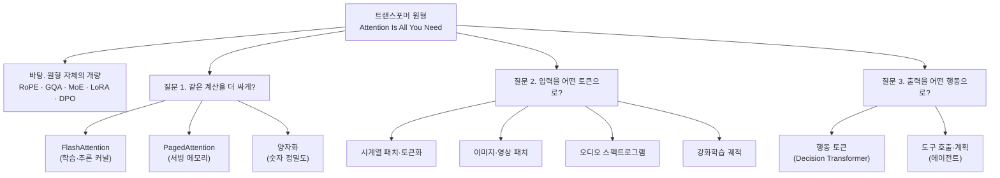
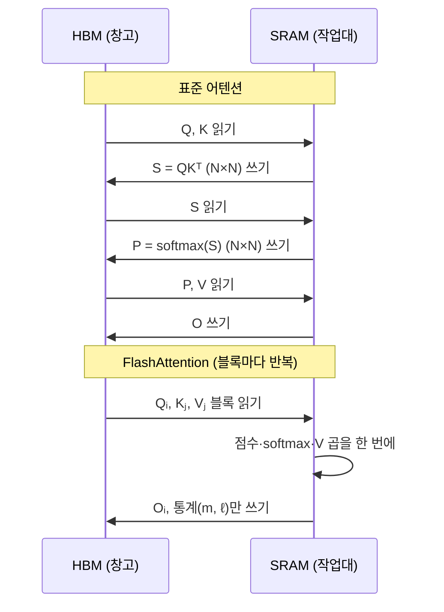
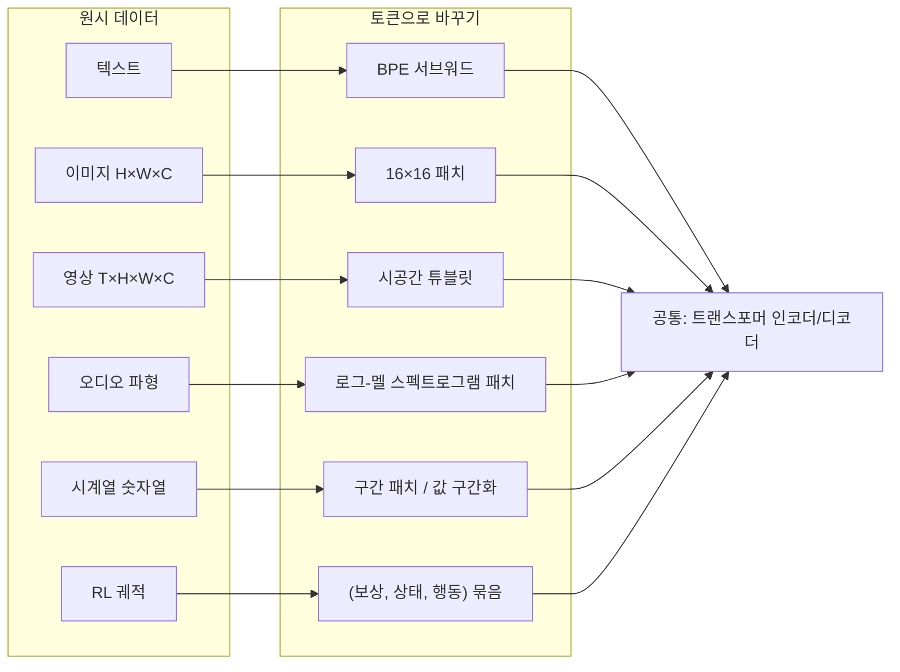
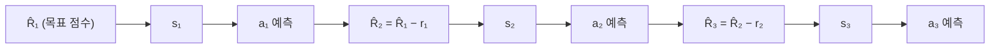
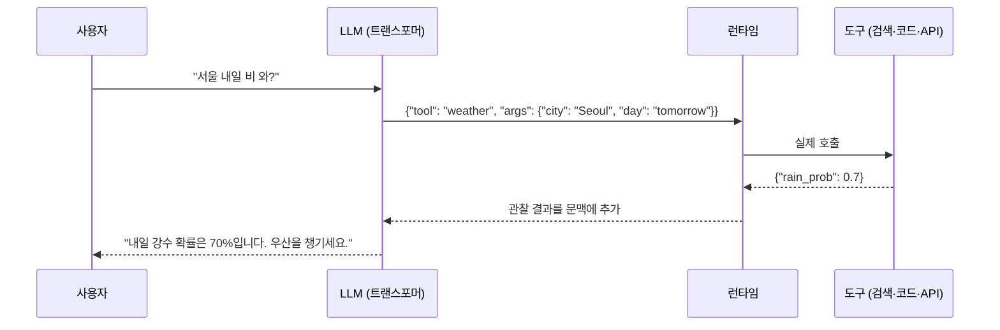
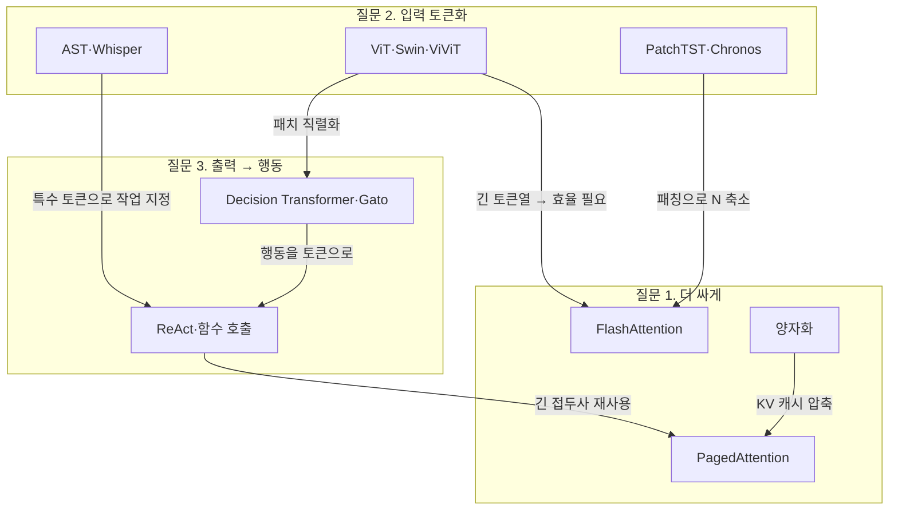

# "Attention Is All You Need" 다음에는 무엇을 읽나… 트랜스포머 응용 지형도

### 트랜스포머 원논문을 읽고 나면 공부할 갈래가 너무 많다. FlashAttention·PagedAttention 같은 GPU·서빙 최적화, 양자화, 시계열·이미지·영상·오디오 트랜스포머, 강화학습과 에이전트 속 트랜스포머가 모두 각자의 분야다. 이 갈래들은 세 질문으로 묶을 수 있다. 같은 계산을 더 싸게 하는가, 입력을 어떤 토큰으로 바꾸는가, 출력을 어떤 행동으로 바꾸는가. 그 밑에는 2017년 원형 자체가 바뀐 부분(RoPE, GQA, MoE, 추측 디코딩, LoRA, DPO, 긴 문맥)이 깔려 있다. 이 글은 각 갈래의 핵심 논문과 수치, 직관을 한 장의 지도로 정리한다

트랜스포머를 공부하는 사람에게 [Attention Is All You Need](https://arxiv.org/abs/1706.03762)(Vaswani 외, 2017)는 사실상 첫 관문이다. 문제는 그다음이다. 2026년의 트랜스포머는 하나의 모델이 아니라 여러 분야가 겹친 생태계다. GPU 커널을 짜는 사람과 주가 예측 모델을 만드는 사람, 로봇 정책을 학습시키는 사람이 모두 "트랜스포머를 쓴다"고 말한다. 같은 말인데 하는 일은 다르다.

이 글은 그 갈래를 넓게 훑는다. 깊게 파기 전에 어떤 분야가 있고 각 분야가 무슨 문제를 푸는지 알아 두자는 것이다. 뼈대는 한국어 신간 『AI 엔지니어를 위한 트랜스포머』(2026년 11월 30일 출간 예정)가 다루는 키워드 목록에서 가져왔다(출처는 글 끝 참고 링크). 각 갈래의 수치와 설명은 원 논문과 공식 블로그·저장소에서 확인해 붙였다. 그 키워드 목록에는 없지만 지금의 LLM을 읽으려면 꼭 알아야 하는 원형의 개량점(위치 인코딩, KV 헤드 공유, MoE, 디코딩 가속, 미세조정·정렬, 긴 문맥, 대안 구조)은 6장으로 따로 묶었다. 개념 설명용 코드는 새로 썼고, NumPy 예제는 직접 실행해 결과를 확인했다.

**책의 원서명·출판사·목차는 공개된 자료에서 확인하지 못했다. 이 글은 책 리뷰가 아니라, 같은 키워드를 원 논문 기준으로 정리한 지형도다. 코드 블록은 원리 설명용 의사 구현이며 실제 라이브러리 성능을 재현하지 않는다.**

## 1. 한눈에 보기

| 갈래 | 푸는 문제 | 대표 기법·논문 | 한 줄 직관 |
|---|---|---|---|
| **GPU 커널 최적화** | 어텐션이 메모리 왕복에 묶여 느리다 | [FlashAttention](https://arxiv.org/abs/2205.14135) 1·[2](https://arxiv.org/abs/2307.08691)·[3](https://arxiv.org/abs/2407.08608) | 작업대(SRAM)에 올리고 내리는 횟수를 줄인다 |
| **서빙 메모리 관리** | KV 캐시가 GPU 메모리를 낭비한다 | [PagedAttention / vLLM](https://arxiv.org/abs/2309.06180) | 운영체제의 페이지처럼 캐시를 블록으로 쪼갠다 |
| **양자화** | 가중치·캐시가 너무 크다 | [LLM.int8()](https://arxiv.org/abs/2208.07339), [GPTQ](https://arxiv.org/abs/2210.17323), [AWQ](https://arxiv.org/abs/2306.00978) | 숫자의 자릿수를 줄여 짐을 가볍게 한다 |
| **원형의 개량** | 2017년 구조로는 길고 큰 LLM이 비효율적이다 | [RoPE](https://arxiv.org/abs/2104.09864), [GQA](https://arxiv.org/abs/2305.13245), [MoE](https://arxiv.org/abs/2101.03961), [추측 디코딩](https://arxiv.org/abs/2211.17192), [LoRA](https://arxiv.org/abs/2106.09685), [DPO](https://arxiv.org/abs/2305.18290) | 부품을 하나씩 갈아 끼운 "2020년대 표준 트랜스포머" |
| **시계열** | 주가·교통량·수요를 예측한다 | [PatchTST](https://arxiv.org/abs/2211.14730), [Chronos](https://arxiv.org/abs/2403.07815) | 연속된 숫자를 "단어"로 자르거나 어휘로 바꾼다 |
| **이미지·영상** | 픽셀을 이해한다 | [ViT](https://arxiv.org/abs/2010.11929), [Swin](https://arxiv.org/abs/2103.14030), [ViViT](https://arxiv.org/abs/2103.15691) | 이미지를 16×16 조각의 문장으로 본다 |
| **오디오** | 소리를 받아 적는다 | [AST](https://arxiv.org/abs/2104.01778), [Whisper](https://arxiv.org/abs/2212.04356) | 소리를 스펙트로그램이라는 그림으로 바꾼다 |
| **강화학습** | 보상을 최대화하는 행동을 고른다 | [Decision Transformer](https://arxiv.org/abs/2106.01345), [Gato](https://arxiv.org/abs/2205.06175) | "얼마나 잘하고 싶은지"를 프롬프트로 준다 |
| **에이전트** | 답을 넘어 행동까지 한다 | [ReAct](https://arxiv.org/abs/2210.03629), [Toolformer](https://arxiv.org/abs/2302.04761) | 출력 형식을 도구 호출로 정해 둔다 |

갈래가 많아 보이지만 질문은 세 개로 줄어든다.



> **쉽게 말하면**
> 트랜스포머를 요리사라고 하자. 질문 1은 주방 동선이다. 같은 요리를 더 빨리, 더 좁은 주방에서 만드는 법이다. 질문 2는 재료 손질이다. 생선이든 채소든 요리사가 다룰 수 있는 크기로 썰어 주는 일이다. 질문 3은 접시에 담는 방식이다. 말로 레시피를 알려 줄지, 직접 손님 테이블로 음식을 가져다줄지 정한다.

이하에서는 질문 1(2~5장)을 먼저 보고, 원형 자체의 개량(6장)을 정리한 뒤, 질문 2(7·8장)와 질문 3(8·9장) 순서로 간다. 강화학습(8장)은 입력(궤적)과 출력(행동)을 모두 다루므로 두 질문에 걸친다.

## 2. 출발점: 어텐션이 왜 비싼가

### 2.1 원형 복습

어텐션(attention)은 각 토큰이 다른 모든 토큰을 얼마나 참고할지 정하는 연산이다. 토큰마다 질문(Query, $Q$), 이름표(Key, $K$), 내용(Value, $V$) 벡터를 만든다. 질문과 이름표의 유사도로 가중치를 정하고, 그 가중치로 내용을 섞는다.

$$
\mathrm{Attention}(Q,K,V)=\mathrm{softmax}\!\left(\frac{QK^\top}{\sqrt{d_k}}\right)V
$$

시퀀스 길이를 $N$, 헤드 차원을 $d$라고 하면 $QK^\top$은 $N\times N$ 행렬이다. 계산량은 $O(N^2 d)$, 이 중간 행렬을 그대로 저장하면 메모리도 $O(N^2)$다. 길이가 2배가 되면 비용은 4배가 된다.

### 2.2 진짜 병목은 계산보다 이동

여기서 흔한 오해가 있다. "어텐션은 곱셈이 많아서 느리다." 실제로 표준 구현에서 시간을 잡아먹는 것은 곱셈보다 **메모리 왕복**이다. FlashAttention 논문은 A100 GPU의 메모리 계층을 이렇게 정리했다.

| 계층 | 용량 | 대역폭 | 비유 |
|---|---|---|---|
| GPU SRAM (SM 내부 온칩) | 약 20MB (SM당 192KB × 108개) | 약 19TB/s | 손 닿는 작업대 |
| GPU HBM (고대역폭 메모리) | 40~80GB | 1.5~2.0TB/s | 같은 방의 창고 |
| CPU DRAM | 1TB 이상 | 약 12.8GB/s | 건물 밖 물류센터 |

GPU 두 줄은 논문 2.1절 본문("40-80GB of HBM with bandwidth 1.5-2.0TB/s", "192KB of on-chip SRAM per each of 108 SMs ... around 19TB/s")을 그대로 옮겼다. 20MB는 192KB×108을 계산한 값이다. CPU DRAM 줄은 본문이 아니라 논문 그림 1(왼쪽)의 메모리 계층 도식에 적힌 값이다. 참고로 H100 SXM은 HBM3 80GB, 약 3.35TB/s이고 SM당 공유 메모리가 228KB로 늘었지만 "작업대가 창고보다 훨씬 작고 빠르다"는 구도는 같다.

작업대는 창고보다 10배쯤 빠르지만 1,000분의 1도 안 되게 작다. 표준 어텐션은 $S=QK^\top$를 계산해 HBM에 쓰고, 다시 읽어 softmax를 하고, 결과 $P$를 또 HBM에 쓰고, 다시 읽어 $PV$를 곱한다. $N\times N$ 행렬이 창고와 작업대를 여러 번 오간다.

이런 연산을 **메모리 대역폭 제약(memory-bound)** 연산이라고 부른다. 산술 강도(arithmetic intensity), 즉 "메모리에서 1바이트 가져올 때마다 하는 연산 수"가 낮아서, 계산 유닛이 놀면서 데이터를 기다린다.

$$
\text{산술 강도} = \frac{\text{FLOPs}}{\text{메모리 이동 바이트}}
$$

## 3. FlashAttention: 작업대에 올리고 내리는 횟수를 줄인다

### 3.1 아이디어

FlashAttention은 새로운 어텐션 구조가 아니다. 수학적으로 **똑같은 결과**를 내는 계산 순서의 재배치다. 근사(approximation)를 쓰지 않는다는 뜻에서 논문 제목에 "Exact"가 들어간다.

핵심은 두 가지다.

1. **타일링(tiling)**: $Q, K, V$를 SRAM에 들어갈 만한 블록으로 자른다. 블록 하나를 올려 놓고 곱셈·softmax·$V$ 곱까지 한 번에 끝낸다. $N\times N$ 행렬 전체는 HBM에 한 번도 쓰지 않는다.
2. **재계산(recomputation)**: 역전파 때 필요한 중간 행렬을 저장하지 않는다. 대신 softmax 정규화 통계(블록별 최댓값과 합)만 저장해 두고, 필요할 때 다시 계산한다. 계산은 조금 늘지만 메모리 왕복이 크게 줄어 전체적으로 빨라진다.

결과적으로 추가 메모리가 $O(N^2)$에서 $O(N)$으로 줄어든다.

### 3.2 블록 단위 softmax가 가능한 이유: 온라인 softmax

softmax는 분모에 "모든 원소의 합"이 들어간다. 그러니 블록을 나눠 계산하면 안 될 것 같다. 이를 푸는 것이 **온라인 softmax**다. 블록을 하나 볼 때마다 지금까지의 최댓값 $m$과 지수 합 $\ell$을 갱신하고, 이전 결과를 보정 계수로 다시 맞춘다.

블록 $j$에서 점수 $s_j$를 얻었을 때:

$$
m^{\text{new}}=\max\!\left(m,\ \max(s_j)\right),\qquad
\ell^{\text{new}}=e^{m-m^{\text{new}}}\,\ell+\sum e^{s_j-m^{\text{new}}}
$$

$$
O^{\text{new}}=\frac{e^{m-m^{\text{new}}}\,\ell\,O+e^{s_j-m^{\text{new}}}V_j}{\ell^{\text{new}}}
$$

최댓값을 빼는 이유는 수치 안정성이다. $e^{100}$ 같은 값이 넘치지(overflow) 않도록 한다. 아래는 NumPy로 쓴 한 행짜리 개념 구현이다. 실제 FlashAttention은 CUDA 커널이며 이 코드처럼 동작 원리만 같다.

```python
import numpy as np

def naive_attention_row(q, K, V):
    s = K @ q / np.sqrt(q.shape[0])          # N개 점수 전부 저장
    p = np.exp(s - s.max()); p /= p.sum()
    return p @ V

def tiled_attention_row(q, K, V, block=64):
    d = q.shape[0]
    m, l = -np.inf, 0.0                       # 지금까지의 최댓값, 지수 합
    o = np.zeros(V.shape[1])                  # 지금까지의 (정규화된) 출력
    for j in range(0, K.shape[0], block):     # 블록 하나만 "작업대"에 올린다
        s = K[j:j+block] @ q / np.sqrt(d)
        m_new = max(m, s.max())
        scale = np.exp(m - m_new)             # 이전 결과 보정 계수
        p = np.exp(s - m_new)
        l_new = scale * l + p.sum()
        o = (scale * l * o + p @ V[j:j+block]) / l_new
        m, l = m_new, l_new
    return o

N, d = 1024, 64
q, K, V = np.random.randn(d), np.random.randn(N, d), np.random.randn(N, d)
print(np.allclose(naive_attention_row(q, K, V), tiled_attention_row(q, K, V)))  # True
```



### 3.3 세대별 수치

| 버전 | 대상 GPU | 논문 초록의 주요 수치 |
|---|---|---|
| [FlashAttention](https://arxiv.org/abs/2205.14135) (2022) | A100 | BERT-large(길이 512) MLPerf 1.1 기록 대비 종단 15% 빠름, GPT-2(길이 1K) 3배, Long-Range Arena(1K~4K) 2.4배. Path-X(길이 16K)에서 61.4% 정확도로 트랜스포머 최초의 우연 이상 성능 |
| [FlashAttention-2](https://arxiv.org/abs/2307.08691) (2023) | A100 | 1세대 대비 약 2배. 1세대가 이론 최대 FLOPs의 25~40%였던 것을 50~73%로. GPT 계열 학습에서 A100당 최대 225 TFLOPs/s (모델 FLOPs 활용률 72%) |
| [FlashAttention-3](https://arxiv.org/abs/2407.08608) (2024) | H100 | FA2가 H100에서 활용률 35%에 그쳤다고 지적. FP16 최대 740 TFLOPs/s(활용률 75%), FP8 약 1.2 PFLOPs/s. 1.5~2.0배 가속. FP8 오차는 기준 FP8 어텐션보다 2.6배 작음 |

2세대는 작업 분할(병렬화 축을 시퀀스 길이 방향으로 넓힘)과 비-행렬곱 연산 줄이기에 집중했다. 3세대는 H100의 비동기 하드웨어(TMA, 워프 특화)와 FP8 저정밀 연산을 활용한다. 하드웨어가 바뀔 때마다 같은 수식의 "최적 배치"가 바뀐다는 것이 이 계보의 교훈이다.


*출처: [Dao-AILab/flash-attention](https://github.com/Dao-AILab/flash-attention) 저장소.*

오늘날 PyTorch의 `scaled_dot_product_attention`은 조건이 맞으면 FlashAttention 계열 커널로 자동 분기한다. 사용자는 대개 의식하지 않고 혜택을 받는다.

```python
import torch
import torch.nn.functional as F

q = torch.randn(2, 8, 4096, 64, device="cuda", dtype=torch.float16)
k, v = torch.randn_like(q), torch.randn_like(q)
out = F.scaled_dot_product_attention(q, k, v, is_causal=True)  # 내부에서 fused 커널 선택
```

## 4. PagedAttention: 서빙 메모리를 운영체제처럼 관리한다

### 4.1 KV 캐시란

학습이 끝난 LLM을 서비스하는 단계를 **서빙(serving)** 이라고 한다. LLM은 토큰을 하나씩 생성한다(자기회귀, autoregressive). 매 토큰마다 앞선 모든 토큰의 $K, V$를 다시 계산하면 낭비이므로 저장해 두고 재사용한다. 이것이 **KV 캐시**다.

KV 캐시는 크다. 토큰 하나당 크기는 다음과 같다.

$$
\text{KV 바이트/토큰} = 2 \times L \times H_{kv} \times d_{head} \times b
$$

($L$: 층 수, $H_{kv}$: KV 헤드 수, $d_{head}$: 헤드 차원, $b$: 원소당 바이트, 앞의 2는 K와 V)

예를 들어 32층, KV 헤드 8개(GQA, 6.3절), 헤드 차원 128, FP16(2바이트)인 8B급 모델이라면 $2\times32\times8\times128\times2 = 131{,}072$바이트, 즉 **토큰당 128KiB**다. 8K 토큰 대화 하나에 1GiB가 든다. 동시 사용자가 수십 명이면 모델 가중치보다 캐시가 더 커질 수 있다.

### 4.2 문제: 단편화와 과예약

기존 서빙 시스템은 요청마다 "최대 길이만큼" 연속된 메모리를 미리 잡았다. 답이 얼마나 길어질지 모르기 때문이다. 결과는 두 종류의 낭비다.

- **내부 단편화**: 2,048토큰을 예약했는데 답이 200토큰으로 끝나면 나머지는 비어 있다.
- **외부 단편화**: 크기가 제각각인 예약 사이사이에 쓸 수 없는 작은 빈틈이 생긴다.

vLLM 팀의 [공식 블로그](https://vllm.ai/blog/2023-06-20-vllm)는 기존 시스템이 단편화와 과예약 때문에 **메모리의 60~80%를 낭비**한다고 측정했다.

### 4.3 해법: 가상 메모리의 페이징

[PagedAttention](https://arxiv.org/abs/2309.06180)(Kwon 외, SOSP 2023)은 운영체제의 가상 메모리에서 아이디어를 가져왔다. KV 캐시를 고정 크기 **블록**(예: 16토큰)으로 쪼개고, 논리적으로 연속된 블록을 물리적으로는 흩어진 위치에 둔다. 요청마다 **블록 테이블**이 "논리 블록 n번은 물리 블록 몇 번"을 기록한다. 새 토큰이 블록을 채우면 그때 한 블록만 더 할당한다.


*KV 캐시를 블록 단위로 나눠 비연속 메모리에 두는 PagedAttention. 출처: [vLLM 블로그](https://vllm.ai/blog/2023-06-20-vllm).*

| 운영체제 개념 | PagedAttention 대응 |
|---|---|
| 페이지 | KV 블록 |
| 프로세스 | 요청(시퀀스) |
| 페이지 테이블 | 블록 테이블 |
| 바이트 | 토큰 |
| Copy-on-Write | 병렬 샘플링·빔 서치에서 공통 앞부분 공유 |

```python
BLOCK = 16

class BlockAllocator:
    def __init__(self, num_blocks):
        self.free = list(range(num_blocks))
        self.ref = [0] * num_blocks

    def alloc(self):
        b = self.free.pop(); self.ref[b] = 1; return b

class Sequence:
    def __init__(self, alloc):
        self.alloc, self.table, self.n = alloc, [], 0   # table: 논리 → 물리

    def append_token(self):
        if self.n % BLOCK == 0:                          # 블록이 다 찼을 때만 새로 할당
            self.table.append(self.alloc.alloc())
        self.n += 1

    def fork(self):                                      # 병렬 샘플링: 앞부분 공유
        child = Sequence(self.alloc)
        child.table, child.n = list(self.table), self.n
        for b in self.table: self.alloc.ref[b] += 1      # 쓰기 전까지는 복사하지 않음
        return child
```

낭비는 마지막 블록의 빈 칸으로 한정된다. 블로그는 이 방식으로 낭비가 4% 미만으로 줄었다고 적었다(논문 초록은 "near-zero waste"라고 표현). 메모리가 남으니 한 번에 더 많은 요청을 묶어(batching) 처리할 수 있다.

| 비교 | 수치 (출처) |
|---|---|
| 같은 지연 시간에서 FasterTransformer·Orca 대비 처리량 | 2~4배 (논문 초록) |
| 출력 1개(n=1), HF Transformers 대비 | 14~24배 (블로그) |
| 출력 1개(n=1), TGI 대비 | 2.2~2.5배 (블로그) |
| 출력 3개(n=3), HF / TGI 대비 | 8.5~15배 / 3.3~3.5배 (블로그) |

블로그 수치는 2023년 6월 당시 버전 비교다. 지금의 TGI·SGLang·TensorRT-LLM 등도 대부분 블록 단위 KV 관리를 채택했으므로, 이 격차가 현재도 유지된다고 읽으면 안 된다.

> **쉽게 말하면**
> 예전 식당은 손님이 몇 명 올지 모르니 예약마다 10인석을 통째로 잡아 줬다. 실제로는 두 명만 와도 나머지 여덟 자리는 빈다. PagedAttention은 2인 테이블을 여러 개 두고, 일행이 늘 때마다 근처의 빈 2인 테이블을 하나씩 붙여 준다. 테이블이 붙어 있지 않아도 종업원이 "이 일행은 3번, 7번, 12번 테이블"이라는 장부만 들고 있으면 된다.

### 4.4 FlashAttention과 PagedAttention의 관계

둘 다 "잡기술"이지만 위치가 다르다.

| | FlashAttention | PagedAttention |
|---|---|---|
| 단계 | 학습과 추론 모두 | 주로 추론 서빙 |
| 대상 | 한 번의 어텐션 연산 | 여러 요청에 걸친 KV 캐시 |
| 최적화 축 | HBM↔SRAM 왕복 횟수 | GPU 메모리 할당·공유 |
| 비유 | 요리사의 동선 | 식당의 좌석 배치 |
| 결과 | 같은 수식, 더 빠른 커널 | 같은 모델, 더 큰 배치 |

실제 서빙 엔진은 둘을 함께 쓴다. 블록 테이블을 읽어 흩어진 KV 블록에서 어텐션을 계산하는 커널 자체를 FlashAttention 스타일로 짠다.

## 5. 양자화: 숫자의 자릿수를 줄인다

**양자화(quantization)** 는 FP16(16비트 부동소수점)으로 저장된 숫자를 INT8·INT4·FP8 같은 더 적은 비트로 바꾸는 일이다. 70B 파라미터 모델은 FP16이면 가중치만 약 140GB지만, 4비트면 약 35GB(스케일 등 부가 정보 제외)다.

가장 단순한 대칭 양자화는 이렇다.

$$
s=\frac{\max|w|}{2^{b-1}-1},\qquad q=\mathrm{round}\!\left(\frac{w}{s}\right),\qquad \hat w = s\cdot q
$$

어려움은 **이상치(outlier)** 다. 값 대부분이 작은데 몇 개만 크면, 큰 값에 맞춘 스케일 때문에 작은 값들이 모두 0 근처로 뭉개진다.

| 기법 | 핵심 아이디어 | 논문 |
|---|---|---|
| LLM.int8() | 대부분은 INT8로, 이상치 특성 차원만 FP16으로 따로 계산(혼합 정밀도 분해) | [Dettmers 외, 2022](https://arxiv.org/abs/2208.07339) |
| GPTQ | 2차 정보(헤시안 근사)를 써서 한 열씩 양자화하며 오차를 남은 열로 보정. 학습 없이(PTQ) 3~4비트 | [Frantar 외, 2022](https://arxiv.org/abs/2210.17323) |
| AWQ | 가중치가 아니라 **활성값 분포**로 고른 중요 채널(약 1%)을, 혼합 정밀도 대신 채널별 스케일링으로 보호. MLSys 2024 최우수 논문 | [Lin 외, 2023](https://arxiv.org/abs/2306.00978) |
| KV 캐시 양자화 | 가중치뿐 아니라 KV 캐시를 FP8·INT4로 저장 | 서빙 엔진 기능 (vLLM 등) |

```python
import numpy as np

def quantize_sym(w, bits=4):
    qmax = 2 ** (bits - 1) - 1
    s = np.abs(w).max() / qmax
    q = np.clip(np.round(w / s), -qmax - 1, qmax).astype(np.int8)
    return q, s

w = np.random.randn(4096) * 0.02
w[7] = 1.5                                   # 이상치 하나
q, s = quantize_sym(w)
err = np.abs(w - q * s).mean()
print(f"scale={s:.4f}, 평균 오차={err:.4f}")  # 이상치 때문에 scale이 커져 작은 값들이 대부분 0이 된다
```

양자화는 질문 1(더 싸게)에 속한다. FlashAttention이 "이동 횟수"를, PagedAttention이 "자리 배치"를 줄인다면, 양자화는 "짐 하나의 무게"를 줄인다. 메모리 대역폭 제약 연산에서는 옮길 바이트가 줄어드는 것만으로 속도가 오른다.

## 6. 원형 자체의 개량: 2017년 그림과 2026년 LLM의 차이

지금까지는 "원형을 그대로 두고 더 싸게 돌리는" 기술이었다. 그런데 Llama·Qwen·DeepSeek 같은 요즘 LLM의 구조도를 원논문 그림 옆에 놓으면 부품 자체가 꽤 바뀌어 있다. 이 장은 그 차이를 부품별로 정리한다. 다른 갈래의 논문을 읽을 때 "기본 가정"으로 깔리는 내용이라, 원논문 다음에 가장 먼저 익혀 둘 만하다.

| 부품 | 2017년 원형 | 요즘 디코더 LLM의 흔한 선택 | 바뀐 이유 |
|---|---|---|---|
| 위치 정보 | 사인·코사인 절대 위치를 임베딩에 더함 | **RoPE**(회전 위치 임베딩) | 상대 위치를 자연스럽게 담고 길이 확장이 쉽다 |
| 정규화 | Post-LN, LayerNorm | **Pre-LN**, RMSNorm | 깊은 모델의 학습 안정성, 계산 단순화 |
| FFN 활성화 | ReLU | **SwiGLU** | 같은 파라미터에서 품질 향상 |
| 어텐션 헤드 | MHA(헤드마다 K, V) | **GQA**, MQA, MLA | KV 캐시 크기 축소 |
| FFN 규모 | 밀집(dense) 한 덩어리 | **MoE**(전문가 여럿 중 일부만 사용) | 총 파라미터는 키우고 토큰당 계산은 유지 |
| 구조 | 인코더-디코더(번역) | 디코더 전용(GPT 계열) | 다음 토큰 예측 하나로 사전학습을 통일 |

### 6.1 위치 정보: 사인 곡선에서 RoPE로

어텐션은 그 자체로는 순서를 모른다. "개가 사람을 물었다"와 "사람이 개를 물었다"의 토큰 집합이 같기 때문이다. 그래서 위치 정보를 따로 넣어야 한다. 원논문은 위치마다 다른 사인·코사인 값을 임베딩에 **더했다**(절대 위치).

[RoPE](https://arxiv.org/abs/2104.09864)(Su 외, 2021)는 더하는 대신 **돌린다**. $Q$와 $K$ 벡터를 두 칸씩 짝지어 2차원 평면의 점으로 보고, 위치 $m$에 비례하는 각도 $m\theta_i$만큼 회전시킨다($\theta_i = 10000^{-2i/d}$). 두 벡터를 각각 $m$, $n$만큼 돌린 뒤 내적하면 각도 차이 $m-n$만 남는다. 그래서 어텐션 점수가 **상대 위치**에만 의존한다.

$$
\langle R_{m} q,\ R_{n} k\rangle = \langle q,\ R_{n-m}\, k\rangle
$$

> **쉽게 말하면**
> 시계 바늘 두 개를 생각하자. 둘 다 같은 만큼 더 돌려도 두 바늘 사이의 각도는 그대로다. RoPE는 "몇 번째 자리인가"를 바늘의 각도로 적어 두어서, 어텐션이 보는 것은 절대 자리가 아니라 "몇 칸 떨어져 있나"가 된다.

```python
import numpy as np

def rope(x, pos, base=10000.0):
    d = x.shape[-1]
    theta = base ** (-np.arange(0, d, 2) / d)   # 짝마다 다른 회전 속도
    cos, sin = np.cos(pos * theta), np.sin(pos * theta)
    x1, x2 = x[0::2], x[1::2]
    out = np.empty_like(x)
    out[0::2] = x1 * cos - x2 * sin             # 2차원 회전
    out[1::2] = x1 * sin + x2 * cos
    return out

q, k = np.random.randn(64), np.random.randn(64)
a = rope(q, 10) @ rope(k, 7)        # 거리 3
b = rope(q, 103) @ rope(k, 100)     # 역시 거리 3
print(np.isclose(a, b))             # True: 점수는 상대 거리에만 의존
```

경쟁 방식으로는 어텐션 점수에 거리에 비례한 벌점을 빼는 [ALiBi](https://arxiv.org/abs/2108.12409)가 있다. 학습 길이보다 긴 입력에 비교적 잘 버틴다는 장점이 있지만, 오늘날 주류는 RoPE다. 이어지는 6.5절의 문맥 길이 확장 기법 대부분이 RoPE의 회전 각도를 조정하는 방식이다.

### 6.2 정규화와 FFN: Pre-LN, RMSNorm, SwiGLU

원논문은 잔차 연결을 더한 **뒤에** 정규화를 했다(Post-LN). 층이 깊어지면 학습 초반 기울기가 불안정해져 학습률 워밍업에 민감해진다. 요즘 LLM은 거의 다 서브층에 들어가기 **전에** 정규화하는 [Pre-LN](https://arxiv.org/abs/2002.04745)을 쓴다. 왜 그런지는 [최신 LLM이 Pre-LN을 쓰는 이유](./260907_1237_llm+preLN.md)에서 수식으로 다뤘다. 정규화 자체도 평균 빼기를 생략하고 크기만 맞추는 [RMSNorm](https://arxiv.org/abs/1910.07467)으로 가벼워졌다.

FFN의 ReLU는 게이트를 하나 더 둔 [SwiGLU](https://arxiv.org/abs/2002.05202)로 바뀌었다. 한 갈래의 출력이 다른 갈래 출력의 "통과량"을 조절하는 구조다. 행렬이 3개로 늘어나는 대신 은닉 차원을 약 2/3로 줄여 파라미터 수를 맞추는 것이 관례다.

### 6.3 KV 헤드 줄이기: MQA, GQA, MLA

4.1절의 KV 캐시 공식에서 $H_{kv}$를 줄이면 캐시가 그만큼 준다. 원형의 멀티헤드 어텐션(MHA)은 쿼리 헤드마다 자기 $K, V$를 가진다.

- [MQA](https://arxiv.org/abs/1911.02150)(Shazeer, 2019): 모든 쿼리 헤드가 $K, V$ 한 벌을 공유한다. 캐시는 헤드 수만큼 줄지만 품질이 떨어질 수 있다.
- [GQA](https://arxiv.org/abs/2305.13245)(Ainslie 외, 2023): 쿼리 헤드를 몇 묶음으로 나눠 묶음마다 $K, V$를 공유한다. MHA와 MQA 사이의 절충이다. 4.1절 예시의 "KV 헤드 8개"가 바로 GQA이고, 쿼리 헤드가 32개라면 MHA 대비 캐시가 1/4이다. 자세한 내용은 [GQA 완전판](./260731_1237_GQA_Grouped_Query_Attention.md) 참고.
- MLA(Multi-head Latent Attention, [DeepSeek-V2](https://arxiv.org/abs/2405.04434)): $K, V$를 작은 잠재 벡터로 압축해 저장하고 쓸 때 복원한다. 헤드를 공유하지 않고 차원을 줄이는 방향이다. [Kimi K3 해설](./260803_2304_kimi_k3_deep_dive.md)처럼 최신 오픈 모델의 혼합 어텐션 설계에도 쓰인다.

### 6.4 MoE: 전문가 여럿 중 일부만 깨운다

**MoE(Mixture of Experts)** 는 FFN을 여러 개(전문가)로 두고, **라우터**가 토큰마다 그중 상위 $k$개만 골라 계산한다. 쉽게 말하면 큰 병원에 전문의가 수십 명 있어도 환자 한 명은 접수 창구가 정해 준 두세 명만 만나는 구조다. 병원 전체의 지식(총 파라미터)은 크지만 환자 한 명당 진료 시간(토큰당 계산량)은 작다.

- [Switch Transformer](https://arxiv.org/abs/2101.03961)(Fedus 외, 2021)는 전문가 1개만 고르는($k=1$) 단순한 라우팅으로 조 단위 파라미터까지 키웠다.
- [Mixtral 8x7B](https://arxiv.org/abs/2401.04088)(2024)는 층마다 전문가 8개 중 2개를 골라, 총 약 47B 파라미터 중 토큰당 약 13B만 쓴다.
- DeepSeek 계열은 전문가를 더 잘게 쪼개고 항상 켜지는 공유 전문가를 따로 두는 식으로 발전시켰다.

트레이드오프도 분명하다. 계산은 줄어도 **모든 전문가의 가중치는 메모리에 있어야** 하므로 서빙 메모리는 총 파라미터 기준으로 든다. 라우터가 일부 전문가에만 몰리지 않도록 부하 균형 손실을 둬야 하고, 여러 GPU에 전문가를 나눠 둘 때는 토큰을 주고받는 통신 비용이 생긴다. 질문 1(더 싸게)의 관점에서 보면 "계산은 싸지고 메모리·통신은 비싸지는" 기술이다.

### 6.5 긴 문맥: 어디까지, 어떻게 늘리나

문맥 길이는 2017년의 512토큰에서 이제 수십만~백만 토큰으로 늘었다. 여기에는 세 층위의 기술이 겹친다.

1. **위치 인코딩 확장**: 짧게 학습한 RoPE 모델을 길게 쓰면 처음 보는 회전 각도가 나와 성능이 무너진다. [Position Interpolation](https://arxiv.org/abs/2306.15595)은 위치를 비율만큼 압축해 학습한 각도 범위 안으로 넣고, [YaRN](https://arxiv.org/abs/2309.00071)은 주파수 대역별로 다르게 늘려 짧은 거리 정보를 덜 잃는다. llama.cpp 계열의 YaRN 처리는 [ggml 1.0.0 정리](./261116_0151_ggml_v1_0_0_API_FP8_and_Backend_Speedups.md)에서 다뤘다.
2. **계산·메모리**: FlashAttention(3장)으로 $O(N^2)$ 메모리를 없애고, KV 캐시는 GQA·양자화로 줄인다. 최근 $W$개 토큰만 보는 슬라이딩 윈도 어텐션([Mistral 7B](https://arxiv.org/abs/2310.06825)), 시퀀스를 여러 GPU에 나눠 블록을 고리처럼 돌리는 [Ring Attention](https://arxiv.org/abs/2310.01889)도 쓴다.
3. **실제로 쓰는가**: 문맥에 넣을 수 있다고 모델이 다 활용하는 것은 아니다. [Lost in the Middle](https://arxiv.org/abs/2307.03172)은 정보가 문맥 가운데 있을 때 성능이 떨어지는 현상을 보였다. 그래서 공식 문맥 길이와 별도로 긴 문맥 평가가 따로 필요하다.

### 6.6 디코딩 가속, 미세조정, 정렬

**연속 배칭(continuous batching)**: 요청 묶음 전체가 끝날 때까지 기다리지 않고, 한 요청이 끝나면 그 자리에 새 요청을 바로 끼운다(Orca, OSDI 2022). PagedAttention과 함께 vLLM 같은 서빙 엔진의 기본 기능이다.

**추측 디코딩(speculative decoding)**: 작은 "초안" 모델이 다음 토큰 $K$개를 빠르게 제안하고, 큰 모델이 한 번의 순전파로 $K$개를 동시에 검증한다. 초안 확률 $q$, 본 모델 확률 $p$일 때 각 토큰을 $\min(1, p/q)$ 확률로 받아들이고, 거절되면 보정된 분포에서 다시 뽑는다. 이 규칙 덕분에 결과 분포가 큰 모델 단독과 **수학적으로 같다**([Leviathan 외](https://arxiv.org/abs/2211.17192), [Chen 외](https://arxiv.org/abs/2302.01318)). 자기회귀 생성이 메모리 대역폭 제약이라 $K$개를 한 번에 검증해도 시간이 거의 늘지 않는다는 점(2.2절)을 이용한다. 별도 초안 모델 대신 모델 자신의 다중 토큰 예측(MTP) 헤드를 쓰는 변형은 [MTPLX 글](./261031_1654_MTPLX_Native_MTP_Speculative_Decoding_on_Apple_Silicon.md)에서 다뤘다.

**LoRA·PEFT**: 수십억 파라미터를 전부 미세조정하는 대신, 원래 가중치 $W$는 얼리고 작은 두 행렬의 곱만 학습한다.

$$
W' = W + \frac{\alpha}{r} BA,\qquad B\in\mathbb{R}^{d\times r},\ A\in\mathbb{R}^{r\times k},\ r\ll \min(d,k)
$$

[LoRA](https://arxiv.org/abs/2106.09685) 논문은 GPT-3 175B에서 학습 파라미터를 약 1만 분의 1로, GPU 메모리를 약 1/3로 줄였다고 보고했다. 학습이 끝나면 $BA$를 $W$에 합쳐 추론 비용이 늘지 않는다. [QLoRA](https://arxiv.org/abs/2305.14314)는 얼린 $W$를 4비트로 양자화(5장)해 65B 모델을 48GB GPU 한 장에서 미세조정했다. 이처럼 일부 파라미터만 학습하는 방법을 통틀어 PEFT(parameter-efficient fine-tuning)라고 부른다.

**정렬(alignment)**: 사전학습만 한 모델은 "다음 단어를 잘 잇는 모델"이지 "지시를 잘 따르는 모델"이 아니다. 흐름은 대략 다음과 같다.

| 방법 | 무엇을 하나 | 비용·특징 |
|---|---|---|
| SFT(지도 미세조정) | 지시-응답 예시로 그대로 학습 | 가장 단순, 정렬의 출발점 |
| [RLHF](https://arxiv.org/abs/2203.02155) | 사람 선호로 보상 모델을 만들고 PPO로 정책 최적화 | 모델 여러 개(정책·참조·보상·가치)가 필요해 무겁다 |
| [DPO](https://arxiv.org/abs/2305.18290) | "좋은 답 vs 나쁜 답" 쌍에서 바로 분류 손실처럼 학습 | 보상 모델·RL 루프 없이 RLHF 목적을 근사 |
| [GRPO](https://arxiv.org/abs/2402.03300) | 한 문제에 답을 여러 개 뽑아 그룹 평균 대비 점수로 갱신 | 가치 모델이 없다. 자동 채점 가능한 수학·코드 추론 강화학습에 널리 쓰인다 |

### 6.7 트랜스포머의 대안과 변형

$O(N^2)$ 어텐션을 아예 다른 연산으로 바꾸려는 흐름도 있다. [Mamba](https://arxiv.org/abs/2312.00752)(Gu·Dao, 2023) 같은 상태 공간 모델(SSM)과 선형 어텐션 계열은 고정 크기 상태를 갱신하며 시퀀스를 읽어 길이에 선형인 비용과 상수 크기 캐시를 얻는다. 대신 문맥의 특정 위치를 정확히 찾아오는 능력은 어텐션보다 약하다는 보고가 많아, 최근에는 두 방식을 층마다 섞는 **하이브리드**가 흔하다. 같은 층을 여러 번 통과시켜 깊이를 늘리는 루프 트랜스포머처럼 원형 구조를 변형하는 시도는 [GLM-5.4 해설](./261123_2230_GLM_5_4_First_Loop_Transformer_and_Generalized_Coding.md)에서 다뤘다.

## 7. 언어 밖의 트랜스포머: 핵심은 입력을 토큰으로 바꾸는 방법

트랜스포머는 원래 "토큰의 집합"을 처리하는 기계다. 단어가 아니어도 토큰으로 바꿀 수 있으면 무엇이든 다룬다. 그래서 언어 외 도메인에서 첫 번째 설계 결정은 **입력을 어떤 토큰으로 자를지**다. 두 번째는 도메인 고유의 성질(이미지의 지역성, 시계열의 주기성 등)을 **모델 구조에 가정으로 넣을지**다.



### 7.1 이미지: 16×16 조각의 문장

[ViT](https://arxiv.org/abs/2010.11929)(Dosovitskiy 외, 2020) 논문 제목은 "An Image is Worth 16x16 Words"다. 224×224 이미지를 16×16 패치로 자르면 $14\times14=196$개 패치가 된다. 각 패치를 펼쳐 선형 투영하면 196개 토큰이 된다. 여기에 분류용 `[CLS]` 토큰과 위치 임베딩을 더한다.


*출처: [google-research/vision_transformer](https://github.com/google-research/vision_transformer).*

```python
import torch, torch.nn as nn

class PatchEmbed(nn.Module):
    def __init__(self, img=224, patch=16, in_ch=3, dim=768):
        super().__init__()
        # stride=kernel=patch인 합성곱 = "자르고 펼쳐서 선형 투영"과 같다
        self.proj = nn.Conv2d(in_ch, dim, kernel_size=patch, stride=patch)
        n = (img // patch) ** 2
        self.cls = nn.Parameter(torch.zeros(1, 1, dim))
        self.pos = nn.Parameter(torch.zeros(1, n + 1, dim))

    def forward(self, x):                        # x: (B, 3, 224, 224)
        x = self.proj(x).flatten(2).transpose(1, 2)   # (B, 196, 768)
        cls = self.cls.expand(x.size(0), -1, -1)
        return torch.cat([cls, x], dim=1) + self.pos  # (B, 197, 768)
```

ViT는 합성곱 신경망(CNN)이 가진 "가까운 픽셀끼리 관련 있다"는 가정(귀납 편향, inductive bias)이 약하다. 그래서 데이터가 적으면 CNN보다 약하고, 대규모 사전학습에서 강해진다. 이 약점을 구조로 보완한 것이 [Swin Transformer](https://arxiv.org/abs/2103.14030)다. 어텐션을 작은 창(window) 안으로 제한하고, 층마다 창을 밀어(shift) 창끼리 정보를 섞는다. 이미지의 지역성을 모델 구조에 다시 넣은 셈이다. 계산량도 이미지 크기에 선형에 가깝다.

### 7.2 영상: 시간 축을 하나 더

영상은 프레임이 시간 순으로 쌓인 것이다. [ViViT](https://arxiv.org/abs/2103.15691)는 시공간 튜블릿(tubelet, 여러 프레임에 걸친 3차원 패치)을 토큰으로 쓰고, 공간 어텐션과 시간 어텐션을 분리하는 변형들을 비교했다. 영상은 토큰 수가 프레임 수만큼 곱해지므로, 3장의 효율화 기법이 가장 절실한 도메인이기도 하다.

### 7.3 오디오: 소리를 그림으로

음성 파형은 1초에 1만6천 개 이상의 샘플이다. 그대로 토큰으로 쓰기엔 너무 길다. 그래서 짧은 구간마다 주파수 성분을 뽑은 **로그-멜 스펙트로그램**(사람 귀의 민감도에 맞춘 주파수 축 × 시간 축의 2차원 그림)으로 바꾼다.

- [AST](https://arxiv.org/abs/2104.01778)(Audio Spectrogram Transformer)는 스펙트로그램을 이미지처럼 패치로 잘라 ViT 방식으로 분류한다.
- [Whisper](https://arxiv.org/abs/2212.04356)(OpenAI, 2022)는 30초 단위 로그-멜 스펙트로그램을 인코더에 넣고, 디코더가 텍스트 토큰을 생성한다. 인터넷에서 모은 68만 시간(680,000시간) 분량의 다국어·다중 작업 약지도(weakly supervised) 데이터로 학습했다. 약지도란 사람이 일일이 다듬은 정답 대신, 웹에 붙어 있던 자막처럼 조금 거친 정답을 대량으로 쓰는 방식이다. 언어 식별·전사·번역 같은 작업을 특수 토큰으로 지정하는 방식은, 출력 형식을 토큰으로 정하는 9장 에이전트 이야기의 예고편이다.

### 7.4 시계열: 숫자열을 단어로 바꾸는 두 가지 방법

주가, 교통량, 전력 수요, 매장 판매량 같은 **시계열(time series)** 은 언어와 달리 어휘가 없다. 연속값이다. 여기서 두 흐름이 갈린다.

**(1) 패치로 자르기: PatchTST**

[PatchTST](https://arxiv.org/abs/2211.14730)(Nie 외, ICLR 2023) 제목은 "A Time Series is Worth 64 Words"다. ViT의 발상을 그대로 가져와, 시계열을 겹치는 구간(patch)으로 잘라 각 구간을 토큰으로 쓴다. 두 가지 설계가 핵심이다.

- **패칭**: 한 시점이 아니라 구간을 토큰으로 써서 지역 패턴을 담고, 토큰 수를 줄여 어텐션 비용($O(N^2)$)을 낮춘다.
- **채널 독립(channel independence)**: 여러 변수(예: 온도·습도·전력)를 섞지 않고 변수마다 같은 모델을 따로 적용한다.


*출처: [yuqinie98/PatchTST](https://github.com/yuqinie98/PatchTST).*

패치 길이 $P$, 간격(stride) $S$, 입력 길이 $L$이면 토큰 수는 대략

$$
N = \left\lfloor \frac{L-P}{S} \right\rfloor + 2
$$

이다(끝에 패딩 한 칸을 더하는 논문 설정 기준). $L=512, P=16, S=8$이면 $N=64$로, 제목의 "64 Words"가 여기서 나온다.

**(2) 어휘로 바꾸기: Chronos**

Amazon의 [Chronos](https://arxiv.org/abs/2403.07815)(Ansari 외, 2024)는 반대 방향으로 간다. 시계열 값을 문맥 구간의 평균 절댓값으로 나눠 스케일을 맞춘 뒤(mean scaling), 값의 범위를 일정 간격으로 나눠(구간화, binning) 정수 토큰 ID로 바꾼다. 논문 설정의 어휘는 특수 토큰을 포함해 4,096개다. 그러면 시계열이 "어휘가 정해진 언어"가 되고, T5 같은 언어 모델 구조를 거의 그대로 학습시킬 수 있다. 예측도 다음 토큰을 확률적으로 샘플링하는 방식이라 불확실성 범위를 자연스럽게 얻는다. 미리 학습한 모델을 새 데이터셋에 바로 적용하는 제로샷 예측이 목표다. 모델 크기는 2천만~7억 1천만 파라미터이고, 공개 데이터에 가우시안 프로세스로 만든 합성 시계열을 섞어 학습했으며, 42개 데이터셋에서 평가했다(논문 초록).

후속작은 토큰화 방식부터 바꿨다. 2024년 11월의 Chronos-Bolt는 값을 구간화하지 않고 PatchTST처럼 **패치**로 자른 뒤 여러 시점의 분위수(quantile)를 한 번에 내놓는다. 저장소는 같은 크기의 원조 Chronos보다 최대 250배 빠르고 메모리는 20배 적게 든다고 적었다. 2025년 10월의 Chronos-2는 여러 변수를 함께 보는 다변량 예측과 외부 변수(공변량)까지 제로샷으로 다룬다. 두 흐름이 결국 섞이고 있다는 뜻이다.

| | PatchTST | Chronos |
|---|---|---|
| 토큰 | 연속값 구간 → 선형 투영 벡터 | 값 구간화 → 정수 ID |
| 구조 | 트랜스포머 인코더 + 예측 헤드 | 언어 모델(T5 계열) 그대로 |
| 출력 | 미래 값 회귀 | 다음 토큰 샘플링(확률 예측) |
| 지향 | 데이터셋별 학습에 강함 | 사전학습 후 제로샷 |
| 후속 | 패칭·채널 독립을 이후 여러 시계열 모델이 따라 씀 | Chronos-Bolt(패치·분위수), Chronos-2(다변량·공변량) |

시계열 트랜스포머가 늘 이기는 것은 아니다. [DLinear](https://arxiv.org/abs/2205.13504)(Zeng 외, 2022)는 단순 선형 모델이 당시 여러 트랜스포머 시계열 모델을 이긴다는 결과로 반론을 냈고, PatchTST는 이 반론 이후에 트랜스포머의 경쟁력을 다시 보인 연구로 읽힌다. 시계열에서는 "어텐션을 쓴다"보다 "입력을 어떻게 자르고 정규화하느냐"가 성능을 더 크게 좌우한다는 점을 기억해 두면 좋다.

> **쉽게 말하면**
> 언어 모델은 "단어 사전"이 있는 학생이다. 시계열에는 사전이 없다. PatchTST는 숫자열을 몇 칸씩 끊어 "구절"로 읽게 한다. Chronos는 아예 숫자를 "아주 낮음, 낮음, 보통, 높음…" 같은 수천 개의 낱말로 바꿔 사전을 만들어 준다.

## 8. 강화학습 속 트랜스포머: 궤적을 문장처럼

### 8.1 강화학습 용어 정리

**강화학습(reinforcement learning, RL)** 은 에이전트가 환경에서 **상태(state)** 를 보고 **행동(action)** 을 하면 **보상(reward)** 을 받는 구조다. 목표는 누적 보상을 최대화하는 **정책(policy)** 을 찾는 것이다. 전통적인 방법은 가치 함수를 추정하고 벨만 방정식으로 갱신한다.

### 8.2 Decision Transformer: 강화학습을 시퀀스 모델링으로

[Decision Transformer](https://arxiv.org/abs/2106.01345)(Chen 외, 2021)는 질문을 바꿨다. "어떤 행동이 가치가 높은가"를 계산하는 대신, **"이 정도 점수를 내고 싶다"는 조건 아래 다음 행동을 예측**한다. 과거 기록(오프라인 데이터)의 궤적을 세 종류 토큰이 번갈아 나오는 문장으로 만든다.

$$
\tau = \left(\hat R_1, s_1, a_1,\ \hat R_2, s_2, a_2,\ \dots,\ \hat R_T, s_T, a_T\right),
\qquad \hat R_t=\sum_{t'=t}^{T} r_{t'}
$$

$\hat R_t$는 **return-to-go**, 즉 "지금부터 끝까지 더 받을 보상의 합"이다. 추론 때는 원하는 목표 점수를 첫 $\hat R$로 넣고, 모델이 행동을 출력하면 받은 보상만큼 $\hat R$를 깎아 다음 입력으로 넣는다.



```python
def rollout(model, env, target_return, max_len=20):
    rtg, s = target_return, env.reset()
    ctx = []                                   # (R̂, s, a) 토큰을 이어 붙인 문맥
    for _ in range(1000):
        ctx += [("R", rtg), ("s", s)]
        a = model.predict_action(ctx[-3 * max_len:])  # GPT처럼 다음 '행동 토큰' 예측
        s, r, done = env.step(a)
        ctx.append(("a", a))
        rtg -= r                               # 받은 만큼 목표에서 뺀다
        if done:
            break
```

여기서도 핵심은 **입력의 모습**이다. 보상·상태·행동을 어떤 순서로, 어떤 임베딩으로 넣느냐가 설계의 대부분이다. 출력 쪽은 "다음 행동 토큰"으로 고정된다.

### 8.3 일반화: 하나의 정책, 여러 도메인

DeepMind의 [Gato](https://arxiv.org/abs/2205.06175)(Reed 외, 2022)는 같은 트랜스포머 가중치로 아타리 게임, 이미지 캡션, 대화, 로봇 팔 조작까지 다뤘다. 이미지 패치, 텍스트 토큰, 관절 각도(구간화한 연속값)를 모두 하나의 토큰 시퀀스로 직렬화했다. 7장의 "입력을 토큰으로" 원리를 극단까지 밀어붙인 사례다. 이 계보는 이후 로봇 분야의 Vision-Language-Action(VLA) 모델로 이어진다.

또 하나의 큰 교차점은 LLM 학습 자체다. [RLHF](https://arxiv.org/abs/2203.02155)(InstructGPT)처럼 사람 선호를 보상으로 삼아 언어 모델을 정책으로 보고 최적화하는 흐름이다. 여기서는 트랜스포머가 강화학습의 "도구"가 아니라 "학습 대상"이다. 보상 모델 없이 선호 데이터로 바로 학습하는 DPO, 수학·코드처럼 정답을 자동 채점할 수 있는 문제에서 그룹 내 상대 점수로 정책을 갱신하는 GRPO 같은 후속 방법은 6.6절에서 정리한다.

| 관계 | 예 | 트랜스포머의 역할 |
|---|---|---|
| RL 문제를 시퀀스로 풂 | Decision Transformer | 정책 그 자체 |
| 여러 도메인을 한 시퀀스로 | Gato, VLA | 범용 정책 |
| LLM을 RL로 조정 | RLHF, DPO, GRPO(추론 강화학습) | 최적화 대상(정책) |

## 9. 에이전트 속 트랜스포머: 출력의 모습을 정한다

### 9.1 답에서 행동으로

**에이전트(agent)** 는 질문에 답만 하지 않는다. 상황을 판단해 다음에 무엇을 할지 정하고, 검색·코드 실행·API 호출 같은 **행동**까지 맡는다. 내부를 보면 여전히 텍스트 생성이다. 다만 생성된 텍스트를 시스템이 **명령으로 해석**한다. 그래서 에이전트에서는 입력뿐 아니라 **출력의 형식**이 중요한 설계 대상이 된다.

### 9.2 대표 패턴

- [ReAct](https://arxiv.org/abs/2210.03629)(Yao 외, 2022): 생각(Thought) → 행동(Action) → 관찰(Observation)을 번갈아 출력한다. 추론과 행동을 섞어 환각을 줄이고 진행을 추적하기 쉽게 한다.
- [Toolformer](https://arxiv.org/abs/2302.04761)(Schick 외, 2023): 모델이 스스로 "어디서 API를 부르면 다음 토큰 예측이 좋아지는지"를 학습 데이터로 만들어 도구 호출 형식을 익힌다.
- 오늘날의 **함수 호출(function calling)/구조화 출력**: 도구의 JSON 스키마를 프롬프트로 주고, 모델이 그 스키마에 맞는 JSON을 내도록 학습·제약한다. 생성 단계에서 문법(grammar)에 맞지 않는 토큰을 막는 **제약 디코딩(constrained decoding)** 도 쓴다.



```python
import json

TOOLS = {"weather": lambda city, day: {"rain_prob": 0.7}}

def agent_step(llm, history):
    out = llm(history)                       # 모델은 텍스트를 낼 뿐이다
    try:
        call = json.loads(out)               # 출력 형식을 '도구 호출'로 약속해 두었다
    except json.JSONDecodeError:
        return out, True                     # 일반 답변이면 종료
    result = TOOLS[call["tool"]](**call["args"])
    history.append({"role": "tool", "content": json.dumps(result)})
    return None, False                       # 관찰을 넣고 다시 생성
```

### 9.3 에이전트의 "잡기술"

에이전트가 실제로 동작하려면 모델 밖에서도 여러 장치가 필요하다.

| 영역 | 무엇을 하나 |
|---|---|
| 출력 형식 | JSON 스키마, 제약 디코딩, 파싱 실패 시 재시도 |
| 계획 | 큰 작업을 단계로 쪼개고, 실패하면 다시 계획 |
| 기억 | 긴 작업에서 문맥 압축·요약, 외부 저장소(RAG) |
| 검증 | 실행 결과·테스트로 자기 출력 확인 |
| 서빙 | 같은 시스템 프롬프트·도구 설명의 KV 캐시 재사용(접두사 캐싱) |

마지막 줄은 4장과 연결된다. 에이전트는 같은 긴 접두사(시스템 프롬프트, 도구 목록)를 반복해서 보내므로, PagedAttention의 블록 공유 위에 만든 접두사 캐싱이 비용을 크게 좌우한다. 질문 1과 질문 3이 실무에서 만나는 지점이다.

## 10. 다시 지도로: 갈래 사이의 연결



| 지금 관심이 있다면 | 먼저 읽을 것 | 그다음 |
|---|---|---|
| 학습·추론 속도, GPU | FlashAttention 1 → 2 | FlashAttention-3, Triton 커널 작성 |
| LLM 서빙·인프라 | PagedAttention(vLLM) | 연속 배칭, 접두사 캐싱, 추측 디코딩 |
| LLM 구조 자체 | RoPE, GQA, Pre-LN | MoE(Switch → Mixtral → DeepSeek), MLA, Mamba |
| 긴 문맥 | RoPE → Position Interpolation | YaRN, Ring Attention, Lost in the Middle |
| 모델 경량화 | LLM.int8(), GPTQ | AWQ, FP8 학습·KV 캐시 양자화 |
| 미세조정·정렬 | LoRA → QLoRA | InstructGPT(RLHF) → DPO → GRPO |
| 비전 | ViT | Swin, ViViT, 멀티모달 LLM |
| 음성 | AST | Whisper |
| 수요 예측·금융 | DLinear → PatchTST | Chronos 등 시계열 파운데이션 모델 |
| 강화학습·로봇 | Decision Transformer | Gato, VLA 모델 |
| 에이전트 | ReAct, Toolformer | 함수 호출·제약 디코딩, 에이전트 평가 |

## 11. 정리

트랜스포머의 응용은 갈래가 많지만 묻는 것은 세 가지다.

1. **같은 수식을 더 싸게 계산하는가.** FlashAttention은 메모리 왕복을, PagedAttention은 메모리 배치를, 양자화는 숫자의 크기를 줄인다. 어느 것도 어텐션의 수학을 바꾸지 않는다. 반대로 RoPE·GQA·MoE·추측 디코딩·LoRA·DPO는 원형의 부품을 갈아 끼워, 2017년 그림과 2026년 LLM 사이의 거리를 만든다. 원논문 다음 한 걸음으로 이 부품 목록부터 익히면 나머지 갈래의 논문이 훨씬 잘 읽힌다.
2. **세상을 어떤 토큰으로 자르는가.** 이미지의 패치, 소리의 스펙트로그램, 시계열의 구간이나 구간화된 값, 강화학습의 (보상, 상태, 행동) 묶음이 모두 이 질문의 답이다. 도메인 성질은 필요하면 구조(창 어텐션, 채널 독립 등)로 다시 넣는다.
3. **출력을 무엇으로 해석하는가.** 다음 단어, 다음 행동, 다음 도구 호출이다. 에이전트는 결국 언어 출력의 응용이지만, 형식과 검증 장치가 쌓여 별도의 연구 분야가 됐다.

원논문만 읽은 상태라면 세 질문 중 어디에 손이 가는지부터 정하면 된다. 그 갈래의 첫 논문 하나를 읽고 나면, 나머지 갈래도 같은 세 질문의 다른 답으로 보이기 시작한다.

## 참고 링크

- 원형: Vaswani 외, [Attention Is All You Need](https://arxiv.org/abs/1706.03762) (2017)
- 효율화
  - Dao 외, [FlashAttention](https://arxiv.org/abs/2205.14135) (2022), [FlashAttention-2](https://arxiv.org/abs/2307.08691) (2023), Shah 외, [FlashAttention-3](https://arxiv.org/abs/2407.08608) (2024), 저장소 [Dao-AILab/flash-attention](https://github.com/Dao-AILab/flash-attention)
  - Kwon 외, [Efficient Memory Management for LLM Serving with PagedAttention](https://arxiv.org/abs/2309.06180) (SOSP 2023), [vLLM 블로그](https://vllm.ai/blog/2023-06-20-vllm), 저장소 [vllm-project/vllm](https://github.com/vllm-project/vllm)
- 원형의 개량
  - Su 외, [RoFormer(RoPE)](https://arxiv.org/abs/2104.09864), Press 외, [ALiBi](https://arxiv.org/abs/2108.12409), Chen 외, [Position Interpolation](https://arxiv.org/abs/2306.15595), Peng 외, [YaRN](https://arxiv.org/abs/2309.00071)
  - Xiong 외, [Pre-LN](https://arxiv.org/abs/2002.04745), Zhang·Sennrich, [RMSNorm](https://arxiv.org/abs/1910.07467), Shazeer, [GLU 변형(SwiGLU)](https://arxiv.org/abs/2002.05202)
  - Shazeer, [MQA](https://arxiv.org/abs/1911.02150), Ainslie 외, [GQA](https://arxiv.org/abs/2305.13245), DeepSeek-AI, [DeepSeek-V2(MLA)](https://arxiv.org/abs/2405.04434)
  - Fedus 외, [Switch Transformer](https://arxiv.org/abs/2101.03961), Jiang 외, [Mixtral of Experts](https://arxiv.org/abs/2401.04088)
  - Leviathan 외, [Speculative Decoding](https://arxiv.org/abs/2211.17192), Chen 외, [Speculative Sampling](https://arxiv.org/abs/2302.01318)
  - Hu 외, [LoRA](https://arxiv.org/abs/2106.09685), Dettmers 외, [QLoRA](https://arxiv.org/abs/2305.14314), Rafailov 외, [DPO](https://arxiv.org/abs/2305.18290), Shao 외, [DeepSeekMath(GRPO)](https://arxiv.org/abs/2402.03300)
  - Liu 외, [Ring Attention](https://arxiv.org/abs/2310.01889), Liu 외, [Lost in the Middle](https://arxiv.org/abs/2307.03172), Gu·Dao, [Mamba](https://arxiv.org/abs/2312.00752)
- 양자화
  - Dettmers 외, [LLM.int8()](https://arxiv.org/abs/2208.07339), Frantar 외, [GPTQ](https://arxiv.org/abs/2210.17323), Lin 외, [AWQ](https://arxiv.org/abs/2306.00978)
- 비전·영상·오디오
  - Dosovitskiy 외, [ViT](https://arxiv.org/abs/2010.11929), Liu 외, [Swin Transformer](https://arxiv.org/abs/2103.14030), Arnab 외, [ViViT](https://arxiv.org/abs/2103.15691)
  - Gong 외, [AST](https://arxiv.org/abs/2104.01778), Radford 외, [Whisper](https://arxiv.org/abs/2212.04356)
- 시계열
  - Nie 외, [PatchTST](https://arxiv.org/abs/2211.14730) ([저장소](https://github.com/yuqinie98/PatchTST)), Ansari 외, [Chronos](https://arxiv.org/abs/2403.07815) ([저장소](https://github.com/amazon-science/chronos-forecasting)), Zeng 외, [DLinear](https://arxiv.org/abs/2205.13504)
- 강화학습·에이전트
  - Chen 외, [Decision Transformer](https://arxiv.org/abs/2106.01345), Reed 외, [Gato](https://arxiv.org/abs/2205.06175), Ouyang 외, [InstructGPT(RLHF)](https://arxiv.org/abs/2203.02155)
  - Yao 외, [ReAct](https://arxiv.org/abs/2210.03629), Schick 외, [Toolformer](https://arxiv.org/abs/2302.04761)
- 키워드 출처: ImcommIT, [AI 엔지니어가 되려면..?](https://www.youtube.com/watch?v=HfJ33jhHs2Q) (2026-11-24)
