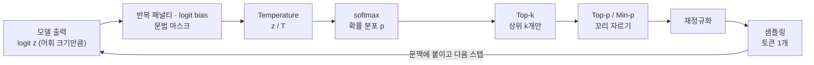
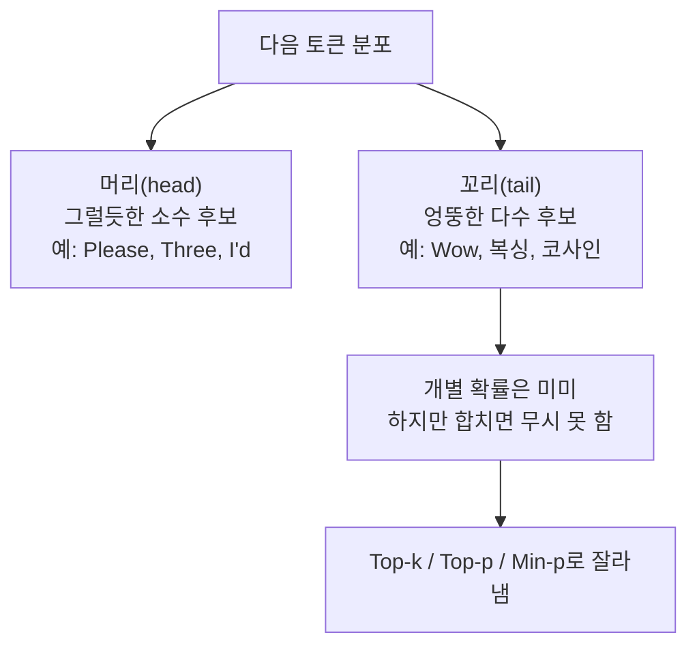
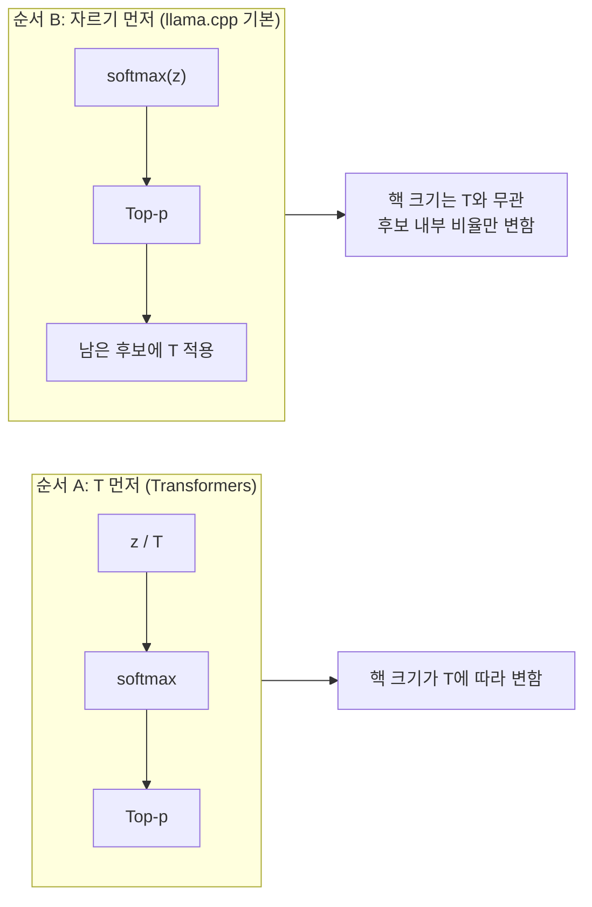
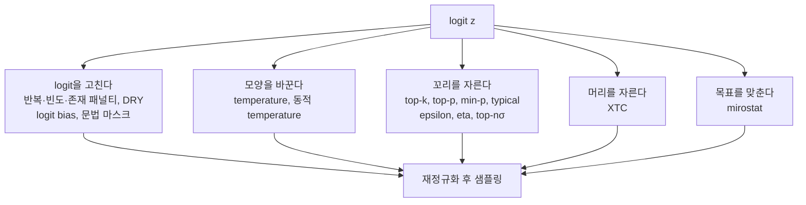

# LLM 샘플링의 기본기: Top-k, Top-p, Temperature는 확률 분포의 어디를 자르고 어떻게 휘게 하는가

### LLM은 매 스텝 어휘 전체에 대한 확률 분포를 내고, 그중 하나를 뽑아 다음 토큰을 만든다. Top-k는 "후보 개수"를, Top-p(nucleus)는 "누적 확률 질량"을 기준으로 분포의 꼬리를 잘라내고, Temperature는 softmax 앞에서 logit을 나눠 분포 전체의 뾰족함(엔트로피)을 조절한다. 세 손잡이는 서로 독립이 아니다. Temperature가 분포 모양을 바꾸면 Top-p가 남기는 후보 수도 따라 바뀌고, 엔진마다 적용 순서가 달라 같은 숫자가 다른 결과를 낸다

텍스트 생성 API를 한 번이라도 호출해 봤다면 `temperature`, `top_p`, `top_k`라는 이름을 봤을 것이다. 개념 자체는 어렵지 않지만, 특히 temperature는 "높이면 어떻게 되더라?"가 순간 헷갈리기 쉽다. 이 글은 세 파라미터를 **확률 분포를 다루는 연산**이라는 하나의 관점으로 정리한다. 정의와 수식, 손으로 계산한 수치 예, 파이썬 구현, 실무에서 값을 고르는 기준을 다룬다. 이어서 같은 관점으로 min-p, typical, 반복 패널티, mirostat, 제약 디코딩, 스펙큘러티브 디코딩까지 넓힌다.

근거로는 원 논문을 썼다. Top-k 샘플링을 스토리 생성에 쓴 Fan et al.의 [Hierarchical Neural Story Generation](https://aclanthology.org/P18-1082/)(ACL 2018), nucleus(Top-p) 샘플링을 제안한 Holtzman et al.의 [The Curious Case of Neural Text Degeneration](https://arxiv.org/abs/1904.09751)(ICLR 2020), 그 후속인 [Min-p 샘플링](https://arxiv.org/abs/2407.01082)(ICLR 2025 oral)이다. 구현 관점은 Hugging Face의 [How to generate text](https://huggingface.co/blog/how-to-generate) 글과 [Generation strategies 문서](https://huggingface.co/docs/transformers/main/en/generation_strategies), 그리고 Transformers와 llama.cpp의 소스 코드(2026년 11월 `main`/`master` 기준)를 참고했다.

**아래 수치 예(logit 값, 확률, 엔트로피)는 설명용으로 직접 만든 가상의 분포를 파이썬으로 계산한 것이다. 실제 모델의 분포가 아니다. 상용 API의 파라미터 범위·제약은 모델과 시점에 따라 바뀌므로, 쓰기 전에 각 사의 최신 문서를 확인해야 한다.**


## 1. 한눈에 보기

| 손잡이 | 무엇을 기준으로 | 분포에 하는 일 | 값이 커지면 | 값이 작아지면 | 대표 기본값·관례 |
|---|---|---|---|---|---|
| **Top-k** | 순위(개수) | 상위 k개만 남기고 나머지 확률을 0으로, 다시 정규화 | 후보가 늘어 다양해짐 | 후보가 줄어 보수적. k=1이면 greedy | Fan et al. `k=10`, HF 블로그 예 `k=50`, llama.cpp 기본 `40` |
| **Top-p** | 누적 확률 질량 | 누적합이 p에 처음 도달하는 지점까지만 남김 | 꼬리가 더 들어와 다양해짐 | 핵심 후보만 남음 | 0.9~0.95 근처가 흔함. llama.cpp 기본 `0.95` |
| **Temperature** | 분포의 모양 | softmax 전에 logit을 T로 나눔(자르지 않음) | 분포가 평평해짐, 엔트로피↑ | 분포가 뾰족해짐, 엔트로피↓. T→0이면 greedy | 1.0이 "원래 분포". llama.cpp 기본 `0.8` |
| **Min-p** | 최고 확률 대비 비율 | 1등 확률의 일정 비율보다 작은 토큰 제거 | 문턱이 높아져 후보가 줄어듦 | 후보가 늘어남 | 논문 권장 0.05~0.1. llama.cpp 기본 `0.05` |



> **쉽게 말하면**
> 매 스텝 LLM은 수만~수십만 개 단어 카드 각각에 "뽑힐 확률"을 적어 둔 추첨함을 만든다.
> - **Top-k**: "인기 순위 상위 k장만 추첨함에 남겨라."
> - **Top-p**: "인기 순으로 카드를 넣다가, 넣은 카드들의 확률 합이 p를 넘으면 멈춰라."
> - **Temperature**: 카드를 버리지 않는다. 대신 인기 카드와 비인기 카드의 **격차**를 키우거나(T<1) 줄인다(T>1).

위 순서(패널티 → Temperature → Top-k → Top-p)는 Hugging Face Transformers 쪽 구성이다. llama.cpp는 temperature를 **맨 마지막**에 적용한다. 순서가 결과를 바꾸는 이유와 엔진별 실제 순서는 6.2절에서 다룬다.

## 2. 출발점: 모델은 "확률 분포"를 낸다

### 2.1 토큰, logit, softmax, 확률 분포

LLM은 글자를 그대로 다루지 않고 **토큰**(token) 단위로 다룬다. 토큰은 대개 **서브워드**(subword), 즉 단어보다 작거나 같은 조각이다. BPE 같은 알고리즘으로 만든 어휘(vocabulary)는 영어·한국어·일본어·중국어 조각, 숫자, 기호, 코드 조각까지 수만~수십만 개를 담는다.

한 스텝에서 모델이 내는 것은 어휘의 모든 토큰 $i$에 대한 실수 점수 $z_i$, 즉 **logit**이다. logit은 아직 확률이 아니다. 음수도 되고 합이 1도 아니다. 이를 확률로 바꾸는 함수가 **softmax**다.

$$
p_i = \frac{\exp(z_i)}{\sum_{j=1}^{|V|} \exp(z_j)}
$$

지수 함수 $\exp$는 모든 값을 양수로 만들고, 분모의 합으로 나누면(정규화) 전체 합이 1이 된다. 이렇게 "가능한 결과 각각에 0 이상의 값을 주고, 그 합이 1인 것"을 **확률 분포**라 한다. 그다음 이 분포 $p$에서 토큰 하나를 **샘플링**(무작위 추출)하고, 뽑힌 토큰을 문맥 뒤에 붙여 다음 스텝을 돈다. 이것이 **자기회귀**(autoregressive) 생성이다.

> **쉽게 말하면**
> - **토큰**: 레고 블록. 문장은 블록을 하나씩 이어 붙여 만든다.
> - **logit**: 심사위원이 블록마다 매긴 "날것의 점수". 마이너스 점수도 있고 합계에 의미가 없다.
> - **softmax**: 점수를 "파이 조각의 크기"로 바꾸는 계산. 점수가 높을수록 조각이 크고, 조각을 다 합치면 파이 한 판(1)이 된다.
> - **샘플링**: 그 파이 위에서 다트를 던져 맞은 조각을 고르는 일. 큰 조각이 자주 맞지만 작은 조각도 맞을 수 있다.

### 2.2 왜 그냥 샘플링하면 안 되는가: 긴 꼬리 문제

가장 단순한 방법은 둘이다.

- **Greedy**: 매번 확률 최댓값 토큰을 고른다. 결정적이고 안정적이지만, 긴 글에서는 같은 구절을 반복하는 경향이 잘 알려져 있다. Hugging Face 문서도 greedy가 긴 시퀀스에서 반복으로 무너진다고 적는다.
- **순수 샘플링**(pure / multinomial sampling): 분포 $p$ 그대로 뽑는다. 다양하지만 문제가 있다.

순수 샘플링에서는 확률이 0이 아닌 모든 토큰이 뽑힐 수 있다. "'핫도그 세 개 주세요'를 영어로 번역해 줘"라는 요청의 첫 토큰으로 `Please`나 `Three`는 자연스럽다. 하지만 `Wow`, 심지어 `복싱`, `코사인`, `こんにちは` 같은 토큰도 아주 작은 확률을 갖는다.

토큰 하나하나의 확률은 무시할 만하다. 문제는 그런 토큰이 **엄청나게 많다**는 것이다. 가상의 계산을 해 보자. 어휘 15만 개 중 엉뚱한 토큰 14만 개가 각각 $10^{-6}$의 확률을 가진다면, 그 합은

$$
140{,}000 \times 10^{-6} = 0.14
$$

이다. 어느 엉뚱한 토큰이 나올지는 모르지만, **엉뚱한 토큰 중 하나가 나올 확률**은 14%나 된다. 수백 토큰을 생성하는 동안 이런 사고가 한 번만 나도 문장이 틀어지고, 틀어진 문맥 위에서 다음 토큰을 고르니 오류는 쌓인다. Holtzman et al.은 이 현상을 분포의 **신뢰할 수 없는 꼬리**(unreliable tail)라고 부르고, 꼬리를 잘라내는 것이 nucleus 샘플링의 핵심 동기라고 설명한다. Fan et al.도 완전한 무작위 샘플링은 학습 때 보지 못한 실수를 만들어 생성을 망칠 수 있다고 적는다.



### 2.3 탐색으로 푸는 방법: beam search

샘플링 대신 **탐색**으로 "가장 그럴듯한 문장"을 찾는 방법도 있다. **Beam search**는 매 스텝 누적 로그 확률이 높은 부분 문장 $B$개(beam 폭)를 유지하며 넓혀 간다. greedy가 눈앞의 1등만 보는 데 비해, 지금은 2등이지만 뒤에 더 좋은 문장으로 이어지는 경로를 살릴 수 있다. 번역·요약처럼 출력이 입력에 강하게 묶인 작업에서 오래 쓰였다.

하지만 열린 생성(스토리, 대화)에서는 약점이 뚜렷하다. Fan et al.은 beam search가 학습 데이터의 흔한 구절과 반복적인 문장을 만든다며 top-k 샘플링이 훨씬 효과적이었다고 보고했다. Holtzman et al.도 확률을 최대화하는 디코딩이 오히려 밋밋하고 반복적인 텍스트로 퇴화한다는 것을 보였다. 사람이 쓴 글은 "가장 확률 높은 문장"이 아니기 때문이다. 그래서 오늘날 채팅형 LLM은 대부분 샘플링을 쓰고, beam search는 Transformers의 `num_beams` 같은 옵션으로 남아 있다.

| 방식 | 매 스텝 하는 일 | 장점 | 약점 |
|---|---|---|---|
| Greedy | 1등 토큰 선택 | 빠르고 결정적 | 반복, 국소 최적 |
| Beam search | 상위 B개 경로 유지 | 짧고 정답이 분명한 작업에 강함 | 열린 생성에서 밋밋·반복, 비용 B배 |
| 순수 샘플링 | 분포 그대로 추출 | 다양함 | 꼬리 토큰 사고 |
| 잘라낸 샘플링(top-k/p, min-p) | 꼬리 제거 후 추출 | 다양성과 일관성의 균형 | 손잡이 조정 필요 |

## 3. Top-k: 상위 k개만 남긴다

### 3.1 정의

확률을 내림차순으로 정렬했을 때 상위 $k$개의 집합을 $V^{(k)}$라 하자. Top-k는 이 집합 밖의 확률을 0으로 만들고 다시 정규화한다.

$$
p'_i =
\begin{cases}
\dfrac{p_i}{\sum_{j \in V^{(k)}} p_j} & i \in V^{(k)} \\[2mm]
0 & \text{otherwise}
\end{cases}
$$

$k=1$이면 greedy와 같고, $k=|V|$이면 순수 샘플링과 같다. 그 사이에서 **그럴듯한 재료만 남기면서도 매 스텝 무작위성은 유지**하는 것이 목적이다. Fan et al.(ACL 2018)은 스토리 생성에서 "가장 가능성 높은 $k=10$개 후보"에서 무작위로 뽑는 top-k 무작위 샘플링을 썼고, 이것이 Top-k 샘플링이 널리 쓰이는 계기 중 하나가 됐다.

### 3.2 수치 예

가상의 logit $z = [4.0,\ 3.0,\ 2.0,\ 0.5,\ -1.0]$ (토큰 A~E)를 쓴다. $T=1$에서 softmax 결과는 다음과 같다.

| 토큰 | A | B | C | D | E |
|---|---|---|---|---|---|
| $p$ (T=1) | 0.649 | 0.239 | 0.088 | 0.020 | 0.004 |
| Top-k(k=3) 후 | 0.665 | 0.245 | 0.090 | 0 | 0 |

상위 3개의 합 0.976으로 나눠 재정규화했다. D, E는 이제 절대 나오지 않는다.

### 3.3 한계: 분포 모양을 보지 않는다

Top-k의 약점은 **k가 고정**이라는 점이다. 모델이 확신할 때(한 후보가 0.95)도 k개를 남기므로 불필요한 후보가 끼고, 모델이 망설일 때(수십 개 후보가 비슷한 확률)는 k개만 남겨 좋은 후보를 잘라 버린다. Holtzman et al.이 Top-p를 제안한 이유가 바로 이 점이다. 문맥마다 "합리적인 후보 수"가 다르다.

## 4. Top-p(nucleus): 누적 확률 p까지만 남긴다

### 4.1 정의

확률을 내림차순으로 정렬한 뒤, 누적합이 $p$ 이상이 되는 **가장 작은 집합** $V^{(p)}$를 고른다.

$$
V^{(p)} = \arg\min_{V' \subseteq V} |V'| \quad \text{s.t.} \quad \sum_{i \in V'} p_i \ge p
$$

이 집합을 **핵**(nucleus)이라 부른다. 그 밖은 0으로 만들고 재정규화한다. Top-k가 "개수 고정"이라면 Top-p는 "**질량 고정, 개수 가변**"이다.


### 4.2 개수가 저절로 바뀌는 예

$p = 0.9$일 때 세 가지 상황을 보자.

| 상황 | 정렬된 확률(누적) | 핵 크기 | 해석 |
|---|---|---|---|
| 보통 | 0.50, 0.25(**0.75**), 0.16(**0.91**) | 3 | 세 번째에서 0.9를 넘음 |
| 확신 | 0.80, 0.13(**0.93**) | 2 | 두 개만으로 충분. 모델이 더 확신하는 상황 |
| 망설임 | 0.30, 0.25, 0.17, 0.12, 0.08(**0.92**) | 5 | 다섯 개가 필요. 모델이 덜 확신하는 상황 |

핵의 크기 자체가 **모델의 불확실성을 나타내는 지표**처럼 읽힌다. 확신할수록 핵이 작고, 망설일수록 핵이 크다. 고정된 k로는 이 적응을 얻을 수 없다.

### 4.3 Top-k와 비교

| 기준 | Top-k | Top-p |
|---|---|---|
| 자르는 기준 | 순위 | 누적 확률 |
| 남는 후보 수 | 항상 k | 문맥마다 다름 |
| 확신하는 분포에서 | 불필요한 후보 포함 | 1~2개로 좁아짐 |
| 평평한 분포에서 | 좋은 후보를 자름 | 많이 남김 |
| 계산 | 부분 정렬(top-k 선택) | 전체 정렬 + 누적합 |

두 방법을 함께 쓰는 것도 흔하다. 예를 들어 `top_k=50, top_p=0.95`는 "최대 50개 안에서, 누적 95%까지만"이다. Hugging Face 블로그도 이 조합을 예로 든다. 큰 어휘에서 전체 정렬은 비싸므로, top-k로 먼저 후보를 줄인 뒤 top-p를 계산하면 비용을 아낄 수 있다.

## 5. Temperature: 자르지 않고 분포를 휘게 한다

### 5.1 정의

Temperature $T > 0$는 softmax에 들어가기 전에 logit을 나누는 값이다.

$$
p_i(T) = \frac{\exp(z_i / T)}{\sum_{j} \exp(z_j / T)}
$$

$T=1$이면 원래 분포다. 이 형태는 통계역학의 **볼츠만 분포** $p_i \propto \exp(-E_i / k_B T)$와 같은 모양이고, 이름도 거기서 왔다(logit을 음의 에너지로 보면 된다). 머신러닝에서는 Hinton et al.의 [지식 증류](https://arxiv.org/abs/1503.02531) 논문이 softmax temperature를 널리 알린 대표 사례다.

### 5.2 T > 1: 격차가 줄어든다

$T$가 커지면 $z_i/T$가 모두 0 쪽으로 모인다. 그러면 $\exp(z_i/T)$는 모두 1 근처로 모이고, 확률들이 서로 비슷해진다. 그럴듯한 토큰은 높은 logit을 받았지만 $T$에 의해 **깎이고**, 어색한 토큰과의 차이가 줄어든다. 결과는 더 다양한 출력이고, 대가는 엉뚱한 토큰이 튀어나올 확률의 증가다.

극한에서 $T \to \infty$이면 모든 $z_i/T \to 0$이므로 분포는 **균등 분포** $1/|V|$에 수렴한다.

### 5.3 0 < T < 1: 격차가 벌어진다

$T$가 1보다 작으면 나눗셈이 logit을 **키운다**. 그런데 나눗셈은 비율로 키우는 것이므로, 원래 컸던 logit은 크게 커지고 작았던 logit은 덜 커진다. 지수 함수를 거치면 이 차이가 더 증폭된다.

정확히는 두 토큰의 확률 비가

$$
\frac{p_a(T)}{p_b(T)} = \exp\!\left(\frac{z_a - z_b}{T}\right)
$$

이므로, $T$를 절반으로 줄이면 logit 차이가 두 배로 벌어지는 효과가 난다. 극한 $T \to 0^+$에서는 최댓값 토큰만 확률 1을 갖는 **one-hot**, 즉 greedy가 된다. 그래서 많은 API와 엔진이 `temperature=0`을 greedy로 처리한다(다만 7.4의 재현성 주의 참고).

> **주의: logit이 음수일 때도 직관이 맞나?** "큰 값은 더 커지고"라는 설명은 logit이 양수일 때 와닿는다. 음수 logit은 $T<1$에서 오히려 더 작아진다. 하지만 softmax는 모든 logit에 같은 상수를 더해도 결과가 변하지 않으므로(shift invariance), 본질은 **logit 사이의 차이** $z_a - z_b$가 $1/T$배 된다는 것이다. 위 비율 공식이 정확한 설명이다.

### 5.4 수치 예와 엔트로피

같은 logit $z = [4.0, 3.0, 2.0, 0.5, -1.0]$에 세 가지 온도를 적용했다.

| T | A | B | C | D | E | 엔트로피 $H$ (bits) |
|---|---|---|---|---|---|---|
| 0.5 | 0.866 | 0.117 | 0.016 | 0.001 | 0.000 | 0.65 |
| 1.0 | 0.649 | 0.239 | 0.088 | 0.020 | 0.004 | 1.35 |
| 2.0 | 0.448 | 0.272 | 0.165 | 0.078 | 0.037 | 1.92 |


여기서 **엔트로피**(entropy)는 분포의 불확실성, 즉 "결과를 예측하기 어려운 정도"를 재는 양이다.

$$
H(p) = -\sum_i p_i \log_2 p_i
$$

모든 확률이 한 토큰에 몰리면 $H = 0$, 균등하면 $H = \log_2 |V|$로 최대다. 표에서 보듯 $T$를 올리면 엔트로피가 단조롭게 커진다.

### 5.5 물리 직관으로 기억하기

Temperature의 방향이 헷갈릴 때는 실제 온도와 엔트로피를 떠올리면 된다.

| | 물리계 | LLM 샘플링 |
|---|---|---|
| 온도가 높다 | 분자가 활발히 움직임, 무질서↑, 엔트로피↑ | 그럴듯한 토큰과 어색한 토큰의 확률이 비슷해짐, 무작위성↑ |
| 온도가 낮다 | 분자가 차분해짐, 질서↑, 엔트로피↓ | 확신하던 토큰을 더 확신, 무작위성↓ |
| 극한 | 절대영도: 바닥 상태 하나 | $T \to 0$: greedy(argmax) |

이 비유는 비유가 아니라 수식 수준에서 같은 구조다. 볼츠만 분포에서 온도를 올리면 높은 에너지 상태(낮은 logit 토큰)의 점유 확률이 올라간다.

## 6. 세 손잡이는 서로 얽혀 있다

### 6.1 Temperature가 Top-p의 핵 크기를 바꾼다

Temperature는 분포 모양을 바꾸고, Top-p는 분포 모양을 보고 자른다. 그러니 **Temperature를 먼저 적용하면 Top-p가 남기는 후보 수가 달라진다.** 5.4의 분포에 $p=0.9$를 적용하면 다음과 같다.

| T | 누적 확률 | 핵 크기 |
|---|---|---|
| 0.5 | 0.866 → **0.983** | 2 |
| 1.0 | 0.649 → 0.888 → **0.976** | 3 |
| 2.0 | 0.448 → 0.720 → 0.885 → **0.963** | 4 |

온도를 올리면 분포가 평평해지고, 같은 $p$를 채우려면 더 많은 후보가 필요하다. 반대로 Top-k는 개수만 보므로 T와 무관하게 항상 k개를 남긴다(남은 후보들 사이의 확률은 달라진다).

### 6.2 적용 순서: 엔진마다 다르다

라이브러리의 기본 순서를 소스 코드에서 직접 확인했다(2026년 11월 기준).

| 엔진 | 기본 순서 | 확인한 곳 |
|---|---|---|
| Hugging Face Transformers | 반복 패널티·n-gram 금지 등 logits processor → **temperature** → top-h → top-k → top-p → min-p → typical → epsilon → eta | `generation/utils.py`의 `_get_logits_processor` |
| llama.cpp | penalties → DRY → top-nσ → top-k → typical → top-p → min-p → XTC → **temperature** | `common/common.h`, CLI의 `--samplers` 기본값(`--sampling-seq` 기본 `edskypmxt`) |

Transformers는 temperature가 1.0이 아닐 때만 temperature warper를 넣고, 잘라내기 단계보다 **먼저** 적용한다. llama.cpp는 temperature를 **맨 끝**에 둔다. 그래서 llama.cpp 기본 설정에서는 top-p·min-p가 $T=1$ 분포를 기준으로 후보를 정하고, temperature는 살아남은 후보끼리의 비율만 바꾼다. llama.cpp는 `--samplers`로 순서를 사용자가 바꿀 수 있다.

같은 logit에 `T=2, top_p=0.9`를 주면 결과가 이렇게 갈린다.

| 순서 | 남는 후보 | 후보 확률 |
|---|---|---|
| T 먼저(Transformers 방식) | A, B, C, D (4개) | 0.466, 0.282, 0.171, 0.081 |
| 자르기 먼저(llama.cpp 기본) | A, B, C (3개) | 0.506, 0.307, 0.186 |

첫 행은 $T=2$ 분포의 상위 4개를 재정규화한 값이고, 둘째 행은 $T=1$ 분포로 A·B·C를 고른 뒤 그 셋의 logit에 $T=2$를 적용한 값이다. **같은 숫자라도 엔진이 다르면 다른 분포에서 뽑는다.** 높은 temperature에서 꼬리가 들어오는 문제는 T 먼저 순서에서 더 크게 나타난다. vLLM 등 다른 서빙 엔진의 순서는 이 글에서 코드로 확인하지 않았으니, 쓰는 버전의 문서나 코드를 직접 봐야 한다.



### 6.3 Min-p: 최고 확률에 비례하는 문턱

Top-p의 약점도 지적됐다. 높은 temperature에서는 분포가 평평해져 핵이 지나치게 커지고, 꼬리 토큰이 다시 들어온다. Nguyen et al.의 **min-p**(ICLR 2025 oral)는 문턱을 "가장 높은 확률의 일정 비율"로 둔다. 논문 3.1절의 표기를 그대로 옮기면 다음과 같다.

$$
p_{\max} = \max_{v \in V} P(v \mid x_{1:t-1}), \qquad p_{\text{scaled}} = p_{\text{base}} \times p_{\max}, \quad p_{\text{base}} \in (0, 1]
$$

$$
V_{\min} = \{\, v \in V : P(v \mid x_{1:t-1}) \ge p_{\text{scaled}} \,\}
$$

$V_{\min}$ 안에서 확률을 재정규화해 샘플링한다. 예를 들어 $p_{\text{base}}=0.1$이면 1등 확률의 10% 이상인 토큰만 남는다. 모델이 확신하면($p_{\max}$가 크면) 문턱이 높아져 후보가 줄고, 망설이면 문턱이 낮아져 후보가 늘어난다. 논문 3.4절은 temperature를 먼저 적용한 뒤 $p_{\text{scaled}}$를 계산한다고 설명하고, 창의성과 일관성의 균형에 $p_{\text{base}}$ 0.05~0.1을 권한다. 매우 높은 temperature에서 일관성을 지키려면 0.5~0.7 이상도 쓸 수 있다고 적는다. Mistral·Llama 3 계열 1B~123B에서 특히 높은 temperature일 때 품질과 다양성이 함께 좋아졌다고 보고하고, Hugging Face Transformers와 vLLM 등에 채택됐다고 밝힌다.

## 7. Top-k·Top-p 너머: 알아 둘 만한 디코딩 기법

세 손잡이 외에도 실무 엔진에는 많은 샘플러가 있다. 모두 "logit 또는 확률 분포를 고친 뒤 뽑는다"는 같은 틀에 들어간다.



### 7.1 반복 억제: 반복·빈도·존재 패널티, DRY

샘플링을 해도 모델은 방금 쓴 말을 되풀이하곤 한다. 그래서 이미 나온 토큰의 logit을 깎는 방법들이 있다.

- **반복 패널티**(repetition penalty): CTRL([Keskar et al., 2019](https://arxiv.org/abs/1909.05858))에서 널리 퍼졌다. 이미 나온 토큰의 logit을 $\theta>1$로 **나눈다**. Transformers 구현은 logit이 음수면 대신 $\theta$를 곱해 항상 확률이 내려가게 한다. $\theta=1$이 끔이다.
- **빈도·존재 패널티**(frequency / presence penalty): OpenAI 계열 API의 방식이다. 토큰 $j$가 지금까지 $c_j$번 나왔다면 아래처럼 등장 횟수에 비례해(빈도), 그리고 한 번이라도 나왔으면 고정값만큼(존재) 뺀다. OpenAI Chat Completions 문서 기준 두 값 모두 -2.0~2.0이다. 존재 패널티는 "새로운 주제로 넘어가게" 하는 쪽에 가깝다.
- **n-gram 금지**: Transformers의 `no_repeat_ngram_size`처럼 같은 n-gram이 다시 나오지 못하게 확률을 0으로 만든다. 확실하지만 "New York"처럼 반복이 필요한 표현까지 막는다.
- **DRY**(Don't Repeat Yourself): text-generation-webui에 [제안된](https://github.com/oobabooga/text-generation-webui/pull/5677) 뒤 llama.cpp 등에 들어갔다. 토큰 하나가 아니라 **이미 나온 시퀀스를 이어 붙이는 토큰**을 찾아, 반복 길이 $n$이 허용 길이를 넘으면 $\text{multiplier} \cdot \text{base}^{\,n - \text{allowed\_length}}$만큼 logit을 깎는다. 길게 베낄수록 지수적으로 세게 막는다. llama.cpp 기본은 multiplier 0(끔), base 1.75, allowed_length 2이고, 줄바꿈·콜론·따옴표·`*`에서 시퀀스를 끊는다.

$$
z_j \leftarrow z_j - c_j \cdot \alpha_{\text{freq}} - \mathbb{1}[c_j > 0] \cdot \alpha_{\text{pres}}
$$

수치 예: 토큰 A(logit 4.0)가 이미 두 번 나왔다고 하자.

| 설정 | A의 새 logit | 새 분포 (A, B, C, D, E) |
|---|---|---|
| 패널티 없음 | 4.0 | 0.649, 0.239, 0.088, 0.020, 0.004 |
| 반복 패널티 $\theta=1.3$ | 3.077 | 0.424, 0.392, 0.144, 0.032, 0.007 |
| 빈도 0.5 + 존재 0.5 | $4.0 - 2 \times 0.5 - 0.5 = 2.5$ | 0.292, 0.482, 0.177, 0.040, 0.009 |

빈도·존재 패널티는 1등을 B로 바꿨다. 패널티는 문맥에 맞는 반복(코드의 변수 이름, 고유명사)까지 깎으므로, 코드나 구조화 출력에는 약하게 쓰거나 끄는 편이 안전하다.

### 7.2 다른 잘라내기 기준

| 기법 | 남기는 조건 | 특징 | 출처 |
|---|---|---|---|
| **Typical** | 놀람 $-\log p_i$가 엔트로피 $H$에 가까운 순으로, 누적 질량 $\tau$까지 | 너무 뻔한 토큰도 뺄 수 있음 | [Meister et al., Locally Typical Sampling](https://arxiv.org/abs/2202.00666) |
| **Epsilon** | $p_i \ge \epsilon$ | 절대 문턱 하나 | [Hewitt et al., Truncation Sampling as Language Model Desmoothing](https://arxiv.org/abs/2210.15191) |
| **Eta** | $p_i \ge \eta$, $\eta = \min(\epsilon, \sqrt{\epsilon}\, e^{-H})$ | 엔트로피가 크면 문턱이 낮아짐 | 같은 논문 |
| **Top-nσ** | $z_i \ge \max_j z_j - n\sigma$ ($\sigma$는 logit 표준편차) | logit 공간에서 자름. temperature를 바꿔도 남는 집합이 같음 | [Tang et al., Top-nσ](https://arxiv.org/abs/2411.07641) |
| **Top-a** | $p_i \ge a \cdot p_{\max}^2$ | min-p와 비슷하나 $p_{\max}$의 제곱에 비례 | 논문이 아닌 커뮤니티 구현에서 퍼짐 |

Typical은 직관이 반대라서 예를 보면 좋다. 우리 분포($T=1$)의 엔트로피는 0.937 nats이고, 각 토큰의 놀람은 A 0.432, B 1.432, C 2.432다. 엔트로피와의 거리는 B(0.495)가 A(0.505)보다 가깝다. 그래서 $\tau=0.2$이면 top-p는 A만 남기지만 typical은 **B만** 남긴다. "평균적인 정보량을 가진 토큰을 고른다"는 설계라서 지나치게 뻔한 선택도 피한다.

Top-nσ가 temperature에 흔들리지 않는 이유도 간단하다. logit을 $T$로 나누면 최댓값과 표준편차가 함께 $1/T$배 되므로, 문턱과의 상대 위치가 그대로다.

### 7.3 머리를 자르는 XTC와 목표를 맞추는 Mirostat

- **XTC**(Exclude Top Choices): 꼬리가 아니라 **머리**를 자른다. 정해진 확률(`xtc_probability`)로 발동하고, 문턱(`xtc_threshold`, llama.cpp 기본 0.1)을 넘는 후보가 둘 이상이면 그중 **가장 낮은 하나만 빼고** 모두 지운다. 그럴듯한 후보가 여럿일 때만 뻔한 1등을 피하게 해 상투적인 문장을 줄이려는 창작용 샘플러다. [text-generation-webui PR](https://github.com/oobabooga/text-generation-webui/pull/6335)로 소개됐고 llama.cpp는 기본 꺼짐(확률 0)이다.
- **Mirostat**([Basu et al., ICLR 2021](https://arxiv.org/abs/2007.14966)): 손잡이를 고정하지 않고 **목표 놀람(surprise) $\tau$**를 정한 뒤 피드백 제어로 잘라내기 수준을 매 스텝 조정한다. 관측한 놀람이 목표보다 크면 다음 스텝을 더 보수적으로, 작으면 더 과감하게 만든다. 출력의 perplexity를 일정하게 유지해 반복으로 빠지는 쪽과 엉뚱한 말로 흩어지는 쪽을 모두 피하려는 방법이다. llama.cpp는 `--mirostat 1|2`로 켜고 기본 $\tau=5.0$, 학습률 $\eta=0.1$이며, 켜면 top-k·top-p·typical은 무시된다.

### 7.4 seed와 결정성

샘플링은 의사 난수에 기댄다. **seed**를 고정하면 같은 분포에서 같은 토큰이 뽑힌다. 하지만 같은 seed라도 결과가 달라질 수 있다.

- **분포 자체가 흔들린다.** GPU에서 부동소수점 덧셈은 순서에 따라 결과가 미세하게 다르고, 서빙 엔진은 요청을 다른 요청과 묶어(batch) 처리한다. 배치 구성이 바뀌면 커널의 축약 순서가 바뀌어 logit이 달라질 수 있다. Thinking Machines Lab의 [Defeating Nondeterminism in LLM Inference](https://thinkingmachines.ai/blog/defeating-nondeterminism-in-llm-inference/)는 이 "배치 불변성(batch invariance)" 부족을 주된 원인으로 짚는다.
- **동점과 근소한 차이.** logit이 거의 같은 두 토큰은 작은 수치 오차로 순위가 뒤집힌다. greedy(`T=0`)에서도 결과가 바뀔 수 있는 이유다.
- **API는 보장하지 않는다.** OpenAI Chat Completions의 `seed`는 베타 기능으로 표시돼 있고, Anthropic 마이그레이션 가이드도 `temperature = 0`이 이전 모델에서도 동일한 출력을 보장한 적이 없다고 적는다.

### 7.5 logit bias와 제약(구조화) 디코딩

- **logit bias**: 특정 토큰 id의 logit에 직접 값을 더한다. OpenAI Chat Completions는 -100~100을 받는다. -100은 사실상 금지, +100은 사실상 강제다. 토큰 단위라 "단어"를 막으려면 그 단어를 이루는 토큰들을 모두 알아야 한다.
- **제약 디코딩**(constrained / structured decoding): JSON 스키마, 정규식, 문법(GBNF 등)을 상태 기계로 바꾸고, 매 스텝 **문법상 올 수 없는 토큰의 logit을 $-\infty$로 마스킹**한 뒤 샘플링한다([Willard & Louf, Efficient Guided Generation](https://arxiv.org/abs/2307.09702), [Outlines](https://github.com/dottxt-ai/outlines)). llama.cpp의 grammar도 샘플러 체인 안에서 같은 일을 한다. 형식은 항상 맞지만, 마스킹 후 남은 후보끼리 재정규화하므로 **모델이 원래 쓰고 싶던 내용과 다른 방향으로 밀릴 수** 있다. 형식이 강제될수록 temperature를 낮게 두는 편이 안전하다.

### 7.6 스펙큘러티브 디코딩과 샘플링

샘플링 파라미터는 출력 품질만이 아니라 **추론 가속**에도 영향을 준다. 스펙큘러티브 디코딩([Leviathan et al.](https://arxiv.org/abs/2211.17192), [Chen et al.](https://arxiv.org/abs/2302.01318))은 작은 드래프트 모델이 분포 $q$에서 토큰을 제안하고, 큰 타깃 모델이 분포 $p$로 한꺼번에 검증한다. 제안 토큰 $x$는 확률 $\min\left(1, \frac{p(x)}{q(x)}\right)$로 받아들이고, 거절하면 $\max(0,\ p - q)$를 정규화한 분포에서 다시 뽑는다. 이 규칙은 **타깃 분포 $p$를 정확히 보존**한다.

여기서 $p$와 $q$는 temperature·top-p 등을 적용한 **최종 분포**여야 한다. 그래서 두 모델에 같은 샘플러 설정을 적용해야 정리가 성립한다. temperature가 높아 분포가 평평해지면 드래프트와 타깃이 같은 토큰을 고를 확률이 줄어 수락률이 떨어지는 경향이 있다. $T \to 0$이면 두 분포가 one-hot이 되어 수락은 "argmax가 같은가"로 바뀐다. 같은 섹션의 [MTPLX 글](261031_1654_MTPLX_Native_MTP_Speculative_Decoding_on_Apple_Silicon.md)이 temperature 1, top-p 0.95, top-k 20 조건에서의 검증을 다룬다.

## 8. 구현과 실무

### 8.1 파이썬으로 직접 구현

아래 코드는 Transformers처럼 temperature를 먼저 적용하는 순서다. `seed`를 주면 같은 결과를 재현한다.

```python
import numpy as np
from collections import Counter

def apply_penalties(logits, generated, repetition_penalty=1.0, frequency_penalty=0.0, presence_penalty=0.0):
    z = np.asarray(logits, dtype=np.float64).copy()
    counts = Counter(generated)
    for tok, c in counts.items():
        # CTRL식 반복 패널티: 양수 logit은 나누고, 음수 logit은 곱한다
        if repetition_penalty != 1.0:
            z[tok] = z[tok] / repetition_penalty if z[tok] > 0 else z[tok] * repetition_penalty
        # OpenAI식 빈도·존재 패널티: 등장 횟수와 등장 여부만큼 뺀다
        z[tok] -= c * frequency_penalty + presence_penalty
    return z

def sample_next(logits, temperature=1.0, top_k=0, top_p=1.0, min_p=0.0, seed=None):
    rng = np.random.default_rng(seed)
    z = np.asarray(logits, dtype=np.float64)

    # 1) temperature: T -> 0 이면 greedy
    if temperature <= 1e-6:
        return int(np.argmax(z))
    z = z / temperature

    # 2) softmax (최댓값을 빼서 overflow 방지: shift invariance 덕분에 결과는 같다)
    z = z - z.max()
    p = np.exp(z)
    p /= p.sum()

    # 3) top-k (동점이 있으면 k개보다 조금 더 남을 수 있다)
    if 0 < top_k < len(p):
        kth = np.partition(p, -top_k)[-top_k]
        p = np.where(p >= kth, p, 0.0)

    # 4) top-p (nucleus)
    if top_p < 1.0:
        order = np.argsort(p)[::-1]
        cum = np.cumsum(p[order])
        cutoff = np.searchsorted(cum, top_p) + 1   # 누적합이 처음 p 이상이 되는 위치까지 포함
        keep = np.zeros_like(p, dtype=bool)
        keep[order[:cutoff]] = True
        p = np.where(keep, p, 0.0)

    # 5) min-p: 최고 확률의 min_p배보다 작은 토큰 제거
    if min_p > 0.0:
        p = np.where(p >= min_p * p.max(), p, 0.0)

    # 6) 재정규화 후 샘플링
    p /= p.sum()
    return int(rng.choice(len(p), p=p))

logits = [4.0, 3.0, 2.0, 0.5, -1.0]
print(sample_next(logits, temperature=0.7, top_p=0.9, seed=42))  # 같은 seed면 같은 결과
print(apply_penalties(logits, generated=[0, 0], frequency_penalty=0.5, presence_penalty=0.5))
# [ 2.5  3.   2.   0.5 -1. ]
```

`T=0.7, top_p=0.9`이면 분포가 A 0.767, B 0.184, C 0.044…가 되고 누적합이 B에서 0.950으로 0.9를 넘으므로 A와 B만 남는다. 1만 번 뽑으면 A가 약 80%, B가 약 20%다.

Hugging Face Transformers에서는 같은 일을 `generate`의 인자로 한다. 샘플링은 `do_sample=True`일 때만 켜진다는 점이 자주 놓치는 부분이다. 라이브러리 차원의 기본 모드는 greedy이고, `do_sample` 없이 temperature나 top_p만 바꾸면 "샘플링 모드가 아니다"라는 경고가 나온다. 다만 많은 모델이 `generation_config.json`에 `do_sample=True`와 권장 temperature·top_p를 담아 배포하므로, 실제 기본 동작은 모델마다 다르다.

```python
outputs = model.generate(
    **inputs,
    do_sample=True,          # 이게 없으면 temperature/top_p는 사실상 의미가 없다
    temperature=0.7,
    top_k=50,
    top_p=0.95,
    repetition_penalty=1.1,  # 1.0이면 끔
    max_new_tokens=100,
)
```

### 8.2 값을 고르는 기준

| 작업 | 경향 | 이유 |
|---|---|---|
| 코드 생성, 정답이 있는 추출·분류, JSON | 낮은 T(0~0.3), 또는 greedy. 형식은 제약 디코딩으로 | 하나의 정답에 가까움. 꼬리 토큰 하나가 문법을 깸 |
| 요약, 번역, 일반 질의응답 | 중간 T(0.3~0.8), top-p 0.9 안팎 | 정확성과 자연스러움 사이 |
| 브레인스토밍, 창작, 다양한 후보 생성 | 높은 T(0.8~1.2), top-p 또는 min-p로 꼬리 제어. 필요하면 DRY·XTC | 다양성이 목적. 대신 잘라내기로 사고 방지 |
| 여러 샘플 중 고르기(self-consistency, best-of-n) | T를 어느 정도 올림 | 샘플이 서로 달라야 다수결·검증이 의미 있음 |

위 범위는 업계에서 흔히 쓰는 경험칙이지 논문이 정한 값이 아니다. 모델마다 학습·정렬 방식이 달라 "적정 온도"도 다르고, 모델 제공사가 권장값을 따로 공개하는 경우가 많다. 그 값을 먼저 보는 편이 안전하다.

몇 가지 실무 주의점이 있다.

- **`temperature=0`이 완전한 재현성을 보장하지는 않는다.** 7.4에서 본 대로 부동소수점 연산 순서, 배치 구성, 동점 처리 때문에 같은 입력에도 결과가 달라질 수 있다.
- **API마다 범위와 제약이 다르다.** 2026년 11월 공식 문서 기준으로 정리하면 다음과 같다.
  - **OpenAI**: Responses·Chat Completions 레퍼런스에서 temperature는 0~2, top_p는 0~1이며, 둘 중 **하나만 바꾸라**고 권한다. 추론 모델에서는 temperature를 거부하거나 기본값만 받는다는 개발자 보고가 많다. 모델별 허용 여부는 해당 모델 문서로 확인해야 한다.
  - **Anthropic(이전 세대)**: AWS Bedrock의 Claude Messages 문서 기준 temperature는 기본 1, 범위 0~1, top_p는 기본 0.999, top_k는 0~500(기본 꺼짐)이다. Claude Opus 4.1부터 temperature와 top_p를 **동시에 지정할 수 없게** 됐고([API 릴리스 노트](https://docs.claude.com/en/release-notes/api)), Bedrock 문서도 Sonnet 4.5·Haiku 4.5가 둘 중 하나만 받는다고 적는다.
  - **Anthropic(현재)**: [Claude Opus 5.5 마이그레이션 가이드](https://platform.claude.com/docs/en/models/opus-5-5/migration-guide)는 Claude Opus 4.7부터 샘플링 파라미터가 **제거됐다**고 적는다. `temperature`, `top_p`, `top_k`를 빼고 프롬프트로 동작을 조정하라고 권하며, Claude Sonnet 5와 Opus 5.5는 이 값을 보내면 400 오류를 낸다. 현재 Messages API 레퍼런스에도 세 파라미터가 없다.
- **두 손잡이를 동시에 크게 돌리지 말 것.** T와 top-p는 둘 다 다양성을 조절하므로, 하나를 고정하고 다른 하나만 바꿔야 효과를 해석하기 쉽다. OpenAI 문서의 "하나만 바꾸라"는 권고도 같은 이유다.
- **추론(reasoning) 모델은 별도다.** 긴 사고 과정을 생성하는 모델은 제공사가 샘플링 설정을 고정하거나 파라미터 자체를 막는 경우가 많다. 위 Anthropic의 변화가 대표적이다. 이때는 effort 같은 다른 손잡이와 프롬프트로 조정한다.
- **로컬 엔진의 기본값을 확인할 것.** llama.cpp는 아무것도 지정하지 않아도 temperature 0.8, top-k 40, top-p 0.95, min-p 0.05가 켜져 있다(`common/common.h`). "기본값"이 "아무 처리도 안 함"이라는 뜻이 아니다.

## 9. 자주 하는 오해

| 오해 | 실제 |
|---|---|
| "temperature를 올리면 모델이 더 똑똑해지거나 창의적으로 생각한다" | 모델 내부 계산(logit)은 그대로다. 바뀌는 것은 **뽑는 방식**뿐이다. 다양성이 늘 뿐, 새 지식이 생기지 않는다 |
| "top-p=0.9는 확률 0.9 이상인 토큰만 남긴다" | 아니다. 확률 순으로 더한 **누적합**이 0.9에 도달할 때까지 남긴다. 개별 확률은 작아도 된다 |
| "top-k와 top-p는 같은 것을 다른 말로 한 것" | 기준이 다르다. 개수 고정 vs 질량 고정. 확신·망설임 상황에서 행동이 반대로 갈린다 |
| "T를 낮추면 hallucination이 사라진다" | 꼬리 토큰에서 오는 우발적 오류는 줄지만, 모델이 **확신을 갖고 틀린** 답은 T를 낮출수록 오히려 더 확정적으로 나온다 |
| "T=0과 top_k=1은 항상 같다" | 이론상 둘 다 argmax지만 구현에 따라 T=0을 특별 처리하거나 아주 작은 값으로 바꾸므로 동작이 미세하게 다를 수 있다 |
| "같은 설정이면 어느 엔진이든 같은 분포에서 뽑는다" | 적용 순서가 다르다. Transformers는 temperature를 먼저, llama.cpp는 마지막에 적용해 같은 `T, top_p`에서도 남는 후보가 다르다 |
| "seed를 고정하면 항상 같은 출력이 나온다" | seed는 난수만 고정한다. 배치 구성이나 하드웨어가 바뀌어 logit이 흔들리면 결과가 달라진다 |

## 10. 정리

세 파라미터는 모두 "모델이 낸 확률 분포에서 어떻게 하나를 뽑을 것인가"라는 같은 질문에 대한 서로 다른 답이다.

- **Top-k**는 순위로 꼬리를 자른다. 단순하지만 문맥의 불확실성을 보지 않는다.
- **Top-p**는 누적 질량으로 꼬리를 자른다. 핵 크기가 모델의 확신 정도에 따라 저절로 변한다.
- **Temperature**는 자르지 않고 분포 전체를 휘게 한다. $T$는 logit 차이를 $1/T$배 하고, 엔트로피를 단조롭게 바꾼다. 높은 온도는 무질서, 낮은 온도는 질서라는 물리 직관이 수식 수준에서 맞다.
- 셋은 독립이 아니다. 특히 temperature는 top-p가 남기는 후보 수를 바꾸고, 적용 순서는 엔진마다 다르다(Transformers는 T 먼저, llama.cpp는 T 마지막).
- 그 위에 min-p·typical·top-nσ 같은 다른 잘라내기 기준, 반복을 막는 패널티와 DRY, 형식을 강제하는 제약 디코딩이 같은 "logit을 고치고, 자르고, 뽑는다"는 틀 안에 쌓인다.

정답이 하나인 작업에서는 분포를 날카롭게, 다양성이 필요한 작업에서는 분포를 넓히되 꼬리는 잘라 둔다. 이 한 문장이 실무 설정의 대부분을 설명한다.

## 참고

- Angela Fan, Mike Lewis, Yann Dauphin, [Hierarchical Neural Story Generation](https://aclanthology.org/P18-1082/) (ACL 2018, [arXiv](https://arxiv.org/abs/1805.04833)) — Top-k 샘플링(k=10)
- Ari Holtzman, Jan Buys, Li Du, Maxwell Forbes, Yejin Choi, [The Curious Case of Neural Text Degeneration](https://arxiv.org/abs/1904.09751) (ICLR 2020) — Nucleus(Top-p) 샘플링
- Minh Nhat Nguyen et al., [Turning Up the Heat: Min-p Sampling for Creative and Coherent LLM Outputs](https://arxiv.org/abs/2407.01082) (ICLR 2025 oral)
- Geoffrey Hinton, Oriol Vinyals, Jeff Dean, [Distilling the Knowledge in a Neural Network](https://arxiv.org/abs/1503.02531) (2015) — softmax temperature
- 기타 샘플링: [Locally Typical Sampling](https://arxiv.org/abs/2202.00666), [Truncation Sampling as Language Model Desmoothing](https://arxiv.org/abs/2210.15191)(epsilon·eta), [Top-nσ](https://arxiv.org/abs/2411.07641), [Mirostat](https://arxiv.org/abs/2007.14966), [CTRL](https://arxiv.org/abs/1909.05858)(반복 패널티), [DRY PR](https://github.com/oobabooga/text-generation-webui/pull/5677), [XTC PR](https://github.com/oobabooga/text-generation-webui/pull/6335)
- 제약 디코딩: [Efficient Guided Generation for Large Language Models](https://arxiv.org/abs/2307.09702), [Outlines](https://github.com/dottxt-ai/outlines)
- 스펙큘러티브 디코딩: [Fast Inference from Transformers via Speculative Decoding](https://arxiv.org/abs/2211.17192), [Accelerating Large Language Model Decoding with Speculative Sampling](https://arxiv.org/abs/2302.01318)
- 결정성: Thinking Machines Lab, [Defeating Nondeterminism in LLM Inference](https://thinkingmachines.ai/blog/defeating-nondeterminism-in-llm-inference/)
- Hugging Face, [How to generate text: using different decoding methods for language generation with Transformers](https://huggingface.co/blog/how-to-generate), [Generation strategies 문서](https://huggingface.co/docs/transformers/main/en/generation_strategies), [Utilities for Generation](https://huggingface.co/docs/transformers/main/en/internal/generation_utils)
- llama.cpp, [CLI README](https://github.com/ggml-org/llama.cpp/blob/master/tools/cli/README.md) — `--samplers` 기본 순서와 샘플러 옵션
- OpenAI, [Responses API 레퍼런스](https://developers.openai.com/api/reference/resources/responses/methods/create) — temperature·top_p 범위
- AWS Bedrock, [Anthropic Claude Messages API 파라미터](https://docs.aws.amazon.com/bedrock/latest/userguide/model-parameters-anthropic-claude-messages-request-response.html) — temperature/top_p 범위와 동시 지정 제약
- Anthropic, [Claude API Release Notes](https://docs.claude.com/en/release-notes/api), [Claude Opus 5.5 migration guide](https://platform.claude.com/docs/en/models/opus-5-5/migration-guide) — 샘플링 파라미터 제거
- 시각화 코드: [CodingVillainKor/manimgl-imcommit](https://github.com/CodingVillainKor/manimgl-imcommit) (manim 기반 애니메이션 소스)
- ImcommIT, [LLM 추론 기본기 (YouTube)](https://www.youtube.com/watch?v=XKKwbJbx-88) (2026-11-24)
- 같은 섹션: [MTPLX: 네이티브 MTP 스펙큘러티브 디코딩](261031_1654_MTPLX_Native_MTP_Speculative_Decoding_on_Apple_Silicon.md)
