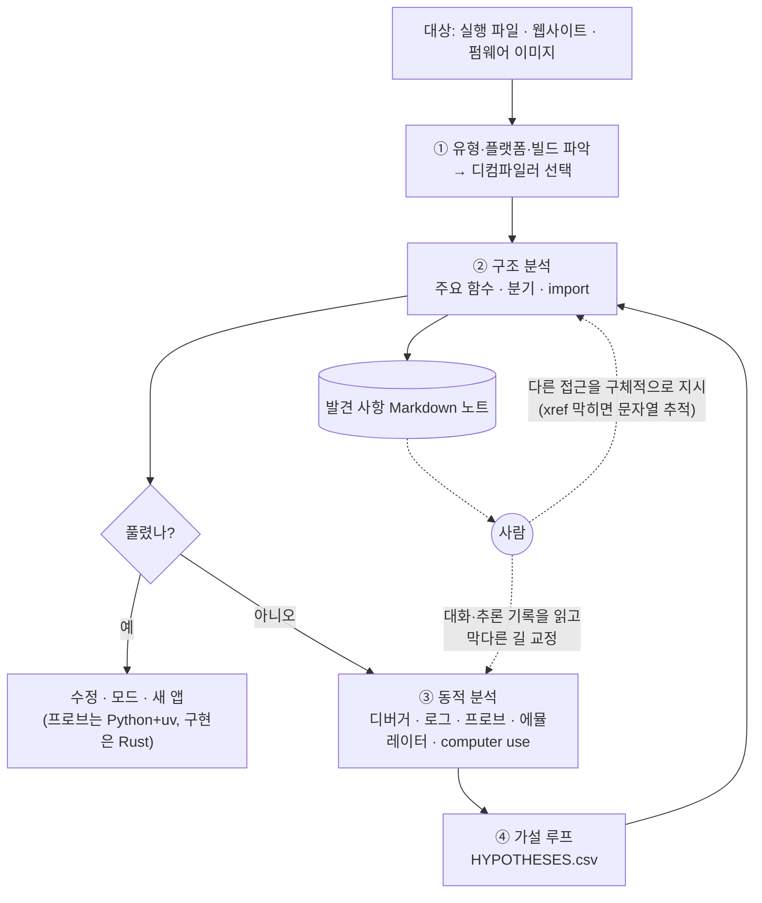

# 수년 걸릴 해킹을 몇 주로… LLM 에이전트와 함께하는 리버스 엔지니어링의 실제 작업법

### 오랫동안 손으로 하드웨어와 소프트웨어를 뜯어 온 해커가 2026년의 작업 방식을 공개했다. Ghidra를 MCP로 에이전트에 연결하고, 발견은 Markdown에 계속 적고, 막히면 가설을 CSV에 하나씩 적어 실험으로 확인한다. 반년 동안 카메라, 신시사이저, 전자책 리더, 프린터를 고쳤다. 그래도 에이전트가 막다른 길에 들어섰을 때 알아채는 것은 여전히 사람 몫이었다

2026년 11월 18일 ioma8은 블로그 Slow Chronicle에 [LLM assisted reverse engineering](https://www.slowchronicle.com/posts/llm-assisted-reverse-engineering)을 올렸다. 블로그를 연 다음 날 [Hacker News](https://news.ycombinator.com/item?id=50553225) 첫 페이지에 올라 315점을 받았다. GeekNews([토픽 37466](https://news.hada.io/topic?id=37466))도 이 글을 요약하고 HN 토론을 정리했다.

이 글은 원문의 도구 구성과 작업 흐름을 정리한다. 원문이 공개한 세 가지 에이전트 스킬([hypothesis-debugging](https://github.com/ioma8/hypothesis-debugging), [ghidra-decompile-skill](https://github.com/ioma8/ghidra-decompile-skill), [grill-me](https://github.com/mattpocock/skills))의 실제 내용을 저장소에서 확인해 덧붙였다. 예제 코드 두 개도 새로 써서 돌려 봤다. 같은 폴더의 [REA: 코딩 에이전트를 위한 리버스 엔지니어링 툴킷](261001_2359_REA_Reverse_Engineering_Toolkit_for_Coding_Agents.md)과 함께 읽으면 좋다.

> 리버스 엔지니어링은 **내가 소유한 기기와 소프트웨어**, 그리고 상호운용·수리·보존 목적에서 다룬다. 라이선스 우회나 유료 기능 해제는 법과 약관 문제가 따른다. HN 토론에서도 이 선이 논쟁이 됐다(7장).

## 1. 한눈에 보기

| 구성 요소 | 원문에서 쓴 것 | 역할 |
|---|---|---|
| 모델 | **Deepseek v4.1 Flash** (DeepSeek Harness), 가끔 Codex + Luna/Terra | 성능·속도·비용 균형이 가장 좋았다고 함 |
| 디스어셈블러·디컴파일러 | **Ghidra + MCP 브리지** | 무료 최고 수준. 에이전트가 MCP로 직접 조작 |
| 빠른 CLI 도구 | **radare2**, **kuna** | Ghidra만 못하지만 훨씬 빠르고 에이전트가 쓰기 쉬움 |
| 스킬 | grill-me, RE 도구 사용법 스킬, **hypothesis-debugging** | 질문 타이밍, 도구 사용법, 가설 검증 루프 |
| 프로브·프로토타입 | **Python + uv** (단일 파일 인라인 의존성) | 빠른 실험 |
| 실제 수정 구현 | **Rust** | 엄격한 컴파일러가 에이전트에게 즉각 피드백 |
| 기록 | Markdown 노트, `HYPOTHESES.csv` | 맥락 압축·에이전트 교체 후에도 이어 가기 |



글머리의 경력 표기는 출처마다 다르다. GeekNews 요약은 "20년간 수작업으로 해 온"이라고 옮겼고, 원문 추출본에는 "2년"으로 나온다. 원문 본문에서 확인할 것.

## 2. 도구 구성: 왜 Ghidra만으로 부족한가

원문의 첫 선택은 **Ghidra + MCP 브리지**다. Ghidra는 NSA가 공개한 무료 디스어셈블러·디컴파일러로, 상용 도구에 견줄 만하다. MCP 브리지를 붙이면 에이전트가 함수 목록을 조회하고, 특정 주소를 디컴파일하고, xref를 따라가는 일을 직접 한다.

그런데 Ghidra는 무겁다. 원문은 **radare2**와 **kuna** 같은 CLI 도구를 함께 쓴다. 품질은 Ghidra만 못하지만 훨씬 빠르고, 텍스트 입출력이라 에이전트가 다루기에 오히려 더 나을 수 있다는 것이다. HN에서는 radare2에서 갈라진 **Rizin** 개발자가 같은 이야기를 했다. 순수 C에 의존성이 적고, 명령 인터페이스가 YAML로 정의돼 있으며, 대부분 명령이 JSON을 출력해 AI가 쓰기 쉽다고 했다(7장).

원문이 링크한 [ghidra-decompile-skill](https://github.com/ioma8/ghidra-decompile-skill) 저장소에는 실전에서 배운 요령이 담겨 있다.

- **비싼 것은 디컴파일이 아니라 분석이다.** 전체 auto-analysis는 큰 펌웨어에서 몇 시간씩 걸린다. 대신 `-noanalysis`로 한 번만 import해 프로젝트를 남겨 두고, 필요한 주소만 정확히 디컴파일한다. 114MB짜리 stripped AArch64 이미지에서 함수 하나를 3.3초에 디컴파일했다고 한다.
- **버전 함정.** 배포된 GhidraMCP 7.0.0 확장은 Ghidra 12.1.4용이다. Ghidra 12.2에서는 모든 디컴파일이 `SleighLanguageDescription` 오류로 실패한다. 해결책은 `chore/ghidra-12.2` 브랜치를 직접 빌드하고 `extension.properties`에 `version=12.2`가 들어갔는지 확인하는 것이다.
- **디컴파일된 C는 의사 코드다.** Ghidra가 추정한 인자 타입은 힌트일 뿐이고, 기준은 호출 지점의 레지스터다.

```sh
# 헤드리스: 분석 없이 import하고, 지정한 주소만 디컴파일 (ghidra-decompile-skill SKILL.md 형식)
GHIDRA="${GHIDRA:-$HOME/Applications/ghidra_12.2_PUBLIC}"
PROJ=/tmp/ghproj
BIN=/path/to/firmware.bin
mkdir -p "$PROJ"

"$GHIDRA/support/analyzeHeadless" "$PROJ" target \
  -import "$BIN" -noanalysis \
  -scriptPath "$PWD/tools" \
  -postScript ResearchDecompile.java 0x17580d0 0x153ed40

# 두 번째부터는 -import 대신 -process로 같은 프로젝트를 재사용
```

이 스킬에는 Ghidra 스크립트 22개가 들어 있다. 대표적인 것은 다음과 같다.

- 특정 주소 디컴파일(`ResearchDecompile`), 범위 디스어셈블(`DisasmRange`)
- vtable·RTTI 덤프(`DumpVtable`, `DumpRTTI`)
- 상수·문자열·포인터 역추적(`FindConst`, `FindStrings`, `FindPointerValues`)
- 오프셋 사용처 추적(`FindOffsetUse`)
- 이미지 베이스와 메모리 블록 확인(`ProgramInfo`)

원문은 이런 **도구 사용법 스킬이 없으면 에이전트가 너무 일찍 포기한다**고 강조한다.

## 3. 작업 흐름

### 3.1 기본 흐름: 식별 → 구조 → 기록

1. **바이너리 유형·플랫폼·빌드를 파악하고 디컴파일러를 고른다.** 원문은 요즘 AI가 순수 x86·ARM 디스어셈블리만으로도 꽤 잘 해낸다고 적었다.
2. **발견 사항을 Markdown 파일에 계속 적게 한다.** 사람이 읽을 노트이면서, 맥락이 압축되거나 에이전트를 바꿔도 이어 갈 수 있는 인계 문서다. 에이전트가 같은 곳을 맴돌지 않게 하는 지도이기도 하다.
3. **기본 구조를 분석한다.** 주요 함수, 큰 분기, import된 함수를 본다. 대상은 데스크톱 실행 파일, 웹사이트, 펌웨어 이미지 무엇이든 된다. 구조가 잡히면 원본 수정, 모드 제작, 동작 이해로 넘어간다.

1단계를 돕는 예제를 하나 붙인다. 표준 라이브러리만 쓰는 PEP 723 단일 파일 스크립트라 원문처럼 `uv run triage.py`로 돌릴 수 있고, `python3`으로 바로 실행해도 된다. 매직 바이트로 ELF·PE·Mach-O·DEX를 가르고, 모르는 형식이면 엔트로피로 압축·암호화 여부를 가늠한다.

```python
# /// script
# requires-python = ">=3.10"
# dependencies = []
# ///
"""triage.py — 리버스 엔지니어링 1단계: 바이너리 형식·아키텍처 식별 (표준 라이브러리만)

  uv run triage.py <file> [...]
"""
import struct
import sys

ELF_MACHINE = {0x03: "x86", 0x28: "ARM", 0x3E: "x86-64", 0xB7: "AArch64", 0xF3: "RISC-V", 0x08: "MIPS"}
PE_MACHINE = {0x14C: "x86", 0x8664: "x86-64", 0x1C0: "ARM", 0xAA64: "AArch64"}
MACHO_CPU = {7: "x86", 0x01000007: "x86-64", 12: "ARM", 0x0100000C: "arm64"}


def triage(path: str) -> str:
    with open(path, "rb") as f:
        head = f.read(4096)
    if head[:4] == b"\x7fELF":
        bits = {1: "32-bit", 2: "64-bit"}[head[4]]
        endian = "<" if head[5] == 1 else ">"
        machine = struct.unpack_from(endian + "H", head, 18)[0]
        return f"ELF {bits} {ELF_MACHINE.get(machine, hex(machine))} ({'LE' if endian == '<' else 'BE'})"
    if head[:2] == b"MZ":
        pe = struct.unpack_from("<I", head, 0x3C)[0]
        if head[pe:pe + 4] == b"PE\0\0":
            machine = struct.unpack_from("<H", head, pe + 4)[0]
            return f"PE (Windows) {PE_MACHINE.get(machine, hex(machine))}"
        return "MZ (DOS executable)"
    magic_be = struct.unpack_from(">I", head, 0)[0]
    if magic_be == 0xCAFEBABE:  # Mach-O fat (universal) — Java class와 매직이 같아 개수로 구분
        n = struct.unpack_from(">I", head, 4)[0]
        if n < 20:
            cpus = [MACHO_CPU.get(struct.unpack_from(">I", head, 8 + 20 * i)[0], "?") for i in range(n)]
            return f"Mach-O universal [{', '.join(cpus)}]"
        return "Java class file"
    magic_le = struct.unpack_from("<I", head, 0)[0]
    if magic_le in (0xFEEDFACE, 0xFEEDFACF):
        cpu = struct.unpack_from("<I", head, 4)[0]
        return f"Mach-O {MACHO_CPU.get(cpu, hex(cpu))}"
    if head[:4] == b"dex\n":
        return "Android DEX"
    if head[:4] == b"PK\x03\x04":
        return "ZIP 계열 (APK · JAR · 펌웨어 패키지일 수 있음: 압축 해제 후 재분류)"
    # 형식을 모르면 raw 펌웨어일 가능성: 엔트로피로 압축·암호화 여부를 가늠
    from collections import Counter
    import math
    counts = Counter(head)
    entropy = -sum(c / len(head) * math.log2(c / len(head)) for c in counts.values())
    hint = "압축/암호화 의심" if entropy > 7.5 else "평문 코드·데이터 섞임 (raw 펌웨어 후보)"
    return f"알 수 없는 형식, 앞 4KB 엔트로피 {entropy:.2f} bits/byte → {hint}"


if __name__ == "__main__":
    for p in sys.argv[1:]:
        print(f"{p}: {triage(p)}")
```

```text
$ python3 triage.py /bin/ls random.bin hyp.py
/bin/ls: Mach-O universal [x86-64, arm64]
random.bin: 알 수 없는 형식, 앞 4KB 엔트로피 7.96 bits/byte → 압축/암호화 의심
hyp.py: 알 수 없는 형식, 앞 4KB 엔트로피 5.41 bits/byte → 평문 코드·데이터 섞임 (raw 펌웨어 후보)
```

### 3.2 정적 분석이 막혔을 때 쓰는 다섯 가지

| 방법 | 내용 |
|---|---|
| 디버거 | 브레이크포인트를 걸고 특정 구간의 실제 실행을 관찰 |
| 로그·프로브 | 원본의 숨은 로그 기능을 켜거나, 원본에 주입하는 프로브를 만들어 파일로 기록 |
| 실행 환경 제어 | 데스크톱 앱은 **computer use**로 에이전트가 직접 조작, 펌웨어는 **API로 제어되는 에뮬레이터** |
| 구체적 방향 전환 | "다른 방법을 써 봐"가 아니라 "xref 추적이 막혔으니 바이너리 안의 **문자열**을 추적해"처럼 지시 |
| 추론 기록 읽기 | 대화와 thinking 전체를 읽고, 에이전트가 좁은 길에 갇혔는지 판단해 제안 |

원문은 마지막 항목을 **사람의 기술**로 꼽는다. LLM도 한 가지 접근에 매몰될 수 있고, 그 막다른 길을 알아채는 것은 경험 많은 사람이 잘한다. HN에서도 하드웨어 RE에서는 에이전트에게 **Unicorn 에뮬레이션 하네스**를 짜게 하는 것이 효과적이라는 경험이 공유됐다. 펌웨어 부팅에 필요한 MMIO를 모의로 구현해 가는 탐색에 능하다는 것이다(7장).

## 4. 세 가지 에이전트 스킬

### 4.1 grill-me: 필요한 순간에 사람에게 묻기

Matt Pocock의 [skills](https://github.com/mattpocock/skills)에 있는 `/grill-me`는 계획이나 설계를 집요하게 캐묻는 인터뷰 스킬이다. 실제 지침은 `grilling` 스킬에 있다. 모든 결정을 "설계 트리"로 펼치고, 선행 결정이 정해진 질문들을 한 라운드에 번호를 붙여 추천 답과 함께 묻는다. **사실 확인은 에이전트가 직접 하고, 결정만 사람에게 묻는다**는 규칙이 핵심이다. 원문 저자는 이것을 RE용으로 좁혀 쓴다.

```text
Use skill /grill-me to ask me up to 5 questions whose answers are crucial
for your further progress. Ask only one question at a time.
```

"이 펌웨어의 원래 하드웨어가 뭔지", "목표가 읽기인지 수정인지"처럼 사람만 아는 맥락을 에이전트가 적절한 때에 물어 오게 하는 장치다.

### 4.2 RE 도구 사용법 스킬

radare2, kuna, Ghidra MCP 브리지를 언제 어떻게 쓰는지 적어 둔 스킬이다. 2장에서 본 [ghidra-decompile-skill](https://github.com/ioma8/ghidra-decompile-skill)이 공개판이다. 설치는 `npx skills add ioma8/ghidra-decompile-skill`이고, Node 22.20 이상이 필요하다.

### 4.3 hypothesis-debugging: 추측을 실험으로 바꾸기

원문의 핵심은 저자가 직접 만든 [hypothesis-debugging](https://github.com/ioma8/hypothesis-debugging)이다. 막힌 에이전트는 그럴듯한 추측을 늘어놓고 무작위로 시도하며 같은 자리를 맴돈다. 이 스킬은 **과학적 방법**을 강제해 그 습관을 끊는다.


`SKILL.md`의 규칙은 단호하다.

- 단계를 건너뛰지 말 것.
- **한 번에 가설 하나**, 테스트도 하나.
- 테스트 **전에** CSV에 기록할 것("NEVER skip this file").
- 가설 없이 코드를 고치지 말 것.
- disproved된 결과를 무시하지 말 것.

| 항목 | 값 |
|---|---|
| 파일 | 프로젝트 루트의 `HYPOTHESES.csv` |
| 열 | `hypothesis,test,conclusion,notes` |
| 결론 값 | `proved`(근본 원인 확인), `disproved`(배제), `need more info`(결론 불가, 부족한 것을 notes에) |
| 대기 중 | `conclusion`이 비어 있는 행 |
| 설치 | `npx skills add ioma8/hypothesis-debugging` |

결과가 파일에 남기 때문에 이미 반증된 가설을 다시 시도하지 않는다. 맥락이 압축되거나 다른 에이전트로 넘어가도 지금까지의 탐색이 그대로 보인다. 사람이 진행 상황을 한눈에 파악할 수도 있다.

### 4.4 예제: 규칙을 코드로 강제하는 `hyp.py`

스킬 문서의 규칙은 에이전트가 어길 수 있다. 같은 CSV 형식을 쓰되 규칙을 **코드로 강제**하는 작은 도구를 만들어 봤다. 표준 라이브러리만 쓰는 PEP 723 스크립트다.

- 결론이 안 난 가설이 있으면 새 가설을 거부한다.
- `proved`가 나오면 더 이상 가설을 받지 않는다.

```python
# /// script
# requires-python = ">=3.10"
# dependencies = []
# ///
"""hyp.py — HYPOTHESES.csv 루프를 강제하는 작은 도구 (ioma8/hypothesis-debugging 형식)

  uv run hyp.py add "가설" "그 가설만 가르는 단 하나의 테스트"
  uv run hyp.py conclude proved|disproved|"need more info" "관찰한 사실"
  uv run hyp.py show
"""
import csv
import sys
from pathlib import Path

FILE = Path("HYPOTHESES.csv")
HEADER = ["hypothesis", "test", "conclusion", "notes"]
STATUSES = {"proved", "disproved", "need more info"}


def load() -> list[dict]:
    if not FILE.exists():
        return []
    with FILE.open(newline="") as f:
        return list(csv.DictReader(f))


def save(rows: list[dict]) -> None:
    with FILE.open("w", newline="") as f:
        w = csv.DictWriter(f, fieldnames=HEADER, quoting=csv.QUOTE_ALL)
        w.writeheader()
        w.writerows(rows)


def pending(rows):
    return [r for r in rows if not r["conclusion"]]


def main(argv: list[str]) -> int:
    rows = load()
    cmd = argv[1] if len(argv) > 1 else "show"

    if cmd == "add":
        if pending(rows):  # 규칙: 한 번에 가설 하나
            print(f"✗ 결론이 안 난 가설이 있다: {pending(rows)[0]['hypothesis']!r}")
            return 1
        if any(r["conclusion"] == "proved" for r in rows):
            print("✗ 이미 proved 된 근본 원인이 있다. 멈추고 보고할 것.")
            return 1
        hypothesis, test = argv[2], argv[3]
        rows.append({"hypothesis": hypothesis, "test": test, "conclusion": "", "notes": ""})
        save(rows)
        print(f"+ 가설 #{len(rows)} 기록. 이제 테스트 하나만 실행: {test}")
    elif cmd == "conclude":
        status, notes = argv[2], argv[3]
        if status not in STATUSES:
            print(f"✗ 결론은 {sorted(STATUSES)} 중 하나")
            return 1
        if not pending(rows):
            print("✗ 결론을 낼 가설이 없다. 먼저 add")
            return 1
        pending(rows)[0].update(conclusion=status, notes=notes)
        save(rows)
        print("■ 근본 원인 확정. 멈추고 보고." if status == "proved" else "↻ 1단계(시스템 이해)로 돌아가 다음 가설.")
    elif cmd == "show":
        for i, r in enumerate(rows, 1):
            print(f"{i:>2}. [{r['conclusion'] or 'pending':>14}] {r['hypothesis']}  — {r['notes']}")
    return 0


if __name__ == "__main__":
    sys.exit(main(sys.argv))
```

원문 저자의 프린터 드라이버 작업을 흉내 낸 **가상의** 세션으로 돌려 본 결과다(주소와 관찰 내용은 예시다).

```text
$ python3 hyp.py add "드라이버가 프린터에 PostScript를 보낸다" "출력 스풀 파일 첫 바이트가 %!PS인지 확인"
+ 가설 #1 기록. 이제 테스트 하나만 실행: 출력 스풀 파일 첫 바이트가 %!PS인지 확인
$ python3 hyp.py conclude disproved "첫 바이트가 ESC E: PCL 리셋. PostScript 아님"
↻ 1단계(시스템 이해)로 돌아가 다음 가설.
$ python3 hyp.py add "용지 크기 명령의 PCL 코드가 A4와 Letter를 뒤바꾼다" "필터 바이너리에서 '&l26A' 문자열 xref를 따라 분기 확인"
+ 가설 #2 기록. 이제 테스트 하나만 실행: 필터 바이너리에서 '&l26A' 문자열 xref를 따라 분기 확인
$ python3 hyp.py add "동시 가설" "거부되어야 함"
✗ 결론이 안 난 가설이 있다: '용지 크기 명령의 PCL 코드가 A4와 Letter를 뒤바꾼다'
$ python3 hyp.py conclude proved "A4 선택 시 &l2A(Letter)를 쓰는 분기 발견 (0x1000041c0)"
■ 근본 원인 확정. 멈추고 보고.
$ cat HYPOTHESES.csv
"hypothesis","test","conclusion","notes"
"드라이버가 프린터에 PostScript를 보낸다","출력 스풀 파일 첫 바이트가 %!PS인지 확인","disproved","첫 바이트가 ESC E: PCL 리셋. PostScript 아님"
"용지 크기 명령의 PCL 코드가 A4와 Letter를 뒤바꾼다","필터 바이너리에서 '&l26A' 문자열 xref를 따라 분기 확인","proved","A4 선택 시 &l2A(Letter)를 쓰는 분기 발견 (0x1000041c0)"
```

## 5. 프로브는 Python + uv, 구현은 Rust

- **Python + uv.** uv로 실행 환경을 빠르고 이식성 있게 만들고, 의존성을 파일 안에 선언하는 단일 파일 스크립트(PEP 723)로 프로토타입, 빠른 프로브, 디컴파일 보조 도구를 만든다. 위 두 예제가 같은 형식이다.
- **Rust.** 실제 수정 기능은 가능하면 Rust로 구현한다. 이유는 둘이다. 저자에게 우아한 언어이고, **엄격한 컴파일러가 메모리와 문법 문제를 즉시 알려 줘 에이전트의 반복 작업에 좋은 피드백**이 된다는 것이다. 단점은 느린 컴파일이다. 웹, 데스크톱 앱, 해킹 도구와 트레이너, 여러 임베디드 펌웨어를 Rust로 만들었다고 한다.

## 6. 반년의 성과

| 대상 | 한 일 | 저장소 |
|---|---|---|
| Alphasmart NEO (휴대용 타이핑 기기) | 리버스 엔지니어링과 수정 | [neo-re](https://github.com/ioma8/neo-re) |
| EmWave (바이오피드백 기기) | 통신 프로토콜 완전 매핑, 커스텀 앱 | [emwave-utils](https://github.com/ioma8/emwave-utils) |
| Sony Alpha 미러리스 2대 | 프로토콜 매핑 → 파일 전송·무선 제어 데스크톱/모바일 앱, **A7III를 무선 웹캠으로** | — |
| Arturia MiniFreak (신시사이저) | 커스텀 펌웨어 | — |
| Teenage Engineering OP-Z | 커스텀 펌웨어 | [opz-firmware-notes](https://github.com/ioma8/opz-firmware-notes) |
| Akai MPC Sample | 커스텀 펌웨어 | [mpc-minimod](https://github.com/ioma8/mpc-minimod) |
| Xteink X4 (전자책 리더) | 커스텀 펌웨어 | [cool](https://github.com/ioma8/cool) |
| HP LaserJet P2055dn (구형 프린터) | macOS 드라이버 수정 | [hp-p2055dn-macos-driver](https://github.com/ioma8/hp-p2055dn-macos-driver) |
| 어린 시절 쓰던 지원 중단 소프트웨어 | 라이선스 잠금 해제 | — |
| Evernote | 가벼운 커스텀 클라이언트 | — |

저자는 이 하나하나가 손으로 했다면 **수년씩** 걸렸을 일이라고 말한다.

### 6.1 리버스 엔지니어링과 소프트웨어 개발의 경계

저자는 둘의 경계가 얇다고 본다. 유료 앱의 독자 저장 포맷을 해독한 뒤, 그 파일을 다루는 새 편집기를 만들었다. 개인용 Photoshop류 편집기도 만들었는데, 시중의 ArtCraft 제품군보다 1년쯤 앞섰다고 적었다.

### 6.2 맺음말

해킹은 저자의 평생 취미다. 어셈블리와 하드웨어를 이해하지만 손으로 하는 분석은 길고 지루했다. 저렴한 LLM 도구가 이 취미를 바꿨다. 이제 손으로 하던 분석이 그립지 않고 결과가 빨리 나오는 것이 즐겁다고 한다. 오랜 경험은 에이전트를 올바른 방향으로 이끄는 데 쓰이고, 여전히 많이 배운다고 했다. 결론은 LLM이 호기심을 없애지 않고 **탐구 속도를 높였다**는 것이다. "Let's free our minds!"라며 누구나 자기 기기를 고쳐 보라고 권한다.

## 7. Hacker News 반응

- **CCTV 카메라를 Home Assistant로.** Gemini와 약 2시간 만에 카메라 클라우드 플러그인을 분석한 경험담이 나왔다.
  - 기존 GitHub 프로젝트가 동작하지 않자, 데스크톱 소프트웨어를 별도 네트워크 네임스페이스에서 띄우고 `tcpdump`로 필요한 통신만 잡는 스크립트를 15분 만에 짰다.
  - 서버 URL과 인증 정보가 기존 프로젝트와 다르다는 것을 확인하고, Ghidra로 관련 문자열이 든 DLL을 봤다.
  - 사용자명과 키를 찾는 일은 Gemini에 맡겼다. 서버 혼잡으로 모델을 바꿔 가며 30분~1시간 걸렸다.
  - 결과적으로 Home Assistant로 주차장 차량을 감지하게 됐다.
  - 한 답글은 인증 관련 RE 요청을 Gemini가 매번 거절해 쓸모없었다며, 어떻게 설득했느냐고 물었다.
- **단종된 오디오 플러그인과 DSP 악기.** Terraform과 약간의 Python 정도만 써 본 DevOps/SRE 출신이 원본과 거의 같은 소리의 플러그인을 분석했다는 경험담이 나왔다. 코드를 그대로 쓰지는 않았지만 현대 DSP로 재현할 실마리를 얻었다고 한다. 생성형 AI에 불만도 있지만, 버려진 독점 소프트웨어의 내부를 이해하는 것은 가장 멋진 활용 중 하나라는 평이었다. 독점 하드웨어에도 유용해서, Claude로 구형 Intel Mac에서 Linux를 더 잘 돌리려는 시도가 많다는 답도 달렸다.
- **아이 장난감과 선반.** 중국어 이야기 장난감의 USB 카트리지 `.dat` 파일 구조를 AI가 15분 만에 풀었다는 사례가 나왔다. 텍스트를 Base64로 인코딩해 `manifest|pagetext|image1|image2` 형식으로 이어 붙인 구조였다. 이후 폴더를 넣으면 이야기 파일을 만드는 스크립트와, 아이디어로 이야기와 그림을 만드는 스킬까지 만들었다. 비싼 선반은 제품 사진 4~5장을 FreeCAD MCP에 연결된 Claude에 넣자 1시간 만에 수정 가능한 CAD와 조립 안내 PDF가 나왔다. 작업 중에 원본 제품까지 찾아냈다고 한다. FreeCAD로 LED 7세그먼트 디스플레이를 만들려다 ChatGPT와 한 시간을 씨름하고도 실패했다는 답글도 달렸다.
- **추측 루프 문제.** Opus 4.8로 큰 대상을 다룰 때는 계속 지켜보며 "추측을 멈추라"고 지시해야 한다는 경험담이 나왔다.
  - 완전한 블랙박스가 아니면 정보를 끈질기게 추적해 확정 답을 얻을 수 있으니, 에이전트는 호출을 먼 하위 시스템까지 따라가는 끈질긴 도구여야 한다고 했다.
  - 하드웨어에는 **Unicorn 에뮬레이션 하네스**가 효과적이지만, 에이전트가 가끔 목적을 무너뜨리는 지름길을 택한다고 했다.
  - 답글에서는 다른 해법들이 나왔다. llama.cpp의 추론 토큰 한도를 동적으로 조절하고 "테스트로 후보를 배제하라"는 판단 모델을 붙이자는 제안, 시각 입력과 브라우저 접근을 주자 UI 관련 과도한 의심이 크게 줄었다는 관찰, 스스로 검증하게 하면 현실에 더 붙어 일한다는 관찰이다.
- **스킬은 필요한가.** 간단한 지시는 그때그때 말하면 되고 원칙을 이해하는 게 더 중요하다며, 남이 만든 스킬을 쓰는 이유를 묻는 의견이 나왔다. 답글은 갈렸다.
  - 스킬과 AGENTS.md 모두 안티패턴이고, 스킬 패키지 관리자의 등장은 경고 신호라는 의견. 문서는 사람을 위해 써야 하며, 사람용 문서로 일하지 못하면 LLM이 아직 부족한 것이라는 주장이다. 업계가 LLM 이후에야 문서를 중시한다는 점이 거슬린다는 말도 덧붙였다.
  - 반복하기 싫은 지시를 담는 것이 스킬이고, 전용 CLI와 묶으면 사용법을 매번 가르칠 필요가 없다는 의견. 에이전트용 CLI에 `foo help`처럼 Markdown 사용법을 출력하는 인자를 두면 한 번 읽고 쓴다고 했다.
  - 복잡한 작업 흐름을 매 프롬프트마다 다시 불러 주기 싫다는 의견.
  - 원문 저자도 답했다. 영어가 모국어가 아니라 오타가 있다며, 쓰는 스킬은 오랫동안 반복해 효과를 확인한 것이고 남의 스킬도 같은 기준으로 고른다고 했다.
- **Android 앱의 유료 기능 해제 논쟁.** Codex로 구독형 앱 몇 개의 유료 기능을 해제했고, 완전히 오프라인으로 동작하게 만들어 개인정보가 밖으로 나가지 않게 했다는 글이 올라왔다.
  - Android 앱은 사실상 ZIP 안의 Dalvik 바이트코드라 디컴파일이 쉽고, 난독화도 대개 이름 바꾸기 수준이라 LLM을 늦추지 못한다는 기술적 설명이 붙었다.
  - 반발도 나왔다. 살 수 없는 소프트웨어를 교육 목적으로 복제하는 것과 달리, **구매할 수 있는 저렴한 앱의 유료 기능을 해제하는 것은 절도에 가깝다**는 것이다.
- **조명·카메라 통합 앱.** 프런트엔드 개발자가 Aputure MC 조명, Neewer COB 조명, Hollyland 영상 송신기의 Android 앱을 분석한 경험담이 나왔다. 여기에 공개 프로토콜인 BMPCC 4K/6K 카메라 제어를 더해 앱 하나로 통합했다. MC 12개와 COB 2개의 전환·이징·색·밝기를 키프레임처럼 설정하고, false color와 3D LUT 전환, 녹화·ISO·조리개까지 제어한다. Claude와 주말 하루에 끝냈고 "겸허해지는 경험"이었다고 했다.
- **과정의 배움 vs 결과의 만족.** 과정에서 기술을 익히고 결과에서 만족을 얻는데, AI 역공학은 둘 다 주지 않는다는 의견이 나왔다. 반론도 이어졌다.
  - 같은 일을 많이 해 보면 지루한 부분을 맡길 AI가 반갑다.
  - Ghidra MCP로 LLM을 붙이되 대부분 직접 하고 LLM은 클릭할 곳과 검증만 맡기면, 옆에 사람이 앉은 듯한 최고의 학습법이 된다.
  - 에이전트에게 한 일을 기록하게 하고 그 기록으로 Unicorn 사용법을 익혔다.
  - 완수와 이해 사이의 균형은 정말 어렵다.
- **Rizin을 에이전트 친화적으로.** Cutter GUI의 엔진인 [Rizin](https://rizin.re) 개발자가 AI 에이전트용 개선을 소개했다.
  - 최신 정식판 0.9.1보다 git `dev` 브랜치를 권했고, 1~2개월 뒤 0.10에 들어간다.
  - 실험적 [rizin-mcp](https://github.com/rizinorg/rizin-mcp) 서버도 있다. 순수 Rust로 작성됐고, 디스어셈블·디컴파일·xref·RzIL 에뮬레이션 등 도구 85개를 제공한다. 다만 최신 모델은 MCP 없이 CLI를 직접 써도 그만큼 또는 더 잘한다고 했다.
  - 저장소는 [rizinorg/rizin](https://github.com/rizinorg/rizin)과 [rizinorg/cutter](https://github.com/rizinorg/cutter)다.
- **Civilization 1 디컴파일.** 당시 빌드 형태 그대로 Civ 1을 역공학한 [civd](https://github.com/sjmelia/civd) 사례가 나왔다. "소프트웨어 고고학" 같았다고 한다. 처음에는 작업 흐름을 지나치게 복잡하게 짜서 느렸고, 단순화해 에이전트가 스스로 방향을 잡게 하자 가장 좋은 결과가 나왔다. MSC51은 비교적 단순하고 링커의 정렬 순서로 변수명 범위를 좁힐 수 있어 좋은 대상이라고 했다.

## 8. 정리: 원문에서 가져갈 것

| 원칙 | 왜 |
|---|---|
| **도구 사용법을 스킬로 준다** | 없으면 에이전트가 너무 일찍 포기한다 |
| **발견을 파일에 적게 한다** (Markdown, CSV) | 맥락 압축·에이전트 교체 후에도 이어지고, 같은 탐색 반복을 막는다 |
| **추측 대신 가설 하나, 실험 하나** | 맴돌기와 무작위 시도를 끊는다 |
| **방향 전환은 구체적으로** | "xref가 막혔으면 문자열을 추적해" |
| **추론 기록을 사람이 읽는다** | 막다른 길을 알아채는 것은 경험의 몫이다 |
| **피드백이 엄격한 언어로 구현한다** | Rust 컴파일러가 에이전트의 반복을 빠르게 교정한다 |
| **무거운 분석은 한 번만** | Ghidra는 `-noanalysis` import 후 필요한 주소만 디컴파일한다 |

원문이 보여 주는 것은 "AI가 다 해 준다"가 아니다. **경험 있는 사람이 방향을 잡고, 에이전트가 끈기 있게 파고드는 분업**이다. 그 분업이 손으로 하면 몇 년 걸렸을 일을 취미의 시간 안으로 끌어왔다.

## 참고

- ioma8, [LLM assisted reverse engineering](https://www.slowchronicle.com/posts/llm-assisted-reverse-engineering), Slow Chronicle (2026-11-18)
- GeekNews, [LLM을 활용한 리버스 엔지니어링](https://news.hada.io/topic?id=37466), [Hacker News 토론](https://news.ycombinator.com/item?id=50553225)
- 스킬: [ioma8/hypothesis-debugging](https://github.com/ioma8/hypothesis-debugging), [ioma8/ghidra-decompile-skill](https://github.com/ioma8/ghidra-decompile-skill), [mattpocock/skills (grill-me, grilling)](https://github.com/mattpocock/skills)
- 저자 프로젝트: [neo-re](https://github.com/ioma8/neo-re), [emwave-utils](https://github.com/ioma8/emwave-utils), [opz-firmware-notes](https://github.com/ioma8/opz-firmware-notes), [mpc-minimod](https://github.com/ioma8/mpc-minimod), [cool](https://github.com/ioma8/cool), [hp-p2055dn-macos-driver](https://github.com/ioma8/hp-p2055dn-macos-driver)
- 도구: [Rizin](https://rizin.re) ([GitHub](https://github.com/rizinorg/rizin)), [Cutter](https://github.com/rizinorg/cutter), [rizin-mcp](https://github.com/rizinorg/rizin-mcp), [civd](https://github.com/sjmelia/civd)
- GeekNews 관련 글: [리버스 엔지니어링용 Ghidra MCP 서버](https://news.hada.io/topic?id=19995), [Qwen 3.8 27B, 리버스 엔지니어링을 30분 만에](https://news.hada.io/topic?id=32808), [2026년, 엔지니어로 살아간다는 것](https://news.hada.io/topic?id=36945), [Cutter](https://news.hada.io/topic?id=3222), [REA Reverse](https://news.hada.io/topic?id=35105)
- 같은 카테고리: [REA: 코딩 에이전트를 위한 리버스 엔지니어링 툴킷](261001_2359_REA_Reverse_Engineering_Toolkit_for_Coding_Agents.md), [스케일링 법칙에서 검증 가능한 루프까지](260804_2159_Self-Improving_Agents_from_Scaling_Laws_to_Verifiable_Loops.md)
