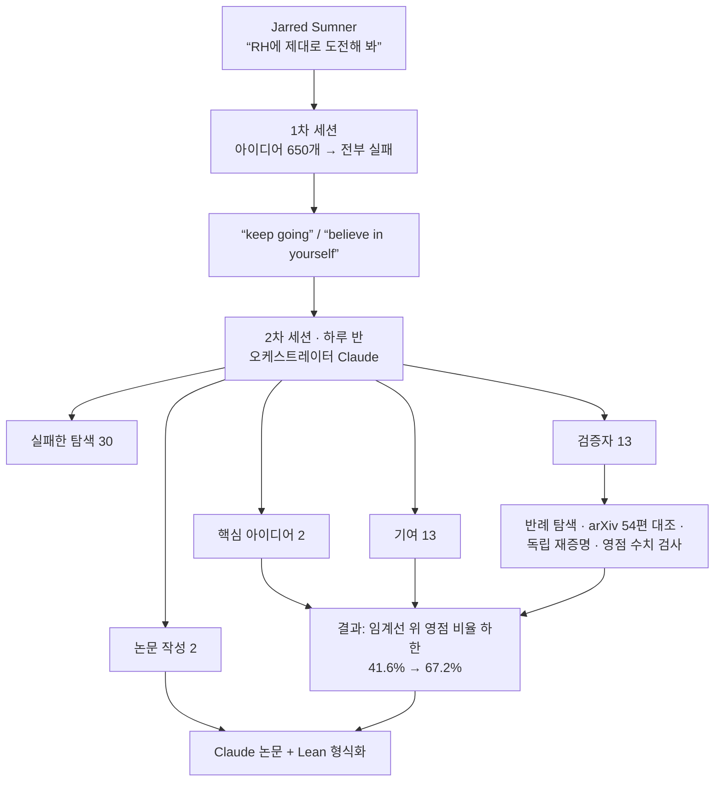
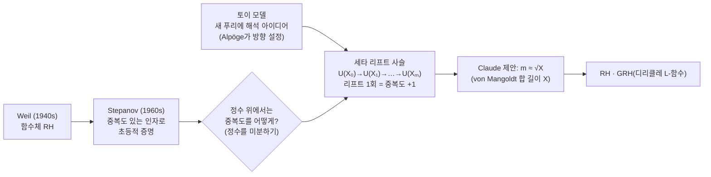
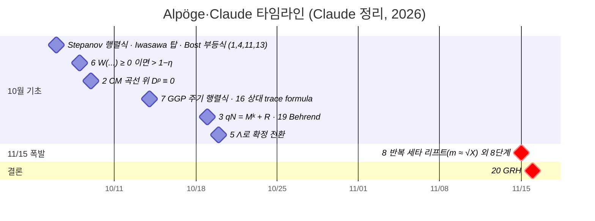
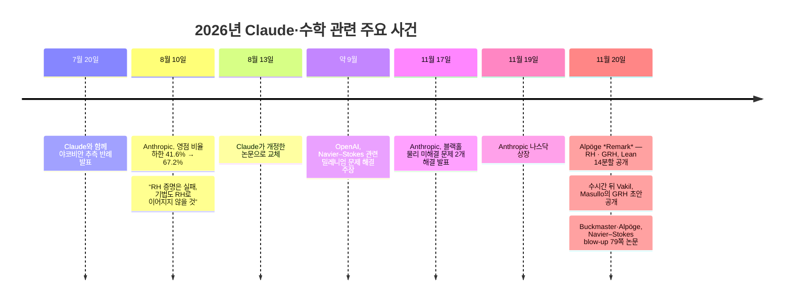
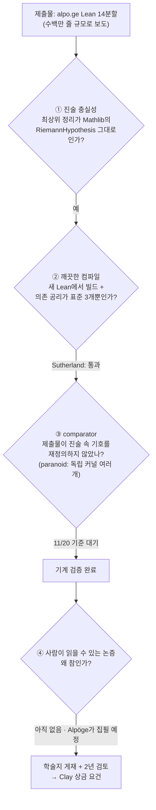

# Claude는 리만 가설을 풀었나… 8월의 ‘67.2%’와 11월의 ‘Lean 증명’ 사이

### 8월 Anthropic은 “증명 실패, 대신 영점 비율 하한 41.6%→67.2%”를 발표했다. 석 달 뒤 Anthropic 수학자 Levent Alpöge는 Claude와 함께 RH와 GRH를 증명했다며 Lean 코드만 공개했다. 두 사건의 과정, 검증 단계, 남은 쟁점을 정리한다

2026년 11월 20일(금), Anthropic 소속 수학자 Levent Alpöge가 개인 사이트에 네 쪽짜리 메모 [*Remark*](https://alpo.ge/remark.pdf)를 올렸다. 첫 문단에 이런 문장이 있다.

> “I believe I have, working with Claude, discovered a proof of the Riemann Hypothesis.”

1859년 베른하르트 리만이 제기한 뒤 167년 동안 풀리지 않은 문제다. 클레이 수학연구소(Clay Mathematics Institute)는 2000년 이 문제를 [밀레니엄 문제](https://www.claymath.org/millennium/riemann-hypothesis/) 일곱 개 가운데 하나로 정하고 상금 100만 달러를 걸었다. Alpöge는 같은 방법으로 **일반화 리만 가설(GRH)**까지 해결했다고 주장했다. 다만 공개한 것은 논문이 아니라 **Lean 형식 증명 코드**뿐이었다.

“Claude가 리만 가설을 풀었다”는 말은 그 전에도 한 번 돌았다. 2026년 8월 Anthropic이 낸 연구 글 때문인데, 그때 Claude는 리만 가설을 **풀지 못했다**. 이 글은 이 두 사건을 시간순으로 놓고, 무엇을 주장했는지, 어떻게 만들었는지, 어떻게 검증하고 있는지, 그리고 아직 확인되지 않은 것이 무엇인지 정리한다.

## 0. 어디에 두는가

이 글의 주제는 수학 그 자체보다 **LLM 에이전트가 연구 결과를 내놓는 방식**이다. 8월 사례는 서브에이전트 약 60개를 조율한 Claude Code 세션이었고, 11월 사례는 사람이 이끌고 Claude가 기술 작업을 맡은 뒤 **Lean 커널과 comparator라는 기계 검증기**로 결과를 확인하는 구조다. 따라서 typeboard 분류상 `docs/06_AI/02_Agents`에 둔다. 같은 폴더의 [Self-Improving Agents from Scaling Laws to Verifiable Loops](./260804_2159_Self-Improving_Agents_from_Scaling_Laws_to_Verifiable_Loops.md)가 다룬 “검증 가능한 루프”가 실제 수학 연구에서 어떻게 쓰였는지 보여 주는 사례이기도 하다. 제품·업계 뉴스로 보면 `07_Tech_Trends`에도 들어갈 수 있지만, 이 글의 중심은 에이전트의 작업 방식과 검증 구조다.

## 1. 리만 가설을 먼저 짧게

리만 제타 함수 ζ(s)는 Re(s) > 1에서 다음과 같이 정의하고, 해석적 연속으로 복소평면 전체로 넓힌다.

$$
\zeta(s)=\sum_{n=1}^{\infty}\frac{1}{n^{s}}=\prod_{p\ \text{소수}}\frac{1}{1-p^{-s}}
$$

음의 짝수 −2, −4, …에서 생기는 영점을 *자명한 영점*이라 하고, 나머지 영점은 모두 0 < Re(s) < 1인 띠(임계대) 안에 있다. **리만 가설은 이 비자명 영점이 모두 임계선 Re(s) = 1/2 위에 있다는 주장이다.**

이 주장이 중요한 이유는 소수 분포와 직접 연결되기 때문이다. 리만의 명시 공식(explicit formula)에 따르면 소수 계단 함수는 “매끄러운 주항 + 영점마다 하나씩 붙는 파동”으로 쓸 수 있다. 영점의 실수부가 β이면 그 파동의 진폭은 대략 x^β로 자란다. 모든 영점이 1/2 위에 있으면 소수 개수의 오차는 √x 정도로 묶이고, 1/2 밖에 영점이 하나라도 있으면 그보다 큰 진동이 생긴다. Alpöge가 메모 첫 줄에서 RH를 “소수 개수에 대한 최적의 통제(optimal control)”라고 부른 것도 이 때문이다.


*출처: Quantum Zeitgeist. 매끄러운 공식에 영점 파동을 10개, 100개 더하면 소수 계단이 점점 재현된다.*


*출처: Quantum Zeitgeist. 영점 하나가 임계선 밖에 있으면 소수 개수의 파동이 그만큼 커진다.*

Quantum Zeitgeist가 든 숫자로 감을 잡을 수 있다. 100만 이하 소수는 78,498개이고 가우스식 추정치는 78,628이다. 지금까지 계산으로 확인한 영점은 10조 개가 넘으며, 모두 임계선 위에 있었다.

### 예제 1 — 처음 10개 영점 계산하기 (mpmath)

```python
# pip install mpmath
from mpmath import mp, zetazero, zeta

mp.dps = 20
for n in range(1, 11):
    rho = zetazero(n)                      # 허수부 기준 n번째 비자명 영점
    print(f"{n:2d}  rho = {rho.real} + {mp.nstr(rho.imag, 12)}i"
          f"   |zeta(rho)| = {mp.nstr(abs(zeta(rho)), 3)}")
```

```text
 1  rho = 0.5 + 14.1347251417i   |zeta(rho)| = 5.2e-21
 2  rho = 0.5 + 21.0220396388i   |zeta(rho)| = 4.28e-21
 3  rho = 0.5 + 25.0108575801i   |zeta(rho)| = 1.08e-20
 ...
10  rho = 0.5 + 49.7738324777i   |zeta(rho)| = 3.2e-20
```

주의할 점이 하나 있다. `zetazero`는 임계선 위에서 실수 함수 Z(t)의 부호 변화를 찾는 방식으로 영점을 구한다. 그래서 실수부가 0.5로 나오는 것은 계산 방식이 그렇게 정해 둔 결과이지 증거가 아니다. 계산 검증에서는 임계대 전체의 영점 개수(N(T))와 임계선 위에서 찾은 개수가 같은지 비교한다. 8월 실험에서 Claude의 서브에이전트들이 “알려진 영점과 수천 번 대조”한 작업도 이런 수치 검사다.

## 2. 8월 10일 — “리만 가설에 제대로 도전해 봐”, 그리고 실패

Anthropic은 2026년 8월 10일 연구 글 [*Claude has improved on a longstanding lower bound for the fraction of zeros of the Riemann zeta function that satisfy the Riemann hypothesis*](https://www.anthropic.com/research/riemann-zeta)를 발표했다. 8월 13일에는 Claude가 직접 고친 논문으로 교체했는데, 증명을 더 명확히 쓰고 역사적 맥락을 보탠 판본이다.

### 2.1 출발: 수학자가 아닌 사람의 프롬프트

시작은 Bun 개발자로 알려진 Anthropic 직원 **Jarred Sumner**였다. 수학자가 아닌 그는 Claude Code에서 공개되지 않은 연구용 Claude에게 리만 가설 자체에 “제대로 도전해 보라(take a real stab)”고 요청했다. 어떤 수학을 쓸지는 모두 모델에게 맡겼다.

- **1차 세션**: Claude는 아이디어 **650개**를 만들어 시도했고 하나도 통하지 않았다.
- **2차 세션**: 다시 해 보라는 요청을 받은 Claude는 **하루 반** 동안 **서브에이전트 약 60개**를 조율했다. 셸 명령 **2,400회**를 실행하고 Python 스크립트 수백 개를 썼으며, 알려진 제타 영점과의 수치 검사를 수천 번 돌렸고, 서로의 작업을 심사했다.
- 두 세션을 합친 비용은 **출력 토큰 3,100만 개**였다.
- 사람이 한 일은 대부분 격려였다. “keep going”, “believe in yourself” 같은 말이다. Anthropic은 이 격려가 처음에 회의적이던 Claude를 계속 밀고 나가게 했다고 설명한다. 각주에 따르면 비슷한 격려 프롬프트가 7월 Claude가 **야코비안 추측(Jacobian conjecture)**을 반증할 때도 쓰였다([Alpöge의 X 게시물](https://x.com/__alpoge__/status/2079028340955197566)).

서브에이전트 60개는 다음과 같이 역할이 나뉘었다(Anthropic 각주 1).

| 역할 | 수 |
|---|---|
| 핵심 아이디어 개발 | 2 |
| 핵심 아이디어에 기여 | 13 |
| 새 아이디어를 시도했으나 실패 | 30 |
| 검증자(validator) | 13 |
| 초기 논문 작성 보조 | 2 |



### 2.2 결과: RH가 아니라 ‘몇 퍼센트가 선 위에 있나’

Claude는 원래 질문(RH 증명)에는 실패했다. 대신 그 과정에서 가까운 문제를 개선했다. **비자명 영점 가운데 임계선 위에 있다고 증명된 비율의 하한**을 기존 **41.6%**에서 **67.2%**로 올린 것이다. Brunch 해설은 논문의 정확한 진술을 “비자명 영점의 최소 3분의 2는 단순 영점이며 임계선 위에 있다”로 옮기고, Montgomery–Taylor 창(window)을 쓰면 약 67.25%라고 설명한다.

Anthropic이 공개한 계보와 핵심 단계는 다음과 같다.

- **배경**: Montgomery가 1973년 [쌍상관(pair correlation)](https://en.wikipedia.org/wiki/Montgomery's_pair_correlation_conjecture) 기법을 만들었다. 원래 RH를 가정한 기법이었는데, 이후 [Aryan](https://arxiv.org/abs/1902.05473)과 Baluyot–Goldston–Suriajaya–Turnage-Butterbaugh([2306.04799](https://arxiv.org/abs/2306.04799), [2501.14545](https://arxiv.org/abs/2501.14545))가 RH 가정 없이 쓸 수 있게 만들었다.
- **조합**: 위 결과들에 [Bombieri(2000)](https://eudml.org/doc/252338)를 더하면 41.6%를 넘을 길이 생긴다.
- **구성**: Weil이 유도한 이차형식을 갖춘 함수 공간을 만든다. 임계선 위 영점은 양정치(positive-definite) 부분공간을, 선 밖의 영점은 음정치 부분공간을 만든다. 그다음 1차·2차 모멘트 정보로 이차형식의 **랭크**를 위에서 누르는 부등식을 세운다.
- Anthropic은 모멘트 계산 자체(쌍대 소수 표현이나 힐베르트 변환을 쓰는 부분)는 해석적 정수론에서 “놀랍지 않은” 부분이라고 했다. 새로운 점은 양정치·음정치 부분공간을 **함께** 놓고 공간 전체를 다룬 데 있다. 그 덕분에 대각이 아닌 형식을 쓸 수 있었다.

### 2.3 검증: 에이전트 내부 → 사내 수학자 → 외부 전문가 → Lean

1. **에이전트 단계**: 검증 서브에이전트들이 증명을 심사하고 반례를 찾았다. arXiv 논문 **54편**을 내려받아 이미 알려진 결과인지 확인했고, 결과를 처음부터 독립적으로 다시 증명했다.
2. **Claude의 제안**: Claude가 먼저 논문을 쓰겠다고 했고, 사람 정수론자의 검증을 받으라고 권했다.
3. **사내 수학자**: Levent Alpöge와 Ralph Furman이 논문과 선행 연구의 관계를 살펴 검증했고, 전문가용 비공식 노트를 따로 썼다.
4. **외부 전문가**: Brian Conrey와 Dan Goldston이 짧은 기간에 논문을 검토했다. Anthropic은 “검토했다(examined)”고 썼을 뿐 보증했다고 쓰지는 않았다.
5. **Lean**: Anthropic의 Eric Easley가 Claude와 함께 형식화했고, 표준 검증 도구 [comparator](https://github.com/leanprover/comparator)를 통과했다. 코드는 [anthropics/zeta-23-lean](https://github.com/anthropics/zeta-23-lean)에 있다.

공개 자료는 [Claude의 논문](https://assets.claude.com/95c246936988e43127bc6b2ceb7077c1dad2d68e.pdf), [전문가용 비공식 노트](https://assets.claude.com/23455459f8832d06bb175cc0f88d019aed962ef8.pdf), [Claude가 결과에 도달한 과정에 대한 설명(부록)](https://assets.claude.com/d7f3ecf1d01392d887f8bc974ca187e2a121b1ed.pdf), [작업 과정 상세 기록](https://assets.claude.com/8a0d1add3c637b858a9a181e98c40e9548c3f44f.pdf)이다. 논문의 저자 표기는 “CLAUDE / ANTHROPIC”이다. 학술지 동료 심사는 아직 확인되지 않았고, 사용한 모델의 이름·세대·크기도 공개되지 않았다.

### 2.4 반응: “새 아이디어는 맞지만, RH로 가는 길은 아니다”

Scientific American은 [“No, AI didn’t just solve the thorniest problem in math”](https://scientificamerican.com/article/no-ai-didnt-just-solve-the-thorniest-problem-in-math)(8월 12일, Joseph Howlett)라는 제목으로 선을 그었다.

- **James Maynard**(옥스퍼드): 이 문제에는 진짜 새 아이디어가 필요했고 이번 결과가 그것을 준 것 같다고 평가했다. 다만 이 접근이 RH까지 이어질 경로는 없다고 했다.
- **Andrew Sutherland**(MIT): 미리 주어진 문제를 푸는 수준을 넘어 AI가 흥미로운 연구를 할 수 있다는 증거라고 했다.
- 기사는 비율이 **100%가 되어도 상금 대상이 아니라**는 점을 짚었다. 비율은 극한 밀도이므로 “거의 모든” 영점이 선 위에 있어도 밀도 0인 소수의 예외는 남을 수 있다.

Anthropic도 직접 “Claude가 쓴 기법이 RH 증명으로 이어질 것이라고 기대하지 않는다”고 썼다. 67.2%는 “RH를 67.2% 풀었다”는 뜻이 아니다. 비율의 **하한**을 올렸다는 뜻이다.

## 3. 11월 20일 — Alpöge의 *Remark*: “Claude와 함께 RH를 증명했다고 믿는다”

석 달 뒤 상황이 달라졌다. 8월 논문을 검증했던 Alpöge가 이번에는 직접 RH 증명을 주장하고 나섰다.

### 3.1 무엇을 주장했나

메모 첫 쪽의 요지는 이렇다.

- Claude와 함께 리만 가설의 증명을 찾았다고 **믿는다**.
- 방법은 훨씬 멀리까지 확장되어 **GRH**도 해결하며, 시간이 더 있으면 **확장 리만 가설(ERH)**도 가능할 것으로 본다.
- Claude와 함께 논증을 **가정 없이** 형식화했다.
- 지금 논증은 엄청나게 길지만 곧 “대폭 단순화될 것”이라고 직감한다. 제대로 이해하고 설명하고 글로 쓰는 일은 앞으로 하겠다고 했다.

증명 링크인 각주 1은 논문이 아니라 Lean 프로젝트 압축 파일 **14개**를 가리킨다. `alpo.ge/lean.tar.gz.part01` … `part14`이다.

### 3.2 사람이 한 일과 Claude가 한 일

Alpöge는 학생 시절부터 이 문제를 “수십 년짜리 계획”으로 품고, 문제에서 알아볼 수 있는 도구를 모두 익히려 했다고 썼다. 이번에 역할은 다음처럼 나뉘었다.

- **Alpöge**: 서로 아주 다른 두 아이디어를 결합하는 **토이 모델(toy setting)**로 방향을 잡았다. 그중 하나는 그 자체로 새롭고 충격적이어서 “리만의 그림자” 가운데 수학자들이 가장 자랑스러워하던 결과 하나를 아주 단순하게 만들었다고 한다. 이어 그 토이 모델에 대응하는 실제 상황으로 이끌었다.
- **Claude**: 그 지점부터 Claude가 사람을 압도했다고 한다. 메모의 표현은 “No, Claude flew, and danced, and sparkled near that finish line”이다. Alpöge는 특히 고차 랭크 군 위의 보형 형식(automorphic forms)에 대해 자신은 깊이 알지 못한다고 인정했고, 이 부분을 대부분 Claude에게 맡겼다.

그가 “동료 수학자들이 의자에서 떨어질 것”이라며 소개한 한 줄은 이것이다.

> 함수체 위의 RH를 해결한 **Stepanov의 논증**은 **중복도(multiplicity)**가 있는 인자를 쓴다. 이번 논증은 Stepanov 논증의 후손이다. 그런데 정수 위에서는 중복도를 만들기 어렵다. “정수를 미분하는 것” 같은 일이기 때문이다. 토이 모델에서 나온 단순하고 새로운 푸리에 해석적 아이디어 덕분에, **세타 리프트(theta lift)를 사슬처럼 이어** 같은 기법이 “본래 보형적인(natively automorphic)” 방식으로 반복되게 하는 길을 보게 되었다. 리프트 하나가 중복도 하나를 흉내 낸다고 볼 때, 길이 X인 von Mangoldt 합에 대해 Claude가 제안한 사슬 길이는 **√X**였다. “그 밖에 무엇이 될 수 있겠는가?”



### 3.3 Claude가 정리한 20단계 타임라인 (10/6 → 11/16)

“믿을 만한 수학자”가 의식의 흐름처럼 쓰지 말고 요점과 타임라인을 보여 주라고 조언해서, Claude가 기록을 철저히 뒤져 타임라인을 만들었다고 한다. 각주 4에서 Alpöge는 자신이 전문가가 아닌 부분은 Claude의 “슬롭” 요약을 바꿔 쓴 것이라 이해가 안 될 수도 있다며 사과하고, “Lean이 모든 것을 해명해 줄 것”이라고 덧붙였다. 원문 순서와 날짜를 그대로 옮긴다(번호는 원문 번호다).

| # | 날짜 | 내용(원문 요지) |
|---|---|---|
| 1 | 10/6 | Stepanov 행렬식(determinant) |
| 2 | 10/9 | p가 K에서 inert일 때 CM 곡선 위에서 Dᵖ ≡ 0 (D는 불변 미분). Dᵃ·θ(0)/Ωᵃ가 p의 거듭제곱으로 나누어떨어짐 |
| 3 | 10/19+ | qN = Mᵏ + R, 이차형식 x₁x₂ + … + x_{k−1}x_k 사용. GL₅의 6겹 덮개 위 세타에서 μ가 보형적이므로 N의 “보형성”을 노림. 이차곡면은 C/Z[ω] 같은 CM 위에서 Weil식 해석을 가짐. 변에 Poincaré 다발을 올려 θ들을 얻음 |
| 4 | 10/6+ | 행렬식으로 W(1_S) ≥ 0. 이를 중복도 1인 Stepanov로 다시 해석, “bootstrap!!” |
| 5 | 10/20 | Λ로 확정 전환: Σ_{n≤X} Λ(n)(X/n − 1)₊ − X log X + (1+γ)X. Guinand–Weil이 부호를 줌, 분산 시험함수 트릭으로 trace formula처럼 보이게 만듦, twist 위 Mehta형 적분 |
| 6 | 10/8 | W(1_(0,1] + (∼X^η)·1_(0,1/X]) ≥ 0 이면 > 1 − η |
| 7 | 10/14 | 원하는 주기(GGP 주기)를 담은 W(·)의 행렬식. 값 0, 1은 interlacing 가중치, 또는 최대 m개의 non-interlacing |
| 8 | 11/15 | 완전 정부호 유니터리 군 사이의 반복 세타 리프트 U(X₀)→…→U(Xₘ), π ↦ π ⊞ μ_j[t], **중복도 m 획득**. “m을 √X 정도로 잡을 때” |
| 9 | 11/15 | 리프트의 노름과 레벨, 차수 m 항의 상쇄. Chowla–Selberg, Weyl, Siegel mass로 나눗셈 성질 증명 |
| 10 | 11/15 | m겹 반복 리프트의 나눗셈 성질에 대한 충분한 하한 |
| 11 | 10/6 | F_{qⁿ}/F_q 위의 비둘기집 논법에 빗댄 Iwasawa 탑 |
| 12 | 11/15 | Seesaw: 반복 리프트의 주기는 Hecke 지표와 무관한 Bessel 주기(Rallis) |
| 13 | 10/6 | Bost 기울기 부등식 |
| 14 | 11/15 | 리프트 하나의 “비용”을 정밀 계산. 그대로 두면 **2/3에서 멈춤**. 주항을 얻어 상수를 함수체로 옮기거나 twist로 없애려 함, “나눗셈”이 필요 |
| 15 | 11/15 | Hecke 지표들에 걸쳐 정수 구조를 붙여 “gcd”, 곧 추가 평균화 |
| 16 | 10/14 | 상대 trace formula. μ의 GL₅ 6겹 덮개 보형성을 이용한 다른 반평면 논증, Cauchy–Schwarz로 사영된 Poincaré 급수의 노름 문제로 환원 |
| 17 | 11/15 | twist로 없애지 못한 H¹(o_E[1/ℓ], Q_ℓ/Z_ℓ(−e)) 류에 대해 **Vandiver 추측의 상당히 약한 형태**를 위해 싸움 |
| 18 | 11/15 | 공부피(covolume), 세타 급수의 지수, 리프트와 형식 사이의 합동 계산 |
| 19 | 10/19 | Iwasawa 탑의 정밀한 선택, 특히 **Behrend!!** 사용 |
| 20 | **11/16** | **GRH** |



20단계는 41일 동안 이어졌고, 그 가운데 **8단계가 11월 15일 하루**에 몰려 있다. 결론은 그다음 날 나왔다. 14번이 특히 눈에 띈다. 아무 처리를 하지 않으면 리프트의 비용 때문에 논증이 **2/3에서 멈춘다**는 내용인데, 8월 결과(약 3분의 2)와 같은 숫자다. 다만 두 논증이 실제로 이어진다는 근거는 공개 자료에 없다.

각주 6에서 Alpöge는 17번의 Vandiver 약화형만으로도 “꽤 강하다”며, 정수 Z의 K군 여러 개가 소멸하고 100 정도까지는 순환성이 따라 나올 것으로 본다고 썼다. 각주 7에서는 19번의 Behrend 트릭이 “직관적으로 불필요해질 것이 분명한 종류의 트릭”이라고 했다.


*출처: Quantum Zeitgeist. 10월 6일부터 11월 16일까지 20단계, 11월 15일에만 8단계.*

### 예제 2 — 타임라인 5번의 Λ-가중 합을 직접 계산해 보기

5번 항목의 식 S(X) = Σ_{n≤X} Λ(n)(X/n − 1)₊ − X log X + (1+γ)X는 체비쇼프 함수의 가중 버전에서 **주항을 정확히 빼고 남은 오차항**이다. 명시 공식으로 쓰면 영점마다 대략 X^ρ/(ρ(ρ−1)) 꼴의 항이 붙는다. RH가 참이면 S(X)는 √X 규모로 묶이고, 실수부 β > 1/2인 영점이 있으면 X^β 규모의 진동이 섞인다. 이 오차를 통제하는 것이 RH의 내용이고, 증명은 바로 이 양을 대상으로 삼는다.

```python
import math

EULER_GAMMA = 0.5772156649015329

def von_mangoldt_table(N: int) -> list[float]:
    """Λ(n): n = p^k 이면 log p, 아니면 0."""
    lam = [0.0] * (N + 1)
    sieve = bytearray([1]) * (N + 1)
    for p in range(2, N + 1):
        if sieve[p]:
            sieve[p*p::p] = bytearray(len(sieve[p*p::p]))
            pk = p
            while pk <= N:
                lam[pk] = math.log(p)
                pk *= p
    return lam

N = 10**7
lam = von_mangoldt_table(N)
for X in (10**3, 10**4, 10**5, 10**6, 10**7):
    s = sum(lam[n] * (X / n - 1) for n in range(2, X + 1))
    S = s - X * math.log(X) + (1 + EULER_GAMMA) * X
    print(f"X=1e{int(math.log10(X))}  S(X)={S:12.2f}   S/sqrt(X)={S/math.sqrt(X):8.3f}")
```

```text
X=1e3  S(X)=        1.53   S/sqrt(X)=   0.048
X=1e4  S(X)=        1.75   S/sqrt(X)=   0.017
X=1e5  S(X)=        3.67   S/sqrt(X)=   0.012
X=1e6  S(X)=       11.04   S/sqrt(X)=   0.011
X=1e7  S(X)=       27.86   S/sqrt(X)=   0.009
```

X log X 규모(10⁷이면 약 1.6×10⁸)의 두 항이 상쇄된 뒤 남는 값은 수십에 불과하고, S/√X도 작게 유지된다. 물론 이것은 증명이 아니라 관찰이다. 8월 실험의 서브에이전트들이 돌린 “수천 번의 수치 검사”도 이런 종류의 감각 확인이었다.

### 3.4 왜 Lean만 공개했나: “슬롭”을 올리지 않겠다는 선택

메모 2쪽에서 Alpöge는 자신이 처한 상황을 이렇게 설명한다. 논증 주변의 방대한 수학을 스스로 익히기도 전에 **완결된 논증**을 세상에 내놓게 되었다는 것이다. 형식화는 끝났고, 충분히 자세한 문서를 기계적으로 뽑아내는 것도 쉽다. 하지만 “거대하고 읽을 수 없는 *슬롭*의 졸작”을 올리는 것은 부적절하다고 보고 **Lean만** 공개했다.

각주 2는 이렇다. 그는 재미 삼아 문서를 뽑아 봤는데 **250,000쪽이 넘었다**. Claude는 그것을 귀엽게도 GRH “책(book)”이라고 불렀고, Theorem 1은 “실수는 전순서이므로 σ ≠ 1/2이면 σ > 1/2 또는 σ < 1/2”로 시작했다고 한다. 이 25만 쪽은 공개하지 **않은** 기계 생성 문서다. SiliconANGLE처럼 “증명이 25만 쪽”이라고 쓰면 사실을 잘못 전하게 된다.

### 3.5 타이밍 논란: 상장 다음 날

발표일은 Anthropic이 나스닥에 상장한 **바로 다음 날**이었다. SiliconANGLE에 따르면 공모로 930억 달러 이상을 조달했고, 주가는 첫날 34% 올랐다. Pasquale Pillitteri는 종가를 97.17달러로 전한다.

Alpöge는 메모에서 이 문제를 직접 다뤘다. 모든 일이 일요일 늦은 밤에 일어났고, 그는 Dario Amodei에게 “가정해서, 만약 내가 …”라는 메시지를 보내 발표가 가능한지 물었다. 함께 따져 본 결과 “지켜야 할 제약(constraint)”이 있었다고 한다. 그 제약이 무엇인지는 밝히지 않았다. 그는 경영진과 상의한 소수의 수학자 모두 비슷한 판단을 했지만, “더 기다리면 도저히 살 수 없을 것 같다”고 느낀 책임은 전적으로 자신에게 있다고 썼다. 타이밍을 냉소적으로 보는 해석은 “틀렸다”고도 했다. AFP 보도 시점까지 Anthropic은 응답하지 않았고 공식 발표도 내지 않았다.

### 3.6 감사의 말과 OpenAI 언급

감사 명단에는 Manjul Bhargava, Peter Sarnak, Maksym Radziwiłł, Jascha Sohl-Dickstein, Jarred Sumner 등이 있다. 특히 David Dohan, Ben Michel, Ralph Furman, Eric Price, Cora Vinther를 따로 언급했다. Quantum Zeitgeist는 명단에 오른 사람 가운데 결과를 공개적으로 보증한 사람은 없다고 지적했다.

메모는 OpenAI 쪽 수학 결과의 “좋은 안목”도 칭찬한다.

- **Ehrhart 추측**: 등호 조건을 따져 보다가 Monge–Ampère 방정식의 해를 정확히 다루는 것을 보고 “Navier–Stokes가 무너질 것”을 바로 알았다고 한다.
- **Siegel 논증**: (2, 3, 6) 삼각군 트릭에 결과가 엄밀히 밀리는 논증을 조용히 포함한 것을 보고, 공개적으로 말하지는 않았지만 “중복도 없는 Stepanov”임을 알아봤다고 한다. Weil과 Deligne을 부호만으로 증명하는 **qN = Mᵏ + R**을 손에 넣었을 때 이 문제가 “밤샘과 체력 소모만 충분하면” 무너질 것이 분명해졌다고 썼다.

## 4. 같은 날 쏟아진 반응과 맞불



### 4.1 수학자들의 말

- **Brian Conrey**(RH 전문가, AFP 인터뷰): “인류 역사의 기념비적 순간… 수학에서 일어난 일 가운데 가장 큰 일”이라고 했다. “전혀 예상하지 못했다”, “심각하게 복잡해 보인다. 어떤 인간도 이걸 찾아낼 참이 아니었다”, “더 간단한 방법이 나올 것”이라고도 했다. 다만 원고는 보지 못했고 사이트의 메모만 읽었으며 사본을 요청한 상태라고 밝혔다.
- **Nestor Guillen**(NYU 방문교수): “이번에는 같은 기업 논란이 없을지도 모른다”며 다행이라고 했다. Alpöge가 증명을 완전히 이해하지 못한다고 인정한 점을 높이 사면서, AI가 “도구에 더 가깝게” 일했고 “기계 신(machine god)이라는 생각”을 걷어 냈다고 평가했다.
- **Andrew Sutherland**(MIT): Lean 코드를 따로 컴파일했고 문제가 없었다. Lean 커널이 **표준 공리 세 개만**으로 독립적으로 다시 확인했으며, “뭔가 수상할 가능성은 사실상 0”이라고 했다(Scientific American).
- **Kevin Buzzard**(Imperial College London): 핵심 질문은 “Lean 코드의 정리 진술이 실제 정리 진술과 일치하는가”라고 짚었다([Xena 블로그](https://xenaproject.wordpress.com/2026/11/12/and-the-proof-is-checked-in-lean/)). [Lean Zulip](https://leanprover.zulipchat.com/#narrow/channel/113488-general/topic/Discussion.3A.20Alp.C3.B6ge.20Proves.20the.20Riemann.20Hypothesis/near/642270043)에서는 아직 성공한 **comparator 실행**을 기다린다고 했다.
- **Elliot Glazer**: [X에서](https://twitter.com/ElliotGlazer/status/2123792743503933774) 진술이 GRH가 맞고 Lean 버그일 확률은 1% 미만이라고 봤다.
- **Thomas Bloom**(맨체스터): [증명 길이를 언급](https://twitter.com/thomasfbloom/status/2123796489197514945)하며 Lean 전문가들이 Zulip에서 논의 중이라고 전했다.

Scientific American의 두 기사는 같은 날 온도가 다르다. Clara Moskowitz의 [기사](https://www.scientificamerican.com/article/the-ai-riemann-hypothesis-proof-is-almost-certainly-true-independent-mathematicians-attest/)는 증명이 “거의 확실히 진짜”라고 썼다. Joseph Howlett의 [기사](https://www.scientificamerican.com/article/dueling-claims-of-riemann-hypothesis-proofs-emerge/)에는 “아직 누구도 실제로 검증하지 않았다”는 문장이 있다. 다만 이 문장은 아래 Masullo 건을 다루는 문단에 있어서 Alpöge 건에도 해당하는지는 분명하지 않다.

### 4.2 맞불: Stanford의 사람 손 GRH 초안

발표 몇 시간 뒤 AMS 회장이자 Stanford 교수인 **Ravi Vakil**이 [블로그](https://math216.wordpress.com/2026/11/20/hurried-announcement-alessandro-masullo-grh/)에 같은 학과 젊은 수학자(박사후연구원) **Alessandro Maria Masullo**의 GRH 증명 초안을 올렸다. **AI 없이** 썼고 몇 달 전에 이미 나왔을 수 있다고 했다.

- **Brian Conrad**(Stanford)는 지난 몇 달 동안 이 증명에 피드백을 주었다고 했다. “방법의 성패를 판단하려면 논문이 최종 개정 단계에 이르러야 한다”, “대대적인 개정 중이다”라고 말했고, 지금 발표하는 것과 침묵하다 나중에 올리는 것을 “두 개의 달갑지 않은 선택지”라고 표현했다.
- Vakil은 이후 여러 사람이 문제를 보고했다며 정확성에 대해서는 **아무 주장도 하지 않는다**고 밝혔다.

### 4.3 같은 날의 또 다른 발표: Navier–Stokes

Tristan Buckmaster와 Alpöge는 Navier–Stokes blow-up에 관한 **79쪽 논문**과 Lean 4 형식화를 [GitHub](https://github.com/tristanbuckmaster/navier-stokes)에 올렸다. Buckmaster는 [Mastodon](https://mastodon.social/@tristanbuckmaster/117649035783718539)에 원고가 다듬어지지 않았고 LLM의 도움을 많이 받았다고 썼다. 수치 인증서(numerical certificate)는 아직 공개되지 않았다. AFP에 따르면 약 두 달 전 OpenAI가 유체 방정식 관련 밀레니엄 문제를 AI가 풀었다고 발표했고, 수학자들은 맞아 보이지만 완전히 검증되지는 않았다고 본다. Alpöge는 Buckmaster와 관련 유체 문제를 연구했으며 그 성과의 공로를 두고 분쟁의 중심에 섰다. OpenAI는 잘못이 없다고 부인했다.

## 5. Lean으로 “검증되었다”는 말의 세 층위

SiliconANGLE은 “Lean 프로그램이 크래시 없이 돌면 그 논증은 옳다”고 썼다. 절반만 맞는 말이다. Quantum Zeitgeist와 Buzzard의 설명을 합치면 확인해야 할 층이 세 개 있다.


*출처: Quantum Zeitgeist. 진술(statement), 깨끗한 컴파일(clean compile), 읽을 수 있는 논증(readable argument).*



### 5.1 ① 진술: Mathlib의 `RiemannHypothesis`

커뮤니티가 꾸린 독립 검증 저장소([Deicyde/riemann-hypothesis](https://github.com/Deicyde/riemann-hypothesis), 현재 `leanprover-community/riemann-hypothesis`로 보임)는 Mathlib만 import하는 파일 `src/Challenge.lean`에 다섯 개 정리를 진술해 두었다.

| 정리 | 의미 |
|---|---|
| `riemannHypothesis` | Mathlib의 `RiemannHypothesis` |
| `riemannZeta_eq_zero_re` | 같은 내용을 풀어 쓴 판본 |
| `LFunction_ne_zero_of_half_lt_re` | 모든 법(modulus), 모든 디리클레 지표 χ에 대해 Re s > 1/2이면 L(χ, s) ≠ 0 (자명 지표의 s = 1은 제외) |
| `LFunction_eq_zero_re` | 0 < Re s < 1인 L(χ, s)의 영점은 모두 Re s = 1/2 |
| `LFunction_eq_zero_re_of_isPrimitive` | 같은 내용, 원시 지표만 |

참고로 [Mathlib](https://github.com/leanprover-community/mathlib4)에서 리만 가설의 정의는 대략 다음과 같다(`Mathlib/NumberTheory/LSeries/RiemannZeta.lean`).

```lean
/-- 리만 가설: 자명한 영점(-2, -4, …)과 s = 1을 제외한
    ζ의 모든 영점은 실수부가 1/2이다. -/
def RiemannHypothesis : Prop :=
  ∀ (s : ℂ) (_ : riemannZeta s = 0) (_ : ¬∃ n : ℕ, s = -2 * (n + 1)) (_ : s ≠ 1),
    s.re = 1 / 2
```

`Challenge.lean`의 최상위 정리는 이것을 그대로 결론으로 갖는 다음과 같은 형태다(형태 예시이며, 실제 파일은 저장소에서 확인해야 한다).

```lean
import Mathlib

theorem riemannHypothesis : RiemannHypothesis := by
  sorry  -- 챌린지 파일에서는 비워 두고, 제출물(Main)이 실제 증명을 채운다
```

“진술이 Mathlib의 정의 그대로”라는 확인이 ①이다. Quantum Zeitgeist는 이 단계는 Mathlib 정의에 달려 있어 비교적 쉽다고 본다.

### 5.2 ②·③ 컴파일과 comparator: 실제 명령

커뮤니티 저장소 README의 절차는 다음과 같다. Lean은 `v4.33.1`에 고정하고, 판정은 Lean `v4.36.0`의 `lake comparator`로 한다.

```bash
export LEAN_ABORT_ON_PANIC=1
export LAKE_ARTIFACT_CACHE=false
export MATHLIB_CACHE_GET_URL=https://cache.mathlib.org/mathlib4

# 1) 깨끗한 클론: 챌린지(진술만) 빌드 후 export
lake exe mathlib/cache get
lake build Challenge
lake env lean4export Challenge -- $(cat export-targets.txt) > challenge.export
# challenge.export sha256 = bd484ac9886a96f26b1d9a7a59ebd45b7a70d102c015d4f31f9302bbdd6ab2b9

# 2) 두 번째 클론: 네트워크 차단 샌드박스에서 제출물 빌드 (수 시간)
lake exe mathlib/cache get      # 샌드박스에 들어가기 전에
lake build Main

# 3) 제출물 export
lake env lean4export Main -- $(cat "$CLEAN/export-targets.txt") > solution.export

# 4) 판정: 같은 진술을, 재정의 없이, 허용된 공리만으로 증명했는가
lake comparator --config "$CLEAN/comparator.json" \
  --challenge-from-export "$CLEAN/challenge.export" \
  --solution-from-export solution.export
```

README에 붙은 주의 사항도 함께 옮긴다.

- 이 저장소에서는 `lake exe cache get`을 쓰면 안 된다. 제출물의 미리 빌드된 산출물까지 내려받기 때문이다.
- 큰 머신에서 수 시간이 걸리고, 디스크는 약 100GB가 필요하며, 4단계는 메모리를 많이 쓴다. 프로젝트 캐시만 4.94GB다.
- 커뮤니티 캐시에는 신뢰할 수 없는 PR과 자원봉사자 머신의 산출물이 섞여 있고, 다운로드 검사로는 증명을 검증하지 **못한다**.
- 제출물은 라이선스 없이 공개되었으며, 검증 목적으로만 수정 없이 미러링했다.
- 결과는 `verification/`에 쌓일 예정이다. 이 기사를 쓰는 시점에는 통과 여부가 README에 나와 있지 않다.

Buzzard가 말한 comparator의 역할은 두 가지다. (a) 제출 코드가 진술에 쓰인 기호(`riemannZeta`, `RiemannHypothesis` 등)를 몰래 재정의하지 않았는지 확인하고, (b) paranoid 모드에서 독립된 커널 여러 개로 컴파일되는지 확인한다. Scientific American은 이 실행이 보통 몇 시간이면 끝난다고 했다. 8월 결과의 Lean 형식화([zeta-23-lean](https://github.com/anthropics/zeta-23-lean))는 이미 이 comparator를 통과했다.

### 5.3 ④ 그리고 Clay

기계 검증이 모두 끝나도 Quantum Zeitgeist의 말대로 **기계가 확인한 증명은 왜 참인지는 말해 주지 않는다**. 클레이 연구소의 규정은 **동료 심사 학술지 게재와 그 뒤 2년간의 검토와 수용**을 요구한다. 지금까지 연구소가 해결로 인정한 밀레니엄 문제는 Perelman의 푸앵카레 추측 하나뿐이다. OpenAI의 Navier–Stokes 주장도 아직 이 기준을 넘지 못했다. 발표 몇 시간 뒤에도 클레이 웹사이트는 리만 가설을 미해결로 표시하고 있었다.

## 6. 정리 — 8월과 11월은 무엇이 다른가

| | 2026-08-10 Anthropic 연구 | 2026-11-20 Alpöge *Remark* |
|---|---|---|
| 주장 | RH 증명 **실패**. 임계선 위 영점 비율 하한 41.6% → **67.2%** | RH **및 GRH(디리클레 L-함수)** 증명, ERH도 가능하다고 기대 |
| 주체 | 공개되지 않은 연구용 Claude(오케스트레이터 + 서브에이전트 약 60개) | Alpöge(방향 설정, 토이 모델) + Claude(보형 형식 등 기술적 핵심) |
| 촉발 | 비수학자 Jarred Sumner의 “take a real stab” | Alpöge의 수십 년 계획, 10/6–11/16 41일 |
| 산출물 | Claude 저자 논문 + 노트·부록·기록 + Lean | **Lean만**(14분할). 사람이 읽을 원고는 미공개(기계 문서는 25만 쪽 이상) |
| 검증 | 에이전트 내부 → Alpöge·Furman → Conrey·Goldston 검토 → comparator 통과 | Sutherland 컴파일·커널 재확인(표준 공리 3개). comparator는 11/20 기준 대기, 외부 심사 없음 |
| 회사 입장 | 공식 연구 글. “이 기법은 RH로 이어지지 않을 것” | 공식 발표 없음. 개인 사이트 게시, 상장 다음 날 |
| 평가 | Maynard “진짜 새 아이디어, 그러나 RH로 가는 길은 아님” | Conrey “수학사 최대 사건”, Guillen “기계 신이 아니라 도구”, 진위는 검증 중 |

### 보도 간 차이와 주의점

- **25만 쪽**: SiliconANGLE은 증명의 분량처럼 썼다. 원문 각주 2에 따르면 Alpöge가 재미로 뽑아 본 뒤 **공개하지 않은** 기계 생성 문서의 분량이다.
- **“컴파일되면 옳다”**: SiliconANGLE의 설명은 진술 충실성, 공리, comparator 단계를 빠뜨렸다.
- **범위**: SiliconANGLE은 표준 RH와 GRH를 모두 명시했다. Quantum Zeitgeist와 커뮤니티 저장소는 GRH를 **디리클레 L-함수**에 한정한다. 원문은 “so-called GRH”라고만 쓰고 ERH는 기대로 남겼다.
- **Nature 보도**: Nature는 [“Mathematician says he and AI solved Riemann hypothesis”](https://www.nature.com/articles/d41586-026-03812-7)로 보도했지만 유료 장벽 때문에 본문을 확인하지 못했다.
- **Masullo 건**: Vakil이 이후 정확성 주장을 거두었다는 내용은 Pasquale Pillitteri의 11/21 업데이트에만 있다.
- **이 글은 2026-11-21 기준이다.** comparator 결과와 Alpöge의 원고가 나오면 평가가 크게 달라질 수 있다.

두 사건을 나란히 놓으면 공통점이 하나 보인다. 8월에는 Claude가 스스로 “사람 정수론자에게 검증받으라”고 권했고, 11월에는 사람이 “읽을 수 없는 슬롭”을 올리지 않으려고 Lean만 내놓았다. 어느 쪽이든 **신뢰는 생성이 아니라 검증 과정에서 나온다**. 에이전트 60개가 하루 반 만에, 또는 사람과 모델이 41일 만에 만든 결과라도, 그것을 받아들일지는 Lean 커널, comparator, 그리고 결국 사람이 쓰는 원고와 2년의 검토로 정해진다.

## 참고 자료

- Anthropic, [Claude has improved on a longstanding lower bound for the fraction of zeros of the Riemann zeta function that satisfy the Riemann hypothesis](https://www.anthropic.com/research/riemann-zeta) (2026-08-10, 08-13 개정)
  - [Claude 논문](https://assets.claude.com/95c246936988e43127bc6b2ceb7077c1dad2d68e.pdf) · [전문가용 노트](https://assets.claude.com/23455459f8832d06bb175cc0f88d019aed962ef8.pdf) · [과정 설명 부록](https://assets.claude.com/d7f3ecf1d01392d887f8bc974ca187e2a121b1ed.pdf) · [작업 기록](https://assets.claude.com/8a0d1add3c637b858a9a181e98c40e9548c3f44f.pdf) · [zeta-23-lean](https://github.com/anthropics/zeta-23-lean) · [leanprover/comparator](https://github.com/leanprover/comparator)
- Levent Alpöge, [*Remark*](https://alpo.ge/remark.pdf) (2026-11-20, 4쪽)
- Scientific American: [No, AI didn’t just solve the thorniest problem in math](https://scientificamerican.com/article/no-ai-didnt-just-solve-the-thorniest-problem-in-math) (08-12) · [The AI Riemann hypothesis proof is almost certainly true](https://www.scientificamerican.com/article/the-ai-riemann-hypothesis-proof-is-almost-certainly-true-independent-mathematicians-attest/) (11-20) · [Dueling claims of Riemann hypothesis proofs emerge](https://www.scientificamerican.com/article/dueling-claims-of-riemann-hypothesis-proofs-emerge/) (11-20) · [Anthropic mathematician claims to prove Riemann hypothesis](https://www.scientificamerican.com/article/anthropic-mathematician-claims-to-prove-riemann-hypothesis-most-famous-problem-in-all-of-math/)
- Phys.org / AFP, [Anthropic researcher says he and Claude proved the Riemann hypothesis, first posed in 1859](https://phys.org/news/2026-11-anthropic-claude-math-greatest-riddle.html) (11-20)
- SiliconANGLE, [Anthropic researcher claims to have proven Riemann hypothesis using Claude](https://siliconangle.com/2026/11/20/anthropic-researcher-claims-to-have-proven-riemann-hypothesis-using-claude/) (11-20)
- Quantum Zeitgeist, [Anthropic Mathematician Claims Proof of the Riemann Hypothesis Built With Claude](https://quantumzeitgeist.com/riemann-hypothesis-proof-claim-anthropic-claude/) (11-20)
- Pasquale Pillitteri, [Anthropic mathematician claims a Riemann hypothesis proof made with Claude](https://pasqualepillitteri.it/en/news/35468/riemann-hypothesis-proof-claude-alpoge) (11-20, 11-21 업데이트)
- Nature, [Mathematician says he and AI solved Riemann hypothesis](https://www.nature.com/articles/d41586-026-03812-7) (본문 미확인)
- DataCamp, [Claude Tried the Riemann Hypothesis. Here’s What Happened.](https://www.datacamp.com/ko/tutorial/claude-and-the-riemann-hypothesis) (08-10)
- 이채문, [클로드가 리만 가설에서 세운 기록](https://brunch.co.kr/@aichaemun/298) (08-23)
- 검증 인프라: [leanprover-community/riemann-hypothesis (Deicyde 미러)](https://github.com/Deicyde/riemann-hypothesis) · [Mathlib](https://github.com/leanprover-community/mathlib4) · [Kevin Buzzard, Xena](https://xenaproject.wordpress.com/2026/11/12/and-the-proof-is-checked-in-lean/) · [Lean Zulip 토론](https://leanprover.zulipchat.com/#narrow/channel/113488-general/topic/Discussion.3A.20Alp.C3.B6ge.20Proves.20the.20Riemann.20Hypothesis/near/642270043)
- 맞불·주변: [Ravi Vakil, Masullo GRH 발표](https://math216.wordpress.com/2026/11/20/hurried-announcement-alessandro-masullo-grh/) · [Buckmaster Navier–Stokes](https://github.com/tristanbuckmaster/navier-stokes) · [Buckmaster Mastodon](https://mastodon.social/@tristanbuckmaster/117649035783718539) · [Elliot Glazer](https://twitter.com/ElliotGlazer/status/2123792743503933774) · [Thomas Bloom](https://twitter.com/thomasfbloom/status/2123796489197514945)
- 배경: [Clay — Riemann Hypothesis](https://www.claymath.org/millennium/riemann-hypothesis/) · [Wikipedia — Riemann hypothesis](https://en.wikipedia.org/wiki/Riemann_hypothesis) · [Montgomery pair correlation](https://en.wikipedia.org/wiki/Montgomery's_pair_correlation_conjecture) · [Aryan](https://arxiv.org/abs/1902.05473) · [BGST 2306.04799](https://arxiv.org/abs/2306.04799) · [BGST 2501.14545](https://arxiv.org/abs/2501.14545) · [Bombieri 2000](https://eudml.org/doc/252338)
