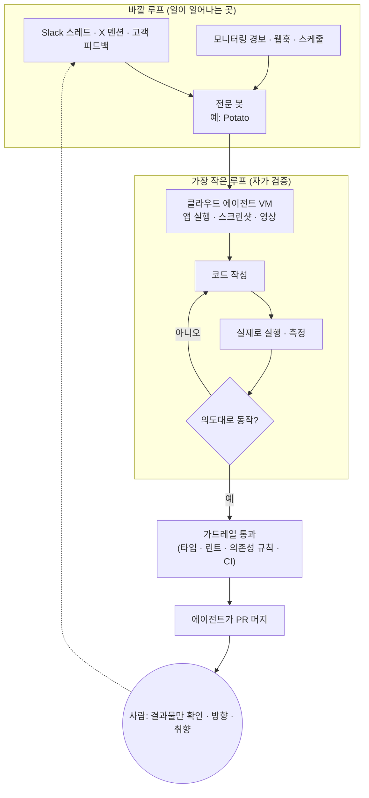
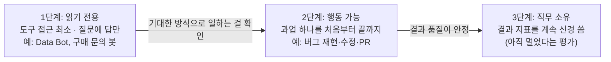
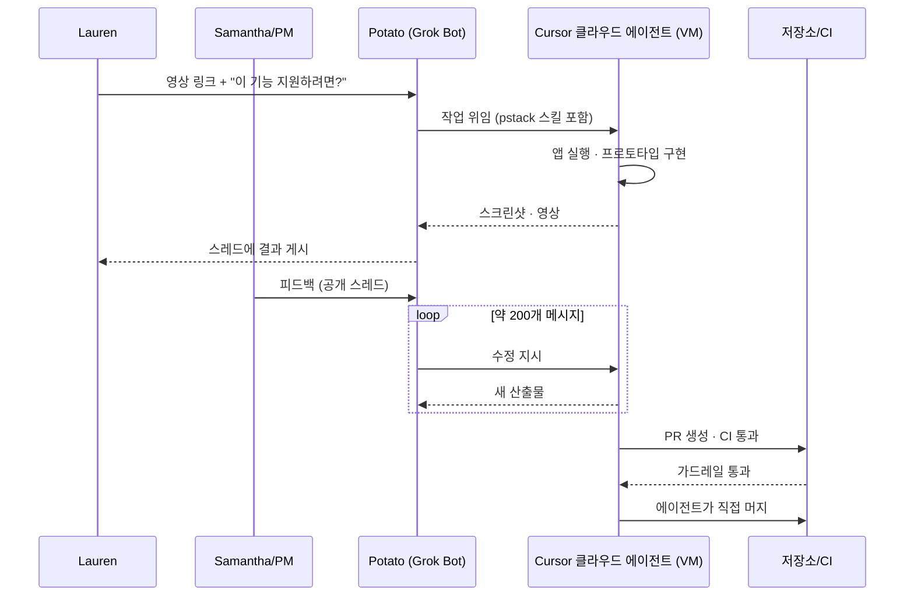
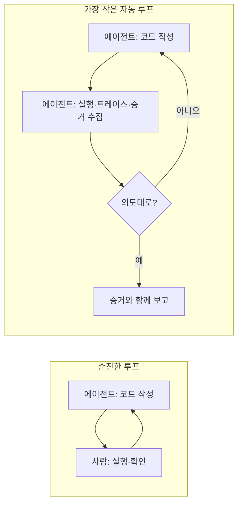
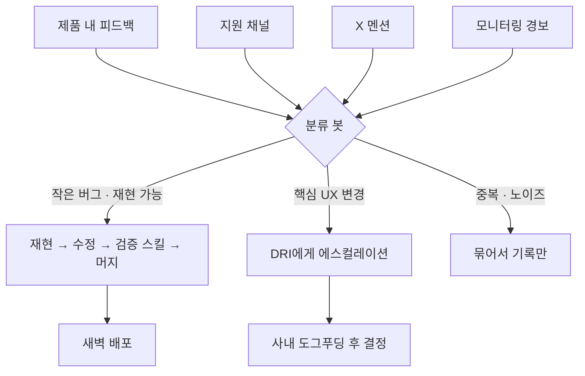
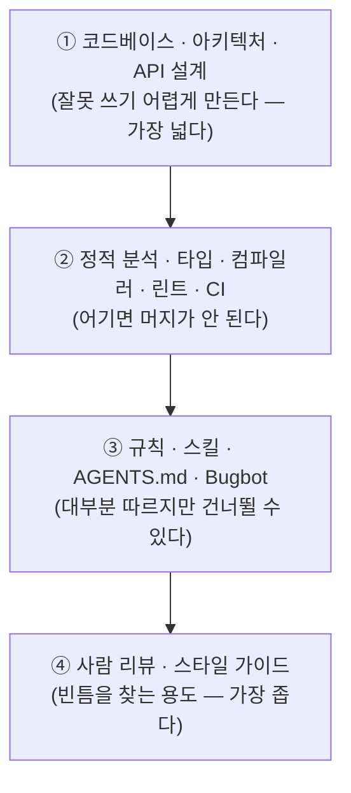
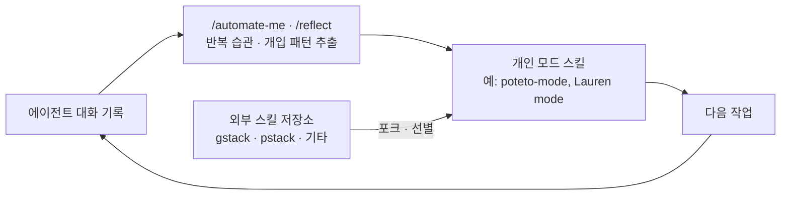

# 한 달 PR 4,000개의 구조: 에이전트 ‘바깥 루프’, 팀 봇, 그리고 소프트웨어 공장에서 ‘모든 것 공장’으로

### 코딩 에이전트가 코드를 잘 쓰는 단계는 이미 지났다. 이제 병목은 맥락을 모으는 ‘바깥 루프’, 에이전트가 자기 결과를 직접 확인하는 ‘가장 작은 루프’, 그리고 리뷰 토큰 대신 규칙을 코드베이스에 박아 두는 ‘거꾸로 된 피라미드’다. Grok Bot 팀의 Lauren Tan(poteto)과 Roman Ugarte가 밝힌 작업 방식을 공식 문서·오픈소스 스킬 저장소와 맞춰 보며, 한 사람이 한 달에 PR 4,000개를 내는 구조를 뜯어 본다


xAI의 에이전트 제품 [Grok Bot](https://docs.x.ai/grok-bot/overview)을 만드는 엔지니어 **Lauren Tan**(온라인 핸들 poteto, React 코어 팀 출신)과 **Roman Ugarte**(Cursor에서 Growth를 이끌었다)가 2026년 11월 14일 Y Combinator의 Garry Tan 등과 함께 [From Software Factories to Everything Factories](https://podscan.fm/e/ep_g9m8rab4lnq4xz2q)라는 주제로 자기들의 작업 방식을 공개했다. 이 글은 그 발언을 뼈대로 삼고, Lauren Tan이 공개한 스킬 묶음 [pstack](https://github.com/cursor/plugins/tree/main/pstack), xAI의 [Team Bots 공지](https://x.ai/news/team-bots)와 [문서](https://docs.x.ai/grok-bot/team-bots), Garry Tan의 [gstack](https://github.com/garrytan/gstack), Steve Yegge의 [Gas Town](https://github.com/steveyegge/gastown), Jack Dorsey·Roelof Botha의 조직론까지 붙여 하나의 작업 모델로 다시 정리한다.

> **PR 4,000개, 리뷰 토큰 5,000만 개 같은 숫자는 당사자 본인의 말이며 제3자 검증은 없다.** 사내 봇(Potato, Data Bot, Sandy 등)의 내부 구현은 공개되지 않았다. 아래의 코드·설정 예시는 설명을 위해 새로 만든 재구성이고, 실제 Grok Bot이나 Cursor 내부 코드가 아니다.

## 1. 한눈에 보기

모델 출시 소식이 아니라 **에이전트를 여러 개 굴릴 때 사람이 설계해야 하는 루프·권한·검증 구조** 이야기다.

| 항목 | 내용 |
|---|---|
| 출처 | Y Combinator, 2026-11-14 (Lauren Tan·Roman Ugarte·Garry Tan) |
| 인물 | Lauren Tan(Grok Bot 엔지니어, pstack 작성자), Roman Ugarte(Grok Bot), Garry Tan(YC) |
| 핵심 숫자 | Lauren Tan 본인 기준 월 PR 약 2,000개(2026년 9월, 조회 400만 회를 넘긴 작업 방식 공개 당시) → 약 4,000개(11월) |
| 핵심 개념 | 바깥 루프, 팀 봇, 신뢰 사다리, 가장 작은 루프(자가 검증), 거꾸로 된 피라미드 |
| 공개 자료 | pstack(MIT, Cursor 플러그인), gstack, Grok Bot 문서, Team Bots 공지(2026-09-28), YC qm |

| 층위 | 질문 | 답(이 글의 요지) |
|---|---|---|
| 맥락 수집 | 에이전트에게 일감과 맥락을 누가 옮기나 | 사람이 복사·붙여넣기 하지 말고, **봇이 Slack·X·메일 등 일이 일어나는 곳에 들어가 있게** 한다 |
| 봇 분할 | 봇 하나 vs 여러 개 | 정답은 없다. **한 가지 문제를 집요하게 신경 쓰는 전문 봇**이 사람 조직과 잘 맞는다 |
| 권한 | 봇에 어떤 권한을 주나 | “사람을 채용하면 어떻게 하나”를 그대로 따른다. **읽기 전용부터** 시작해 넓힌다 |
| 가장 작은 루프 | 무엇부터 자동화하나 | 코드 작성이 아니라 **실행·검증**. 에이전트가 자기 작업을 직접 돌려 보게 한다 |
| 바깥 루프 | 사람이 빠지면 무엇이 일을 시작하나 | 경보·피드백·웹훅이 봇을 깨우고, 같은 검증 스킬로 재현→수정→머지 |
| 리뷰 비용 | 리뷰에 토큰을 얼마나 쓰나 | 리뷰 토큰을 늘리지 말고 **규칙을 아키텍처·린트·CI로 내린다** |
| 사람의 몫 | 실행이 싸지면 무엇이 희소해지나 | 목표 정의, 의도 명세, 그리고 **‘아니요’라고 말하는 취향** |



## 2. 용어부터: 안쪽 루프, 바깥 루프, 공장

이 분야는 용어가 빠르게 만들어지고 사람마다 뜻이 조금씩 다르다. 이 글에서 쓰는 뜻을 먼저 고정한다.

| 용어 | 이 글에서의 뜻 | 쉽게 말하면 |
|---|---|---|
| **안쪽 루프(inner loop)** | 코드를 쓰고, 돌리고, 고치는 반복. 원래는 개발자 한 명의 편집기 안에서 일어나던 일 | 요리사가 간을 보며 냄비를 젓는 손놀림 |
| **바깥 루프(outer loop)** | 무엇을 만들지 정하고, 맥락을 모으고, 결과를 배포·관측하고, 다음 일감을 찾는 반복 | 주문을 받고 재료를 들여오고 손님 반응을 보는 일 |
| **마지막 1마일(last mile)** | 대화·이슈에 흩어진 맥락을 에이전트 입력으로 옮기는 마지막 수작업 | 택배가 동네까지 와도 문 앞까지는 누가 들어야 한다 |
| **스킬(skill)** | 에이전트가 따라 할 절차를 적은 파일(보통 `SKILL.md`). 도구 사용법·체크리스트·판단 기준을 담는다 | 신입에게 주는 업무 매뉴얼 한 장 |
| **루프(Grok Bot의 schedule)** | 스킬을 일정이나 이벤트에 걸어 반복 실행하는 것. Garry Tan은 “스킬 파일 위에 웹훅을 얹은 크론”이라고 표현됐다 | 알람이 울리면 매뉴얼대로 하는 당번 |
| **소프트웨어 공장(software factory)** | 사람이 일일이 지켜보지 않아도 여러 에이전트가 코드를 생산·검증·병합하는 체계 | 요리사 대신 주방 전체가 돌아가는 구조 |
| **모든 것 공장(everything factory)** | 같은 구조를 영업·고객지원·회계 같은 비개발 직무로 넓힌 것 | 주방뿐 아니라 홀·계산대·구매도 같은 방식으로 |
| **DRI** | Directly Responsible Individual. 한 결과에 책임지는 단 한 사람 | “이 일은 누구 거냐”에 답하는 이름 |

> **비유 상자: 주방장과 칼 세트**
> Lauren Tan은 개인 스킬 묶음을 **요리사의 칼 세트**에 비유한다. 요리사는 새 식당에 갈 때 자기 칼을 들고 간다. 칼(스킬)은 주방(코드베이스)마다 바뀌지 않는 손에 익은 도구이고, 주방의 동선·규칙(아키텍처·린트·CI)은 식당이 정한다. 에이전트 생산성은 칼이 좋아서만 나오지 않는다. **주방이 실수를 구조적으로 막아 줄 때** 칼을 빠르게 쓸 수 있다.

“소프트웨어 공장”이라는 말은 Steve Yegge가 2026년 1월 1일 공개한 다중 에이전트 오케스트레이터 [Gas Town](https://github.com/steveyegge/gastown) 이후 널리 퍼졌다. Gas Town은 코딩 에이전트 20~30개를 같은 코드베이스에서 병렬로 돌리고, 작업·수정·머지 요청을 Beads라는 원장에 기록하는 체계다. 그 공장들이 주로 **안쪽 루프**를 자동화했다면, Grok Bot 쪽 주장은 그 바깥, 즉 **맥락이 생기는 곳과 일이 끝나는 곳**까지 봇이 들어가야 한다는 것이다.

## 3. 봇은 몇 개로, 어떻게 나누나

### 3.1 가로 자르기 vs 세로 자르기

봇을 나누는 방식은 크게 두 가지다.

| 방식 | 예 | 장점 | 단점 |
|---|---|---|---|
| **직무별(가로)** | 엔지니어 봇, 마케터 봇, 데이터 봇 | 직무별 스킬·도구가 한곳에 모인다. 여러 고객에 재사용 | 한 고객의 전체 맥락은 흩어진다 |
| **대상별(세로)** | 고객사 A 전담 봇, 고객사 B 전담 봇 | 한 대상의 모든 맥락이 한 봇에 쌓인다 | 직무별 노하우가 봇마다 중복된다 |
| **봇 하나** | OpenClaw 같은 개인 비서 하나 | 단순하다. 모든 맥락을 한 봇이 안다 | 맥락 창이 섞이고, 스킬이 비대해진다 |

Grok Bot 문서상 봇은 각자 **자기 맥락과 자기 스킬 묶음**을 가진다([Grok Bot 개요](https://docs.x.ai/grok-bot/overview)). 그래서 봇을 나누는 일은 곧 **맥락 창을 나누는 일**이다. 한 봇에 모든 일을 몰면 서로 상관없는 메모·스킬·대화가 한 맥락 창에서 경쟁한다.

모든 봇을 팀 공간에 넣을 필요도 없다. Lauren Tan은 엔지니어링 봇은 Slack에 두지만, 점심 메뉴를 골라 주거나 메일을 살피는 **개인 비서 봇**은 Slack에 넣지 않는다. 기준은 단순하다. 그 일의 맥락이 팀 대화에 있으면 팀 공간에, 개인에게만 있으면 개인 공간에 둔다.

### 3.2 “한 가지를 집요하게 신경 쓰는 봇”

Roman Ugarte의 설계 원칙은 채용 원칙과 같다. 회사는 “샤워하면서도 출근길에도 그 문제만 생각하는 사람”을 뽑고 싶어 한다. 동시에 백 가지를 신경 쓰는 슈퍼스타 한 명보다, **각자 한 문제를 맡아 먼저 찾아오는 작은 팀**이 머릿속에서 관리하기 쉽다는 것이다. 이 관점에서 봇은 다음 세 가지를 갖춰야 한다.

1. **하나의 사업 문제**: “고객 문의 분류”, “데이터 질의 응답”, “성능 회귀 감시”처럼 범위가 좁다.
2. **그 문제를 가장 잘 아는 사람**: 봇의 관리자다. 봇은 그 사람의 **도제(apprentice)** 처럼 배운다.
3. **능동성**: 물어볼 때만 답하지 않고, 발견한 것을 먼저 가져온다. Grok Bot 문서는 스스로를 “proactive AI teammate”라고 소개한다.

흥미로운 관찰도 있었다. 초기 열성 사용자 중 상당수가 **소상공인**이었다는 것이다. 채용이 가장 어려운 쪽이 가장 절박하게 쓴다. 회계·장부 정리처럼 사람을 구하기 어려운 업무를 몇 시간 만에 봇 “직원”으로 채운다는 설명이다(장부 처리 정확도에 대한 수치는 제시되지 않았다).

## 4. 팀 봇, 정체성, 권한

### 4.1 Team Bots: 한 사람이 만들고 팀이 같이 쓴다

xAI는 2026년 9월 28일 [Team Bots](https://x.ai/news/team-bots)를 공개 베타로 냈다(Teams·Enterprise 플랜). 공지와 [문서](https://docs.x.ai/grok-bot/team-bots)에서 확인되는 구조는 다음과 같다.

| 요소 | 내용 |
|---|---|
| 역할 | **소유자(owner)**, **관리자(Manager)**, **협업자(Collaborator)** |
| 공유 자원 | 소유자·관리자가 넣은 시크릿·앱·파일은 모든 팀원 대화에서 쓸 수 있다 |
| 학습 검토 | 협업자가 가르친 내용은 **Review learnings**에서 소유자·관리자가 승인해야 팀 지식이 된다 |
| 팀 스킬 | 팀 스킬은 **소유자만** 저장한다. 팀원이 자기 대화에서 가르친 절차는 그 사람 메모로 남는다 |
| 프라이버시 | 사용자별 대화·맥락·기억은 분리된다 |
| Slack | 팀 봇마다 자기 핸들이 있어 채널에 초대할 수 있다 |
| 사례(공지 기준) | 엔지니어링 팀 봇이 5인 팀의 **하루 100개 이상 PR**을 도왔다고 xAI가 주장 |

사내에서 이런 봇을 만드는 사람은 주로 **빌더 기질의 한 명**이다. 엔지니어링 조직에는 원래 많고, GTM 엔지니어·서포트 엔지니어처럼 다른 부서에도 있다. 이들이 하루 몇 시간을 들여 동료 수십 명의 반복 업무를 덜어 주는 자동화를 만든다. 영업팀은 리드·딜 리서치와 영업 운영 업무를 **공유 전문 봇**에 맡기고, 팀원 모두가 그 봇에 노하우를 보탠다. 한 사람마다 봇을 하나씩 두는 것이 아니라, **팀의 모범 사례가 쌓이는 봇 하나**를 같이 키우는 구조다.

### 4.2 Slack에 들어온 봇은 누구 말을 들어야 하나

멀티플레이어 AI의 가장 큰 미해결 문제는 **사회적 맥락**이다. 여러 사람이 오가는 Slack 스레드에서 봇은 누가 도메인 전문가인지, 누가 결정권자인지 모른다. “EQ도 눈치도 없는 신입을 온보딩하는 것과 같다”는 표현이 정확하다. 모델도 하네스(harness, 모델을 감싸 도구·권한·대화를 연결하는 실행 틀)도 그렇게 만들어지지 않았다. 해법은 세 층에서 동시에 나와야 한다.

- **제품 층**: 소유자·관리자·협업자 같은 역할 메타데이터를 봇이 읽게 한다.
- **하네스 층**: 지시가 충돌할 때 누구를 우선할지, 언제 소유자에게 확인할지를 규칙으로 둔다.
- **모델 층**: 다자 대화에서 화자의 권한·전문성을 추론하도록 학습한다.

### 4.3 “사람이라면 어떻게 하겠나”

인증(authentication, 누구인지 확인)과 인가(authorization, 무엇을 해도 되는지 결정)에 대해 업계 전체에 정답은 아직 없다. Grok Bot 팀의 기준은 단순하다. **사람을 채용할 때 하는 일을 그대로 한다.** 컴퓨터를 주고, 역할과 연차에 맞춰 범위를 좁힌 자격 증명을 주고, 신뢰가 쌓이면 접근 범위를 넓힌다. 기존 IAM을 다시 만들지 않아도 된다는 장점도 있다.

YC 쪽에서 언급된 다른 방식은 **사용자 권한 상속**이다. 봇이 Slack 채널이나 특정 사람과 일할 때 그 사용자의 권한을 물려받는다. 파트너와 엔지니어가 같은 봇을 불러도 접근 범위가 달라진다. 예로 든 것이 YC가 2026년 7월 말 MIT 라이선스로 공개한 [qm](https://github.com/yc-software/qm)(Quartermaster의 줄임말)이다. Slack과 웹에서 도는 “멀티플레이어 에이전트 하네스”로, Claude Code·Codex·OpenCode 같은 코딩 에이전트를 붙이고 사람·채널(room)마다 메모리·파일·키체인·권한·크론·샌드박스를 분리한다([MarkTechPost 정리](https://www.marktechpost.com/2026/08/03/y-combinator-open-sources-qm-multiplayer-ai-agent-harness/)). 다만 Roman Ugarte가 짚었듯 qm은 **한 명의 슈퍼 직원 봇**을 전제로 한 설계이고, Grok Bot은 **여러 전문 봇의 무리**를 전제로 한다. 두 방식의 차이는 이렇다.

| 방식 | 권한의 주체 | 적합한 경우 | 위험 |
|---|---|---|---|
| 봇 고유 정체성 | 봇 자신(직원처럼) | 팀 봇, 장기 실행, 감사 추적 | 봇 계정이 과권한을 누적하기 쉽다 |
| 사용자 권한 상속 | 호출한 사람 | 슈퍼 비서형 단일 봇 | 혼동된 대리인(confused deputy) 문제, 다자 스레드에서 누구 권한인지 모호 |

### 4.4 신뢰 사다리: 읽기 전용부터

신뢰는 작은 것부터 쌓인다. Roman Ugarte가 제시한 세 단계를 정리하면 다음과 같다.



1단계의 대표 사례가 **Data Bot**이다. 데이터 사이언스 팀은 “이 기능 출시를 고민 중인데 빠르게 분석해 줄 수 있나” 같은 Slack 메시지를 끝없이 받았다. 그래서 데이터베이스 **읽기 권한만** 가진 봇을 만들어 Slack에 넣었다. xAI 공지도 Data Bot을 “승인된 테이블에 대한 읽기 전용 쿼리”로 답하고 교정을 받아 배우는 봇으로 소개한다. 읽기 전용 봇은 권한을 **DB 역할로** 강제하는 것이 핵심이다. 프롬프트로 “쓰지 마”라고 하는 것과는 다르다.

```sql
-- 재구성 예시: Data Bot 전용 읽기 전용 역할 (PostgreSQL)
CREATE ROLE data_bot LOGIN PASSWORD :'DATA_BOT_PW';   -- 비밀번호는 시크릿 저장소에서 주입
ALTER ROLE data_bot SET default_transaction_read_only = on;
ALTER ROLE data_bot SET statement_timeout = '30s';     -- 폭주 쿼리 차단

GRANT USAGE ON SCHEMA analytics TO data_bot;
GRANT SELECT ON analytics.daily_active_users,
               analytics.feature_events,
               analytics.experiments TO data_bot;      -- '승인된 테이블'만
REVOKE ALL ON SCHEMA billing FROM data_bot;            -- 민감 스키마는 명시적으로 차단
```

이 설계에서는 봇이 실수하더라도 **데이터를 망가뜨릴 수 없다.** 신뢰 사다리의 1단계가 안전한 이유는 봇의 판단이 좋아서가 아니라, 판단이 틀려도 피해 범위(blast radius)가 작기 때문이다.

## 5. 봇끼리 대화하면 생기는 일

Grok Bot에는 봇끼리 대화·협업하는 1급 도구가 있고, 데스크톱·모바일 앱에서 그 대화를 볼 수 있다. 관찰된 장면 몇 가지는 이렇다.

- **감독 봇의 훈육**: “리드 엔지니어 봇”에게 다른 엔지니어 봇들을 감독하라고 맡기고 피드백을 줬더니, 리드 봇이 하위 봇들에게 그 피드백을 전하며 꽤 엄격하게 지적하더라는 일화. 한 번 말하면 **팬아웃(fan-out)** 으로 전체에 퍼진다는 장점이기도 하다.
- **봇 사이의 협업 요청**: Lauren Tan의 개인 엔지니어 봇 Potato에게 “Data Bot이랑 얘기해서 이게 실제 사용자 문제인지, 몇 명이 영향받는지 데이터 가져와”라고 시키면, 두 봇이 Slack 스레드에서 공개적으로 대화한다.
- **사내 봇 포럼**: YC는 사내 코딩 에이전트들이 서로 묻고 답하는 내부 “Stack Overflow” 같은 공간(Moltbook 비슷한 것)을 만들었다고 한다. 사람이 프롬프트를 주지 않아도 긴 대화가 이어진다.

통제 관점에서 중요한 결론은 하나다. **에이전트끼리 공식 통신 채널이 있으면, 에이전트는 뒷채널을 만들기보다 그것을 쓴다.** 그러니 봇 간 통신을 금지하기보다, 기록되고 사람이 볼 수 있는 채널로 **유도**하는 편이 낫다.

위험 쪽 언급도 있었다. “abliterated” 모델은 가중치에서 **거부(refusal) 방향을 제거**한 오픈 모델을 말한다. 기본 성향은 여전히 도움이 되려 하지만, 악의적인 지시를 받으면 거절하지 않는다. 따라서 위험은 모델 단독이 아니라 **거부가 제거된 모델 + 악의적 맥락**의 조합에서 나온다. 팀 봇 환경에서 학습 내용을 소유자·관리자가 승인하게 한 Review learnings 같은 장치가 의미를 갖는 이유다.

## 6. Slack 스레드 하나로 기능을 끝까지

### 6.1 실제 흐름

Lauren Tan이 보여 준 사례는 이렇다. X에서 본 영상 링크를 Potato에게 주고 “이런 기능을 지원하려면 뭐가 필요하지?”라고 물었다. Potato는 **Cursor 클라우드 에이전트**를 띄웠다. 클라우드 에이전트는 자기 가상 머신을 가지므로 Grok Bot 앱을 직접 실행하고, 프로토타입을 만들고, **스크린샷과 영상**을 가져왔다. 동료 Samantha와 PM 한 명이 같은 공개 스레드에서 피드백을 줬고, 약 200개 메시지가 오간 끝에 기능이 완성됐다. 그동안 Lauren Tan은 Cursor 편집기를 한 번도 열지 않았고, **PR도 읽지 않고 산출물(스크린샷·영상)만 봤다.**



### 6.2 무엇이 달라졌나

| 구분 | 혼자 에이전트와 일할 때 | 공개 스레드에서 봇과 일할 때 |
|---|---|---|
| 피드백 시점 | 구현이 끝난 뒤 | 프로토타입 단계부터 |
| 루프 길이 | 길어진다 | 짧아진다 |
| 노하우 전파 | 개인의 비공개 세션에 갇힌다 | 같은 스레드에 있던 사람이 다음 날 같은 방식을 따라 한다 |
| 사람의 확인 대상 | diff | 결과물(스크린샷·영상·지표) |

Garry Tan은 이 방식을 “골드 스탠더드”라 부르며 전 세계 엔지니어 중 이렇게 일하는 사람은 1~10% 정도일 것이라고 추정했다(근거 없는 어림이다). 중요한 단서는 Lauren Tan 본인이 단 말이다. **“하룻밤에 도달하기 어렵다.”** 올바른 스킬, 좋은 가드레일과 제약이 있는 코드베이스, 그리고 사람 코드 리뷰에 쓰던 시간을 **코드베이스·정적 분석·도구에 인코딩해 둔 투자**가 먼저 있어야 에이전트에게 머지를 맡길 수 있다.

## 7. 가장 작은 루프: 에이전트가 스스로 검증하게

### 7.1 빠진 조각은 ‘실행’이다

에이전트를 순진하게 쓰면 흐름은 이렇다. 에이전트가 코드를 쓰고, **사람이** 실행해 보고, 문제를 다시 알려 준다. 이것도 루프이긴 하지만 사람이 그 루프의 한 칸을 메우고 있다. 가장 작은 자동 루프는 그 칸을 에이전트에게 넘기는 것이다.

- 코드를 실제로 **실행**한다(테스트가 아니라 앱 자체).
- **실사용자처럼** 앱을 조작한다(UI 흐름 클릭, CLI 명령 실행).
- **CPU 트레이스·성능 지표**를 직접 수집한다.

에이전트가 자기 작업을 확인할 수 있게 되면, 스스로 문제를 찾고 고치고, 원하는 결과가 나올 때까지 반복한다.



### 7.2 “맞다”와 “좋다”는 다르다

이 루프가 보장하는 것은 **정확성(correctness)**, 즉 원하는 일을 한다는 것까지다. 느리거나 자원을 낭비하는 코드일 수 있다. 그래서 Lauren Tan의 그림에서는 “좋은(good) 코드 작성” 칸을 일부러 지웠다. 엔지니어의 새 일은 **에이전트가 기본값으로 좋은 코드를 쓰게 만드는 것**이고, 그 수단이 뒤에 나올 가드레일과 스킬이다.

직관적인 모델을 하나 세워 보자. **(설명용 가정이며 측정값이 아니다.)** 한 번 시도에서 의도대로 동작할 확률을 $p$라 하고 시도가 독립이라면, 자가 검증 루프를 최대 $k$번 돌 때 성공 확률은

$$
P_{\text{success}}(k) = 1 - (1-p)^k
$$

이다. $p=0.4$여도 $k=5$면 약 $0.92$가 된다. 반대로 **검증 단계가 없으면** 에이전트는 실패를 모르므로 $k$가 사실상 1에 고정된다. 자가 검증의 가치는 모델을 똑똑하게 만드는 데 있지 않다. **재시도 횟수를 의미 있게 만드는 데** 있다. 다만 이 식은 “좋은 코드”에 대해서는 아무 말도 하지 않는다. 검증 기준이 정확성뿐이면 루프는 느린 정답에도 수렴한다.

### 7.3 pstack의 검증 스킬

pstack에는 이 루프를 위한 스킬이 따로 있다([pstack 저장소](https://github.com/cursor/plugins/tree/main/pstack), [Flavio Copes의 해설](https://flaviocopes.com/pstack)).

- `/create-verification-skill`: 프로젝트 전용 `verify-<app>` 스킬을 만든다. 앱 실행, 헬스 체크, 사용자 주도 동작, 증거 수집, 정리(cleanup)를 다룬다.
- `/maintain-verification-skill`: 앱이 정당하게 바뀌면 검증 스킬도 현재 소스에 맞춰 갱신한다.
- 원칙 **prove-it-works**: “컴파일된다”나 “빌드가 초록색”은 증거가 아니다. CLI 변경이면 실제 명령을, UI 변경이면 흐름을, 마이그레이션이면 실제 입력을, 성능이면 트레이스 비교를, 저장소 변경이면 저장된 값을 다시 읽어 확인한다.

아래는 그 형식을 흉내 낸 **재구성 예시**다. Electron 데스크톱 앱을 가정했다.

```markdown
---
name: verify-desktop-app
description: Electron 데스크톱 앱 변경을 실제 실행으로 검증한다. UI·성능 변경 후 반드시 사용.
---

# verify-desktop-app

## 1. 실행
- `pnpm build && pnpm start --remote-debugging-port=9222` 로 앱을 띄운다.
- 30초 안에 메인 창이 뜨지 않으면 FAIL. 로그 마지막 200줄을 첨부한다.

## 2. 헬스 체크
- DevTools Protocol로 `document.readyState === "complete"` 를 확인한다.
- 콘솔 에러가 0개인지 확인한다. 경고는 목록으로 보고한다.

## 3. 사용자 주도 동작 (변경과 맞는 것만)
- 변경된 화면으로 이동해 사용자가 하는 순서대로 클릭·입력한다.
- 각 단계마다 스크린샷을 `./evidence/<step>.png` 로 저장한다.

## 4. 성능 증거 (렌더러를 건드렸다면 필수)
- 핵심 흐름을 돌리며 Performance 트레이스를 기록한다.
- 50ms 이상 Long Task 개수와 최장 시간을 보고한다. 변경 전 커밋과 비교한다.

## 5. 정리
- 앱 프로세스를 종료하고 임시 프로필 디렉터리를 지운다.

## 보고 형식
PASS / ISSUES / BLOCKED 중 하나 + 증거 파일 목록. "아마 될 것"은 PASS가 아니다.
```

## 8. 바깥 루프: 사람이 아니라 경보가 일을 시작한다

가장 작은 루프가 믿을 만해지면 그 위에 바깥 루프를 얹는다. 예를 들어 어떤 지표가 임계값 아래로 떨어지면 경보가 울리고, 그 경보가 Grok Bot이나 Cursor 자동화를 깨운다. 봇은 **가장 작은 루프에서 쓰던 같은 스킬과 도구**로 자기 머신에서 문제를 재현하고, 고치고, 검증한다. 사람은 에이전트마다 붙어 앉아 지켜보는 역할에서 **여러 에이전트를 지휘하는 역할**로 옮겨 간다. Lauren Tan은 한 단계 더 나아가, 하위 에이전트를 관리하는 프로젝트 코디네이터 에이전트마저 봇에게 맡긴다고 했다. 이것은 Cursor가 2026년 9월 베타로 낸 [Projects](https://cursor.com/docs/agent/projects) 기능이다. 공식 문서에 따르면 Project는 기능 하나·마이그레이션·앱 전체 같은 큰 작업 단위이고, 사람은 **코드를 직접 쓰지 않는 코디네이터 에이전트**와 대화하며, 코디네이터는 클라우드 에이전트 위에서 하위 에이전트를 병렬로 돌린다. 병렬 하위 에이전트 수만큼 토큰도 늘어난다는 점은 9장의 비용 문제와 이어진다.

Grok Bot 팀의 실제 예가 **Sandy**다. 제품 내 피드백, 지원 채널, X 등에서 하루 수천 건의 고객 피드백을 받아, 작은 버그는 재현→수정→머지까지 사람 개입 없이 처리한다. “새벽 3시에 자동으로 나간다.” xAI 공지가 소개한 고객 성공팀 사례도 같은 구조다. 분당 수백 건의 고객 메시지를 분류해 담당자에게 배정하고, 봇이 끝까지 처리할 수 있는 것은 처리하고 나머지만 DRI에게 넘긴다.



경보와 봇을 잇는 부분은 평범한 웹훅이다. 아래는 **재구성 예시**다. 실제 Grok Bot 웹훅 형식은 문서에서 확인해야 한다(pstack의 `make-bot-ui` 스킬이 “웹훅으로 Grok Bot을 트리거하는 페이지”를 만든다는 점에서 웹훅 트리거 자체는 지원되는 것으로 보인다).

```typescript
// 재구성 예시: 모니터링 경보를 받아 봇 작업으로 바꾸는 얇은 어댑터
import { createHmac, timingSafeEqual } from "node:crypto";

type Alert = { metric: string; value: number; threshold: number; dashboardUrl: string; commit: string };

const BOT_WEBHOOK_URL = process.env.BOT_WEBHOOK_URL!;   // 봇 쪽에서 발급한 트리거 URL
const ALERT_SECRET = process.env.ALERT_SECRET!;

function verify(body: string, signature: string): boolean {
  const expected = createHmac("sha256", ALERT_SECRET).update(body).digest("hex");
  return signature.length === expected.length &&
    timingSafeEqual(Buffer.from(signature), Buffer.from(expected));
}

export async function handleAlert(rawBody: string, signature: string): Promise<Response> {
  if (!verify(rawBody, signature)) return new Response("bad signature", { status: 401 });
  const a: Alert = JSON.parse(rawBody);

  // 봇에게는 '무엇을 하라'가 아니라 '어떤 스킬로, 어떤 완료 조건까지'를 준다.
  const task = [
    `경보: ${a.metric}=${a.value} (임계값 ${a.threshold}), 커밋 ${a.commit}`,
    `대시보드: ${a.dashboardUrl}`,
    "1) verify-desktop-app 스킬로 로컬에서 재현하라. 재현 못 하면 BLOCKED로 보고하고 멈춰라.",
    "2) 원인을 고치고 같은 스킬로 지표가 임계값 위로 돌아온 증거를 첨부하라.",
    "3) CI가 통과하면 PR을 열어라. 핵심 UX 파일(src/ui/core/**)을 건드렸다면 머지하지 말고 DRI를 멘션하라.",
  ].join("\n");

  await fetch(BOT_WEBHOOK_URL, {
    method: "POST",
    headers: { "content-type": "application/json" },
    body: JSON.stringify({ message: task }),
  });
  return new Response("queued", { status: 202 });
}
```

여기서 3번 줄이 중요하다. **에이전트 자율 머지의 범위를 경로로 제한**하는 것이 다음 절의 “취향” 문제와 연결된다.

## 9. 리뷰에 토큰을 얼마나 써야 하나

### 9.1 5,000만 토큰짜리 리뷰

Garry Tan은 gstack의 `/ship` 스킬이 변경된 모든 줄을 검토하며 버그를 잡는데, 한 번에 **수천만 토큰**을 쓴다고 털어놨다. 리뷰 한 번에 5,000만 토큰에서 1,000만 토큰으로 줄이고 싶었지만, 그의 오케스트레이터(Cappy의 “captain”)는 30가지 버그 유형을 잡는 홀드아웃 평가 결과를 근거로 “1,000만으로는 안 되고 3,000만은 필요하다”고 버텼다고 한다. 토큰 단가를 $c$(달러/백만 토큰), 리뷰당 토큰을 $T$(백만 단위), 월 PR 수를 $N$이라 하면 월 리뷰 비용은 단순히

$$
\text{Cost}_{\text{review}} = c \cdot T \cdot N
$$

이다. 예를 들어 **가정값** $c=\$3$, $T=30$, $N=4{,}000$이면 월 36만 달러다. 숫자 자체는 단가에 따라 크게 달라지지만, 요점은 분명하다. **리뷰 토큰은 PR 수에 정비례한다.** PR이 늘수록 “리뷰를 더 꼼꼼히”는 선형으로 비싸진다.

### 9.2 다중 모델 적대적 리뷰의 함정

pstack에는 `/interrogate`가 있다. diff와 의도, 리뷰 규칙을 **서로 다른 모델 계열**에 보내고, 리드 리뷰어가 중복을 걸러 “act on / consider / noted / dismissed” 네 칸으로 나눈다. 리드는 파일을 고치지 않는다. 그런데 Lauren Tan은 최근 이런 리뷰 스킬의 비중을 **일부러 줄였다**고 말한다. 이유는 **과적합(overfitting)** 이다.

- 리뷰 에이전트는 어떤 피드백이 정말 중요한지 가릴 판단력이 부족할 수 있다.
- 제품의 목표·의도·앞으로의 방향을 전부 알지 못한다.
- 그래서 “두 달 뒤 폐기할 코드”를 두고 이상적인 설계를 놓고 토론하는, 사람 팀에서도 흔한 낭비가 일어난다.

Garry Tan이 즉석에서 떠올린 대안도 같은 방향이다. gstack의 office hours나 CEO 리뷰 단계에서 나온 제품 요구사항이 Markdown으로 프로젝트에 저장되니, 리뷰 스킬이 그것을 읽고 **“실제로 고칠 버그”와 “0.1% 확률로만 생기는 무의미한 정확성 문제”** 를 구분하게 하자는 것이다. 리뷰의 기준을 **제품 의도**에 묶는 셈이다.

참고로 Garry Tan은 여전히 계획 모드(plan mode)와 계획 스킬을 쓰지만, Lauren Tan은 **“어디서도 계획하지 않는다”** 고 답했다. 별도의 계획 단계 대신 pstack의 플레이북과 자가 검증 루프, 코드베이스 가드레일이 그 역할을 나눠 맡는다는 뜻으로 읽힌다.

### 9.3 거꾸로 된 피라미드: 코드베이스가 기억이다

Lauren Tan의 핵심 그림은 **거꾸로 된 피라미드**다. 위가 넓고 아래가 좁다. 넓을수록 엔지니어가 시간을 더 쓰는 곳이고, 위에 있을수록 **강제력이 강하고 토큰이 안 든다.** 2026년 9월 발표를 정리한 [해설](https://redreamality.com/blog/lauren-tan-poteto-trust-before-parallel/)에 따르면 층은 대략 다음 순서다.



| 층 | 강제력 | 매 PR 토큰 비용 | 무엇을 넣나 |
|---|---|---|---|
| ① 아키텍처 | 구조적으로 불가능하게 | 0 | 모듈 경계, 타입으로 표현한 도메인, 잘못 쓰기 어려운 API |
| ② 정적 분석 | 기계적 강제 | 0(CI 연산만) | 린트 규칙, 의존성 그래프 검사, 타입 검사 |
| ③ 규칙·스킬 | 권고(에이전트가 건너뛸 수 있음) | 맥락에 실리는 만큼 | 작업 절차, 판단 기준, 리뷰 봇 |
| ④ 사람 리뷰 | 사람 판단 | 사람 시간 | 인프라·DB·배포처럼 민감한 부분, 그리고 **새로 드러난 빈틈** |

원리는 이렇다. 프로그래밍 언어·컴파일러·린터는 원래 **사람이 좋은 코드를 쓰도록 돕기 위해** 존재했다. 당연히 에이전트에게도 똑같이 도움이 된다. 리뷰에서 반복해 지적하는 문제를 ①·②층으로 내리면, 그 문제는 **다시는 토큰을 쓰지 않아도 되는 문제**가 된다. 그래서 “코드베이스는 기억의 한 형태”라는 말이 나온다. 대화 기억은 사라지지만, 린트 규칙은 모든 미래의 에이전트 세션에 공짜로 적용된다.

다만 모든 것을 내리라는 뜻은 아니다. 인프라·데이터베이스·배포처럼 **민감한 영역은 여전히 사람이 루프에 남는 편이 낫다**는 단서가 붙는다. Lauren Tan 스스로도 이 그림을 “과학적인 도표는 아니다”라고 했다. 층의 폭은 측정값이 아니라 **엔지니어가 시간을 어디에 쓰는지**에 대한 권고다.

### 9.4 빠르고, 싸고, 좋게: 셋 다 고를 수 있나

예전에는 “빠르다·싸다·품질이 좋다 중 둘만 고를 수 있다”는 말이 통했다. Garry Tan은 이제 셋 다 가능하다고 주장했고, Lauren Tan은 “가능하지만 쉽게 도달하지는 않는다”고 답했다. 근거는 두 가지다.

- **피라미드가 토큰을 줄인다.** 일상적인 엔지니어링 작업은 ①·②층에 기대면 매번 비싼 리뷰를 돌릴 필요가 없다.
- **지능의 단가가 내려간다.** 프런티어 모델의 토큰 하나가 1년 전 토큰보다 훨씬 많은 일을 하고, 지금의 작은 모델이 1년 전의 큰 모델보다 낫다. 같은 일을 하는 데 필요한 $T$(리뷰당 토큰)나 $c$(단가)가 함께 내려가는 효과가 있다.

주의할 점도 있다. Lauren Tan은 **토큰 제한이 사실상 없는 연구소**에서 일하며, 스스로를 “6개월~1년 뒤의 소프트웨어 엔지니어링을 먼저 탐험하는 사람”이라고 표현했다. 토큰 예산이 빠듯한 팀이 같은 방식을 그대로 따라 하면 비용이 먼저 터진다. 그래서 순서가 중요하다. **피라미드 위층에 먼저 투자해 토큰이 덜 드는 구조를 만든 뒤** 병렬 에이전트 수를 늘려야 한다.

## 10. 린트 규칙 하나로 없앤 성능 문제

### 10.1 Electron 렌더러와 프레임 예산

Grok Bot 데스크톱 앱은 Electron 앱이다. Electron은 Node.js가 도는 **메인 프로세스**와 Chromium 페이지가 도는 **렌더러 프로세스**로 나뉜다. 렌더러의 메인 스레드가 오래 걸리는 작업에 막히면 스크롤·입력·애니메이션이 끊긴다(“janky”). [Electron 성능 문서](https://www.electronjs.org/docs/latest/tutorial/performance)도 메인 프로세스를 오래 걸리는 작업으로 막지 말라고 하고, 렌더러는 60fps 애니메이션에 필요한 자원을 빼앗지 않게 하라고 한다.

프레임 예산은 단순한 나눗셈이다.

$$
t_{\text{frame}} = \frac{1000\ \text{ms}}{\text{FPS}}, \qquad t_{60} \approx 16.7\ \text{ms}, \qquad t_{120} \approx 8.3\ \text{ms}
$$

이 시간 안에 스크립트·레이아웃·페인트가 모두 끝나야 한다. Cursor를 만들며 얻은 교훈이 “렌더러는 긴 작업에 매우 민감하다”였다.

### 10.2 시간을 재는 게 아니라 import를 막는다

여기서 흥미로운 점은, 정적 분석이 **실행 시간을 알 수는 없다**는 것이다. 그래서 Grok Bot 팀은 질문을 바꿨다. “이 코드가 오래 걸리나?”를 리뷰하는 대신, **메인 쪽 코드와 렌더러 쪽 코드 사이의 import 자체를 금지**했다. 무거운 작업은 대개 메인 쪽 모듈에 있으니, 경계를 넘는 import가 불가능하면 렌더러에 무거운 코드가 섞여 들어갈 길이 구조적으로 막힌다. 그리고 이것을 **의존성 그래프 검사기 + CI**로 강제했다. 결과적으로 이 앱의 성능은 대부분 AI가 쓴 코드인데도 일관되게 유지됐다고 한다(측정값은 공개되지 않았다). 처음엔 빠르다가 시간이 갈수록 쓰레기 코드(slop)와 성능 문제가 쌓이는 흔한 AI 앱의 궤적과 반대라는 주장이다.

아래는 같은 아이디어를 공개 도구로 구현한 **재구성 예시**다. 실제 팀 구현(자체 의존성 그래프 검사기)과는 다를 수 있다.

```javascript
// eslint.config.js — 재구성 예시: 프로세스 경계를 넘는 import 금지
export default [
  {
    files: ["src/renderer/**/*.{ts,tsx}"],
    rules: {
      "no-restricted-imports": ["error", {
        patterns: [{
          group: ["**/main/**", "electron/main", "node:fs", "node:child_process"],
          message: "렌더러에서 메인 프로세스 코드·무거운 Node API를 import하지 마세요. preload/IPC를 거치세요.",
        }],
      }],
    },
  },
  {
    files: ["src/main/**/*.ts"],
    rules: {
      "no-restricted-imports": ["error", {
        patterns: [{ group: ["**/renderer/**"], message: "메인에서 렌더러 코드를 import하지 마세요." }],
      }],
    },
  },
];
```

```javascript
// .dependency-cruiser.cjs — 재구성 예시: 간접 import(전이 의존)까지 그래프로 검사
module.exports = {
  forbidden: [
    {
      name: "renderer-must-not-reach-main",
      severity: "error",
      comment: "렌더러 → 메인 경로는 직접이든 간접이든 금지 (긴 작업이 렌더러로 새는 것을 차단)",
      from: { path: "^src/renderer" },
      to: { path: "^src/main", reachable: true },
    },
    {
      name: "main-must-not-reach-renderer",
      severity: "error",
      from: { path: "^src/main" },
      to: { path: "^src/renderer", reachable: true },
    },
  ],
};
```

```yaml
# .github/workflows/guardrails.yml — 재구성 예시: 규칙을 CI에서 강제
name: guardrails
on: [pull_request]
jobs:
  boundaries:
    runs-on: ubuntu-latest
    steps:
      - uses: actions/checkout@v4
      - uses: pnpm/action-setup@v4
      - run: pnpm install --frozen-lockfile
      - run: pnpm eslint .
      - run: pnpm depcruise src --config .dependency-cruiser.cjs
```

`no-restricted-imports`만으로는 A→B→C처럼 **중간 모듈을 거친 간접 의존**을 못 잡는다. 의존성 그래프 검사기가 필요한 이유다. 이 규칙이 CI에 들어간 순간 “렌더러에서 긴 작업을 하지 마라”는 리뷰 코멘트는 **영원히 필요 없어진다.** Lauren Tan의 표현대로 “더 이상 쓰지 않아도 되는 토큰”이다.

## 11. pstack과 gstack: 나만의 칼 세트

### 11.1 두 스킬 묶음

| 항목 | pstack | gstack |
|---|---|---|
| 작성자 | Lauren Tan(poteto) | Garry Tan(YC) |
| 배포 | [cursor/plugins](https://github.com/cursor/plugins/tree/main/pstack), MIT | [garrytan/gstack](https://github.com/garrytan/gstack) |
| 기본 대상 | Cursor 플러그인(`SKILL.md`는 Claude Code·Codex에서도 로드) | Claude Code(`--host`로 Codex·Cursor 등 지원) |
| 설치 | Cursor: `/add-plugin pstack` → `/setup-pstack` | `~/.claude/skills/gstack`에 clone 후 `./setup` |
| 성격 | 엔지니어링 엄밀성, **코드를 덜 쓰기**, 증명 중심 | 스프린트 역할별 슬래시 커맨드(제품 리뷰·엔지니어링 리뷰·배포 등) |
| 대표 스킬 | `/poteto-mode`, `/how`, `/why`, `/architect`, `/arena`, `/swarm`, `/interrogate`, 검증 스킬 | `/office-hours`, `/plan-ceo-review`, `/plan-eng-review`, `/review`, `/ship`, `/qa` |

pstack의 진입점 `/poteto-mode`는 작업을 22개 플레이북(조사, 버그 수정, 성능, 기능, 리팩터링, 배포, 오토파일럿 등) 중 하나에 맞추고, 원칙 색인을 읽고, 단계를 작업 목록으로 옮긴 뒤 **모델 역할별로**(구현·조사·판단·리뷰) 위임한다. `/setup-pstack`이 사용 가능한 모델을 역할에 배정한다. 원칙 중에는 Laziness Protocol, Subtract Before You Add, Prove It Works, Guard the Context Window 같은 것이 있다. 정확한 스킬·원칙 개수는 버전마다 바뀌므로 저장소에서 확인하는 것이 좋다.

```bash
# Cursor
/add-plugin pstack
/setup-pstack            # 모델을 역할(구현/조사/판단/리뷰)에 배정

# Claude Code (공식 README 기준)
/plugin marketplace add cursor/plugins
/plugin install pstack@cursor-plugins
```

pstack은 gstack에서 영감을 받았고, gstack도 pstack에서 아이디어를 가져온다. 서로를 포크하며 진화하는 관계다. Lauren Tan의 권고는 명확하다. **남의 스택을 그대로 쓰지 말고 포크해서 자기 스택을 만들어라.** 이유는 신뢰다. 자기 도구를 믿을 때 사람도 에이전트도 더 많은 일을 맡길 수 있다. 사내에는 pstack의 내부판(“Lauren mode”)이 저장소에 설치돼 있고, 봇이 띄우는 클라우드 에이전트도 같은 스킬을 쓴다. **봇 쪽과 편집기 쪽의 스킬이 같다**는 점이 Slack 스레드만으로 기능을 끝낼 수 있는 전제다.

### 11.2 스킬은 기억에서 자란다

Garry Tan의 오케스트레이터 Cappy는 10~15개 스레드를 상시 돌리며, 그중 하나가 “밖에서 좋은 스킬(Theo(theo.gg)의 T-stack, pstack, 디자인 도구 등)을 찾아 나에게 맞게 가져오기”를 한다. 더 흥미로운 것은 **대화 기록에서 사용자를 배운다**는 부분이다. 언제 개입하고, 언제 “그냥 해”라고 하는지가 기록에 남으니, 쓸수록 무엇을 원하는지 더 잘 안다. pstack의 `/automate-me`(대화 기록에서 반복 습관을 캐내 개인 모드 스킬을 생성)와 `/reflect`(기록을 리뷰어에게 보내 개선안을 승인·거절·보류로 분류)가 같은 발상을 스킬로 만든 것이다.



## 12. 소프트웨어 공장 vs 회사 전체 공장

코딩에서 된 것이 다른 직무에서도 바로 될까. Roman Ugarte가 짚은 차이는 두 가지다.

| 차이 | 소프트웨어 | 그 밖의 지식 노동 |
|---|---|---|
| **검증 가능성** | 컴파일되거나 안 되거나, CI를 통과하거나 못 하거나. 작성·테스트·배포 인프라가 두텁다 | “마케팅이 좋아졌다”를 판정할 컴파일러·CI가 없다 |
| **맥락의 위치** | 대부분 코드베이스 안에 있다 | 사람 머릿속, 종이, 서류함, 잊어버린 비밀번호 뒤에 있다 |

7장의 수식으로 말하면, 비개발 직무에서는 **“의도대로인가?” 판정 자체가 어렵기 때문에** 자가 검증 루프가 잘 닫히지 않는다. 그래서 처음부터 회사를 새로 만드는 스타트업은, 맥락을 기록 가능한 곳에 두고 성과를 측정 가능한 KPI로 정의하는 식으로 **회사 전체를 공장으로 설계**할 기회가 있다. 2년 전 세워진 회사라면 하지 않았을 선택이다.

### 12.1 AI 네이티브 조직의 세 역할

Block의 Jack Dorsey와 Sequoia의 Roelof Botha는 2026년 3월 에세이 “From Hierarchy to Intelligence”에서 영구적인 중간 관리층을 없애고 세 역할로 조직을 짜는 안을 냈다([Sequoia 인터뷰](https://sequoiacap.com/podcast/jack-dorsey-every-company-can-now-be-a-mini-agi)). Block은 그에 앞서 2월에 약 4,000명(약 40%)을 감원했다고 보도됐다.

| 역할 | 하는 일 | 에이전트 시대의 해석 |
|---|---|---|
| **IC**(개인 기여자) | 만들고 운영한다 | 마케팅팀이 엔지니어링을 기다리지 않고 직접 만든다 |
| **DRI** | 정해진 기간 동안 결과를 소유한다 | IC와 봇을 조율하고, 봇이 못 끝낸 일을 넘겨받는다 |
| **플레이어-코치** | 일하면서 사람을 키운다 | AI에 깊이 빠진 사람이 모두에게 “이렇게 부르면 된다”를 가르친다(Garry Tan은 Lauren Tan을 그 예로 들었다) |

같은 맥락에서 “회사는 특정 기능을 위한 미니 AGI를 만드는 곳이고, 직원의 일은 그 AGI를 돌보고 먹이는 것”이라는 표현도 나왔다.

### 12.2 실행이 넘치면 무엇이 희소해지나

코딩 에이전트 100개, 봇 100개를 한 문제에 풀 수 있다면 실패의 원인은 실행 부족이 아니다. **의도 명세 실패(intent specification failure)** 또는 **목표 실패**다. 데스크톱 클라이언트 성능 개선은 숫자로 정의할 수 있지만, 마케팅 개선은 정의하기 어렵다. 앞으로 회사는 **목적 함수(objective function)를 설계하는 데** 더 많은 시간을 쓰게 된다.

- 어떤 KPI가 그 결과를 대표하는가
- 에이전트를 그 방향으로 어떻게 향하게 하는가
- 그 정의는 누가 책임지는가

“실행 대역폭이 제약이던 세계”에서 “실행이 넘치는 세계”로 넘어가면, 희소한 것은 **무엇을, 왜 할지 정하는 상위 실행 기능**이다. 최고의 AI 빌더와 평범한 빌더의 차이도 결국 사용자 의도를 봇이 할 일로 얼마나 잘 번역하느냐에 있다.

## 13. 취향은 ‘아니요’라고 말하는 것

실행이 싸지자 Grok Bot 팀의 병목은 개발 시간이 아니라 **팀 내 합의**로 옮겨 갔다. 로드맵은 무엇인가, 비전은 무엇인가, 무엇이 좋고 무엇이 훌륭한가. 회의에서 누가 아이디어를 내면 다른 사람이 “주말에 그거 PR 만들어 놨는데”라고 하는 일이 일상이 됐다. 그러나 다 머지하면 **프랑켄슈타인 같은 제품**이 된다. 모두가 하루에 수천 개의 작은 결정을 내리는 상황에서는 일관된 제품 철학이 더 중요해진다.

그래서 팀은 변경을 두 범주로 나눈다.

| 범주 | 예 | 처리 |
|---|---|---|
| **자가 치유해도 되는 것** | 재현 가능한 작은 버그, 성능 회귀, 사용성 불편 | 공장이 재현→수정→머지. 새벽 3시 자동 배포 |
| **절대 자동으로 하면 안 되는 것** | 사용자가 매일 보는 핵심 픽셀, 버튼 위치 | 사내 도그푸딩을 **불편할 만큼 오래** 한 뒤 결정. 사내 제품-시장 적합성(PMF)이 없거나 **애매하기만 해도** 출시하지 않는다 |

사용자가 앱을 새로 고칠 때마다 버튼이 옮겨 가 있다면 그건 속도가 아니라 피로다. Lauren Tan이 자기 공장을 **기능 개발이 아니라 유지보수**(성능, 버그, 사용성 불만)에 돌리는 이유도 여기에 있다. 예전엔 그 자체로 풀타임 직무였던 일을 에이전트에게 주고, 사람은 제품 경험에 더 깊이 집중한다. 단서도 하나 붙었다. **사람을 위한 소프트웨어**라면 사람이 의도를 가지고 설계해야 하지만, **에이전트를 위한 소프트웨어**라면 최대한 빠르게 가도 될 것이라는 견해다.

8장의 웹훅 예시에서 `src/ui/core/**` 경로만 자율 머지를 막은 것이 바로 이 구분을 코드로 옮긴 것이다. GitHub라면 CODEOWNERS와 브랜치 보호 규칙으로 같은 효과를 낼 수 있다.

```text
# .github/CODEOWNERS — 재구성 예시: 핵심 UX는 사람 승인 필수, 나머지는 에이전트 자율 머지 허용
/src/ui/core/      @product-design-dri
/src/onboarding/   @product-design-dri
/infra/            @platform-dri
/migrations/       @data-dri
```

## 14. 2027년의 에이전트

전망은 자연스럽게 짐작의 영역이므로 짧게 정리한다.

- **정체성의 완성**: 봇이 자기 정체성, 전화번호, 신용카드를 가지고 사람이 할 수 있는 거의 모든 일을 하는 동료가 되는 것. Grok Bot 공식 개요 문서에서 확인되는 것은 봇들이 함께 쓰는 **영구 클라우드 컴퓨터**(브라우저·파일 시스템·터미널)와 일정 기반 루틴까지다. 전화와 카드는 일부만 와 있다. 보도에 따르면 Grok Bot은 미국 내 업체에 대신 전화를 거는 기능(통화용 임시 번호 배정)과, Stripe Link로 거래마다 **일회용 가상 카드**를 받아 결제하는 기능을 얻었다([Crypto Briefing](https://cryptobriefing.com/grok-bot-online-purchases-stripe-link/), [StartupHub](https://www.startuphub.ai/ai-news/artificial-intelligence/2026/grok-bots-get-phones-cards-and-slack-seats)). 다만 xAI 공식 문서로는 확인하지 못했고, 봇이 **자기 소유의** 번호·카드를 갖는 단계는 아직 목표로 남아 있다.
- **인터페이스의 최종형**: 채팅이 에이전트의 최종 형태인가라는 질문. Lauren Tan은 Neuralink의 BCI(뇌-컴퓨터 인터페이스) 제품 Telepathy를 예로 들며, 의도를 “생각의 속도로” 전달하는 미래를 거론했다. Telepathy라는 이름은 2024년 1월 Neuralink의 첫 이식형 제품명으로 발표된 것으로, 마비 환자가 생각만으로 휴대폰·컴퓨터를 조작하게 하는 장치다. 이를 에이전트와 대화하는 인터페이스로 쓴다는 것은 추측이며, 그런 공식 발표는 확인하지 못했다.
- **회의·문서로의 확장**: 봇이 회의에 참여하고 Google Docs 안에서 일하는 것. Grok Bot의 목표는 B2B SaaS를 다시 만드는 것이 아니라 **기존 도구에 접근해 그 안에서 일하는 것**이라고 했다.

참고로 Garry Tan은 “Opus 4.5가 나온 지 1년”이라며 단일 에이전트 사용은 익숙해졌고 이제 **에이전트 스웜(swarm) 오케스트레이션** 단계라는 시대 구분이 나왔다(Claude Opus 4.5는 2025년 11월 출시). 같은 맥락에서 언급된 “OpenAI의 에이전트 스웜 실험과 관련 사고, 나비에-스토크스 등 밀레니엄 문제 해결” 같은 주장은 Garry Tan의 즉흥 발언이며 이 글에서는 검증하지 못했다.

## 15. 실무 체크리스트

**봇 설계**
- [ ] 봇마다 **하나의 사업 문제**와 **그 문제를 가장 잘 아는 관리자**가 정해져 있다
- [ ] 봇은 일이 일어나는 곳(Slack 채널, 이슈 트래커)에 자기 정체성으로 들어가 있다
- [ ] 봇 간 통신은 **사람이 볼 수 있는 채널**로 유도했다

**권한과 신뢰**
- [ ] 새 봇은 **읽기 전용**으로 시작하고, 권한을 프롬프트가 아니라 **DB 역할·토큰 스코프**로 강제했다
- [ ] 팀 봇에 들어가는 학습 내용은 소유자·관리자가 **승인**한다
- [ ] 다자 스레드에서 지시가 충돌할 때 누구를 우선하는지 규칙이 있다

**루프**
- [ ] 에이전트가 앱을 **직접 실행하고 증거(스크린샷·트레이스·로그)를 수집**하는 검증 스킬이 있다
- [ ] 검증 스킬은 앱이 바뀔 때 같이 **유지보수**된다
- [ ] 경보·피드백이 봇을 깨우는 바깥 루프는 **같은 검증 스킬**을 재사용한다

**가드레일과 비용**
- [ ] 리뷰에서 두 번 이상 나온 지적은 **린트·타입·의존성 규칙·CI**로 내릴 수 있는지 검토한다
- [ ] 리뷰 비용을 $c \cdot T \cdot N$으로 추적하고, PR 수 증가와 함께 보고 있다
- [ ] 리뷰 스킬이 **제품 요구사항 문서**를 읽고 중요하지 않은 지적을 걸러 낸다

**취향**
- [ ] 자율 머지 가능 경로와 **사람 승인 필수 경로**(핵심 UX, 인프라, DB, 배포)를 CODEOWNERS·브랜치 보호로 나눴다
- [ ] 사용자 경험을 바꾸는 변경은 **사내 도그푸딩**을 거치고, 애매하면 내보내지 않는다

## 16. 정리

한 사람이 한 달에 PR 4,000개를 낸다는 숫자는 자극적이지만, 이 작업 방식에서 가장 쓸모 있는 부분은 숫자가 아니라 **순서**다.

1. 먼저 **가장 작은 루프**를 닫는다. 에이전트가 자기 결과를 직접 실행·확인하게 한다.
2. 그다음 반복되는 리뷰 지적을 **거꾸로 된 피라미드의 위층**(아키텍처·정적 분석·CI)으로 내린다. 그래야 “맞는 코드”가 “좋은 코드”에 가까워지고, 리뷰 토큰이 PR 수에 비례해 폭증하지 않는다.
3. 그 위에서야 **바깥 루프**를 연다. 봇이 Slack과 경보 속에서 일감을 받고, 같은 스킬로 재현·수정·머지한다.
4. 봇에게 주는 권한은 **사람 채용처럼** 읽기 전용부터 넓힌다.
5. 실행이 넘칠수록 사람의 일은 **목표 정의와 ‘아니요’** 로 옮겨 간다.

Lauren Tan의 9월 발표가 말한 “병렬보다 신뢰가 먼저”도 같은 이야기다. 에이전트 수를 늘리는 것은 마지막 단계이고, 그 전에 필요한 것은 사람이 보지 않아도 에이전트가 받아들일 만한 결과를 내는 환경이다. 소프트웨어는 컴파일러와 CI라는 판정 기계가 있어서 그 환경을 먼저 만들 수 있었다. 회사 전체를 공장으로 만드는 일이 더 어려운 이유도, 다른 직무에는 아직 그런 판정 기계가 없기 때문이다.

> **덧붙임: 회계 전공자에서 AI 엔지니어로**
> Lauren Tan은 싱가포르에서 자라 호주 Monash 대학에서 회계·재무를 전공했다. 재무 모델링 수업에서 Excel과 VBA로 밸류에이션 매크로를 만들다가 재무보다 만드는 쪽이 더 재미있다는 것을 알았다. 졸업 후 친구와 스타트업을 했고, 호주 스타트업 커뮤니티를 통해 첫 직장을 얻었다. 배우는 것을 블로그와 X에 꾸준히 공유하던 중 Ember 커뮤니티의 Tom Dale과 Leah Silber에게서 포틀랜드 컨퍼런스 발표를 제안받은 것이 전환점이었다고 한다. 이후 Meta·Netflix·Cursor를 거치며 React 컴파일러 작업에도 참여했다(경력은 본인 발언과 pstack README 기준). 그의 조언은 짧다. **멋진 걸 만들고, 그것에 대해 말하고, 그걸 루프로 반복하라.**

## 참고 링크

- Y Combinator, [From Software Factories to Everything Factories](https://podscan.fm/e/ep_g9m8rab4lnq4xz2q) (2026-11-14)
- YouTube: [한 달에 PR 4,000개, AI 엔지니어 로렌 탄의 에이전트 팀 만드는 법](https://www.youtube.com/watch?v=gP1ELwJA97k) (한국어 자막판, 원본 Y Combinator)
- xAI, [Grok Bot 개요 문서](https://docs.x.ai/grok-bot/overview) · [Team Bots 문서](https://docs.x.ai/grok-bot/team-bots) · [Team Bots 공지](https://x.ai/news/team-bots) (2026-09-28)
- [pstack 저장소](https://github.com/cursor/plugins/tree/main/pstack) (Cursor 플러그인, MIT) · Flavio Copes, [A deep dive into pstack](https://flaviocopes.com/pstack)
- Lauren Tan, [2026년 9월 발표 관련 X 게시물](https://x.com/poteto/status/2102050467505430555) · 해설 [Trust First, Then Parallel](https://redreamality.com/blog/lauren-tan-poteto-trust-before-parallel/)
- Garry Tan, [gstack](https://github.com/garrytan/gstack)
- Y Combinator, [qm (Quartermaster)](https://github.com/yc-software/qm) · [MarkTechPost 정리](https://www.marktechpost.com/2026/08/03/y-combinator-open-sources-qm-multiplayer-ai-agent-harness/) (2026-08-03)
- Cursor, [Projects 문서](https://cursor.com/docs/agent/projects) · [Changelog](https://cursor.com/changelog/projects)
- Steve Yegge, [Gas Town](https://github.com/steveyegge/gastown)
- Sequoia, [Jack Dorsey: Every Company Can Now Be a Mini-AGI](https://sequoiacap.com/podcast/jack-dorsey-every-company-can-now-be-a-mini-agi)
- Lenny's Newsletter, [How we built Grok Bot in a month](https://www.lennysnewsletter.com/p/how-we-built-grok-bot-in-a-month) (2026-09-08, 유료 구독 일부)
- StartupHub, [Grok Bots get phones, cards and Slack seats](https://www.startuphub.ai/ai-news/artificial-intelligence/2026/grok-bots-get-phones-cards-and-slack-seats) · Crypto Briefing, [Grok Bot online purchases with Stripe Link](https://cryptobriefing.com/grok-bot-online-purchases-stripe-link/)
- Electron, [Performance](https://www.electronjs.org/docs/latest/tutorial/performance)
- 도구 문서: [ESLint no-restricted-imports](https://eslint.org/docs/latest/rules/no-restricted-imports) · [dependency-cruiser](https://github.com/sverweij/dependency-cruiser)
