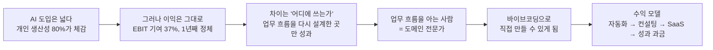
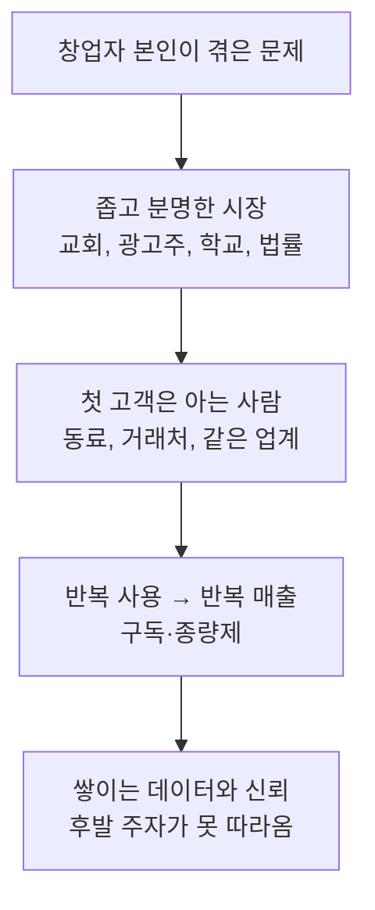
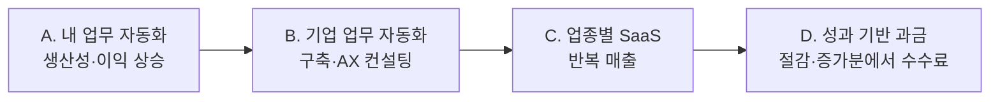

# 15년 경력이 돈이 되는 법: 바이브코딩 시대에 도메인 전문성이 이기는 이유

AI가 코드를 대신 써 주는 시대가 되자, "무엇을 만들 수 있느냐"보다 "무엇을 만들어야 하는지 아느냐"가 더 비싸졌다. 프로그램을 만드는 능력은 빠르게 흔해지는 반면, 한 업계에서 10년, 15년 굴러 본 사람만 아는 문제와 규칙은 그대로 희소하다. 바이브코딩(자연어로 AI에게 지시해 소프트웨어를 만드는 방식)은 이 희소한 지식을 가진 40~60대 현업 전문가에게 처음으로 직접 제품을 만들 수 있는 길을 열었다.

이 글은 그 논리를 데이터, 실제 사례 네 가지, 수익 모델 네 가지, 산업별 기회 순서로 정리한다.

확인 기준: 2026-11-22. 수치는 McKinsey 보고서와 공개된 매출 추적 서비스(TrustMRR) 기준이다. 사례 중 일부는 공개 자료가 적어, 확인된 내용만 적었다.



## 1. AI로 만드는 능력보다 중요한 것

코딩 에이전트가 좋아지면서 "앱 하나 만드는 데 드는 비용"은 거의 0에 가까워지고 있다. 그러면 남는 질문은 두 가지다. 무엇을 만들 것인가, 그리고 누가 돈을 낼 것인가. 둘 다 코딩 실력으로 답할 수 있는 질문이 아니다.

- **무엇을 만들까**: 현장에서 매일 반복되는 귀찮은 일, 실수하면 돈이 새는 지점, 기존 소프트웨어가 못 맞추는 예외 규칙. 이것은 그 일을 오래 해 본 사람이 안다.
- **누가 돈을 낼까**: 같은 업계 사람들이 어떤 문제에 지갑을 여는지, 의사결정은 누가 하는지, 어떤 말로 설득되는지. 이것도 그 업계 사람이 안다.

만드는 능력이 평준화되면 경쟁의 축은 "문제를 아는 쪽"으로 옮겨 간다. 개발자가 업계를 공부하는 것보다, 업계 사람이 AI로 만드는 법을 배우는 쪽이 빨라졌다.

## 2. 데이터로 보는 AI 도입과 실제 성과

McKinsey의 [The state of AI in 2026: On the road to ROI](https://www.mckinsey.com/capabilities/quantumblack/our-insights/the-state-of-ai)는 2026년 5월 4일부터 6월 8일까지 1,719명을 조사했다. 결과는 "개인은 체감하는데, 회사 이익은 아직"으로 요약된다.

| 항목 | 수치 |
| --- | --- |
| AI가 개인 생산성을 높였다 | 80% |
| AI가 더 나은 의사결정을 돕는다 | 50% |
| AI가 회사 전반으로 확산 중 | 44% (1년 전 38%) |
| AI가 EBIT(영업이익)에 기여했다 | 37%, 1년 전과 사실상 같음 |
| 고성과 기업(EBIT의 5% 이상을 AI에 돌리고 영향이 "상당하다"고 답함) | 약 6%, 역시 정체 |
| 토큰 등 AI 운영비가 사용을 제약 | 약 20% |
| 내년에 AI 때문에 전체 고용이 줄 것으로 예상 | 39% (1년 전 32%) |

눈여겨볼 것은 고성과 기업의 차이다. 보고서에 따르면 이들은 효율만이 아니라 성장과 혁신을 함께 목표로 삼고, **AI를 기존 업무에 끼워 넣는 대신 업무 흐름 자체를 AI 중심으로 다시 설계한다.** 업무 흐름을 다시 설계하려면 그 흐름을 속속들이 알아야 한다. 어디서 시간이 새는지, 어느 단계가 사실상 필요 없는지, 어떤 예외가 사고를 내는지. 이것이 도메인 지식이다.

같은 해 [ICONIQ의 State of AI 보고서](https://www.iconiq.com/growth/reports/state-of-ai-2026)는 AI 제품이 소프트웨어 회사 매출에서 차지하는 비중이 2025년 32%에서 올해 42%로 오를 것으로 봤다. 돈은 AI로 흘러가고 있지만, 그 돈을 이익으로 바꾸는 열쇠는 기술보다 업무 이해에 있다.

## 3. 개발자 대 15년 차 도메인 전문가

두 사람이 같은 업계용 서비스를 만든다고 해 보자.

| | 15년 차 개발자 | 15년 차 도메인 전문가 |
| --- | --- | --- |
| 첫 버전 만드는 속도 | 빠르다 | 바이브코딩으로 충분히 빠르다 |
| 무엇이 진짜 문제인지 | 인터뷰와 추측 | 몸으로 안다 |
| 예외 규칙과 업계 관행 | 출시 후 고객 불만으로 배운다 | 처음부터 반영한다 |
| 첫 고객 찾기 | 콜드 메일 | 전 동료, 거래처, 협회 |
| 신뢰 | "개발사" | "우리 업계 사람" |
| 약점 | 업계 언어를 모른다 | 보안, 확장, 유지보수 |

AI 이전에는 오른쪽 사람이 왼쪽 사람을 고용해야 했다. 아이디어는 있어도 만들 수 없었기 때문이다. 이제 첫 버전은 직접 만들 수 있다. 코드 품질이 개발자보다 떨어지더라도, 고객이 돈을 내는 이유는 코드가 아니라 "내 문제를 정확히 푸는가"다.

## 4. 바이브코딩이 현업 전문가에게 기회인 이유

- **검증 비용이 사라졌다.** 예전에는 외주 개발에 수천만 원과 몇 달을 써야 아이디어가 맞는지 알 수 있었다. 이제 주말 이틀이면 내 업무에 써 보는 버전이 나온다.
- **내가 첫 사용자다.** 자기 일을 자동화하는 데서 시작하면 사용자 인터뷰가 필요 없다. 매일 써 보며 고치면 된다.
- **영업망이 이미 있다.** 15년 동안 쌓은 동료와 거래처가 첫 고객이자 피드백 창구다.
- **작아도 된다.** 수천 개 교회, 수백 개 포워더처럼 좁은 시장은 대기업이 들어오지 않지만 1인 사업에는 충분히 크다.

## 5. 도메인 지식의 다섯 단계와 경제적 가치

도메인 지식이 모두 같은 값을 갖지는 않는다. 누구나 검색으로 알 수 있는 지식은 AI도 안다. 값이 나는 지식은 위로 올라갈수록 문서로 남아 있지 않고, 경험으로만 쌓인다.

| 단계 | 내용 | 예 (수출입 물류) | AI가 대신할 수 있나 |
| --- | --- | --- | --- |
| 1. 용어 | 업계 말을 안다 | FOB, CIF, B/L, CBM | 이미 안다 |
| 2. 절차 | 일이 어떤 순서로 흘러가는지 안다 | 견적 → 부킹 → 선적 → 통관 | 대부분 안다 |
| 3. 규칙과 예외 | 언제 무엇이 달라지는지 안다 | 부피중량, 최소 운임, 위험물 서류 | 일반론만 안다 |
| 4. 문제와 비용 | 어디서 돈과 시간이 새는지 안다 | 견적 회신이 늦어 놓치는 화주, 서류 오류로 생기는 체선료 | 모른다 |
| 5. 사람과 시장 | 누가 결정하고 무엇에 돈을 내는지 안다 | 중소 포워더 대표는 "견적 속도"에 돈을 낸다 | 모른다 |

1~2단계는 AI가 평준화했다. 3단계는 AI에게 가르치면 쓸 수 있다. 4~5단계가 사업이 된다. 무엇을 자동화하면 돈이 되는지(4단계), 그것을 누구에게 어떻게 팔지(5단계)는 현장 경험 없이는 답하기 어렵다.

## 6. 전문성만으로는 부족하다

도메인 지식은 진입장벽이지만 영원한 해자는 아니다. 같은 업계의 다른 전문가도 바이브코딩을 배우고, 큰 회사도 언젠가 들어온다. 지속적인 경쟁력은 전문성 위에 쌓아야 한다.

- **데이터**: 서비스를 쓰는 고객이 늘수록 쌓이는 견적, 상담, 판례, 성과 데이터. 이것은 후발 주자가 복사할 수 없다.
- **워크플로 잠금**: 고객의 하루 업무 흐름 안에 들어가면 바꾸기 어려워진다. 단발성 도구보다 매일 여는 도구가 강하다.
- **커뮤니티와 신뢰**: 업계 안의 평판, 사용자 모임, 추천 고리.
- **기술 이해의 바닥**: 보안, 개인정보, 비용 구조처럼 AI가 대충 넘기면 사고가 나는 부분은 최소한 이해해야 한다.

## 7. 실제 사례 네 가지

### 사례 1. Glossa: 교회 통역으로 월 2천만 원대 반복매출

[Glossa](https://glossa.live/)는 교회 예배와 기독교 행사를 100개 넘는 언어로 실시간 AI 음성 통역한다. 장비 없이 아무 기기에서나 쓴다. 창업자 Anton Karbanovich는 처음에 "우리 교회용 앱"으로 시작했다고 말한다([Product Hunt](https://www.producthunt.com/products/glossa)). 2025년 6월 키프로스에서 세웠고, [ElevenLabs 스타트업 지원](https://faith.tools/app/glossa)을 받았다.

[TrustMRR](https://trustmrr.com/startup/glossa-live)에 Stripe로 검증된 수치(2026-10-19 갱신)는 이렇다.

| 항목 | 값 |
| --- | --- |
| 최근 30일 매출 | $31,173 |
| MRR(월 반복매출) | $14,404, 원화 약 2천만 원 |
| 누적 매출 | $196,539 |
| 활성 구독 | 100개, 사용자 약 2,000명 |
| 가격 | 시간당·언어당 $5 종량제, 월 $99 / $299 / $499 |

[App Store](https://apps.apple.com/us/app/id6759844333)와 [Google Play](https://play.google.com/store/apps/details?id=live.glossa.translate)에 앱이 있고, 형편이 어려운 교회도 매달 4시간은 무료로 쓸 수 있다. 기술 스택은 Next.js, React, Cloudflare, Stripe로 평범하다. 이 사례의 핵심은 기술이 아니라 시장 선택이다. "실시간 통역"은 거대 기업이 다 하는 분야지만, "이민자가 섞인 교회의 예배"라는 좁은 문제를 교회 안에 있는 사람이 정확히 짚었다. 마케팅도 SEO와 콘텐츠로, 교회들이 검색하는 말("예배 실시간 번역", "다국어 예배")을 그대로 잡았다.

### 사례 2. Hyros: 마케팅 실무 경험을 SaaS로

[Hyros](https://www.hyros.com/)는 광고 성과를 추적하고 매출을 어느 광고가 만들었는지 나누는 어트리뷰션 플랫폼이다. 창업자 Alex Becker는 광고를 직접 집행하던 마케터였고, 광고 플랫폼이 보여 주는 숫자(대부분 마지막 클릭 기준)와 실제 매출이 맞지 않는 문제를 몸으로 겪은 뒤 이 도구를 만들었다([Built In](https://www.builtinchicago.org/company/hyros)). 서버 측 1차 데이터로 긴 구매 여정을 추적하는 방식이다. 2019년부터 3,000곳 넘는 기업이 썼다고 한다. 회사는 2023년 Banzai에 인수됐고 경영진이 바뀌었다([Demand Gen Report](https://www.demandgenreport.com/industry-news/multichannel-attribution-company-hyros-appoints-new-ceo/7816)).

"광고비를 어디에 써야 하는가"라는 질문은 마케터라면 매일 하는 질문이다. 그 질문에 대한 답을 도구로 만들면, 같은 고민을 하는 수천 명의 마케터가 고객이 된다. 자신의 실무 고통이 곧 제품 기획서였다.

### 사례 3. 위노트: 초등교사가 만든 학교 상담 솔루션

현직 초등교사가 직접 만든 학교 상담 기록·관리 도구다. 학교 상담은 기록 양식, 보호자 소통, 개인정보 처리, 학년 간 인계처럼 교사만 아는 규칙이 많고, 범용 메모 앱이나 일반 CRM으로는 맞지 않는다. 교사는 자기 교실이 첫 시험장이고, 동료 교사가 첫 고객이다.

학교 현장에는 이 문제를 푸는 서비스가 여럿 나와 있다. 설문과 AI로 학생 관계와 정서를 진단하는 [와이즈온스쿨](https://www.hangyo.com/mobile/article.html?no=105409), 상담 내용과 출결을 한 시스템에서 관리하고 생활기록부 초안을 돕는 [U+ 슈퍼스쿨](https://www.lguplus.com/biz/insight/story/877)이 그 예다. 대기업 제품이 있어도 교사가 만든 도구가 살아남는 이유는, 교사가 실제로 어떤 순서로 일하는지에 맞췄기 때문이다.

### 사례 4. Lawbot: 15년 차 개발자가 도메인 전문가에게 진 경험

법률 챗봇을 만든 15년 차 개발자가 같은 시장에서 법률 전문가가 만든 서비스에 밀린 경험이다. 법률 서비스에서는 어떤 질문에 답하지 말아야 하는지, 어떤 문서가 먼저 필요한지, 무엇이 책임 문제를 만드는지가 제품의 품질을 가른다. 이것은 코드를 잘 짜서 알 수 있는 것이 아니라 법률 실무를 해 봐야 아는 것이다.

법률 AI 시장의 흐름도 같은 이야기를 한다. 케임브리지 법대 졸업생들이 만든 LawBot은 변호사와 기계의 사건 예측 대결을 계획했다가 방향을 바꿨고([Legal Futures](https://www.legalfutures.co.uk/latest-news/lawbot-team-plans-lawyer-v-machine-case-prediction-challenge), [Legal Cheek](https://www.legalcheek.com/2018/07/cambridge-law-grads-behind-case-predicting-robot-part-ways)), 세무 변호사가 직접 세운 [Ailira](https://botscrew.com/blog/behind-successful-chatbots-ailira/)는 전문가가 만든 법률 AI의 예로 꼽힌다. 요즘은 범용 모델이 수천 달러짜리 법률 특화 도구를 앞서는 일도 생기면서, 법률 테크 회사들이 기술보다 업무 이해로 차별화해야 하는 상황이 됐다([Bloomberg Law](https://news.bloomberglaw.com/bloomberg-government-news/legal-tech-battles-to-set-itself-apart-from-general-ai-models)).

### 네 사례의 공통점



- 기술은 평범하다. 차별점은 문제 정의다.
- 창업자가 그 시장의 일원이었다.
- 범용 도구로는 맞지 않는 좁은 문제를 골랐다.
- 한 번 팔고 끝나는 게 아니라 매달 쓰는 구조다.

## 8. 도메인 지식을 돈으로 바꾸는 네 가지 모델



### A. 내 업무 자동화로 생산성과 이익 높이기

가장 위험이 낮은 출발점이다. 내 회사, 내 사무실에서 매일 하는 일을 자동화하면 바로 시간과 돈이 남는다. 실패해도 잃는 것이 없고, 성공하면 그 도구가 다음 단계(B, C)의 시제품이 된다.

### B. 기업 업무 자동화 구축과 AX 컨설팅

같은 업계 다른 회사의 업무를 자동화해 주고 구축비나 자문료를 받는다. AX(AI Transformation) 컨설팅이다. McKinsey가 말한 "업무 흐름 재설계"를 대신해 주는 일이고, 업계를 아는 사람이 하면 설득이 쉽다. 프로젝트마다 반복되는 부분이 보이면 그것이 SaaS의 씨앗이 된다. 대형 AI 회사들도 이 시장을 본다. OpenAI와 Anthropic은 2026년 사모펀드 자금으로 기업 배포 전문 회사를 세웠다.

### C. 업종별 SaaS로 반복매출 만들기

여러 고객사에서 같은 문제를 확인하면, 설치형 구축 대신 구독형 서비스로 만든다. 매달 들어오는 반복매출(MRR)은 사업의 가치를 가장 크게 올린다. Glossa가 이 단계다. 수직(vertical) SaaS는 시장은 좁지만 경쟁이 적고 고객이 잘 떠나지 않는다.

### D. 성과 기반 과금으로 수익 극대화

"도구를 파는 것"이 아니라 "결과를 파는 것"이다. 고객이 절감한 비용이나 늘어난 매출의 일정 비율을 받는다. 성과를 측정할 수 있어야 하고, 무엇이 성과인지 고객과 합의할 수 있어야 하므로 도메인 지식이 가장 많이 필요하다. 대신 같은 고객에게서 가장 많이 받을 수 있다.

## 9. 예제: 견적 자동화와 과금 방식 비교

물류 견적은 도메인 규칙의 덩어리다. 항공은 실중량과 부피중량(1 CBM = 167kg) 중 큰 쪽으로 받고, 해상 LCL은 CBM과 톤 중 큰 쪽(R/T)으로 받고, 최소 운임이 있고, 위험물은 서류와 할증이 붙는다. 코드 자체는 바이브코딩으로 몇 분이면 나온다. 이 규칙을 정확히 알려 줄 수 있는 사람이 값진 것이다.

```ts
// quote.ts — 실행: bun quote.ts (요율은 예시 값이다)
type Shipment = { id: string; mode: "air" | "sea"; kg: number; cbm: number; dangerous: boolean; lane: string };

const RATE = {
  air: { perKg: { "ICN-LAX": 4.2, "ICN-FRA": 3.8 } as Record<string, number>, min: 150 },
  sea: { perCbm: { "PUS-LAX": 85, "PUS-RTM": 95 } as Record<string, number>, min: 120 },
};
const FUEL_SURCHARGE = 0.18; // 항공 유류할증 18%
const DG_FEE = 120; // 위험물 서류·취급비
const DOC_FEE = 45; // 기본 서류비

function quote(s: Shipment) {
  const notes: string[] = [];
  let freight: number;
  if (s.mode === "air") {
    // 항공은 실중량과 부피중량(1 CBM = 167 kg) 중 큰 쪽으로 받는다
    const chargeable = Math.max(s.kg, s.cbm * 167);
    if (chargeable > s.kg) notes.push(`부피중량 적용 ${chargeable.toFixed(0)}kg`);
    const rate = RATE.air.perKg[s.lane];
    if (rate === undefined) throw new Error(`${s.id}: 요율 없는 구간 ${s.lane}`);
    freight = Math.max(chargeable * rate, RATE.air.min) * (1 + FUEL_SURCHARGE);
  } else {
    // 해상 LCL은 CBM과 톤(1,000kg = 1 R/T) 중 큰 쪽
    const rt = Math.max(s.cbm, s.kg / 1000);
    const rate = RATE.sea.perCbm[s.lane];
    if (rate === undefined) throw new Error(`${s.id}: 요율 없는 구간 ${s.lane}`);
    freight = Math.max(rt * rate, RATE.sea.min);
    if (freight === RATE.sea.min) notes.push("최소 운임 적용");
  }
  const total = freight + DOC_FEE + (s.dangerous ? DG_FEE : 0);
  if (s.dangerous) notes.push("위험물: MSDS와 DG 신고서 필요");
  return { id: s.id, lane: s.lane, total: Math.round(total), notes };
}

const shipments: Shipment[] = [
  { id: "Q-101", mode: "air", kg: 80, cbm: 1.2, dangerous: false, lane: "ICN-LAX" },
  { id: "Q-102", mode: "air", kg: 300, cbm: 0.9, dangerous: true, lane: "ICN-FRA" },
  { id: "Q-103", mode: "sea", kg: 2400, cbm: 1.1, dangerous: false, lane: "PUS-LAX" },
  { id: "Q-104", mode: "sea", kg: 300, cbm: 0.8, dangerous: false, lane: "PUS-RTM" },
];
for (const q of shipments.map(quote)) console.log(`${q.id} ${q.lane} $${q.total}  ${q.notes.join(", ")}`);

// 과금 방식 비교: 같은 고객사에 월 구독, 좌석, 성과 기반으로 받을 때
const quotesPerMonth = 600; // 고객사가 한 달에 내는 견적 수
const minutesSaved = 12; // 견적 하나에 아끼는 시간
const hourlyCost = 35_000; // 담당자 시간당 비용(원)
const savedWon = (quotesPerMonth * minutesSaved * hourlyCost) / 60;
const plans = {
  "월 구독(고정)": 300_000,
  "좌석(3명 × 9만 원)": 3 * 90_000,
  "성과 기반(절감액의 20%)": savedWon * 0.2,
};
console.log(`고객사의 월 절감액 ₩${savedWon.toLocaleString("ko-KR")}`);
for (const [name, won] of Object.entries(plans)) console.log(`${name.padEnd(16)} ₩${Math.round(won).toLocaleString("ko-KR")}`);
```

Bun 1.4.5에서 실행한 결과:

```text
Q-101 ICN-LAX $1038  부피중량 적용 200kg
Q-102 ICN-FRA $1510  위험물: MSDS와 DG 신고서 필요
Q-103 PUS-LAX $249
Q-104 PUS-RTM $165  최소 운임 적용
고객사의 월 절감액 ₩4,200,000
월 구독(고정)         ₩300,000
좌석(3명 × 9만 원)    ₩270,000
성과 기반(절감액의 20%)  ₩840,000
```

80kg짜리 화물(Q-101)이 부피 때문에 200kg 요금을 내는 것, 300kg 해상 화물(Q-104)이 최소 운임에 걸리는 것은 규칙을 모르면 놓치는 부분이다. 아래 과금 비교는 모델 D의 논리를 보여 준다. 고객이 한 달에 420만 원을 아낀다는 것을 증명할 수 있으면, 30만 원 구독보다 절감액의 20%(84만 원)를 받는 쪽이 고객에게도 납득이 되고 공급자에게도 낫다. 그 "증명"에 업무 지식이 필요하다.

## 10. 지금 수익화 기회가 큰 산업

공통 조건은 세 가지다. 반복되는 문서·계산 업무가 많고, 실수 비용이 크고, 아직 업계에 맞는 소프트웨어가 부족한 곳.

| 산업 | 자동화할 일 | 왜 기회인가 |
| --- | --- | --- |
| 물류·수출입 | 견적, 선적 서류(인보이스, 패킹리스트, B/L), 통관 자료 | 견적 회신 속도가 수주를 가르고, 서류 오류가 곧 비용이다 |
| 건설·제조 | 복잡한 견적(적산), 공정·일정 관리, 자재 발주 | 규칙과 예외가 많아 범용 도구가 안 맞는다 |
| 법률·회계 | 문서 검토, 계약서 비교, 증빙·자료 분석 | 문서량이 많고 시간당 단가가 높다. 단 책임 문제를 아는 사람이 만들어야 한다 |
| 마케팅 대행 | 고객사별 성과 분석, 월간 리포트 | 대행사마다 리포트 작성에 매달 많은 시간을 쓴다. 성과 기반 과금과 잘 맞는다 |
| 교육 | 상담 기록, 학습 관리, 평가 보조 | 교사가 겪는 행정 부담이 크다 |
| 부동산 | 매물 정리, 계약 서류, 고객 응대 | 반복 문의와 서류가 많다 |
| 유통 | 재고, 발주, 상품 정보 관리 | 소상공인용 도구가 부족하다 |
| 의료 | 예약·문진·서류 보조 | 규제와 개인정보를 아는 사람만 들어갈 수 있다 |

## 11. 개인 생산성 도구가 수익화에 불리한 이유

할 일 관리, 메모, 일정, 글쓰기 보조 같은 개인 생산성 도구는 처음 만들기 가장 쉽지만, 돈 벌기는 가장 어렵다.

- **경쟁이 무한하다.** 누구나 만들 수 있고, 거대 기업이 무료로 준다.
- **지불 의사가 낮다.** 개인은 월 몇천 원에도 망설이지만, 기업은 시간을 아끼는 도구에 수십만 원을 낸다.
- **AI 범용 앱이 흡수한다.** 챗봇 하나가 메모, 요약, 일정까지 해 주면 별도 도구의 자리가 없어진다.
- **도메인 지식이 필요 없다.** 그래서 해자도 없다.

반대로 "특정 업종의 특정 업무"는 범용 AI가 흡수하기 어렵고, 고객이 회사라 지불 능력도 크다.

## 12. 두 가지 성장 방향

도메인 전문가가 바이브코딩으로 사업을 키우는 길은 두 갈래다.

1. **도메인 전문성을 더 깊게**: 업계의 더 어려운 문제(4~5단계 지식)로 올라가고, 고객 데이터를 쌓아 그 업계에서 대체 불가능한 사람이 된다.
2. **기술 지식을 더 넓게**: AI가 써 준 코드를 읽고, 보안과 개인정보와 비용 구조를 이해하고, 필요하면 개발자를 고용해 이끌 수 있을 만큼 배운다.

둘 다 필요하지만 출발점은 다르다. 개발자는 이제 업계를 배워야 하고, 현업 전문가는 이제 만드는 법을 배우면 된다. 그리고 후자 쪽이 따라잡을 거리가 더 짧아졌다. 15년 경력은 AI 시대에 낡은 자산이 아니라, 가장 복사하기 어려운 자산이다.

## 출처

- [The state of AI in 2026: On the road to ROI](https://www.mckinsey.com/capabilities/quantumblack/our-insights/the-state-of-ai), McKinsey, 2026-08
- [2026 State of AI Report: The Builder's Economy](https://www.iconiq.com/growth/reports/state-of-ai-2026), ICONIQ
- Glossa: [TrustMRR](https://trustmrr.com/startup/glossa-live), [창업자 페이지](https://trustmrr.com/founder/karbanovich), [faith.tools](https://faith.tools/app/glossa), [App Store](https://apps.apple.com/us/app/id6759844333), [Product Hunt](https://www.producthunt.com/products/glossa)
- Hyros: [공식 사이트](https://www.hyros.com/), [Built In](https://www.builtinchicago.org/company/hyros), [Demand Gen Report](https://www.demandgenreport.com/industry-news/multichannel-attribution-company-hyros-appoints-new-ceo/7816)
- 학교 상담·관리 도구: [와이즈온스쿨(한국교육신문)](https://www.hangyo.com/mobile/article.html?no=105409), [U+ 슈퍼스쿨](https://www.lguplus.com/biz/insight/story/877)
- 법률 AI: [Legal Futures](https://www.legalfutures.co.uk/latest-news/lawbot-team-plans-lawyer-v-machine-case-prediction-challenge), [Legal Cheek](https://www.legalcheek.com/2018/07/cambridge-law-grads-behind-case-predicting-robot-part-ways), [Ailira](https://botscrew.com/blog/behind-successful-chatbots-ailira/), [Bloomberg Law](https://news.bloomberglaw.com/bloomberg-government-news/legal-tech-battles-to-set-itself-apart-from-general-ai-models)
