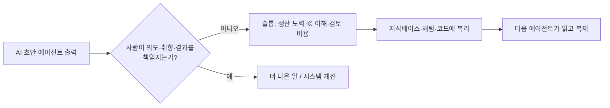
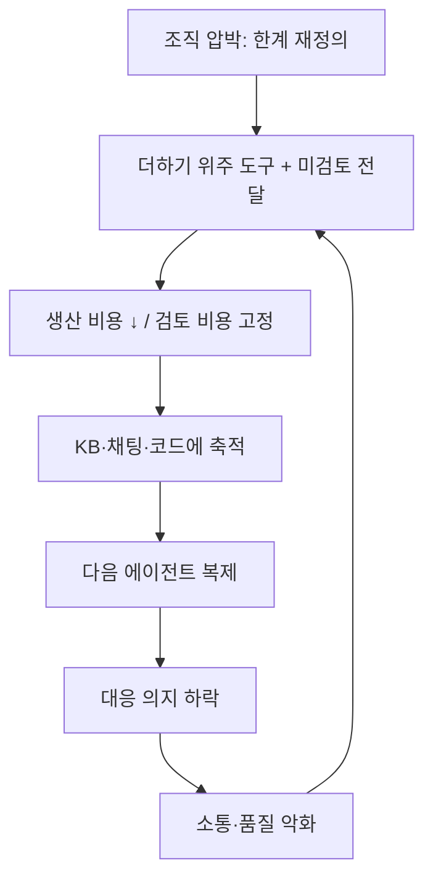
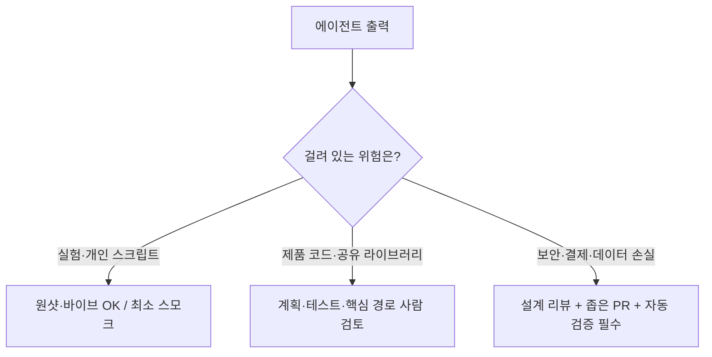
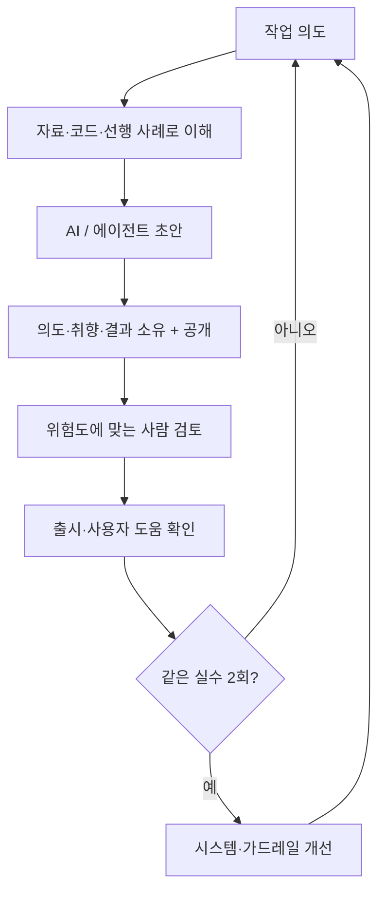

# No AI Slop 선언문… AI를 막는 게 아니라, ‘넘기기만 하는 출력’에 맞선다

### AIE Code Summit 2026 발표자·참가자가 Agile Manifesto에 빗대 정리한 다섯 가치와 스물두 조. 슬롭은 AI 사용이 아니라 생산 노력보다 독자·검토자 부담이 클 때 생기며, GeekNews 토론은 PR·검토·이름·알파의 실무로 이어진다


2001년 유타주 Snowbird에서 17명의 엔지니어가 문서 중심의 무거운 프로세스에 맞서 [Agile Manifesto](https://agilemanifesto.org/)를 남겼다. 2026년 AIE Code Summit의 발표자와 참가자들은 같은 형식을 빌려 [No AI Slop: A Manifesto](https://www.slopmanifesto.com/)를 썼다. GeekNews([토픽 37128](https://news.hada.io/topic?id=37128))는 요지와 댓글을 묶었고, DaleSeo는 [비공식 한국어 번역 gist](https://gist.github.com/DaleSeo/e647dabfd4cd5df386dbd6e62b3a9985)를 올렸다.

선언문은 AI 사용 금지가 아니다. 슬롭을 **받아 본 적도, 보내 본 적도 있는** 사람들이, 코드·문서·계획·메시지에 AI가 스며든 환경에서 **사람이 맡아야 할 역할**을 적어 둔 것이다. 이 글은 원문의 가치·믿음·결의 22조와 GeekNews·번역 gist·토론을 기사 형태로 전부 다시 읽는다.

## 0. 어디에 두는가

이 문서는 모델 아키텍처 해설이 아니라 **코딩 에이전트·LLM을 개발 워크플로에 쓸 때의 품질·검토·책임 원칙**이다. typeboard 분류상 `docs/06_AI/03_AI_Dev_Case_Studies`에 둔다. `07_Tech_Trends`의 제품·런타임 뉴스와도, `02_Agents`의 상시 실행·온톨로지 설계와도 겹치지만, 사례 폴더의 “실제 개발에 쓴 규범”에 가장 가깝다.

## 1. 다섯 가지 가치 — Agile식 ‘over’ 문장

원문이 “we have come to value”로 적는 쌍은 다섯이다.

| 덜 우선 | 더 우선 |
|---|---|
| output (산출물) | **outcomes** (실질적 결과·성과) |
| speed | **understanding** |
| a model’s first draft | **our own thinking** |
| easier work | **better work** |
| patching the output | **improving the system** |

목표는 빠르게 변하는 세상에서도 AI를 안전·책임 있게 써서 **모두에게 가치를 만들고, 수년 뒤에도 유효한** 역할을 사람이 받아들이는 것이다.



## 2. 슬롭이란 무엇인가 — 정의와 비정의

원문 2–3조의 핵심을 한 줄로 줄이면 이렇다.

> **슬롭** = 만드는 데 들인 노력보다, 소비자에게 이해하라고 요구하는 노력이 더 큰 결과물.  
> AI를 썼다고 슬롭이 되는 것은 **아니다**. 품질과 독자 경험을 책임지지 않고 AI 출력을 **그대로 넘길 때** 슬롭이 된다.

GN⁺ 추가 요약도 같은 선을 강조한다. “AI로 만든 것”이 아니라 **노력의 비대칭**이 정의다.

## 3. 우리가 믿는 것 (1–9) — 왜 슬롭이 커지는가

원문의 믿음 조항을 빠짐없이 펼치면 아래와 같다.

**1. 유용하지만 규모가 폭주한다**  
AI는 대부분에게 지금까지 쓴 도구 중 가장 유용하다. 그러나 에이전트 무리는 **한 사람이 평생 검토할 양보다 많은 작업물을 하루 만에** 만들 수 있다.

**2–3. 정의와 책임**  
위 정의. 책임 없는 전달이 슬롭이다.

**4. 증폭기**  
AI는 사람 판단을 대체하지 못한다. 판단 **또는 판단의 부재**를 증폭할 뿐이다.

**5. 비대칭 비용**  
천 줄 PR·열 쪽 문서의 생산 비용은 0에 가까워지고, **검토 비용은 그대로**다.

**6. AI 이전의 슬롭**  
코드에서는 예전에도 문제를 제대로 풀지 않고 우회를 반복할 때 슬롭이 늘었다. **빼기보다 더하기에 심하게 기운 도구**가 원인을 키운다.

**7. 압박**  
많은 슬롭은 회사에서 “인간적으로 가능한 일의 한계를 다시 쓰라”고 몰아붙일 때 나온다.

**8. 복리**  
지식 베이스·채팅·코드에 슬롭이 많을수록 다음 에이전트가 더 많이 읽고 베낀다.

**9. 의지 소진**  
팀에 슬롭이 돌수록 맞서 싸울 의지가 약해지고, 소통과 품질은 **시간이 갈수록 나빠진다**.



## 4. 우리가 결의하는 것 (10–21) — 어떻게 맞설 것인가

**10–12. 사람 시간·더 나은 일·의도 끌어내기**  
사람 시간과 주의력은 귀하니 현명하게 쓰도록 최적화한다. AI는 쉽게만이 아니라 **더 낫게** 만들어야 하므로 슬롭에 맞선다. 시스템·도구·제품은 **의도 유도**와 **사람 이해**가 싸게 되도록 설계한다.

**13–14. 사고와 소유**  
모델과 일할 때도 생각은 직접 한다. 착수 전에 자료·코드·선행 사례로 문제를 이해한다. AI 기여가 커도 **의도·취향·결과**는 사람이 진다.

**15–16. 투명성과 동료 규범**  
에이전트가 쓴 것을 보낼 때 그 사실을 밝히고, 중요한 부분은 보내기 전에 확인한다. 슬롭을 받으면 **친절하게** 알리고 먼저 검토해 달라고 한다. 대부분 자신도 그런 말을 들어야 했던 적이 있다.

**17–18. 검토의 알파, 자동화의 한계**  
**무언가**를 검토하는 데에는 언제나 alpha(경쟁 우위·초과수익에 가까운 이득)가 있다. 모델이 좋아져 코드 대부분을 안 읽게 되어도 **계획·설계·결과**는 검토한다. 안 하면 남과 같은 출력만 남는다. 에이전트 리뷰·린터·검증기는 유용하나 충분하지 않다. 당분간 출력의 **일부**는 사람이 보며, 범위는 **걸려 있는 위험(stakes)** 에 맞춘다.

**19. 지표의 서열**  
무엇이 출시됐고, 누가 쓰며, 어떻게 도움이 되는지가 LOC·머지 PR·토큰·병렬 에이전트 수보다 **훨씬** 중요하다.

**20. 바이브 코딩은 금지 대상이 아니다**  
미검토 출력이 언제나 나쁜 것은 아니다. 원샷·바이브 코딩은 레버리지가 큰 도구다. 슬롭이 나쁜 경우는 **쓸모 있는 제품, 유지보수 가능한 시스템, 나와 동료의 시간·에너지**라는 결과를 해칠 때다.

**21. 두 번이면 시스템**  
같은 실수가 두 번 나오면 출력만 고치지 말고 **시스템과 가드레일**을 고쳐 팀의 용량을 키운다. 린터·타입 체커·자동 검사가 잡을 수 있는 것은 거기에 맡긴다.

## 5. 마지막 조 (22) — 정답을 고정하지 않는다

누구도 다 알아내지 못했다. 각자 무엇을 받아들이고 거부할지 다시 배우는 중이며 **하나뿐인 정답은 없다**. 커뮤니티와 함께 정의를 진화시키겠다고 적는다. 열린 질문 네 개: 슬롭이란 무엇인가 / 왜 생기는가 / 왜 싸울 가치가 있는가 / 어떻게 맞설 것인가.

기여에 감사로 적힌 이름에는 Philip Kiely, Swyx, Lucas Meijer, Rebecca Bakels, Tejas Kumar, Natalie Serrino, Francisco Javier Arceo, Kent C. Dodds, Ankit Jain, Brandon Waselnuk, Mihail Eric, Justin McCarthy, Raz Berman Gold, Yacine Mahdid, Justin Poehnelt, Lauren Tan, Kyle Mistele 등이 있다. GeekNews 시점 서명 예로 Dex Horthy, Kent C. Dodds, Lauren Tan, Tejas Kumar, Dominik Kundel 등이 언급된다. 서명은 gist 댓글(이름·회사·X·LinkedIn 등)로 받고 주기적으로 반영한다.

번역 gist가 붙인 **더 읽을거리**도 선언의 맥락이다.

- swyx, *No More Slop* (AIE Code Summit 발표)
- Tejas Kumar, *Please stop the slop*
- Jake Nations, *Vibe Coding Our Way to Disaster*
- Ghostty AI Usage Policy
- Dex, *Why Software Factories Fail*

## 6. 실무로 옮기는 최소 패턴 (예제)

선언은 코드 스펙이 아니지만, 15·16·21조는 워크플로에 바로 붙일 수 있다.

### 6.1 에이전트 작성 사실을 밝히는 PR 본문

```markdown
## Summary
- Fix session timeout when the host clock skews.

## AI assistance
- Drafted with a coding agent; I reviewed the auth/session paths and the regression test.
- Prompt/intent (short): "Preserve existing public API; add clock-skew tolerance; no new deps."

## Test plan
- [ ] unit: session renew under ±5m skew
- [ ] manual: long-lived tab refresh
```

### 6.2 슬롭을 받았을 때의 짧은 회신 (16조)

```text
Thanks for the PR. Could you take a pass on the reader/reviewer experience first?
Happy to review after the intent, tests, and the risky paths are checked by you.
(I've needed the same note myself.)
```

### 6.3 같은 실수 두 번 → 가드레일 (21조)

```js
// 예: "에이전트가 또 console.log를 main에 남김"이 두 번이면
// PR 설명을 고치지 말고 린터로 승격한다.
module.exports = {
  rules: {
    'no-console': ['error', { allow: ['warn', 'error'] }],
  },
}
```

```ts
// 예: 공개 API 파괴를 CI가 잡게 — 사람이 매번 기억하지 않음
// (의사코드) if publicApiDiff(pr) && !label('api-break-approved') → fail
```

### 6.4 위험도에 따른 검토 범위 (18조)



## 7. GeekNews 토론이 덧붙인 실무

**애자일 비유**  
“애자일이 성공했던가”는 선언 형식에 대한 냉소로 읽히고, hungryman은 “잘 쓰는 곳은 잘 쓴다. 선언 자체로 의미가 있지 않나”로 받는다. 선언문의 성패를 Agile의 문화사와 동일시할 필요는 없다는 축이다.

**속도보다 이해**  
eggkmc3처럼 가치 서열 자체에 공감하는 반응이 있다.

**대형 PR·프롬프트 첨부**  
“출력을 땜질하기보다 시스템”이 AI 대형 PR 검토 논의와 맞닿는다는 댓글: 기여자 프롬프트를 PR에 넣으면 사고 과정을 보기 쉽다. 반론·보완으로는 **대형 PR 금지·분할**(위험↓, 되돌리기↑), Zed [delta](https://delta.dev/)의 대화 계층 버전 관리(전부 추적 vs 초안만), [OpenSpec](https://openspec.dev)으로 제안서·설계·명세·작업 목록·검증 근거를 PR에 싣고 커밋을 명세→코드→테스트→증거 순으로 재구성하는 팀 사례가 올라온다. “긴 LLM 대화를 읽는 것이 코드 정확성을 증명하나?”라는 회의도 같이 있다.

**이름**  
부정형(`No AI Slop`)보다 ‘인간을 위한 엔지니어링’·‘책임 있는 AI 사용 헌장’ 같은 긍정형이 부르기 쉽다는 Agile 비유.

**“남과 같은 출력”**  
17조의 alpha 문장을 제로섬으로 읽지 말라는 반박: 핵심에 혁신을 모으고 나머지는 “충분히 괜찮음”이면 된다. 접근성 확대로 독특함이 줄어도 나쁘지 않다.

**비전 vs 전쟁**  
무조건 전쟁 프레임보다 AI를 삶에 이롭게 통합할 비전. 비개발자의 제품 제작 가능성에 큰 가치가 있으며, AI 제품도 품질 기준으로 사람 제품과 비슷하게 다뤄야 한다.

**진짜 원인**  
AI 여부와 무관하게 저질 결과물은 사람이 만든다. 첫 결과를 다듬지 않고 완제품처럼 내놓는 습관은 shovelware·ClipArt 시대에도 있었다. AI는 그걸 **쉽게** 만들었을 뿐이다. Cory Doctorow의 reverse centaur 논지와 닮았다는 추천도 있다.

**대안 가치 문안**  
출시 속도보다 인간 책임, 무감독 자율보다 존엄·통제, 대체보다 역량 확장, 코드 생성보다 실질 성과, 개인 향상보다 협업 — Agile식 “왼쪽도 가치 있으나 오른쪽을 더” 형식의 재작성 제안.

**검토 병목**  
사람이 병목이라는 전제와, 검토는 병목이 아니라 **품질 관리**라는 반론이 맞붙는다. LLM이 줄 수를 부풀리고 문서화·추상화에 약하며 “추가”로 흐른다는 경험, 테스트를 통과 못해 Jira가 늘었다는 현장감, “하루에 사람 시절의 수십·수백 배 코드를 정말 생성해야 하나?”라는 질문이 이어진다. 댓글에서 **alpha**는 금융 초과수익·경쟁 우위 지식으로 풀이된다.

## 8. 선언문을 한 장의 운영 체크리스트로

1. **넘기기 전에** 의도·독자·위험한 경로를 사람이 본다 (3, 14, 15).
2. **에이전트 작성**이면 밝힌다 (15).
3. **슬롭을 받으면** 친절히 되돌린다 (16).
4. **코드 전량 리딩이 불가능**해져도 계획·설계·결과의 일부는 남긴다 (17–18).
5. **측정**은 토큰·병렬 에이전트가 아니라 출시·사용·도움으로 (19).
6. **바이브 코딩**을 금기시하지 말고, 결과를 해칠 때만 슬롭으로 부른다 (20).
7. **같은 실수 2회**면 린터·타입·CI·명세 스키마로 승격한다 (21).
8. **정답 선언으로 얼리지 않는다** (22). 팀마다 수용선이 다르다.



## 9. 결론: 슬롭과의 싸움은 ‘속도 거부’가 아니라 ‘책임의 위치’다

No AI Slop 선언문은 AI를 시대의 적으로 두지 않는다. 에이전트가 하루 만에 검토 불가능한 양을 만들 수 있는 조건에서, **생산 비용과 이해·검토 비용의 비대칭**을 슬롭이라 부르고, 그 비대칭을 사람이 책임·시스템·가드레일로 갚자고 적는다. 다섯 가치는 산출·속도·초안·쉬운 일·출력 땜질보다 결과·이해·자기 사고·나은 일·시스템 개선을 고른다. 22조는 정답을 고정하지 않은 채, 커뮤니티와 함께 진화할 여지를 연다.

GeekNews가 보탠 것은 선언을 PR 분할, 프롬프트·OpenSpec 첨부, 이름 짓기, reverse centaur, 검토=품질관리 논쟁으로 **팀 규범**에 내려놓는 일이다. 복사할 문장 하나만 고르라면 원문 3조와 14조를 겹친 것이다. **AI를 쓴 것이 문제가 아니라, 품질과 독자 경험을 책임지지 않은 채 넘긴 것이 문제다. 내보내는 순간의 의도·취향·결과는 여전히 사람의 이름 아래 있다.**

---

**원문 및 참고 자료**

- *No AI Slop: A Manifesto* (AIE Code Summit 2026 speakers & attendees). https://www.slopmanifesto.com/
- GeekNews 토픽 요약·댓글: https://news.hada.io/topic?id=37128
- DaleSeo, 비공식 한국어 번역 gist: https://gist.github.com/DaleSeo/e647dabfd4cd5df386dbd6e62b3a9985
- Agile Manifesto (2001): https://agilemanifesto.org/
- 토론·번역 gist에서 이어진 읽을거리: swyx *No More Slop*; Tejas Kumar *Please stop the slop*; Jake Nations *Vibe Coding Our Way to Disaster*; Ghostty AI Usage Policy; Dex *Why Software Factories Fail*
- 댓글에서 언급된 도구·개념: [OpenSpec](https://openspec.dev), [delta](https://delta.dev/), Cory Doctorow reverse centaur

※ 본 기사는 원문 선언문, GeekNews 요약·토론, 비공식 한국어 번역 gist를 바탕으로 재구성한 해설이다. 서명자 명단은 시점마다 갱신되므로 원문·gist를 따른다. AI 사용 금지를 권하는 문서가 아니라, 책임 있는 사용·검토·시스템 개선을 정리한 규범 해설이다.
