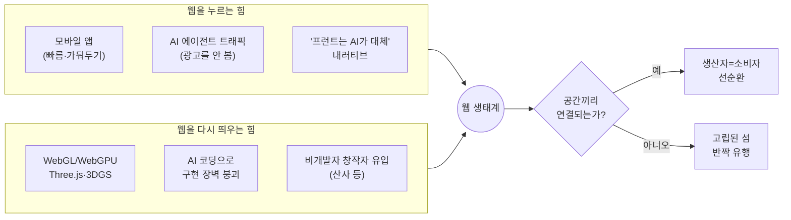
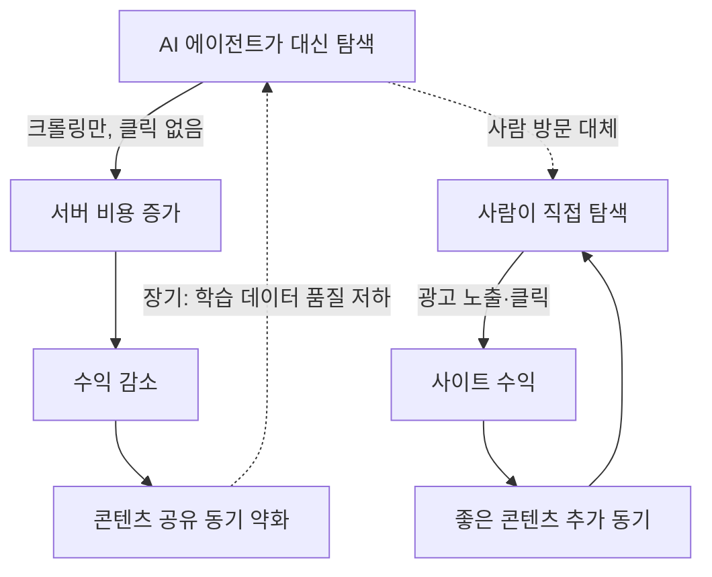
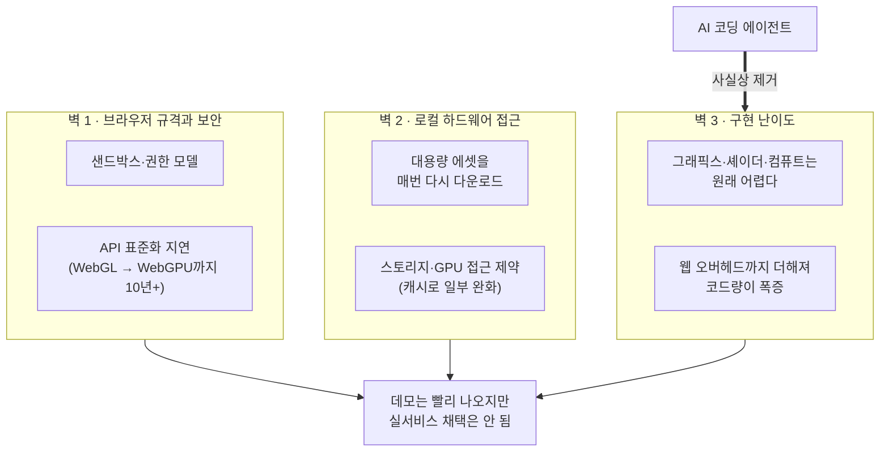
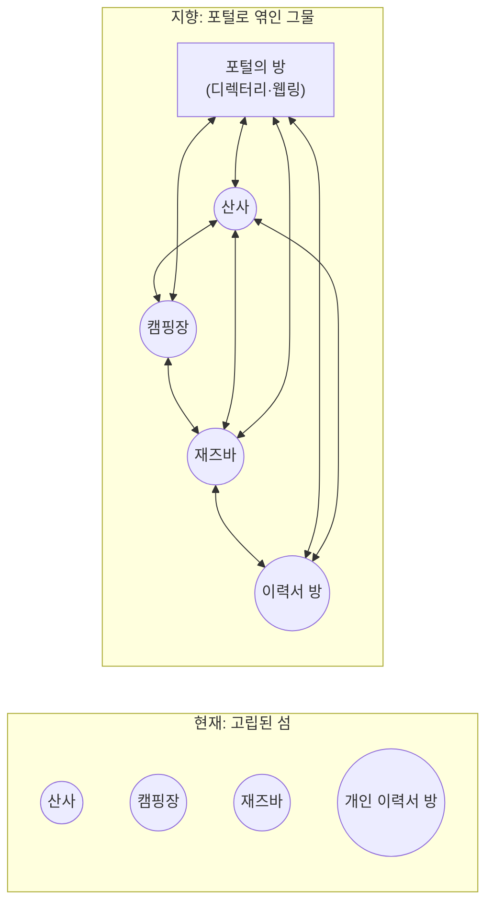

# AI가 바꿔 놓은 웹 개발: 프런트엔드는 '제품 책임자'로, 웹은 '3D 개인 공간'으로

### 개발자 채용은 반등하는데 웹 프런트엔드는 유독 회복이 더디다. 이유는 둘이다. AI가 단순 코딩을 가져가면서 프런트엔드에 디자인·UX·검증·제품 책임이 몰렸다. 또 모바일 앱과 AI 에이전트 트래픽이 웹의 광고 수익 구조를 깎았다. 그런데 같은 AI가 3D 웹(WebGL·WebGPU·Three.js·가우시안 스플래팅)의 구현 장벽도 무너뜨렸다. 비개발자가 만든 3D 가상 사찰 '산사'가 일주일 만에 100만 방문을 넘긴 것은 웹이 '새로운 경험'으로 다시 사람을 모을 수 있다는 신호다. 다만 웹의 본질인 '링크'를 살리지 못하면 이 붐도 섬으로 끝날 수 있다


2026년 하반기 개발자 채용 시장에는 두 가지 흐름이 함께 있다. 백엔드 쪽에서는 LLM 기반 시스템(RAG, 에이전트)을 만드는 'AI 엔지니어' 공고가 다시 늘었다. 반면 웹 프런트엔드는 반등 소식이 거의 없다. 이 글은 이 비대칭을 기술 측면에서 분석한다. 근거로는 [Anthropic Economic Index의 소프트웨어 개발 보고서](https://www.anthropic.com/research/impact-software-development), [Cloudflare의 AI 크롤러 crawl-to-refer 데이터](https://blog.cloudflare.com/crawlers-click-ai-bots-training/), [WebGPU 주요 브라우저 지원 발표](https://web.dev/blog/webgpu-supported-major-browsers), [3D Gaussian Splatting 원 논문](https://repo-sam.inria.fr/fungraph/3d-gaussian-splatting/), [Zillow SkyTour](https://www.zillowgroup.com/news/take-home-listings-to-new-heights-with-skytour), [Korea Times](https://www.koreatimes.co.kr/southkorea/20261103/ai-built-virtual-buddhist-temple-draws-1-mil-visitors-in-less-than-a-week)·[서울신문](https://www.seoul.co.kr/news/newsView.php?id=20261105032003)·[미주중앙일보](https://www.koreadaily.com/article/20261101002249145)·[헤럴드경제](https://biz.heraldcorp.com/article/10932566)의 '산사' 보도와 제작자 인터뷰([앱인토스 블로그](https://toss.im/apps-in-toss/blog/sansa))를 썼다. 이를 바탕으로 웹 개발 직무와 웹 생태계가 어디로 가는지 정리한다.

**경제 상황(금리, 데이터센터·피지컬 AI로의 자본 쏠림)이 일자리 수에 주는 영향은 이 글의 범위가 아니다. 채용 공고 원문, 웹 3D 사이트 점유율(0.64%), 국내 위키 사이트의 광고 수입 감소 같은 일부 수치는 1차 출처를 확인하지 못했다. 'IKEA AR 구매율 20%'는 IKEA가 아니라 화장품 소매업체 연구에서 나온 수치로 보인다. 해당 항목은 본문에 따로 표시했다.**

## 1. 한눈에 보기

| 질문 | 요약 |
|---|---|
| 웹 일자리가 사라졌나? | 아니다. 다만 **같은 직함에 요구하는 범위가 넓어졌다**(디자인·UX·기획·AI 코드 검증·품질 책임) |
| 왜 프런트엔드만 회복이 느린가? | ① "프런트는 쉬워서 AI가 대체한다"는 경영 측 내러티브 ② 웹 광고 생태계 수축(모바일 + AI 트래픽) |
| AI 기능 화면화는 프런트 기회인가? | 제한적이다. 챗봇 UI는 금방 범용화됐고, 무거운 쪽은 백엔드·MLOps로 갔다. 생성형 크리에이티브 도구의 **UX**는 예외다 |
| 웹은 어떻게 다시 사람을 모으나? | 모바일·AI가 빼앗을 수 없는 **새로운 경험**이 필요하다. 유력한 후보는 **3D 체험**이다 |
| 3D 웹이 그동안 안 퍼진 이유 | 브라우저 규격·보안 샌드박스, 로컬 하드웨어·스토리지 접근 제약, 높은 구현 난이도. 이 세 겹이 쌓여 있었다 |
| 지금 무엇이 달라졌나 | WebGPU가 4대 브라우저에 들어왔고, 가우시안 스플래팅으로 실사 품질이 나온다. 무엇보다 **AI가 구현 난이도를 거의 없앴다** |
| 남은 과제 | 개별 3D 공간끼리 **링크**로 이어지는 생태계 만들기. 고립된 섬 하나로는 트래픽이 생기지 않는다 |



## 2. 채용 공고가 보여 주는 변화: "코딩하는 사람"에서 "책임지는 사람"으로

### 2.1 같은 회사, 5년 차이의 공고

국내 대형 IT 기업의 프런트엔드 공고를 2021년과 2026년으로 나눠 비교하면 차이가 분명하다. 2021년 공고의 자격 요건은 JavaScript, Git을 이용한 형상 관리, 프레임워크 경험 같은 **구현 기술 목록**이었다. 2026년 공고에는 다음 같은 문구가 들어간다.

- "AI 기반 개발 도구를 실무에 활용한 경험"
- "결과물을 그대로 믿기보다 한번 확인해 보는 습관"
- "결과물을 직접 검증하고 **책임**질 수 있는 분"
- "기획과 지표 설계, AI가 짠 코드의 검증까지"

**(특정 기업 공고의 원문과 게시 시점은 이 글에서 직접 확인하지 못했다. 위 문구는 업계 공고에 반복해서 나오는 표현을 정리한 것으로 읽어야 한다.)**

> **쉽게 말하면**: 예전 프런트엔드 공고는 "이 공구들을 다룰 줄 아세요?"를 물었다. 지금 공고는 "공구는 AI가 들 테니, 완성품이 제대로 됐는지 당신이 서명할 수 있나요?"를 묻는다.

### 2.2 백엔드와 프런트엔드의 엇갈린 AI 수요

| 구분 | AI가 만든 새 수요 | 상태 |
|---|---|---|
| 백엔드 | LLM 시스템 구축(RAG·에이전트·평가 파이프라인) → "AI 엔지니어" | 공고 증가. 기존 백엔드 경력자가 LLM을 추가로 익히는 경로가 유리하다 |
| 프런트엔드(2023~24) | ChatGPT식 대화 UI 만들기(Streamlit + OpenAI API 등) | **빠르게 소멸**. 너무 쉬웠고, 외부 LLM에 종속돼 기술적 차별점이 없었다 |
| 프런트엔드(현재) | AI 코딩 도구로 높인 생산성, 그리고 그 결과물의 검증·책임 | "AI 사용료만 주면 한 사람이 더 빨리 한다"는 경영 측 기대 |
| 프런트엔드(틈새) | 생성형 영상·음성·이미지 **크리에이티브 워크플로**의 UX | 의미 있다. 다만 프런트 개발자가 크리에이터 감각까지 가져야 한다 |

**RAG**(Retrieval-Augmented Generation)는 LLM이 답하기 전에 외부 문서를 검색해 문맥에 넣는 구조다. 백엔드가 데이터 파이프라인과 검색 인덱스를 쥐고 있으니 자연스럽게 백엔드 쪽 일이 됐다. 반면 브라우저에서 모델을 직접 돌리는 일은 뒤에서 볼 웹의 기술적 한계에 막혔다. 그래서 프런트엔드가 **AI를 직접 제품화하는 축**이 되지는 못했다.

### 2.3 "검증"이 새 병목이다

몇 달 전까지 업계 담론은 "에이전트가 알아서 다 만든다"였다. 지금은 사람이 AI 출력을 확인하고, 틀린 곳을 지적하고, 다시 시키는 루프가 일의 중심이 됐다. Anthropic 엔지니어링 블로그의 [장기 실행 에이전트를 위한 하네스](https://www.anthropic.com/engineering/effective-harnesses-for-long-running-agents)와 [장기 애플리케이션 개발 하네스 설계](https://www.anthropic.com/engineering/harness-design-long-running-apps) 글도 같은 방향이다. 두 글은 모델 성능보다 **사용자가 설계하는 하네스**(세션 간 인계 산출물, 별도 평가 에이전트, 컨텍스트 리셋 같은 실행 틀)를 강조한다. 결과 품질의 책임이 점점 사용자 쪽으로 넘어간다는 뜻으로도 읽힌다.

**하네스**(harness)는 말의 마구에서 온 말이다. 모델을 감싸서 무엇을 보고, 어떤 도구를 쓰고, 언제 멈추고, 무엇으로 채점받는지 정하는 실행 환경을 가리킨다.

프런트엔드에서 "검증 가능한 사람"이 되려면 눈으로 보는 확인을 **자동화된 증거**로 바꿀 수 있어야 한다. 아래는 AI가 고친 화면을 머지하기 전에 돌리는 최소한의 Playwright 검증 예시다(교육용 예제다).

```typescript
// e2e/checkout.spec.ts — AI가 수정한 결제 화면을 사람이 '서명'하기 전 돌리는 검증
import { test, expect } from "@playwright/test";

test.describe("checkout page (AI-modified)", () => {
  test("핵심 CTA가 보이고 클릭 가능하다", async ({ page }) => {
    await page.goto("/checkout");
    const cta = page.getByRole("button", { name: "결제하기" });
    await expect(cta).toBeVisible();
    await expect(cta).toBeEnabled();
  });

  test("모바일 폭에서 가로 스크롤이 생기지 않는다", async ({ page }) => {
    await page.setViewportSize({ width: 375, height: 812 });
    await page.goto("/checkout");
    const overflow = await page.evaluate(
      () => document.documentElement.scrollWidth > window.innerWidth
    );
    expect(overflow).toBe(false);
  });

  test("시각 회귀: 기준 스냅샷과 비교", async ({ page }) => {
    await page.goto("/checkout");
    await expect(page).toHaveScreenshot("checkout.png", { maxDiffPixelRatio: 0.01 });
  });

  test("LCP 예산 2.5초 이내(실험실 측정)", async ({ page }) => {
    await page.goto("/checkout");
    const lcp = await page.evaluate(
      () =>
        new Promise<number>((resolve) => {
          new PerformanceObserver((list) => {
            const entries = list.getEntries();
            resolve(entries[entries.length - 1].startTime);
          }).observe({ type: "largest-contentful-paint", buffered: true });
        })
    );
    expect(lcp).toBeLessThan(2500);
  });
});
```

"결과물을 숫자로 남긴다"는 공고 문구가 가리키는 것도 이것이다. 체류 시간, 전환율, LCP 같은 지표로 **AI가 만든 화면이 나아졌다는 증거**를 내놓는 사람이 평가받는다.

**LCP**(Largest Contentful Paint)는 화면에서 가장 큰 이미지나 글 덩어리가 그려지기까지 걸린 시간이다. Google의 Core Web Vitals는 2.5초 이하를 '좋음'으로 본다. 쉽게 말하면 "사용자가 이 페이지가 떴다고 느끼는 순간"이다. 위 예제처럼 실험실(헤드리스 브라우저)에서 재는 값은 실제 사용자 기기에서 재는 값(필드 데이터)보다 대체로 낙관적이다. 그래서 머지 게이트에는 실험실 값을 쓰고, 릴리스 후에는 RUM(Real User Monitoring)으로 필드 값을 따로 확인하는 편이 안전하다.

### 2.4 "일자리가 전부 사라진다"는 말을 경계해야 하는 이유

- **남의 분야는 원래 쉽게 망할 것처럼 보인다.** 바깥에서 보면 세무는 "엑셀 작업이니 AI가 다 하겠지" 싶다. 그런데 직접 해 본 사람은 금방 만만치 않다는 것을 안다. 프런트엔드를 "쉬우니 대체된다"고 보는 시선도 같은 착시다.
- **사람은 사람에게 일 시키기를 좋아한다.** 경영자는 채팅창에 프롬프트를 치기보다, 사정을 다 아는 직원에게 "이것 좀 처리해 와"라고 맡기는 편을 훨씬 편하게 여긴다. 그래서 신입이 사라지기보다 **AI를 쓰는 신입이 일을 맡는** 구도가 될 가능성도 있다. **(이는 전망이며 실증 근거는 없다.)**
- **소프트웨어 직군 전체는 회복 중이다.** 백엔드의 AI 엔지니어 수요가 늘었다. 미국 빅테크가 한국에서 고급 엔지니어를 직접 뽑는 사례도 생겼다. 그런데도 웹 프런트엔드만 반등 소식이 없다. 그래서 "왜 웹만"을 따로 따져 봐야 한다.

## 3. 프런트엔드의 '본질 회귀': 디자인·UX·제품 책임

### 3.1 프런트엔드는 원래 "제품의 얼굴"이었다

프런트엔드의 기술 난이도가 백엔드보다 낮다는 말은 예전부터 있었다. 그렇다고 일이 만만했던 적은 없다. 초창기 웹은 디자이너가 직접 HTML을 만지는 경우가 많았다. 이후 디자인 패턴이 정형화되면서 "누구나 배워서 할 수 있는" 직무가 됐고, 코딩 열풍 시기에 인력이 크게 늘었다.

그런데 사용자 앱 중심 회사에서 일해 보면 성과 평가의 비대칭이 눈에 띈다.

- 이미지 처리 엔진에 딥러닝을 넣고 모바일 최적화를 하는 **엔진 팀**의 성과는 사용자 지표로 바로 이어지지 않는다.
- 그 기능을 부르는 **버튼의 위치와 디자인**을 바꿔 유입이나 체류 시간을 늘린 팀은 숫자로 성과를 증명한다.

> **비유**: 식당에서 불 조절을 잘하는 주방장의 기여는 측정하기 어렵다. 반면 가게 앞에서 손님을 끌어들이는 사람의 기여는 "들어온 손님 수"로 바로 보인다. 웹 프런트는 제품 전체의 호객 창구다. 가장 많은 사람이 보는 화면이 웹이고, 쇼핑몰이든 사진관 예약 페이지든 첫인상이 매출을 좌우한다.

### 3.2 AI가 가져간 것과 남긴 것

| AI가 가져간 일 | 남아서 더 무거워진 일 |
|---|---|
| "버튼 위치 옮겨 주세요", "이미지 크기 줄여 주세요" 같은 수작업 | 무엇을 옮길지 정하는 **디자인 판단** |
| 이벤트 핸들러·레이아웃 보일러플레이트 | 사용자를 끌어당기는 **UX 설계** |
| 로컬·서버를 오가는 배포·디버깅 잡무 | 데이터로 버튼과 전환의 관계를 읽는 **기획** |
| Stack Overflow 답을 복붙해 변형하던 일 | AI 출력의 **품질 책임** |

그래서 직무가 반으로 갈린다. 귀찮은 수작업을 자기 일로 여겼던 사람은 자리를 잃는다. 반면 "보는 사람을 끌어당기는 감각"에 재능과 관심이 있던 사람에게는 훨씬 유리해졌다. 업계에서 '프로덕트 엔지니어'라는 표현이 퍼지는 것도 같은 맥락이다. 화면 하나를 기획부터 배포까지 맡고 성과를 숫자로 남기는 사람이다.

왜 "코딩이 줄었으니 여유가 생긴다"로 끝나지 않았을까. LLM이 "개발 도구 구독" 수준에 머물렀다면 개발자는 같은 일을 덜 힘들게 했을 것이다. 하지만 GPU 값과 데이터센터 투자가 커지면서 AI 업계는 그 돈을 회수해야 했다. 그래서 AI는 코딩 보조를 넘어 법률·세무·회계·의료 상담까지 "다 해 준다"고 홍보됐다. 이 기대가 고용 쪽으로 넘어오면 이런 논리가 된다. "코딩은 딸깍이면 된다며? 그럼 원래 해야 했던 일(디자인·UX·기획)을 더 해." 수작업이 사라진 자리를 **본연의 업무**가 채운 것이다.

웹 밖의 사람에게도 같은 변화가 왔다. 예전에는 AI 연구자가 연구 결과를 시연하려면 데모 웹페이지가 필요했다. 그러려면 프런트, 서버, 배포를 오가는 **풀스택** 잡무를 직접 하거나 웹 개발자를 따로 써야 했다. 지금은 코딩 에이전트가 이 잡무를 대신한다. 로컬과 서버를 오가는 배포·디버깅도 맡고, 원격 GPU에서 학습을 돌리며 30분마다 손실값을 확인하고 검증 손실이 다시 오르면 멈추는 감시 작업까지 한다. 사람이 SSH 명령을 직접 칠 일이 거의 없다. 웹 진입 장벽이 낮아진 만큼 **웹을 직업으로 하지 않던 사람**도 웹으로 들어온다.

### 3.3 "타이핑을 좋아하는 사람"에서 "제품을 좋아하는 사람"으로

예전에는 키보드로 코드를 치는 일을 좋아해야 프로그래머가 될 수 있었다. 지금은 말로 코딩 에이전트에게 시킬 수 있다. 그래서 프로그래머에게 필요한 동기가 바뀐다. 제품 만들기를 좋아하는 사람, 고객을 끌어당겨 결제나 체류로 이어 가는 일을 좋아하는 사람이 유리하다. 이 변화는 웹에만 해당하지 않고 소프트웨어 전반의 흐름이다. 그중에서도 사용자 접점인 웹 프런트엔드에서 가장 먼저, 가장 크게 드러난다.

## 4. 웹 생태계의 수익 구조는 왜 흔들렸나

### 4.1 웹이 잘됐던 세 가지 이유

1. **접근성**: 설치가 필요 없다. 앱은 설치를 시키려고 막대한 광고비를 쓰지만, 웹은 링크 하나로 사람이 온다. 프로그래밍 튜토리얼 사이트나 Stack Overflow는 광고 없이도 필요한 사람이 스스로 찾아왔다.
2. **웹서핑 자체가 오락**: 클릭할 때마다 새것이 뜨는 경험이 재미였다. 그 안에서 "내 공간"을 원하는 욕구가 생겼고, 싸이월드의 '미니홈피'(방이라는 공간감)가 그 욕구를 채웠다.
3. **생산자 = 소비자 선순환**: 웹을 쓰다가 "나도 이걸로 돈 벌 수 있겠다"며 들어오는 사람(웹 개발, SEO, 마케팅)이 많았다. 소비자가 곧 다음 생산자가 됐다.

### 4.2 첫 번째 타격: 모바일

모바일 앱은 **빠르고**, 사용자를 **가둬 둘 수 있다**. 웹은 언제든 다른 탭으로 떠날 수 있는 개방형이지만, 앱은 재미있는 것을 계속 보여 주면 사용자가 나가지 않는다. 숏폼 피드가 대표적이다. 대형 소셜 서비스의 광고 매출은 대부분 모바일에서 나오고, 일부 서비스는 웹 버전을 거의 방치하다시피 한다. 피자 주문이나 예약 같은 "볼일 처리"도 쿠폰과 적립으로 앱에 묶으려는 경향이 강하다.

### 4.3 두 번째 타격: AI 에이전트 트래픽

이제 검색과 조사는 사람 대신 AI가 한다. 논문을 찾을 때도 "관련 최신 논문을 찾아 PDF로 저장하고 요약 보고서를 써 달라"고 에이전트에게 맡기는 흐름이 흔하다. 웹 사이트 입장에서는 치명적이다.

- AI는 **광고를 보지 않는다.**
- AI는 **곁길로 새지 않는다.** "평소 사려던 물건이 떴네" 하며 클릭하는 일이 없다.
- 그런데도 **서버 비용은 더 든다.** 같은 질의를 여러 번, 여러 페이지에 걸쳐 긁어 가기 때문이다.

Cloudflare는 이 불균형을 **crawl-to-refer 비율**로 측정한다. AI 플랫폼이 페이지를 크롤링한 횟수를, 그 플랫폼에서 원 사이트로 사람을 보내 준(referral) 횟수로 나눈 값이다.

$$
\text{crawl-to-refer ratio} = \frac{\text{AI 크롤러의 요청 수}}{\text{해당 AI 서비스에서 유입된 사람 방문 수}}
$$

[Cloudflare의 2025년 분석](https://blog.cloudflare.com/crawlers-click-ai-bots-training/)에 따르면 Anthropic은 2025년 7월 기준 약 38,000:1로 주요 AI 업체 가운데 불균형이 가장 컸다(1월 약 287,000:1에서 줄어든 값). OpenAI는 약 1,000:1 안팎이었다. **이 값은 측정 기간에 따라 크게 달라진다.** 같은 Cloudflare 데이터를 인용했는데도 70,900:1부터 2,237:1까지 서로 다른 수치가 보도된 적이 있다([Search Engine Journal](https://www.searchenginejournal.com/everyone-is-quoting-the-same-number-and-getting-different-answers/588659/)). 특정 숫자보다 **자릿수**를 보는 편이 맞다.

광고 기반 사이트의 손익을 아주 단순하게 쓰면 다음과 같다.

$$
\Pi = \underbrace{N_{\text{human}} \cdot v \cdot \text{RPM}/1000}_{\text{광고 수익}} \;-\; \underbrace{(N_{\text{human}} + N_{\text{bot}}) \cdot c}_{\text{서빙 비용}}
$$

여기서 $v$는 사람 1명당 페이지뷰, $\text{RPM}$은 1,000뷰당 광고 수익, $c$는 요청당 서빙 비용이다. AI가 사람의 정보 탐색을 대신하면 $N_{\text{human}}$은 줄고 $N_{\text{bot}}$은 는다. 그러면 **트래픽 총량은 늘어도 이익은 줄어든다.**

숫자로 감을 잡아 보자. RPM이 2달러이고 사람 1명이 5페이지를 본다면 사람 1명당 광고 수익은 $5 \times 2 / 1000 = 0.01$달러다. 요청당 서빙 비용이 0.0001달러라면, 봇 요청 100건이 사람 1명의 광고 수익을 그대로 지운다. crawl-to-refer 비율이 수천~수만 대 1이라는 것은 **사람 방문 1번당 이런 요청이 수천 건 붙는다**는 뜻이다(숫자는 설명용 가정이다).

**앱은 왜 덜 맞았나.** AI 에이전트가 앱을 대신 쓰는 것도 기술적으로는 가능하다. 하지만 화면을 보고 터치를 흉내 내는 방식은 느리고 비싸다. 메신저처럼 대형 앱은 외부 API를 열어 주지도 않는다. 반면 웹은 "정보를 편하게 공유하자"는 개방성이 장점이었다. 그 개방성 때문에 사람뿐 아니라 AI도 쉽게 긁어 간다. **웹의 장점이 그대로 약점이 된 셈이다.**

사이트 쪽 대응도 나오고 있다. Cloudflare는 2025년 7월부터 새 도메인에서 AI 크롤러를 기본 차단하고, 크롤러에게 요청당 요금을 물리는 'Pay per crawl'을 시험하기 시작했다. 반대로 AI가 사이트를 잘 읽도록 요약 문서를 루트에 두는 **`llms.txt`** 관행도 퍼졌다. 쉽게 말하면 "AI 손님용 안내문"이다. 다만 둘 다 사람 방문과 광고 노출을 되돌려 주지는 않는다. 그래서 광고 모델의 근본 문제는 남는다.

### 4.4 상징적 사례들

| 사례 | 관측 | 출처 |
|---|---|---|
| Stack Overflow | 월간 질문 수가 2025년 1월 약 2만 건대에서 12월 3,600~3,900건 수준으로 급감. 2025년 5월에 이미 2009년 초 수준까지 내려갔다는 분석도 있다 | [Futurism](https://futurism.com/artificial-intelligence/ai-has-basically-killed-stack-overflow), [Pragmatic Engineer](https://blog.pragmaticengineer.com/stack-overflow-is-almost-dead) (Stack Exchange Data Explorer 기반 2차 보도이며 수치는 출처마다 다르다) |
| Wikipedia | AI 검색 요약과 숏폼 영향으로 사람 페이지뷰가 줄었다고 Wikimedia가 밝힘 | [TechCrunch, 2025-10](https://techcrunch.com/2025/10/18/wikipedia-says-traffic-is-falling-due-to-ai-search-summaries-and-social-video/) |
| 국내 위키 사이트(나무위키) | "구글이 사이트·앱 광고로 번 수입이 3년 연속 줄었다"는 이야기가 돈다 | **미확인**: 1차 자료를 찾지 못했다. 2024년 국정감사 자료는 오히려 2019~2021년 배너 수익이 늘었다고 했다([뉴데일리](https://www.newdaily.co.kr/site/data/html/2024/11/01/2024110100321.amp.html)) |

같은 시기 Google 전체 매출과 Google Cloud 매출은 늘었다. 하지만 이것은 플랫폼의 몫이다. 클라우드 매출이 늘어도 그 돈은 **웹페이지를 만드는 참여자**에게 돌아가지 않는다. 웹 전체의 크기가 줄었다기보다 **참여자 한 사람이 수익을 기대할 확률**이 줄었다고 보는 편이 정확하다.

Stack Overflow의 쇠퇴는 장기적으로 위험하다. 질문을 잘못 올리면 혹독하게 평가받던 곳이라, AI가 친절하게 답해 주자 사람들은 금방 떠났다. 예전에는 "Stack Overflow 답을 잘 찾아 변형하는 능력"이 곧 프로그래밍 실력처럼 여겨졌다. 그 자리를 AI가 대신했다. 하지만 AI가 프로그래밍을 완벽하게 해 주는 것은 아니다. 그리고 **전문가가 검증한 새 답이 웹에 쌓이는 속도**가 줄면, 미래의 모델이 배울 재료도 줄어든다. 좋은 정보를 올려도 광고 수익이 돌아오지 않으면 공유 문화 자체가 약해진다.



### 4.5 결론: 웹에는 '새로운 경험'이 필요하다

웹 방문의 이유를 즐길 거리, 정보 찾기, 볼일 처리로 나눠 보면 셋 다 약해졌다. 즐길 거리는 숏폼 앱으로, 정보 찾기는 AI로, 볼일 처리는 앱(그리고 앞으로는 AI 에이전트)으로 넘어가는 중이다. 지금 웹이 제공하는 것은 기술적으로 모두 다른 곳에 빼앗길 수 있다. **웹이 살아나려면 모바일과 AI가 쉽게 대체할 수 없는 새로운 경험**이 있어야 한다.

## 5. 3D 웹: 데모는 늘 빨랐지만 대중화는 늘 늦었다

### 5.1 웹의 표현력은 이렇게 진화했다

| 단계 | 표현 | 병목 |
|---|---|---|
| 1 | 텍스트(마크업 언어) | 전송 속도. 폰트 선택이 디자인의 전부였다 |
| 2 | 이미지 임베드 | 사진 전송 속도 → 디지털 카메라 보급과 함께 개인 쇼핑몰 황금기 |
| 3 | 동영상 | 스트리밍 비용 → YouTube 임베드가 해결. 이후 동영상 소비는 앱으로 이동 |
| 4 | **3D** | 계산량. 기술은 다 있는데 퍼지지 않았다 |

3D 그래픽스는 본질적으로 **고효율(고밀도) 연산**이다. GPU가 AI 연산기로 변한 것도, 3D 렌더링과 신경망 연산이 모두 대량의 병렬 행렬·벡터 연산이기 때문이다.

### 5.2 기술은 이미 다 있다

| 기술 | 역할 | 상태 |
|---|---|---|
| **WebGL** | OpenGL ES 기반 브라우저 3D API | 사실상 모든 브라우저에서 동작 |
| **WebGPU** | Vulkan/Metal/D3D12 세대의 현대식 GPU API. 컴퓨트 셰이더 지원 | [Chrome/Edge 113, Firefox 141(Windows), Safari 26에서 정식 지원](https://web.dev/blog/webgpu-supported-major-browsers). Firefox의 Linux·Android 등은 진행 중(2025-11 기준) |
| **Three.js** | WebGL/WebGPU 위의 고수준 3D 라이브러리 | npm 주간 다운로드 약 1,218만(2026-09-15~21), Babylon.js의 약 39배([mind-verse 분석](https://www.mind-verse.de/news/three-js-boom-ki-coding-webgpu-analyse-ed0965d1ad11), utsubo 인용) |
| **WebLLM** | 브라우저에서 WebGPU로 LLM을 로컬 추론 | [MLC WebLLM](https://github.com/mlc-ai/web-llm). 동작은 하지만 대중적 사용은 드물다 |
| **3D Gaussian Splatting** | 사진 여러 장으로 실사 같은 3D 장면을 실시간 렌더링 | [Kerbl 외, SIGGRAPH 2023](https://repo-sam.inria.fr/fungraph/3d-gaussian-splatting/). 웹 뷰어 다수 |

용어를 짧게 정리한다.

- **API**: 프로그램이 GPU 같은 장치에 일을 시키는 정해진 창구다. WebGL은 2011년 무렵의 모바일 그래픽 API(OpenGL ES 2.0/3.0)를 브라우저로 옮긴 것이다. WebGPU는 요즘 게임 엔진이 쓰는 Vulkan·Metal·Direct3D 12의 설계를 따른다.
- **컴퓨트 셰이더**: 화면에 그림을 그리지 않고 GPU로 **일반 계산**만 하는 프로그램이다. WebGL에는 이것이 없어서 물리 시뮬레이션이나 신경망 계산을 텍스처에 억지로 끼워 넣어야 했다. WebGPU에서는 정식으로 쓸 수 있다. WebLLM 같은 브라우저 내 LLM 추론이 WebGPU 이후에야 현실적이 된 이유다.
- **샌드박스**: 웹페이지가 내 컴퓨터의 파일·장치에 함부로 손대지 못하게 가두는 격리 공간이다. 아무 링크나 눌러도 안전한 이유이자, 무거운 앱을 만들기 어려운 이유다.

**WebGL이냐 WebGPU냐.** 2026년 기준 실무 선택지는 대개 둘 중 하나가 아니라 **둘 다**다. Three.js의 `WebGPURenderer`는 WebGPU가 없는 환경에서 WebGL 2로 자동 전환한다. 셰이더는 TSL(Three.js Shading Language)이라는 JavaScript 노드 언어로 한 번 쓰면 WGSL과 GLSL로 각각 변환된다. 다만 구형 모바일 기기, 일부 Linux 드라이버, 기업망의 GPU 차단 정책 때문에 "WebGPU 전용"은 아직 위험하다. 레거시 `WebGLRenderer`도 여전히 가장 넓게 호환된다.

### 5.3 가우시안 스플래팅을 짧게 설명하면

> **쉽게 말하면**: 장면을 삼각형 메시로 깎아 만드는 대신, 색과 투명도를 가진 **반투명 타원 수백만 개**를 공간에 뿌린다. 사진과 똑같이 보이도록 이 타원들의 위치·크기·색을 최적화한다. 결과는 "실사를 게임처럼 걸어 다니며 보는" 장면이다.

각 가우시안 $i$는 중심 $\boldsymbol{\mu}_i$, 공분산 $\Sigma_i$, 불투명도 $\alpha_i$, 시점에 따라 달라지는 색(구면 조화 함수 계수)을 가진다. 공분산은 양의 정부호를 유지하도록 회전 $R$과 스케일 $S$로 분해해 학습한다.

$$
G_i(\mathbf{x}) = \exp\!\left(-\tfrac{1}{2}(\mathbf{x}-\boldsymbol{\mu}_i)^\top \Sigma_i^{-1} (\mathbf{x}-\boldsymbol{\mu}_i)\right), \qquad \Sigma_i = R_i S_i S_i^\top R_i^\top
$$

화면의 각 픽셀은 카메라에서 가까운 순서로 정렬된 가우시안들을 알파 블렌딩해 만든다.

$$
C = \sum_{i=1}^{N} \mathbf{c}_i \, \alpha_i' \prod_{j=1}^{i-1} \left(1 - \alpha_j'\right)
$$

여기서 $\alpha_i'$는 2D로 투영된 가우시안이 그 픽셀에 주는 불투명도다. **NeRF**(Neural Radiance Fields, 2020)는 장면 전체를 신경망 하나에 외워 두고, 픽셀마다 광선을 쏴서 그 신경망을 수백 번 물어보는 방식이다. 3DGS는 그렇게 하지 않고 **래스터라이즈(정렬 + 블렌딩)** 로 끝나기 때문에 실시간이 가능하다. 그래서 웹에서도 돌릴 수 있다.

학습 입력은 보통 이렇다. 먼저 **SfM**(Structure-from-Motion, 예: COLMAP)으로 사진들의 촬영 위치와 희소한 3D 점 구름을 구한다. 그 점들을 가우시안의 초깃값으로 삼는다. 그다음 렌더링 결과와 실제 사진의 차이를 줄이도록 최적화하면서, 부족한 곳은 가우시안을 쪼개거나 복제하고(densification) 쓸모없는 것은 지운다.

**전문가가 알아 둘 트레이드오프**

| 항목 | 내용 |
|---|---|
| 용량 | 장면 하나에 가우시안 수백만 개, 원본 `.ply`로 수백 MB가 흔하다. 웹에서는 양자화·압축 포맷(`.splat`, `.ksplat`, Niantic의 `.spz`, PlayCanvas의 SOG 등)으로 수십 MB까지 줄여 쓴다 |
| 정렬 비용 | 시점이 바뀔 때마다 깊이 정렬을 다시 해야 한다. 웹 뷰어는 Web Worker나 WebGPU 컴퓨트로 정렬을 돌린다. 구형 모바일에서는 이 단계가 병목이다 |
| 편집·조명 | 메시가 아니라서 물리 충돌, 재조명(relighting), 부분 편집이 어렵다. 그래서 바닥·벽은 메시, 배경은 스플랫으로 섞는 하이브리드 구성이 많다 |
| 시점 의존 품질 | 촬영하지 않은 각도에서는 뿌옇게 번지는 아티팩트가 생긴다. 부동산·상품 촬영 가이드가 중요한 이유다 |
| 표준화 | 포맷이 난립해 있다. Khronos는 2026년 2월 glTF 확장 `KHR_gaussian_splatting`의 릴리스 후보를 [발표](https://www.cgchannel.com/2026/02/3d-gaussian-splats-are-being-added-to-the-gltf-standard/)했고, CesiumJS·Babylon.js·PlayCanvas가 지원을 넣었다. 압축은 별도 확장(`..._compression_spz_2` 초안)으로 분리돼 있다. 기본 확장이 최종 비준됐는지는 Khronos 공식 발표로 확인하지 못했다 |

웹 뷰어로는 PlayCanvas(SuperSplat 편집기 포함), Three.js 기반의 GaussianSplats3D·Spark, Babylon.js 내장 지원 등이 쓰인다.

### 5.4 상업적 사례: 돈이 될 것 같은데 왜 안 퍼졌나

- **부동산**: Zillow는 2025년 7월 드론 영상을 가우시안 스플래팅으로 3D화하는 [SkyTour](https://www.zillowgroup.com/news/take-home-listings-to-new-heights-with-skytour)를 내놨다. 파이프라인은 Structure-from-Motion → 3DGS → 사람 검수다([Zillow 엔지니어링 글](https://www.zillow.com/news/how-structured-drone-capture-powers-immersive-3d-skytour)). 다만 일부 시장의 프리미엄 패키지에만 제공된다.
- **가구·리테일**: IKEA는 2017년 무렵부터 앱(IKEA Place, 이후 IKEA 앱)에 3D 보기와 AR 배치를 넣었다. **AR**(증강 현실)은 카메라로 비친 실제 방 위에 가상의 가구를 겹쳐 보여 주는 기술이다. 실물을 매장에서 한 번 봤더라도 "우리 집 그 자리에 놓으면 크기가 맞나"를 확인하면 결제 망설임이 줄어든다는 논리다. "AR로 비춰 본 고객의 구매율이 20% 더 높았다"는 말이 IKEA 사례로 널리 인용된다. **하지만 IKEA가 직접 낸 수치는 찾지 못했다.** '약 20%'라는 숫자는 IKEA가 아니라 아시아태평양 한 시장의 **화장품 소매업체** 앱 데이터(80만 쇼핑 세션 이상)를 분석한 연구에서 나온 것으로 보인다(Tan·Chandukala·Reddy, *Journal of Marketing* 2022, [Kellogg Insight 요약](https://insight.kellogg.northwestern.edu/article/selling-niche-products-augmented-reality)). 이 연구에서 효과는 신규 고객, 덜 알려진 브랜드, 비싼 상품에서 컸다. 마케팅 블로그에는 94%, 189% 같은 다른 숫자도 돌고 비교 기준도 제각각이다([예시](https://www.singlegrain.com/digital-marketing/ar-experiences-that-boosted-conversion-rates-by-189/)). 게다가 IKEA의 이 기능은 웹이 아니라 **앱**에 들어 있다. 앱 개발자는 웹 개발자보다 적고 구하기도 어렵다. 이 점도 기능이 다른 매장으로 퍼지지 못한 이유로 짐작된다.
- **패션·주얼리·신발**: 스마트폰으로 360도 촬영한 뒤 처리해 웹에 올리면 실사 수준의 착장 뷰어를 만들 수 있다. 신발 한 켤레나 주얼리 몇 점은 요즘 일반 PC로도 충분히 렌더링된다. 기술은 오래전에 나왔지만 일상적으로 쓰이지 않는다. 국내 쇼핑몰이 3D로 옷을 팔아 매출이 뛰었다는 사례도 잘 들리지 않는다. 기술이 무르익기 전에 업계 경기가 먼저 꺾인 탓도 있다.
- **채택률**: Three.js를 쓰는 사이트 수는 트래커마다 크게 다르다. Wappalyzer는 약 24만 곳, Intelbee는 약 8.5만 곳으로 집계하고, 전체 웹사이트 대비로는 1% 미만이다(WMTips는 3D 라이브러리 시장점유율을 약 0.2%로 표시한다. **0.64%라는 수치의 원출처는 확인하지 못했다**). 웹은 생각보다 보수적이다. 한번 만든 사이트는 신기술이 나와도 잘 고치지 않는다. 수익 기대가 줄어든 지금은 더 그렇다. 예를 들어 Wikipedia가 수학 문서마다 인터랙티브 3D 시각화를 넣을 가능성은 낮다. 지금도 운영비를 기부에 기대고 있기 때문이다.

### 5.5 세 겹의 벽



1. **브라우저 규격·보안**: 웹은 '어디서든 열린다'는 장점을 위해 강한 샌드박스를 쓴다. 그래서 새 하드웨어 기능은 표준화를 거쳐야 쓸 수 있다.
2. **로컬 하드웨어 접근**: 앱은 데이터를 디스크에 쥐고 있을 수 있다. 웹은 껐다 켜면 수백 MB 에셋을 다시 받아야 할 때가 있다. 웹 게임 엔진 데모가 로딩만 하다 끝나는 경험이나, 브라우저 LLM 대신 결국 로컬 서버(Ollama 등)를 따로 띄우는 관행도 여기서 나온다.
3. **구현 난이도**: 그래픽스·GPU 가속·컴퓨트는 원래 어렵다. 로컬 CUDA로 짜면 간단한 일도 WebGPU에서는 파일과 바인딩, 파이프라인 설정이 늘어난다. 게다가 웹 개발자는 "눈에 보이는 것"을 좋아해 그래픽스와 궁합은 좋지만, 셰이더와 렌더링 이론까지 갖춘 경우는 드물다. 게임 업계에서 미술과 프로그래밍 사이를 잇는 **TA(Technical Artist)** 가 따로 있는 이유다.

두 번째 벽은 완전히 사라지지 않았지만 완화 수단은 꽤 쌓였다. 실무에서 쓰는 조합은 대략 이렇다.

| 문제 | 완화 수단 |
|---|---|
| 매번 다시 받는 대용량 에셋 | Cache API·Service Worker로 오프라인 캐시, OPFS(Origin Private File System)·IndexedDB에 큰 바이너리 저장 |
| 메시·텍스처 용량 | glTF + Draco/meshoptimizer 메시 압축, KTX2(Basis Universal) GPU 압축 텍스처 |
| 첫 화면까지의 대기 | 저해상도 프록시를 먼저 띄우고 고해상도를 점진적으로 스트리밍(LOD) |
| 저장 공간 회수 | `navigator.storage.persist()`로 영구 저장 요청. 다만 브라우저가 거절하거나 사용자가 지울 수 있다 |

그래도 "앱처럼 수 GB를 디스크에 상주시킨다"는 보장은 없다. 웹 3D가 가볍고 짧은 체험에 먼저 맞는 이유다.

**세 번째 벽을 AI가 거의 무너뜨렸다.** 오픈소스 예제가 많고 사용자가 원하는 결과를 정확히 설명할 수 있으면, 코딩 에이전트는 Three.js 코드를 꽤 안정적으로 짠다. Three.js는 2026년 2월 나온 [r183](https://github.com/mrdoob/three.js/releases/tag/r183)에서 AI 코딩 도구용 [`llms.txt`](https://threejs.org/llms.txt)와 `llms-full.txt`를 추가했다. 코딩 에이전트가 낡은 API를 쓰는 문제를 줄이려는 장치로 읽힌다. 그래도 완벽하지는 않다. AAA급 게임처럼 Vulkan으로 자체 엔진을 짜는 수준과는 거리가 멀다. 웹 3D에 기대하는 품질이 그보다 낮아서 문제가 덜할 뿐이다.

아래는 그런 "3D 개인 공간"의 최소 골격이다. 바닥, 조명, 회전하는 오브젝트, 그리고 7장에서 쓸 **포털(다른 사이트로 가는 문)** 을 둔다.

```html
<!doctype html>
<html lang="ko">
<head>
  <meta charset="utf-8" />
  <meta name="viewport" content="width=device-width, initial-scale=1" />
  <title>My 3D Room</title>
  <style>html,body{margin:0;height:100%;background:#111}canvas{display:block}</style>
  <script type="importmap">
    { "imports": { "three": "https://cdn.jsdelivr.net/npm/three@0.170.0/build/three.module.js" } }
  </script>
</head>
<body>
<script type="module">
import * as THREE from "three";

const renderer = new THREE.WebGLRenderer({ antialias: true });
renderer.setSize(innerWidth, innerHeight);
renderer.setPixelRatio(Math.min(devicePixelRatio, 2));
document.body.appendChild(renderer.domElement);

const scene = new THREE.Scene();
scene.fog = new THREE.Fog(0x111111, 8, 25);
const camera = new THREE.PerspectiveCamera(60, innerWidth / innerHeight, 0.1, 100);
camera.position.set(0, 2, 6);

scene.add(new THREE.HemisphereLight(0xffffff, 0x333344, 1.2));
const floor = new THREE.Mesh(
  new THREE.PlaneGeometry(30, 30),
  new THREE.MeshStandardMaterial({ color: 0x2a2a2a })
);
floor.rotation.x = -Math.PI / 2;
scene.add(floor);

// 방의 주인공 오브젝트
const sprout = new THREE.Mesh(
  new THREE.IcosahedronGeometry(0.8, 1),
  new THREE.MeshStandardMaterial({ color: 0x66cc88, flatShading: true })
);
sprout.position.y = 1;
scene.add(sprout);

// 포털: 다른 사람의 3D 공간으로 가는 문 (7장 참고)
const portal = new THREE.Mesh(
  new THREE.TorusGeometry(0.9, 0.12, 16, 64),
  new THREE.MeshBasicMaterial({ color: 0x88aaff })
);
portal.position.set(3, 1.2, 0);
portal.userData.href = "https://example.com/friend-room"; // 이웃 공간 URL
scene.add(portal);

// 클릭 → 레이캐스트 → 포털이면 이동
const ray = new THREE.Raycaster();
const pointer = new THREE.Vector2();
addEventListener("pointerdown", (e) => {
  pointer.set((e.clientX / innerWidth) * 2 - 1, -(e.clientY / innerHeight) * 2 + 1);
  ray.setFromCamera(pointer, camera);
  const hit = ray.intersectObject(portal)[0];
  if (hit) location.href = portal.userData.href; // 웹의 본질: 링크
});

addEventListener("resize", () => {
  camera.aspect = innerWidth / innerHeight;
  camera.updateProjectionMatrix();
  renderer.setSize(innerWidth, innerHeight);
});

renderer.setAnimationLoop((t) => {
  sprout.rotation.y = t * 0.0005;
  portal.rotation.z = t * 0.001;
  renderer.render(scene, camera);
});
</script>
</body>
</html>
```

예전에는 이 정도를 만들려면 그래픽스 지식과 웹 지식이 둘 다 필요했다. 지금은 "새싹 캐릭터가 사는 방을 만들고, 오른쪽에 친구 사이트로 가는 포털을 달아 줘"라는 한 문장으로 시작할 수 있다.

## 6. 장벽이 무너지면 예술이 남는다: 3D 개인 공간 붐

### 6.1 기술 장벽이 사라진 뒤의 풍경

그래픽스 프로그래머가 나비에-스토크스 방정식을 푸는 이유는 방정식 자체가 아니라 **그 결과로 나오는 멋진 영상** 때문이다. 시뮬레이션이 터지고, 컴퓨터가 느리고, 몸이 상해도 버틴 이유가 그것이었다. 코딩의 고통이 대부분 사라지면 남는 것은 **예술적 결과물**이다.

실제로 X나 Threads의 그래픽스·디자인 커뮤니티에는 "AI로 Three.js를 써서 만들었다"는 작품이 쏟아진다. 품질은 두 갈래다.

- **재탕형**: 모델이 한 번 익힌 패턴(예: 유행하는 동양 용 애니메이션)을 너도나도 반복한다.
- **개성형**: 독특한 스타일과 상업성까지 갖춘 작품이다. 이런 작품은 코드를 공개하지 않는 경우가 많다.

러프한 3D 모델링을 생성형 AI로 디테일하게 다듬는 워크플로도 함께 퍼지고 있다. 예를 들어 Blender로 대략의 형태와 카메라를 잡고, 코딩 에이전트로 장면을 정리한 뒤, Seedance 같은 영상 생성 모델로 질감과 움직임을 입히는 식이다. 2.5D(평면 그림을 깊이감 있게 겹친 연출), 바닥에 깔리는 연기, 간단한 격투 게임 같은 효과도 남이 공개한 코드를 보여 주며 "여기에 붙여 줘"라고 하면 쉽게 들어간다.

만드는 사람의 구성도 바뀌었다. AAA급 대작 게임이 큰돈을 쓰고도 잇따라 흥행에 실패하면서 다음 투자와 채용이 줄었다. 그러자 원래 게임을 만들었어야 할 사람들이 웹에서 귀엽고 가벼운 3D 작품을 직접 만들어 내놓는다. 하고 싶은 일이 있으니 회사 밖에서라도 하는 것이다.

### 6.2 수치로 보는 진입 장벽 붕괴

| 지표 | 값 | 출처 |
|---|---|---|
| Claude 코딩 대화 중 JavaScript/TypeScript 비중 | 약 **31%** | [Anthropic Economic Index: AI's Impact on Software Development](https://www.anthropic.com/research/impact-software-development) (2025-04, 50만 건 분석) |
| 같은 분석의 HTML/CSS 비중 | 약 **28%** (웹 언어 합계 약 59%) | 같은 보고서 |
| 같은 분석의 Python 비중 | 약 14% | 같은 보고서 |
| Claude Code 대화 중 '자동화'형 비율 | 79% (Claude.ai는 49%) | 같은 보고서 |
| Three.js npm 주간 다운로드 | 약 270만(2026-03) → 약 1,218만(2026-09) | utsubo 블로그·mind-verse 분석(집계 방식이 달라 직접 비교는 어림값) |

Three.js 다운로드 증가는 한국의 3D 공간 붐 때문만은 아닌 것으로 보인다. 위 분석들은 증가를 전 세계적 현상으로 다루고, 원인으로 AI 코딩과 WebGPU를 꼽는다.

AI에게 묻는 코딩 질문의 절반 이상이 웹 언어라는 사실은 두 가지를 뜻한다. 하나는 웹이 AI 코딩의 최대 수요처라는 점이다. 다른 하나는 AI 기업 입장에서 **웹 개발자가 가장 큰 고객층**이라는 점이다. AI 기업이 막대한 인프라 투자를 회수하려면 사용자가 많아야 하고, 사용자가 가장 많은 개발 분야가 웹이다. 웹 개발 사용성을 앞세우는 마케팅이 강한 이유를 여기서 짐작할 수 있다. **(AI 기업의 의도에 대한 직접 근거는 없다. 시장 구조에서 나온 추론이다.)** 의도가 무엇이든 이 구조는 웹 쪽에 유리한 순풍이다.

### 6.3 '산사' 사례


| 항목 | 내용 |
|---|---|
| 무엇 | 브라우저에서 열리는 3D 온라인 사찰 '산사(SANSA)'. 설치·가입 없이 동자승 캐릭터로 법당에 들어가 합장하고, 앉고, 절하고, 목탁을 치고, 염주를 센다 |
| 공개 | 2026년 10월 26일([Korea Times](https://www.koreatimes.co.kr/southkorea/20261103/ai-built-virtual-buddhist-temple-draws-1-mil-visitors-in-less-than-a-week), [미주중앙일보](https://www.koreadaily.com/article/20261101002249145)). [서울신문](https://www.seoul.co.kr/news/newsView.php?id=20261105032003) 등 일부 매체는 10월 29일로 적어 보도마다 다르다 |
| 반응 | 첫날 1만 방문, 10월 31일까지 누적 90만, 일주일이 안 돼 **100만 방문** 돌파. 동시 접속 한도를 20명에서 1만 명으로 늘렸다. 방문자의 약 20%는 베트남·대만·태국 등 해외 접속이었다(미주중앙일보) |
| 만든 사람 | 영문학 전공 26세 취업준비생 박진원 씨. 코딩 경력이 없었고, ChatGPT의 **Codex**로 **바이브 코딩**했다. 첫 버전을 만들어 배포하기까지 약 30분이 걸렸고, 트래픽이 몰린 뒤 서버 증설과 공간 확장에 하루 가까이 썼다([앱인토스 블로그](https://toss.im/apps-in-toss/blog/sansa)) |
| 수익 | 서버비는 '공양미' 후원(카카오페이 보시)으로 충당한다. 광고는 반발을 고려해 신중히 검토 중이라고 했다. 요청에 따라 토스 앱 안의 미니 앱(앱인토스) 버전도 따로 냈다 |
| 파생 | 온라인 갓바위, 사우나 '고요', 주식 투자자용 기도방, 산티아고 순례길, 성당·교회, 캠핑장 등 유사 공간이 잇따랐다. 이런 공간을 모으는 플랫폼 **메타모아**에는 10월 30일 71곳이던 등록 사이트가 11월 10일 843곳으로 늘었다([헤럴드경제](https://biz.heraldcorp.com/article/10932566)). 이후 1,000곳에 가까워졌다는 이야기도 있지만 이 수치는 확인하지 못했다 |

**바이브 코딩**(vibe coding)은 코드를 한 줄씩 읽고 쓰는 대신, 원하는 결과를 말로 설명하고 AI가 짠 코드를 돌려 보며 "느낌대로" 고쳐 나가는 개발 방식이다. 2025년 초 Andrej Karpathy가 붙인 이름이다.

**"150만"이라는 숫자는 제작자 본인의 집계다.** 헤럴드경제는 박 씨의 말을 빌려 10월 31일 이후 약 150만 명이 다녀갔다고 전했다. 여러 매체가 공통으로 확인한 숫자는 "일주일 내 100만 방문"이다. 지금은 매일 들어가는 서비스는 아니다. 염주를 돌리고 잠시 앉아 있으면 할 일이 끝난다. 그래도 중요한 것은 지속 트래픽이 아니라 **"된다"는 것을 많은 사람이 발견했다는 사실**이다.

흥미로운 점은 이런 개인 3D 공간 붐이 지금은 **한국에서 유독 두드러진다**는 것이다. 코딩 에이전트는 어느 나라에서나 쓰는데도 그렇다. 해외 방문자는 있지만 비슷한 공간을 만드는 흐름은 아직 한국만큼 보이지 않는다. 시각적 감각에 민감한 한국 사용자층의 특성이 강점으로 작용했을 수 있다. **(국가별 비교 자료는 없다. 관찰에 기댄 해석이다.)**

### 6.4 왜 "사람이 몰리기 시작했다"가 중요한가

"그게 돈이 되겠냐", "누구나 만들 수 있는 거 아니냐"는 냉소는 늘 나온다. 하지만 생태계는 다음 순서로 큰다.


초창기 YouTube를 떠올리면 된다. 영상 크리에이터가 되겠다는 사람을 우습게 보는 시선이 많았지만, 그 사람들이 서로의 영상을 봐 주며 생태계를 키웠다. 한 크리에이터가 다른 사람의 콘텐츠를 보면 그쪽 광고 수익이 오르고, 반대도 마찬가지다. 소비자가 곧 생산자인 구조다. 기존 개발자 입장에서도 **사람이 몰리는 판은 무조건 이익**이다. 그 사람들이 언젠가 더 어려운 문제를 들고 오기 때문이다.

수익화 실험도 벌써 보인다. 3D 공간에서 무료 타로를 한 번 봐 주고, 다른 방으로 데려가 사주를 보게 유도하는 흐름이다. 게임의 결제 유도 동선을 웹 공간 경험에 옮긴 것이다. ChatGPT풍 사주 챗봇은 차별점이 없었지만, **체험 자체가 달라지면** 수익화 가능성도 달라진다.

## 7. 메타버스와 무엇이 다른가, 그리고 빠진 한 조각 '링크'

### 7.1 메타버스와의 차이

| 축 | 2021~22 메타버스 | 2026 3D 웹 공간 |
|---|---|---|
| 주체 | 플랫폼 기업이 만든 하나의 거대한 세계 | **개인이 각자 만든 작은 공간** |
| 동력 | 코인·VR 기기·투자 붐과 결합 | AI 코딩으로 무너진 진입 장벽 |
| 접근 | 전용 앱·헤드셋·계정 | **URL 하나** |
| 시각 품질 | 저폴리 아바타 중심 | 가우시안 스플래팅으로 실사 수준 가능 |
| 기대치 | "새로운 현실" | "예쁘고 가볍고 재미있으면 된다" |

'메타버스'라는 단어에는 코인 결합과 거품 붕괴의 이력이 붙어 있다. 그래서 지금 현상을 그 단어로 부르면 오해를 산다. **이름을 바꿔 부르는 편이 낫다.** 실제로 '바이브(vibe)'처럼 느긋하고 가볍게 만들었다는 뉘앙스의 이름을 쓰는 사례도 있다.

### 7.2 빠진 조각: 공간끼리 이어지지 않는다

지금 만들어지는 3D 공간들은 공들여 만들었지만 대부분 **다른 공간으로 가는 링크가 없다.** 만드는 사람 대부분이 "저기 트래픽이 몰린다니 내 사이트로도 돈을 벌 수 있을까"에서 출발했기 때문이다. "내 공간을 갖고 싶다"에서 출발한 경우는 적다. 그 결과 다음 같은 하소연이 나온다.

> "열심히 만들었는데 트래픽이 안 나온다. 마케팅이 부족한가?"

진단이 틀렸다. 이런 공간의 트래픽은 돈을 들인 마케팅이 아니라 **여기 갔다 저기 갔다 하는 사람의 수**에서 나온다. 상점가가 장사가 잘되는 이유는 상점이 여러 개 모여 있어서다. 싸이월드가 재미있었던 이유도 '파도타기'였다. 친구 미니홈피에 댓글을 단 다른 친구의 방으로 넘어가며 놀았다. 사람들이 정말 궁금해한 것은 꾸며 놓은 방이 아니라 **그 방의 주인**이었다.

앱은 구조적으로 트래픽을 자기 안에 가두려 하기 때문에 앱끼리는 이렇게 오갈 수 없다. **웹(web, 거미줄)은 이름 그대로 노드끼리의 연결이 본질이다.** 개인이 만든 3D 공간이 각자 하나의 노드로서 서로 포털을 열어 둔다. 그러면 하나의 큰 게임이 아니라 **수많은 개인 공간의 네트워크**로서 웹이 다시 커질 수 있다. 이건 혼자서는 안 되고 **집단적으로** 해야 하는 일이다.



간단한 연결 규약만 있어도 시작할 수 있다. 예를 들어 각 공간이 루트에 이웃 목록을 공개하는 방식이다(제안 예시이며 표준은 아니다).

```json
{
  "name": "Sprout Lab",
  "owner": "@sprout",
  "entry": "https://example.com/",
  "thumbnail": "https://example.com/og.png",
  "portals": [
    { "name": "산사", "href": "https://example.org/sansa", "tags": ["calm"] },
    { "name": "Jazz Bar", "href": "https://example.net/jazz", "tags": ["music"] }
  ],
  "webring": "https://example.io/ring/3d-rooms"
}
```

90년대 개인 홈페이지의 **웹링**(webring)을 3D 시대에 다시 만드는 셈이다. 디렉터리 사이트가 이 파일들을 긁어 '포털의 방'을 자동으로 만들면, 방문자는 공간에서 공간으로 걸어서 이동한다.

### 7.3 개인 사이트, 다시 3D 미니홈피로

가장 현실적인 쓰임은 **3D 개인 홈페이지·포트폴리오**다. 같은 이력서를 냈는데 한 사람에게만 상장과 프로젝트가 걸린 3D 공간 링크가 있다면, 채용 담당자는 "이 사람은 진심이다"라는 신호를 받는다. 그래픽스·게임 직군에 동영상 포트폴리오가 사실상 필수인 것처럼, 컴퓨터 분야 지원자라면 자기를 소개하는 공간 하나쯤은 갖는 시대다. 싸이월드는 한 회사가 모든 방을 관리했지만, 이번에는 **각자 자기 공간을 직접 만들어 웹 위에 올린다.** 자유도가 훨씬 높고, 인터넷에 "내 부동산"이 생기는 느낌도 더 강하다.

출발점이 "돈이 되나"가 아니라 "이런 공간이 있었으면 좋겠다"일 때 쓰임새도 구체적이 된다. 예를 들어 연구실이나 스터디 모임이 실제 공간 대신 3D 공간을 만들 수 있다. 퀴즈를 푸는 방, 게임룸, 불만이 있으면 "결투실에서 한판 붙자"며 놀 수 있는 대련실을 두는 식이다. 실제 부동산이 없어도 모일 곳이 생긴다. 사용자도 엄격하지 않다. 대충 만든 캐릭터로 왔다 갔다 해도 즐거워한다. 기술적 눈높이가 낮아진 것이 아니라 **기대하는 가치가 기술에서 경험으로 옮겨 간 것**이다.

### 7.4 우려: 복제와 아이디어 보호

웹 코드는 원래 노출된다. 예전에는 노출된 코드도 사람이 읽고 이해해야 해서 퍼지는 속도에 한계가 있었다. 지금은 AI가 즉시 재구현해 버린다. 다만 웹의 역사는 복제가 쉬워도 **"그 주제라면 그 사이트"라는 자리**가 생기면 트래픽이 안정된다는 것을 보여 준다(예: OpenGL은 LearnOpenGL, 렌더링 기초는 Scratchapixel, C++는 cppreference·LearnCpp). 웹의 한 노드로서 자기 자리를 먼저 잡는 쪽이 보호 장치가 된다.

## 8. 커리어 시사점

### 8.1 직군별 정리

| 직군 | 지금 유리한 방향 | 주의할 점 |
|---|---|---|
| 웹 프런트엔드 | 디자인·UX·지표·AI 출력 검증까지 아우르는 **제품 책임형** | 수작업 코딩만 해 온 경력은 가치가 급락 |
| 웹 + 3D | 쇼핑·부동산·포트폴리오·체험형 콘텐츠 | 업무용·SI·의료 UI처럼 3D가 필요 없는 시장이 여전히 크다. 3D 커머스가 기본이 될지는 경기 회복에 달려 있다 |
| 백엔드 → AI 엔지니어 | RAG·에이전트·평가 파이프라인 | 바닥부터 LLM을 한 번 만들어 본 경험이 점점 기본 요건이 된다 |
| 게임·그래픽스 | 대형 게임 투자가 위축된 사이, 웹으로 직접 만들어 배포 | 웹 3D의 기대 품질은 게임보다 낮다. 기술보다 매력이 승부처다 |
| 포워드 디플로이드 엔지니어(FDE) | 고객사 현장에 들어가 AI를 실제 업무에 붙이는 일. 채용이 비교적 활발한 쪽이다 | 사람이 하던 일을 자동화하는 역할이라 현장 직원의 거부감이 크다. 과도기의 반짝 수요일 수 있다는 시각도 있다 |

**FDE**(Forward Deployed Engineer)는 Palantir가 쓰기 시작한 직함이다. 본사에서 제품만 만드는 대신 고객 조직에 '전진 배치'돼, 그 회사의 데이터와 업무 흐름에 맞춰 시스템을 직접 붙이고 고친다. AI 기업들이 기업 고객 확보를 위해 이 직군을 늘리면서 다시 주목받았다.

### 8.2 "LLM을 바닥부터 만들어 봤는가"

LLM을 처음부터 만들어 보는 일은 "게시판을 바닥부터 만들어 본 사람과 안 만들어 본 사람"의 차이에 가깝다. 2023~24년 이전에 AI 엔지니어로 넘어간 세대는 파인튜닝과 API를 겉에서 다루며 시행착오를 겪었다. 소형 LLM을 직접 학습시키는 방법이 퍼진 것은 그 뒤다(예: Andrej Karpathy의 [nanoGPT](https://github.com/karpathy/nanoGPT), [nanochat](https://github.com/karpathy/nanochat)). 지금은 중학생도 해 볼 수 있다. 그러니 다음 세대 지원자에게는 필수 경험이 되어 간다.

직접 만들어 보면 개념의 구분이 몸에 밴다. 흔한 실수가 **사전 학습(pre-training)** 과 **인스트럭션 튜닝(instruction tuning)** 데이터의 혼동이다.

```text
[Pre-training]   대량의 일반 텍스트 → 다음 토큰 예측
                 목표: 언어와 세계 지식의 통계
                 데이터 예: 웹 문서, 책, 코드

[Post-training]  (질문, 답변) 형식의 인스트럭션 데이터셋으로 추가 학습 (SFT)
                 → 필요하면 선호 학습(RLHF / DPO 등)
                 목표: '대화하는 형식'과 지시 따르기

흔한 실수: 처음부터 인스트럭션 데이터만으로 사전 학습
  → "안녕하세요, 저는 AI입니다" 같은 형식은 흉내 내지만
    기반 지식이 빈약한 모델이 된다
```

**Attention**은 Transformer의 핵심 연산이다. 문장의 각 토큰이 다른 모든 토큰을 얼마나 참고할지 가중치를 계산해 섞는다. 쉽게 말하면 "지금 이 단어를 이해하려면 앞의 어느 단어를 봐야 하나"를 학습하는 장치다. 이것을 모르는 채로 LLM 직무에 지원하는 경우도 있다고 한다. 기본기의 차이는 면접에서 바로 드러난다.

### 8.3 시험과 면접은 어떻게 바뀌나

AI 안경을 이용한 부정행위처럼, AI가 암기와 풀이를 대신할 수 있는 시험은 흔들린다. 그래도 현실적인 대응은 당분간 **전자 기기 검사 강화**일 가능성이 크다. 지원자가 많은 국가 시험은 한 명씩 질적으로 평가하기 어렵기 때문이다. 장기적으로는 암기형 문제가 줄고 실무 능력형 문제가 는다. 빅테크 면접도 원래 컨설팅식 **화이트보드 대화형**(출제자와 의견을 주고받으며 함께 푸는 방식)이 정석이었다. 대면으로 마주 앉아 설명을 들어 보면 진짜 이해한 사람과 말만 앞선 사람이 금방 구분된다. 온라인 코딩 테스트는 지원자를 빨리 걸러야 할 때 쓰는 타협이다. 한편 Meta처럼 코딩 면접에 AI 사용을 허용하는 실험을 한다고 보도된 기업도 있다. 시험 문제의 질도 실제로 바뀌어 왔다. 예를 들어 C 언어 시험은 예전에는 문법 함정 문제가 많았지만, 지금은 실제 프로그래밍 능력과 관련된 문제를 내려는 노력이 많다. 세상은 생각보다 빨리 바뀌지 않지만, 장기적으로는 반드시 바뀐다.

### 8.4 신입이 유리한가, 경력이 유리한가

"아키텍처·인프라는 엄밀함이 중요해 경력직이 유리하지만, AI 콘텐츠 영역은 유행 감각이 있는 신입이 유리하지 않나"라는 질문에는 **업종마다 다르다**가 답이다.

| 업종 | 신입에게 기대하는 것 |
|---|---|
| 디자인·패션·문화 콘텐츠 웹 | 요즘 사람이 좋아할 느낌을 뽑아내는 감각. 여기서는 트렌드 감각이 결정적일 수 있다. 윗사람도 잘한 결과물은 알아본다 |
| 순수 기술(엔진·인프라) | 코딩 실력과 기본기 |
| SI·업무용 시스템 | 트렌드보다 안정성. "왜 최신 기술을 안 쓰냐"는 태도는 오히려 반기지 않는다 |

공통점은 하나다. 회사가 신입을 뽑는 이유는 **기존 인력이 신기술로 일을 편하게 하도록** 돕게 하려는 것이다. 그 기대에 자기 강점을 맞추면 된다.

### 8.5 도망치는 경로 vs 확장하는 경로

"웹은 깊이가 없고 그래픽스 취업은 어려우니 백엔드로 가야 하나?"라는 고민에는 두 가지 이야기가 섞여 있다.

- **회피형**: 웹이 안 되니 그래픽스로, 그것도 어려우니 백엔드로. 튕겨 나가듯 옮겨 다닌다.
- **확장형**: 웹 최적화를 파고들다 보니 웹만으로는 한계가 있어 백엔드까지 봤다.

같은 이동이라도 후자는 면접에서 하나의 이야기가 된다. 결국 **자기가 무엇을 하고 싶은지**를 깊이 생각하고, 그것을 세상의 흐름과 맞춰 가는 수밖에 없다. 객관적인 순위표에 자신을 끼워 맞출 필요도 없다. 노래 실력 순위로 가수가 뜨는 것이 아니듯, 기술 분야에서도 자기 스타일이 세상에 맞아떨어지는 순간이 온다.

## 9. 남은 쟁점과 반론

| 쟁점 | 낙관 | 신중론 |
|---|---|---|
| 프런트 직무 확대 | 책임과 권한이 커진 '제품의 얼굴' | 일이 많아지고 책임 리스크도 커진다. 같은 인원으로 더 많은 일을 시키는 구실이 될 수 있다 |
| 3D 웹 붐 | 진입 장벽이 사라진 첫 사례. Three.js 다운로드가 폭증 | 반짝 유행일 수 있다. 지속 방문이 적고, 3D 커머스 수익 사례는 아직 드물다 |
| 웹 광고 생태계 | 새 경험이 사람을 다시 부른다 | AI 트래픽 구조가 바뀌지 않으면 콘텐츠 공급 동기가 계속 약해진다 |
| AI 기업의 역할 | 웹 개발자를 최대 고객으로 키우는 윈윈 구조 | 토큰을 많이 쓰게 하는 쪽으로 사용 문화가 기울 수 있다(에이전트 10개를 돌리면 잔고도 10배로 준다) |
| 사람이 읽을 필요 없는 코드 | 기계가 기계 코드를 고치는 미래 | 아직 근거가 약하다. 당분간은 사람이 검증 가능한 형태여야 책임을 질 수 있다 |

"과도기의 반짝임"이라는 냉소에는 이렇게 답할 수 있다. 반짝임을 만드는 것은 꾸준히 하는 사람들이고, 그런 시도가 있어야 다음 것이 나온다. 모든 것을 반짝일 거라며 보기만 하는 사람은 결국 아무것도 하지 못한다.

## 10. 정리

AI는 웹 개발을 두 방향에서 동시에 바꿨다.

첫째, **직무 쪽**이다. 버튼 옮기기와 보일러플레이트는 AI가 가져갔다. 대신 디자인·UX·지표·검증·품질 책임이 프런트엔드에 쌓였다. 프런트엔드는 원래 제품의 얼굴이었고, 이제 그 본질로 돌아가며 더 무거워졌다. 회복이 느린 것은 일이 없어져서가 아니다. 요구가 바뀌었는데 "프런트는 쉬우니 AI가 대체한다"는 내러티브가 그 변화를 가리고 있기 때문이다.

둘째, **생태계 쪽**이다. 모바일과 AI 에이전트 트래픽이 웹의 광고 선순환을 깎았다. 웹이 다시 사람을 모으려면 새로운 경험이 필요하다. 그 후보인 3D는 기술이 오래전부터 있었지만, 규격·하드웨어·구현 난이도라는 세 겹의 벽에 막혀 있었다. AI가 마지막 벽을 무너뜨리자 비개발자가 만든 3D 공간이 일주일 만에 100만 방문을 모았다.

남은 숙제는 웹이라는 이름 자체에 있다. **각자 만든 공간이 서로 링크로 엮일 때** 웹은 다시 생산자와 소비자가 한 몸인 생태계가 된다. 기술은 준비됐다. 남은 것은 연결과 예술이다.

## 참고 링크

- Anthropic, [Anthropic Economic Index: AI's Impact on Software Development](https://www.anthropic.com/research/impact-software-development) (2025-04)
- Anthropic Engineering, [Effective harnesses for long-running agents](https://www.anthropic.com/engineering/effective-harnesses-for-long-running-agents)
- Anthropic Engineering, [Harness design for long-running application development](https://www.anthropic.com/engineering/harness-design-long-running-apps)
- Cloudflare, [The crawl-to-click gap: Cloudflare data on AI bots, training, and referrals](https://blog.cloudflare.com/crawlers-click-ai-bots-training/)
- Cloudflare, [The crawl before the fall… of referrals](https://blog.cloudflare.com/ai-search-crawl-refer-ratio-on-radar)
- Search Engine Journal, [Everyone is quoting the same number and getting different answers](https://www.searchenginejournal.com/everyone-is-quoting-the-same-number-and-getting-different-answers/588659/)
- Futurism, [AI has basically killed Stack Overflow](https://futurism.com/artificial-intelligence/ai-has-basically-killed-stack-overflow) / The Pragmatic Engineer, [Stack Overflow is almost dead](https://blog.pragmaticengineer.com/stack-overflow-is-almost-dead)
- TechCrunch, [Wikipedia says traffic is falling due to AI search summaries and social video](https://techcrunch.com/2025/10/18/wikipedia-says-traffic-is-falling-due-to-ai-search-summaries-and-social-video/) (2025-10)
- web.dev, [WebGPU is now supported in major browsers](https://web.dev/blog/webgpu-supported-major-browsers) (2025-11)
- Kerbl et al., [3D Gaussian Splatting for Real-Time Radiance Field Rendering](https://repo-sam.inria.fr/fungraph/3d-gaussian-splatting/) (SIGGRAPH 2023) / [GitHub](https://github.com/graphdeco-inria/gaussian-splatting)
- Zillow, [Take home listings to new heights with SkyTour](https://www.zillowgroup.com/news/take-home-listings-to-new-heights-with-skytour) / [How structured drone capture powers immersive 3D SkyTour](https://www.zillow.com/news/how-structured-drone-capture-powers-immersive-3d-skytour)
- Three.js, [threejs.org](https://threejs.org/) / [npm: three](https://www.npmjs.com/package/three) / [r183 릴리스 노트](https://github.com/mrdoob/three.js/releases/tag/r183) / [llms.txt](https://threejs.org/llms.txt)
- CG Channel, [3D Gaussian splats are being added to the glTF standard](https://www.cgchannel.com/2026/02/3d-gaussian-splats-are-being-added-to-the-gltf-standard/) (2026-02)
- Kellogg Insight, [Selling niche products with augmented reality](https://insight.kellogg.northwestern.edu/article/selling-niche-products-augmented-reality) (Tan·Chandukala·Reddy, *Journal of Marketing* 2022 요약. 'AR 구매율 약 20%'의 출처로 보이는 연구)
- 뉴데일리, [나무위키 배너 광고 수익 관련 국정감사 보도](https://www.newdaily.co.kr/site/data/html/2024/11/01/2024110100321.amp.html) (2024-11)
- mind-verse, [KI-gestützte Programmierung und WebGPU: Was den aktuellen Boom um Three.js antreibt](https://www.mind-verse.de/news/three-js-boom-ki-coding-webgpu-analyse-ed0965d1ad11) (Three.js 다운로드 수치)
- MLC, [WebLLM](https://github.com/mlc-ai/web-llm)
- Andrej Karpathy, [nanoGPT](https://github.com/karpathy/nanoGPT) / [nanochat](https://github.com/karpathy/nanochat)
- The Korea Times, [AI-built virtual Buddhist temple draws 1 mil. visitors in less than a week](https://www.koreatimes.co.kr/southkorea/20261103/ai-built-virtual-buddhist-temple-draws-1-mil-visitors-in-less-than-a-week) (2026-11-03)
- 미주중앙일보, ['산사' 보도](https://www.koreadaily.com/article/20261101002249145) (2026-11-01) / 서울신문, [아바타 모여 기도하고 사우나… 메타버스, AI 열풍 업고 '부활'](https://www.seoul.co.kr/news/newsView.php?id=20261105032003) (2026-11-04) / 헤럴드경제, [메타버스 사이트 열흘 새 71곳→843곳](https://biz.heraldcorp.com/article/10932566) (2026-11-10)
- 앱인토스 블로그, [30분 만에 만든 절에, 100만 명 넘는 사람이 찾아왔어요](https://toss.im/apps-in-toss/blog/sansa) (2026-11-05, 제작자 인터뷰)
- Single Grain, [AR Experiences That Boosted Conversion Rates by 189%](https://www.singlegrain.com/digital-marketing/ar-experiences-that-boosted-conversion-rates-by-189/) (IKEA AR 수치가 2차 인용으로 퍼진 예. IKEA 1차 출처 미확인)
- 홍정모, [선데이 라이브: AI가 바꿔놓은 웹 개발의 미래](https://www.youtube.com/watch?v=BO-BTTnITnM) (YouTube, 2026-11-15)
