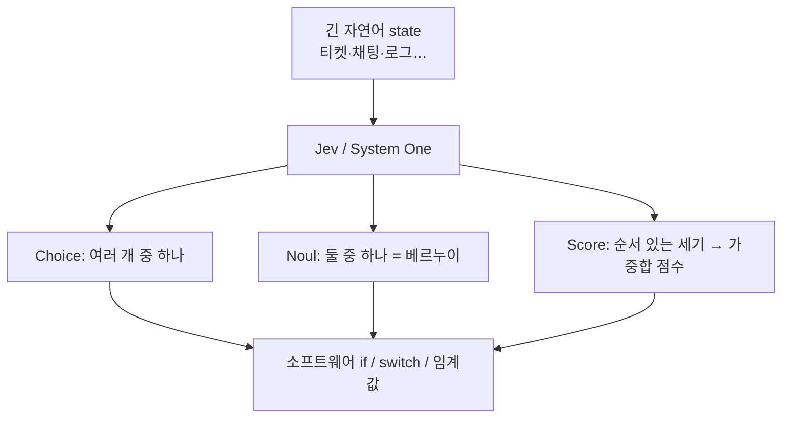
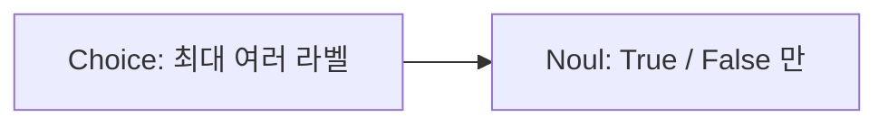
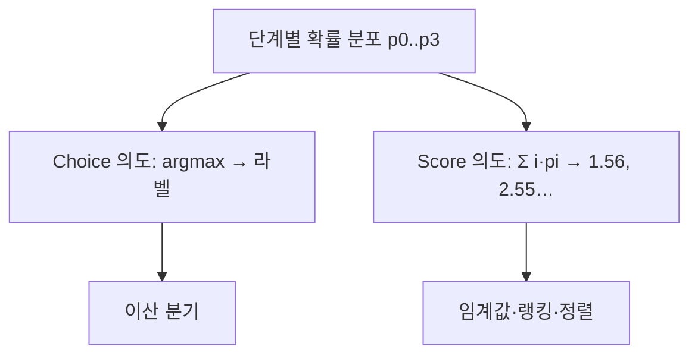
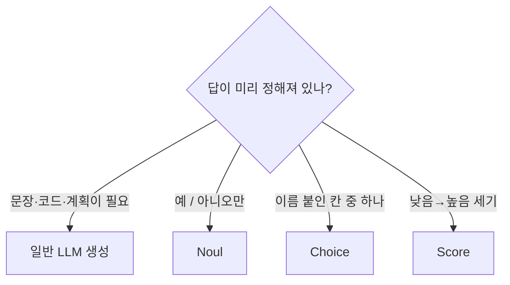

# Jev의 Noul·Score… ‘말하게’ 두지 않고, 예/아니오·세기만 꺼내는 생성 전략

### 유튜브 해설([RX773uJAIOw](https://www.youtube.com/watch?v=RX773uJAIOw))을 따라 Choice의 부분집합인 Noul과, 순서 있는 단계를 가중합하는 Score를 쉽게 풀어 쓴다. Jev는 새 모델 이름이라기보다 LLM의 **판단 전용 생성 전략**이고, 입은 막고 생각(확률·점수)만 받는다

이 글은 위 영상의 **스크립트 전체를** 쉬운 말로 다시 적은 해설이다. 앞서 Choice를 다룬 편에 이어, 이번 편은 **Noul**과 **Score**를 보고, API 명세로 구조를 역추적할 수 있다는 힌트까지 담는다. (모델·추론 구조의 상세 추정은 영상에서 “다음 편”으로 미룬다.)

더 넓은 제품·가격·생태계 맥락은 같은 폴더의 [Jev TypeSafe System One 개요](./261008_2359_Jev_TypeSafe_System_One_Decision_Model.md)를 보면 된다. 여기 문서는 **영상에서 말한 Noul·Score 이야기만** 깊게·쉽게 고정한다.

## 0. 어디에 두는가

Jev는 코딩 에이전트·제품 API로 쓰는 **판단 전용 모델 사례**다. `docs/06_AI/03_AI_Dev_Case_Studies`에 둔다. LLM 내부 수식(`01_LLM`)보다 “소프트웨어가 결정을 어떻게 받나”에 가깝다.

## 1. 한 줄로 잡기 — Jev는 뭐가 다른가

영상 오프닝을 그대로 옮기면 이렇다.

- Jev는 **새로운 LLM 모델**이라기보다, LLM의 **새로운 생성 전략**에 가깝다.
- 기존 LLM과 가장 다른 점: **입을 막아 두고, 생각만 꺼낸다.**
  - 주저리주저리 문장을 쓰게 하지 않는다.
  - 프로그램이 바로 쓸 수 있는 **선택·확률·점수**만 받는다.
- 기본기인 **Choice**는 이전 영상에서 다뤘다.
- 이번 영상은 Choice의 **부분집합**이거나 **개조형**인 **Noul**, **Score**다.
- 이 둘을 본 뒤, **API 명세로 역추적할 수 있는 Jev 구조**까지 살핀다(상세 추정은 다음 영상).



비유하면, 챗봇에게 “JSON으로만 답해”라고 부탁하는 대신, **처음부터 말할 수 있는 칸이 정해진 시험지**를 내는 셈이다.

## 2. Choice를 잠깐만 — Noul·Score의 부모

영상 기준으로 Choice는 **여러 개 중 하나를 고르는 categorical** 판단이다.

질문(`question`)을 채울 때 보통 세 칸이 나온다.

| 칸 | 역할 |
|---|---|
| `type` | `"choice"` |
| `instructions` | 무엇을 묻는지 |
| `criteria` | 선택지들 (**object**: 이름 → 설명) |

응답에는 문항마다 **추정 세기**가 `probabilities`로 오고, 보통은 그중 가장 큰 것(argmax)을 고른다. `confidence` 필드도 있다.

Noul·Score는 이 Choice를 **줄이거나 비튼** 타입이다.

## 3. Noul — “여러 개” 중 가장 작은 부분집합, 2지선다

### 3.1 이름

영상 해석: **Noul ≈ BerNOULli의 Noul**.  
베르누이 시행은 결과가 **둘 중 하나**(예/아니오, 참/거짓)인 경우다.

그래서 Noul은:

> Choice의 subset = **2지선다 Choice**.



### 3.2 문제를 내는 방법 — criteria가 필수가 아니다

Choice는 `type` · `instructions` · `criteria` 세 칸을 채운다.  
**Noul은 criteria가 필수가 아니다.** 참/거짓만으로도 선택지가 어느 정도 정해지기 때문이다.

실무적으로는 `instructions`에 **참인지 거짓인지 물을 문장**만 넣으면 된다.

```json
{
  "refund_requested": {
    "type": "noul",
    "instructions": "고객이 환불을 명시적으로 요청했는가?"
  }
}
```

(제품 API에 따라 `true`/`false` 설명을 `criteria`에 넣는 변형도 있으나, **영상 스크립트**는 “instructions만으로 충분하다”고 설명한다.)

### 3.3 응답 — 숫자 하나

Choice는 `probabilities`로 문항마다 세기가 온다.  
Noul은 더 단순하다.

| 필드 | 의미 |
|---|---|
| `noul` | **0~1**, “참일 추정 세기”(예일 확률) |

- **거짓일 세기**는 따로 안 준다. 합이 1이므로 `1 - noul`이면 된다.
- `confidence` **필드도 없다.** 숫자 하나가 곧 답이고, 곧 확신의 정도다.
  - **0.5 근처** → 잘 모르겠음(확신 낮음)
  - **0 또는 1에 가까움** → 그 선택(거짓 또는 참)을 확신

```json
{
  "nouls": {
    "refund_requested": { "noul": 0.91 }
  }
}
```

코드로 쓰면:

```js
const pYes = response.nouls.refund_requested.noul
const pNo = 1 - pYes

if (pYes >= 0.8) {
  // 환불 요청으로 처리
} else if (pYes <= 0.2) {
  // 환불 요청 아님
} else {
  // 애매 → 사람 검토 또는 LLM으로 에스컬레이션
}
```

### 3.4 언제 유용한가

영상 문장 그대로의 조건:

> 주어진 상황(`state`)은 **긴 자연어라서 애매**하지만,  
> 판단 자체는 **간단해도 충분**할 때.

한 숫자만으로 state의 답을 받을 수 있어 **간결·효율적**이다.  
입이 뚫린 LLM에게 주저리주저리 말하게 시키는 것보다, AI 시스템을 **훨씬 효율적으로** 설계할 수 있다고 영상은 말한다.

주의(개요 문서와 같은 함정): Noul의 0.5는 “중간 정도 실력”이 아니라 **예/아니오가 반반**이다. “얼마나 잘하나” 같은 **세기** 질문은 Score로 보내야 한다.

## 4. Score — Choice를 ‘순서 + 가중합’으로 개조한 타입

### 4.1 개조한다는 뜻

영상: Score는 Choice를 **개조**한 타입이다.  
Choice 문항에 **순서를 매기고**, 그 순서대로 **가중치**를 줘 점수를 낸다.

### 4.2 문제를 내는 방법

| 칸 | Choice | Score |
|---|---|---|
| `type` | `"choice"` | `"score"` |
| `instructions` | 문제 | 문제 (같음) |
| `criteria` | **object** (이름→설명) | **list** (낮은 단계 → 높은 단계) |

차이의 핵심은 **순서의 유무**다.  
list에 **낮은 단계부터 높은 단계** 순으로 “이 단계가 무슨 뜻인지”를 적는다.  
단계는 **2개부터 10개**까지.

```json
{
  "intensity": {
    "type": "score",
    "instructions": "이 메시지의 감정은 얼마나 격한가?",
    "criteria": [
      "중립 / 감정 거의 없음",
      "약한 감정",
      "보통",
      "강한 감정"
    ]
  }
}
```

### 4.3 점수는 어떻게 나오나

1. 답안 후보를 **위급도·감정 격함**처럼 **정성적 크기가 있는 기준**으로 둔다.

   (0=없음, 1=약간, 2·3·4로 갈수록 심함.)
2. 응답으로 오는 값은 “그냥 확률”이라기보다 **각 정도의 세기**(합=1)로 본다.
3. 그 세기를 가중치로, 단계 번호 `0, 1, 2, 3, …`과 **가중합**하면

   “어느 정도 심한지”의 **연속적인 점수**가 된다.

개념식:

\[
\text{score} = \sum_{i=0}^{n-1} i \cdot p_i
\]

여기서 \(p_i\)는 \(i\)번째 단계의 확률(세기)이다. 그래서 네 단계 척도에서도 **1.89** 같은 소수가 나올 수 있다.

```js
// criteria가 4단계(0..3)일 때 기대값 스케치
function expectedScore(probabilities /* length 4, sum≈1 */) {
  let s = 0
  for (let i = 0; i < probabilities.length; i++) {
    s += i * probabilities[i]
  }
  return s
}
```

### 4.4 영상 속 감정 예시

`state`로 감정 격함을 물을 때:

| state | intensity score (영상 수치) | 해석 |
|---|---:|---|
| `"내 API 키였네;;"` | **1.56** | 약한 감정(1)과 보통(2) 사이 |
| 뒤에 `"ㅈ됨;"`을 붙임 | **2.55** | 보통(2)과 강한(3) 사이로 **상승** |

state의 감정이 세진 것이 score에도 반영된다는 관찰이다.

### 4.5 Choice와 나란히 두면

영상에서 instruction을 같게, criteria를 거의 비슷하게 두면 `probabilities` 분포는 **비슷하게** 나올 수 있다. 차이는 소비 방식이다.

| | Choice의 흔한 의도 | Score의 의도 |
|---|---|---|
| 읽는 법 | **argmax** → “가장 센 라벨 하나” | 분포의 **기대값** → 연속 점수 |
| 정보량 | 이산 라벨 | 단계적 크기가 있는 문제에서 **더 구체적** |

Choice의 `probabilities`만으로도 같은 가중합을 직접 짜면 Score처럼 쓸 수 **있긴** 하다. 다만 API가 Score를 이미 편히 주니, **상황 판단의 연속 점수**가 필요하면 Score를 쓰는 편이 낫다고 영상은 정리한다.



## 5. 세 타입을 한눈에 (영상 + 실무)

| 타입 | 한 줄 | criteria | 답이 주는 것 | 코드 감 |
|---|---|---|---|---|
| Choice | 여러 개 중 하나 | object | 라벨 + probabilities (+ confidence) | `switch` |
| Noul | 참/거짓 | (영상: 필수 아님) | `noul` 0~1만 | `if (p)` |
| Score | 순서 있는 세기 | list 2~10 | 소수 가능 `score` | 임계값·정렬 |



## 6. API로 구조를 역추적할 수 있다 — 영상의 맺음

영상 후반:

- Hugging Face에도 **Jev처럼 동작하는 모델**이 이미 여럿 공개되고 있다.
- 비슷한이 빨리 나오는 이유: **기존 LLM과 크게 다르지 않기** 때문이다.
- Jev의 **API 명세·가격 정책**을 보면 모델·추론 구조를 **역으로 추적**할 수 있는 부분이 많다.
- 그 **추정은 다음 영상**에서 다룬다.

이 문서에서는 영상 범위를 넘지 않는다. “입이 막힌 출력 타입(Choice/Noul/Score) + state/questions API”가 곧 제품의 공개 표면이고, 그 표면이 내부 구조를 어느 정도 드러낸다는 관찰만 남긴다.

요청 한 방의 스케치(세 타입을 한 `state`에 묶기):

```json
{
  "model": "jev-latest",
  "state": "내 API 키였네;; ㅈ됨;",
  "questions": {
    "leaked_key": {
      "type": "noul",
      "instructions": "이 메시지는 API 키 유출을 암시하는가?"
    },
    "intensity": {
      "type": "score",
      "instructions": "감정은 얼마나 격한가?",
      "criteria": [
        "중립 / 거의 없음",
        "약한 감정",
        "보통",
        "강한 감정"
      ]
    },
    "channel": {
      "type": "choice",
      "instructions": "어디에 알릴까?",
      "criteria": {
        "security": "보안 온콜",
        "support": "일반 고객지원",
        "ignore": "무시해도 됨"
      }
    }
  }
}
```

입이 뚫린 모델에게 “JSON으로 urgency랑 emotion이랑 routing을 한꺼번에…”라고 쓰는 대신, **칸마다 타입이 다른 시험지**를 한 번에 내는 그림이다.

## 7. 스크립트를 따라가는 짧은 요약

1. Jev = (새 모델이라기보다) **입을 막은 생성 전략**.
2. Choice = 여러 중 하나(이전 편).
3. **Noul** = 베르누이식 2지선다. criteria 없이도 instructions만으로 참/거짓. 응답은 `noul` 하나. confidence 없음. 0.5=모름.
4. **Score** = criteria를 **순서 list**로 두고 단계 확률을 가중합 → 연속 점수. 2~10단계. 감정·위급도처럼 **세기**에 맞음.
5. Choice로도 가중합을 흉내 낼 수 있지만, Score API가 그 의도를 편하게 준다.
6. 유사 모델이 빨리 나오는 이유 ≈ LLM과 크게 안 다름. API·가격으로 구조 추정 가능 → **다음 영상**.

## 8. 결론

이번 영상이 가르치는 실무 감각은 단순하다. **긴 글을 읽혀야 하는 애매한 상황**에서도, 소프트웨어가 필요한 답이 “예/아니오”이거나 “얼마나 센가”라면 LLM에게 말을 시키지 말고 **Noul·Score로 숫자만 받으면 된다.** Choice가 categorical 분기라면, Noul은 그 최소형이고, Score는 같은 분포를 **순서 있는 자로 재는** 개조형이다. 입이 막힌 만큼 파싱·환각 문장·재시도가 줄고, 임계값과 폴백은 **코드가** 소유한다.

---

**원문 및 참고**

- 유튜브 해설 영상: https://www.youtube.com/watch?v=RX773uJAIOw
- 같은 폴더 개요: [Jev TypeSafe System One 한 결정 모델](./261008_2359_Jev_TypeSafe_System_One_Decision_Model.md)
- TypeSafe / Jev API 개념(요청·타입 형태 보강): https://docs.typesafe.ai/ · 공개 소개 문서들(Choice / Noul / Score)

※ 본 문서는 위 영상 스크립트를 우선 반영한 쉬운 해설이다. 감정 score 수치(1.56, 2.55)는 영상에서 든 예시값이다. API 필드명·엔드포인트는 제품 버전에 따라 달라질 수 있으니 공식 문서를 최종 기준으로 한다. 모델 가중치·추론 구조의 역추정은 영상에서 다음 편으로 남겨 두었으므로 여기에서는 단정하지 않는다.
