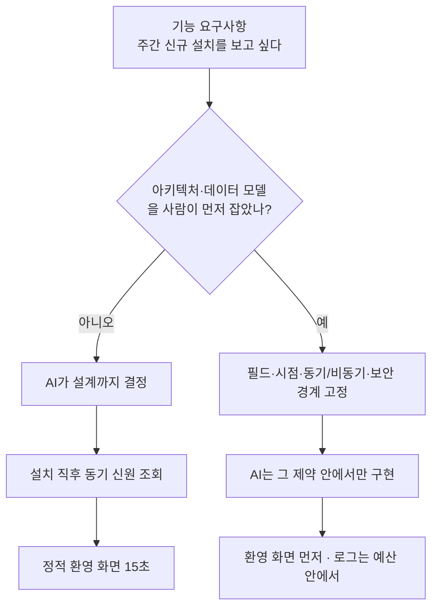
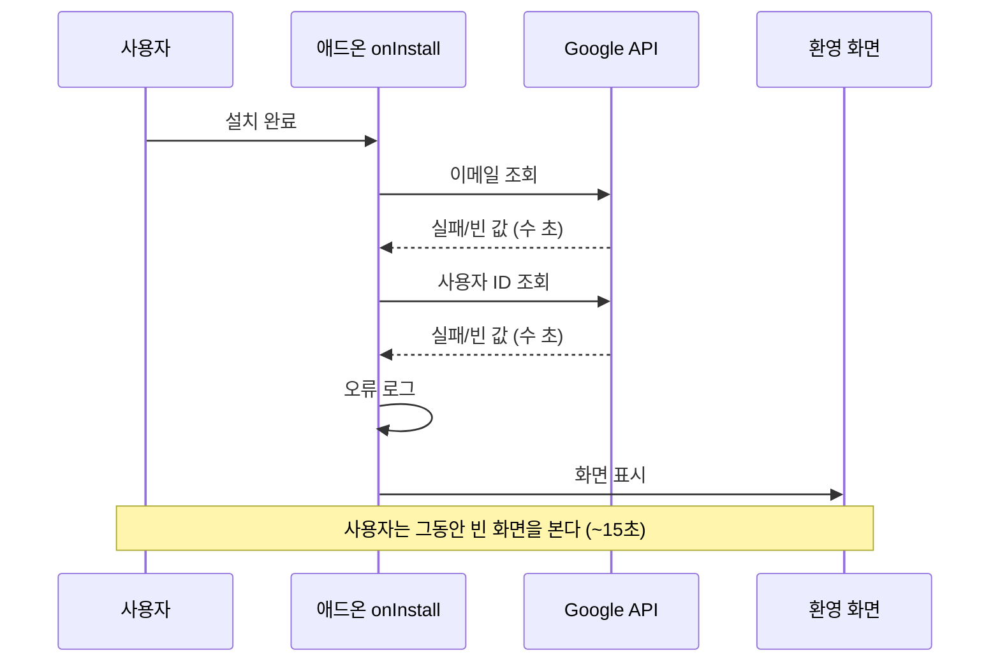
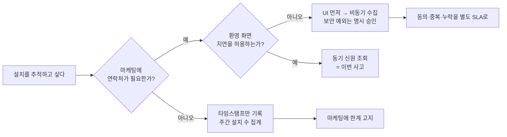
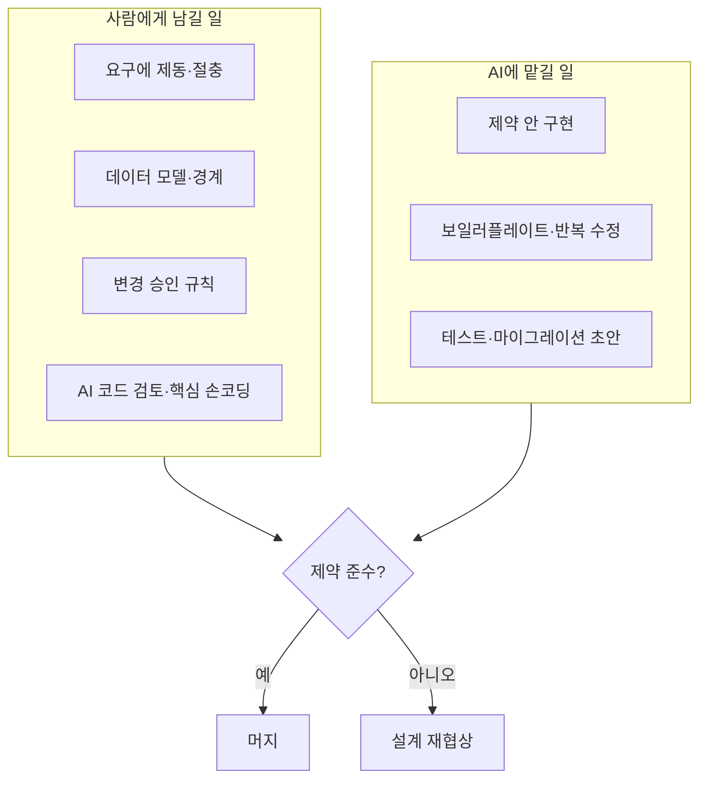

# 우리는 개발자에게 알리지도 않고 아키텍트로 승진시켰다

### Google Forms 애드온의 정적 환영 화면이 15초 걸린 이유는, 바이브 코딩으로 넣은 ‘설치 로그’가 이메일·ID를 동기적으로 조회했기 때문이다. Mani Doraisamy는 이 사고를 근거로, 요구사항만 주고 아키텍처를 안 주면 AI가 설계까지 결정한다고 쓴다. HN에서는 ‘원래 엔지니어 일이다’와 ‘AI도 맥락을 주면 반박한다’는 반론이 갈렸다


Mani Doraisamy는 2026년 11월 20일 [We promoted developers into architects without informing them](https://manidoraisamy.com/developer-to-architect.html)을 올렸다. GeekNews([토픽 37548](https://news.hada.io/topic?id=37548))는 요지를 묶었고, [Hacker News](https://news.ycombinator.com/item?id=50579331)에서는 616포인트·331댓글이 붙었다. 글의 핵심은 보안 공지가 아니라 **역할 전환의 공백**이다. 구현은 AI가 맡고, 사람은 요구사항 협상·데이터 모델·제약·검토를 해야 하는데, 그 승진을 아무도 알려 주지 않았다는 것이다.

이 글은 원문, GeekNews 요약, HN 토론, 그리고 같은 계열의 실무 규범([No AI Slop](261115_0142_No_AI_Slop_Manifesto.md), [도메인 전문성](261109_0110_Domain_Expertise_Beats_Coding_Skill_in_Vibe_Coding_Business.md))을 기사 형태로 다시 읽는다. **원문에 없는 애드온 내부 구현·실측 트레이스는 재구성 예제일 뿐이며, 15초는 저자가 관측한 한 건이다.**

## 0. 어디에 두는가

모델 아키텍처나 런타임 뉴스가 아니라 **코딩 에이전트·바이브 코딩을 쓸 때 사람이 맡아야 할 설계·제약·검토** 이야기다. typeboard 분류상 `docs/06_AI/03_AI_Dev_Case_Studies`에 둔다. `07_Tech_Trends`의 도구·프레임워크 소식과도, `02_Agents`의 에이전트 루프와도 겹치지만, 사례 폴더의 “실제 개발 역할이 어떻게 바뀌는가”에 가장 가깝다.

| 항목 | 내용 |
|---|---|
| 원문 | Mani Doraisamy, 2026-11-20 |
| 트리거 사례 | Google Forms 애드온 설치 후 환영 화면 **약 15초** |
| 직접 원인 | AI가 쓴 설치 로그가 이메일 → ID → 오류를 **동기 try/catch 연쇄**로 조회 |
| 저자 처방 | 타임스탬프만 남기거나, 환영 화면 후 **비동기** 수집 + 마케팅에 한계 고지 |
| 일반화 | 요구사항만 주면 AI가 아키텍처를 결정한다. 사람이 먼저 설계·제약을 잡아야 한다 |
| HN 반응 | “원래 SWE 일” vs “직함 아키텍트 안티패턴” vs “AI도 물으면 반박한다” |



## 1. 한눈에 보기: 요구사항 vs 아키텍처

같은 “설치를 기록한다”도, 무엇을 언제 어떻게 남기느냐에 따라 제품이 달라진다.

| 결정 | 요구사항만 줄 때 AI가 고르기 쉬운 쪽 | 아키텍트가 먼저 박아야 하는 쪽 |
|---|---|---|
| 기록 필드 | 이메일, 사용자 ID, “알 수 없음” 오류까지 | 설치 시각만 / 동의한 신원만 / 둘 다 |
| 실행 시점 | 설치 직후, 환영 화면 **이전** | 환영 화면 **이후**, 또는 백그라운드 |
| 실패 처리 | try → 다른 API → 또 다른 API | 한 번 실패하면 타임스탬프만 남기고 종료 |
| 보안 | 인증된 페이로드만 받도록 재작성 | 비인증 수집이 필요하면 **명시적 승인**과 검증 |
| 하위 호환 | 예전 테이블·컬럼을 그대로 두고 새 버전 추가 | “유지” vs “삭제 후 단일 스키마”를 **지시** |

원문은 AI 코딩 도구가 **기능 요구사항 + 보안 + 하위 호환**에 맞춰져 있다고 본다. 그 결과 (1) 보안을 위해 성능을 깎는 구조, (2) 중복 테이블·컬럼·코드가 쌓이기 쉽다는 것이다.

## 2. 15초의 원인: 한 줄 코드 뒤의 여러 API

### 2.1 무엇이 일어났는가

동료는 주간 신규 설치를 보려고 로그를 바이브 코딩했다. 신규 고객을 보는 일은 사업에 중요하니 방향 자체는 맞다. 문제는 **이메일까지** 남기려 한 점과, Google이 지난 12월부터 사용자 정보 접근을 크게 줄인 맥락을 AI가 “실패하면 다음 조회”로만 푼 점이다.

원문이 적은 연쇄는 대략 이렇다.

1. 설치 시 공유에 동의한 사용자 이메일을 가져온다.
2. 실패하면 사용자 ID를 조회한다.
3. 그마저 실패하면 “설치는 됐지만 이메일·ID를 모른다”는 오류를 남긴다.

코드상으로는 각 단계가 한 줄처럼 보이지만, 내부에서는 Google 서버로 **여러 API 호출**이 나간다. 이 로그가 설치 후 **가장 먼저** 돌았기 때문에, 정적 환영 화면이 뜨기까지 약 15초가 걸렸다.




### 2.2 재구성 예시: 동기 신원 조회(안티패턴)

아래는 **원문 서술을 교육용으로 재구성한 의사코드**다. 실제 애드온 소스가 공개된 것은 아니다. Google Apps Script의 `Session` / Properties 스타일을 빌린다.

```javascript
/**
 * ANTI-PATTERN — 환영 화면보다 먼저 도는 동기 신원 로그
 * 각 getXxx()는 코드 한 줄처럼 보여도 내부에서 원격 호출이 날 수 있다.
 */
function onInstall(e) {
  logInstallIdentitySync_(); // ← 여기서 수십 초가 샐 수 있음
  showWelcomeUi_();
}

function logInstallIdentitySync_() {
  var props = PropertiesService.getScriptProperties();
  var stamp = new Date().toISOString();

  try {
    var email = Session.getActiveUser().getEmail(); // 동의·스코프·정책에 따라 빈 문자열 가능
    if (email) {
      props.setProperty("last_install", JSON.stringify({ at: stamp, email: email }));
      return;
    }
  } catch (err1) {
    // fall through
  }

  try {
    var userId = Session.getTemporaryActiveUserKey(); // 또는 플랫폼별 ID API
    props.setProperty("last_install", JSON.stringify({ at: stamp, userId: userId }));
    return;
  } catch (err2) {
    props.setProperty(
      "last_install",
      JSON.stringify({ at: stamp, error: "installed_but_unknown_identity" })
    );
  }
}
```

한 줄짜리 `getEmail()`이 “로컬 읽기”가 아니라 **정책·권한·네트워크**를 탄다는 감각이 없으면, “로그 한 줄 추가”로 착각하기 쉽다. 리뷰어가 “이 호출의 예산(latency budget)은?”을 묻지 않으면 그대로 머지된다.

## 3. 올바른 코드는 ‘절충’에서 시작한다

### 3.1 아키텍트가 고를 수 있는 두 갈래

원문이 제시하는 시니어/아키텍트 판단은 두 가지다.

1. **설치 시각만** 남긴다. 마케팅에는 “설치만으로는 후속 메일을 보낼 수 없다”고 말한다.
2. 이메일이 꼭 필요하면 **환영 화면을 먼저** 띄우고, 사용자가 화면을 보는 동안 브라우저에서 비동기로 남긴다. 다만 환영 화면에서 서버를 치면, 서버가 **비인증 페이로드**를 받아 기록하도록 보안 경계를 열어야 할 수 있다.

요약하면 아키텍트의 일은 (a) 앱을 느리게 만드는 요구에 **제동**을 걸거나, (b) 비동기·합리적 우회로 **성능과 보안을 조정**하는 것이다.



### 3.2 예시: 환영 화면 우선 + 최소 로그

```javascript
/**
 * BETTER — 설치 시각만 동기 기록, 신원은 선택·비동기
 * 패치/도구를 대신하지 않는, 아키텍처 제약을 코드로 고정한 예.
 */
var InstallLog = {
  // 아키텍처 계약: 설치 경로의 동기 작업은 로컬/캐시 쓰기만.
  recordInstallTimestamp: function () {
    PropertiesService.getScriptProperties().setProperty(
      "last_install_at",
      new Date().toISOString()
    );
  },

  // 신원은 UI가 뜬 뒤에만. 실패해도 사용자 경로를 막지 않는다.
  tryRecordIdentityAsync: function () {
    // HtmlService 등에서 google.script.run 으로 호출한다고 가정
    try {
      var email = Session.getActiveUser().getEmail();
      if (!email) return { ok: false, reason: "empty_email" };
      // 서버가 비인증 수집을 허용한다면, 여기서도 서명·rate limit·스키마 검증이 필요.
      return { ok: true, email: email };
    } catch (e) {
      return { ok: false, reason: String(e) };
    }
  }
};

function onInstall(e) {
  InstallLog.recordInstallTimestamp();
  showWelcomeUi_(); // 신원 조회보다 먼저
}

function showWelcomeUi_() {
  var html = HtmlService.createHtmlOutput(
    "<p>설치해 주셔서 감사합니다.</p>" +
      "<script>" +
      "google.script.run.withSuccessHandler(function(){})" +
      ".tryRecordIdentityFromClient();" +
      "</script>"
  );
  // SpreadsheetApp.getUi().showModalDialog(html, "Welcome"); 등
}
```

제품·마케팅 합의는 코드 주석이 아니라 **문서/티켓에 한 줄**로 남겨야 한다. 예: “주간 설치 KPI = `last_install_at` 카운트. 팔로업 이메일은 별도 옵트인 폼.”

### 3.3 예시: AI에게 넘기기 전에 박아 둘 제약 프롬프트

요구사항만 던지지 말고, **바꾸면 안 되는 경계**를 같이 준다. (도구·모델 불문. 팀 규칙으로 고정해도 된다.)

```text
구현 제약 (변경 시 먼저 승인 요청):
1. onInstall 동기 경로에서는 원격 신원 API를 호출하지 말 것.
2. 설치 이벤트 스키마는 { installedAt: ISO8601 } 만. email/userId 컬럼 추가 금지.
3. 환영 UI는 신원 조회 완료를 await 하지 말 것.
4. 하위 호환: 기존 last_install JSON 키는 읽기만 하고, 새 쓰기는 last_install_at 로만.
5. 보안: 비인증 ingest 엔드포인트를 새로 만들지 말 것. 필요하면 ADR을 먼저 작성.
```

원문 노트도 같은 선을 짚는다. CAP처럼 **자원을 한정해 무엇을 버릴지**가 아키텍처인데, 그걸 모른 채 “전부”를 시키면 AI는 Spanner급을 가정하거나, 반대로 누구나 쓰는 밋밋한 설계로 타협한다.

## 4. AI가 ‘제동’을 안 거는 이유 — 그리고 HN의 반론

### 4.1 원문의 주장

- AI는 코드 작성에는 능하지만, **출시 직전인지 / 수백만 사용자인지** 같은 사업 맥락을 모른다. 그 맥락이 있어야 타임스탬프 vs 이메일을 고를 수 있다.
- 요구에 맞추려는 성향(아첨) 때문에 **반박보다 구현**을 고른다. 그 결과가 15초 환영 화면이다.
- **아키텍처를 안 주고 요구사항만 주면**, AI가 아키텍처를 대신 정한다.
- 보안을 과하게 우선하면 비인증 페이로드 수신 코드를 안 쓰거나, 사람이 쓴 코드까지 인증 필요로 고쳐 **성능·재로그인**을 망가뜨릴 수 있다.

### 4.2 저자가 말하는 ‘새 업무’

아키텍트에게는 익숙한 루프다. 데이터 모델을 설계하고, 구현을 위임하고, 맞는지 검토한다. 문제는 코딩을 잘하던 개발자에게 **구현 재미는 AI가 가져가고**, 요구 협상·설계·제약·검토라는 새 역할은 **안내되지 않았다**는 점이다. 원문은 그 공백이 바이브 코딩에 대한 혼란과 반감을 만든다고 본다.

후기(노트 [2])에서 저자는 HN 피드백을 일부 받아들인다. 좋은 개발자는 이미 아키텍처를 하고, 나쁜 아키텍트는 구현과 동떨어진 상아탑을 그린다. 손대지 않으면 상아탑이 늘고, AI 시대에는 **디버깅·핵심 경로 손코딩**을 가끔이라도 해야 한다고 덧붙였다. “코딩을 완전히 그만두지 말되, 풀타임 일은 아니다.”

블로그 댓글에서도 온도가 갈렸다. Spec-driven development를 묻자 저자는 “요구 과중·설계 과소”로 보인다고 답했고, “코딩이 재미였는데 이 승진은 원하지 않았다”는 반응에는 경제성 질문으로 답했다. 회사가 AI보다 비싼 손코딩에 계속 돈을 낼까.

## 5. 커뮤니티 반응 (Hacker News)

- **원래 엔지니어 일이다.** “티켓 받을 때마다 요구에 밀고, 데이터 모델을 짜는 게 SWE 일 아닌가. 타이핑만 하던 사람이면 직격타”는 댓글이 많이 공감을 받았다. 직함 ‘Architect’를 새로 만든 게 아니라, **손코딩 비중이 줄며 설계 비중이 드러난 것**이라는 읽기다.
- **Architect 직함 안티패턴.** 아키텍트가 시스템·사용 맥락을 엔지니어보다 모르면서 영향력만 크면 조직 안티패턴이라는 주장, “엔터프라이즈 아키텍트·PowerPoint 아키텍처”에 대한 반감이 이어졌다. 좋은 아키텍트는 경계를 주고 분쟁을 조정하고 큰 그림을 지키며 세부는 팀에 맡긴다는 반론도 있었다.
- **AI도 반박한다.** “명령만 내리지 말고 대화하면 밀어붙인다”, “출시 규모를 알려 주면 안다”, “이 코드 performant하냐만 물어도 잡힌다”는 경험이 공유됐다. 동시에 “막연한 성능 프롬프트는 과잉 최적화로 간다”, “맥락을 주는 일 자체가 아키텍트 일”이라는 답이 달렸다.
- **주니어·학습 경로.** 바이브 코딩만 하면 아키텍트로 성장할 기회가 없다는 걱정, “버그는 아직 안 풀렸다. 사람은 수정본을 내보내야 한다”, “에이전트가 불평하지 않으니 비전 있는(?) 아키텍트만 남고 IC가 잘린다”는 냉소가 섞였다.
- **비유.** 트랙터가 농부를 해방시키듯 다음 가치 일로 옮기라는 낙관과, 소프트웨어 수요가 이미 포화였다면 이동할 자리가 없다는 비관이 충돌했다. “음악가에게 AI가 작곡하니 네가 아키텍트라고 말하는 꼴”이라는 비유도 나왔다.

## 6. 실무로 옮기는 체크리스트

- [ ] “로그 한 줄”·“필드 하나” 변경이라도 **동기 경로·원격 호출·환영/첫 화면 지연**을 리뷰 항목에 넣었다
- [ ] 설치·가입·결제 등 크리티컬 경로의 **latency budget**(예: 동기 ≤ 200ms)을 팀에 공유했다
- [ ] AI/에이전트에게 기능 요구와 함께 **스키마·동기/비동기·보안 경계·하위 호환 정책**을 제약으로 넘긴다
- [ ] 제약을 깨는 변경은 도구가 임의로 하지 않고 **ADR/티켓 승인**을 받게 했다
- [ ] 마케팅·제품 KPI와 엔지니어링 이벤트 스키마가 같은지 맞추고, 못 주는 필드는 **명시적으로 거절**한다
- [ ] AI 출력은 아키텍트가 개발자 코드를 보듯 검토한다. 핵심 경로는 가끔 **직접 읽고 손댄다**
- [ ] 바이브 코딩 반감이 나오면 “타이핑 박탈”이 아니라 **역할 안내 부재**인지 먼저 본다



## 7. 정리

15초짜리 환영 화면은 “AI가 못써서”가 아니라 **누가 성능을 위한 필드·시점을 결정하는가**가 비어 있을 때 생기는 사고에 가깝다. 요구사항만 던지면 설계는 모델 기본값(보안 우선, 실패 시 재시도, 하위 호환 누적)으로 채워진다. 그 기본값이 틀린 제품에서는 정적 화면조차 느려진다.

코딩이 싸지고 빨라질수록, 남는 일은 원문이 말한 승진과 같다. 무엇을 버릴지 고르고, 스키마를 고정하고, AI를 그 안에 가두고, 출력을 검토하는 일. 다만 HN이 상기시키듯, 그건 새 직함이라기보다 **원래 엔지니어링의 중심**이었고, 직함만 띄운 상아탑 아키텍처와는 반대다. 승진을 알리지 않은 조직이 혼란을 키운다는 진단과, 맥락을 주면 모델도 밀어붙인다는 실무 팁은 함께 가져가면 된다.

## 참고

- Mani Doraisamy, [We promoted developers into architects without informing them](https://manidoraisamy.com/developer-to-architect.html) (2026-11-20)
- 동일 글 미러: [Intelligent Artifact](https://intelligentartifact.com/posts/we-promoted-developers-into-architects-without-informing-them/)
- GeekNews, [우리는 개발자들에게 알리지도 않고 아키텍트로 승진시켰다](https://news.hada.io/topic?id=37548)
- [Hacker News 토론](https://news.ycombinator.com/item?id=50579331) (item 50579331)
- Google Apps Script, [Authorization modes / Session](https://developers.google.com/apps-script/guides/services/authorization) — FULL/LIMITED와 `getEmail()` 빈 문자열 가능성은 플랫폼 문서를 기준으로 따로 확인할 것
- 같은 카테고리: [No AI Slop 선언문](261115_0142_No_AI_Slop_Manifesto.md), [바이브코딩과 도메인 전문성](261109_0110_Domain_Expertise_Beats_Coding_Skill_in_Vibe_Coding_Business.md), [Jev·Noul·Score 결정 유형](261118_0116_Jev_Noul_and_Score_Decision_Types.md)
- GeekNews 관련: [No AI Slop](https://news.hada.io/topic?id=37128), [도메인 전문성](https://news.hada.io/topic?id=37100)(있다면 교차 확인)
