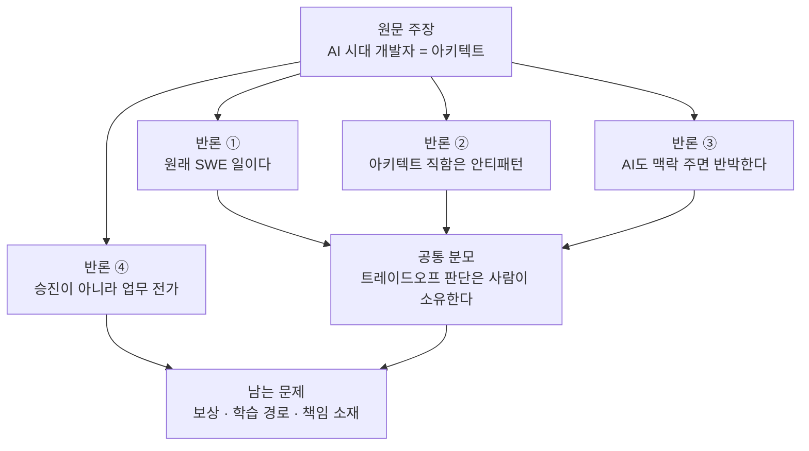
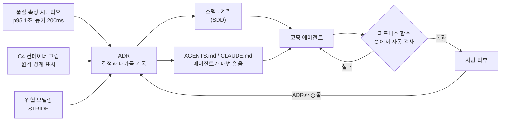
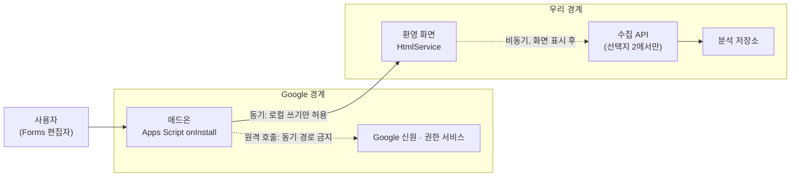
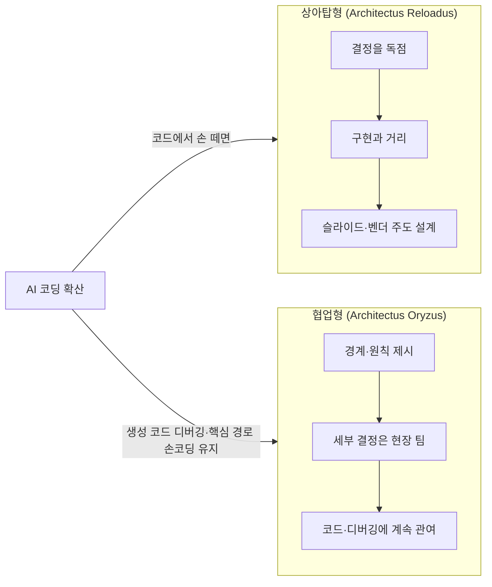
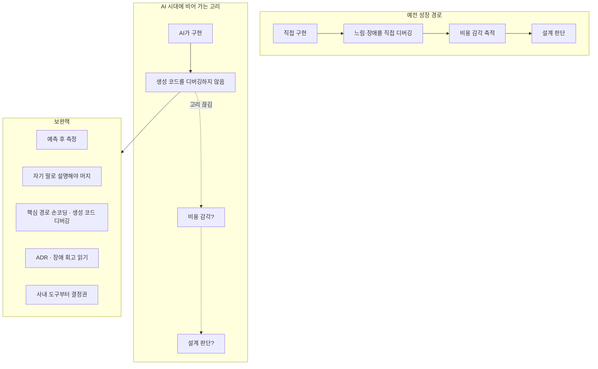

# "아키텍트로 승진했다"는 말을 둘러싼 논쟁: 승진인가, 원래 일인가, 떠넘기기인가

### AI가 구현을 맡으면 개발자에게는 세 가지 일이 남는다. 요구사항에 제동을 걸고, 품질 속성 가운데 무엇을 버릴지 정하고, 그 결정을 AI가 지키게 하는 일이다. Mani Doraisamy의 "알리지 않은 승진" 글은 이 변화를 15초짜리 환영 화면 사례로 보여 줬다. Hacker News에서는 네 갈래 반론이 나왔다. 원래 엔지니어 일이라는 반론, 아키텍트 직함이 안티패턴이라는 반론, AI도 맥락을 주면 반박한다는 반론, 그리고 승진이 아니라 업무 전가라는 반론이다. 이 글은 사례보다 그 논쟁을 다루고, "아키텍처적 판단력"을 실제 도구(품질 속성 시나리오, ADR, C4, 위협 모델링, 스펙 주도 개발, 에이전트 지침 파일, 피트니스 함수)로 풀어 본다


2026년 11월 20일 Mani Doraisamy는 자신의 블로그 "Developer forever"에 [We promoted developers into architects without informing them](https://manidoraisamy.com/developer-to-architect.html)을 올렸다. 이 글은 [Hacker News](https://news.ycombinator.com/item?id=50579331)에서 600포인트를 넘겼고(수집 시점 626포인트, 댓글 332개), GeekNews에도 [소개](https://news.hada.io/topic?id=37548)됐다.

사례 자체는 같은 저장소의 [「우리는 개발자에게 알리지도 않고 아키텍트로 승진시켰다」](261123_2211_Promoted_Developers_to_Architects_Without_Telling_Them.md)(이하 "기존 글")에서 자세히 다뤘다. 설치 로그의 동기 신원 조회, 시퀀스 다이어그램, Apps Script 재구성 코드, 두 갈래 해법의 결정 트리, 제약 프롬프트가 그쪽에 있다. 이 글은 그 내용을 짧게만 요약하고 다음 질문으로 넘어간다. **"아키텍트처럼 판단한다"는 것이 구체적으로 무엇이고, 그것이 승진인지 아닌지를 두고 개발자들은 왜 이렇게 갈라지는가.**

근거는 원문과 원문 후기(노트 [1], [2]), 원문 블로그 댓글, HN 스레드 본문, Google Workspace 업데이트 공지, 그리고 Martin Fowler의 [Who Needs an Architect?](https://martinfowler.com/ieeeSoftware/whoNeedsArchitect.pdf)(IEEE Software, 2003), CAP 정리의 [Gilbert & Lynch 증명](https://users.ece.cmu.edu/~adrian/731-sp04/readings/GL-cap.pdf), LLM 아첨 연구 [Towards Understanding Sycophancy in Language Models](https://arxiv.org/abs/2310.13548) 같은 1차 자료다. **HN 댓글은 사용자명과 의역으로 인용했다. 스레드는 계속 바뀌므로 포인트와 댓글 수는 수집 시점 값이다(기존 글은 더 이른 시점의 616포인트·331댓글을 적었다). 표·코드·수식 안의 수치 예시는 설명용 재구성이며 원문의 실측값이 아니다. 원문 수치는 15초뿐이다.**

## 1. 한눈에 보기

| 항목 | 내용 |
|---|---|
| 원문 | Mani Doraisamy, "We promoted developers into architects without informing them" (2026-11-20) |
| 촉발 사례 | 바이브 코딩한 설치 로그가 이메일 → 사용자 ID → 오류 기록을 차례로 시도해, 정적 환영 화면이 뜨는 데 **15초** 걸렸다 |
| 원문 그림 | 삼각형 두 장. 하나는 "요구·보안 충족, 성능 희생", 다른 하나는 "비개발자는 성능을 잃고, 개발자는 **바이브 코드를 버린다**" |
| 원문 진단 | AI는 사업 맥락을 모르고, 아첨 성향 탓에 요구에 반박하지 않으며, **보안과 하위 호환성**을 우선하도록 맞춰져 있다 |
| 원문 결론 | 요구사항만 주면 AI가 아키텍처를 정한다. 개발자의 새 일은 **아키텍트**다. 코딩은 계속 하되 풀타임 일은 아니다(노트 [2]) |
| HN 규모 | 626포인트 · 332댓글 (수집 시점) |
| 반론 ① | "원래 엔지니어 일이다". 요구에 반박하고 데이터 모델을 짜는 것은 늘 SWE의 일이었다 |
| 반론 ② | "아키텍트 직함은 안티패턴이다". 시스템을 덜 아는 사람이 결정권을 더 가지는 구조라는 비판이다 |
| 반론 ③ | "AI도 반박한다". 규모와 맥락을 알려 주면 AI도 반대 의견을 낸다는 경험담이다 |
| 반론 ④ | "승진이 아니라 업무 전가다". PM·아키텍트·QA를 혼자 맡는데 급여는 그대로라는 불만이다 |
| 남는 질문 | 손으로 구현해 보지 않은 세대는 트레이드오프 감각을 어디서 기르는가 |



## 2. 먼저 용어 네 개

이 논쟁은 몇 가지 용어를 전제로 한다. 개발 경험이 적은 독자를 위해 비유로 먼저 정리한다.

| 용어 | 뜻 | 비유 |
|---|---|---|
| **아키텍처 vs 구현** | 아키텍처는 바꾸기 비싼 큰 결정(무엇을 어디에 두고, 무엇이 무엇을 언제 부르는가)이다. 구현은 그 틀 안에서 실제 코드를 쓰는 일이다 | 집을 지을 때 내력벽·배관·창 위치를 정하는 것이 설계, 벽지를 바르고 타일을 붙이는 것이 시공이다. 벽지는 나중에 바꿔도 되지만 내력벽은 아니다 |
| **기능 요구 vs 비기능 요구** | 기능 요구는 시스템이 *무엇을* 하는가("설치를 기록한다"), 비기능 요구는 그 일을 *얼마나 잘* 하는가(빠르게, 안전하게, 고치기 쉽게) | 식당에서 "김치찌개를 판다"는 기능, "10분 안에 나오고 위생 점검을 통과한다"는 비기능이다 |
| **품질 속성** | 비기능 요구를 측정 가능한 특성으로 나눈 것. 성능, 보안, 가용성, 유지보수성, 호환성 등. ISO/IEC 25010이 [체계적으로 분류](https://iso25000.com/index.php/en/iso-25000-standards/iso-25010)한다 | 자동차의 연비, 안전 등급, 정비 비용 같은 사양표 항목 |
| **트레이드오프** | 한 품질 속성을 올리면 다른 속성이 내려가는 관계. 그래서 "무엇을 포기할지"를 정해야 한다 | 여행 가방 하나에 짐을 싸면 옷을 늘릴수록 신발을 줄여야 한다. 가방을 키우면 들고 다니기 힘들다 |

이 글에서 말하는 **아키텍처적 판단력**은 이 넷을 합친 것이다. 기능 요구를 받았을 때 그것이 어떤 품질 속성을 건드리는지 알아채고, 무엇을 우선하고 무엇을 감수할지 정하고, 그 결정을 기록해 지키게 하는 능력이다.

## 3. 출발점: 15초와 삼각형 두 장

### 3.1 사례 요약 (자세한 내용은 기존 글)

팀은 주간 신규 설치 수를 보려 했다. 동료가 바이브 코딩(vibe coding: 코드를 거의 읽지 않고 자연어 요구만으로 AI에게 구현을 맡기는 방식)으로 설치 로그를 만들었다. AI가 쓴 코드는 이메일을 가져오고, 실패하면 사용자 ID를, 그것도 실패하면 "식별 불가" 오류를 기록했다. 코드로는 한 줄씩이지만 단계마다 Google 서버로 여러 API 호출이 나갔다. 이 로그가 설치 직후 가장 먼저 실행되면서 **정적 환영 화면이 15초 뒤에야 떴다.** 사용자 입장에서 설치 로그는 아무 가치가 없는 기능이다. 그런데 그 기능 때문에 첫인상이 망가졌다.

시퀀스 다이어그램과 안티패턴·개선 코드는 기존 글 2장과 3장에 있다.

### 3.2 "작년 12월부터"의 정체 (추정)

원문은 Google이 "작년 12월부터" 사용자 정보 접근을 크게 제한했다고만 쓰고, 어떤 변경인지 밝히지 않았다. 원문이 2026년 11월에 쓰였으니 작년 12월은 2025년 12월이다.

시기가 맞는 공식 변경이 하나 있다. Google Workspace 업데이트 블로그의 [Granular OAuth consent in Google Apps Script](https://workspaceupdates.googleblog.com/2025/08/granular-oauth-consent-in-google-apps.html) 공지에 따르면, Apps Script로 만든 **게시된 Editor 애드온**(Google Forms 애드온이 여기에 속한다)에 세분화된 OAuth 동의 화면이 적용됐다. 롤아웃은 두 번 연기된 끝에 **2025년 12월 둘째 주**에 시작됐다. 이 변경 뒤로 사용자는 애드온이 요청한 권한(scope)을 전부 승인하거나 전부 거절하는 대신, 일부만 골라 승인할 수 있다. Google은 개발자에게 승인된 scope를 프로그램으로 확인하고, 필요한 scope가 없으면 실행을 일찍 끝내는 안전장치를 넣으라고 권한다.

Apps Script의 [`User.getEmail()`](https://developers.google.com/apps-script/reference/base/user) 문서도 보안 정책이 사용자 신원 접근을 막으면 빈 문자열을 돌려준다고 적고 있다. 따라서 "이메일 조회가 실패하거나 빈 값을 돌려주는 경우가 늘었고, AI가 그것을 '다른 API로 재시도'로 풀었다"는 흐름은 개연성이 높다. **다만 원문이 가리킨 변경이 이 공지라는 점은 원문에 적혀 있지 않은 추정이다.**

이 대목이 판단력과 관련 있는 이유는 따로 있다. AI가 실패를 만났을 때 기본으로 하는 일은 **실패를 우회하는 코드를 더 쓰는 것**이다. 사람이라면 "권한 모델이 바뀌었으니 이 데이터는 이제 기대하지 말자"는 결정을 내릴 수 있다. 환경 변화를 요구 변경으로 번역하는 일이 아키텍트의 몫이다.

### 3.3 첫 번째 삼각형: 아무도 고르지 않은 희생


원문 본문의 첫 그림은 꼭짓점 세 개짜리 삼각형이다.

| 꼭짓점 | 그림 속 설명 | 결과 |
|---|---|---|
| Vibe code | 설치하는 모든 사용자를 기록 | 충족 |
| Security | 코드 줄마다 Google 서버 호출 | 충족 |
| Performance | 환영 화면 로딩 15초 | **희생** |

요구(모든 설치자 기록)와 보안은 챙겼고, 그 대가를 **아무도 결정하지 않은 채** 성능이 치렀다. 원문이 문제 삼는 것은 버그가 아니라 누구도 내리지 않은 결정이다.

### 3.4 두 번째 삼각형: 개발자는 무엇을 버리는가

원문의 두 번째 그림(이 글 맨 위 그림)은 같은 삼각형을 비개발자와 개발자로 나란히 놓는다. 기존 글에는 없는 내용이고, 원문 주장의 핵심이 이 그림에 있다.

| | 비개발자 (Non Developer) | 개발자 (Developer) |
|---|---|---|
| 하는 일 | 요구를 설명해 코드를 생성한다 | 아키텍처와 설계로 코드를 제약한다 |
| 지키는 꼭짓점 | Vibe code, Security | Security, Performance |
| 버리는 꼭짓점 | **Performance** (AI가 보안을 우선하므로) | **Vibe code** |

눈여겨볼 점은 개발자가 버리는 꼭짓점이다. 성능도 보안도 아닌 **"바이브 코드"**, 즉 요구를 말로 던지면 AI가 알아서 다 구현해 주는 편의다. 개발자는 요구를 있는 그대로 다 받아 주는 대신, 요구를 깎거나 시점을 미루거나 구조를 정해서 보안과 성능을 함께 지킨다. 원문의 두 갈래 해법이 정확히 이것이다.

1. **설치 시각만 기록한다.** 주간 신규 설치 수가 목적이면 충분하다. 마케팅에는 설치만으로는 후속 메일을 보낼 수 없다고 알리고, 이메일은 뒤 단계에서 수집하도록 협의한다.
2. 이메일이 꼭 필요하면 **환영 화면을 먼저 띄우고** 비동기로 수집한다. 대신 서버가 인증되지 않은 페이로드를 받아야 할 수 있어 보안 검토가 따라온다(5.3절).

원문 결론은 1번이다. 결정 트리는 기존 글 3.1절에 있다.

현실에서 이 협의가 어느 쪽으로 기우는지는 기술보다 **조직 안의 힘의 관계**에 좌우되는 경우가 많다. 개발 조직과 사업 조직 중 어느 쪽 발언권이 센가에 따라 같은 요구도 다르게 처리된다. 그래서 아키텍트의 일에는 성능을 떨어뜨리는 요구에 이의를 제기하거나, 요구를 충족하면서 성능을 지키는 현실적인 대안을 찾는 조율이 늘 포함된다.

### 3.5 원문이 그리는 개발자의 미래

원문 후반부는 사례에서 일반론으로 넘어간다. 요지를 순서대로 정리하면 이렇다.

- **AI 코딩 도구는 기능 요구와 비기능 요구 두 개(보안, 하위 호환성)에 맞춰져 있다.** 그래서 보안을 위해 성능을 희생하거나, 기존 기능을 지키려고 불필요한 테이블·컬럼·중복 코드를 쌓는다.
- **개발자가 할 일**은 트레이드오프를 이해하고, 아키텍처와 데이터 모델을 직접 설계하고, AI가 그 제약 안에서 코딩하게 하는 것이다. 아키텍처를 바꿔야 할 때는 AI가 반드시 먼저 묻게 한다.
- **하위 호환성의 수명도 사람이 정한다.** 호환이 필요한 동안은 여러 버전의 로직과 테이블을 두게 하고, 필요가 끝나면 옛 버전을 지우고 하나만 남기라고 AI에게 지시한다. 유지보수성을 위해서다.
- **코딩 업무는 사라지지만 개발자 일자리는 사라지지 않는다.** 아키텍처와 설계를 모르는 비개발자가 AI로 만든 소프트웨어는 성능이 나쁘고 유지보수하기 어려운 테이블을 남긴다. 그 차이를 메우는 사람이 개발자다.
- **"코딩을 그리워하지 말고 아키텍트가 되라."** 요구에 이의를 제기하고, 데이터 모델을 설계하고, AI가 그 모델에 맞춰 일하도록 제약하고, 아키텍트가 개발자 코드를 리뷰해 온 것처럼 AI 코드를 리뷰하라는 것이다. 원문은 "당신은 승진했다. 아무도 말해 주지 않았을 뿐"이라는 취지의 말로 끝난다.

"코딩을 그리워하지 말라"는 말은 후기(노트 [2])에서 한 번 누그러진다. 코딩을 완전히 그만두지는 말고, 적어도 핵심 부분은 계속 직접 쓰라는 것이다. 다만 그것이 더는 풀타임 일은 아니라고 했다.

## 4. "아키텍처적 판단력"을 분해하면

"아키텍트처럼 생각하라"는 말은 자주 쓰이지만 정의가 흐릿하다. 원문과 소프트웨어 아키텍처 분야의 표준 어휘를 맞대면 네 층으로 나뉜다.

### 4.1 AI의 기본값을 알아채기

원문의 핵심 관찰은 AI가 기능 요구를 구현하면서 비기능 요구 중에서는 보안과 하위 호환성을 우선한다는 것이다.

| AI 기본값 | 무엇이 희생되는가 | 사례 |
|---|---|---|
| 보안 우선 | 성능, 사용성 | 비인증 페이로드를 받는 코드를 쓰지 않거나, 사람이 쓴 코드까지 인증 필수로 고친다. 그 결과 느려지거나 재로그인을 요구한다 |
| 하위 호환 우선 | 유지보수성 | 기존 테이블·컬럼·코드를 남겨 둔 채 새 버전을 덧붙여 중복이 쌓인다 |
| 요구 충실(아첨) | 전체 비용 | 요구를 그대로 구현하고, "이 필드가 정말 필요한가"라고 묻지 않는다 |
| 실패 우회 | 지연, 복잡도 | 호출이 실패하면 다른 API로 재시도하는 폴백 체인을 만든다(3.2절) |

쉽게 말하면 **AI는 "안전하고, 아무것도 깨지 않고, 시킨 것은 다 하는" 방향으로 기운다.** 대부분은 좋은 기본값이다. 하지만 그 기본값이 제품의 우선순위와 어긋날 때 알아채고 뒤집는 것은 사람의 몫이다.

### 4.2 트레이드오프: CAP가 비유로 쓰인 이유

원문 노트 [1]은 CAP 정리를 끌어온다. CAP 정리는 분산 데이터 저장소가 **일관성(Consistency)**, **가용성(Availability)**, **분할 내성(Partition tolerance)** 세 가지를 동시에 완전히 보장할 수 없다는 명제다. Eric Brewer가 2000년 PODC 기조연설에서 추측으로 제시했고, 2002년 Gilbert와 Lynch가 [형식적으로 증명](https://users.ece.cmu.edu/~adrian/731-sp04/readings/GL-cap.pdf)했다.

실무에서 네트워크 분할(P)은 피할 수 없으므로, 분할이 생겼을 때 C와 A 중 무엇을 택할지 고르는 문제로 읽힌다. 이를 확장한 것이 [PACELC](https://en.wikipedia.org/wiki/PACELC_design_principle)(Daniel Abadi, 2012)다. 분할(P)이 생기면 A와 C 중에서 고르고, 그렇지 않을 때(E: Else)도 지연(L: Latency)과 일관성(C) 사이에서 골라야 한다.

$$
\text{if } P:\ \ A \ \text{or}\ C \qquad \text{else}:\ \ L \ \text{or}\ C
$$

원문 사례는 PACELC의 "Else" 쪽, 즉 장애가 없을 때도 생기는 트레이드오프에 가깝다. 신원 정보를 빠짐없이 남기려 할수록 **지연**(L)이 늘었다. 원문은 세 가지를 다 달라고 하면 AI가 "Google Spanner++"를 재발명하고 Google 규모의 데이터센터를 기대하게 된다고 경고한다. 트레이드오프를 모른 채 시키면 AI가 대신 타협한 결과를 받는다는 뜻이다.

> 아키텍처란 한정된 자원 안에서 시스템이 돌아가도록 **무엇을 포기할지 고르는 일**이다. (원문 노트 [1]의 취지를 의역)

### 4.3 지연 예산으로 보는 15초

비전문가에게 가장 직관적인 도구는 **지연 예산**(latency budget)이다. 사용자 경로 하나에 허용할 총 시간을 정하고, 각 단계가 그 시간을 나눠 쓰게 하는 것이다. 동기 경로의 총 지연은 대략 각 호출 지연의 합이다.

$$
T_{\text{welcome}} \approx T_{\text{render}} + \sum_{i=1}^{n} T_{\text{call},i}
$$

Nielsen Norman Group이 정리한 [응답 시간의 세 한계](https://www.nngroup.com/articles/response-times-3-important-limits/)는 0.1초(즉각적으로 느낌), 1초(흐름이 끊기지 않음), 10초(주의를 유지할 수 있는 한계)다. 15초는 마지막 한계마저 넘는다.

아래는 **설명용 재구성**이다(원문은 호출 수와 호출별 지연을 밝히지 않았다).

| 시나리오 | 동기 경로의 원격 호출 | 환영 화면까지 |
|---|---|---|
| 이메일·ID 폴백 체인 | 여러 번 (실패와 재시도 포함) | 원문 관측 **15초** |
| 설치 시각만 기록 | 0회 (로컬 쓰기) | 렌더 시간 수준 |
| 화면 먼저 + 비동기 수집 | 0회 (수집은 화면 이후) | 렌더 시간 수준, 수집 실패는 별도 집계 |

아키텍트의 질문은 단순하다. **"이 경로의 예산은 몇 초이고, 이 호출은 그 예산의 몇 퍼센트를 쓰는가?"** 이 질문을 AI는 스스로 던지지 않았고, 리뷰어도 던지지 않았다.

### 4.4 품질 속성 시나리오: "빠르게"를 검증 가능한 문장으로

"빠르게 해 줘"는 AI에게도 사람에게도 검증할 수 없는 요구다. SEI(카네기멜런 소프트웨어 공학 연구소)의 [품질 속성 워크숍](https://www.sei.cmu.edu/library/quality-attribute-workshop-collection/)과 ATAM이 쓰는 **품질 속성 시나리오**는 품질 요구를 여섯 부분으로 쪼개 측정 가능하게 만든다. 원문 사례에 적용하면 다음과 같다(값은 가정).

| 부분 | 내용 |
|---|---|
| 출처(Source) | 신규 사용자 |
| 자극(Stimulus) | 애드온 설치를 마친다 |
| 대상(Artifact) | onInstall 핸들러와 환영 화면 |
| 환경(Environment) | 정상 운영, 사용자가 일부 권한을 거부했을 수 있음 |
| 응답(Response) | 환영 화면을 표시한다. 신원 수집이 실패해도 사용자 경로를 막지 않는다 |
| 측정(Response measure) | 환영 화면 표시까지 p95 1초 이내. onInstall 동기 경로는 200ms 이내 |

이 표 한 장이 있으면 프롬프트, ADR, 테스트, 리뷰가 모두 같은 숫자를 가리킬 수 있다. SEI의 [ATAM](https://www.sei.cmu.edu/library/architecture-tradeoff-analysis-method-collection/)은 이런 시나리오를 여러 개 놓고, 어떤 결정이 한 속성을 올리고 다른 속성을 깎는지(트레이드오프 지점)를 찾는 평가 방법이다.

## 5. 판단을 남기고 강제하는 도구들

판단력은 머릿속에만 있으면 AI에게도 동료에게도 전달되지 않는다. 기존 글이 "제약 프롬프트"를 보여 줬다면, 여기서는 그 제약을 **기록하고(ADR), 그림으로 보이고(C4), 위험을 따지고(위협 모델링), 스펙에 넣고(SDD), 에이전트가 늘 읽게 하고(지침 파일), 기계가 검사하게 하고(피트니스 함수), 사람이 검토하는(리뷰)** 흐름 전체를 다룬다.



### 5.1 ADR: 결정과 그 대가를 한 장에

[ADR](https://www.cognitect.com/blog/2011/11/15/documenting-architecture-decisions)(Architecture Decision Record)은 Michael Nygard가 2011년 제안한 형식이다. 맥락·결정·결과를 한 장에 짧게 남긴다. 템플릿과 도구는 [adr.github.io](https://adr.github.io/)에 모여 있다. AI 시대에 ADR이 특히 쓸모 있는 이유는 **"결과"에 포기한 것을 적는다**는 점이다. 에이전트는 "왜 이메일을 안 모으지?"라며 기능을 '고쳐' 넣으려 할 수 있는데, ADR이 그 질문에 미리 답한다.

재구성 예시로, 원문 사례를 ADR 한 장으로 옮기면 다음과 같다.

```markdown
# ADR-012: 설치 이벤트는 시각만 동기 기록한다

상태: 승인됨

## 맥락
- 목표 KPI: 주간 신규 설치 수.
- 2025-12부터 Editor 애드온에 세분화된 OAuth 동의가 적용되어, 사용자가 신원 scope를 거부할 수 있다.
- 신원 조회는 원격 호출을 여러 번 일으키고, 실패 시 폴백 체인이 지연을 키운다.
- 품질 속성 시나리오 QAS-03: 환영 화면 p95 1초, onInstall 동기 경로 200ms (팀 가정값).

## 결정
- onInstall 동기 경로에서는 로컬 쓰기만 한다: { installedAt }.
- 신원(email/userId)은 수집하지 않는다. 마케팅 후속 연락은 별도 옵트인 폼으로 받는다.

## 결과
- (+) 환영 화면이 지연 없이 뜬다. 설치 수 KPI는 유지된다.
- (−) 설치자에게 자동 후속 메일을 보낼 수 없다. 마케팅에 공지 완료.
- 검사: fitness/onInstall.fitness.test.js 가 동기 경로의 원격 호출을 막는다.
- 이 ADR과 충돌하는 변경은 사람이 승인해야 한다. 에이전트는 구현 전에 먼저 질문한다.
```

### 5.2 C4 모델: 원격 경계를 그림에 드러내기

15초 사고의 뿌리는 `getEmail()` 한 줄이 **경계를 넘는 호출**이라는 사실이 코드에서 보이지 않았다는 데 있다. Simon Brown의 [C4 모델](https://c4model.com/)은 시스템을 Context(시스템과 외부 사람·시스템), Container(배포·실행 단위), Component(컨테이너 내부 구성), Code 네 단계 줌으로 그린다. AI와 함께 일할 때는 Context와 Container 두 단계만 있어도 효과가 크다. 에이전트와 리뷰어가 "이 호출이 어느 상자에서 어느 상자로 가는가"를 볼 수 있기 때문이다. 아래는 C4 컨테이너 수준을 흉내 낸 재구성 그림이다.



점선은 지연과 실패가 생기는 원격 경계다. 이런 그림을 `docs/architecture/` 같은 곳에 두고 에이전트 지침 파일에서 가리키면, "점선 위의 호출을 동기 경로에 추가하지 말 것" 같은 규칙이 구체적인 의미를 갖는다.

### 5.3 위협 모델링: 선택지 2의 보안 대가를 따지기

원문의 두 번째 해법(화면 먼저, 비동기 수집)에는 "서버가 인증되지 않은 페이로드를 받아야 할 수 있다"는 단서가 붙는다. 이때 "보안 문제가 있다"로 끝내지 않고 **무엇이 어떻게 위험한지 따지는 것**이 위협 모델링이다. [Threat Modeling Manifesto](https://www.threatmodelingmanifesto.org/)는 이를 네 질문으로 요약한다. 무엇을 만드는가, 무엇이 잘못될 수 있는가, 그래서 무엇을 할 것인가, 충분히 잘했는가. 두 번째 질문에는 Microsoft의 [STRIDE](https://learn.microsoft.com/en-us/azure/security/develop/threat-modeling-tool-threats) 분류가 널리 쓰인다. 재구성 예시는 다음과 같다.

| STRIDE | 비인증 수집 API에서의 위협 | 완화책 (예시) |
|---|---|---|
| Spoofing(위장) | 남의 이메일을 넣어 기록을 오염시킨다 | 설치 시 발급한 짧은 수명의 서명 토큰 확인. 이메일은 "미검증"으로 표시 |
| Tampering(변조) | 필드를 바꾸거나 추가한다 | 엄격한 스키마 검증, 허용 필드 외 거부 |
| Repudiation(부인) | 누가 보냈는지 추적할 수 없다 | 토큰 ID와 수신 시각을 감사 로그로 남김 |
| Information disclosure(정보 노출) | 응답으로 기존 데이터를 흘린다 | 쓰기 전용 엔드포인트, 본문 없는 응답 |
| Denial of service(서비스 거부) | 대량 요청으로 저장소를 채운다 | 토큰당·IP당 rate limit, 크기 제한 |
| Elevation of privilege(권한 상승) | 수집 API 자격으로 다른 자원에 접근한다 | 수집 전용 최소 권한 계정 |

이 표를 만들어 보면 선택지 2의 비용이 "보안 검토 한 번"이 아니라 **계속 운영해야 할 장치 여러 개**라는 것이 드러난다. 원문이 선택지 1을 고른 이유가 구체적으로 보이는 셈이다. 동시에 AI가 "보안 때문에 안 됩니다"라고 할 때 그 말을 그대로 받지 않고, 위협별로 비용을 따져 결정을 사람이 가져오는 방법이기도 하다.

### 5.4 스펙 주도 개발: 요구만 무거운 스펙의 함정

원문 블로그 댓글에서 한 독자가 스펙 주도 개발(SDD, spec-driven development)이었다면 이 문제를 막을 수 있었겠느냐고 물었다. 저자는 도움이 될 수 있다고 하면서도, 이번 경우는 **요구사항은 무겁고 아키텍처와 설계는 가벼웠다**고 답했다.

SDD는 코드보다 스펙을 먼저 쓰고, 에이전트가 스펙에서 계획과 작업을 뽑아 구현하게 하는 방식이다. GitHub의 [Spec Kit](https://github.com/github/spec-kit)은 원칙 문서(constitution) → 스펙(specify) → 기술 계획(plan) → 작업 분해(tasks) → 구현 순서를 명령으로 제공한다. Martin Fowler 사이트의 [SDD 도구 비교 글](https://martinfowler.com/articles/exploring-gen-ai/sdd-3-tools.html)도 Kiro, Spec Kit, Tessl을 비교한다. 저자의 답을 이 구조에 대입하면 요점이 분명해진다.

- "모든 설치자를 기록한다"는 **스펙(무엇)** 단계의 문장이다. 스펙만 아무리 자세해도 15초는 막지 못한다.
- 15초를 막는 문장은 **원칙(constitution)과 계획(plan)** 단계에 있어야 한다. "사용자 경로의 동기 코드에서 원격 호출 금지", "QAS-03을 만족할 것" 같은 문장이다.
- 따라서 SDD를 쓸 때 아키텍트의 일은 스펙 작성이 아니라 **계획 단계의 검토와 원칙 문서의 소유**다. 에이전트가 만든 계획에서 원격 경계를 넘는 동기 호출, 새 테이블, 인증 흐름 변경을 찾아 승인하거나 거절한다.

### 5.5 컨텍스트 엔지니어링: AGENTS.md와 CLAUDE.md

코딩 에이전트는 세션이 바뀔 때마다 기억을 잃는다. 그래서 저장소 안에 에이전트가 매번 읽는 지침 파일을 둔다. [AGENTS.md](https://agents.md/)는 여러 도구가 함께 쓰는 형식이고, Claude Code는 [CLAUDE.md](https://code.claude.com/docs/en/memory)를 사용자·프로젝트·하위 폴더 단위로 계층적으로 읽는다. 어떤 정보를 언제 에이전트의 컨텍스트에 넣을지 설계하는 일을 **컨텍스트 엔지니어링**이라 부른다. HN의 "맥락을 주면 AI도 반박한다"(8장)는 경험담은 결국 이 일을 잘했다는 이야기다.

지침 파일에는 코드에서 추론할 수 없는 것, 즉 **결정과 금지 사항**을 적는다. 코드 스타일처럼 린터가 잡을 수 있는 것은 린터에 맡긴다.

```text
# AGENTS.md 발췌 (재구성 예시)
## 아키텍처 제약
- 결정 기록은 docs/adr/, 경계 그림은 docs/architecture/c4-container.md 에 있다. 구조를 바꾸기 전에 읽을 것.
- 사용자 경로(onInstall, 첫 화면, 결제)의 동기 코드에 원격 API 호출을 추가하지 말 것.
  필요하면 구현하지 말고 대안과 비용(지연, 보안, 운영)을 먼저 제시할 것.
- 호출이 실패해도 다른 API로 폴백 체인을 만들지 말 것. 실패를 기록하고 끝낼 것.
- 테이블·컬럼을 "호환용"으로 복제하지 말 것. 하위 호환 유지 기간은 해당 ADR을 따를 것.
- 보안 강화를 이유로 인증 흐름을 바꾸는 변경은 PR 설명에 성능·UX 영향을 숫자로 적을 것.
## 검사
- 변경 후 npm run fitness 를 실행할 것. 실패하면 테스트를 고치지 말고 코드를 고칠 것.
```

### 5.6 피트니스 함수: 결정을 CI가 지키게 하기

ADR과 지침 파일은 읽히지 않으면 소용없다. Neal Ford, Rebecca Parsons, Patrick Kua의 『[Building Evolutionary Architectures](https://evolutionaryarchitecture.com/)』가 정리한 **아키텍처 피트니스 함수**(architectural fitness function)는 아키텍처 특성을 자동 검사로 바꾼 것이다. Thoughtworks Technology Radar도 이 [기법](https://www.thoughtworks.com/radar/techniques/architectural-fitness-function)을 다뤘다. 단위 테스트가 "기능이 맞는가"를 본다면 피트니스 함수는 "구조가 결정대로인가"를 본다.

AI가 코드를 대량으로 쓰는 환경에서는 이것이 가장 확실한 브레이크다. 에이전트가 지침 파일을 놓쳐도 CI가 막는다. 재구성 예시(Jest, Apps Script 전역을 가짜로 주입하는 테스트 하네스를 가정)는 다음과 같다.

```javascript
// fitness/onInstall.fitness.test.js — ADR-012, QAS-03 을 지키는 구조 검사 (재구성 예시)
const { loadAddon } = require("./harness"); // Apps Script 전역을 주입해 애드온 코드를 로드한다고 가정

test("onInstall 동기 경로는 원격 신원·네트워크 API를 호출하지 않는다", () => {
  const remoteCalls = [];
  const spy = (name, value) => (...args) => {
    remoteCalls.push(name);
    return value;
  };

  const addon = loadAddon({
    Session: {
      getActiveUser: spy("Session.getActiveUser", { getEmail: () => "" }),
      getTemporaryActiveUserKey: spy("Session.getTemporaryActiveUserKey", "key"),
    },
    UrlFetchApp: { fetch: spy("UrlFetchApp.fetch", null) },
  });

  addon.onInstall({});

  expect(remoteCalls).toEqual([]); // 하나라도 있으면 ADR-012 위반
});
```

실제 지연(p95 1초)은 가짜 전역으로 잴 수 없으므로, 스테이징에서 설치 흐름을 주기적으로 돌리는 합성 모니터링으로 따로 확인한다. 구조 검사(빠르고 결정적)와 지연 측정(느리지만 실제)을 함께 두는 것이 보통이다.

### 5.7 AI 생성 코드 리뷰: 무엇을 더 보는가

원문은 "아키텍트가 개발자 코드를 리뷰하듯 AI 코드를 리뷰하라"고 한다. AI 코드는 문법과 스타일은 깔끔하지만 실수의 종류가 사람과 다르다. 리뷰 때 추가로 볼 지점을 4.1절의 기본값에 맞춰 정리하면 다음과 같다.

| 볼 지점 | 이유 | 리뷰 질문 |
|---|---|---|
| 한 줄짜리 원격 호출 | 추상화가 지연을 숨긴다 | 이 줄은 네트워크를 타는가, 동기 경로에 있는가 |
| 폴백·재시도 체인 | 실패 우회가 AI 기본값이다 | 실패하면 그냥 포기해도 되지 않는가 |
| 새 테이블·컬럼·함수 버전 | 하위 호환 우선 기본값 | 옛 것은 언제 지우는가, ADR이 있는가 |
| 인증·권한 흐름 변경 | 보안 우선 기본값 | 성능·UX 비용을 숫자로 적었는가 |
| 테스트 삭제·약화 | 통과시키려는 압력 | 테스트가 아니라 코드를 고쳤는가 |
| 큰 diff | 사람이 읽을 수 있는 양을 넘는다 | 결정 단위로 나눌 수 있는가 |

규칙 하나를 더 두는 팀도 많다. **작성자가 PR을 자기 말로 설명할 수 있어야 머지한다.** "AI가 그렇게 짰다"는 설명이 되지 못한다. 이 규칙은 10장의 주니어 학습 문제와도 이어진다.

## 6. HN 논쟁 ①: "원래 엔지니어 일이었다"

가장 먼저, 그리고 가장 넓게 공감을 얻은 반응이다.

- whycombinetor는 자신이 거친 모든 SWE 직무가 요구에 반박하고 데이터 모델을 설계하기를 기대했다고 말한다. 아키텍트는 오히려 이름뿐인 경우가 많았다고 덧붙인다.
- hinkley는 시니어의 자율성이란 시키는 대로만 하지 않는 것이라고 정리한다.
- jameshart는 모든 소프트웨어 개발이 아키텍처라고 본다. if 블록을 넣을지, 함수를 만들지, 새 모듈로 뺄지, 브라우저에서 할지 서버에서 할지가 모두 아키텍처 결정이라는 것이다.
- jimbokun이 "AI가 아키텍처와 개발을 하나의 역할로 합친다"고 쓰자, 0x445442는 이렇게 받았다. 그 역할을 우리는 원래 소프트웨어 엔지니어라고 불렀다.

이 반론은 원문을 부정하기보다 **용어를 바로잡는다.** "승진"이 아니라, 손코딩이 차지하던 시간이 줄면서 원래 있던 설계 비중이 **드러났다**는 읽기다. 다만 원문이 겨냥한 독자, 즉 티켓을 받아 구현만 해 온 개발자에게는 이것이 실제로 새로운 역할이라는 점도 사실이다. 그래서 이 반론은 "맞는 말이지만 원문의 취지와는 약간 어긋난다"는 평가를 받는다.

원문 저자도 후기(노트 [2])에서 이 지적을 받아들였다. 좋은 개발자는 이미 아키텍처를 하고 있었고, 반대로 구현에서 손을 뗀 아키텍트는 비현실적인 설계를 내놓는다는 것이다. 저자는 자신도 그런 적이 있다고 인정했다.

## 7. HN 논쟁 ②: "아키텍트라는 직함"의 문제

스레드에서 가장 길게 이어진 줄기다. 논점은 *아키텍처*(행위)와 *아키텍트*(직함)를 구분하는 데 있다. janpeuker 등은 스레드가 "명사로서의 아키텍트"와 "동사로서의 아키텍트"로 갈렸다고 짚었다.

**비판 쪽**

- alphazard는 아키텍트 직함을 스크럼 마스터와 같은 부류의 나쁜 밈이라 부른다. 결정 영향력이 시스템 이해도와 **반비례**하는 구조라는 것이다. 좋은 엔지니어는 구현보다 설계에 더 많은 시간을 쓴다고 덧붙인다.
- suzzer99는 슬라이드에 이미 들어 있다는 이유로 특정 기술을 밀어붙이는 아키텍트를 묘사한다.
- mordae와 nullpoint420은 벤더에 끌려다니는 아키텍트가 조직을 비싼 기술 스택에 묶어 두는 사례를 든다.
- varjag는 아키텍트 자리가 실패한 프로그래머의 한직(sinecure)이었던 경우도 있었다고 꼬집는다.

**옹호 쪽**

- sirsinsalot는 좋은 아키텍트는 금값이라고 말한다.
- benji8000은 시스템을 깊이 아는 자동차 업계 아키텍트를 예로 든다.
- senderista는 Microsoft의 아키텍트들이 가장 뛰어난 코더였다고 회고한다.
- monocasa는 좋은 아키텍트를 영화감독에 비유한다. 목표를 정하고, 각 부분의 책임자에게 권한을 넘기는 사람이다. 전체 일관성은 지키되 세부 설계 판단은 문제를 더 잘 아는 팀에 맡긴다는 뜻이다.

이 대립은 20여 년 전 Martin Fowler가 [Who Needs an Architect?](https://martinfowler.com/ieeeSoftware/whoNeedsArchitect.pdf)에서 그린 구분과 거의 같다. Fowler는 모든 중요한 결정을 혼자 내리는 아키텍트를 *Architectus Reloadus*라 불렀다. 반대로 팀과 함께 일하며 팀이 스스로 좋은 결정을 내리도록 돕는 아키텍트는 *Architectus Oryzus*라 불렀다. HN의 비판은 앞쪽을, 옹호는 뒤쪽을 겨냥한다.



원문 저자의 후기는 바로 이 그림의 "코드에서 손 떼면" 화살표를 경고한다. 생성된 코드를 디버깅하지 않고 핵심 부분을 손으로 쓰지 않으면 AI와 함께 상아탑이 커진다. 그래서 그는 코딩을 계속 하되, 그것이 풀타임 일은 아니라고 권한다.

조직 차원에서 보면 [콘웨이의 법칙](https://en.wikipedia.org/wiki/Conway%27s_law)이 떠오른다. 시스템 구조는 그것을 설계하는 조직의 소통 구조를 닮는다는 법칙이다. 설계 결정권이 현장에서 멀어지면 시스템도 현장의 제약에서 멀어진다. 결국 문제는 직함이 아니라 **결정권과 시스템 이해가 같은 사람에게 있는가**다. 5장의 도구들은 이 둘을 붙여 두는 장치이기도 하다. ADR과 피트니스 함수는 누가 결정했고 무엇으로 지키는지를 코드 옆에 남긴다.

## 8. HN 논쟁 ③: "AI도 맥락을 주면 반박한다"

원문 진단의 한 축인 "AI는 아첨해서 반박하지 않는다"를 정면으로 반박하는 경험담들이다.

- killerstorm은 원문의 전제가 틀렸다고 말한다. 명령만 내리지 말고 대화를 하면 AI는 분명히 반박한다는 것이다.
- DeathArrow는 AI가 자주 반박하며, 더 강하게 밀어붙이라고 지시할 수도 있다고 쓴다. 출시 규모 같은 정보도 알려 주면 안다고 한다.
- cluckindan은 가이드라인에 어긋나는 일을 시켰을 때 매번 반대 의견이 돌아왔다고 한다.
- ChrisMarshallNY는 사용자 데이터를 LLM에 넣어 두면 요청에 자주 반박한다고 한다.
- 저자가 AI의 능력을 과소평가한다는 지적도 있었다. 이미 아키텍트 역할을 하며 코드까지 써야 했던 사람에게는 AI 덕분에 **설계에 더 많은 시간을 쓸 수 있게 됐다**는 긍정적인 반응도 나왔다.

**회의 쪽**

- spiralpolitik는 AI가 흔한 모범 사례는 잘 반영하지만, 그것이 이번 상황에 맞지 않는다는 것은 알아채지 못한다고 본다.
- weitendorf는 긴 호흡의 아키텍처 판단이나 위협 모델링·인센티브 같은 보안 판단은 LLM에 맡기기 조심스럽다고 말한다. 그런 결정을 직접 겪어 본 경험이 없기 때문이라는 것이다.
- classabove는 "시스템 맥락에 비추어 말이 되는가"라는 판단이 아직 풀린 문제가 아니라고 본다.
- ricardobeat는 결과의 책임은 설계 공간을 제한한 엔지니어에게 있으며, "하지 마라"식 부정 프롬프트만으로는 부족하다고 지적한다.

연구 쪽 근거도 있다. Anthropic 연구진의 [Towards Understanding Sycophancy in Language Models](https://arxiv.org/abs/2310.13548)(Sharma 외, 2023)는 사람 선호 피드백으로 학습한 여러 어시스턴트가 사용자의 기존 믿음에 맞추는 응답, 즉 아첨(sycophancy) 경향을 일관되게 보인다고 보고했다. 원인 중 하나로 사람 평가자와 선호 모델이 맞장구치는 응답을 더 높게 평가하는 경향을 들었다. 모델과 도구는 그 뒤로 계속 개선되었으므로 "지금 모델은 반박하지 않는다"고 일반화할 수는 없다. 다만 **아무 맥락 없이 지시만 주면 지시를 따르는 쪽이 기본값**이라는 점은 양쪽 모두 사실상 인정한다.

그래서 이 논쟁의 실질적인 합의점은 다음과 같다.

| 질문 | 반박파의 답 | 원문 쪽의 답 | 정리 |
|---|---|---|---|
| AI는 반박할 수 있는가 | 맥락을 주면 한다 | 맥락이 없으면 안 한다 | 둘 다 참이다 |
| 맥락은 누가 주는가 | 사용자가 주면 된다 | 그 맥락을 아는 사람이 아키텍트다 | **맥락 주입 자체가 아키텍트의 일**이다 |
| 무엇을 줘야 하는가 | 규모, 단계, 제약 | 품질 속성의 우선순위 | 측정 가능한 제약(시나리오, ADR, 금지 호출) |
| 어디에 줘야 하는가 | 대화 중에 | (언급 없음) | 매번 말하지 말고 지침 파일과 CI에 고정(5.5, 5.6절) |

재구성 예시로, 같은 요구를 두 방식으로 주면 다음처럼 달라진다. 기존 글 3.3절의 제약 목록이 "무엇을 금지할지"라면, 여기서는 "AI가 반박할 근거를 주는 법"에 초점을 둔다.

```text
[요구만 줄 때]
설치할 때마다 사용자 정보를 로그로 남겨 줘. 주간 신규 설치를 보고 싶어.

[맥락과 우선순위를 함께 줄 때]
목표: 주간 신규 설치 수 집계. 이메일은 '있으면 좋음'이지 필수가 아님.
상황: 출시 초기, 첫 화면 체감 속도가 전환율에 중요함. 사용자는 신원 권한을 거부할 수 있음.
우선순위: 첫 화면 속도 > 데이터 완전성. 기준은 docs/adr/ 의 QAS-03 (환영 화면 p95 1초).
요청: 이 우선순위와 충돌하는 요구가 있으면 구현하지 말고, 선택지 2~3개와 각 비용을 먼저 제시해.
```

두 번째 프롬프트에서 AI가 내놓는 반박은 결국 **사람이 미리 정해 준 우선순위의 반영**이다. 반박파의 경험담은 원문을 무너뜨린다기보다, 원문이 말한 아키텍트의 일이 프롬프트와 지침 파일이라는 형태로 이미 이루어지고 있음을 보여 준다.

## 9. HN 논쟁 ④: 이것이 승진인가

가장 감정이 실린 줄기다.

- zug_zug는 이제 PM, 아키텍트, QA를 다 하는데 급여는 그대로라고 요약한다.
- ramesh31은 그냥 지쳤다고 쓴다. 예전에는 문제 하나를 깊이 생각할 수 있었는데, 지금은 스무 가지 일을 얕게 다루며 한 팀이 하던 일을 혼자 책임진다는 것이다.
- wasabinator는 아무도 승진하지 않았고 평가절하되고 있을 뿐이라고 말한다. 더 많이 산출하고 덜 받는다는 것이다.
- giantg2는 개발 역할에서 밀려나 요구사항 수집, 백로그 작성, 이해관계자 관리를 하고 있다고 털어놓는다. 그 일은 개발 직군의 일도 아니라고 한다.
- bluefirebrand와 mellosouls는 아키텍트가 되는 것이 승진이 아니며, 그런 프레이밍 자체가 잘못이라고 본다.
- 반대로 esseph는 아키텍트 직무는 보통 일은 적고 급여는 많다고 반박한다.

원문 블로그 댓글에서도 같은 온도가 보인다. 한 독자가 "코딩이 재미있는 부분이었고 이 승진은 원한 적이 없다"고 하자, 저자는 자신도 코딩을 사랑한다고 답했다. 다만 회사가 AI보다 비싼 손코딩에 계속 돈을 낼지라는 경제성 질문은 남으니, 이 전환을 지금 기대치로 맞춰 두는 편이 낫다고 덧붙였다.

이 논쟁의 구조를 정리하면 **역할(role)·보상(compensation)·직함(title)이 따로 움직인다**는 데 있다.

| 차원 | 원문이 말하는 변화 | HN 불만의 핵심 |
|---|---|---|
| 역할 | 구현 → 설계·제약·검토 | 역할은 늘었다. PM·QA 일까지 붙었다 |
| 직함 | "아키텍트로 승진" | 직함은 그대로다 |
| 보상 | 언급 없음 | 급여도 그대로다 |
| 만족도 | 언급 없음 (후기에서 코딩 유지 권장) | 좋아하던 일은 줄고 덜 좋아하던 일은 늘었다. 깊이 대신 폭을 요구받는다 |

생산성 향상의 이득이 노동자에게 돌아오는가는 기술이 아니라 **분배와 조직**의 문제다. packetlost와 shimman은 일이 합리화되고 측정 가능해질수록 역사적으로 노동자에게 불리했다고 지적했다. lkjdsklf는 빅테크가 성공한 이유가 엔지니어에게 권한을 주고 코드 줄 수 같은 지표를 버렸기 때문이라고 상기시킨다. 이 대목은 이 글이 판정할 수 있는 영역이 아니다. 다만 "승진"이라는 단어가 이토록 반발을 산 이유는 분명하다. **승진의 의무(책임 증가)는 왔는데 승진의 권리(직함·보상·결정권)는 오지 않았다**는 체감 때문이다.

## 10. 남는 질문: 손으로 짜 보지 않은 사람은 판단력을 어디서 기르나

스레드에서 가장 오래 남는 질문은 비관도 낙관도 아닌, 학습 경로에 관한 것이다.

- JKCalhoun은 40년 넘게 프로그래머로 일하며 수십 개의 API를 다루고 수십 개의 앱과 프레임워크를 직접 쓰고 유지보수한 끝에 아키텍트가 됐다고 말한다. 처음부터 바이브 코딩만 했다면 아키텍트로 성장하지 못했을 것이라고 본다.
- mablopoule은 구현을 멈추면 트레이드오프를 평가하는 능력도 잃는다고 경고한다. 자동차를 주고 걷기를 금지하는 것과 같다고 비유한다.
- silver92bullet은 AI가 초기 작업을 다 하면 주니어가 성능 직관을 어떻게 배우냐고 묻는다.
- hdgvhicv는 AI가 주니어 자리를 없애면 미래의 시니어 아키텍트는 어디서 오느냐고 묻는다.
- 반면 perlgeek는 주니어에게 핵심 코드 전에 사내 도구부터 자율권을 주는 방식을 소개한다.

15초 사례를 다시 보면 이 걱정이 구체적이 된다. 원문은 해결책으로 "각 메서드 안에서 API 호출이 몇 번 일어나는지 아는 시니어"를 상정한다. 그 지식은 문서보다 **느린 화면을 직접 디버깅해 본 경험**에서 온다. 추상화가 지연을 숨긴다는 감각, 한 줄짜리 `getEmail()`이 네트워크를 탈 수 있다는 감각이다. HN에서 LeafItAlone과 jpollock도 같은 지점을 짚었다. 추상화는 지연을 숨기며, 진짜 안전장치는 테스트와 기능 플래그라는 것이다.



비어 가는 고리를 메우는 방법은 커뮤니티 제안과 5장의 도구를 합치면 몇 가지로 정리된다.

| 방법 | 어떻게 | 기르는 감각 |
|---|---|---|
| 예측 후 측정 | 머지 전에 "이 경로의 원격 호출은 몇 번, 지연은 얼마"를 먼저 적고, 프로파일러나 로그로 확인한다 | 추상화 뒤의 비용 |
| 설명해야 머지 | 생성 코드의 각 결정을 자기 말로 설명하게 한다. 설명 못 하는 줄은 다시 본다 | 코드를 읽는 습관 |
| 핵심 경로 손코딩 | 결제·설치·인증 같은 경로의 일부는 AI 없이 직접 구현하거나, 생성 코드를 한 번은 디버거로 따라간다 | 실패 모드에 대한 직관 |
| 결정 기록 읽기 | 팀의 ADR과 장애 회고를 읽고, "나라면 무엇을 골랐을까"를 적어 본다 | 트레이드오프 어휘 |
| 작은 결정권 | 사내 도구처럼 피드백이 빠르고 위험이 낮은 곳에서 설계 결정을 맡긴다 | 결정에 대한 책임감 |
| 계획 리뷰 페어링 | 시니어와 함께 에이전트가 낸 계획을 검토하며 "왜 이 대안을 버렸나"를 묻는다 | 대안을 만드는 습관 |

원문 후기와 HN이 공통으로 가리키는 처방은 결국 하나다. **코딩을 버리지 말고, 풀타임이 아니라 판단력을 유지하는 훈련으로 남겨 두라.**

## 11. 실무 체크리스트

기존 글 6장의 체크리스트(동기 경로 리뷰, 지연 예산, 제약 전달, KPI·스키마 정렬 등)를 전제로, 이 글에서 다룬 도구를 더한 항목들이다.

- [ ] 사용자 핵심 경로마다 **품질 속성 시나리오**(출처·자극·대상·환경·응답·측정)를 한 장씩 썼다
- [ ] 되돌리기 어려운 결정은 **ADR**로 남기고, "결과"에 포기한 것과 검사 방법을 적었다
- [ ] **C4 컨텍스트·컨테이너 그림**에 원격 경계를 표시하고 에이전트 지침 파일에서 가리켰다
- [ ] 비인증 엔드포인트나 인증 흐름 변경은 **STRIDE**로 위협과 운영 비용을 따진 뒤 결정했다
- [ ] SDD를 쓴다면 스펙이 아니라 **원칙 문서와 계획 단계**를 사람이 소유하고 검토한다
- [ ] **AGENTS.md / CLAUDE.md**에 금지 호출, 폴백 체인 금지, 하위 호환 기간, 질문 규칙을 적었다
- [ ] 핵심 ADR마다 **피트니스 함수**를 CI에 두고, 실패 시 테스트가 아니라 코드를 고치게 했다
- [ ] 외부 플랫폼의 권한·정책 변경(예: OAuth 동의 방식)을 추적하고, 바뀌면 요구 자체를 다시 협상한다
- [ ] AI 생성 PR은 **작성자가 자기 말로 설명할 수 있어야** 머지한다
- [ ] 주니어에게는 예측 후 측정, 핵심 경로 손코딩, 계획 리뷰 페어링 시간을 일정에 넣었다
- [ ] 늘어난 설계·조율 책임이 **직함·평가·보상**에 반영되는지 조직 차원에서 점검했다

## 12. 정리

원문은 코딩이 자동화되어도 개발자의 일은 사라지지 않고 아키텍트의 일로 옮겨 간다고 주장한다. 그리고 그 승진을 아무도 알려 주지 않았다고 지적했다. 원문의 두 번째 삼각형이 그 주장을 가장 짧게 요약한다. 비개발자는 요구를 그대로 구현하다 성능을 잃고, 개발자는 **"시키면 다 되는" 편의를 버리고** 보안과 성능을 함께 지킨다.

HN의 네 갈래 반론은 이 주장을 무너뜨리기보다 정밀하게 다듬는다.

1. **원래 엔지니어 일이다.** 맞다. AI는 새 역할을 만들었다기보다, 손코딩이 가리던 설계 비중을 **드러냈다.**
2. **직함은 안티패턴일 수 있다.** 맞다. 문제는 직함이 아니라 결정권과 시스템 이해의 분리다. 코드에서 손을 떼면 누구든 상아탑형이 된다.
3. **AI도 반박한다.** 맞다. 다만 맥락과 우선순위를 주는 일 자체가 원문이 말한 아키텍트의 일이다. 그 맥락은 대화가 아니라 ADR, 지침 파일, 피트니스 함수에 고정될 때 오래간다.
4. **승진이 아니다.** 이것은 기술이 아니라 조직의 질문이다. 책임은 늘었는데 직함·보상·결정권이 따라오지 않으면, "승진"이라는 말은 위로가 아니라 냉소를 부른다.

남는 것은 결국 하나의 능력이다. 같은 기능이라도 출시 단계, 사용자 특성, 비즈니스 목표에 따라 좋은 제품의 기준은 달라진다. 빠른 출시가 중요한 서비스가 있고, 안정성과 신뢰성이 중요한 서비스가 있다. 그 상황에서 **무엇을 우선하고 무엇을 감수할지 정하고, 그 결정을 시스템 전체 관점에서 책임지는 것**이 아키텍처적 판단력이다. AI가 코드를 짜는 시대에 이 능력은 직함과 상관없이 모든 개발자에게 요구된다. 그 능력을 기르는 경로, 즉 직접 짜고 직접 디버깅해 보는 경험을 어떻게 지킬지가 다음 숙제다.

## 참고 링크

- Mani Doraisamy, [We promoted developers into architects without informing them](https://manidoraisamy.com/developer-to-architect.html) (2026-11-20). 미러: [Intelligent Artifact](https://intelligentartifact.com/posts/we-promoted-developers-into-architects-without-informing-them/)
- [Hacker News 토론](https://news.ycombinator.com/item?id=50579331) (item 50579331)
- GeekNews, [우리는 개발자들에게 알리지도 않고 아키텍트로 승진시켰다](https://news.hada.io/topic?id=37548)
- Google Workspace Updates, [Granular OAuth consent in Google Apps Script (Editor add-ons)](https://workspaceupdates.googleblog.com/2025/08/granular-oauth-consent-in-google-apps.html) (2025-08 게시, 2025-09 일정 변경)
- Google Apps Script, [Class User (`getEmail`)](https://developers.google.com/apps-script/reference/base/user)
- Martin Fowler, [Who Needs an Architect?](https://martinfowler.com/ieeeSoftware/whoNeedsArchitect.pdf), IEEE Software (2003)
- Seth Gilbert & Nancy Lynch, [Brewer's Conjecture and the Feasibility of Consistent, Available, Partition-Tolerant Web Services](https://users.ece.cmu.edu/~adrian/731-sp04/readings/GL-cap.pdf) (2002)
- [PACELC design principle](https://en.wikipedia.org/wiki/PACELC_design_principle) (Daniel Abadi, 2012)
- Mrinank Sharma 외, [Towards Understanding Sycophancy in Language Models](https://arxiv.org/abs/2310.13548) (2023)
- [ISO/IEC 25010](https://iso25000.com/index.php/en/iso-25000-standards/iso-25010) 품질 모델
- SEI, [Quality Attribute Workshop Collection](https://www.sei.cmu.edu/library/quality-attribute-workshop-collection/), [ATAM Collection](https://www.sei.cmu.edu/library/architecture-tradeoff-analysis-method-collection/)
- Michael Nygard, [Documenting Architecture Decisions](https://www.cognitect.com/blog/2011/11/15/documenting-architecture-decisions) (2011), [adr.github.io](https://adr.github.io/)
- Simon Brown, [The C4 model](https://c4model.com/)
- [Threat Modeling Manifesto](https://www.threatmodelingmanifesto.org/), Microsoft, [Threat Modeling Tool threats (STRIDE)](https://learn.microsoft.com/en-us/azure/security/develop/threat-modeling-tool-threats)
- GitHub, [Spec Kit](https://github.com/github/spec-kit), Birgitta Böckeler, [Understanding Spec-Driven-Development: Kiro, spec-kit, and Tessl](https://martinfowler.com/articles/exploring-gen-ai/sdd-3-tools.html)
- [AGENTS.md](https://agents.md/), Claude Code, [Manage Claude's memory (CLAUDE.md)](https://code.claude.com/docs/en/memory)
- Neal Ford 외, [Building Evolutionary Architectures](https://evolutionaryarchitecture.com/), Thoughtworks Technology Radar, [Architectural fitness function](https://www.thoughtworks.com/radar/techniques/architectural-fitness-function)
- Nielsen Norman Group, [Response Times: The 3 Important Limits](https://www.nngroup.com/articles/response-times-3-important-limits/)
- [Conway's law](https://en.wikipedia.org/wiki/Conway%27s_law)
- 같은 저장소: [우리는 개발자에게 알리지도 않고 아키텍트로 승진시켰다](261123_2211_Promoted_Developers_to_Architects_Without_Telling_Them.md)
- 원 영상: [해외 개발자들의 생각과 논쟁 (코딩하는기술사)](https://www.youtube.com/watch?v=d9pP4frSWdA)
