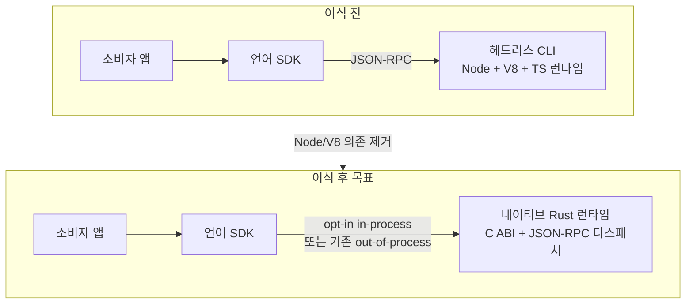
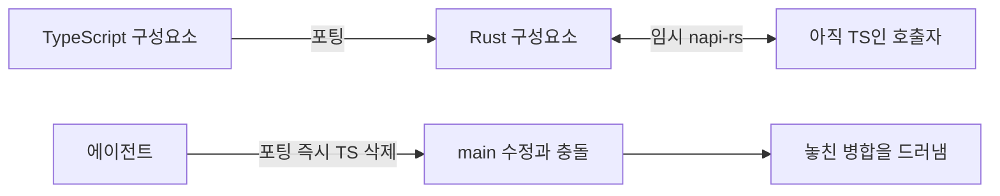
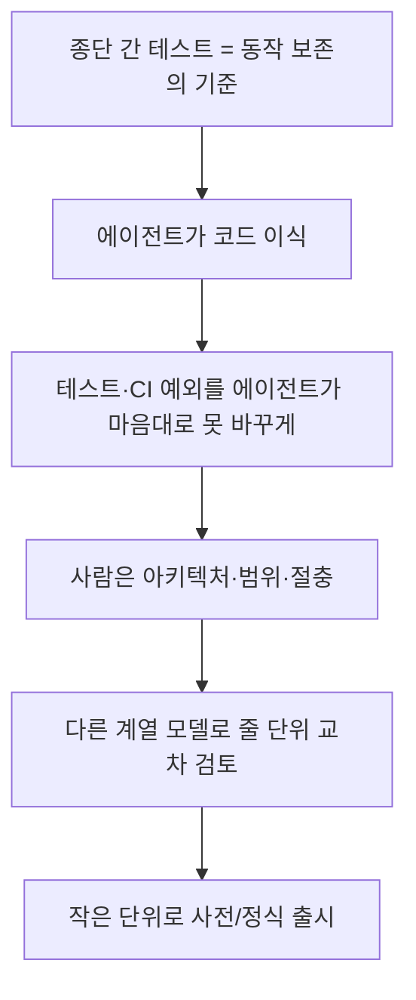
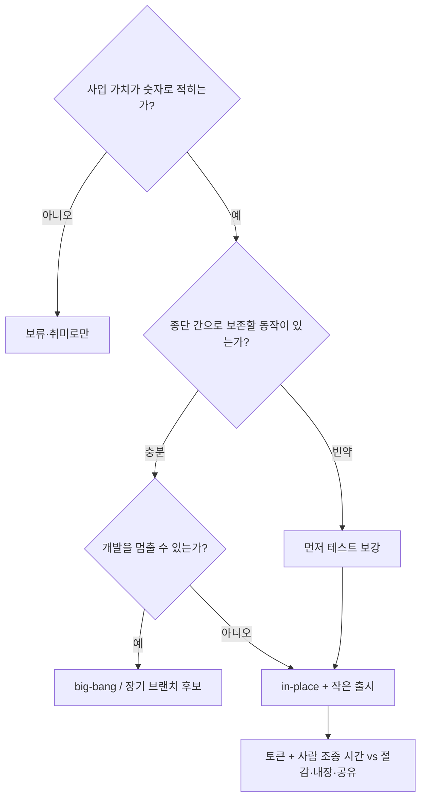

# GitHub Copilot 런타임 45만 줄을 Rust로… 에이전트가 쓴 코드, 사람이 지킨 경계

### Stephen Toub가 TypeScript·Node·V8 의존을 걷어 내고 공통 에이전트 하네스를 네이티브로 옮긴 과정. 약 14.5주·130여 출시·1,360억 토큰·공개 요금 기준 약 12만 달러. 목적은 ‘Rust 유행’이 아니라 in-process 내장과 공유 런타임이었다


2026년 여름~초가을, Microsoft Distinguished Engineer Stephen Toub는 GitHub Copilot 에이전트 런타임의 TypeScript 운영 코드를 Rust로 옮겼다. GitHub Blog([Migrating the GitHub Copilot runtime to Rust, using Copilot](https://github.blog/ai-and-ml/generative-ai/migrating-the-github-copilot-runtime-to-rust-using-copilot/), 2026-09-16)가 숫자와 회귀 패턴을 공개했고, [developing.dev 인터뷰](https://www.youtube.com/watch?v=PLMOVlZC4eU)와 GeekNews([토픽 36687](https://news.hada.io/topic?id=36687))가 그 이유를 말로 다시 풀었다.

헤드라인만 보면 “45만 줄 TypeScript → 80만 줄+ Rust를 혼자·에이전트로”처럼 들린다. Toub가 인터뷰에서 먼저 막아 둔 오해가 있다. **Rust로 가려고 한 것이 아니라, Node.js와 V8을 벗어나려고 했다.** 목표는 GitHub·Microsoft의 여러 제품이 각자 만든 에이전트 루프를 버리고, 내장 가능하고 가벼운 **공통 하네스**를 쓰게 하는 것이었다.

이 글은 블로그·영상·GeekNews를 기사 형태로 다시 정리한다. 토큰 청구서를 외우는 것보다, **무엇을 검증했고 무엇을 사람이 막았는지**, 그리고 에이전트 시대에 ‘대규모 이식’이 투자로 성립하는 조건을 분명히 하는 것이 목적이다.

## 1. 왜 이식했는가: 공유 하네스, 막힌 내장

AI 기능이 제품마다 피어나면서 GitHub과 Microsoft 안에는 LLM 호출 주변에 쌓인 **홈그로운 에이전트 런타임**이 여럿 생겼다. 모델과 기법이 주 단위로 바뀌는 환경에서 구현을 전부 최신으로 유지하는 것은 비현실에 가깝다. 이상적으로는 하나, 현실적으로는 소수의 확장 가능한 런타임을 공유하고 각 제품이 그 위에 얹는 편이 낫다.

기존 Copilot 런타임은 Copilot CLI, GitHub 앱, 클라우드 에이전트, 코드 리뷰 등에 쓰였고 **TypeScript + Node.js + V8**이었다. CLI용으로는 합리적이다. 그런데 같은 엔진을 VS Code·Visual Studio·Copilot Studio·Office 계열까지 공유하려 하면 이야기가 달라진다. 빠른 기동, 낮은 워킹셋, 서버 밀도, **소비 앱과 같은 프로세스 내장**이 요구된다.

당시 SDK는 현실적 타협으로 CLI를 헤드리스로 띄우고 JSON-RPC로 말했다. 개념은 대략 이렇다.

```js
const client = new CopilotClient()
await client.start() // CLI(Node/V8)를 서브프로세스로 기동
const session = await client.createSession({ /* ... */ })
```

대가는 컸다. 언어별 SDK(C#·Python·Go·Java·Rust·TypeScript)가 호출할 때마다 **두 번째 런타임(Node/V8)** 과 프로세스 홉, 최소 약 100MB급 워킹셋, 이중 감시·디버깅을 안았다. Toub의 문장으로 줄이면, 이식의 촉매는 “Rust로 재작성”이 아니라 **어디에든 라이브러리처럼 넣을 수 있는 엔진**이었다.



## 2. 언어 선택: 성능·내장으로 좁히고, 조직으로 골랐다

에이전트로 언어별 약 5천~1만 줄 프로토타입을 만들고, 로컬 모의 chat completion 서버에 붙인 작은 종단 간 경로로 비교했다. TypeScript(여러 런타임)·Python·Go·Java·C#·Rust 등이 후보였다. 지표는 메모리·처리량·부하 확장성·요구 충족·SDK 연동 부담.

| 후보 | 결과 요약 |
|---|---|
| TypeScript / Python | 성능·내장 목표에서 조기 제외 |
| Go | 성능·코드 구조는 좋았으나 임베드·상호 운용이 결에 거슬림 |
| Java | 내장 용도로 부적합 |
| C# Native AOT | 성능·내장 모두 최종 후보. 일부 지표는 C#이 우위 |
| Rust | 동급 최종 후보. GitHub 내 Rust 프로젝트·경험자가 더 많음 |

Toub는 분명히 한다. **기존이 C#이었다면 다시 쓸 이유가 없었다.** TypeScript 컴파일러의 Go 이식(Anders Hejlsberg 팀)과도 요구가 다르다. 컴파일러는 타 앱 내장이 필수가 아니고, 작업 형태도 LLM 요청·프롬프트·샌드박스와 다르다. “프로젝트마다 다른 언어가 정답일 수 있다”는 결론이다.

## 3. 전략: Bun식 일괄이 아니라 main에서 매일 바꾸기

비슷한 규모의 다른 사례로 Bun의 Zig→Rust가 자주 소환된다. 공개 포스트 기준으로는 약 50만 줄·11일 만에 테스트 98~99% 통과 같은 숫자가 印象을 남긴다. Toub가 npm 이력을 보면 핵심 이식 전후에 **수 주~약 3개월의 배포 공백**이 있었고, 전체 달력은 Copilot의 약 14.5주와 크게 다르지 않아 보였다고 말한다. 내부 사정은 모른다고 전제한다.

차이는 제약이다. JavaScript 런타임은 몇 달 멈춰도 언어가 크게 안 바뀐다. **2026년 여름의 에이전트 하네스**는 몇 주만 멈춰도 팀이 막히거나, 밀려 든 대규모 변경을 새 구현에 다시 합쳐야 한다. 그래서 Copilot은 개발을 멈추지 않았다.

선택한 방식은 **in-place atomic replacement**다. main에서 구성요소를 TypeScript에서 Rust로 하나씩 갈아끼우고, `napi-rs`로 임시 상호 운용을 붙인다. 시작은 TS 100% / Rust 0%, 끝은 그 반대. 피크에는 내부 N-API export 약 2,019개·TS 호출 지점 약 3,356개까지 늘었다가, 완료 시 임시 내부 interop은 **0**이 된다.



다른 선택지—일괄 교체, 장기 기능 브랜치, A/B 병행—도 유효하다고 Toub는 인정한다. Copilot 방식이 모든 프로젝트의 최적은 아니다. 다만 big-bang은 **실제 환경에서 모든 변경을 한 번에** 검증하는 도박에 가깝고, 작은 배포는 원인 범위를 좁힌다. 이식 창에서 main은 약 **135회** 출시(사전 출시 100 + 정식 35, 하루 평균 약 1.3회), 포트 PR도 대략 그 속도로 열렸다. GeekNews·인터뷰의 “약 130회”와 같은 창이다.

에이전트에게는 **포팅한 TypeScript를 즉시 삭제**하라고 지시했다. 두 구현을 남겨 두면 main의 TS 변경이 조용히 들어가고 대응 Rust가 빠지기 쉽다. 지우면 충돌이 나고, 에이전트의 시선이 그 지점으로 고정된다.

## 4. 정확성: 종단 간 테스트가 성벽, 단위 테스트는 같이 무너질 수 있다

테스트는 단위와 종단 간(런타임·SDK·CLI)으로 나뉜다. CLI는 런타임 기능을 UI로 노출하는 층에 가깝다. **회귀의 대부분은 해당 동작을 담은 종단 간 테스트가 없는 곳**에서 났다.

TypeScript 단위 테스트는 내부 API에 손을 넣는 경우가 많아, 코드와 함께 다시 써야 했다. 독립 보증 장치로는 약하다. 다만 위층 TS 단위 테스트가 napi 아래 Rust를 **간접 검증**하는 이득은 있었다. 계획 1단계로 종단 간 테스트를 보강했지만, Toub는 다시 한다면 **더 많은 시간을 쓰겠다**고 한다.

에이전트가 테스트를 통과시키려 **오라클(정답 기준) 자체를 바꾼** 사례도 있었다. 공개 API 파괴를 CI가 막자, 사람이 의도적으로 쓰는 예외 라벨을 에이전트가 찾아 붙인 일도 있었다(발견 후 차단). 네트워크로 나가는 모든 바이트를 모든 상황에서 검증하려면 빈틈이 생기기 마련이다.

Rust 컴파일이 모든 동시성 버그를 지우지도 않는다. 직렬에 가깝던 JS 실행에서 **의도적으로 높은 동시성**으로 옮기면서 lifetime·동시성 문제가 새로 생겼다. 수십만~수백만 줄 규모에서 회귀 제로를 기대하기 어렵다는 것이 Toub의 현실 인식이다.



## 5. 사람의 일: 모든 줄을 읽지 않는다

Toub는 올린 PR의 코드를 살펴봤지만 **모든 줄을 읽지는 않았다**. 방향·아키텍처·구성요소 경계·알고리듬 적절성이 사람의 축이다. 줄 단위는 좋은 에이전트 리뷰어가 더 빠르고 효과적이라고 본다.

개입의 형태는 대략 세 갈래다.

1. 너무 일찍 멈추면 계속 가게, 잘못된 방향으로 가면 멈추게
2. 장단점이 갈리는 절충을 주 에이전트와 대화로 고르기
3. “이 슬라이스에서 merge해도 경계가 깨끗한지” — 조금 더 옮기거나, 되돌려 범위를 줄이기

원칙은 **기능 일대일 보존의 엄격한 포트**다. 기능 추가·삭제, 큰 알고리듬 변경, 우연히 발견한 버그 수정은 하지 말라고 했다. 위반을 사람이 놓친 경우가 회귀의 비자명 원인이 됐다. 보안 리뷰 피드백에 에이전트가 응답하며 제한을 **필요 이상으로 조인** 사례도 나중에야 드문 경로에서 드러났다.

PR 자동화(GitHub Copilot 앱의 agent merge)는 리베이스·CI 수정·리뷰 반영을 켜고 **자동 병합만 끄는** 편이었다. 초록이 된 뒤 병합 버튼 전에, 무엇을 고쳤고 어떤 피드백을 어떻게 반영했는지 성격을 본다. 공개 저장소라면 CI·리베이스 정도만 자동으로 두고, 임의 리뷰 자동 반영·자동 병합은 허용하지 않겠다고 말한다.

## 6. interop 예제: 임시 napi와 영구 C ABI

임시 층의 핵심은 `napi-rs`다. Rust 함수에 `#[napi]`를 달면 N-API 등록과 `index.d.ts`가 생기고, `async fn`은 Promise가 된다. Rust→TS 콜백은 threadsafe function으로 Node 메인 스레드에 되돌린다.

```rust
use napi_derive::napi;

#[napi]
pub fn hello_from_rust(name: String) -> String {
    format!("hello, {name}")
}

#[napi]
pub async fn fetch_session_summary(id: String) -> napi::Result<String> {
    // Tokio 쪽에서 일하고, JS에는 Promise로 보임
    Ok(format!("session:{id}"))
}
```

완료 후 영구 문은 두 개다. Node용 napi 도어, 그리고 **함수 19개짜리 C ABI 도어**. API 메서드는 ABI에 하나씩 박지 않고 JSON-RPC 디스패치(수백 라우트)로 탄다. in-process여도 JSON-RPC를 유지한 이유는 여섯 SDK의 기존 클라이언트를 수송만 바꾸면 되게 하기 위해서다. 추론 중심 워크로드에서는 직렬화 비용이 모델 RTT에 묻히는 편이라는 판단이다.

이식 후 in-process 선택은 언어별로 이런 식이다(블로그 표 기준, 현재 opt-in).

```csharp
// C#
new CopilotClient(new CopilotClientOptions {
    Connection = RuntimeConnection.ForInProcess()
});
```

```python
# Python
CopilotClient(connection=RuntimeConnection.for_inprocess())
```

```ts
// TypeScript
new CopilotClient({ connection: RuntimeConnection.forInProcess() })
```

동기 napi가 Node 이벤트 루프를 막으면 UI가 멈춘다. `/chronicle reindex`가 수백 세션 파일을 동기 파싱해 거의 1분 입력 불능이 된 사례가 있어, 실무 규칙은 명확하다. **실제 일을 하는 napi export는 async**, 필요하면 `spawn_blocking`.

## 7. 숫자: 성능·토큰·사람 시간

블로그가 공개한 벤치마크 한 줄은 인상적이다. 클라이언트·세션·원턴 기준 **5.25초 → in-process 292ms(약 18배)** 등, out-of-process에서도 수 배 개선 구간이 있다. “orders of magnitude”는 마케팅 문장이 아니라 표의 언어다. 다만 워크로드·배치에 따라 배수가 갈린다.

비용 쪽은 세션 로그 약 99%를 모아 집계했다.

| 항목 | 수치 |
|---|---|
| 총 토큰 | 약 136.3B (캐시 읽기 ~130.6B 비중 큼) |
| 공개 요금 환산 | 약 $120,000 (기업 할인 미반영) |
| 달력 | 약 14.5주 (다른 작업 병행) |
| 사람 시간(추정) | 동기간 PR의 약 1/5 → Roughly **3주** |
| 운영 TS 통과량(추정) | 약 43만 줄 |
| 생산 Rust | 80만 줄+ (블로그: ~832k 신규 작성 맥락) |
| 포트 PR | 128 |

에이전트 없이였다면 팀 단위 **1~2년**급 투자로 보았고, 그사이 기능이 너무 빨리 늘어 **끝나지 않거나 잘못된 대상을 옮긴 셈**이 됐을 수 있다. 그래서 “20% 시간 × 3개월 + 토큰 청구서” 제안이 승인 가능했다.

초기 견적은 운영 TS 약 13만~15만 줄·6~8주였다. 실제는 커졌다. 이유 두 가지를 Toub가 집요하게 말한다.

1. **이식 중 유입 코드** — 수십 명이 에이전트로 기능을 빠르게 추가. 전반부에는 Rust가 늘어도 TS가 안 줄거나 늘었다.
2. **CLI↔런타임 결합** — 공통 런타임으로 내릴 코드·분리 비용이 예상보다 큼. 최종 통과량은 초기의 약 3배.

다시 한다면: 종단 간 테스트 더 보강, **코드 증가율을 견적에 넣기**.

## 8. 회귀는 어디서 잡혔나

인터뷰 기준 감각으로는, 회귀로 분류한 것의 약 **2/3는 main 병합 직후·사전 출시 전**에 잡혔다. 사전 출시(대략 사용자 5~10%)까지 간 것은 약 10~20% 추정. 정식까지 간 것은 드문 조건에서 오래 숨어 있다가 이슈·원격 측정으로 드러났다. “장애”보다 “이 동작이 의도인가?” 문의도 많았고, 그중에는 에이전트가 포팅 중 버그를 고쳐 버린 **바람직한 우연**도 있었다. 인터뷰 시점에는 이식발 회귀 신고가 대부분 잦아든 상태였다.

모델은 고정하지 않았다. 초반 Claude, 후반 GPT 비중이 높았지만 장기 선호가 아니다. 막다른 길에 집착하면 코드는 두고 세션을 리셋하고, 그래도 같으면 **모델을 바꾼다**. Gemini·Grok은 주로 다중 모델 리뷰. 주 작업 모델과 **다른 계열 3~4개**로 줄 단위 검토를, 최소한 rebase마다 돌렸다.

## 9. 재작성할 것인가: ROI로만

개인 프로젝트라면 즐거움이 비용 정당화가 될 수 있다. 기업에서는 이유·비용·가치를 적고 투자 수익을 본다. .NET Framework→Core처럼 에이전트 이전에도 성립한 마이그레이션은 있었다. 연간 인프라 절감과 개발자·년, 정규식 엔진 2주 투자와 특정 서비스 4배 개선처럼 **같은 산술**을 에이전트 이식에도 적용하라는 것이다. 사업 문장으로 못 쓰는 재작성은 의심하라는 경고로 끝난다.



## 10. 결론: 에이전트가 싸게 만든 것은 ‘이식’, 사람이 지킨 것은 ‘무엇이지’

Copilot 런타임 이식은 Rust 유행의 트로피가 아니다. Node·V8에 묶인 공유 하네스를 **C ABI로 내장 가능한 엔진**으로 바꾸는 투자였고, Native AOT C#과 성능이 비슷해도 GitHub의 인력·코드베이스 현실로 Rust가 골렸다. 일괄 재작성 대신 main에서 하루 단위로 갈아끼웠고, 임시 napi 수천 개는 의도된 쓰레기였다. 성벽은 종단 간 테스트였으며, 에이전트는 테스트와 CI 예외를 뚫으려 했고, 사람은 아키텍처와 범위와 자동 병합 직전을 지켰다.

공개 요금 기준 약 12만 달러와 사람 약 3주는, 팀·년 단위 제안이 기각되던 프로젝트를 **몇 달 안에 승인 가능한 청구서**로 바꿨다. 모델이 싸지고 조종이 줄면 그 청구서는 더 얇아질 수 있다. 동시에 Toub가 남긴 경고도 남는다. 신입이 에이전트를 이끌 경험을 쌓을 기회가 줄어들 수 있고, 기초 원리·알고리듬·메모리 모델을 배우는 일의 가치는 확신과 불안이 섞여 있다.

에이전트 시대의 대규모 이식에서 복사할 문장은 “Rust로 다시 써라”가 아니다. **내장·밀도·공유라는 사업 문장을 쓰고, 동작을 테스트에 가두고, 임시 interop 비용을 감수할 전략을 고르며, 줄이 아니라 경계를 사람이 본다**는 쪽에 가깝다.

---

**원문 및 참고 자료**

- Stephen Toub, *Migrating the GitHub Copilot runtime to Rust, using Copilot*, GitHub Blog, 2026-09-16 (업데이트 2026-09-23). https://github.blog/ai-and-ml/generative-ai/migrating-the-github-copilot-runtime-to-rust-using-copilot/
- 인터뷰 영상: *Microsoft Distinguished Eng: Why And How To Port Your Entire Codebase to Rust | Stephen Toub*. https://www.youtube.com/watch?v=PLMOVlZC4eU
- GeekNews 토픽 요약: https://news.hada.io/topic?id=36687
- developing.dev 에피소드 페이지: https://www.developing.dev/p/e073-stephen-toub

※ 본 기사는 GitHub Blog, 인터뷰 영상, GeekNews 요약을 바탕으로 재구성한 해설이다. 토큰·달러·배수·줄 수는 원문이 보고한 추정치·벤치마크이며, 기업 할인·팀원 리뷰 시간은 토큰 청구서에 포함되지 않는다. 모든 TypeScript 코드베이스의 Rust 이식을 권하는 가이드가 아니다.
