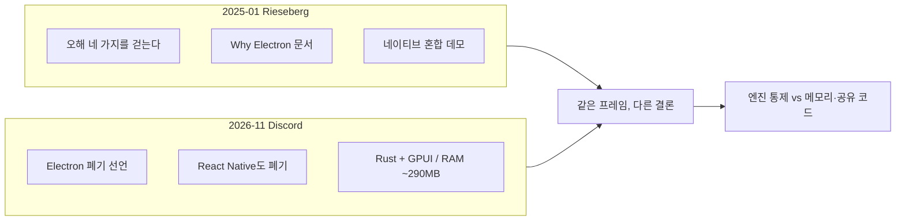
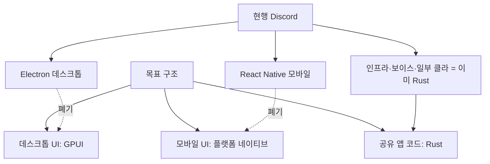
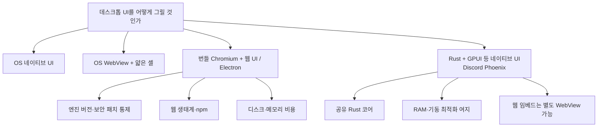
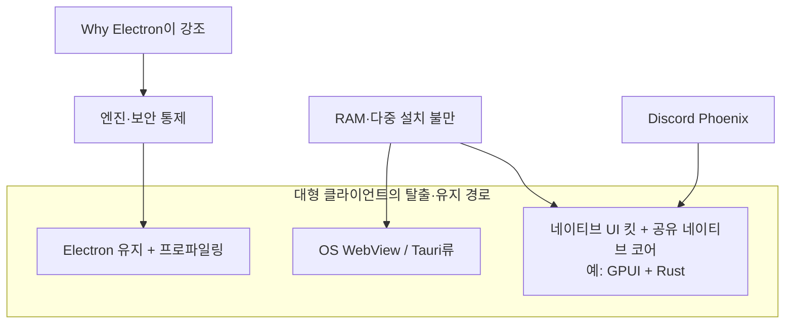
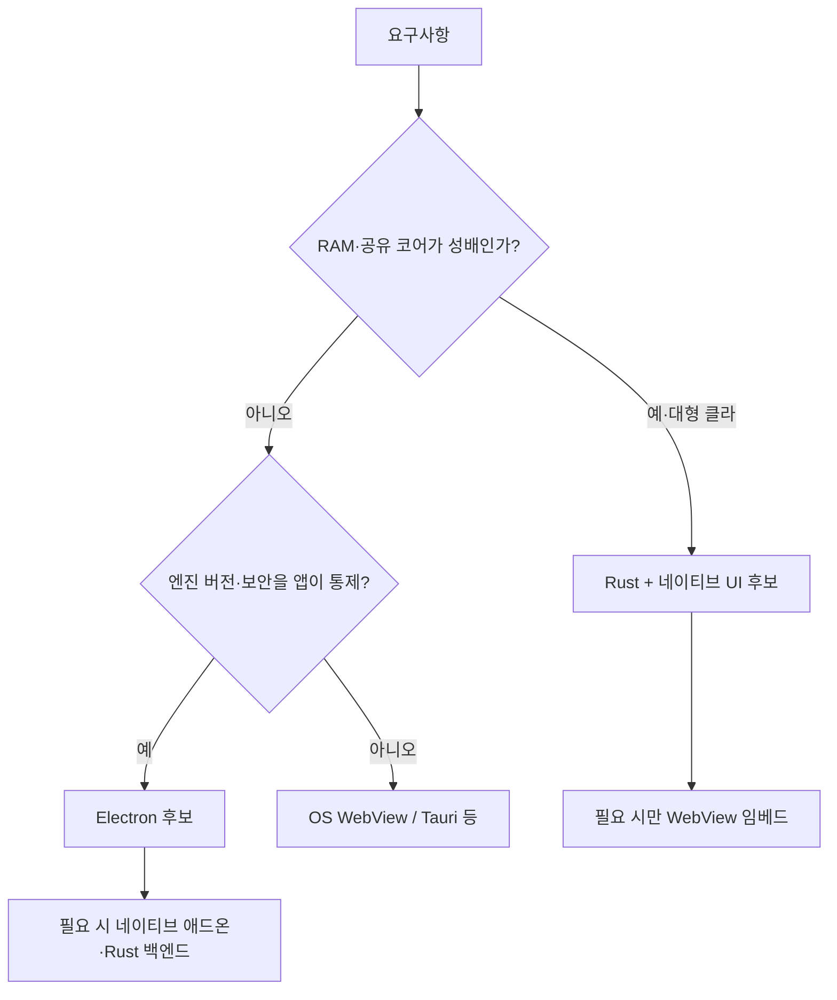

# Discord가 Electron을 버린다… 290MB Rust 클라이언트와, 유지보수자가 짚은 ‘틀린 비판’들

### The Verge가 전한 Discord의 Electron·React Native 이탈과, Felix Rieseberg가 정리한 네 가지 오해를 한 축에서 읽는다. 이탈의 실체는 Tauri가 아니라 GPUI이고, 변호의 핵심은 ‘웹만’이 아니라 엔진 통제와 네이티브 혼합이다


2026년 11월 5일 The Verge는 [Discord is ditching Electron and its new app uses less RAM](https://www.theverge.com/news/1027379/discord-ditching-electron-web-app)에서 한 문장으로 판을 갈았다. Discord가 웹 기술로 데스크톱을 그리던 Electron을 버리고, 클라이언트를 **Rust로 통째로** 옮긴다는 소식이다. CTO Stanislav Vishnevskiy가 X에 올린 Windows 빌드 스크린샷은 RAM **약 290MB**. 기존 앱이 서버 몇 개만 켜도 쉽게 1GB를 넘기고, 심하면 수 GB까지 가는 것과 대비된다.

같은 생태계의 다른 축에는, 약 열 달 앞선 글이 있다. Electron co-maintainer Felix Rieseberg의 [Things people get wrong about Electron](https://felixrieseberg.com/things-people-get-wrong-about-electron/)(2025-01-21)과 공식 [Why Electron](https://www.electronjs.org/docs/latest/tutorial/why-electron) 문서는 “네이티브가 아니다”, “웹이라서 나쁘다”, “OS WebView면 충분하다”, “200MB는 너무 크다”는 반복 비판을 받아친다. GeekNews([토픽 19028](https://news.hada.io/topic?id=19028))는 그 요지와 댓글을 한국어로 묶었다. 당시 플래그십 사례 목록에 Discord 이름이 올라가 있었다.

이 글은 두 사건을 기사처럼 겹쳐 읽는다. Discord 이탈이 Rieseberg의 변호를 ‘거짓’으로 만들지는 않는다. 반대로 변호가 Discord의 RAM 문제를 ‘사용자가 안 느낀다’로 지우지도 않는다. **무엇이 오해였고, 무엇이 측정 가능한 비용이었으며, Discord가 고른 탈출구가 왜 Tauri·WebView가 아니었는지**를 가르는 것이 목적이다.

## 1. 한 축의 두 소식: 변호와 이탈

Electron 논쟁의 문장은 거의 고정되어 있다. Visual Studio Code, Slack, Discord, Figma, ChatGPT, Claude, Notion, 1Password, Docker Desktop이 그 경로를 택해도 “무겁다”는 감각은 잘 안 꺼진다. Rieseberg는 그 감각의 상당수가 **잘못된 전제** 위에 있다고 본다. Discord는 그 감각의 일부가 **제품 지표로 참**이라고 보고, 프레임워크를 떠난다.



읽기 순서는 의도적이다. 먼저 Discord가 **무엇을 버리고 무엇을 택했는지**를 고정한 뒤, Rieseberg의 네 오해를 그 위에서 다시 펼친다. 변호를 먼저 외우면 이탈이 ‘배신’처럼 보이고, 이탈만 보면 모든 Electron 앱이 틀린 선택처럼 보인다.

## 2. Discord: Electron·React Native를 버리고 Rust로 모은다

Tom Warren의 Verge 기사가 전하는 핵심은 CTO의 X 포스트다.

> We’ve been early adopters of Rust since 2018 and a lot of our infra, voice tech, and even some of the current client is already Rust, the holy grail was getting the whole client there.  
> That means Electron goes away, and so does React Native, mobile keeps native UI but shares app code with desktop via Rust.

정리하면 세 겹이다.

| 축 | 내용 |
|---|---|
| 데스크톱 | Electron 제거. 클라이언트 전체를 Rust로 |
| 모바일 | React Native 제거. **네이티브 UI는 유지**, 앱 로직은 데스크톱과 Rust로 공유 |
| 일정 | 일반 공개일은 미정. “곧 사용자 테스트”를 희망 |

후속 보도(Windows Latest, 9to5Windows, Wccftech 등)가 보탠 기술 디테일은 Verge 한 줄보다 날카롭다.

- 내부 이름 **Discord Phoenix**
- UI 스택은 **Tauri가 아니라 GPUI**(Zed 에디터 계열의 GPU 가속 네이티브 UI). Vishnevskiy가 “nice try”로 Tauri 추측을 직접 부정
- 조기 Windows 11 빌드 RAM **290.2MB**, 계정 **두 개** 동시 로그인 상태라는 정정
- 현행 Electron 클라이언트는 유휴만으로도 수백 MB, 사용 중 1~2GB, 회사도 최대 약 4GB까지 인지한 적이 있다는 맥락
- YouTube·Activities 같은 임베디드 웹은 당분간 **시스템 WebView**를 쓸 수 있다는 보도도 있음(네이티브 UI ≠ 웹 제로)



이탈의 동기는 Rieseberg가 “사용자가 거의 안 본다”고 말한 **설치 용량**보다, GeekNews 댓글이 집요하게 찌른 **런타임 메모리**에 가깝다. Discord는 2018년부터 Rust를 써 왔고, “성배”는 클라 전체가 그 언어에 모이는 것이었다. Electron을 미세 최적화(보도에 따르면 Electron 42 업그레이드로 중앙값 CPU 약 17% 개선 등)해도, 공유 코드·메모리라는 목표 앞에서는 프레임워크 교체가 답이 된 셈이다.

중요한 한계도 같이 적는다. 290MB는 **통제된 A/B 벤치마크가 아니라** 조기 빌드 스크린샷이다. 보이스·화면 공유·장시간 세션에서의 숫자는 아직 공개 비교가 부족하다. 일반 사용자가 언제 Phoenix를 받는지도 미정이다. “Electron 사망” 헤드라인과 “Discord의 제품 결정”은 범위가 다르다.

## 3. 왜 같은 비판이 10년째 도는지 — Rieseberg의 출발점

Electron의 핵심 선택은 두 겹이다. UI는 HTML·CSS·JavaScript(와 WebAssembly)로 그리고, 렌더링 엔진은 OS WebView에 맡기지 않고 **Chromium 일부를 앱과 함께 배포**한다. OS에는 이미 UI 라이브러리와 WebView가 있다. 디스크도 줄고 이론상 자원도 공유할 수 있다. “왜 그 수고냐”는 합리적 질문이다.

Rieseberg의 답은 ‘웹이 무조건 낫다’가 아니라 **제어권**에 가깝다. 안정성·보안·성능의 기준선을 앱 팀이 고르고, 필요하면 C++·Objective-C·Rust를 섞는다. Discord Phoenix는 그 스펙트럼의 반대쪽 끝 — **웹 UI 셸까지 버리고 네이티브 UI + Rust 공유 코어** — 로 이동한 사례로 읽힌다. 변호와 이탈이 같은 문장(“네이티브를 섞을 수 있다”)에서 갈라지는 지점이다.



## 4. 오해 1: Electron은 JavaScript와 네이티브를 대립시킨다

주장은 단순하다. JS는 모든 곳에 안 맞고, 네이티브가 낫다. Electron은 네이티브가 아니다.

Rieseberg는 이 오해의 상당 부분을 **유지보수 팀, 특히 본인**의 책임으로 돌린다. 초창기 발표가 “JavaScript에서 OS와 대화한다”를 강조했기 때문이다. 실제 포인트는 웹만 쓰라는 것이 아니라, **웹 앱에 원하는 만큼의 네이티브 코드를 붙일 수 있다**는 것이다.

| 쪽 | 예시 | 무게 중심 |
|---|---|---|
| 웹 UI + 가끔 네이티브 | Rieseberg가 말하는 전형 | 네이티브 UI·무거운 연산·SQLite 등만 네이티브 |
| 대부분 네이티브 + Electron UI | 1Password | 핵심 로직 Rust, 셸·UI에 Electron |
| 클라 전체 Rust + 네이티브 UI | Discord Phoenix(진행 중) | Electron·RN 제거, GPUI + 모바일 네이티브 UI |
| 거의 OS 네이티브 UI | Xcode / Visual Studio 쪽 | Electron보다 그 도구가 생산적일 수 있음 |

Discord는 사실상 **1Password형 혼합을 넘어**, 웹 셸까지 걷어 내는 쪽이다. 그래서 “Electron = JS만”이라는 오해는 여전히 틀리지만, “Electron이면 네이티브를 충분히 섞을 수 있으니 RAM 문제는 없다”로 읽으면 Discord 사례와 충돌한다. 섞을 수 **있다**와, 제품이 그 경로로 **메모리를 이길 수 있다**는 다른 명제다.

데모로 Rieseberg는 [electron-native-code-demos](https://github.com/felixrieseberg/electron-native-code-demos)를 공개했다. 같은 todo 네이티브 UI를 SwiftUI·GTK·Win32로 구현하고 이벤트를 JS로 올린다.

```sh
git clone https://github.com/felixrieseberg/electron-native-code-demos
cd electron-native-code-demos
npm i
npm run build
npm run electron
```

각 패키지 최소 표면:

1. `helloWorld(string) → string` — OS API 한 줄
2. `helloGui()` — 네이티브 todo. 추가·변경·삭제 시 JS 이벤트

```cpp
// N-API 층(개념): JS 인자 → 네이티브 브릿지
Napi::Value HelloWorld(const Napi::CallbackInfo& info) {
  NSString* result = [ObjCBridge helloWorld:nsInput];
  // ...
}
```

```objc
// 브릿지 층(개념)
+ (NSString*)helloWorld:(NSString*)input {
  return [NSString stringWithFormat:@"Hello from Objective-C! You said: %@", input];
}
```

GeekNews 댓글은 “가능하다 ≠ 쉽다”고 받았다. Discord가 GPUI·공유 Rust로 간 이유도, Electron 안에서 네이티브만 조금 얹는 것으로는 **성배(전체 클라 언어 통일 + RAM)** 에 못 미쳤기 때문으로 읽는 편이 자연스럽다.

## 5. 오해 2: 웹 앱은 나쁘다 — 따라서 Electron도 나쁘다

“모든 네이티브가 모든 웹보다 낫다”는 명제는 시장과 어긋난다. Rieseberg 표현대로면 소프트웨어가 세상을 먹은 뒤 **웹이 소프트웨어를 먹었다**. 나쁜 앱은 나쁜 앱이고, 웹에도 많다. “웹은 네이티브를 못 배운 사람의 선택”이라는 말은 제약·요구사항·사용자 선택을 지운다.

Why Electron의 사례는 취미 앱이 아니다. NASA Mission Control, Bloomberg Terminal(사용자당 연 약 2만 5천 달러), McDonald’s 키오스크, SpaceX Dragon 2 인터페이스 등이 Chromium·웹 스택을 쓴다. GeekNews가 키오스크 예시의 설득력에 웃음을 붙였듯, 사례 품질 논쟁과 “웹 = 열등” 명제는 별개다.

Discord 이탈은 이 오해를 **증명하지 않는다**. Discord는 “웹이 열등해서”가 아니라, **자사 클라이언트의 메모리·공유 코드 목표** 때문에 웹 셸을 버린다. 같은 주에도 VS Code·Notion·Slack류는 Electron(또는 웹 UI) 위에 남아 있다. 한 제품의 이탈을 웹 UI 전체의 패배로 읽는 것이 바로 Rieseberg가 경계한 단순화다.

## 6. 오해 3: OS WebView가 Chromium보다 성능이 좋다

Slack 초기의 MacGap(OS WebView)은 빈 앱 1MB 미만의 가벼움이 매력이었다. 실제 Slack 웹 앱을 올리자 느림이 보고됐고, Chrome이 더 빨랐다. Apple도 `WKWebView`로 다중 프로세스 쪽에 다가갔다. Rieseberg 요약: 따라잡기 게임은 계속되고, 최고의 렌더러는 아직 최고의 브라우저 쪽에 가깝다.

더 중요한 문장: 많은 Electron 팀이 번들 엔진을 고르는 **1순위는 성능이 아니라** 안정성·보안·신뢰성의 **독립 통제**다. Why Electron이 적는 OS WebView의 구조적 리스크는 안정성(버그 → OS/기기 업그레이드 요구), 보안(앱 업데이트로 엔진 패치), 성능(단순 HTML은 WebView가 유리할 수 있으나 대화형 대형 앱에서는 Chromium 경험이 우위인 경우가 많음)이다.

Discord의 선택은 여기서 **세 번째 길**이다. Teams처럼 WebView로 갈아타는 것도, Electron을 유지하는 것도 아니다. **GPUI로 UI를 네이티브로 그리고**, 필요할 때만 시스템 WebView를 임베드하는 쪽으로 보도된다. “WebView가 Chromium을 이긴다”는 오해를 검증하는 실험이 아니라, **웹 렌더러 자체를 주 UI에서 빼는** 실험에 가깝다.



## 7. 오해 4: 번들 크기가 (거의) 전부다 — 그리고 Discord가 찌른 축은 메모리

대부분 Electron 앱은 대략 **100~300MB**다. 5MB가 200MB보다 낫다는 첫 원리에는 반대가 없다. Rieseberg의 논점은 사용자가 그걸 **최우선으로 하느냐**다. Netflix 4K·Call of Duty 업데이트 비유는 GeekNews에서 “주제에서 빗나간다”는 비판을 받았다. Teams의 WebView 이동, PC에 Electron 앱 10개면 공유 런타임이 필요하다는 탄식, Helper 프로세스 메모리 한숨, Tauri 기대와 배포 불안이 댓글을 채웠다.

Discord 뉴스는 그 댓글 축을 본편으로 끌어올린다. Verge 헤드라인의 “uses less RAM”이 가리키는 것은 설치 폴더 크기가 아니라 **작업 관리자의 메모리**다. 290MB(계정 2개) 스크린샷이 강력한 이유는, Rieseberg가 상대적으로 덜 깊게 쓴 그 축을 제품이 전면에 걸었기 때문이다.

합의점을 다시 쓰면 이렇다.

- **디스크 크기는 진짜 비용**이고, Why Electron도 하드 제약이면 다른 선택을 쓰라고 적는다.
- **크기만으로 프레임워크를 기각하면** 제품 결정을 왜곡할 수 있다.
- **메모리는 별 축**이다. Discord·GeekNews 현장이 여기로 모인다.
- **Tauri ≠ Discord의 답**. Rust를 써도 UI가 WebView면 “웹 셸 제거”가 아니다. Phoenix는 GPUI를 명시했다.

## 8. ‘Electron을 이겨라’ — Discord가 공백을 채우는 방식

Rieseberg 글의 말미는 전쟁 선언이 아니다. Electron은 데스크톱 앱을 만들고 싶은 사람들이 필요한 프레임을 채운 결과다. 더 잘 채우면 유지보수자들은 악수할 준비가 되어 있다고 적는다.

Discord Phoenix는 그 문장의 실험이다. 다만 “이김”의 정의가 Tauri식 얇은 셸이 아니라, **GPUI + 공유 Rust + 모바일 네이티브 UI**다. 공식 문서가 이미 “OS UI가 목표면 플랫폼별 네이티브가 나을 수 있다”, “디스크가 하드 제약이라면 다른 것”이라고 열어 둔 예외와 맞닿는다. Discord는 그 예외를 **메모리·코드 공유** 이유로 실행에 옮긴 대형 소비자 앱이다.

| 상황 | 방향 | Discord와의 관계 |
|---|---|---|
| 극단적 저전력·IoT | 임베디드 UI | 해당 없음 |
| 디스크 하드 제약 | Electron 외 | 부차 |
| UI 대부분 OS/네이티브 컴포넌트 | 플랫폼별 네이티브·GPUI류 | Phoenix의 핵심 |
| AAA 실시간 3D | 게임 엔진 | 해당 없음 |
| 작은 웹 임베드 | OS WebView 등 | Activities/YouTube 등에 잔존 가능 |



## 9. 예제로 보는 ‘웹 + 네이티브’와, Discord가 그 너머로 간 이유

Electron 안에서의 최소 패턴은 여전히 유효하다. **무거운 일·플랫폼 UI는 네이티브, 제품 UI는 웹**, 사이는 N-API.

```js
const native = require('electron-native-objc') // 데모용 예시 이름

console.log(native.helloWorld('typeboard'))

native.on('todoAdded', (payload) => {
  console.log('todo added', payload)
})

native.helloGui()
```

성능 가이드가 반복하는 지연 로딩도 같다. “Electron이 느리다”의 상당수는 프레임워크 이름보다 **무엇을 메인/렌더러에 올렸는지**다.

```js
// 나쁜 예: 기동 시 무거운 모듈 전부
const fooParser = require('foo-parser')

// 나은 예: 필요할 때 로드
class Parser {
  async getParsedFiles() {
    const fooParser = require('foo-parser')
    const files = await this.getFiles()
    return fooParser.parse(files)
  }
}
```

Discord의 선택지는 이 패턴의 연장선이 아니라 **단절**에 가깝다. 이미 인프라·보이스·일부 클라가 Rust인데, 성배가 “전체 클라”라면 Electron 렌더러·React Native 브릿지를 남기는 한 성배에 도달하지 못한다. 개념적으로는 이런 경계다.

```text
[Electron 혼합]
  JS/HTML UI  ──N-API──►  Native / Rust 조각

[Discord Phoenix 방향]
  GPUI(네이티브 UI)  ◄──►  공유 Rust 앱 코드  ◄──►  모바일 네이티브 UI
         │
         └──(필요 시) 시스템 WebView 임베드
```

## 10. 한계를 인정한 뒤에도 남는 실무 질문

1. **비판 대상을 나눈다.** 웹 UI / 번들 Chromium / 우리 앱 구현 / 런타임 메모리. Discord는 특히 마지막을 움직였다.
2. **“네이티브 가능”과 “네이티브로 재작성”을 혼동하지 않는다.** Rieseberg 데모는 전자, Phoenix는 후자에 가깝다.
3. **WebView·Tauri·GPUI를 한 바구니 ‘Rust 대안’으로 묶지 않는다.** UI가 웹인지 네이티브인지가 메모리·동작 예측을 가른다.
4. **290MB 스크린샷을 최종 벤치마크로 쓰지 않는다.** 계정 2개·조기 빌드·보이스 미포함 가능성을 같이 적는다.
5. **번들 크기 변호가 메모리 불만을 지우지 않는다.** GeekNews와 Discord가 같은 구멍을 가리킨다.
6. **한 제품의 이탈을 생태계 판결로 읽지 않는다.** Rieseberg의 “공백을 더 잘 채우면 된다”와 Discord의 실험은 공존한다.

## 11. 결론: 오해를 걷은 뒤에도, 어떤 제품은 떠난다

Rieseberg가 걷어 내려 한 오해는 네 개다. Electron은 JS 진영이 아니라 **웹과 네이티브를 섞는 프레임**이다. 웹이 본질적으로 열등하다는 명제는 미션 크리티컬 사례와 맞지 않는다. OS WebView가 항상 더 빠르다는 증거는 그가 본 대화형 앱 기준에서 약하고, 번들 동기의 중심은 성능보다 **엔진 통제**에 있다. 바이너리 크기만으로 선택을 끝내는 것도 과장이다.

Discord가 2026년 11월에 보여 준 것은 그 오해 교정 밖의 결정이다. 이미 Rust를 쓰던 회사가 **전체 클라·모바일 공유 코드·RAM**을 성배로 삼자, Electron과 React Native는 경로에서 빠졌다. 대체재는 댓글이 기다리던 Tauri가 아니라 GPUI였고, 초기 숫자는 설치 MB가 아니라 작업 관리자의 290MB였다. Verge가 헤드라인에 올린 것도 그 축이다.

남는 질문은 하나에서 두 개로 늘었다.  
첫째, **엔진 버전·보안·크로스플랫폼 웹 UI를 한 팀이 통제해야 하는가** — 예라면 Electron이 채운 공백은 아직 있다.  
둘째, **메모리와 공유 네이티브 코어가 제품의 성배인가** — 예라면 Discord처럼 웹 셸을 버리는 쪽이, 유지보수자가 말하던 “더 잘 채우기”의 한 형태다.

둘 다 “Electron이 항상 옳다/틀리다”로 접히지 않는다. 변호는 오해를 지우고, 이탈은 비용을 측정한다. 그 사이 어디에 우리 제품이 있는지를 적는 일이, 프레임워크 이름 논쟁보다 먼저다.

---

**원문 및 참고 자료**

- Tom Warren, *Discord is ditching Electron and its new app uses less RAM*, The Verge, 2026-11-05. https://www.theverge.com/news/1027379/discord-ditching-electron-web-app
- Felix Rieseberg, *Things people get wrong about Electron*, 2025-01-21. https://felixrieseberg.com/things-people-get-wrong-about-electron/
- Electron, *Why Electron*. https://www.electronjs.org/docs/latest/tutorial/why-electron
- GeekNews 토픽 요약·댓글: https://news.hada.io/topic?id=19028
- Native UI/코드 데모: https://github.com/felixrieseberg/electron-native-code-demos
- Electron Performance 가이드: https://www.electronjs.org/docs/latest/tutorial/performance
- 후속 맥락(GPUI·Phoenix·RAM 보도): Windows Latest / 9to5Windows / Wccftech 등 CTO X 포스트 기반 기사

※ 본 기사는 The Verge 보도, Felix Rieseberg 원문, Electron 공식 문서, GeekNews 토론 및 CTO 발언을 인용한 후속 보도를 바탕으로 재구성한 해설이다. Discord Phoenix의 290MB는 조기 빌드 스크린샷이며 공개 일정·전 기능 벤치마크는 미확정이다. Electron 채택·폐기를 권하는 최종 가이드가 아니다.
