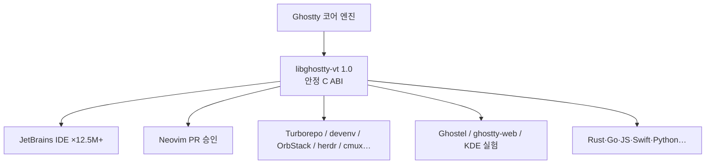
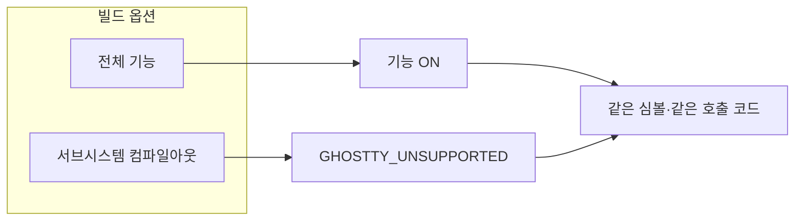
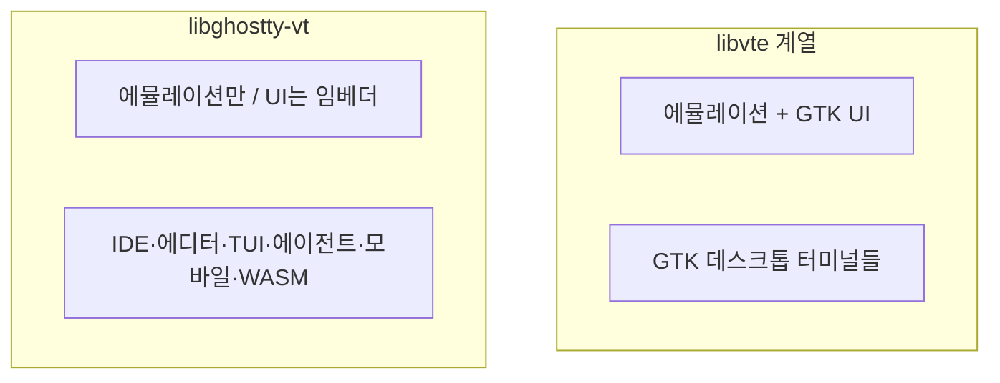

# libghostty 1.0… Ghostty 엔진이 ‘앱’이 아니라 안정 C ABI로 퍼진다

### Mitchell Hashimoto가 분리한 `libghostty-vt`가 시맨틱 버저닝·ABI 약속·배포판 패키징까지 갖춘 1.0에 도달했다. JetBrains만 1,250만+ 활성 사용자, Neovim은 libvterm 교체 PR을 승인하고 태그 릴리스를 기다렸다. GeekNews·Lobsters는 Zig·libvte·kitty·iTerm 논쟁까지 이어진다


2026년 11월 6일 Mitchell Hashimoto는 [Libghostty 1.0](https://mitchellh.com/writing/libghostty-1-0)에서 `libghostty-vt` 1.0을 알렸다. Ghostty 코어에서 뽑아 낸 이식형 고성능 **C 터미널 에뮬레이션 라이브러리**이고, 이번 릴리스는 기능 목록만이 아니라 **라이브러리와 C ABI가 안정**하다는 선언이다. GeekNews([토픽 36736](https://news.hada.io/topic?id=36736))는 도입 현황·ABI·패키징·의존성·플랫폼 표와 Lobsters 토론을 한국어로 묶었다.

약 1년 전 “libghostty is coming” 시점에는 Zig 모듈만 막 들어갔고 C API도 없었으며 소비자는 Ghostty뿐이었다. 지금은 C API가 완전한 터미널 에뮬레이터이고, 무료·상용 수백 제품의 프로덕션에서 돌아가며, **강제되는 ABI 안정성 정책**까지 있다. 문서·예제·다운로드는 [lib.ghostty.org](https://lib.ghostty.org)다.

이 글은 원문 본문·각주와 GeekNews·토론을 기사 형태로 다시 정리한다. “왜 또 터미널이냐”보다 **이미 누가 쓰는지, 1.0이 배포판·동적 링크에 무엇을 약속하는지, 파편화를 어떻게 줄이려는지**를 전부 남기는 것이 목적이다.

## 0. 디렉터리

오픈소스 인프라·라이브러리 1.0 릴리스이므로 `docs/07_Tech_Trends`에 둔다. Deno·Python 릴리스 등과 같은 층이고, 언어 크레이트 가이드(`02_Rust`)나 AI 사례(`06_AI`)와는 축이 다르다.

## 1. 이미 누가 쓰는가 — Ghostty 앱보다 큰 배수

원문이 “why?”에 다시 철학으로 답하지 않고 **산업 영향**으로 답하는 이유가 여기 있다.

| 소비자 | 역할 |
|---|---|
| JetBrains IDE 터미널 | JediTerm → libghostty. IntelliJ·PyCharm·GoLand 등. 보고서 기준 **1,250만+** 활성 사용자 |
| Neovim | libvterm → `libghostty-vt` PR **승인**. 리사이즈 시 스크롤백 reflow 10년 이슈 해소. 배포판 별도 패키징을 위해 **태그 릴리스 대기** → 이번 1.0이 그 조건 |
| KDE | Konsole 대체 실험 |
| Vercel Turborepo | TUI 작업 출력 렌더 |
| devenv | 셸 구동 |
| Antithesis | TUI 퍼징 → btop 등 실버그 |
| Ghostel | Emacs |
| ghostty-web | WASM + Xterm.js 호환 API |
| OrbStack | 상용 임베드 |
| herdr, cmux 등 | 신규 터미널·에이전트 코딩 도구 |

바인딩은 Rust, Go, JavaScript, Swift, Python, .NET, Elixir, Dart, Java 등. awesome-libghostty는 **100개 훨씬 넘는** 프로젝트를 추적한다.

핵심 문장: **오늘 libghostty로 돌아가는 터미널 사용자가 Ghostty 앱 사용자보다 훨씬 많다**(대략치. 대부분 소비자가 사용량을 공개하지 않으며, JetBrains 숫자만으로도 이미 배수다). 그리고 영향은 “또 하나의 터미널 앱”을 넘어선다.



## 2. 1.0이 의미하는 것 — 시맨틱 버저닝과 ABI 약속

1.0부터 `libghostty-vt`는 시맨틱 버저닝과 **엄격한 ABI 호환**을 따른다. 배포판이 패키징하고, 앱이 동적 링크해도 된다는 자신감을 주기 위해서다. Hashimoto는 “유용한 기능”을 넘어 **오래가는 C 라이브러리의 표지**가 ABI 안정성이라고 본다. 처음부터 자신이 즐겨 쓰던 C 라이브러리들의 설계를 참고했다고 적는다.

설계 요지:

1. **모든 객체는 opaque handle**
2. 수백 개 읽기/쓰기 값은 **enum 키 getter/setter** 소수로 — 새 심볼 없이 값 추가
3. 새 헤더 + 옛 라이브러리 → 크래시/UB 대신 **`GHOSTTY_UNSUPPORTED`**
4. 소수 non-opaque struct는 **size 필드** 또는 reserved padding으로 필드 추가 대비
5. enum은 C 표준이 허용하는 범위에서 모든 컴파일러에 **`int`로 고정**
6. CI가 정책 강제: Linux는 **libabigail** vs 커밋된 baseline, macOS·WASM은 golden type manifest
7. ELF는 export 심볼 **버전** — 불일치 시 로더가 로드 단계에서 거부

개념 스케치:

```c
/* opaque handle — 레이아웃을 호출자에게 노출하지 않음 */
typedef struct GhosttyTerminal GhosttyTerminal;

GhosttyTerminal *ghostty_terminal_new(/* allocator, opts */);
GhosttyResult ghostty_terminal_set(GhosttyTerminal *t,
                                   GhosttyOption key,
                                   GhosttyValue value);
GhosttyResult ghostty_terminal_get(GhosttyTerminal *t,
                                   GhosttyOption key,
                                   GhosttyValue *out);

/* 옛 .so + 새 헤더의 알 수 없는 key → GHOSTTY_UNSUPPORTED */
if (r == GHOSTTY_UNSUPPORTED) {
    /* 기능만 끄고 계속 */
}
```

```c
/* non-opaque면 흔히 size로 확장성을 연다 (토론에서 인용된 일반 C ABI 패턴) */
struct GhosttyFoo {
    size_t size; /* offsetof(last) + sizeof(last) */
    /* ... fields ... */
};
```

Zig 구현이 ABI를 깨지 않느냐는 Lobsters 질문에 대한 답은 원문·댓글이 같다. **안정성은 C ABI 층**. Zig 쪽 변경은 그 뒤로 추상화된다.

## 3. 패키징 — Ghostty 앱과 다른 릴리스 주기

1.0은 빌드 도구, tarball, 의존성 라이선스 manifest, 문서까지 갖춰 주요 OS·배포판이 **공식 표준 도구**로 패키징할 수 있게 한다.

- Ghostty 앱과 **별도 릴리스 주기**
- libghostty에 필요한 파일·의존성만 담은 전용 tarball → 용량↓, 라이선스 검증 단순
- 서명된 소스 tarball + Zig 캐시 레이아웃의 **의존성 tarball** → **완전 오프라인 빌드**
- 설치물: 공유/정적 라이브러리(**SONAME**), 헤더, **pkg-config**, **CMake** package config
- `--prefix`, `DESTDIR`, `lib64` 준수. 디버그 정보는 기본 유지(배포판이 split)
- 절차는 tarball의 `PACKAGING-LIBGHOSTTY.md`

```text
# 배포판이 기대하는 형태(개념)
libghostty-vt.so.<SONAME>
libghostty-vt.a
include/ghostty/...
lib/pkgconfig/libghostty-vt.pc
lib/cmake/Libghostty/...
```

## 4. 의존성·라이선스 — MIT, 카피레프트 없음

| 항목 | 내용 |
|---|---|
| 라이선스 | MIT |
| 기본 런타임 | **libc만** (SIMD 경로·기본 `malloc` 때문에 기본 빌드는 libc 링크) |
| freestanding | SIMD 끄면 libc 없이 — bare-metal RISC-V·ARM이 이 경로 |
| 컴파일인 의존성 | simdutf, Google Highway(SIMD), 소형 Unicode grapheme 테이블, Kitty 그래픽용 **Wuffs** |
| C++ stdlib | simdutf·Highway를 **libc++ 없이** 빌드 → 없음 |
| 카피레프트 | 의존성 트리에 **없음** |
| manifest | 버전·SPDX·해시 기계 판독 — 배포판 번들 메타데이터용 |
| 옵션 | 시스템 simdutf/Highway **동적 링크** 플래그 |

각주: 예전 글의 “libc조차 없다”는 기본 빌드가 아니라 freestanding 경로를 가리킨다.

## 5. 포트어빌리티 — 빌드·테스트 표와 아티팩트

**CI에서 빌드 + 전체 유닛 테스트 + 예제 실행:**

| 플랫폼 | 아키텍처 |
|---|---|
| Linux (glibc, musl) | x86_64, aarch64 |
| macOS 13+ | x86_64, aarch64 |
| iOS 13+ | aarch64 |
| FreeBSD | x86_64, aarch64 |
| Windows | x86_64 |
| Android | aarch64, x86_64, arm |
| WASM freestanding | wasm32 |

**빌드만(자동 테스트 미구축, 알려진 사용자 있음):** bare-metal riscv32/thumb, WASI wasm32, Windows arm64, illumos x86_64, 32-bit x86.

플랫폼별 산출물:

- Linux/FreeBSD: SONAME·버전 심볼 공유 lib, static, headers, pkg-config, CMake
- macOS/iOS: `@rpath` dylib + compatibility version, **XCFramework**(macOS/iOS/시뮬) → Xcode·SPM
- Windows: DLL+`.pdb`, import lib, static. **GNU ABI**로 빌드하되 MSVC가 import lib로 링크하는 경로를 CI 검증
- Android: NDK 공유 lib, Android 15+ **16KB 페이지** 지원
- WASM: 속도판·크기판. 전 기능 ON이어도 크기판 **1MB 미만**. 읽기 전용 뷰어면 입력 인코딩·검색·선택·Kitty 그래픽 등을 컴파일아웃해 **대략 절반**. 함수는 제거하고 `GHOSTTY_UNSUPPORTED` 반환 → 호출 코드 불변. 이 플래그는 WASM 전용이 아니라 **모든 타깃·임베디드**에도 유용

자원: **스레드 생성 없음**, 할당은 커스텀 allocator, 컴퓨트·메모리 최소. Hashimoto 실험: **4코어·8GB** Linux에서 살아 있는 셸이 출력하는 활성 터미널 **1만 개**. `bash`는 libghostty-vt보다 RAM을 훨씬 써서 8GB에 안 들어가 **`dash`를 써야** 했다.



## 6. 다음에 오는 것 — 1,500줄 C와 공유 수정

원문의 도발적 문장: 이제 **약 1,500줄 C**로 터미널을 만들면, 프로토콜/시퀀스 이해 범위와 파싱 처리량·메모리(즉 libghostty-vt가 제공하는 축)에서 **2025년 거의 모든 터미널, 2026년 대부분**보다 기능·성능이 낫다. 언어 바인딩으로 주요 언어에서도 “거의 공짜”로 된다. (각주: “기능·성능”의 정의는 위 축으로 한정. 글 자체는 **손글씨, AI 도움 없음**이라고 밝힌다.)

이후 초점: 안정성 유지 + 존재하는 터미널 프로토콜을 가능한 한 많이 구현하되 **켜고 끌 선택권**을 임베더에게. 어느 임베더의 버그 리포트·기능이든 생태계 전체를 빠르게·안전하게 끌어올린다. 파편화↓, 속도↑.

## 7. GeekNews·Lobsters가 덧붙인 축

**독점·확장 명령 농담**  
5년 내 세션 95%·자체 확장 명령, MS 비판·IBM 라이선스화 풍자. CSTML 터미널 질문도 붙는다 — 진지한 로드맵이라기보다 단일 엔진 편중 우려의 유머다.

**Zig vs ABI**  
C ABI로 안정 → Zig 언어 breaking은 소비자에게 안 보인다.

**Cool-Retro-Term**  
이모지 폭·렌더 깨짐을 libghostty-vt로 고치고 싶다는 바람.

**좋은 C ABI 참고**  
libopus, size/`offsetof` 버전 구조체, ARA API, HPy(Python C 확장). “처음부터 확장 가능한 ABI”가 Zig 인터프리터 C 인터페이스를 다시 보게 했다는 반응. 사내 점검 항목을 거의 다 넘는 엄밀함이라는 평가.

**실사용자**  
Android 실험 재개 예정, Ghostel이 다른 Emacs 터미널보다 낫다는 체감, 문서·[예제](https://lib.ghostty.org/vt/example-programs.html)로 GUI·TUI 테스트에 쓰려는 사람.

**kitty vs Ghostty**  
렌더/애니메이션 체감으로 kitty로 옮긴 사람, kitten ssh/clipboard/탭 팁, 성능 타협 없는 개발자 링크. 반대로 Ghostty가 pi 에이전트 `tuiMode=fullscreen`, Kitty 그래픽·OSC-8·스크롤에서 빛난다는 경험(이미지 줌은 아직).

**libvte 비교**  
gnome-terminal 등 다수가 libvte 얇은 래퍼. libvte는 **GTK UI 포함**, 범위는 좁다. libghostty-vt는 **에뮬레이션만**(UI는 앱이), kitty 키보드/그래픽·데스크톱 알림 등 libvte에 없는 프로토콜이 있다. “공유 수정으로 파편화 감소” 지향은 닮았고 경계는 다르다.



**왜 직접 터미널을?**  
1,500줄 문장에 “천천히 설명해 달라 / 나중에 브라우저처럼 엔진 경쟁이 사라질까 아쉽지 않길” — 학습·임베드 동기와 다양성 우려가 공존.

**iTerm2**  
만족해서 잔류, 창 관리면 충분, Terminal.app 입력 지연으로 이탈 경험, bateri.dev 언급. Ghostty로 간 이유: iTerm의 AI 채팅·내장 브라우저 등 **원치 않는 기능**과 취약점·잦은 업데이트 알림, 비레티나 아티팩트. 아쉬운 점: GUI 설정·프로필 vs Ghostty의 키를 찾아 쓰는 설정 파일. 설정 Git 관리 집착으로 iTerm 포맷을 못 받아들인 사람도 있다.

## 8. 실무적으로 남는 문장

1. **터미널을 또 쓰지 말고 엔진을 링크하라** — herdr/cmux·IDE·에디터의 공통 선택.
2. **1.0의 상품은 기능 목록이 아니라 ABI·패키징·오프라인 빌드**다.
3. **Unsupported를 크래시 대신 반환**하는 API가 구버전 .so와 신헤더를 공존시킨다.
4. **카피레프트 없는 MIT + manifest**가 배포판·상용 임베드를 동시에 겨냥한다.
5. **스레드 없음·커스텀 allocator·1만 세션**은 “터미널 = 무거운 데스크톱 앱” 편견을 깬다.
6. **libvte와 대체재가 아니라 층이 다르다** — UI 포함 GTK 위젯 vs 헤드리스 엔진.
7. **생태계 버그 수정이 전원에게 돌아간다**는 것이 Hashimoto가 그리는 파편화 해법이다.

## 9. 결론

libghostty 1.0은 Ghostty라는 앱의 부록이 아니다. JetBrains 규모로 이미 검증된 터미널 엔진을, **배포판이 패키징하고 앱이 동적 링크할 수 있는 C ABI**로 고정한 사건이다. Neovim이 태그만을 기다리던 상태, WASM 1MB 미만, freestanding bare metal, 1,500줄 C 임베드 — 모두 같은 문장으로 수렴한다. **에뮬레이션을 한 번 잘 만들고, opaque handle과 CI로 ABI를 지키면, 나머지는 바인딩과 UI의 문제**다.

GeekNews·Lobsters가 보탠 것은 kitty/iTerm 취향 전쟁과 libvte 비교, Zig 불안의 해소, “엔진 독점” 농담이다. 원문이 남기려는 실무 문장은 더 짧다. **터미널을 또 발명하지 말고, 버그와 프로토콜을 공유 라이브러리에 갚아라.** Boo. 👻

---

**원문 및 참고 자료**

- Mitchell Hashimoto, *Libghostty 1.0*, 2026-11-06. https://mitchellh.com/writing/libghostty-1-0
- GeekNews 토픽 요약·Lobsters 토론 정리: https://news.hada.io/topic?id=36736
- 문서·예제·다운로드: https://lib.ghostty.org / https://lib.ghostty.org/vt/example-programs.html
- 패키징 가이드: `PACKAGING-LIBGHOSTTY.md` (릴리스 tarball)
- 토론에서 언급: libvte, libopus, ARA API, HPy, kitty/kitten, iTerm2, Ghostel, awesome-libghostty

※ 본 기사는 Hashimoto 원문과 GeekNews·Lobsters 토론을 바탕으로 재구성한 해설이다. 사용자 수·성능 비교는 원문이 밝힌 대략치·정의된 축(프로토콜 지원·파싱 처리량·메모리)에 한정된다. C 예제 심볼명은 API 개념 스케치이며, 정확한 시그니처는 lib.ghostty.org를 따른다.
