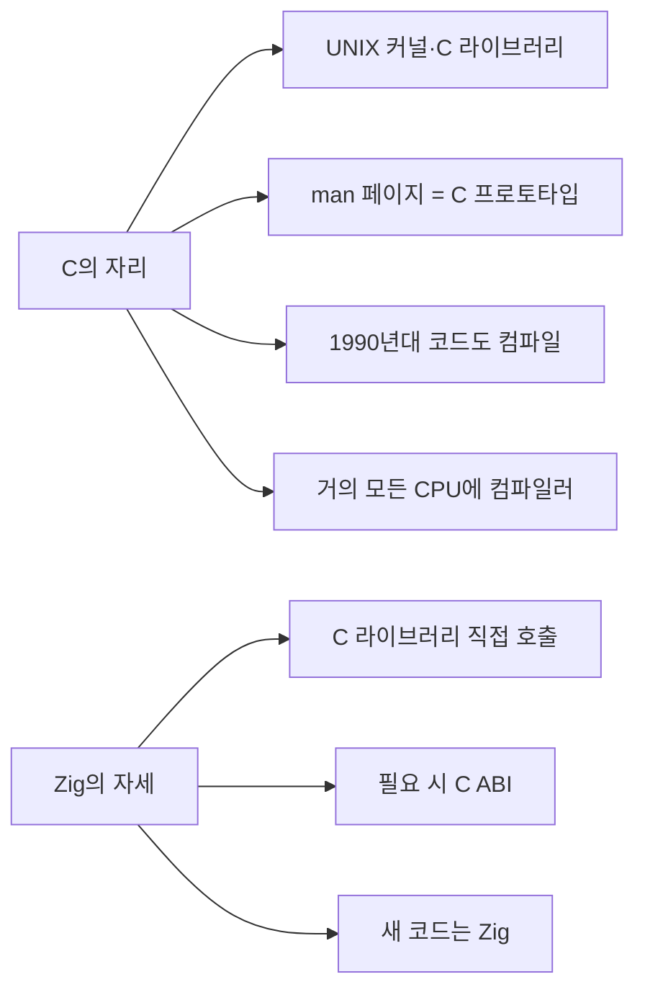
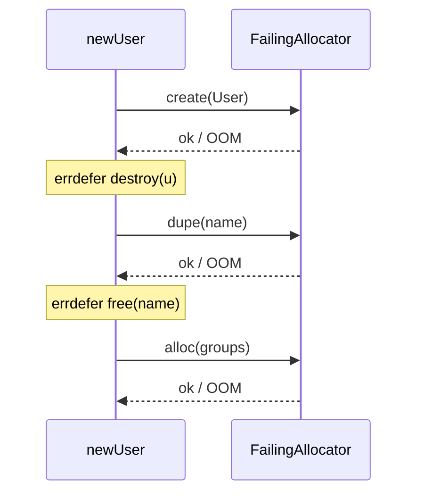

# 시스템 프로그래밍에서 C보다 Zig를 선택하는 이유… 같은 목표, 다른 기본 경로

### Mihalis Tsoukalos의 Why Zig Over C. C는 여전히 최애 언어지만 새 코드는 Zig. `errdefer`·슬라이스·강제 오류·`comptime`·`zig cc`와 한계(UAF·안정성·생태계). GeekNews([37123](https://news.hada.io/topic?id=37123)) 댓글의 “현대 C vs pit of success”, LLM·Rust·학습 경로까지


2026년 11월 [Why Zig Over C for Systems Programming](https://www.mtsoukalos.eu/2026/11/why-zig-over-c-for-systems-programming/)에서 Tsoukalos는 먼저 [Why Zig Over Rust](https://www.mtsoukalos.eu/2026/04/why-zig-over-rust-for-systems-programming/)를 쓴 뒤, **당연한 다음 질문으로 C**를 꺼낸다.

- **Rust vs Zig**는 안전성과, 그 대가를 얼마나 감수할지에 대한 선택이었다.
- **C vs Zig**는 목표가 비슷한 두 언어 사이의 선택이다. 둘 다 작고, GC가 없으며, 기계가 하는 일에 가깝다.

그래서 이 글은 “C를 버리고 완전히 다른 세계로 간다”가 아니다. **C에서 시간을 잡아먹는 부분**과 Zig가 그걸 어떻게 다루는지에 대한 글이다. 예제는 Mac에서 **Zig 0.17**과 **clang**으로 컴파일했다.

아래는 원문 본문·코드·링크된 관련 글 요지와 GeekNews 요약·댓글을 기사 형태로 **전부** 다시 정리한 것이다.

## 0. 디렉터리

언어·런타임 선택과 시스템 프로그래밍 도구 비교이므로 `docs/07_Tech_Trends`에 둔다. Electron/GPUI, Copilot Rust 포트와 같은 “도구를 고르는 이유” 층이다.

## 1. C가 이미 잘 하는 것



C는 UNIX의 언어다. 커널, C 라이브러리, 결국 다른 언어가 호출하는 시스템 라이브러리 대부분이 C로 쓰였고, man 페이지는 C 함수 선언과 C 예제로 API를 설명한다. 1990년대 프로그램도 오늘 컴파일되고, 거의 모든 CPU에 C 컴파일러가 있다. 언어가 작아서 Kernighan과 Ritchie의 *The C Programming Language* 한 권으로 전체를 다룰 수 있다.

Zig는 그 기반을 **대체하려 하지 않는다**. C 라이브러리를 직접 말하고, 필요할 때 C ABI를 쓴다. 저자는 C를 **가장 좋아하는 언어**로 여기면서도, **새 코드는 더 이상 C로 쓰고 싶지 않다**고 적는다.

## 2. `goto` 없이 자원 정리 — `errdefer`

여러 자원을 확보하다 중간에 실패하면, 이미 확보한 것을 **역순**으로 풀어야 한다. Linux 커널도 쓰는 답은 `goto`다.

```c
struct user *user_new(const char *name, size_t n_groups)
{
    struct user *u = malloc(sizeof *u);
    if (u == NULL)
        goto fail;
    u->name = strdup(name);
    if (u->name == NULL)
        goto fail_user;
    u->groups = calloc(n_groups, sizeof *u->groups);
    if (u->groups == NULL)
        goto fail_name;
    return u;

fail_name:
    free(u->name);
fail_user:
    free(u);
fail:
    return NULL;
}
```

동작한다. 다만 **정리 코드가 할당과 멀리** 있고, 레이블 순서를 할당 순서에 맞춰 **손으로** 맞춰야 한다.

같은 함수의 Zig:

```zig
fn newUser(allocator: std.mem.Allocator, name: []const u8, n_groups: usize) !*User {
    const u = try allocator.create(User);
    errdefer allocator.destroy(u);
    u.name = try allocator.dupe(u8, name);
    errdefer allocator.free(u.name);
    u.groups = try allocator.alloc(u32, n_groups);
    return u;
}
```

각 `errdefer`는 되돌릴 할당 **바로 아래**에 두고, 함수가 **오류를 반환할 때만** 역순으로 실행된다. 레이블이 없다.

더 마음에 드는 점은 **실패 경로를 테스트**할 수 있다는 것이다. `std.testing.FailingAllocator`의 `fail_index`로 첫·두·세 번째 할당을 각각 실패시키고, 아래의 `std.testing.allocator`가 해제되지 않은 메모리를 보고한다.

```zig
test "newUser does not leak when an allocation fails" {
    for (0..3) |i| {
        var failing = std.testing.FailingAllocator.init(std.testing.allocator, .{ .fail_index = i });
        try std.testing.expectError(error.OutOfMemory, newUser(failing.allocator(), "mihalis", 4));
    }
}
```

```bash
$ zig test user.zig
1/1 user.test.newUser does not leak when an allocation fails...OK
All 1 tests passed.
```

C에서 같은 세 경로를 시험하려면 `malloc()` 래퍼나 외부 도구가 필요하다.



## 3. 길이를 아는 슬라이스와 문자열

C에서 배열은 함수에 넘어가면 포인터가 되고, 길이는 따로(또는 안) 전달한다. 아래는 `<=` 대신 `<`여야 할 off-by-one이다.

```c
int sum(const int *a, size_t n)
{
    int total = 0;
    for (size_t i = 0; i <= n; i++)
        total += a[i];
    return total;
}
```

`{1, 2, 3}`으로 Mac에서 돌리면 `sum = 7`, 종료 코드 0. 배열 뒤 메모리에서 온 1이다. clang `-Wall -Wextra`도, 프로그램도 불평하지 않는다.

Zig 슬라이스는 길이를 품는다. 같은 실수는 `debug`/`safe`에서 멈춘다.

```zig
fn sum(a: []const i32) i32 {
    var total: i32 = 0;
    for (0..a.len + 1) |i| total += a[i];
    return total;
}
```

```bash
$ zig run sum.zig
thread … panic: index out of bounds: index 3, len 3
```

실제 코드에서는 `for (a) |x|`로 원소를 순회하면 이 인덱스 실수 자체가 안 난다. Zig 문자열도 **길이를 가진 바이트 슬라이스**라 `strlen()`으로 0 바이트를 찾을 필요가 없고, 종료 문자를 빼먹어 버퍼가 한 바이트 부족한 문제도 없다.

## 4. 무시할 수 없는 오류 반환

C는 `-1`/`NULL` + `errno`, 오류 코드 등 여러 방식으로 실패를 알리지만 **확인을 강제하지 않는다**. `close()`·`fclose()` 반환값을 무시해도 컴파일된다.

Zig는 오류를 **반환 타입**에 넣고, 무시하면 컴파일을 거부한다. `try` / `catch` / `if` 중 하나로 처리해야 하고, 실패 경로가 호출 **바로 옆**에 드러난다. 저자가 Go에서도 좋아했던 특성이다.

## 5. 전처리기 대신 `comptime`

C 전처리기는 C의 의미를 모르는 **텍스트** 처리기다. 고전 매크로는 인수를 두 번 평가한다.

```c
#define MAX(a, b) ((a) > (b) ? (a) : (b))
```

큰 프로젝트는 OS마다 `#ifdef`가 쌓인다.

Zig의 컴파일 시간 코드는 **일반 Zig 코드**이고, 나머지 프로그램처럼 컴파일러 검사를 받는다. `#ifdef __linux__` 대신:

```zig
if (builtin.os.tag == .linux) {
    // 해당 없으면 컴파일러가 분기 제거
}
```

제네릭 자료구조는 **타입을 받아 타입을 반환하는 함수**로 구현한다. 저자는 [Zig comptime](https://www.mtsoukalos.eu/2025/06/zig-comptime/)에서 자세히 썼다. 요지:

| 포인트 | 내용 |
|---|---|
| zero-cost | 컴파일 시간에 계산·특수화 → 런타임 비용 없음 |
| 타입 안전 메타프로그래밍 | 텍스트 매크로가 아니라 Zig 타입·값 위에서 동작 |
| 코드 생성 | 룩업 테이블, 상태기계, 특수 함수를 같은 언어로 |
| 반사 | 타입 속성을 컴파일 시간에 검사해 제네릭 동작 |

```zig
fn createPowers(comptime N: usize) [N]usize {
    var arr: [N]usize = undefined;
    var currentPower: usize = 1;
    for (0..N) |i| {
        arr[i] = currentPower;
        currentPower *= 2;
    }
    return arr;
}

// 컴파일 시점에 [5]usize = {1,2,4,8,16}이 바이너리에 박힘
const powersOfTwo = createPowers(5);
```

## 6. 정수 오버플로와 정의되지 않은 동작

C에서 부호 있는 정수 오버플로는 **undefined behavior**다.

```c
int add(int a, int b)
{
    return a + b;
}

int main(void)
{
    printf("%d\n", add(INT_MAX, 1));
    return 0;
}
```

clang으로 돌리면 `-2147483648`과 종료 코드 0. 표준은 그 결과를 보장하지 않으며, “실행될 수 없다”고 본 코드를 제거하는 것도 허용한다.

Zig는 `debug`/`safe`에서 부호 유무와 관계없이 오버플로를 검사하고 `panic: integer overflow`와 위치로 멈춘다.

| 의도 | Zig |
|---|---|
| 래핑 | `+%` |
| 포화(최댓값에 고정) | `+|` |

## 7. C 컴파일러이자 점진적 전환 도구

`zig cc`는 `gcc`/`clang` 대신 쓸 수 있는 C 컴파일러이고, **기본으로 크로스 컴파일**한다.

```bash
# Mac에서 추가 설치 없이 정적 Linux 실행 파일
zig cc -target x86_64-linux-musl -o sum sum.c
```

`debug` 모드의 `zig cc`는 UB 새니타이저도 켠다. 앞의 `add()`는 대략 이런 패닉으로 멈춘다.

```text
panic: signed integer overflow: 2147483647 + 1 cannot be represented in type 'int'
```

`build.zig`는 C와 Zig 파일을 **함께** 컴파일할 수 있어, 같은 빌드를 유지하며 C 프로젝트를 **파일 단위**로 옮길 수 있다.

### 7.1 Zig 0.17과 `@cImport()` 제거

C 헤더가 필요하면 Zig 0.17에서는 `@cImport()`가 없고 [`zig translate-c`](https://www.mtsoukalos.eu/2026/10/cimport-removed-in-zig-0.17/)를 쓴다.

```bash
# c.h 에 #include <unistd.h> 후
zig translate-c -lc c.h > c.zig
```

```zig
// Before (0.16): const c = @cImport(@cInclude("unistd.h"));
const c = @import("c.zig");
```

주의: 생성 `c.zig`는 OS·아키텍처에 의존하고, 프로그램과 **같은 디렉터리**에서 import해야 한다. `build.zig` 프로젝트는 공식 `translate-c` 패키지를 빌드에 넣는 편이 권장된다.

## 8. Zig가 고치지 않는 것

Zig는 “C의 모든 문제를 푼 언어”가 아니다.

- **use-after-free**, 수명이 끝난 스택 변수에 대한 포인터 보관은 막지 않는다.
- `fast` / `small` 모드에서는 대부분 안전 검사가 꺼져 **C처럼 UB**가 가능하다.
- **언어 안정성**은 C에 못 미친다. Zig 0.17 출시 때 책의 Zig 파일 **152개 중 35개**를 고쳐야 했고, 수십 년 전 C는 여전히 컴파일된다.
- C에는 도구·책·숙련자가 더 많고, Zig가 지원하지 않는 칩용 컴파일러도 있다. **벤더 C만 있는 마이크로컨트롤러**면 선택이 이미 정해진다.

그래도 결론은 같다. UNIX 소스와 시스템 라이브러리를 읽는 데는 C가 계속 필요하지만, **새 코드에는 Zig**. 런타임 없이 하드웨어에 가까운 같은 종류의 코드를 쓰면서, 컴파일러와 `debug` 모드가 C가 조용히 통과시키는 실수를 많이 잡기 때문이다.

## 9. (참고) 같은 저자의 Zig vs Rust 한 줄

[Why Zig Over Rust](https://www.mtsoukalos.eu/2026/04/why-zig-over-rust-for-systems-programming/)의 축은 “어느 쪽이 더 안전한가”가 아니라, **기계가 하는 일을 얼마나 적은 의식으로 생각하게 하느냐**다. Rust의 소유권·차용은 존중하지만, raw pointer·커스텀 할당자·트리에 안 맞는 소유권에서는 빌림 검사와 **싸우는 비용**이 시스템을 푸는 문제와 분리된다고 본다. Zig는 작고, 할당자를 인자로 넘기며, 오류 합을 `try`/`switch`로 드러낸다. 대신 UAF·버퍼 오버플로를 컴파일러가 Rust만큼 막아주지는 않는다. Zig는 아직 1.0 전이므로 표준 라이브러리 파손 비용도 인지한 선택이라고 적는다.

## 10. GeekNews·토론에서 나온 말

### 10.1 요약이 찍은 포인트

GeekNews([37123](https://news.hada.io/topic?id=37123)) 요지는 위 본문과 같다. `errdefer` + FailingAllocator, 슬라이스 범위 검사, 강제 오류, `comptime`, 파일 단위 C↔Zig 공존, 그리고 **해제 후 사용은 Zig도 막지 않음**·버전·도구·하드웨어 범위의 한계.

### 10.2 도구 선택의 기준이 바뀌었다

> AI들이 rust코드는 잘 짜지만 zig코드는 잘 못짬. 이젠 툴체인 … 선택기준이 바뀌었음. — iolothebard

### 10.3 “구식 C” 비교 vs pit of success (GN⁺)

현대 도구를 쓰면 나열된 장점 상당수를 C에서도 얻을 수 있다는 반론이 있다. 부호 정수 오버플로 → 새니타이저, 무시하면 안 되는 오류 → `[[nodiscard]]`(C23에도 있음), 크기 아는 슬라이스 → span/가변 수정 타입, `defer`도 C 컴파일러에 들어올 예정 등. Rust의 **시간적 메모리 안전** 이점은 Zig에는 해당하지 않는다.

저자 쪽 취지는 [Falling Into The Pit of Success](https://blog.codinghorror.com/falling-into-the-pit-of-success/)에 가깝다. 현대 C로도 가능하지만, **일관되게 지키려면 자기 규율이 너무 많이** 필요하다. Zig는 그 관행을 **자연스러운 기본 경로**로 만든다. 할당자를 함수에 넘기는 문화가 라이브러리 전반에 퍼져 있는 점도 “가능하지만 드묾”인 C와 다르다. 의존성이 생기면 그 작성자의 방식을 받아들여야 하니, **새 언어 = 새 생태계** 논리가 성립한다. 그래도 `comptime` vs 전처리기는 **상당히 큰 차이**로 본다.

### 10.4 C++ 부분집합·GC·아레나

- C처럼 쓰되 예외/RTTI는 끄고 템플릿·오버로드·람다만 쓰는 C++ “자기만의 언어” 전략, STL 부분집합(예외 없이 SIMD 가속 포함)도 거론됐다.
- GC 언어를 선호하는 쪽은 `scores["charlie"] = 92` 같은 코드에서 Zig/Rust가 메모리 할당을 **너무 전면**에 내세운다고 본다. 자연어 → 의사코드 → 타입 있는 GC → 저수준이라는 **단계**가 필요하고, Zig/Rust는 마지막 단계용이라는 주장.
- Zig는 C++만큼 표현력이 있으면서 암묵성을 피하고, **아레나** 지원이 낫다는 평가도 있다. (한편 Rust `Allocator` API 안정화 소식도 댓글에 등장.)

### 10.5 goto 정리의 다른 C 스타일

자원별 레이블 여러 개보다, `calloc` + 단일 `fail` + `free(NULL)` no-op을 활용하거나, 부분 초기화까지 처리하는 `user_free()`로 실패 경로를 한 줄로 모으는 편이 낫다는 반론이 있다. (널 비트 패턴이 표준상 전부 0이라는 가정에 의존한다는 점도 같이 적힘.)

### 10.6 명시적 `for` vs 의도 표현

`for (size_t i = 0; i <= n; i++)`를 좋아하는 쪽과, 실제 하드웨어는 벡터화·루프 펼치기라 **의사 어셈블리처럼 보이는 명시성**을 경계하는 쪽이 맞붙었다. Zig에서도 `while (i <= n) : (i += 1)`로 비슷하게 쓸 수 있고, Odin/Go/V 스타일도 언급됐다. 합이 필요하면 `total = a.sum()` / reduce가 의도를 더 잘 담는다는 쪽이 강했다.

### 10.7 D·Nim·Rust·LLM

D/Nim에 비슷한 기능이 오래전부터 있었다는 지적, 시스템 주제에서 GC 기본값은 거부감을 준다는 반론, Nimony(사실상 Nim 3.0) 링크, “Rust가 틈새를 대체할 것” vs “Scala처럼 안 될 수도 / 단순 Kotlin식 자리”, Zig의 C 컴파일러가 Rust 크로스컴파일에 유용하다는 실무 메모, Zig는 Rust와 **정반대의 정확성 접근**(암묵성 제거 vs 실수 방어)이라는 재정의까지 이어졌다. “LLM 시대라 Rust/Go 아니면 끝” 식 깎아내리기에 대한 반발도 있다.

### 10.8 C와 Zig, 무엇을 먼저 배울까

저수준 경험이 Go뿐인 질문자에게는:

- Linux/BSD 스택·FFI·실행 원리를 보려면 **여전히 C**가 강력하다.
- 용도별로 Go(API)·Rust(TUI) 등 실용 선택이 갈린다.
- 학습 면에서는 C로 수동 메모리와 “무엇이든 허용”의 문제를 겪은 뒤 Zig/Rust 제약이 **자동화**로 보이게 하라는 조언. CMU 15-122 자료([schedule](https://www.cs.cmu.edu/~15122/schedule.shtml))가 기초로 추천됐다.

## 11. 한눈에

| 주제 | C | Zig (저자 관점) |
|---|---|---|
| 목표 | 작고, GC 없음, 기계에 가까움 | 같음 |
| 부분 실패 정리 | `goto` 레이블 | `errdefer` + 실패 경로 테스트 |
| 배열/문자열 | 포인터 + 별도 길이 / NUL | 길이 있는 슬라이스 |
| 오류 | 관례, 무시 가능 | 타입에 포함, 무시 불가 |
| 메타 | 전처리기 텍스트 | `comptime` (타입 검사) |
| 정수 오버플로 | 부호 정수 = UB | debug/safe에서 panic, `+%`/`+|` |
| 전환 | — | `zig cc`, `build.zig`, `translate-c` |
| 한계 | — | UAF 미차단, 미안정, 좁은 칩·도구 |

**참고**

- [Why Zig Over C for Systems Programming](https://www.mtsoukalos.eu/2026/11/why-zig-over-c-for-systems-programming/) (원문)
- [Why Zig Over Rust for Systems Programming](https://www.mtsoukalos.eu/2026/04/why-zig-over-rust-for-systems-programming/)
- [Zig comptime](https://www.mtsoukalos.eu/2025/06/zig-comptime/)
- [@cImport() Is gone in Zig 0.17](https://www.mtsoukalos.eu/2026/10/cimport-removed-in-zig-0.17/)
- [GeekNews 37123](https://news.hada.io/topic?id=37123)
- [Falling Into The Pit of Success](https://blog.codinghorror.com/falling-into-the-pit-of-success/)
- [CMU 15-122](https://www.cs.cmu.edu/~15122/schedule.shtml)
