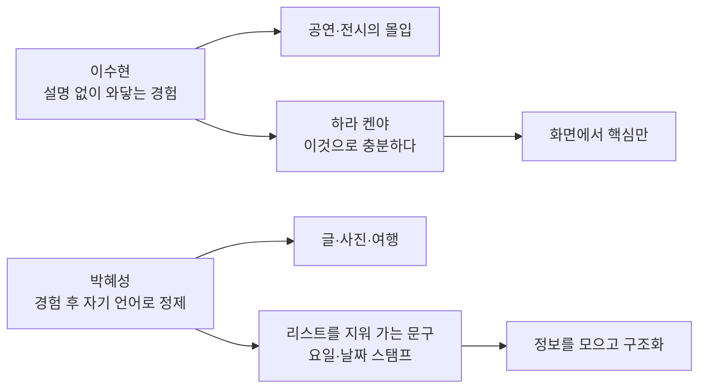
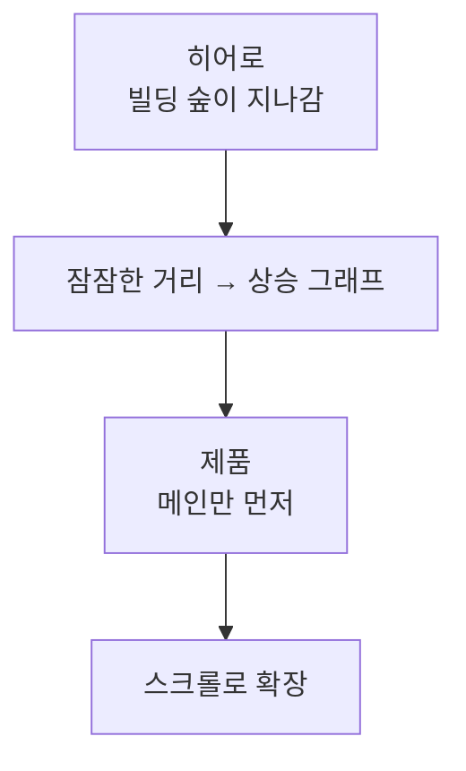
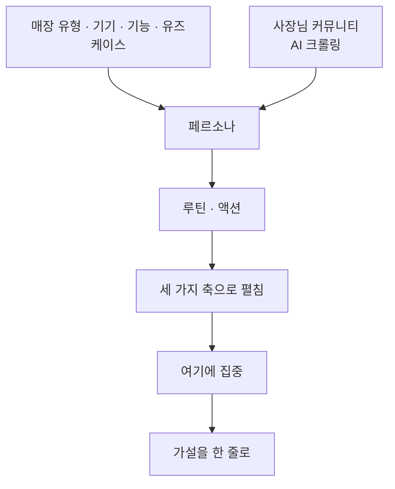
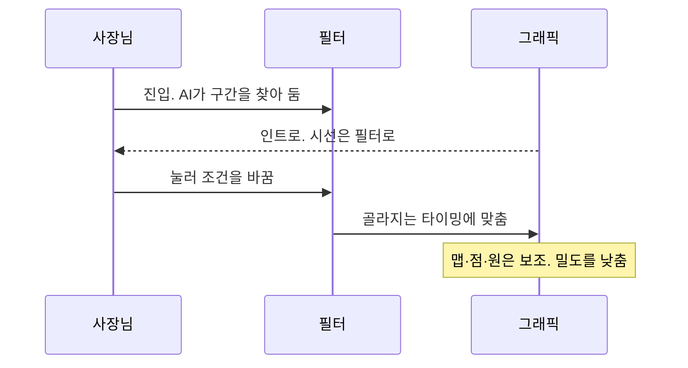

# 디자이너가 서비스를 만드는 방법… 토스플레이스 Simplicity Mini

### 토스 챌린저스 [Simplicity Mini](https://www.youtube.com/watch?v=EfEKf6uzALE). 프로덕트 디자이너 박혜성·비주얼 디자이너 이수현이 취향, Framer 채용 사이트, 사장님 앱 구조화, ‘차플’ 노트, 동네 매출 비교 인터랙션과 Figma AI 시행착오까지 작업창을 연다


채널은 [토스 챌린저스](https://www.youtube.com/@tosschallengers), 제목은 **「디자이너가 서비스를 만드는 방법 | 토스플레이스 | Simplicity Mini」**다. 설명은 이렇게 시작한다.

> 사장님을 위한 서비스를 만드는 토스플레이스, 그곳의 Visual Designer와 Product Designer는 어떤 취향을 바탕으로 어떤 제품을 만들고 있을까요? 토스 디자이너의 작업창을 열어보았습니다.

챕터는 영상 설명에 적힌 타임스탬프다.

| 시각 | 챕터 |
|---|---|
| 0:00 | 나를 한 문장으로 소개해주세요 |
| 0:18 | 프로덕트 디자이너와 비주얼 디자이너 |
| 1:24 | 토스 디자이너의 개인적 취향 |
| 4:06 | 토스플레이스 채용 페이지는 어떻게 만들었을까 |
| 6:56 | 프로덕트 디자이너의 일하는 방식 |
| 8:10 | 디자이너가 제품을 만드는 방법 |
| 10:36 | 작업창으로 보는 디자인 사례 |
| 13:55 | 프로덕트 디자이너가 가장 즐거울 때 |
| 14:56 | 좋아하는 것이 일하는 방식이 될 때 |

아래는 그 대화 전체를 기사로 다시 적은 것이다. 화면에만 있고 말로 이름 붙이지 않은 툴·축 이름은 지어 넣지 않았다.

## 0. 디렉터리

제품이 만들어지는 **일하는 방식** 이야기다. 런타임 뉴스와 같은 층은 아니지만, 도구(Framer, Figma AI)와 제작 과정을 다루는 동향 노트이므로 `docs/07_Tech_Trends`에 둔다.

## 1. Simplicity Mini와 두 역할

개발자 콘텐츠로 **SLASH**가 이미 있다. 디자인 챕터도 하는 일을 더 잘 설명하고 싶어 **Mini**를 새로 만들었다고 한다.

한 문장 자기소개는 어렵다는 말로 시작한 뒤, 역할을 이렇게 가른다.

| | 박혜성 | 이수현 |
|---|---|---|
| 직함 | 토스 프로덕트 디자이너 | 토스 비주얼 디자이너 |
| 중심 | 리서치부터 기획, 최적의 사용자 경험 | 인터랙션 중심의 화면 |
| 하는 일 | 무엇을 만들지 구조로 좁히기 | 화면 안 문제를 풀고, 이해를 돕거나 행동을 유도 |

## 2. 좋아하는 것이 먼저다



### 2.1 이수현 — 한 번에 느껴지는 메시지

LP를 소유한 사진은 아니다. LP 바에서 듣고 있는 장면을 찍은 것이다. 길게 설명하기보다 **복잡한 설명 없이도 한 번에 메시지가 느껴지는 경험**을 좋아한다. 공연은 말로 풀지 않아도 빠져들고, 전시는 표현 방식이 주는 몰입이 재미있다고 한다.

좋아하는 디자이너로 **하라 켄야**를 든다. 「이것으로 충분하다」는 무지(MUJI)의 감성, 많이 넣기보다 **핵심만 남기는 매력**이다. 메시지가 바로 다가오는 쪽을 좋아한다.

### 2.2 박혜성 — 보고 듣고, 자기 언어로 남기기

세상을 보고 듣고 경험한 뒤 **나름대로 다시 정제하는 과정** 자체를 좋아한다. 해외에서 일하고 살아 보고 여행하면서, 글과 사진으로 저장해 자기 언어로 이해해 둔다. 기록을 좋아한다는 진행자의 말에 그렇다고 답한다.

가져온 문구는 음성상 **네덜란드 그래픽 디자이너**의 타이포그래피가 멋진 물건으로 소개된다(이름은 자동 자막에서 또렷하지 않다). 그중 두 포맷을 제일 좋아한다.

1. 할 일을 줄줄이 쓰고, 하면서 **지워 가는** 리스트.
2. 생각 옆에 **요일과 날짜를 찍어** 언제 남겼는지 알게 하는 포맷.

여태 써 본 것 중 제일 잘 맞는다고 했고, 진행자가 집에 있는 것을 선물하겠다고 받아 넘긴다.

## 3. 채용 웹 — 컨셉이 스크롤로 이어지게

이수현이 보여 준 일은 **토스플레이스 전 직군 대규모 채용 웹사이트**다. 그래픽 디자이너와 협업했고, 사이트는 **Framer**로 만들었다. 인터랙션과 “이 프로젝트를 어떻게 표현할지”를 전반적으로 제안할 수 있는 분위기였다고 한다.

히어로는 그래픽 디자이너의 작업이다. 오프라인 매장에 혁신을 가져오는 계열사라는 점에서, **빌딩 숲이 지나가는** 혁신 느낌의 시안이었다. 그 아래 UI·정보로 내려갈 때도 자연스럽게 이어지길 바랐다.

처음에 그래프만 띄우려던 화면을, 히어로와 잇기 위해 이렇게 제안했다. 그래프가 뚝 끊기지 않고, **토스가 나타나기 전 잠잠하던 빌딩**에서 **상승하는 그래프**로 넘어가게.

제품 소개 구간은 제품 홍보 사이트처럼 보이지 않기를 원했다. **메인만 먼저** 보여주고, 스크롤에 따라 자연스럽게 확장·지나가게 했다.



후기 중 기뻤던 말은, 넘어갈 때 **슬릭해서 계속 돌려봤다**는 반응이다. Framer로 디자인하고 개발하고 배포까지 한 경험은 **두 번도 채 안 되는데** 해냈다는 자부심이 있었고, 그 반응이 계속할 원동력이 된다고 한다.

## 4. 정보를 모으고, 세 축으로 좁히기

박혜성은 “많이 모으고 구조화한다”를 짧게 보여 준다. 예전에 만든 **사장님 앱**은 모바일에서 매장 현황을 한눈에 보고, 필요한 업무를 폰으로 처리하게 하는 서비스다.

정리한 층은 이렇다.

- 매장 유형 × 기기 조합별로 **쓸 수 있는 기능**
- **유즈 케이스**
- 페르소나별로 무엇이 필요하고, 그러면 사용자가 쓸 것이라는 사례

여기에 **사장님 커뮤니티를 AI로 크롤링**해 페르소나, 하고 있는 일, 루틴, 액션을 구조화하고 제품 구조로 구체화했다. 그다음 **세 가지 축**에서 시도할 것을 적고, 그중 어디에 집중할지 정한다. 영상은 세 축의 이름을 말로 풀지 않는다. 다듬어 **뾰족하게** 만들 때가 진짜 재미있다고 한다.



## 5. 둘이 만난 제품 — 차플에서 두 MVP

둘이 같이 만드는 맥락은 **차플(찾아가는 토스플레이스)** 간담회다. 토스플레이스가 줄 수 있는 데이터와, 사장님 의사결정에 필요한 데이터를 추렸다. 사장님이 남긴 노트에는 이런 궁금증이 있었다.

- 가게 평균 매출이 올랐는지, 줄었는지, 얼마인지
- 근처 카페 평균은 어느 정도인지
- **전체는 궁금하지 않고, 같은 업종만** 비교하고 싶다
- 매출을 **정확하게** 알고 싶다
- 다른 데보다 잘하는지 못하는지, 다른 가게는 어떻게 하고 왜 잘되는지, **어떻게 하면 더 잘할지**

그래서 인사이트를 넣기로 했다. 정리한 다음 **다시 발산**하는 일이 재미있고, 그건 디자이너가 대체로 좋아하는 구간이라고 한다.

가설을 한 줄로 정리한 뒤, 시각적으로 말하기 위해 시안을 **아주 많이** 그린다. 제로 투 원, A부터 Z까지 갈 수 있는 데까지 가 본다. 같은 한 줄도 표현은 여러 가지다.

- **랭킹**으로 보여 주기
- 매출·객단가·재방문율 같은 지표를 다른 매장과 비교해 **상위 몇 %**처럼 내 매장 진단하기

그렇게 **두 가지 MVP**가 나왔다.

1. 매장에서 일어나는 일을 한눈에. 예를 들어 **점심 장사가 어떻게 됐는지**.
2. 매출이 어느 정도인지, 다른 매장 대비 잘하는지 못하는지를 **객관적으로** 판단하게 하는 제품.

그중 **동네 매출 비교**가 직관적으로 와닿았으면 해서 이수현에게 맡겼고, “진짜 멋있게 만들어 주셨다”고 한다.

## 6. 작업창 — 필터가 주인공, 그래픽은 보조

동네 매출 비교가 **어떻게 소개될지**가 첫 고민이었다.

- 진입하면 **필터를 AI가 찾아** 준다.
- 그렇게 찾은 구간으로 들어가, 그 화면을 계속 쓸 수 있게 한다.
- 누르면 필터가 나오고, 바꿔 볼 수 있다.
- 제한된 컨테이너가 뜰 때 시선이 가고, 온보딩 패턴·시선 강조가 되도록 제안했다.

온보딩에 패턴이 쫘르륵 나오는 그래픽이 들어간다. 인트로는 유려해야 보기 좋고, 그게 **신뢰**로도 이어진다고 봐서 시안을 많이 쳤다.

| 시도 | 의도 |
|---|---|
| 맵·지도 | 공간을 보여주는 느낌 |
| 점선 | 분석하는 심상 |
| 필터 UI를 앞에 | 미리 골라 주는 느낌 |
| 점으로 맵을 그림 | 방향을 잡은 안 |
| 원이 퍼짐 vs 점이 퍼짐 | 같이 보여줄지 |
| 점이 너무 기계적이지 않은지 | 반도체·기계 느낌 경계 |

요즘은 AI가 잘 되어 있어 더 잘 표현하고 다양히 시험해 보려 시작했다. **처음은 처참**했다. 프롬프트 도중에 모델이 냅다 제안한 것 중에는 심각한 시안도 나왔다.

그래서 방향을 틀었다. 벡터 느낌은 **Figma에서 레이어로, Figma AI로** 먼저 만들고, **그 벡터 소스를 프롬프트와 함께** AI에 던져 만들게 했다.

동적인 부분을 만질 때 가장 중요한 것은 **시선의 흐름**이다. 그래픽은 보조 수단으로 아래에 떠 있게 하고, 밀도도 낮춰 **메인 필터**가 강조되고 패턴은 보조로만 느껴지게 정제했다. 필터가 골라지는 느낌으로 **마무리 타이밍**을 그래픽과 맞췄다.



이해를 위한 스케치다. 영상 속 구현 코드는 아니다.

```ts
type Filter = { industry: string; area: string; metric: "sales" | "ticket" | "revisit" };

// 진입: 필터는 이미 골라져 있다. 그래픽은 그 선택을 따라올 뿐.
const intro = {
  filter: { industry: "cafe", area: "nearby", metric: "sales" } satisfies Filter,
  graphic: "dots-on-map" as const,
  role: "support" as const, // 시선의 주인공은 filter
};

function onFilterCommit(next: Filter) {
  return { filter: next, graphicPhase: "settle-with-selection" };
}
```

## 7. 배포 뒤의 말, 그리고 제목

자랑으로 보여 준 사용자 말은 이렇다.

- 이 서비스 **꼭 유지**됐으면 좋겠다.
- 운영 시간을 실제로 바꿔 **오전 매출을 높였다**.
- 이런 기능 **필요했다**.

수많은 데이터에서 가장 필요한 것, 사용자가 가장 원하는 것을 추려 **하나의 디자인 산출물**이 될 때가 제일 재미있다고 한다. 하는 이유 자체는 사장님 **매출이 오르고**, 그 기능으로 **장사가 잘되기를** 바라는 것이다.

오늘 이야기에 붙인 제목은 **「좋아하는 것이 일하는 방식이 될 때」**. 취향 이야기가 일하는 방식과 이어지고, 그 방식이 제품 구현까지 영향을 줘서 맞다는 쪽이다. 덧붙인 말은, 즐기면서 한 일이 결과도 잘 나왔다는 경험, 그리고 **직접 제안하고 능동적으로** 일할 수 있는 환경이라 그게 가능하다는 느낌이다.

마지막 메시지: **꼭 좋아하는 일을 하실 수 있길.**

## 8. 한눈에

| 구간 | 요지 |
|---|---|
| Mini | SLASH(개발) 옆에, 디자인 챕터를 설명하는 짧은 콘텐츠 |
| 취향 | 핵심만 남기는 경험 / 경험을 구조로 기록 |
| 채용 웹 | Framer. 빌딩 → 상승 그래프 → 제품은 스크롤로 확장. 홍보 사이트처럼 보이지 않게 |
| 사장님 앱 | 유형·기기·기능·유즈케이스·페르소나, 커뮤니티 AI 크롤링, 세 축 후 집중 |
| 차플 | 같은 업종·근처·정확한 매출 비교. 가설 한 줄 뒤 시안은 A–Z |
| MVP 둘 | 한눈에 보는 매장 현황, 동네 대비 객관 진단 |
| 인터랙션 | AI가 고른 필터가 주인공. 그래픽은 시선 보조. Figma 벡터를 AI에 넘겨 수습 |
| 결과 | “유지해 달라”, “오전 매출이 올랐다”, “필요했다” |

**참고**

- [디자이너가 서비스를 만드는 방법 | 토스플레이스 | Simplicity Mini](https://www.youtube.com/watch?v=EfEKf6uzALE) (토스 챌린저스, 설명·챕터·대화)
- [토스 챌린저스](https://www.youtube.com/@tosschallengers)
