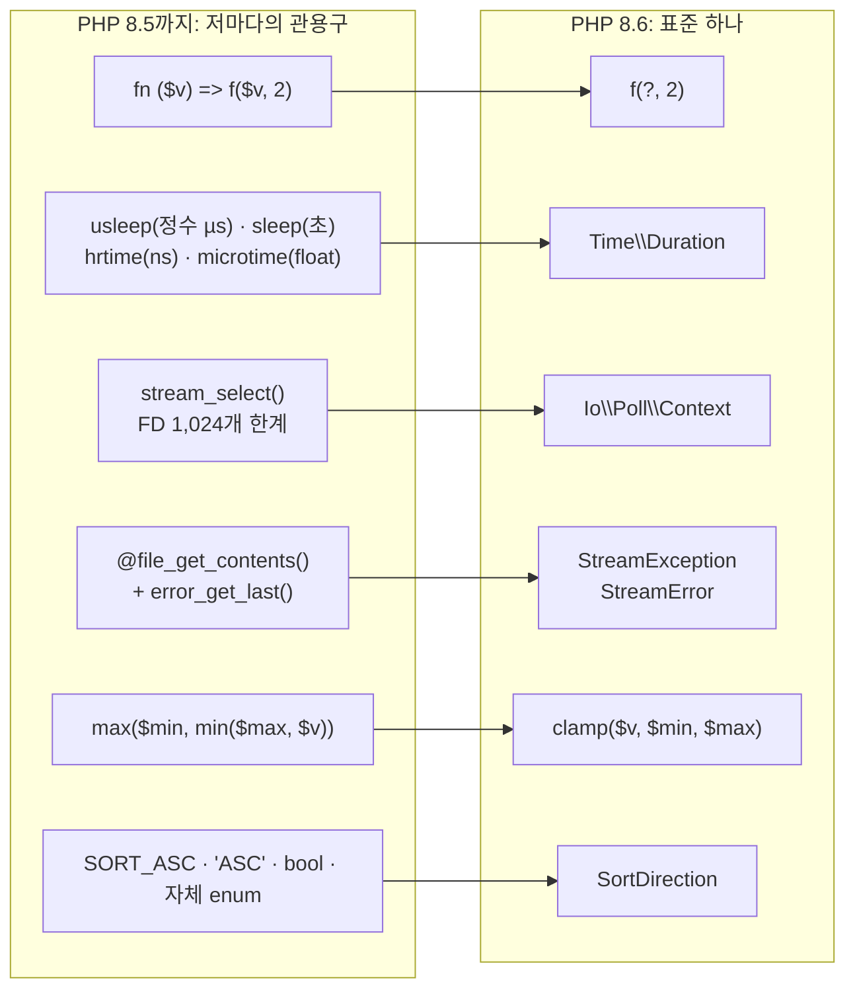
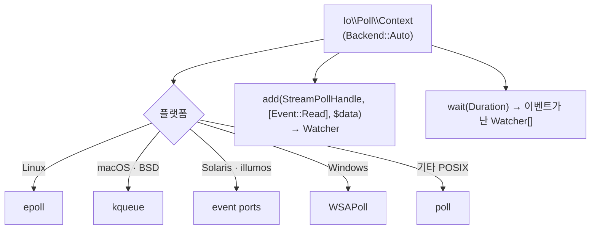
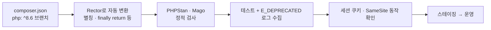

# PHP 8.6 출시… 부분 함수 적용, `Time\Duration`, `Io\Poll`로 "흩어진 관용구"를 표준으로

### 2026년 11월 19일 나온 PHP 8.6의 중심은 부분 함수 적용(`?`, `...`)이다. 여기에 나노초 정밀도의 `Time\Duration`, epoll·kqueue를 직접 쓰는 `Io\Poll`, 예외로 받는 스트림 오류, `clamp()`, `SortDirection` enum이 더해졌다. 업그레이드 전에는 세션 보안 기본값 강화, 입력 검증 `ValueError`, `fclose()` 반환값 변화, 20여 개의 사용 중단 예정 항목을 확인해야 한다

PHP 8.6.0이 2026년 11월 19일 [출시](https://www.php.net/releases/8.6/en.php)됐다. 공식 공지의 헤드라인은 "Faster, Safer, More Powerful"이다. GeekNews([토픽 37476](https://news.hada.io/topic?id=37476))가 공지를 요약하고 [Hacker News 토론](https://news.ycombinator.com/item?id=50557870)도 함께 정리했다.

이 글은 공식 공지를 뼈대로 삼는다. 각 기능의 RFC에서 정확한 API와 설계 이유를 보충하고, 같은 시기 PHP Foundation이 낸 [표준 라이브러리 투자 글](https://thephp.foundation/blog/2026/11/03/stdlib-investment/)의 맥락도 붙였다. 예제 코드는 RFC 시그니처를 따라 새로 썼다. **로컬에 PHP 8.6이 없어 실행 검증은 하지 못했다.**

## 1. 한눈에 보기

| 분류 | 기능 | 한 줄 설명 | RFC |
|---|---|---|---|
| 언어 | **부분 함수 적용** | `f(?, 2)`, `f(1, ...)`로 일부 인수를 미리 채운 Closure 생성 | [partial_function_application_v2](https://wiki.php.net/rfc/partial_function_application_v2) |
| 표준 라이브러리 | **`Time\Duration`** | 나노초 정밀도의 불변 경과 시간 타입 | [duration_class](https://wiki.php.net/rfc/duration_class) |
| I/O | **`Io\Poll`** | epoll/kqueue/event ports/WSAPoll 기반 폴링 API | [poll_api](https://wiki.php.net/rfc/poll_api) |
| I/O | **스트림 오류 처리** | 경고 대신 `StreamException`, 구조화된 `StreamError` | [stream_errors](https://wiki.php.net/rfc/stream_errors) |
| 표준 라이브러리 | **`clamp()`** | 값을 `[min, max]`로 제한 | [clamp_v2](https://wiki.php.net/rfc/clamp_v2) |
| 표준 라이브러리 | **`SortDirection`** | `Ascending` / `Descending` 공용 enum | [sort_direction_enum](https://wiki.php.net/rfc/sort_direction_enum) |
| 리플렉션 | 매개변수 DocComment | `ReflectionParameter::getDocComment()` | [parameter-doccomments](https://wiki.php.net/rfc/parameter-doccomments) |
| 리플렉션 | `isReadable()` / `isWritable()` | readonly·비대칭 가시성·훅을 고려한 접근 판정 | [isreadable-iswriteable](https://wiki.php.net/rfc/isreadable-iswriteable) |
| 객체 | readonly 속성 기본값 | `public readonly string $x = 'y';` | [readonly_property_defaults](https://wiki.php.net/rfc/readonly_property_defaults) |



## 2. 부분 함수 적용: 화살표 함수 없이 콜백 만들기

### 2.1 기본 문법

함수 호출에서 인수 자리에 **자리표시자**를 두면, 함수를 바로 호출하지 않고 **나머지 인수를 기다리는 Closure**를 돌려준다.

- `?`는 정확히 인수 **하나**를 비워 둔다.
- `...`는 나머지 인수 **전부**(0개 이상)를 비워 둔다.

```php
<?php
$versions = ['8.4', '8.5', '8.6', '8.7', '9.0'];

// PHP 8.5까지
$supported = array_filter($versions, fn ($v) => version_compare($v, '8.6', '>='));

// PHP 8.6: 첫 번째 인수만 비워 둔 Closure
$supported = array_filter($versions, version_compare(?, '8.6', '>='));
// ['8.6', '8.7', '9.0']

// ...: 앞부분만 고정하고 나머지는 그대로 넘긴다
$log = sprintf('[%s] %s: %s', ...);
echo $log('INFO', 'db', 'connected');   // [INFO] db: connected
```

규칙은 RFC에 정리돼 있다.

| 규칙 | 예 |
|---|---|
| 위치 인수와 `?`를 섞고, 그 뒤에 이름 있는 인수, 마지막에 `...`는 최대 1개 | `foo(1, ?, 3, ...)` |
| 자리표시자는 최소 하나 필요 | `foo(1, 2)`는 그냥 호출 |
| 이름 있는 `?`는 **작성한 순서대로** Closure의 매개변수가 됨 | `stuff(s2: ?, i1: ?)` → `fn(string $s2, int $i1)` |
| 이름 있는 인수 뒤에 위치 `?`는 불가 | `stuff(i: 1, ?)` → 컴파일 오류 |
| 생성된 Closure는 원래 함수의 이름·타입·기본값·참조 전달 여부를 물려받음 | `#[SensitiveParameter]`, `#[NoDiscard]`도 상속 |
| `new`에는 쓸 수 없음 | `new Foo(1, ?)` 오류, `Foo::make(1, ?)`는 가능 |

### 2.2 화살표 함수와 다른 점: 평가 시점

미리 채운 인수의 표현식은 **Closure를 만드는 순간** 평가된다. 화살표 함수 안의 표현식은 **호출할 때마다** 평가된다.

```php
<?php
function now(): string { echo "now() 호출\n"; return date('H:i:s'); }
function stamp(string $msg, string $at): string { return "$at $msg"; }

$a = stamp(?, now());          // 여기서 now()가 한 번 실행된다
$b = fn ($m) => stamp($m, now());  // 여기서는 실행되지 않는다

echo $a('first'), "\n";        // 생성 시각이 고정됨
echo $b('second'), "\n";       // 호출 때마다 now() 실행
```

비싼 계산을 미리 한 번만 하고 싶을 때는 이 차이가 이점이지만, 매번 새 값이 필요할 때는 함정이 된다.

### 2.3 파이프 연산자 `|>`와의 짝

PHP 8.5의 파이프 연산자 `|>`는 왼쪽 값을 오른쪽 **단일 인수 호출 가능 값**에 넘긴다. 문제는 대상 함수의 첫 번째 인수가 아닌 자리에 값을 넣어야 할 때였다. 8.5에서는 매번 클로저로 감싸야 했다. HN 댓글 한 줄이 이를 요약한다. "PFA 없는 `|>`는 오히려 코드가 길어진다. 8.6으로 먼저 올린 뒤 파이프를 쓰는 걸 추천한다."

```php
<?php
// PHP 8.5: 첫 번째 인수가 아니면 클로저가 필요했다
$slug = $title
    |> trim(...)
    |> (fn ($s) => str_replace(' ', '-', $s))
    |> strtolower(...);

// PHP 8.6: 자리표시자로 바로
$slug = $title
    |> trim(...)
    |> str_replace(' ', '-', ?)
    |> strtolower(...);
```

RFC에 따르면 파이프 오른쪽의 부분 적용이 단일 인수로 정적으로 판단되는 경우(`foo(?)`, `foo(1, ?)`, `foo(1, ...)`)에는 **Closure를 만들지 않고 직접 호출로 컴파일**된다. 그래서 성능 비용도 없다.

## 3. `Time\Duration`: 단위가 섞이지 않는 시간

### 3.1 왜 필요했나

PHP 함수들은 시간을 저마다 다른 단위로 받았다. PHP Foundation 글이 꼽은 목록이 그대로 문제를 보여 준다.

| 함수 | 단위 |
|---|---|
| `sleep()` | 초 (int) |
| `usleep()` | 마이크로초 (int) |
| `CURLOPT_TIMEOUT_MS` | 밀리초 |
| `hrtime()` | 나노초 |
| `stream_set_timeout()` | (초, 마이크로초) 정수 쌍 |
| `microtime(true)` | 초 (float) |

`$timeout = 30`만 보고는 30초인지 30밀리초인지 알 수 없다. `DateInterval`은 "1개월"처럼 길이가 고정되지 않은 달력 단위를 다루므로 경과 시간 표현에는 맞지 않는다.

### 3.2 API

`Time\Duration`은 `final readonly class`다. 모든 연산은 새 객체를 돌려준다.

| 구분 | API |
|---|---|
| 생성 | `fromSeconds(int $s, int $ns = 0)`, `fromNanoseconds()`, `fromMicroseconds()`, `fromMilliseconds()`, `fromMinutes()`, `fromHours()`, `fromIso8601DurationString('PT1H30M')` |
| 속성 | `->seconds`, `->nanoseconds`, `->negative` |
| 연산 | `add()`, `sub()`, `multiplyBy(int)`, `divideBy(int)`, `negate()`, `absolute()` |
| 비교 | `<`, `>`, `==` 직접 비교 가능, `Duration::compare($a, $b)` (−1/0/1), `min()`·`max()`·`clamp()` 사용 가능 |
| 범위 | 나노초 정밀도, 최대 약 292년. 넘치면 `Time\TimeException` |

음수를 직접 만드는 생성자는 없고 `->negate()`로만 만든다. `+` 같은 산술 연산자는 오버로드되지 않았다. 설계는 Go의 `time.Duration`, Java의 `java.time.Duration`, Rust의 `std::time::Duration`을 참고했다.

### 3.3 예제: 지수 백오프

공식 공지의 백오프 예제를 바탕으로, 부분 적용과 `clamp()`를 함께 쓰도록 새로 썼다.

```php
<?php
use Time\Duration;

/** 시도 횟수에 따라 대기 시간을 두 배씩 늘리되, 0.1초~30초 범위로 제한한다. */
function backoff(Duration $base, int $attempt): Duration
{
    return clamp(
        $base->multiplyBy(2 ** $attempt),
        min: Duration::fromMilliseconds(100),
        max: Duration::fromSeconds(30),
    );
}

$waitFor = backoff(Duration::fromMilliseconds(200), ?);   // 부분 적용: attempt만 남김

for ($attempt = 0; $attempt < 10; $attempt++) {
    if (try_request()) {
        break;
    }
    $delay = $waitFor($attempt);
    printf("retry #%d in %d.%03ds\n", $attempt, $delay->seconds, intdiv($delay->nanoseconds, 1_000_000));
    time_nanosleep($delay->seconds, $delay->nanoseconds);
}
```

PHP 8.5까지는 이 코드를 `$delayUs = min($base * 2 ** $attempt, 30_000_000); usleep($delayUs);`처럼 썼다. "30_000_000이 무슨 단위인지"를 주석으로 설명해야 했던 부분이 타입으로 바뀌었다.

이것은 새 날짜·시간 API의 첫 조각이다. 다음 단계로 `Time\Instant`(시점)와 `Time\Clock` 인터페이스가 [RFC로 논의 중](https://wiki.php.net/rfc/time_instant_class)이다. Instant끼리의 차이가 Duration이 되는 구조다.

## 4. `Io\Poll`: `stream_select()`의 1,024개 한계를 넘어

### 4.1 왜 필요했나

`stream_select()`는 내부적으로 `select()`를 쓴다. 그래서 감시할 수 있는 파일 디스크립터가 보통 **1,024개로 제한**되고, 호출할 때마다 전체 목록을 훑는 O(n) 구조다. ReactPHP나 AMPHP 같은 이벤트 루프 라이브러리는 이를 피하려고 `ext-ev`, `ext-uv` 같은 별도 확장을 요구해야 했다. `Io\Poll`은 OS가 제공하는 고성능 메커니즘을 PHP 코어에서 바로 쓰게 한다. 이벤트 루프 전체가 아니라 **폴링만** 제공하는 최소 API이며, 라이브러리들이 공통 기반으로 쓰라는 설계다.



### 4.2 API 요약 (RFC v1.4 기준)

| 타입 | 핵심 |
|---|---|
| `Context` | `__construct(Backend $backend = Backend::Auto)`, `add(Handle, array $events, mixed $data = null): Watcher`, `wait(...)`, `getBackend()` |
| `Watcher` | `getHandle()`, `getTriggeredEvents()`, `hasTriggered(Event)`, `getData()`, `modifyEvents()`, `modifyData()`, `remove()` |
| `StreamPollHandle` | 스트림을 감싸는 핸들. `getStream()`, `isValid()`. 앞으로 소켓·cURL 핸들도 추가 예정 |
| `Event` | `Read`, `Write`, `ReadHangUp`(epoll), `OneShot`, `EdgeTriggered`(epoll·kqueue), 출력 전용 `Error`, `HangUp` |
| `Backend` | `Auto`, `Poll`, `Epoll`, `Kqueue`, `EventPorts`, `WSAPoll`. `getAvailableBackends()` |
| 예외 | `Io\IoException` → `Io\Poll\PollException` → `FailedPollWaitException`, `BackendUnavailableException` 등 |

**`wait()` 시그니처 주의.** RFC v1.4 본문은 `wait(?int $timeoutSeconds = null, int $timeoutMicroseconds = 0, ?int $maxEvents = null)`로 적혀 있다. 하지만 Duration RFC는 이를 `wait(?Time\Duration $timeout = null, ?int $maxEvents = null)`로 바꾸기로 했고, PHP Foundation 글도 8.6 기능 동결 전 약 두 달 동안 이 변경을 마쳤다고 밝혔다. 아래 예제는 최종 형태인 Duration 시그니처를 따른다. `null`이면 무한 대기, 길이 0인 Duration이면 즉시 반환이다.

### 4.3 예제: 연결 수천 개를 받는 에코 서버

```php
<?php
use Io\Poll\{Context, Event};
use Time\Duration;

$server = stream_socket_server('tcp://0.0.0.0:8080', $errno, $errstr);
stream_set_blocking($server, false);

$poll = new Context();                       // 플랫폼에 맞는 백엔드 자동 선택
$poll->add(new StreamPollHandle($server), [Event::Read], 'listener');
echo 'backend: ', $poll->getBackend()->name, "\n";   // 예: Epoll, Kqueue

while (true) {
    foreach ($poll->wait(Duration::fromSeconds(1)) as $watcher) {
        $stream = $watcher->getHandle()->getStream();

        if ($watcher->getData() === 'listener') {
            $client = stream_socket_accept($stream, 0);
            stream_set_blocking($client, false);
            $poll->add(new StreamPollHandle($client), [Event::Read], 'client');
            continue;
        }

        if ($watcher->hasTriggered(Event::HangUp) || feof($stream)) {
            $watcher->remove();
            fclose($stream);
            continue;
        }

        $data = fread($stream, 8192);
        if ($data !== false && $data !== '') {
            fwrite($stream, $data);           // 에코
        }
    }
}
```

`stream_select()` 버전은 루프마다 `$read` 배열을 다시 만들고 1,024개를 넘으면 동작하지 않는다. 이 버전은 커널이 준비된 연결만 알려 준다. 폴리필을 쓰면 8.6 이전에서도 같은 코드를 시험해 볼 수 있다. Symfony Polyfill 1.41이 [`Io\Poll` 폴리필](https://symfony.com/blog/symfony-polyfill-1-41-0-released-io-poll-now-available)을 제공한다.

## 5. 스트림 오류를 예외로

PHP 8.5까지 파일·네트워크 스트림 실패는 **경고(warning) + `false` 반환**이었다. 실패 원인을 알려면 `@`로 경고를 누르고 `error_get_last()`의 문자열을 파싱해야 했다. 8.6에서는 컨텍스트 옵션으로 동작을 고를 수 있다.

| `stream.error_mode` (`StreamErrorMode`) | 동작 |
|---|---|
| `Error` (기본) | 기존처럼 경고·notice |
| `Exception` | 치명적(terminating) 오류에서 `StreamException` |
| `Silent` | 출력 없이 실패, 오류는 저장 |

```php
<?php
$context = stream_context_create([
    'stream' => ['error_mode' => StreamErrorMode::Exception],
]);

try {
    $body = file_get_contents('https://example.invalid/config.json', context: $context);
} catch (StreamException $e) {
    foreach ($e->getErrors() as $error) {          // StreamError[]: 주 오류가 먼저
        printf(
            "[%s] %s (wrapper=%s, target=%s)\n",
            $error->code->name,                    // StreamErrorCode enum, 예: ConnectFailed, NotFound
            $error->message,
            $error->wrapperName,                   // 예: https, file
            $error->param ?? '-',                  // 파일명 또는 URL
        );
    }
}
```

`StreamError`는 `code`(`StreamErrorCode` enum), `message`, `wrapperName`, `severity`, `terminating`, `param` 속성을 가진 불변 객체다. 예외 모드가 아니어도 `stream_last_errors()`로 마지막 오류 목록을 받을 수 있고, `error_handler` 옵션으로 콜백을 걸 수도 있다. 한 작업 안에서 여러 하위 오류가 나면 배열로 묶이며, 가장 중요한 오류가 첫 번째다.

TLS 스트림도 개선됐다. **세션 재개**, **외부 사전 공유 키(PSK)**, **TLS 1.3 0-RTT 조기 데이터**를 지원한다.

## 6. `clamp()`와 `SortDirection`: 작지만 자주 쓰는 것

### 6.1 `clamp()`

```php
<?php
clamp(-10, 0, 100);   // 0
clamp(50, 0, 100);    // 50
clamp(110, 0, 100);   // 100

clamp(min: 0, value: $angle, max: 90);              // 이름 있는 인수
clamp('a', 'c', 'g');                                // 'c' (PHP 비교 규칙 적용)
clamp(Duration::fromSeconds(30), Duration::fromMinutes(1), Duration::fromMinutes(10))->seconds; // 60

clamp(5, 10, 1);      // ValueError: Argument #2 ($min) must be smaller than or equal to argument #3 ($max)
clamp(NAN, 4, 6);     // NAN (값이 NAN이면 그대로)
```

`max($min, min($max, $value))`와 결과는 같다. 하지만 인수 순서를 헷갈리는 실수가 잦았다. 전역 함수 `clamp`를 직접 정의해 둔 코드는 이름이 충돌하므로 확인해야 한다.

### 6.2 `SortDirection`

```php
<?php
enum SortDirection { case Ascending; case Descending; }   // 내장 정의 (전역 네임스페이스)

final class QueryBuilder
{
    public function orderBy(string $column, SortDirection $direction = SortDirection::Ascending): static
    {
        $sql = match ($direction) {
            SortDirection::Ascending  => "$column ASC",
            SortDirection::Descending => "$column DESC",
        };
        // ...
        return $this;
    }
}

$query->orderBy('created_at', SortDirection::Descending);
$query->orderBy('created_at', SORT_STRING);
// TypeError: QueryBuilder::orderBy(): Argument #2 ($direction) must be of type SortDirection, int given
```

PHP 8.5까지는 `int $direction = SORT_ASC`로 받고 `match`로 분기했다. 실수로 `SORT_STRING`(정수 2)을 넘기면 메서드 **안에서** `UnhandledMatchError`가 났다. 이제는 인수를 넘기는 시점에 `TypeError`가 난다.

케이스 두 개, 네 줄짜리 enum이 RFC까지 거친 이유는 PHP Foundation 글에 나온다. GitHub에서 `SortDirection`을 검색하면 **서로 호환되지 않는 정의가 150개 이상** 나온다. Doctrine에도 자체 `Order` enum이 있다. 라이브러리 A의 정렬 방향을 라이브러리 B에 그대로 넘길 수 없었던 것이다. 다만 기존 `sort()`나 `array_multisort()`가 이 enum을 받도록 바뀌지는 않았다. 라이브러리 API 사이의 **공용어**로 쓰라는 것이다.

## 7. 리플렉션과 객체 모델

**매개변수 DocComment.** 매개변수 바로 앞의 문서 주석을 리플렉션으로 읽을 수 있다.

```php
<?php
function search(
    /** Terms to search */
    string $query,
    /** Max results, 1–100 */
    int $limit = 20,
) {}

$p = (new ReflectionFunction('search'))->getParameters()[0];
var_dump($p->getDocComment());   // string(22) "/** Terms to search */"
```

**`ReflectionProperty::isReadable()` / `isWritable()`.** readonly, 비대칭 가시성(`public private(set)`), 속성 훅, 초기화 상태, 매직 메서드까지 고려해 "이 스코프에서 지금 읽거나 쓸 수 있는가"를 판단한다.

```php
<?php
final class NewsEntry
{
    public string $title = '';
    public private(set) string $slug = '';
}

$title = new ReflectionProperty(NewsEntry::class, 'title');
$slug  = new ReflectionProperty(NewsEntry::class, 'slug');
var_dump($title->isReadable(), $title->isWritable());  // true, true
var_dump($slug->isReadable(),  $slug->isWritable());   // true, false (클래스 밖에서)
```

**readonly 속성 기본값.** readonly 클래스를 포함해 인스턴스 readonly 속성에 기본값을 선언할 수 있다. 기본값 자체가 초기화로 간주되므로 **생성자에서 덮어쓸 수 없다.**

```php
<?php
final readonly class SlugRule
{
    public string $parser = SlugParser::class;   // 8.5까지는 생성자에서 할당해야 했다
}
```

그 밖의 변화는 다음과 같다.

- `#[\Override]`를 클래스 상수와 enum case에도 붙일 수 있다.
- enum이 `__debugInfo()`를 구현할 수 있다.
- 상수에 저장된 객체의 속성을 직접 바꿀 수 있다 (`Config::DEFAULTS->timeout = 30`).

## 8. 표준 라이브러리와 성능

| 영역 | 추가 |
|---|---|
| URI | `Uri\Rfc3986\UriBuilder`, `Uri\WhatWg\UrlBuilder`, URI·호스트 유형 감지, `Uri\WhatWg\url_percent_encode()` |
| Sodium | **X-Wing**, **ML-KEM-768**(양자 내성 키 캡슐화), IP 주소 암호화, SHAKE·TurboSHAKE 가변 길이 출력 |
| 데이터 | `mysqli::quote_string()`, `pack()`/`unpack()`의 `<`·`>` 엔디언 수식자, `ZipArchive::openString()`/`closeString()` |
| 문자열·국제화 | `grapheme_strrev()`, `IntlNumberRangeFormatter` |
| 진단 | JSON 오류 메시지에 위치 포함, `error_include_args` INI 설정 |
| 성능 | `array_map()`에 일급 호출 가능 값이나 부분 적용 콜백을 넘기면 **루프로 컴파일**, `printf()` 가속, 상태 없는 Closure 캐싱, JSON 인코딩 가속 |

성능 항목의 첫 줄이 눈에 띈다. `array_map(strtoupper(...), $xs)`나 `array_map(str_pad(?, 10), $xs)`처럼 쓰면 콜백 호출이 루프 안으로 인라인된다. 부분 함수 적용이 문법 설탕을 넘어 **최적화 힌트** 역할도 한다는 뜻이다.

## 9. 업그레이드 전에 확인할 것

### 9.1 동작이 바뀌는 항목

| 항목 | 8.5까지 | 8.6 |
|---|---|---|
| 세션 기본값 | `use_strict_mode=0`, `cookie_httponly=0`, `samesite` 없음 | **`use_strict_mode=1`, `cookie_httponly=1`, `cookie_samesite=Lax`** |
| 사용자 정의 세션 핸들러 | 자유 | `create_sid()`와 `validateId()`를 모두 구현하지 않으면 사용 중단 예정 |
| `fclose()`, `file_put_contents()`, `copy()` | 플러시·닫기 실패를 무시 | 실패 시 **`false` 반환** |
| 입력 검증 | 범위 밖 값, 잘못된 플래그, NUL 바이트를 조용히 자르거나 무시 | **`ValueError`** |
| `trim()`, `ltrim()`, `rtrim()` | 기본 문자 집합에 `\f` 없음 | **폼 피드 `\f`도 제거** |

세션 기본값 변화는 보안상 반가운 변화다. 하지만 크로스 사이트 POST로 세션 쿠키를 보내야 하는 구성(외부 결제 콜백 등)이라면 `SameSite=Lax` 때문에 동작이 달라질 수 있다. `fclose()`의 반환값을 검사하는 코드가 이제 실제 디스크 쓰기 실패를 잡아낸다.

### 9.2 사용 중단 예정 (Deprecations)

| 분류 | 대상 | 대체 |
|---|---|---|
| 제어 흐름 | `finally` 안의 `return` (예외를 조용히 버리고 반환값을 덮어씀) | `finally`에서는 정리만 |
| 생성자·소멸자 | `__construct()`/`__destruct()`에서 값 반환, 제너레이터화 | 반환하지 않기 |
| 매직 메서드 | `__debugInfo()`의 nullable 반환 타입 | `array` |
| 식별자 | 클래스·함수·상수 이름 `let`, `is`, 상수 `_`, 클래스 상수 `namespace`, 함수 `readonly` | 이름 변경 |
| mbstring 정규식 | `mb_ereg()`, `mb_split()` 등 (Oniguruma 유지보수 중단) | `u` 수식어 PCRE (`preg_*`) |
| 별칭 | `is_double()`, `is_long()`, `is_integer()`, `doubleval()` | `is_float()`, `is_int()`, `floatval()` |
| SPL | `spl_object_hash()`, `spl_classes()` | `spl_object_id()`, `ReflectionExtension::getClassNames()` |
| 로케일 | `strcoll()`, `SORT_LOCALE_STRING` | intl `Collator` |
| 배열 자리의 객체 | `array_walk()`, `array_walk_recursive()`, `http_build_query()`, `mb_convert_variables()`, 압축 함수·필터 | `get_object_vars()`로 먼저 변환 |
| 인수 | `define()` 세 번째 인수, `$allow_string=false`인 `is_a()`/`is_subclass_of()`에 클래스명 문자열 | 제거 |
| 필터 | `php://filter`에 필터 16개 초과 (`filter.max_filter_count` 미설정 시) | 설정 명시 |
| 기타 | `metaphone()`, `mysqli_get_charset()`, `mysqli_stmt_init()`, `SplFileObject` CSV 메서드, `ArrayIterator` 정렬·플래그·직렬화 메서드 | 각 매뉴얼 참고 |

`finally` 안의 `return`이 왜 위험한지는 짧은 예로 보인다.

```php
<?php
function load(): string
{
    try {
        throw new RuntimeException('disk full');
    } finally {
        return 'default';   // 8.6: Deprecated. 예외가 조용히 사라지고 'default'가 반환된다
    }
}
echo load();   // default — 디스크 오류는 어디에도 남지 않는다
```

전체 목록은 [마이그레이션 가이드](https://www.php.net/manual/en/migration86.php)와 [ChangeLog](https://www.php.net/ChangeLog-8.php#PHP_8_6)에 있다. HN 댓글에서는 대규모 업그레이드에 [Rector](https://getrector.com)가 7.4 → 8.4 전환에 큰 도움이 됐다는 경험담이 나왔다. 정적 검사에는 PHPStan이나 Mago가 언급됐다.



## 10. 커뮤니티 반응 (Hacker News)

- **새 버전보다 패치가 먼저.** 같은 날 PHP 팀은 정기 4주 릴리스 주기에 맞춰 심각한 취약점 수정판(UTC 14:00~14:30)을 예고했다. 한 댓글은 최근 공개된 심각한 취약점이 8.5 이상에 해당하는 것으로 보인다고 했다([GHSA-8mjj-2r7p-4hg2](https://github.com/php/php-src/security/advisories/GHSA-8mjj-2r7p-4hg2), [GHSA-2fjv-p558-g82m](https://github.com/php/php-src/security/advisories/GHSA-2fjv-p558-g82m)). 나머지 Critical 하나([GHSA-gr4f-wgx5-jpfv](https://github.com/php/php-src/security/advisories/GHSA-gr4f-wgx5-jpfv))는 시작 시점의 특정 설정에서만 문제가 된다고 봤다. 반론으로 취약점은 그 둘뿐이 아니라며 Aikido의 [PHP2Shell 분석](https://www.aikido.dev/blog/critical-vulnerabilities-in-php-php2shell)과 [11월 19일 보안 릴리스 정리](https://www.aikido.dev/blog/php-security-release-19-november-2026-cve-2026-115560)가 링크됐다. 8.6.0 안정판에는 해당 수정이 모두 포함된다는 답도 달렸다(→ [PHP2Shell](../05_Network_and_Security/02_Security/261023_1756_PHP2Shell_Critical_Remote_Code_Execution_in_the_PHP_Engine.md)).
- **ZTS 오버헤드 감소에 대한 기대.** 스레드 안전 빌드(ZTS)의 비용이 더 줄면 ZTS만으로 충분해지고, [krakjoe/parallel](https://github.com/krakjoe/parallel) 같은 네이티브 병렬 처리의 길이 열릴 수 있다는 의견이 나왔다. 반론도 있었다. PHP의 장점은 요청마다 단일 스레드라는 것이며, I/O 대기는 제너레이터(`yield from`)나 Fibers(`amphp/amp`)로 풀고 스레드는 확장 안에 숨겨야 한다는 것이다.
- **부분 함수 적용에 대한 엇갈린 평가.** 우아하고 자주 필요하다는 쪽이 있었다. 반대로 선언이 호출처럼 보여 헷갈린다, "partial"이라는 이름이 C#의 partial class를 떠올리게 한다, 결국 클로저인데 타입 시스템이 빈약해 어떤 호출 가능 값인지 알기 어렵다는 지적도 나왔다.
- **사용자 함수 인자 수 제한.** 내장 함수처럼 초과 인자를 막고 싶다며 `function foo($a, $b, void) {}` 같은 문법을 제안한 댓글이 있었다. PHP 5 코드를 8.3에서 돌렸더니 `true`/`false`를 반환하던 메서드가 같은 시그니처로 예외를 던지더라는 하위 호환 경험담도 나왔다.
- **PHP 옹호와 우려.** 상태 없는 요청 모델 덕분에 시작이 빠르고 메모리 누수가 어렵다는 옹호가 가장 긴 토론을 만들었다. 반대편은 언어 기능이 계속 늘어나면서 복잡도와 보안 위험이 커진다고 봤다. 일부 파서가 8.4 속성 훅을 따라잡는 데 수년이 걸렸고, Laravel 같은 프레임워크를 올리면 가볍지도 않으며, preloading을 쓰면 요청 간 상태도 샌다는 것이다. Hack이 10년 전에 PHP가 됐어야 했다는 아쉬움도 있었다.
- **그 밖에.** `metaphone()` 사용 중단 경고에 걸렸는데 Gemini가 순수 PHP 대체 구현을 써 줬다는 경험담, Debian Forky에 8.6이 들어갈지 묻는 질문이 있었다. 8.6.0 소스 태그는 [php-src php-8.6.0](https://github.com/php/php-src/releases/tag/php-8.6.0)이다. 프로그래밍 언어는 "사람들이 불평하는 언어와 아무도 안 쓰는 언어" 두 종류뿐이라는 농담도 달렸다.

## 11. 정리: 표준 라이브러리에 투자한 릴리스

PHP Foundation의 Tim Düsterhus는 이번 릴리스를 "**한 번 설계해 어디서나 쓰는**(Designed Once, Usable Everywhere)" 투자로 설명했다. `SortDirection` 같은 네 줄짜리 enum에도 RFC 논의를 들이는 이유가 있다. 생태계에 흩어진 150개의 정의를 하나로 모으면 라이브러리끼리 값을 그대로 주고받을 수 있기 때문이다. 이 접근은 `Random\*`(8.2, `mt_rand`·`shuffle` 대체), `Dom\*`(8.4), `Uri\*`(8.5, `parse_url` 대체)로 이어져 왔다. 네임스페이스 덕분에 기존 API를 깨지 않고 "두 번째 시도"를 할 수 있다.

8.6의 큰 흐름은 세 가지다.

1. **콜백 작성 비용을 낮춘다.** 부분 함수 적용으로 `|>`가 비로소 제 역할을 하고, `array_map` 최적화로 성능까지 따라온다.
2. **타입으로 의미를 고정한다.** `Duration`이 단위를, `SortDirection`이 방향을, `StreamError`가 실패 원인을 타입으로 표현한다.
3. **안전한 기본값으로 옮긴다.** 세션 보안 기본값, `ValueError`, `fclose()` 실패 보고, `finally` 안 `return` 사용 중단이 여기에 해당한다.

업그레이드 순서는 HN의 조언 그대로다. **현재 운영 중인 버전의 보안 패치를 먼저** 적용하고, 그다음 Rector와 정적 검사를 앞세워 8.6으로 옮긴다.

## 참고

- PHP, [PHP 8.6 Release Announcement](https://www.php.net/releases/8.6/en.php) (2026-11-19), [마이그레이션 가이드](https://www.php.net/manual/en/migration86.php), [ChangeLog](https://www.php.net/ChangeLog-8.php#PHP_8_6), [소스 태그 php-8.6.0](https://github.com/php/php-src/releases/tag/php-8.6.0)
- GeekNews, [PHP 8.6의 새로운 기능](https://news.hada.io/topic?id=37476), [Hacker News 토론](https://news.ycombinator.com/item?id=50557870)
- RFC: [Partial Function Application v2](https://wiki.php.net/rfc/partial_function_application_v2), [Duration class](https://wiki.php.net/rfc/duration_class), [Poll API](https://wiki.php.net/rfc/poll_api), [Stream errors](https://wiki.php.net/rfc/stream_errors), [clamp v2](https://wiki.php.net/rfc/clamp_v2), [SortDirection enum](https://wiki.php.net/rfc/sort_direction_enum), [Parameter DocComments](https://wiki.php.net/rfc/parameter-doccomments), [isReadable/isWritable](https://wiki.php.net/rfc/isreadable-iswriteable), [Readonly property defaults](https://wiki.php.net/rfc/readonly_property_defaults), 논의 중: [Time\Instant](https://wiki.php.net/rfc/time_instant_class)
- 매뉴얼: [부분 함수 적용](https://www.php.net/manual/en/functions.partial-application.php), [Time\Duration](https://www.php.net/manual/en/class.time-duration.php), [스트림 오류 처리](https://www.php.net/manual/en/stream.errors.handling.php), [clamp](https://www.php.net/manual/en/function.clamp.php), [SortDirection](https://www.php.net/manual/en/enum.sortdirection.php), [ReflectionProperty::isReadable](https://www.php.net/manual/en/reflectionproperty.isreadable.php)
- The PHP Foundation, [Designed Once, Usable Everywhere: An Investment in PHP's Standard Library](https://thephp.foundation/blog/2026/11/03/stdlib-investment/) (2026-11-03), [PHP 8.6 kicks off with partial function application](https://thephp.foundation/blog/2025/12/08/partial-application/)
- 해설: [stitcher.io — What's new in PHP 8.6](https://stitcher.io/blog/new-in-php-86), [Laravel News](https://laravel-news.com/php-8-6), [Phoronix](https://phoronix.com/news/PHP-8.6-Released), [Symfony Polyfill 1.41 (Io\Poll)](https://symfony.com/blog/symfony-polyfill-1-41-0-released-io-poll-now-available)
- 보안: [GHSA-8mjj-2r7p-4hg2](https://github.com/php/php-src/security/advisories/GHSA-8mjj-2r7p-4hg2), [GHSA-2fjv-p558-g82m](https://github.com/php/php-src/security/advisories/GHSA-2fjv-p558-g82m), [GHSA-gr4f-wgx5-jpfv](https://github.com/php/php-src/security/advisories/GHSA-gr4f-wgx5-jpfv), Aikido [PHP2Shell](https://www.aikido.dev/blog/critical-vulnerabilities-in-php-php2shell) · [2026-11-19 보안 릴리스](https://www.aikido.dev/blog/php-security-release-19-november-2026-cve-2026-115560)
- 도구: [Rector](https://getrector.com), [krakjoe/parallel](https://github.com/krakjoe/parallel)
- GeekNews 관련 글: [PHP 8.4 릴리즈](https://news.hada.io/topic?id=17888), [PHP 8.5 릴리즈](https://news.hada.io/topic?id=24503), [PHP 8.5의 새로운 기능들](https://news.hada.io/topic?id=24514), [PHP 8.0과 8.1의 새 기능들](https://news.hada.io/topic?id=7686), [Django 6.0의 새로운 기능](https://news.hada.io/topic?id=24980)
- 같은 섹션: [Python 3.15 릴리스](261010_2359_Python_3.15_Release_with_Lazy_Imports_frozendict_and_UTF-8_Default.md)
