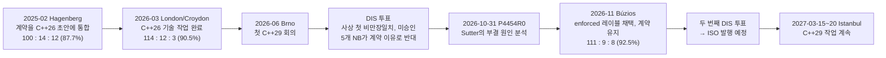
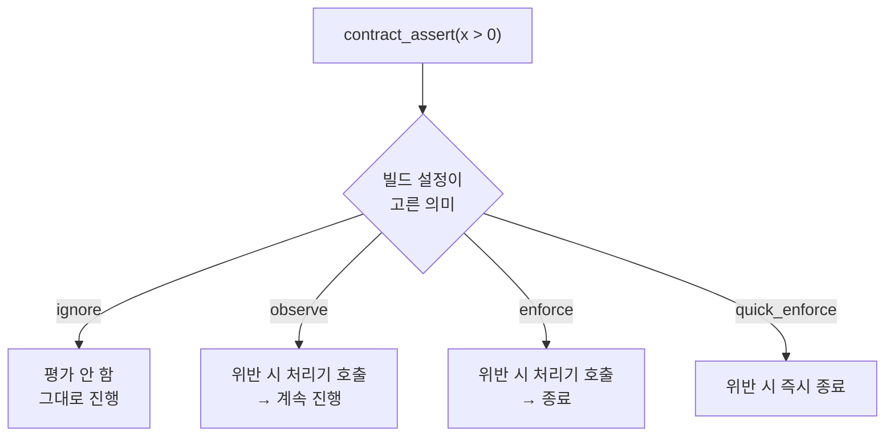
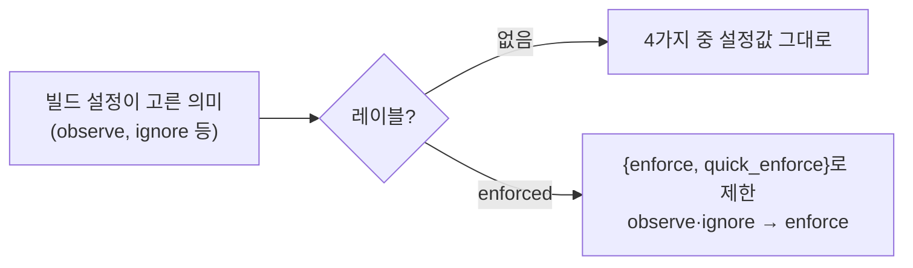
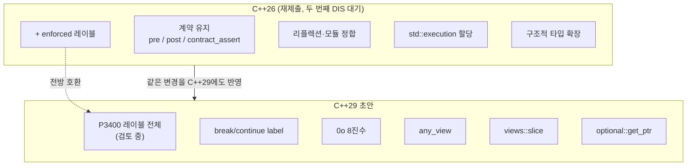

# C++26, 다시 완성… 첫 DIS 부결 뒤 계약은 남기고 `enforced` 레이블을 더했다

### ISO C++ 위원회가 2026년 11월 브라질 부지오스(Búzios) 회의에서 C++26 기술 작업을 두 번째로 끝냈다. 사상 처음 국가 기관 승인 투표(DIS)를 통과하지 못한 원인인 계약(contracts)은 빼지 않았다. 대신 "이 검사는 빌드 설정과 무관하게 반드시 멈춘다"를 소스에 적는 `pre<std::contracts::controls::enforced>`를 넣고, 재제출안을 찬성 111·반대 9(92.5%)로 통과시켰다. C++29 초안에는 `break label;`, `0o` 8진수, `any_view`, `views::slice`, `optional::get_ptr()`가 들어갔다


Herb Sutter는 2026년 11월 21일(태평양 시간) 자신의 블로그 Sutter's Mill에 [C++26 is done (again)! — Trip report: November 2026 ISO C++ standards meeting (Búzios, Brazil)](https://herbsutter.com/2026/11/21/c26-is-done-again-trip-report-november-2026-iso-c-standards-meeting-buzios-brazil/)을 올렸다. GeekNews([토픽 37770](https://news.hada.io/topic?id=37770))가 이를 요약했고, [Hacker News 토론](https://news.ycombinator.com/item?id=50600838)(149포인트, 221댓글)의 의견도 함께 정리했다.

이 글은 Sutter의 회의 보고서를 뼈대로 삼는다. 채택된 논문 원문([P4451R2](https://isocpp.org/files/papers/P4451R2.pdf), [P3400R5](https://www.open-std.org/jtc1/sc22/wg21/docs/papers/2026/p3400r5.pdf), [P3568R3](https://www.open-std.org/jtc1/sc22/wg21/docs/papers/2026/p3568r3.html), [P0085R4](https://www.open-std.org/jtc1/sc22/wg21/docs/papers/2026/p0085r4.html), [P3216R4](https://www.open-std.org/jtc1/sc22/wg21/docs/papers/2026/p3216r4.html), [P4189R0](https://www.open-std.org/jtc1/sc22/wg21/docs/papers/2026/p4189r0.html))과, DIS 부결 경위를 분석한 Sutter의 [P4454R0](https://isocpp.org/files/papers/P4454R0.pdf), 앞서 GeekNews에 올라온 [부결 소식(37092)](https://news.hada.io/topic?id=37092)으로 배경을 보충했다. 회의에서 채택된 개정판 가운데 [P0085R5](https://isocpp.org/files/papers/P0085R5.html)(2026-11-19), [P3568R4](https://isocpp.org/files/papers/P3568R4.html)(2026-11-20), [P3216R6](https://isocpp.org/files/papers/P3216R6.html)(2026-11-20), [P3411R7](https://isocpp.org/files/papers/P3411R7.html)(2026-11-18)은 isocpp.org에 올라와 있어 이를 기준으로 확인했다. 표준 라이브러리 하드닝과 계약의 관계는 [P3471R4](https://isocpp.org/files/papers/P3471R4.html)와 [P3878R1](https://www.open-std.org/jtc1/sc22/wg21/docs/papers/2025/p3878r1.html)로 보충했다. **P3861R1은 아직 공개되지 않아 R0를 기준으로 설명했다. 컴파일러로 직접 실행해 보지는 않았다. "재구성 예제"로 표시한 코드는 논문의 규칙을 따라 새로 쓴 것이다.**

## 0. 어디에 두는가

특정 언어 문법 하나의 입문서가 아니라 **언어 표준화 절차와 그 결과물(C++26 확정, C++29 초안)에 관한 소식**이다. PHP 8.6, Python 3.15, Zig vs C 글과 같은 층이므로 `docs/07_Tech_Trends`에 둔다.

| 항목 | 내용 |
|---|---|
| 회의 | ISO/IEC JTC1/SC22/WG21(C++ 위원회), 2026년 11월, 브라질 리우데자네이루주 부지오스, Zoom 병행 |
| 기간 | 6일(월~토). 보고서 게시일(11월 21일, 토)로 보면 11월 16~21일 (날짜는 추정) |
| 주최 | C++ Alliance (준비 총괄 Matheus Izvekov) |
| 참석 | 약 220명, 대면 35% / 원격 65%, 27개국 공식 대표, 새 게스트 13명(대부분 대면), 새 NB 대표도 참석 |
| 하위 그룹 | 활동 중인 하위 그룹 22개. 이번에는 NB 의견 처리에 집중해 평소보다 적게 열렸다 |
| 핵심 결정 | C++26 계약 유지 + `enforced` 레이블 추가, 재제출안 111 : 9 : 8 |
| C++26 추가 변경 | 논문 4편 + 편집 수정 (C++29 초안에도 똑같이 반영) |
| C++29 채택 | 핵심 언어 논문 5편, 표준 라이브러리 논문 7편 |
| 다음 일정 | 두 번째 DIS 투표 → 최종 편집 → ISO 발행. 다음 전체 회의는 2027년 3월 15~20일 튀르키예 이스탄불([N5057](https://isocpp.org/files/papers/N5057.pdf)), 그다음은 6월 14~19일 불가리아 소피아 |

원격 비율이 평소보다 높았던 이유도 보고서에 적혀 있다. 전문가들이 비행기를 타려던 시점에 **미국 항공 운항 중단(ground stop)** 이 겹쳤다.

## 1. 용어 먼저: WG21, NB, CD, DIS

C++ 표준은 한 회사가 아니라 ISO가 낸다. 처음 보는 사람이 헷갈리는 약어부터 정리한다.

| 용어 | 뜻 | 쉽게 말하면 |
|---|---|---|
| **WG21** | ISO 산하 C++ 작업 그룹. 전문가 수백 명이 논문(Pxxxx)으로 제안하고 투표한다 | 언어를 실제로 설계하는 개발팀 |
| **NB** (National Body) | 각국 표준화 기관(미국 INCITS, 영국 BSI, 독일 DIN 등) | 최종 결재권을 가진 주주들 |
| **CD** (Committee Draft) | 위원회 초안. NB 의견(comment)을 받는 단계 | 베타 릴리스 + 버그 리포트 접수 |
| **DIS** (Draft International Standard) | 국제 표준안. NB가 승인/반대/기권으로 투표 | 릴리스 후보(RC)에 대한 최종 승인 |
| **plenary** | WG21 전체 회의의 본회의 투표 | 메인 브랜치 머지 투표 |
| **P-member** | 투표 의무가 있는 정회원 국가 기관 | 의결권 있는 주주 |

DIS는 원래 **형식적인 단계**로 여겨졌다. 실질적 이견은 WG21 안에서 다 풀고, NB는 그 결과를 추인하는 구조다. P4454R0에 따르면 지금까지 C++ DIS 투표는 **언제나 만장일치**였다.

ISO의 DIS 승인 기준은 두 가지를 동시에 만족해야 한다(GeekNews 37092 요약 기준).

$$
\frac{\text{P-member 찬성}}{\text{P-member 찬성} + \text{P-member 반대}} \ge \frac{2}{3}
\quad\text{그리고}\quad
\frac{\text{전체 반대}}{\text{전체 투표(기권 제외)}} \le \frac{1}{4}
$$

37092와 [herecomesthemoon.net](https://herecomesthemoon.net/2026/11/cpp26-failed-the-national-bodies/)이 인용한 집계(출처는 Robert Seacord의 LinkedIn 글, **비공식, ISO 공식 결과로는 미검증**)는 P-member 찬성 12·반대 8, 전체 22개국 중 반대 9였다. 그렇다면 $12/20 = 60\% < 66.7\%$, $9/22 \approx 40.9\% > 25\%$로 두 기준을 모두 넘지 못한다. 기권은 12개국이었다는 댓글(J. Daniel García)도 있었다. 반대한 NB의 이름은 어느 쪽도 밝히지 않았다. 앞서 CD 단계 의견서(N5028, N5031)에서 계약에 강하게 반대한 나라로는 스웨덴, 스페인, 미국, 프랑스, 루마니아, 체코, 핀란드가 거론되지만, 이것이 DIS 반대표와 같다는 근거는 없다.

## 2. 경과: 3월 완성 → DIS 부결 → 11월 재완성



세 번의 본회의 투표에서 찬성 비율은 **기권을 뺀 찬반 기준**으로 계산한다.

| 투표 | 찬성 | 반대 | 기권 | 찬성 비율 |
|---|---:|---:|---:|---:|
| 2025-02 계약을 작업 초안에 통합 ("trunk에 머지") | 100 | 14 | 12 | $100/114 = 87.7\%$ |
| 2026-03 C++26 확정·제출 | 114 | 12 | 3 | $114/126 = 90.5\%$ |
| 2026-11 수정한 C++26 재제출 | 111 | 9 | 8 | $111/120 = 92.5\%$ |

WG21 안에서 계약 지지는 오히려 **조금씩 늘었다**. 그런데도 DIS가 떨어졌다. Sutter는 보고서에서 그 결과가 "거의 모두를 놀라게 했다"고 썼다.

### 2.1 왜 떨어졌나: P4454R0의 진단

Sutter는 부지오스 회의 직전에 [P4454R0 "When a language's creator and its steward body strongly disagree"](https://isocpp.org/files/papers/P4454R0.pdf)(2026-10-31)를 냈다. 회의 보고서가 "자세한 경위는 2.3절"이라고 가리키는 문서다. 요지는 다음과 같다.

- **새로운 점은 창시자의 반대다.** WG21이 생긴 지 36년 만에 처음으로 Bjarne Stroustrup이 위원회 합의에 맞서 DIS 승인 자체에 반대했다. 그는 C++26 계약이 새 보안 취약점을 만들고, 핵심 동작을 구현 정의로 남기며, 의미가 컴파일러 스위치에 좌우된다고 비판했다(P4334R0, P4454R0에 따르면 그의 개인 사이트 [stroustrup.com](https://www.stroustrup.com/)에 공개. 직접 확인하지는 못했다).
- **NB가 창시자 쪽에 무게를 뒀다.** 2.3절 제목이 "Fact 3: The NBs chose to give Bjarne's view more weight"다. Sutter가 아는 범위에서 DIS 반대를 조직적으로 로비한 사람은 약 5명(WG21 명부 약 600명의 1%)이었다. 반대표를 던진 NB의 절반 이상은 WG21에 참여한 적이 없거나 계약에 우려를 낸 적이 없었다. 로비가 NB 반대표를 **두 배 이상** 늘렸다는 것이 그의 계산이다.
- **로비만으로 설명되지는 않는다.** Sutter도 로비 없이 스스로 우려를 낸 NB들이 있었고, 그것이 C++ DIS 사상 **첫 반대표**였다고 인정한다.
- **양쪽 논문.** 부결 뒤 위원회 안에서도 "계약을 빼자"는 Vinnie Falco의 P4420 "Do Remove Contracts"와, 계약을 최소 기능(MVP)으로 C++26에 남기자는 P4433R0 같은 반대 방향 논문이 나왔다(herecomesthemoon.net 정리 기준, 원문은 확인하지 못함). 반대 측은 "명세가 부족하고 강제가 믿을 만하지 않다", 지지 측은 "10년 넘게 다듬은 최소 기능이며 이번 주기를 놓치면 3년이 밀린다"는 입장이다.
- **선택지.** 논문은 C++26을 발행하지 않고 C++29로 넘어가기(A), 계약을 빼고 재투표(B, Stroustrup이 가장 원한 안) 등 여러 경로를 비교했다. 실제로 택한 것은 **계약을 유지하되 NB 요청 일부를 확장으로 받아들이는 길**이었다.

P4454R0은 다른 언어의 선례도 표로 정리했다. 가장 가까운 사례로 C89의 `noalias`를 든다. 1988년 최종 검토 단계에서 Dennis Ritchie가 기능 하나를 빼라고 최후통첩을 했고, 위원회는 `noalias`를 뺐다. 10년 뒤 C99에 `restrict`가 들어갔다.

### 2.2 NB가 요구한 것

Sutter 보고서에 따르면 **5개 NB가 이번 DIS에서 처음으로 계약 우려를 내고 반대(Disapprove)** 했다(P4454R0 2.3절 인용). 회의 한 주의 대부분이 NB 의견 처리에 쓰였고, 의견은 대부분 계약에 관한 것이었다. 여러 의견이 **C++26에서 계약을 빼라**고 요구했다. 위원회는 다시 논의하고 재투표했지만 결론은 **유지**였다. 대신 여러 NB가 "가장 중요한 요청"이라고 말한 한 가지를 받아들였다. 소스 코드에 **"이 계약은 항상 강제된다"** 고 적을 수 있게 하라는 것이다. 위원회는 계약의 개발 과정, 반복 검토한 우려, 결정 경위를 NB에게 설명하는 상세한 근거 문서와 일정표도 따로 마련했다.

## 3. 배경 지식: C++26 계약(contracts)이란

**계약**은 함수가 지켜야 할 약속을 코드에 적는 기능이다.

- `pre(조건)`: **사전 조건**. 호출하는 쪽이 지켜야 할 조건이다.
- `post(r : 조건)`: **사후 조건**. 함수가 돌려주는 값 `r`이 지켜야 할 조건이다.
- `contract_assert(조건)`: 함수 본문 안의 **단언**이다. `assert` 매크로를 대체한다.

쉽게 말하면 "이 함수는 양수만 받는다", "이 함수는 항상 양수를 돌려준다"를 주석이 아니라 컴파일러가 읽는 문법으로 적는 것이다.

```cpp
// C++26 계약의 기본 형태 (재구성 예제)
int wrap_index(int i, int size)
    pre(size > 0)                         // 호출자 책임
    post(r : r >= 0 && r < size)          // 함수 책임
{
    int r = i % size;
    if (r < 0) r += size;
    contract_assert(r >= 0);              // 본문 안의 단언
    return r;
}
```

### 3.1 쟁점의 핵심: 평가 의미(evaluation semantics)

C++26 계약([P2900R14](https://wg21.link/p2900))은 각 단언을 **어떻게 평가할지**를 소스가 아니라 **구현(컴파일러·빌드 설정)** 에 맡긴다. [cppreference](https://en.cppreference.com/w/cpp/language/contracts.html)가 정리한 네 가지 의미는 다음과 같다.

| 의미 | 검사함 | 위반 시 종료 | 동작 |
|---|:-:|:-:|---|
| `ignore` | X | X | 조건을 평가하지 않는다 |
| `observe` | O | X | 위반 처리기(`handle_contract_violation`)를 부르고, 처리기가 돌아오면 **계속 실행** |
| `enforce` | O | O | 위반 처리기를 부르고, 돌아오면 프로그램을 끝낸다 |
| `quick_enforce` | O | O | 처리기 없이 바로 끝낸다 |



이 유연성이 장점이자 논쟁거리였다. 같은 헤더의 인라인 함수가 한 번역 단위(TU, 쉽게 말해 `.cpp` 파일 하나를 컴파일하는 단위)에서는 `enforce`로, 다른 TU에서는 `ignore`로 컴파일된 뒤 링크될 수 있다. 링커가 어느 복사본을 남기느냐에 따라 검사가 실행될 수도, 안 될 수도 있다. 반대 측의 요지는 **"라이브러리 작성자가 '이 검사는 꼭 돈다'를 보장할 방법이 없다"** 였다(GeekNews 37092 요약, HN의 ODR 관련 댓글).

Stroustrup의 비판도 이 지점에 모인다. 의미가 컴파일러 스위치에 달려 있으니 같은 소스가 빌드마다 다르게 동작하고, `observe`로 계속 진행하면 "위반한 뒤에도 실행되는" 경로가 생겨 오히려 새 취약점이 된다는 것이다. 지지 측은 이 유연성 덕분에 대형 코드베이스가 `observe`로 먼저 켜서 위반을 로그로 모은 뒤 `enforce`로 옮기는 **점진적 도입**이 가능하다고 본다.

### 3.2 표준 라이브러리 하드닝: 계약을 쉽게 뺄 수 없던 이유

C++26의 또 다른 안전 기능인 **표준 라이브러리 하드닝**([P3471R4](https://isocpp.org/files/papers/P3471R4.html), Konstantin Varlamov·Louis Dionne)은 계약 위에 세워져 있다. 쉽게 말하면 `v[i]`처럼 지금까지 "범위를 벗어나면 정의되지 않은 동작(UB)"이던 호출을, **하드닝된 구현**에서는 계약 위반으로 바꿔 잡아 주는 기능이다.

| 항목 | 내용 |
|---|---|
| 대상 | 시퀀스 컨테이너의 `operator[]`·`front()`·`back()`·`pop_front()`·`pop_back()`, `span`, `string`/`string_view`, `mdspan`·`bitset`·`valarray`의 `operator[]`, `optional`/`expected`의 `operator*`·`operator->` 등 |
| 켜는 방법 | 구현 정의 (예: `-fhardened`, libc++의 `_LIBCPP_HARDENING_MODE`) |
| 위반 시 | 하드닝된 구현에서는 계약 위반. `ignore`로 건너뛸 수 없다 |
| `observe` 문제 | 처리기가 돌아오면 UB라 하드닝 의미가 없어진다. [P3878R1](https://www.open-std.org/jtc1/sc22/wg21/docs/papers/2025/p3878r1.html)(Voutilainen·Wakely·Spicer·Lavavej)이 "하드닝은 종료형 의미만 쓰자"고 제안했다 |

계약을 빼면 하드닝도 다시 써야 한다는 점이 계약 유지 쪽의 현실적인 근거였다. 반대로 일부 NB는 "하드닝을 계약에서 떼어 달라"고 요청했다(herecomesthemoon.net). HN에서는 "계약은 메모리 안전성과 무관하다"는 댓글과 "하드닝된 구현이 바로 그 연결고리"라는 반박이 오갔다. Sutter의 이번 보고서는 하드닝을 따로 다루지 않았다.

### 3.3 C++26 전체 그림

이번 회의의 변경은 C++26의 일부를 다듬은 것이다. C++26 전체에서 큰 기능은 다음과 같다(이번 보고서가 아니라 이전 회의에서 채택된 것).

| 기능 | 논문 | 쉽게 말하면 |
|---|---|---|
| 정적 리플렉션 | [P2996](https://wg21.link/p2996) | `^^T`로 타입·멤버 정보를 컴파일 시점 값(`std::meta::info`)으로 얻어 코드 생성에 쓴다. 직렬화·바인딩 생성을 매크로 없이 |
| 계약 | [P2900](https://wg21.link/p2900) | `pre`/`post`/`contract_assert` |
| `std::execution` | [P2300](https://wg21.link/p2300) | senders/receivers 기반 비동기·병렬 실행 모델. 콜백 지옥 대신 조합 가능한 "작업 파이프라인" |
| 표준 라이브러리 하드닝 | [P3471](https://wg21.link/p3471) | 범위 밖 접근 등을 UB 대신 계약 위반으로 |
| 오류성 동작(erroneous behavior) | [P2795](https://wg21.link/p2795) | 초기화하지 않은 지역 변수 읽기를 UB가 아닌 "잘못이지만 정의된" 동작으로 |
| 그 밖 | - | `#embed`, 확장 문 `template for`, 팩 인덱싱, `= delete("이유")`, `std::inplace_vector`, `std::simd`, 선형 대수(`<linalg>`, BLAS 기반) 등 |

HN의 "BLAS를 표준 라이브러리에 넣는 목적이 뭐냐"는 댓글은 이 `<linalg>`를 두고 한 말로 보인다.

## 4. C++26 변경 ①: `enforced` 레이블 (P4451R2)

### 4.1 문법

Joshua Berne(Bloomberg)의 [P4451R2 "Early Adoption of an Always-Enforced Label"](https://isocpp.org/files/papers/P4451R2.pdf)이 채택됐다. 루마니아 NB의 [P3911R2 "Make Contracts Reliably Non-Ignorable"](https://isocpp.org/files/papers/P3911R2.html)과 취지가 같다. Sutter 보고서와 논문에 실린 예제는 다음과 같다.

```cpp
#include <contracts>

int f(int x)
    pre<std::contracts::controls::enforced>(x > 0)
    post<std::contracts::controls::enforced>(r : r > 0)
{
    contract_assert<std::contracts::controls::enforced>(x > 0);
    return x;
}

// 레이블은 일반 이름 탐색으로 찾으므로 별칭이나 using-지시문도 된다
namespace scc = std::contracts::controls;

int h(int x)
    pre<scc::enforced>(x > 0)
    post<scc::enforced>(r : r > 0)
{
    contract_assert<scc::enforced>(x > 0);
    return x;
}

using namespace std::contracts::controls;

int g(int x)
    pre<enforced>(x > 0)
    post<enforced>(r : r > 0)
{
    contract_assert<enforced>(x > 0);
    return x;
}
```

보장 내용은 한 문장이다. 이 단언을 위반하면 **프로그램의 다른 부분이 어떤 의미로 빌드됐든 실행이 그 단언을 넘어 계속되지 않는다.** 레이블을 쓰려면 `#include <contracts>`나 `import std;`가 필요하다.

### 4.2 동작 원리: 허용 의미 집합을 좁힌다

`enforced`는 새 의미를 만드는 것이 아니다. **허용되는 평가 의미의 집합을 종료형(terminating) 두 가지로 좁히는** 레이블이다. 논문은 같은 동작을 사용자 정의 레이블로 흉내 내는 코드를 보여 준다(P3400R5의 메커니즘).

```cpp
namespace mylib {
  struct enforced_t {
    using assertion_control_object = enforced_t;
    // 이 레이블이 붙은 단언이 가질 수 있는 의미
    static constexpr std::contracts::evaluation_semantic_set
      allowed_semantics = {std::contracts::evaluation_semantic::quick_enforce,
                           std::contracts::evaluation_semantic::enforce};
  };
  inline constexpr enforced_t enforced{};
}

void g(int* p) pre<mylib::enforced>(p != nullptr);
```

집합으로 쓰면 이렇다. 빌드 설정이 고른 기본 의미를 $s_{\text{cfg}}$, 레이블이 허용하는 집합을 $A$라 하면, 실제 의미는

$$
s = \begin{cases}
s_{\text{cfg}} & s_{\text{cfg}} \in A \\
\operatorname{adjust}(s_{\text{cfg}}) \in A & \text{그 밖}
\end{cases},
\qquad A_{\text{enforced}} = \{\texttt{enforce},\ \texttt{quick\_enforce}\}
$$

이다. 구현 경험 절에 따르면 빌드 설정이 `observe`나 `ignore`를 고르면 `enforce`로 바뀐다. 레이블 객체는 따로 만들지 않고 ABI도 그대로다.



GCC, Clang, EDG 브랜치에서 `-fcontracts-p4451` 플래그로 구현돼 Compiler Explorer에서 시험할 수 있다고 논문은 적었다. 아래처럼 레이블 있는 단언과 없는 단언을 섞으면, `observe`로 빌드했을 때 레이블 없는 것은 관찰만 하고 레이블 있는 것은 강제된다.

```cpp
int checked(int x)
    pre(x % 2 == 0)                                   // 설정을 따름 (observe면 계속 진행)
    pre<std::contracts::controls::enforced>(x > 0)    // 항상 종료형
    post(r : r < 100)
    post<std::contracts::controls::enforced>(r : r != 26)
{
    contract_assert(x < 10);
    contract_assert<std::contracts::controls::enforced>(x != 7);
    return 2 * x;
}
```

### 4.3 왜 `pre!`가 아니고 `pre<...>`인가

루마니아 안은 원래 `pre!(x > 1)`처럼 느낌표 접미사를 제안했다. P4451R2는 이를 받지 않은 이유를 길게 적었다.

- C++에서 `!`는 부정이다. `pre!(x)`와 `pre(!x)`는 글자 하나 자리만 다른데 둘 다 컴파일되고 뜻은 정반대다. GCC의 `-Wlogical-not-parentheses` 경고가 바로 이런 실수(`if (!a > 1)`)를 잡으려고 있다.
- `!`는 `not`으로도 쓸 수 있다. `pre not(x)`는 누구나 "x가 아님을 단언"으로 읽는다.
- 다른 언어의 `!` 접미사는 뜻이 제각각이다(TypeScript의 non-null 단언, Ruby의 변경 메서드, Rust의 매크로 호출 등).

`<...>` 자리는 C++29를 목표로 하는 [P3400R5 "Controlling Contract-Assertion Properties"](https://www.open-std.org/jtc1/sc22/wg21/docs/papers/2026/p3400r5.pdf)(Berne, 2026-10-23)의 **단언 제어 객체(assertion-control object)** 문법이다. P3400은 그룹 지정, 의미 제한·변경, 지역 위반 처리기 등을 레이블로 표현하고 `operator|`로 조합한다. `enforced`는 그 일부를 C++26에 **먼저** 들인 것이므로 전방 호환된다.

이름은 오래 흔들렸다. 개정 이력을 보면 원안 이름 후보는 `terminating`이었고(Debian Code Search에서 식별자 사용 477건 등 충돌 조사), `noncontinuing`, `always_terminating`도 거론됐다. **LEWG가 11월 19일 부지오스에서 `enforced`로 정했고**, R2에서 식별자를 `std::contracts::controls::enforced`로 바꿨다. R1에서는 특수 이름 탐색 지원을 뺐다.

### 4.4 남은 문제: ABI와 최적화

논문 스스로 꼽은 함정도 있다. 항상 강제되는 사전 조건은 호출하는 쪽 컴파일러에게 "이 호출 뒤에는 조건이 참"이라는 **가정**을 준다. 논문의 예를 요약하면 이렇다.

```cpp
void f(int x) pre<std::contracts::controls::enforced>(x > 0);  // 정의는 다른 TU

void g(int x) {
    f(x);               // x <= 0이면 여기서 종료돼야 한다
    if (x > 0) {        // 컴파일러가 "이 검사는 불필요"라고 지울 수 있다
        for (int i = 0; i != x; ++i) send_money_to_friends();
    }
}
```

나중에 `f`가 더 넓은 값을 받도록 바뀌어 사전 조건이 빠진 라이브러리로 **다시 링크**하면, `g`는 지워진 `if` 없이 루프에 들어간다. 이는 ODR(단일 정의 규칙) 위반이긴 하지만, ABI 호환성이란 바로 "어떤 ODR 위반이 안전한가"의 문제다. 논문은 C++26에서는 구현체가 이런 원격 단언 주변에 최적화 장벽을 두는 방식을 받아들이고, 표준 문구로 막는 방법은 P3400과 C++29에서 더 찾자고 권고했다. 호출 측 검사(caller-side checking)를 켜면 종료형 사전 조건이 **두 번** 평가될 수 있다는 비용도 적었다.

### 4.5 `if`와 무엇이 다른가

"그럼 `if (!(x >= 0)) std::abort();`와 뭐가 다르냐"는 질문에 논문은 **기능은 같고 의도가 다르다**고 답한다. 계약 위반은 **버그**라는 뜻이고, `if` + `abort`는 종료가 정상 사용 중에도 일어날 수 있는 **기능**이라는 뜻이다. HN에서도 "그냥 `pre(x > 0)`이면 충분했는데"라는 댓글에, "`pre(x > 0)`도 쓸 수 있다. 다만 설정 가능한 기본 동작을 따르고, 레이블 버전은 컴파일러 설정과 무관하게 검사를 강제한다"는 답이 달렸다.

## 5. C++26 변경 ②: 리플렉션·모듈·`std::execution`·구조적 타입

`enforced` 외에 C++26에 들어간 논문은 세 편이다. 모두 C++29 초안에도 똑같이 반영됐다. C++26과 C++29를 **갈라지지 않게(fork 없이)** 유지하기 위해서다.

| 논문 | 저자 | 대응한 NB 의견 | 내용 |
|---|---|---|---|
| [P4466R2](https://isocpp.org/files/papers/P4466R2.html) Selectively transparent using-declarators | Dan Katz, Tomasz Kamiński | 핀란드 FI-067 | 리플렉션이 모듈(특히 `import std;`)과 일관되게 동작하도록. C++29의 using 별칭 리플렉션 여지는 남김 |
| [P4453R1](https://isocpp.org/files/papers/P4453R1.html) Memory allocation with senders/receivers | Dietmar Kühl, Lucian Radu Teodorescu | 아일랜드 IE-133 | `std::execution`(senders/receivers 비동기 모델)의 메모리 할당을 더 유연하게 제어 |
| [P3861R1](https://isocpp.org/files/papers/P3861R0.pdf) Pragmatic approach to standard structural types | Corentin Jabot | - | `string_view`, `span`, `tuple`을 **템플릿 매개변수로** 더 쓸 수 있게 |

용어 몇 가지를 풀어 둔다.

- **리플렉션(reflection)**: 프로그램이 자기 구조(타입, 멤버, 열거자)를 컴파일 시점에 들여다보는 기능이다. C++26의 대표 기능이다. 쉽게 말하면 "구조체의 필드 이름을 코드로 순회해 JSON 직렬화기를 자동으로 만드는" 일을 매크로 없이 할 수 있다.
- **구조적 타입(structural type)**: 템플릿의 **값 매개변수**(non-type template parameter)로 쓸 수 있는 타입이다. C++20에서 조건이 넓어졌지만, 표준 라이브러리의 `string_view` 등은 내부 구현 때문에 해당하지 않았다. P3861이 이를 실용적으로 열어 주면서 **컴파일 시점에 만들고 실행 시점에도 쓰는 타입 안전 문자열**이 가능해진다. Sutter는 이 논문이 "리플렉션을 더 쓸모 있게 만든다"고 했다.

```cpp
// 재구성 예제: P3861 이후 string_view를 템플릿 인수로 쓰는 모습 (최종 문구 미확인)
template <std::string_view Name>
struct field_tag {
    static constexpr std::string_view name = Name;
};

using user_id = field_tag<"user_id">;   // 문자열 리터럴 → string_view NTTP (가정)
static_assert(user_id::name == "user_id");
```

참고로 Sutter 보고서의 P3861R1 링크는 실제로 R0 PDF를 가리킨다.

## 6. C++29 핵심 언어: `break label;`과 `0o`

C++29 핵심 언어에는 이슈 수정과 함께 논문 5편이 채택됐다. 보고서가 소개한 것은 두 편이다. Sutter는 "C++29 채택"이 2029년까지 기다려야 한다는 뜻은 아니라고 강조했다. 일부는 이미 주요 구현체가 지원한다.

### 6.1 레이블 지정 `break` / `continue` (P3568R4, Jan Schultke)

중첩 루프에서 **바깥 루프**를 빠져나가거나 다음 반복으로 넘어가는 문법이다. 지금까지 C++에서는 `goto`, 불리언 플래그, 즉시 호출 람다로 흉내 냈다.

```cpp
// 이전: 플래그
bool found = false;
for (auto& row : grid) {
    for (auto& cell : row) {
        if (cell == target) { found = true; break; }
    }
    if (found) break;
}

// C++29 초안
search: for (auto& row : grid) {
    for (auto& cell : row) {
        if (cell == target) break search;
    }
}
```

Sutter가 "표준 문구의 예제를 약간 고친 것"이라며 실은 규칙 예제가 흥미롭다. 아래는 채택된 P3568R4 문구의 예제 그대로다.

```cpp
y: a: b: while (/* ... */) {
  a: a: c: for (/* ... */) {
    break;          // OK, 감싸는 for 종료
    break a;        // OK, 같음 (안쪽의 a가 우선)
    break b;        // OK, 감싸는 while 종료
    y: { break y; } // 오류: 블록은 break 대상이 될 수 없는 문장
  }
  break c;          // 오류: c는 지금 문장을 감싸지 않음
}
break;              // 오류: 감싸는 루프나 switch가 없음
```

P3568R4(2026-11-20)에서 확인한 세부 규칙은 다음과 같다. R3 이후 `a: a: f(); goto a;`가 잘못된 코드임을 명시하고, 확장 문 안에서 `label: while ...`을 쓰지 못하게 막던 문구 버그를 고쳤다.

| 규칙 | 설명 |
|---|---|
| 한 문장에 레이블 여러 개 | `x: y: while (...)` |
| 같은 이름 레이블 중복 허용 | `goto`로 중복 레이블에 가는 것만 오류. `break a`는 **가장 안쪽** 일치 대상 |
| 대상 | `break`: 감싸는 루프·확장 문·`switch`. `continue`: 루프·확장 문. `case`/`default` 레이블은 해당 없음 |
| `constexpr` | `goto`와 달리 상수 평가 안에서도 쓸 수 있음 |
| `template for`(확장 문) | 그냥 `break`는 확장 자체에 적용, `break label`로 바깥 루프 탈출 |
| C 호환 | C2y에 채택된 N3355(named loops)와 같은 문법 |
| 구현 경험 | Clang이 C++ 모드에서 `-Xclang -fnamed-loops`로 N3355 구현, GCC는 C용 구현 |
| 기능 테스트 매크로 | `__cpp_break_label` = `202611L` (R4 문구) |

HN에서는 "D보다 거의 30년 늦었다"([D 문서](https://dlang.org/spec/statement.html#continue-statement)), "이름만 바꾼 `goto` 아니냐"는 반응이 나왔다. `goto`와의 차이는 **목적지가 반드시 자신을 감싸는 루프나 `switch`** 라는 점이다. 임의의 위치로 뛸 수 없으므로 초기화를 건너뛰는 문제가 생기지 않는다.

### 6.2 `0o` 8진수 접두사 (P0085R5, CERN의 Jolly Chen·Axel Naumann·Michael Jonker)

Sutter가 "이번 회의에서 가장 끈기 있는 논문"이라고 부른 제안이다. 첫 판이 **2015년**에 나왔다.

```cpp
int twelve_a = 12;
int twelve_b = 014;     // 8진수 (C++29에서 사용 중단 예정)
int twelve_c = 0o14;    // 새 8진수 접두사
int twelve_d = 0XC;
int twelve_e = 0b1100;

int zero = 0;           // OK, 0 자체는 예외
int more  = 000;        // 사용 중단 예정
int perm  = 0o755;      // POSIX 권한도 이렇게
```

왜 필요한지는 논문의 함정 예제가 보여 준다. 자릿수를 맞추려고 앞에 0을 붙이면 조용히 8진수가 된다.

```cpp
std::array<std::array<int, 2>, 2> table = {{
  { 100, 042 },   // 42가 아니라 34
  { 107, 000 }
}};
```

$042_8 = 4 \times 8 + 2 = 34_{10}$이다. 사람 눈에는 42로 보인다.

| 언어 | 8진수 표기 |
|---|---|
| Python 3, Rust, Haskell, OCaml, Ruby, PHP 8.1+, ECMAScript 6+ | `0o` 지원 (논문 인용) |
| C2y | 접두사 없는 0이 아닌 8진수를 obsolescent로 (N3353) |
| C++29 초안 | `0o`/`0O` 추가, `0` 접두사 8진수 사용 중단 예정 |

채택된 R5(2026-11-19)는 부록 D에 새 절 [depr.oct]를 두고 "`0`으로 시작하는 접두사 없는 8진수 리터럴 중 `0` 자체가 아닌 것"을 사용 중단 예정으로 정했다. `01`~`07`처럼 10진수와 값이 같은 경우도 사용 중단 대상이지만 구현체가 진단하지 않아도 된다. 나중에 `1970y/January/01d` 같은 날짜 표기에서 `01`~`09`를 10진수로 읽는 제안의 여지를 남기려는 것이다. `std::format`·`ostream` 출력은 바뀌지 않는다. 기능 테스트 매크로는 `__cpp_0o_octals`(값은 편집자가 확정)다. HN에서는 "널리 쓰이는 저장소에 대규모 정리 작업이 생긴다", "C++29 전후 모두 경고 없이 컴파일하려면 8진수를 아예 피하거나 `__cplusplus`로 분기해야 한다"는 우려와 "20년간 Unix 파일 권한 말고는 본 적이 없다"는 반응이 함께 나왔다.

## 7. C++29 표준 라이브러리: `any_view`, `views::slice`, `get_ptr()`

라이브러리에는 이슈 수정과 함께 논문 7편이 채택됐다. 보고서가 소개한 것은 세 편이다.

### 7.1 `std::ranges::any_view` (P3411R7)

Hui Xie, Louis Dionne, S. Levent Yilmaz, Patrick Roberts의 제안이다. **타입 소거(type erasure)** 된 뷰다. 쉽게 말하면 `std::function`이 "호출할 수 있는 무엇이든"을 한 타입으로 감싸듯, `any_view`는 "`Widget`을 차례로 내놓는 범위라면 무엇이든"을 한 타입으로 감싼다. 순회 범주(입력·순방향·양방향 등), 값 타입 등을 지정할 수 있다.

```cpp
class MyClass {
    std::unordered_map<Key, Widget> widgets_;
public:
    std::ranges::any_view<Widget> getWidgets();   // 헤더에 구현 타입이 드러나지 않는다
};

std::ranges::any_view<Widget> MyClass::getWidgets() {
    return widgets_ | std::views::values
                    | std::views::filter(myFilter);
}
```

R7(2026-11-18) 문구의 선언은 다음과 같다. 헤더는 `<ranges>`, 기능 테스트 매크로는 `__cpp_lib_any_view`다.

```cpp
namespace std::ranges {
  template <class Element,
            any_view_options Opts = any_view_options::input,   // 비트마스크 enum
            class Ref = Element&,
            class RValueRef = /* Ref가 lvalue 참조면 remove_reference_t<Ref>&& */,
            class Diff = /* IOTA-DIFF-T(ptrdiff_t) */>
  class any_view;
}

// 양방향 + 크기 있는 뷰로 요구 사항을 올리기
using MyView = std::ranges::any_view<Widget,
    std::ranges::any_view_options::bidirectional |
    std::ranges::any_view_options::sized>;
```

`views::filter(...)`의 실제 타입은 길고 람다 타입까지 포함해 헤더에 적을 수 없다. 지금까지는 `auto` 반환으로 구현을 헤더에 노출하거나 `std::vector`로 복사해야 했다. 대가로 원소마다 간접 호출 비용이 든다.

### 7.2 `views::slice` (P3216R6, Hewill Kang)

시작·끝 인덱스로 연속 부분 범위를 꺼내는 어댑터다. **매개변수를 두 개 받는 첫 어댑터**다. 채택된 R6(2026-11-20) 문구의 정의는 다음과 같다. $D$는 `range_difference_t<decltype((E))>`이고, $F$는 한 번만 평가된다.

$$
\texttt{views::slice}(E, F, G) \equiv E \;|\; \texttt{views::drop}(F) \;|\; \texttt{views::take}\big(D(G) - D(F)\big)
$$

구간은 반열린 구간 $[F, G)$이다. 시작이 범위 크기보다 크면 빈 범위, 끝이 넘치면 $\min(G, \text{size})$까지로 잘라 낸다(clamp). `F`나 `G`가 $D$로 변환되지 않으면 컴파일 오류다. 기능 테스트 매크로는 `__cpp_lib_ranges_slice`이고 freestanding에서도 쓸 수 있다.

```cpp
using namespace std::views;
auto s = std::string_view{"Hello, world!"} | slice(7, 12);   // "world"
auto a = std::vector{1, 2, 3, 4, 5} | slice(1, 10);          // [2, 3, 4, 5]  끝이 넘쳐도 OK
auto e = std::vector{1, 2, 3, 4, 5} | slice(2, 2);           // []  시작 == 끝
auto b = std::vector{1, 2, 3, 4, 5} | slice(5, 10);          // []
auto c = iota(0) | slice(50, 60);                            // 50..59
auto d = iota(0) | slice(0, 20) | stride(5);                 // 간격은 stride로: 0,5,10,15
```

| 언어 | 문법 | 범위 초과 |
|---|---|---|
| Python | `a[s:e:step]` | 잘라 냄 |
| Rust | `&a[s..e]` | panic |
| Go | `a[s:e]` | panic |
| JavaScript | `a.slice(s, e)` | 잘라 냄 |
| C++29 `views::slice` | `r \| slice(s, e)` | 잘라 냄 (range-v3의 `slice`는 UB) |

### 7.3 `std::optional::get_ptr()` (P4189R0, Nevin Liber)

값이 있으면 그 주소를, 없으면 `nullptr`을 돌려준다. Boost.Optional에 같은 이름이 있다.

```cpp
// 논문 시그니처
constexpr T*       get_ptr() noexcept;         // optional<T>
constexpr const T* get_ptr() const noexcept;   // optional<T>
constexpr T*       get_ptr() const noexcept;   // optional<T&>
// 효과: has_value() ? std::addressof(val) : nullptr
```

```cpp
// 재구성 예제
std::optional<Config> cfg = load();
legacy_c_api_init(cfg.get_ptr());       // C API는 "없음"을 NULL로 받는다

// 이전 방식 (optional<T&>일 때)
T* p = ref_opt.transform([](T& t) { return std::addressof(t); }).value_or(nullptr);
```

동기 중 하나는 `inplace_vector::try_*_back()`의 반환 타입이 `T*`에서 `optional<T&>`로 바뀌면서 포인터로 되돌릴 쉬운 방법이 없어졌다는 점이다. `.get()`이라는 이름은 포인터를 **소유**하는 타입처럼 읽혀 택하지 않았다.

## 8. 한눈에 보기

| 표준 | 분류 | 기능 | 논문 | 한 줄 |
|---|---|---|---|---|
| C++26 | 계약 | `enforced` 레이블 | P4451R2 | 빌드 설정과 무관하게 위반 시 멈추는 계약 |
| C++26 | 리플렉션·모듈 | 선택적 투명 using 선언 | P4466R2 | `import std`와 리플렉션의 일관성 (FI-067) |
| C++26 | 비동기 | senders/receivers 메모리 할당 | P4453R1 | `std::execution` 할당 제어 (IE-133) |
| C++26 | 템플릿 | 표준 구조적 타입 | P3861R1 | `string_view`·`span`·`tuple`을 템플릿 인수로 |
| C++29 | 언어 | `break label;` / `continue label;` | P3568R4 | 중첩 루프 탈출, C2y와 같은 문법 |
| C++29 | 언어 | `0o` 8진수 | P0085R5 | `0` 접두사 8진수 사용 중단 예정 |
| C++29 | 라이브러리 | `std::ranges::any_view` | P3411R7 | 타입 소거 뷰 |
| C++29 | 라이브러리 | `views::slice` | P3216R6 | `[start, end)` 부분 범위, 범위 초과는 잘라 냄 |
| C++29 | 라이브러리 | `optional::get_ptr()` | P4189R0 | 값 주소 또는 `nullptr` |



## 9. 커뮤니티 반응 (Hacker News, GeekNews 정리)

- **우선순위 비판.** 가장 위의 댓글은 "계약 자체에는 입장이 없지만, Rust에 뒤처지는 패키징과 메모리 안전성 대신 제한적인 기능에 집중한다"였다. DIS 부결은 우선순위를 다시 볼 기회였는데 그 메시지를 놓쳤다는 것이다.
- **C++은 C++다워야 한다.** 반론으로 "상대가 가장 잘하는 경기에서 이기려 하지 말라. 메모리 안전성은 Rust의 홈그라운드다"라는 의견이 나왔다. C++의 강점은 거대한 설치 기반과 성숙한 생태계라는 것이다. uutils가 한때 CVE 140개를 안고 출시됐다는 주장도 근거로 나왔다(**미검증**).
- **패키징은 언어의 일이 아니다.** 패키징은 생태계의 관심사이며 Conan, vcpkg 등이 이미 있다는 의견, Rust는 재단이 언어·패키지 관리자·빌드 시스템·저장소를 함께 관리하는 생태계라 비교가 다르다는 의견이 있었다. Common Package Specification과 이를 처음 안정판에서 지원한 CMake 4.5가 언급됐다. 위원회 안에도 패키징 표준화 작업이 있었지만 우선순위가 바뀌면서 저자가 위원회 밖으로 옮겼다는 정정 댓글, 대형 모노레포는 결국 Bazel이나 Buck2가 필요하다는 의견도 있었다.
- **계약에 대한 엇갈린 평가.** "필요한 사람은 쓰고 나머지는 무시하면 된다"는 쪽과 "C++26이 아니라 C++29 초안에 남겼어야 한다. 심각한 우려를 표결 숫자로 덮었다"는 쪽이 갈렸다. 한 댓글은 반대로 "WG21 절차는 망가졌지만 계약은 오히려 그 역기능에 시달리지 않은 기능이다. 10년 넘게 걸려 거의 모두가 만족하는 합의에 이르렀는데 목소리 큰 소수가 절차를 좌초시키려 한다"고 봤다. 두 번째 DIS도 다시 부결될 것 같다는 비관도 있었다.
- **계약과 메모리 안전성.** "계약은 미화된 `assert`일 뿐 메모리 안전성에 별 도움이 안 된다"는 비판에, "빌드 플래그와 무관하게 라이브러리가 검사를 강제할 수 있으면 안전성에 도움이 된다"는 반론이 붙었다. 하드닝 검사는 일부러 일반 계약 단언과 다르게 다뤄져 `ignore`에서도 남는다는 설명도 나왔다(3.2절).
- **ODR 우려.** 계약은 헤더에 들어가므로 서로 다른 TU가 같은 함수를 다른 계약 모드로 컴파일할 수 있다는 설명, 이미 `-fno-contracts`로 검사를 끌 수 있었으니 이번 변경은 실질보다 ISO 통과용이라는 평가도 나왔다.
- **표준 라이브러리 구현 부담.** 제안자가 수천 줄의 인라인 어셈블리로 자기 구현이 뛰어나다고 설명해도, 표준에 들어가는 것은 그 구현이 아니라 명세다. 각 표준 라이브러리 관리자가 다시 구현해야 하고, 쏟아지는 기능에 지친 이들은 최소 구현에 그칠 수 있다는 지적이다. BLAS를 표준 라이브러리에 넣는 목적을 묻는 댓글도 있었다.
- **"이 위원회가 Rust의 존재 이유."** C++14 무렵 Rust를 배우기 시작한 이유가 위원회였다는 댓글, 한동안 새 버전을 쉬어 가자는 제안도 있었다.
- **참고 자료.** 정적 분석으로 C++ 계약을 검증해 버그를 일찍 잡는 사례([HN 50379283](https://news.ycombinator.com/item?id=50379283))가 계약의 실제 효용을 보여 주는 글로 소개됐다.

## 10. 정리: "기능 논쟁"이 "거버넌스 논쟁"이 된 회의

이번 회의의 결론은 세 가지로 요약된다.

1. **계약은 C++26에 남는다.** WG21 내부 지지는 87.7% → 90.5% → 92.5%로 오히려 올랐다. 위원회는 "빼라"는 NB 의견을 받지 않았다.
2. **대신 가장 구체적인 요구 하나를 받았다.** `enforced` 레이블은 "라이브러리 작성자가 검사 실행을 보장할 수 없다"는 비판에 대한 직접적인 답이다. 다만 새 문법이 아니라 C++29용 P3400의 일부를 앞당긴 것이고, 교차 TU 최적화와 ABI 문제는 C++29로 미뤘다.
3. **진짜 시험대는 두 번째 DIS다.** P4454R0의 진단대로라면 결과는 기술보다 **창시자와 NB의 판단**에 달려 있다. 이번 수정이 반대 NB들을 설득할지는 아직 알 수 없다.

그 사이 C++29는 조용히 실용적인 기능을 쌓고 있다. 레이블 지정 `break`, `0o`, `views::slice`, `optional::get_ptr()`은 모두 다른 언어나 Boost에 오래 있던 것이다. 다음 전체 회의는 2027년 3월 15~20일 이스탄불이다.

## 참고

- Herb Sutter, [C++26 is done (again)! — Trip report: November 2026 ISO C++ standards meeting (Búzios, Brazil)](https://herbsutter.com/2026/11/21/c26-is-done-again-trip-report-november-2026-iso-c-standards-meeting-buzios-brazil/) (2026-11-21), 이전 보고서: [2026년 3월 London/Croydon](https://herbsutter.com/2026/03/29/c26-is-done-trip-report-march-2026-iso-c-standards-meeting-london-croydon-uk/), [2026년 6월 Brno](https://herbsutter.com/2026/06/13/brno-trip-report/)
- GeekNews, [C++26이 다시 완성됐다: ISO C++ 표준 회의 보고 (37770)](https://news.hada.io/topic?id=37770), [Hacker News 토론](https://news.ycombinator.com/item?id=50600838)
- GeekNews 관련 글: [C++ 표준안, 사상 처음으로 국가 표준화 기구 승인 투표 통과 실패 (37092)](https://news.hada.io/topic?id=37092), [C++26 표준안 부결 이후, Contracts 논쟁과 남은 선택지 (36576)](https://news.hada.io/topic?id=36576), [언어 창시자와 운영 주체가 강하게 대립할 때 (36875)](https://news.hada.io/topic?id=36875), [C++26 완성! (28018)](https://news.hada.io/topic?id=28018), [C++20 표준안 승인 (2815)](https://news.hada.io/topic?id=2815)
- 부결 분석: Herb Sutter, [P4454R0 When a language's creator and its steward body strongly disagree](https://isocpp.org/files/papers/P4454R0.pdf) (2026-10-31), [herecomesthemoon.net — C++26 failed the national bodies](https://herecomesthemoon.net/2026/11/cpp26-failed-the-national-bodies/)
- 계약: [P4451R2 Early Adoption of an Always-Enforced Label](https://isocpp.org/files/papers/P4451R2.pdf), [P3911R2 Make Contracts Reliably Non-Ignorable](https://isocpp.org/files/papers/P3911R2.html), [P3400R5 Controlling Contract-Assertion Properties](https://www.open-std.org/jtc1/sc22/wg21/docs/papers/2026/p3400r5.pdf), [P2900 Contracts for C++](https://wg21.link/p2900), [cppreference: Contract assertions](https://en.cppreference.com/w/cpp/language/contracts.html)
- C++26 기타: [P4466R2](https://isocpp.org/files/papers/P4466R2.html), [P4453R1](https://isocpp.org/files/papers/P4453R1.html), [P3861 (R0 PDF)](https://isocpp.org/files/papers/P3861R0.pdf)
- C++26 배경: [P2996 리플렉션](https://wg21.link/p2996), [P2300 `std::execution`](https://wg21.link/p2300), [P3471R4 표준 라이브러리 하드닝](https://isocpp.org/files/papers/P3471R4.html), [P3878R1 하드닝은 observe를 쓰지 말 것](https://www.open-std.org/jtc1/sc22/wg21/docs/papers/2025/p3878r1.html), [P2795 오류성 동작](https://wg21.link/p2795)
- C++29: [P0085R5 `0o`](https://isocpp.org/files/papers/P0085R5.html) ([R4](https://www.open-std.org/jtc1/sc22/wg21/docs/papers/2026/p0085r4.html)), [P3568R4 `break label;`](https://isocpp.org/files/papers/P3568R4.html) ([R3](https://www.open-std.org/jtc1/sc22/wg21/docs/papers/2026/p3568r3.html)), [P3411R7 `any_view`](https://isocpp.org/files/papers/P3411R7.html), [P3216R6 `views::slice`](https://isocpp.org/files/papers/P3216R6.html) ([R4](https://www.open-std.org/jtc1/sc22/wg21/docs/papers/2026/p3216r4.html)), [P4189 `optional::get_ptr`](http://wg21.link/p4189) ([R0](https://www.open-std.org/jtc1/sc22/wg21/docs/papers/2026/p4189r0.html))
- 다음 회의: [N5057 (Istanbul)](https://isocpp.org/files/papers/N5057.pdf), [isocpp.org 예정 회의 목록](https://isocpp.org/std/meetings-and-participation/upcoming-meetings), [ISO C++ 위원회](https://isocpp.org/std/the-committee)
- 같은 섹션: [PHP 8.6 출시](261121_2226_PHP_8.6_Partial_Application_Duration_Polling_API.md), [시스템 프로그래밍에서 C보다 Zig를 선택하는 이유](261118_0133_Why_Zig_Over_C_for_Systems_Programming.md)
